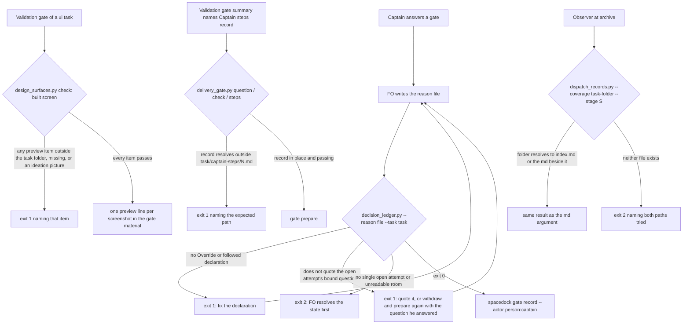

## Scope

- Source: iamcxa/kc-claude-plugins issue #815 (filed 2026-11-09 by the subspace-relay dev2 FO at the Captain's 「同意跑審查，且也同意回報問題」), forwarded to this FO by Paseo 1671c3a9 relaying the Captain's 「這個直接發給 dev2 fo」 (relayed, not a ruling here). The backlog gate is the Captain's.
- Bite (relay observers on four archived subspace-relay tasks, 2026-11-09, not re-run here): (1) `gate record` accepts a reason that does not quote the bound question, although `quotes_bound_question` in `kc-dev-flow-2/scripts/decision_ledger.py` exists (11 of 12 relay gates); (4) the built-screen check in `kc-dev-flow-2/scripts/design_surfaces.py` accepts exactly one `preview:` path while design review and validation need several; (5) `kc-dev-flow-2/scripts/dispatch_records.py --coverage` errors on an archived task directory; (6) the README's Captain steps say `<task>/captain-steps/<N>.md` while `kc-dev-flow-2/scripts/delivery_gate.py` accepts any path named on the summary's `Captain steps:` line (FO read 2026-11-09: the script names no `captain-steps` path).
- Not in this task: issue item 2 belongs to task archive-waits-for-observer-report; item 3 belongs to batch 18 task delivery-check-before-ask-is-provable (PR #817).
- Non-goals: changing Spacedock's own `gate record` (upstream, not ours); item (1) may only be held by a dev2 check FO already runs.

## Budget
- One package PR, or a split the ideation names; workflow word budget unchanged unless the design names a raise for the Captain.

## Stop condition
- Each of items 1, 4, 5 and 6 is either fixed with a falsifier or declined with its reason in the design, and issue #815 is answered.

## FO alignment

Alignment: not needed; adopter-reported gaps with recorded bites.
Surfaces: none
Visible change: none
Release review: not needed: workflow maintenance, on no journey map.

## Design

Source pin: iamcxa/kc-claude-plugins origin/main `6a495cb8c` (fetched 2026-11-10), kc-dev-flow-2 0.37.0 per `kc-dev-flow-2/.claude-plugin/plugin.json`. Every file and symbol below is read there.

### PRFAQ

**kc-dev-flow-2 now refuses four FO records at the moment FO writes them, instead of letting an observer find them after archive.** Before FO records a Captain gate answer, the reason check it already runs also confirms the reason quotes the question the Captain was bound to. The built-screen check accepts the several screenshots a design review actually covers. The dispatch coverage check accepts a task folder, as every other mode of the same script does. The validation gate holds a Captain steps record kept anywhere other than the place the README and ADR 0054 name.

- **Who uses it:** the First Officer of every dev2 adopter (kc-claude-plugins dev2, subspace-relay, qnow), at gate record, at the validation gate, and the observer at archive.
- **Why now:** relay's observers on four archived tasks found all four gaps on 2026-11-09 (issue #815). Re-measured here: of relay's 12 Captain gate resolutions on those tasks, 1 quotes its bound question (`decision_ledger.ledger` + `quotes_bound_question` with the installed 0.37.0 scripts on the relay dev2 state worktree at `3a2040f9`, 2026-11-10); in this workflow 51 of 59 Captain resolutions since 2026-11-06 do (same command, state `b15df8374`).
- **FAQ — does item 1 reopen ADR 0062?** In part; see D1. ADR 0062 chose report-only for backlog and ideation mismatches and refused "a dispatch hold without a supported repair route for consumed approvals". This check holds nothing that was already written: it runs before `gate record`, so the repair is to fix the reason file, or to withdraw and re-prepare when the Captain answered a different question. Dispatch is never held.
- **FAQ — why is item 6 not a Captain decision?** ADR 0054 already ruled where the record lives: `Precedent: ADR 0054 — 「可以」` ("writes Asked, Ran, Observed and any Only he can reason in captain-steps/N.md"). The README agrees; the script never held it. Day one: ADR 0054 and the README sentence landed together; the script's free path was the unspecified side.
- **FAQ — does anything change for archived tasks?** No. Every check here runs at a live FO moment; archived records are read, never re-judged, except that `--coverage` now works on their folders.
- **Acceptance evidence plan:** unit and CLI tests per item with a named falsifier each (AC-1 to AC-10), two replays on real adopter state (AC-3, AC-7, AC-9), lint-skills with the word-budget step (AC-4), ADR lint (AC-5).

### Chain check (Spacedock, then kc-dev-flow-2, then siblings)

- **Spacedock 0.27.2:** `spacedock gate record --help` takes `--reason TEXT` and validates nothing in it; changing it is a non-goal (upstream). `gate withdraw <entity> --reason` and a fresh `gate prepare` are the supported route when the question must change.
- **kc-dev-flow-2:** `decision_ledger.py --reason <file>` (`check_reason`) is the pre-record check README § Captain rulings already makes FO run before `gate record --actor person:captain`; `quotes_bound_question` and `question()` (room `index.json` `question`) already exist. `dispatch_records.py` already resolves a folder to `<folder>/index.md` or `<folder>.md` in four places (folder mode, `check_context`, `check_task_facts`, `check_validation_rulings`); only `check_coverage` does not. `delivery_gate.captain_step_problems` and `steps` exist and read any path.
- **Siblings (read-only, 2026-11-10):** Captain steps records named on `Captain steps:` lines: this workflow and qnow (`62423c60`) use `<task>/captain-steps/<N>.md`; relay (`0a8f92fe`) uses `<task>/review/captain-steps.md` (5 tasks, all archived) and twice a validation log. Relay's `theme-switch-keeps-draft/design/validation-1.yaml` keeps 14 reviewed pictures in a comment because `preview:` takes one.

### Flow

### Item 1 — a gate reason that does not quote the bound question (fix, subject to D1)

- `decision_ledger.py --reason <file> --task <task file or folder>`. `--task` becomes required with `--reason` (exit 2 usage line without it), so the README form is the only form.
- A new reader walks the task's `gates:` block (the same line walk as `gate_entries`, whose output and the ledger JSON stay unchanged) and collects attempts that have a briefing `room-ref` and neither `resolution:` nor `withdrawal:`. Exactly one such attempt is required; zero, two or more, or an unreadable `<room>/index.json` exits 2 naming the task and the room path.
- After the existing declaration check passes, the reason must satisfy `quotes_bound_question({"question": <that question>, "reason": <file text>})`. On a miss: exit 1, `reason: does not quote the bound question`, then `next: write answering 「<question>」 with the bound question copied from <room>/index.json; if he answered a different question, gate withdraw and prepare again with the question he answered, then ask him.` The pass lines (`reason: followed`, `reason: override (area: …)`) are unchanged.
- README § Captain rulings: `--reason <file>` becomes `--reason <file> --task <task>` (+2 words, 5931 to 5933; `lint-skills.py` `WORKFLOW_BUDGET_STEPS` gains a +2 raise step carrying the Captain's quoted D1 words, `loaded`: "startup and resume of the First Officer, and before each Captain gate record").
- ADR (FO reserves the number at implementation dispatch): `<reserved>-a-captain-gate-record-quotes-its-bound-question-before-it-is-written.md`, recording D1's words; it replaces ADR 0062 D2's report-only treatment for Captain records only. ADR 0062's merge-grant rule (`ASK_UNQUOTED`) and the observer's after-archive check stay.
- Existing-code check: reuses `check_reason`, `question()`, `split_task`, `quotes_bound_question`; adds one reader. `laws_check.py` imports the module for `split_task`/`unquote` only, unaffected.
- Not covered: FO-delegated records (`--actor agent:first-officer`) do not run `--reason` today and stay out; FO can still skip the check, as with today's declaration check.

### Item 4 — several `preview:` paths in the built-screen check (fix)

- In a built-screen (`design/validation-<N>.yaml`) report, `preview:` may be a scalar (one path, as today) or a YAML block sequence directly beneath it, one `- <path>` per screenshot. Chosen over repeated `preview:` keys (invalid YAML; the suite refuses them on purpose) and over a folder (the director must Read each picture, so the report should list what it read).
- `check_built_screen` checks every item: relative, no `..`, a file inside the task folder, and not byte-equal to any ideation `Preview:` file; the first failing item is named in the error. The note output prints one `preview: <absolute path>` line per item.
- `design_report` returns the sequence items to its callback; the ideation design-review callback (`check_design_review` `on_preview`) keeps "exactly 1 preview, one of the task's `Preview:` lines" unchanged: ideation previews are already several via several `Preview:` lines or a folder, and no adopter reported a bite there.
- Text: `skills/validation/principles.md` — `Screenshots:` may list several paths and "the report's `preview:` copies that relative path, which is the form the check resolves and the only one it accepts" becomes a list rule; `skills/design-director/SKILL.md` pass 2a — copy each `Screenshots:` path as given as one `- <path>` item under `preview:`. Neither file is under a lint word budget.
- Not covered: whether every listed picture was actually reviewed (the report is model output).

### Item 5 — `dispatch_records.py --coverage` on an archived task directory (fix, diagnosis corrected)

- Measured 2026-11-10, installed 0.37.0 on the relay dev2 state worktree: `--coverage _archive/theme-switch-keeps-draft.md --stage validation` exits 0 (`dispatch coverage complete: validation`); `--coverage _archive/theme-switch-keeps-draft --stage validation` exits 2 (`[Errno 21] Is a directory`). The same holds for `pair-pages-favicon`, both stages. Archive is irrelevant; the folder argument is the cause, and the theme-switch observer report says it passed the folder.
- `check_coverage` resolves a directory argument to `<folder>/index.md`, else `<folder>.md` beside it, before `task_folder`/`find_readme` (the expression folder mode already uses); neither existing exits 2 naming both paths tried. README `<task>` wording unchanged.

### Item 6 — Captain steps record path, README versus script (fix by precedent)

- `Precedent: ADR 0054 — 「可以」`: the record lives at `<task>/captain-steps/<N>.md`. The README already says so; `delivery_gate.py` changes, the README does not (0 words).
- One helper used by `captain_step_problems` (`question` and `check`) and `steps`: the record path, resolved (relative to the task folder, or absolute), must equal `<task folder>/captain-steps/<N>.md` with positive integer N, where the task folder has `index.md` inside or `<folder>.md` beside it. Otherwise exit 1 with `Captain steps record <path> is not <task folder>/captain-steps/<N>.md (ADR 0054); move it there and name that path.` Absolute and relative names of the right file both pass.
- Consequence (as ADR 0054 already accepted for its own rule): relay's next validation gate holds once until its FO moves the record; archived tasks are not re-judged. The module docstring's `Captain steps: <record path>` sentence names the path.

### Unresolved decisions for the Captain

- **D1 — hold a Captain gate record whose reason does not quote its bound question, at every gate (backlog, ideation, validation)?** Recommend **A: yes, at every gate**, with the +2 README words (5931 to 5933) and the ADR above. Reasons: report-only (ADR 0062 D2) produced 11 unquoted of 12 on relay and 8 of 59 here; a written gate reason cannot be amended, so after-archive reports change nothing; the repair route exists before the record. What gets worse: every Captain record can stop on a typo in the quoted question, and an answer given to a shorter chat question now costs a withdraw, re-prepare and re-ask round, which ADR 0062 avoided; FO startup reads 2 more words. **B:** hold only validation records, where the merge grant rides; backlog and ideation stay report-only (8 of relay's 11 misses keep surfacing only after archive). **C:** decline; issue #815 is answered that ADR 0062 D2 stands.
- Items 4, 5 and 6 carry no decision: 4 and 5 are defects with one smallest fix; 6 is settled by ADR 0054.
- Past rulings read: ADR 0062 (named above, D1 departs from its D2), ADR 0054 (followed), ADR 0022 (ideation preview rule, left unchanged), ADR 0070 (keeps `--coverage` as the post-report hold, unchanged). `git -C <state> grep -n 'Override:'` (2026-11-10): no override in this area.

### Words FO reads at each moment

Measured with `wc -w` on origin/main `6a495cb8c` and the installed 0.37.0 scripts (2026-11-10); candidate figures are this design's text, not yet run.

| Moment | Base | Candidate |
| --- | --- | --- |
| FO startup / resume (`references/sd/workflow.md`) | 5931 | 5933 (+2, D1 only) |
| Before each Captain gate record (README passage + `--reason` output) | passage unchanged; pass prints 2 words, a missing declaration 20 | +2 passage words; pass unchanged (2); a quote miss prints about 45 words once, until fixed |
| Validation gate of a ui task (`design_surfaces.py check` output) | one `preview:` line for the built screen | one `preview:` line per listed screenshot (N lines) |
| Validation worker (`skills/validation/principles.md`, 848) and design-director pass 2a (`SKILL.md`, 1211) | 848 / 1211 | about ±10 words each |
| Validation gate prep and each Captain ask (`delivery_gate.py question`/`check`/`steps`) | pass output unchanged | pass unchanged; a misplaced record prints one line of about 25 words |
| Observer at archive (`dispatch_records.py --coverage <folder>`) | 7-word error, exit 2 | `dispatch coverage complete: <stage>` (4 words) or `not due` |

### Answer to issue #815 (FO posts after the Captain's approval; text in English, no closing keyword)

> Thanks for the six findings. Where each one goes in kc-dev-flow-2:
>
> - **1 (gate reason does not quote the bound question):** <D1-A: `decision_ledger.py --reason <file> --task <task>` now also refuses a reason that does not contain `answering 「<bound question>」` for the task's open gate attempt, before `gate record` is written; the repair is to quote it, or withdraw and re-prepare when the Captain answered a different question. Recorded in ADR <number>. | D1-B: the same check, at validation gates only; backlog and ideation stay observer-reported (ADR 0062). | D1-C: declined; ADR 0062 keeps backlog and ideation mismatches observer-reported.> Re-measured on relay's four tasks: 1 of 12 Captain resolutions quoted its bound question.
> - **2 (archive without a committed observer report):** handled by a separate task, archive-waits-for-observer-report.
> - **3 (merge ask with no `merge/ask-N.json`):** handled by a separate task, delivery-check-before-ask-is-provable (PR #817).
> - **4 (one `preview:` path):** a built-screen report's `preview:` may now be a YAML list, one item per screenshot; each item must be a file inside the task folder and not an ideation picture. The ideation design-review rule (one preview per report) is unchanged.
> - **5 (`--coverage` on an archived task):** the cause was the folder argument, not the archive: `--coverage _archive/<task>.md` already worked, `--coverage _archive/<task>` exited 2 with "Is a directory" (re-run 2026-11-10 on two of the four tasks). `--coverage` now accepts the folder.
> - **6 (Captain steps path):** ADR 0054 places the record at `<task>/captain-steps/<N>.md`, and the README agrees, so the script changed: `delivery_gate.py` now holds a `Captain steps:` record anywhere else. Relay's next validation gate will hold once until the record moves there; archived tasks are not re-judged.
>
> Released in kc-dev-flow-2 <version> (PR #<N>).

### Batch overlap

Files this design would change: `kc-dev-flow-2/scripts/decision_ledger.py` (`check_reason`, `main`, one new reader), `test_decision_ledger.py`, `kc-dev-flow-2/references/sd/workflow.md` (§ Captain rulings, one sentence), `kc-dev-flow-2/scripts/lint-skills.py` (`WORKFLOW_BUDGET_STEPS` tail), `kc-dev-flow-2/scripts/design_surfaces.py` (`design_report`, `check_built_screen`), `test_design_surfaces.py`, `kc-dev-flow-2/skills/validation/principles.md` (built-screen paragraph), `kc-dev-flow-2/skills/design-director/SKILL.md` (pass 2a line), `kc-dev-flow-2/scripts/dispatch_records.py` (`check_coverage`), `test_dispatch_records.py`, `kc-dev-flow-2/scripts/delivery_gate.py` (`captain_step_problems`, `steps`, docstring), `test_delivery_gate.py`, one new ADR (shared ADR index).

| Task (state read 2026-11-10) | Shared file, check or record | Effect |
| --- | --- | --- |
| special-role-dispatch-records-built-by-script (batch 20, ideation) | `workflow.md` (+6 words) and `WORKFLOW_BUDGET_STEPS` tail; `dispatch_records.py` (folder and `--names` modes, not `check_coverage`) | textual on the budget tail and README total; whichever lands second recounts |
| amendment-checked-when-written (batch 20, ideation) | `design_surfaces.py` amendment checks, not `design_report`/`check_built_screen` | file only; either order |
| delivery-gate-pr-body-attribution-link (batch 20, ideation) | `delivery_gate.py` PR-body text check, not `captain_step_problems`/`steps` | file only; either order |
| adr-required-statement (validation) | `workflow.md` § Decision records (begins two lines after the § Captain rulings sentence changed here), budget tail; reads `gate record` reasons; ADR index | land it first; this rebases and recounts |
| merge-guard-stops-unasked-merges (validation) | `delivery_gate.py` closing sentence only; ADR index | ADR number only |
| archive-waits-for-observer-report (implementation) | `delivery_gate.py`/observer area (issue item 2), not these functions | file only |
| validation-reads-pr-review-comments (implementation) | `skills/validation/principles.md` (last paragraph; this edits the built-screen paragraph) | same file; land it first |
| comment-check-reaches-delivery-gate (ideation) | `delivery_gate.py` (one function), `skills/validation/principles.md` (report line) | same files, different passages; either order |
| fo-write-checks-parse-top-level (ideation) | `delivery_gate.py` and `design_surfaces.py` top-level parsing; may touch `report_shape`, which `design_report` calls | possible same function; settle its parser change first |
| gate-summary-names-each-decline (ideation) | `delivery_gate.py` `declined_items` | file only |
| captain-ruling-sources-checked (ideation) | imports `decision_ledger.split_task`/`gate_entries` (unchanged here); `design_surfaces.py` | none at function level; keep `gate_entries` output |
| step-back-answer-has-a-record-line, seed-check-requires-alignment-result, dispatch-carries-reserved-adr-number, adoption-asks-which-extensions (ideation) | `dispatch_records.py` `--names`/folder modes, not `check_coverage` | file only |
| ops-inbox-r1-setup-and-isolation, pr-review-lite-value-pilot (implementation); journey-server-host-pilot (validation); adr-silent-undo-probe, journey-canvas-hosted-poc, picky-reviewers-may-run-on-gemini (ideation) | none of these files or checks (they run `design_surfaces.py check` only) | none |

Recommended order: adr-required-statement and validation-reads-pr-review-comments first; this task's `design_surfaces.py` change after fo-write-checks-parse-top-level only if that task's approved design changes `report_shape`, else either order; special-role-dispatch-records-built-by-script and this task recount the README budget in whichever order they land.

## Acceptance criteria

**AC-1** `decision_ledger.py --reason R --task T` exits 1 with `reason: does not quote the bound question` and the `next:` line when R carries a valid declaration but not `answering 「<question>」` for T's single open gate attempt (question from that attempt's `<room>/index.json`), and exits 0 with today's pass line when it does, whitespace ignored. Verified by: `test_decision_ledger.py` fixtures with one resolved attempt (question X) and one open attempt (question Y): a reason quoting Y passes, quoting X fails. Falsifier: reading the newest `room-ref` regardless of resolution, or skipping the quote test, fails the X case.

**AC-2** With `--reason` and no `--task`, or a task with zero or two open attempts, or an unreadable room `index.json`, the command exits 2 naming the task or room path and records nothing. Verified by: CLI tests per case. Falsifier: treating a missing question as a pass turns an exit-2 test into exit 0.

**AC-3** On real records the comparison matches the measurement: the relay dev2 state (read-only, the commit recorded at run time) gives 11 refused of 12 Captain resolutions on the four issue tasks, and this workflow's state gives the refused count since 2026-11-06 recorded with its commit. Verified by: a replay script in the implementation evidence feeding each resolution's reason and bound question through the quote step alone (`quotes_bound_question`), not the whole `check_reason`: reasons recorded before the 2026-11-05 declaration rule would fail its declaration step first. Limit: proves the comparison on real strings, not the open-attempt lookup (AC-1, AC-2 cover that).

**AC-4** `references/sd/workflow.md` § Captain rulings names `--reason <file> --task <task>`; `python3 kc-dev-flow-2/scripts/lint-skills.py` passes with one +2 `WORKFLOW_BUDGET_STEPS` step whose `captain` quotes the Captain's D1 words. Verified by: lint run and `wc -w` (5933 unless another task lands first). Falsifier: removing the step makes lint report the README over budget.

**AC-5** The ADR named in Item 1 lands at FO's reserved number with the Captain's D1 words and states that it replaces ADR 0062 D2 for Captain records only. Verified by: `python3 kc-dev-flow-2/scripts/adr_lint.py docs/adr --since <base> --require <number>` exit 0.

**AC-6** A built-screen report whose `preview:` is a block sequence of N files inside the task folder passes `check_built_screen` and prints N `preview:` lines; an item that is absolute, holds `..`, is missing, or has an ideation picture's bytes fails naming that item; a scalar `preview:` behaves as today. Verified by: `test_design_surfaces.py` cases. Falsifier: checking only the first item lets a bad second item pass.

**AC-7** Relay's `theme-switch-keeps-draft` built-screen report rewritten with its 14 commented pictures as a `preview:` sequence, in a `/tmp` copy of the archived task, produces no built-screen error and 14 `preview:` lines, where the base script refuses the same report. Verified by: `design_surfaces.py check` on the copy at base and candidate, outputs saved in evidence.

**AC-8** `skills/validation/principles.md` and `skills/design-director/SKILL.md` state the list form and no longer say one path is the only form accepted; the ideation design-review rule is unchanged. Verified by: `git diff` of the two passages and `lint-skills.py` passing.

**AC-9** `dispatch_records.py --coverage <folder> --stage S` gives the same output and exit as `--coverage <task .md>` for a folder with `<folder>.md` beside it and for a folder holding `index.md`; a folder with neither exits 2 naming both paths. Verified by: `test_dispatch_records.py` cases, and a read-only run on relay's archived `theme-switch-keeps-draft` folder (base exit 2, candidate exit 0 `dispatch coverage complete: validation`). Falsifier: removing the resolution returns the folder case to exit 2.

**AC-10** `delivery_gate.py question`, `check` and `steps` hold a Captain steps record whose resolved path is not `<task folder>/captain-steps/<N>.md`, naming the expected path; the right file named relatively or absolutely passes. Verified by: `test_delivery_gate.py` cases for `review/captain-steps.md` (held), `captain-steps/notes.md` (held), `captain-steps/1.md` relative and absolute (pass). Falsifier: comparing the literal string fails the absolute case; dropping the check passes the `review/` case.

**AC-11** Nothing else changes. Verified by: `git diff --name-only origin/main...HEAD` lists only the files in `### Batch overlap`, plus the ADR; the package test suite passes.

**AC-12** Issue #815 is answered with the drafted text, filled for the Captain's D1 choice, after his approval and the release. Verified by: the comment URL recorded in this task; the issue stays open for items 2 and 3 unless their tasks have closed them.

## Number guards

ADR: 0073

## Stage Report: ideation

- DONE: Design a fix or a reasoned decline for each of issue #815 items 1, 4, 5 and 6 (a gate reason that does not quote the bound question; several preview: paths in kc-dev-flow-2/scripts/design_surfaces.py; kc-dev-flow-2/scripts/dispatch_records.py --coverage on an archived task folder; the README's Captain steps path versus kc-dev-flow-2/scripts/delivery_gate.py), each fix with a falsifier, and draft the answer to issue #815 that FO posts after the Captain's approval
  `## Design` Items 1, 4, 5, 6 (all fixes; item 1 subject to D1, item 6 by Precedent ADR 0054); falsifiers in AC-1/2/6/9/10; issue answer drafted under `### Answer to issue #815`. Item 5 diagnosis corrected by a read-only run: the folder argument fails, archive is irrelevant.
- DONE: A `### Batch overlap` section naming each file the design would change and each other batch task (issue-815-fo-record-gaps, special-role-dispatch-records-built-by-script, amendment-checked-when-written, delivery-gate-pr-body-attribution-link) and live task of other sessions (adr-required-statement, journey-server-host-pilot, merge-guard-stops-unasked-merges, archive-waits-for-observer-report, ops-inbox-r1-setup-and-isolation, pr-review-lite-value-pilot, validation-reads-pr-review-comments, adoption-asks-which-extensions, adr-silent-undo-probe, captain-ruling-sources-checked, comment-check-reaches-delivery-gate, dispatch-carries-reserved-adr-number, fo-write-checks-parse-top-level, gate-summary-names-each-decline, journey-canvas-hosted-poc, picky-reviewers-may-run-on-gemini, seed-check-requires-alignment-result, step-back-answer-has-a-record-line (in flight or parked; read only)) that changes the same file or check, so FO can order implementation
  Function-level table, every named task listed, with a `Recommended order:` line; other task files read only.
- DONE: The words FO reads at each lifecycle moment, before and after, per root learning.md "Measure the words FO reads at each moment, not one file's size"
  `### Words FO reads at each moment`: six moments; README 5931 to 5933 (+2, D1 only); base counts measured with `wc -w` 2026-11-10, candidate counts are design text, not run.
- DONE: Acceptance criteria with reproducible evidence clauses and falsifiers, and unresolved decisions for the Captain, each with a recommendation and what gets worse under it
  AC-1 to AC-12 in `## Acceptance criteria`; one decision D1 (recommend A) with what gets worse; ADR 0062, 0054, 0022, 0070 and the `Override:` grep (none in area) read.
  AC-1 not yet verified (implementation test).
  AC-2 not yet verified (implementation test).
  AC-3 current evidence: base measurement only, 1 of 12 relay Captain resolutions quote (relay state `3a2040f9`) and 51 of 59 here since 2026-11-06 (`b15df8374`); the new check is not built.
  AC-4 not yet verified (needs D1 words).
  AC-5 not yet verified (needs reserved number).
  AC-6 not yet verified (implementation test).
  AC-7 current evidence: base side only, relay `validation-1.yaml` keeps 14 pictures in a comment with one `preview:` line; candidate not run.
  AC-8 not yet verified.
  AC-9 current evidence: base side reproduced, folder argument exits 2 `Is a directory`, `.md` argument exits 0, on relay `theme-switch-keeps-draft` and `pair-pages-favicon`, both stages (installed 0.37.0, 2026-11-10); candidate not run.
  AC-10 not yet verified; base survey: qnow and this workflow use `captain-steps/<N>.md`, relay `review/captain-steps.md` (5 archived).
  AC-11 not yet verified.
  AC-12 not yet verified (post-approval, post-release).
  `design_surfaces.py check` on this task: `issue-815-fo-record-gaps.md: design surfaces presentable`, exit 0 (installed 0.37.0, 2026-11-10).

### Summary

Designed four fixes in one package PR: item 1 extends the reason check FO already runs (`decision_ledger.py --reason`, now with `--task`) to refuse a reason that does not quote the open attempt's bound question, which partly departs from ADR 0062 D2 and is the one Captain decision (D1, +2 README words); item 4 lets a built-screen `preview:` be a YAML list; item 5 makes `--coverage` accept a task folder (the real cause, not archive); item 6 makes `delivery_gate.py` hold a Captain steps record outside `captain-steps/<N>.md`, by ADR 0054 precedent. Recommended order puts adr-required-statement and validation-reads-pr-review-comments first and this task after fo-write-checks-parse-top-level settles its parser.

## Stage Report: implementation

- DONE: Implement the approved design and acceptance criteria in the task file, using only the files the design names
  Branch `spacedock-ensign/issue-815-fo-record-gaps`; base `6a495cb8c4055f9a6eba8a05419c2d2fad1a90f1`; candidate `e608489c62fd387aeafaa5a1a6111ae59cd7d383`; `implementation/scope.json` confirms exactly 13 approved files; worktree clean and origin/main still at base after fetch. No version bump.
- SKIPPED: One Draft PR (Conventional Commit title scoped to the plugin) from a branch off origin/main
  No PR opened: no push grant. FO owns product push and Draft PR creation; title/body are `/tmp/impl-issue-815-fo-record-gaps-pr.md` and `implementation/pr.md`; issue #815 stays open for its separate items 2 and 3.
- DONE: ADR 0073 records the ruling the design names, quoting the Captain's words from the task file and its gate records
  `docs/adr/0073-a-captain-gate-record-quotes-its-bound-question-before-it-is-written.md` quotes 「核准（建議）」 and its bound question, partially replaces ADR 0062 D2 for Captain records, retains ASK_UNQUOTED and observer behavior; exact prior ADR bytes/digests in `implementation/adr-source-hashes.json`.
- DONE: Every in-scope implementation acceptance criterion has the evidence each names; each named falsifier shown failing by a mutation (python3 -B, caches cleared)
  AC-1/2: CLI fixtures select Y from the one open attempt, reject X, ignore a newer resolved room, and return 2 for missing task, zero/two opens and unreadable/invalid room data; skipping the quote, choosing the newest room or treating missing input as pass fails the acceptance test. AC-6: scalar plus multi-item previews, invalid second paths and duplicate-ideation bytes; checking only the first or skipping bytes fails. AC-9: both task layouts match file-form output/exit, including missing coverage; removing folder resolution fails. AC-10: real question/check/steps entry points hold review/ and nonnumeric/zero records; relative and absolute numbered records pass; dropping the helper or resolving literally fails. Ten caught mutations: `implementation/mutations/tests.json`, harness `implementation/mutations.py`, logs beside it.
  AC-3: `implementation/replay/replay.json` compares quote strings alone: relay state `e73a7c34cd146eaa89a6dba718adfb79c4b4a68a` refuses 11/12; own state `5254e465b7a3beff9e08074532b717f1cf1ea408` since 2026-11-06 refuses 8/63; this does not prove open-attempt lookup, covered above. Harness `implementation/replay.py` exports committed state read-only.
  AC-7/9: temporary archived theme-switch-keeps-draft copy sets status to validation solely to exercise the validation check, and expands the 14 commented pictures into preview sequence items; base screen exit 1/0 preview lines, candidate exit 0/14 lines; folder coverage base exit 2, candidate exit 0 `dispatch coverage complete: validation`. `implementation/replay/*-{base,candidate}.log`; no relay writes.
  AC-4/5/8: README 5931→5933 words with the approved +2 budget step; removing the step fails lint, removing required ADR 0073 fails ADR lint. Validation principles 848→849 words; director 1211→1216; scalar/list guidance updated and ideation callback keeps its one-preview rule. Counts: `implementation/reading.json`.
  AC-11: all 28 repository CI commands exit 0 locally; final design suite 220 tests (4 conditional skips), total CI-command run has 11 conditional skips. Native CLI 0.27.2 used installed SD plugin root 0.27.3; exact hosted 0.27.2 plugin-root parity not run. `implementation/suite-summary.json`, `implementation/suite/`, `implementation/design-final.log`; fresh shell acceptance exit 0, `implementation/acceptance.sh` and `implementation/acceptance-tests.log`.
- SKIPPED: AC-12 Issue #815 is answered with the drafted text after Captain approval and release
  Post-release issue comment is FO-owned and not sent; filled text in `implementation/issue-answer.md`. No comment URL yet; items 2 and 3 stay separate.
- DONE: Repository lint-skills.py, packaged adr_lint.py --since <base> --require 0073, number_guards.py check, and comment_ratio.py pass
  `implementation/lint.log`: 5933/5933; `implementation/adr-final.log`: 66 ADRs, 0 legacy; fresh-ref `implementation/numbers-final.log`: PASS, base/head as above; `implementation/comments.log`: 248 code lines, 1 comment, 0.4% ≤5%; package 0.37.0; design_surfaces.py check also exit 0. Initial sandbox-only state fetch warning was superseded by the fresh-ref rerun.
- SKIPPED: Product publication, RoboRev, hosted CI and released issue reply
  roborev not run: FO runs RoboRev after this local handoff because the worker sandbox cannot reach its daemon. No product push, review request, PR comment, ready/merge action or release. CI cost per PR not measured; no workflow or trigger changes.
- DONE: Affected documents (doc_impact.py rerun at the candidate)
  docs/adr/0011-fo-decides-for-the-captain-by-a-delegation-ladder.md — unaffected: ledger JSON and delegation ladder unchanged.
  docs/adr/0020-a-rise-in-the-workflow-word-budget-needs-a-captain-ruling-recorded-with-it.md — unaffected: budget arithmetic retained; the approved +2 step follows this ruling.
  docs/adr/0037-workers-check-shared-work-and-return-to-fo-early.md — unaffected: the protected +144 step and collaboration contract unchanged.
  docs/adr/0041-seed-admission-enforces-required-fields.md — unaffected: seed fields and seed-only call unchanged.
  docs/adr/0044-delivery-gate-summaries-carry-review-facts-with-legacy-call-compatibility.md — unaffected: reviewer summary and legacy compatibility unchanged.
  docs/adr/0045-validation-reruns-require-a-later-recorded-captain-ruling.md — unaffected: validation rerun and later-ruling checks unchanged.
  docs/adr/0048-paseo-stage-workers-complete-by-final-reply-and-hand-publication-to-fo.md — unaffected: Paseo completion recognition unchanged.
  docs/adr/0049-special-roles-and-stage-defaults-follow-one-model-table.md — unaffected: agent table and effort comparison unchanged.
  docs/adr/0051-the-merge-ask-check-requires-the-round-count.md — unaffected: external-round-count rule unchanged.
  docs/adr/0052-fo-answers-its-own-paseo-workers-permission-requests.md — unaffected: permission routing and extension word bound unchanged.
  docs/adr/0057-rewritten-criteria-are-compared-with-the-captains-words.md — unaffected: criterion amendment parser and added_words unchanged.
  docs/adr/0062-a-gate-approval-grants-what-its-quoted-bound-question-says.md — unaffected: historical ruling remains; ADR 0073 records the narrow Captain pre-record successor; observer and merge-grant rule retained.
  docs/adr/0071-the-merge-question-carries-its-delivery-check-record.md — unaffected: matching delivery record and question hold unchanged.
  docs/adr/0072-counts-cite-saved-output-and-learn-checks-referenced-evidence.md — unaffected: count disclosure and learning evidence behavior unchanged.
  docs/adr/0073-a-captain-gate-record-quotes-its-bound-question-before-it-is-written.md — updated.
  kc-dev-flow-2/README.md — unaffected: repository maintenance commands and documented read-only lint boundary unchanged.
  kc-dev-flow-2/skills/maintain-flow/SKILL.md — unaffected: lint invocation, budget discipline and summary command unchanged; publication and RoboRev stay FO-owned.
  learning.md — unaffected: historical evidence retained; per-moment counts recorded for this task.

### Summary

Implemented all four approved fixes at `e608489c62fd387aeafaa5a1a6111ae59cd7d383` with real archived-record replay, caught reverse mutations and fresh-shell acceptance. Product bytes remain local; FO publishes the prepared Draft PR, runs RoboRev and hosted CI, and posts the issue answer after release. The 11 conditional skips and local SD plugin-root version difference remain explicit limits; this report claims implementation evidence, not delivery or merge authority.

## Stage Report: validation

- DONE: Independent verdict on PR #826 head e608489c against every acceptance criterion in the task file, re-running each evidence command and at least one falsifier per criterion yourself, and judging each limit the implementation report states
  PASSED for candidate `e608489c62fd387aeafaa5a1a6111ae59cd7d383`, base `6a495cb8c4055f9a6eba8a05419c2d2fad1a90f1`, Pilot; AC-1 through AC-11 pass, AC-12 remains post-release/FO-owned. Per-criterion checks and falsifiers: `validation-1/criteria.json`; boundaries: `validation-1/limits.md`. No new Material, Deferred risk, Polish or Needs decision finding; pending delivery is not candidate acceptance.
- DONE: A minimal acceptance script the Captain can run (three to six steps, exact commands, expected output), run by you exactly as written in a fresh bash shell, with its observed output; /Users/kent/.claude/plugins/cache/kc-claude-plugins/kc-dev-flow-2/0.37.0/scripts/adr_lint.py docs/adr --since <base> with its exit code; your verdict naming the head, with findings classified by the workflow's Review-finding disposition
  `validation-1/acceptance.md` names the exact fresh-shell command and five steps; `validation-1/acceptance.sh` ran unchanged at its final state path, exit 0 (`validation-1/acceptance-final-path.log`). Original implementation acceptance also reran from the export, exit 0 (`validation-1/checks.json`). Both declared installed ADR linter roots ran `docs/adr --since 6a495cb8c4055f9a6eba8a05419c2d2fad1a90f1 --require 0073 --root <export>`, exit 0 (`validation-1/adr.log`, `validation-1/adr-dispatch-package.log`).
- DONE: AC-1 and AC-2 open-attempt and refusal boundaries
  CLI tests and a real unresolved relay briefing reject the wrong question, preserve the right/whitespace-varied question and return 2 for missing/ambiguous/unreadable state (`validation-1/real-open-reason.json`, `validation-1/implementation-acceptance/acceptance-tests.log`); bypassing the quote or choosing the newest resolved room fails the tests (`validation-1/mutations/tests.json`). No gate record was written.
- DONE: AC-3 real question/reason replay
  `validation-1/replay/replay.json`: relay state `39cc7eef5c711fc5c05df74a95b6fe30d008febb` refuses 11/12; own state `7de71379c7b4606fc4c194203f413047d4ff880d` since 2026-11-06 refuses 8/63. `validation-1/replay-falsifier.json` catches an always-accept comparator. This compares strings only; lookup has separate evidence above.
- DONE: AC-4, AC-5 and AC-8 approved instructions, budget and ruling
  `validation-1/scope-docs-reading.json`: workflow 5931→5933, validation principles 848→849, director 1211→1216 words; both picture instructions now describe lists and the ideation callback AST is unchanged. Removing the +2 budget step or required ADR fails (`validation-1/mutations/tests.json`); obsolete scalar-only guidance fails the documentation predicate. ADR 0073 quotes the accepted question and partially replaces 0062 D2 without changing ASK_UNQUOTED or the ledger.
- DONE: AC-6 and AC-7 every built screenshot is checked
  `validation-1/replay/screen-base.log` exits 1 with no preview lines; candidate exits 0 with 14 (`validation-1/replay/screen-candidate.log`) on the same rewritten temporary relay report. Invalid second paths, symlink escape and ideation-equal bytes are refused; first-item-only, skipped-digest and containment mutations fail (`validation-1/mutations/tests.json`, `validation-1/symlink-probe.json`). Adopter source bytes were not changed.
- DONE: AC-9 and AC-10 folder coverage and Captain record paths
  Both folder layouts match file-form coverage, absent layouts fail with both attempted paths, and archived relay folder changes base exit 2 to candidate exit 0 (`validation-1/replay/coverage-base.log`, `validation-1/replay/coverage-candidate.log`). `question`, `check` and `steps` hold wrong-folder/nonpositive/nonnumeric records while resolved relative/absolute numbered paths pass; removing resolution or the path helper fails (`validation-1/mutations/tests.json`).
- DONE: AC-11 scope, regressions and goal sufficiency/minimal necessity
  Exactly the 13 approved files changed; worktree and exported candidate hashes match the pinned commit (`validation-1/candidate-sha256.json`, `validation-1/scope-docs-reading.json`). All repository CI commands reran locally (`validation-1/suite-results.json`); conditional skips remain skips. The two-mode corpus comparison covers 222 own and 130 relay tasks with zero output/exit changes (`validation-1/corpus-summary.json`, `validation-1/corpus-results.json`). Each retained code change has a caught reverse mutation; tests, the three instruction changes, budget entry and ADR map directly to accepted outcomes or required lifecycle evidence.
- DONE: Required supporting checks and affected-document dispositions
  Role triggers, dispatch record completeness, design surfaces, fresh-ref number guard and added-comment checks pass (`validation-1/role-triggers.log`, `validation-1/checks.json`, `validation-1/numbers.log`); the sole new comment points to its governing ADR (`validation-1/comments.log`). Reran doc_impact at the candidate; all 18 named documents have a checked implementation disposition (`validation-1/doc-impact.log`, `validation-1/doc-dispositions-checked.json`). No affected diagram changed.
- DONE: Hosted evidence and implementation-limit audit
  `validation-1/github-final.json`: exact-head run 42769688272 passed, including pinned 0.27.2 installation and native dispatch/recovery; PR remains OPEN/Draft; the final read found no comments, reviews or review threads (`validation-1/reviews-final.json`). This covers the reported hosted-version gap while local 0.27.3 plugin-root use and conditional skips remain explicitly local limits. PR body reports FO RoboRev clean at `roborev:1690`; validator did not rerun that daemon. CI cost per PR not measured; no trigger changes. Full judgments: `validation-1/limits.md`.
- SKIPPED: AC-12 Issue #815 is answered after Captain approval and release
  Issue remains OPEN with no comments (`validation-1/github-final.json`); draft `implementation/issue-answer.md` awaits the release version and FO's authorized send. No comment URL exists. Separate items 2 and 3 are not closed by this PR.
- SKIPPED: Delivery, adoption, human reading and real screenshot-review execution
  This validation runs scripts on exports and reads hosted evidence; it does not merge, release, adopt, post, or prove the Captain read the quoted question/the reviewer inspected each screenshot. Those limits were accepted in the design and remain in `validation-1/limits.md`.

### Summary

Recommend PASSED for the four record fixes at `e608489c62fd387aeafaa5a1a6111ae59cd7d383`; product bytes remain unchanged and the independent proof is in `validation-1/`. FO still owns the gate, delivery/release and AC-12 issue reply; this report grants none of those actions and does not claim the whole task is closed.
