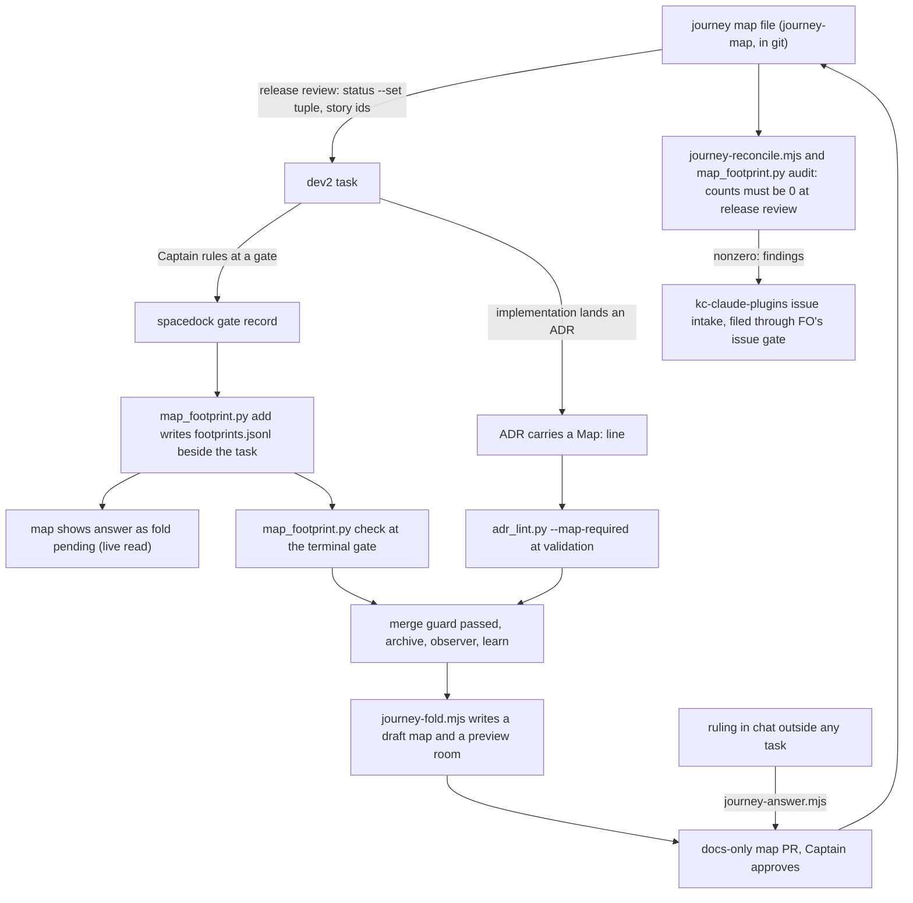
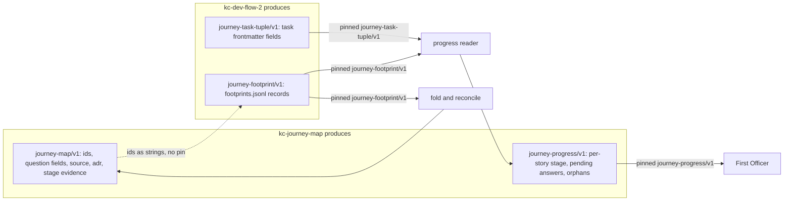

kc-journey-map (the release slice map) and kc-dev-flow-2 meet today through prose split between workflow.md's Release review section and kc-journey-progress's SKILL.md. Nothing tests that prose, and six defects found in an adopter on 2026-10-13 come from that missing interface.

## Captain's words

- 2026-10-13, answering "Should a dev2 design task in kc-claude-plugins handle the journey-map ↔ dev2 interface?": 「可以」.
- 2026-10-13, same turn: 「切片地圖似乎也很適合放 ADR 重點…怎樣同步比較省時省力？」.
- 2026-09-06, the standing ruling on flows: plan, dev and ship are independent plugins joined only by versioned input/output contracts, and each schema lives with its producer.
- 2026-10-13, on keeping the map service deployable later: 「能否在做 dev2 + 地圖整合之餘，在最小程度調整設計讓它變成未來可以部署到特定環境，變成地圖投影服務是可以寄存在外部的？…怎樣才剛好兼顧但不過度設計？」; then 「照你建議」 to the FO's split: this task takes the seam (the CLI can send a token to the map service; the repo-writing `/save` and `/repo-doc` leave the service and stay local; room storage is already set by `JOURNEY_ROOMS_DIR`), and hosting itself stays with task `journey-canvas-hosted-poc`.
- 2026-10-13, on versioning: 「該怎樣維護版本與更新紀錄？我想後者應該是 ADR？」.
- Relayed by an adopter First Officer session, not heard directly: each plugin should be usable alone, with the integration a written two-sided contract, as Spacedock and Spacedock Review are.

## Inputs: defects reported by an adopter FO, 2026-10-13 (kc-journey-map 1.5.1, kc-dev-flow-2 0.20.0)

1. A slug-id workflow could not be read. Fixed in kc-journey-map 1.5.2 (#623); listed here only as the conformance case to keep.
2. An archived task becomes a permanent orphan. A story moved to another release after its task was archived stays listed under `orphans`, and `spacedock status --set` refuses an archived entity, so nothing can clear it.
3. One task can serve only one story, because `journey-story` is a scalar; a task that carries three stories by a Captain ruling shows progress for one.
4. Three meanings of "done" never meet: the map's `status` (an evidence symbol greps), the progress reader's task `done`, and the adopter's deploy record (for example a `staging-verified` commit status).
5. Answers do not flow back to the map. Captain rulings, ADRs, POC findings and validation findings land in task files and ADRs; the map's story `questions` are written by hand.
6. The canvas has no provenance: a drawing records no journey-file commit, so a map ahead of `main` looks current.
7. Release review signal 2 is honour-system: workflow.md says "no script checks that line".

## Input: ADR rulings on the map

A real adopter map (a booking product, release 8) already cites ADRs by hand in story answers and in flow and constraint text: 61 mentions in one journey file, read with `git show origin/next:docs/journey/<file>.yaml | grep -ci adr` on 2026-10-13. Two hand copies already disagree with their sources: one answer says an ADR question is "still open, to fill in", and the same file cites ADRs by two numbering schemes (a separate file `0034`, and a section `26` inside ADR 0001).

## Input: qnow map refresh, reported by qnow's FO session, 2026-10-13

Relayed by that session, not heard directly: the Captain's aim is 「切片地圖會隨著 ADR 以及對話討論內容，逐步自動寫入最新的現況」.

qnow's FO dispatched an ad-hoc dev2 ideation task (`journey-edits-after-merge`, qnow state branch `spacedock-state/dev2`) to refresh its map; neither plugin has a step that reconciles map questions against rulings. Four sub-agents read only the map's notes, dev2 task files, ADRs and `git grep` at a pinned ref; about 45 of about 58 open map questions were answerable, about 13 stay open (counts as reported, not re-read here). Gaps it reports:

1. Captain rulings live in chat, task files and ADRs; the map moves only when someone opens a map-edit task, so it lags every ruling.
2. Some rulings survive only as the map's own paraphrase (a 2026-09-29 batch has no verbatim source in any task file).
3. Map questions carry answer text without `status: answered`, so release boards show them as open.
4. A release-level task (one that covered all five stories of a release) shows as an orphan, because `journey-story` is one story (same as defect 3 above).

Its proposed shape, a suggestion not a ruling: every Captain ruling FO records also emits one map-change record keyed to a story or question id, with verbatim words and date; a reader periodically folds those records and new ADRs into a draft map, rendered to a separate preview room, read back with `journey-read`, and proposed to the Captain as a docs-only PR.

## Direction the Captain accepted, 2026-10-13

The FO proposed this direction in chat across four turns. The Captain answered 「可以」 to the loop, asked about timing and about missed steps, and then said 「可以進入設計」 to the whole of it, including the self-repair placement. Ideation designs against it; it is not yet a design.

1. **Loop:** the map stores only durable facts and reads progress live from dev2; dev2 writes only a minimal footprint, and only at moments where it already stops.
   - **Map → dev2:** planning a release turns gap stories into dev2 tasks carrying story ids; open questions become ideation inputs; constraints become acceptance boundaries.
   - **dev2 → footprint:** the command that records a Captain ruling also writes a footprint. The footprint schema is owned by dev2 and is one record per story or question id. There are four kinds: a question answered (verbatim words, date, source), a new question, an ADR reference, and evidence advancing.
   - **Footprint → map:** at archive, after observer and learn, footprints fold into a preview room and a docs-only map PR that the Captain approves. A new story changes scope and is always his decision.
2. **Timing:**
   - A footprint is written at the gate, and the map reads it live as "answered, fold pending".
   - The durable YAML write happens once per task, at archive.
   - A ruling made outside any task (release planning in chat) goes straight into a map PR, as today.
   - An ADR reference is written with the ADR; its first sentence becomes visible once its PR merges.
3. **"Done" becomes an evidence ladder:** gap → built (merged; the evidence symbol greps) → verified (validation gate accepted) → shipped (deploy record). The map stores the evidence, and the stage is derived from it.
4. **No step may be missed.** Each new step has all three of these:
   - one command that writes both records;
   - a gate check that a line says done, or not needed and why;
   - an after-the-fact reconcile script whose count of unfolded or unmatched items must reach 0 at each release review. Its first run on qnow is expected near the about 45 answers that qnow's FO folded by hand.

   A step that exists only as workflow.md prose is cut, or gets a check.
5. **Self-repair:** the map joins the 自駕路徑 ("autopilot path": 看見 see → 修復 repair → 學習 learn → 代決 decide by precedent; named by the Captain 2026-10-13: 「就叫做自駕路徑」). It gets no mechanism of its own. This task adds the map's 看見 stage: reconcile findings go to the same kc-claude-plugins issue intake that maintain-flow already serves. Docs-only, reversible map PRs may later move to precedent under ADR 0011.

## Open for ideation

- Each schema's owner and version string: what journey-map produces (story, release, goal and question ids; drawn-commit provenance) and what dev2 produces (task tuple and declaration; answers, ADR references and new questions).
- How ADR rulings reach the map. Proposed: by reference, rendered from the ADR at draw time, so no ADR text is copied.
- One conformance test against both a slug-id and an id workflow.
- Versioning, following subspace-relay ADR 0046 ("Relay's HTTP contract has one version", read 2026-10-13): one version per schema, stated in its producer's machine-readable artifact; documents cite it rather than carry their own; a test fails when the schema changes and its version does not. The change record is the producer plugin's release-please CHANGELOG; an ADR records a shape decision or a breaking change.
- The map-service seam named in the Captain's words above.
- Overlap with task `release-acceptance` (defect 7 is its enforced pre-implementation review) and with `journey-canvas-hosted-poc` (defect 6).

## FO alignment

Release: none (package tooling across kc-journey-map and kc-dev-flow-2).
Release review: not needed: no release.
Needed at ideation: not needed: the Captain accepted the direction in chat on 2026-10-13 (recorded above under "Direction the Captain accepted"); ideation lists its unresolved decisions at its gate.
Surfaces: ui
Visible change: The journey map shows each answered question with the Captain's words and date, ADR rulings by reference, an evidence stage per story, and answers still awaiting fold marked as pending.

## Design

Base read: kc-claude-plugins origin/main e2524e93025dd0d5d9217b4d722c2b169d01fda6 (`kc-journey-map` 1.5.2: `lib/progress.mjs`, `lib/model.mjs`, `lib/render.mjs`, `lib/records.mjs`, `skills/kc-journey-progress/SKILL.md`, `references/canvas.md`, `references/cell-contract.md`; `kc-dev-flow-2/references/sd/workflow.md` which says 0.21.0 while this session loaded package 0.20.0, so the design follows origin/main as instructed; `docs/adr/0006`-`0011`); subspace-relay origin/main 9589d251 ADR 0046; qnow origin/next 6d958e76375a93dfe32cb651ce6442ddb12f9808 (`docs/journey/qnow.yaml`); all read 2026-10-13. Ideation wrote no repository file. Profile pilot holds; one watch item is named under Limits.

### PRFAQ

**Press release (future).** The release map and the development workflow now meet at five named schemas, each owned by the side that produces it and each carrying one version that a test holds. When the Captain rules on a question at a gate, a one-line record of his verbatim words and date is written beside the task. The map shows that answer at once, marked "fold pending", and writes it into the map file once, when the task is archived, as a docs-only pull request he approves. An ADR that settles a story or question names it in the ADR itself, and the map shows that ADR's one-sentence title read from the ADR file, never a copy. Each story shows how far its evidence has climbed: gap, built, verified, shipped. A script counts every ruling, answer or ADR that has not reached the map; at each release review the count must be 0.

**FAQ.**

- *Why are there five schemas and who owns each?* The Captain's 2026-09-06 rule: independent plugins join only by versioned input and output contracts, and a schema lives with its producer. The map file and the progress reading are produced by kc-journey-map; the task tuple and the footprint record are produced by kc-dev-flow-2 (dev2). Today the tuple is described only in kc-journey-progress's SKILL.md, the consumer's prose, which is the gap behind defects 2 and 3.
- *How does the version rule follow subspace-relay ADR 0046?* One version per schema, `MAJOR.MINOR.PATCH`, in one machine-readable place in the producer: the field table that the producer's own validator reads, printed by a `schema` command. Documents cite it and carry no number of their own; a test fails when a field table changes and its version does not. The wire string a consumer pins is `<name>/v<MAJOR>`, the form `journey-progress/v1` already has and the sibling task `release-acceptance` uses for `release-walk/v1` and `release-acceptance/v1`. Decision D1 asks the Captain to confirm the change record.
- *Why not let the gate command write the footprint?* `spacedock gate record` belongs to Spacedock, a separate repository; its `--help` (0.27.2) takes no hook and this package cannot add a step inside it. So the footprint write is a package command run beside it, and two checks catch a skipped run (step table below). Decision D2 asks whether the Captain accepts that reading of 「同一個指令」.
- *Why does the map read pending answers live, and write the file only at archive?* The Captain's timing ruling (2026-10-13): footprint at the gate, durable YAML write once per task at archive. The live reader is kc-journey-map's progress reader, which already lists tasks through `spacedock status`; it finds a task's footprints by path convention beside the task file.
- *What if the ruling happens in chat, outside any task?* It goes straight into a map pull request, as today, through `journey-answer.mjs`, which writes the answer and its source in one command.
- *Does the map stop being the authority?* No. The journey YAML in git stays the authority; the footprint is a proposal until the Captain approves the fold PR. A new story is never created by a fold, only proposed (Captain: a new story changes scope).
- *Does the design contain a hosted map service?* No. It takes the seam only (Captain 「照你建議」): the CLI can send a token, and the repo-writing routes can be switched off. Hosting stays with task `journey-canvas-hosted-poc`.

### Existing-code check (recorded conclusion)

Journey: map story -> task -> ruling -> map answer. Working today: `progress.mjs` reads the tuple live (`readProgress`), `journey-add-story.mjs` writes one YAML change in one command, `journey-handoff.mjs --out` refuses to overwrite, `decision_ledger.py` already parses gate resolutions, `adr_lint.py` already runs at validation, and the `learn` extension already runs after archive. Incomplete: the tuple is keyed on release and one story (`tuple` and `key` in `progress.mjs`), questions have no source, no field names an ADR, nothing derives a stage beyond status, and the drawing records no commit. Two bounded searches found nothing to reuse for the missing pieces: `git grep -n -i "footprint"` over `kc-journey-map` and `kc-dev-flow-2` at the base matched only unrelated card-geometry comments in `records.mjs` and `render.mjs`, and `git grep -n -E "journey-(answer|fold|reconcile)"` matched nothing (CHANGELOGs excluded); `git grep -n -E "import yaml"` over `kc-dev-flow-2/scripts` matched nothing, so dev2 scripts hold no YAML parser. Need: Captain's accepted direction and the seven defects below. Conclusion: reuse `progress.mjs`, the `--out` no-overwrite rule, the `learn`-style extension and `adr_lint.py`; add three small journey-map commands and one dev2 script; do not touch Spacedock or `review-release`. Unknown: adopters other than qnow were not read.

### The loop

### Contract catalogue

| Schema | Producer | One version lives in | Wire pin | Consumer and its pin |
|---|---|---|---|---|
| `journey-map` | kc-journey-map | field table in `kc-journey-map/lib/schemas.mjs`, printed by `node lib/schemas.mjs journey-map` | optional top-level `schema: journey-map/v1` in the map file (absent reads as v1, today's files) | kc-journey-map's own reader, fold and reconcile; dev2 holds ids as strings and pins nothing |
| `journey-progress` | kc-journey-map | same file | `schema: journey-progress/v1` (exists today, inline string) | FO reads the JSON and refuses another major; the version FO is told is the `Describes journey-progress <version>` line in `kc-journey-progress/SKILL.md`, held by AC-1 |
| `journey-task-tuple` | kc-dev-flow-2 | field table in `kc-dev-flow-2/scripts/map_footprint.py`, printed by `map_footprint.py schema journey-task-tuple` | none on the task file (frontmatter has no schema key) | `progress.mjs` checks field shapes against its own fixture copy of the producer's printed table, named `journey-task-tuple/v1`; the copy can go stale only on a MINOR, which by rule breaks no reader |
| `journey-footprint` | kc-dev-flow-2 | same file | `"schema":"journey-footprint/v1"` on every line | live reader, `journey-fold.mjs`, `journey-reconcile.mjs` refuse a line whose major differs |
| `release-walk`, `release-acceptance` | defined by task `release-acceptance` | its own design | `/v1` | follow this task's version rule when they land; ordering is not decided here |

Version rule, held by tests. Each producer keeps `contract-versions.json` (`{name: {version: sha256 of the printed field table without its version}}`). A test fails when the printed table's hash differs from the hash recorded for its current version, so a changed table with the same version is red; adding an optional field raises MINOR, removing, renaming or changing a field's meaning raises MAJOR and the wire pin, a wording-only change raises PATCH. A second test fails when a producer document's line `Describes <name> <version>` differs from the printed version. The change record is the producer plugin's release-please CHANGELOG, written from the Conventional Commit that bumps it; an ADR is written for the first shape of a schema and for every MAJOR. D1 asks the Captain to confirm this against his 「我想後者應該是 ADR」.

### Task tuple (dev2 owns), and the defects it fixes

`journey` (the map's `journey:` value), `journey-release`, `journey-story`, `journey-required-tasks`, `journey-mapping-complete`, set by FO through `spacedock status --set` at release review, as today. Two changes, version 1.0.0 of `journey-task-tuple`:

- `journey-story` is a story id or a JSON array string of story ids (the scalar stays valid; `journey-required-tasks` already stores JSON in a string). When it lists several stories, `journey-required-tasks` is a JSON object keyed by story id, so each story keeps its own required list. A task counts toward every story it names. This is defect 3 and qnow's release-level orphan.
- The story id, not the release, is the identity. Story ids are unique across a map: `calculateProgress` already marks a story unverified when its id appears twice, and qnow's map (171 stories) has 0 duplicates, read on 2026-10-13 with a one-off `python3` over `git show origin/next:docs/journey/qnow.yaml` that AC-6 turns into the reconcile script. `journey-release` becomes the release at admission and no longer decides membership, so moving a story to another release no longer strands an archived task. Measured on qnow: question ids repeat across stories (6 ids occur on more than one story, for example `q1`), so every question key is (journey, story, question). A task naming a story that is not on the map stays an orphan, now listed with `archived: true` when its task is archived; an archived orphan does not set the refresh exit code, because `spacedock status --set` refuses an archived task and Spacedock owns that limit. D3 asks for this identity change.

### Footprint (dev2 owns)

File `<task folder>/footprints.jsonl`, found beside the task file `resolved.path` (`<slug>/` next to `<slug>.md`, or the directory of `index.md`), live or under `_archive/`; one JSON object per line, `schema: journey-footprint/v1`, `id` = `fp:<task id or slug>:<n>`, `journey`, `story`, optional `question`, and by `kind`:

| kind | owed fields | meaning |
|---|---|---|
| `answered` | `words` (verbatim), `date`, `source` (`gate-attempt:<id>` or `amendment:<n>`), optional `answer` (one short paraphrase) | a Captain ruling answered a question |
| `question` | `ask`, `source` | a ruling opened a new question |
| `evidence` | `stage` (`verified` or `shipped`), `ref` | evidence climbed; `ref` is the task and gate for verified, the adopter's deploy record verbatim for shipped |
| ADR reference | none written | read from the ADR file's `Map:` line |

The ADR kind is not a fourth written record: the ADR names its story or question in a `Map: <journey>/<story>[/<question>]` line beside `Date:` (or `Map: none - <reason>`), which is the Captain's "written with the ADR", and `adr_lint.py --map-required` is its gate. `map_footprint.py add` refuses an `answered` footprint whose `words` are not a substring of the cited gate resolution reason or amendment `Captain:` line, so verbatim is enforced at write time. It validates shape and source only; it does not read the map, because dev2 scripts hold no YAML parser and the map's schema is journey-map's: an unknown story id is found by reconcile as `unmatched`.

### Steps: one write, one gate line, one count

| Step | One-command write | Gate line (done, or not needed and why) | Reconcile count (0 at release review) |
|---|---|---|---|
| 1 release to task | existing `spacedock status --set <task> journey=... journey-release=... journey-story=...` (list form new) | existing `Release review:` line; its enforcement is task `release-acceptance`'s `release_review.py`, not repeated here | `orphans` (tasks naming a story not on the map) |
| 2 gate footprint | `map_footprint.py add <task> --kind answered --story S --question Q --source gate-attempt:<id> --words '...'` run right after `spacedock gate record` | `Map footprints: <n> in footprints.jsonl` or `Map footprints: not needed: <reason>` under `## FO alignment`; `map_footprint.py check <task>` at the terminal gate exits 1 without one, or when a footprint's source does not resolve | `unrecorded-gate`: Captain resolutions on a journey task cited by no footprint and covered by no not-needed line (`map_footprint.py audit`); `unmatched`: footprints whose story or question is not on the map (`journey-reconcile.mjs`) |
| 3 ADR reference | the ADR's own `Map:` line, written by the implementation worker with the ADR | `adr_lint.py --map-required` at validation: exit 1 on a new ADR with no `Map:` line | `adr-unfolded`: ADR `Map:` ids whose map question has no `adr:` for that file; `unmatched` as above |
| 4 archive fold | `journey-fold.mjs <journey.yaml> --workflow-dir <dir> --out <draft.yaml> --room <preview-room>` (draft never overwrites the source; folding twice gives the same bytes) | FO's archive message states `journey-map fold: <PR url>`, `not needed: <reason>` or `not run: <reason>`, the form the Extensions section already requires; archived state is publish-only, so no task line can hold it | `unfolded`: footprints and ADR references not yet in the map at the base ref |
| 5 ruling outside any task | `journey-answer.mjs <journey.yaml> --story S --question Q --words '...' --date D --where chat` writes `answer`, `status: answered` and `source` | the docs-only PR itself, plus lint `answer-without-source` in `journey-lint` | `unsourced`: answered questions with no `source` (legacy answers take `source: {kind: legacy, reason}` and are counted apart, not failed) |
| 6 evidence ladder | `built` is derived (status exists and the `evidence` symbol greps) and owes no write; `verified` and `shipped` are `map_footprint.py add <task> --kind evidence --stage verified --ref gate-attempt:<id>`, run by FO right after the validation-gate approval, and `--stage shipped --ref <deploy record verbatim>`, run when the adopter's deploy record exists (the `release-acceptance` task's validation gate is the natural moment, but its design is not read here) | the same `Map footprints:` line and `check <task>` as step 2 | `unrecorded-gate` for a validation approval cited by no evidence footprint; `out-of-order`: `shipped` with no `verified`, or `verified` with no built evidence |

Cut: a separate "new story" footprint (the Captain: a new story always changes scope, so a fold prints it as a proposal and applies nothing); a task-file line for the fold (archived state is publish-only; the extension's report line and the count carry it). The kc-journey-map reconcile is `journey-reconcile.mjs <journey.yaml> --workflow-dir <dir> [--release <id>]`, exit 1 when any count is above 0, printing one line per item; the dev2 half is `map_footprint.py audit <workflow-dir>`. Both are named in a new extension `kc-dev-flow-2/extensions/journey-map/EXTENSION.md` that an adopter lists under `extensions:`; the extension adds the footprint, `--map-required` and fold instructions to FO's scope notes and the reconcile run to release review. `workflow.md` gains no footprint rule, only the tuple's list form and one pointer sentence in the Release review bullet (maintain-flow's word-budget rule: net words not above 0).

Self-repair (the Captain's 自駕路徑): reconcile findings are the map's 看見 (see) step. A nonzero count is presented by FO and, on the Captain's yes through FO's existing issue-filing approval gate, filed as a kc-claude-plugins issue, the intake the Captain named as the one `maintain-flow` already serves; no new mechanism. A docs-only fold PR may later move to precedent under ADR 0011's ladder; nothing here grants that.

### Map side: provenance, ADR by reference, stage, seam

- **Provenance (defect 6).** Each page header card drawn gains one line: `drawn from <path> @ <short sha> on <branch>` and, when the file differs from the default branch, `ahead of <base> by <n> commits`. Computed with `git` at render time, returned by `journey-read`. This is the drawn-commit the sibling `Release review: <journey>/<release> at <commit>` line also names.
- **ADR by reference.** A question's `adr: <repo path>[#anchor]` renders as `ADR <number>: <title>`, the title being the ADR file's first line after `# NNNN.`, read at draw time from the default branch with `git show`; a path not yet on that branch renders `ADR pending: <path>` and no text. No ADR text is stored in the map. Limit: a section citation such as `docs/adr/0001-...md#q7--...` (qnow has 4 of its 23 ADR links in that form) shows the file title and the anchor, not the section's own sentence; a file with no `# NNNN.` title shows its file name.
- **Stage (defect 4).** `gap`, `built` (status exists with an `evidence` symbol that greps), `verified` (every required task has an approved validation gate), `shipped` (a `shipped:` record on the story). The stage is a line on the story card; the border colours keep their current meaning.
- **Seam.** One `apiFetch` function in `kc-journey-map/lib` replaces the five bare `fetch` sites and sends `Authorization: Bearer <JOURNEY_API_TOKEN>` when that variable is set, nothing otherwise. The routes that write a repository (`/save`, `/repo-doc`) register only when `JOURNEY_LOCAL_OPS=1`, which `npm run canvas` sets, so local use is unchanged and a deployed service starts without them. Room storage already follows `JOURNEY_ROOMS_DIR`. D5 asks whether "leave the service" means this switch or a code move.

### UI proposal and preview

UI proposal: On a release board page the answer card under a question reads `<answer>` on one line and `「<verbatim words>」 <date>` on the next, prefixed with a half-moon mark when the answer is only a footprint (fold pending); a question answered by an ADR shows `ADR <number>: <title>` and its link icon opens the ADR file; each story card carries one extra line `stage: <gap|built|verified|shipped>`; each page header card carries the drawn-commit line. The source (task, gate, footprint id) stays in the map file and `journey-read`, not on the card, because the card holds about three short lines. Open questions stay as they are.

Preview: journey-map-dev2-contract/preview/preview.tldr

Preview run: the file is a native tldraw export of a disposable fictional room, the existing canvas mechanism, no online resource. From a kc-journey-map install with its dependencies: `JOURNEY_API_PORT=<free> JOURNEY_CANVAS_PORT=<free> JOURNEY_ROOMS_DIR=<empty temp dir> npm run canvas`, then `node lib/journey-tldr.mjs import <state checkout>/journey-map-dev2-contract/preview/preview.tldr preview-room` with the same two ports set, and open `http://127.0.0.1:<canvas port>/?room=preview-room`, page "RELEASE 1". Re-draw from `journey-map-dev2-contract/preview/preview.journey.yaml` with `node lib/journey-render.mjs <that file> preview-room --pages story-map,journey-board --force`. `preview-release-1.png` is a screenshot of that page, a record and not the preview. Limit: the marks are written into today's `card` and `answer` text fields, so the preview proves the proposed text fits the existing cards (its first version overflowed the answer card and was shortened to the lines shown) and does not prove the new renderer.

### Draft ADRs (named by ruling and short title, no number; FO reserves numbers)

- "The two plugins meet at five producer-owned schemas, and a version binds one field table" (the catalogue and version rule above; Captain 2026-09-06 and 2026-10-13).
- "The map shows an ADR ruling by reference to its file and never copies its text" (Captain 2026-10-13, 「切片地圖似乎也很適合放 ADR 重點」).
- "A Captain ruling reaches the map as a footprint at the gate and one fold at archive" (the accepted direction, timing paragraph).

### Disposition of the seven reported defects and four qnow gaps

| Reported | Disposition |
|---|---|
| defect 1 slug-id unreadable | fixed in 1.5.2 (#623); the conformance fixture keeps it (AC-3) |
| 2 archived orphan | identity is the story id (D3); a removed story's archived task is listed, not counted |
| 3 one story per task | list form of the tuple |
| 4 three meanings of done | stage ladder; deploy record carried verbatim, no deploy integration |
| 5 answers do not flow back | footprint, live pending read, fold |
| 6 canvas has no provenance | page header line |
| 7 Release review honour-system | owned by task `release-acceptance` (`release_review.py`); not duplicated |
| qnow 1 rulings lag | the loop |
| qnow 2 paraphrase-only rulings | `source: legacy` with a reason, or backfill from the task |
| qnow 3 answer text without `status: answered` | fold and `journey-answer.mjs` always write it; baseline 21, measured. Whether the release board shows these as open was reported, not re-read: `isQuestionAnswered` in `model.mjs` already reads answer text as answered |
| qnow 4 release-level task orphan | list form |

Fact check on the relayed counts: the reported "about 58 open questions, about 45 answerable, about 13 open" matches qnow's release `r1` exactly in the base map (45 answered plus 13 open is 58), which suggests the qnow FO's fold had already merged to origin/next and the counts describe `r1`, not the whole map (110 questions: 79 answered, 31 open). That is an inference; the fold's PR was not read.

### Slices, budget and stop condition (proposed)

Three pull requests, each releasable alone through release-please: (1) contracts: field tables, `contract-versions.json` and its tests, tuple list form and story identity, `apiFetch` and `JOURNEY_LOCAL_OPS`, provenance line; (2) footprints: `map_footprint.py` (add, check, audit, schema), the extension, ADR `Map:` line and `adr_lint.py --map-required`, `journey-reconcile.mjs`, the live pending reader; (3) fold and map UI: `journey-fold.mjs`, `journey-answer.mjs`, lint rules, card marks, ADR-by-reference render, documents. Stop and return to FO if it needs a change in Spacedock, a fourth pull request, a YAML parser in dev2, or a model-judged check inside a script. Profile limit: `JOURNEY_API_TOKEN` is read from the environment and never stored or printed; if the hosted task turns it into a shared production credential, return to profile selection. Ordering against `release-acceptance`: both edit the workflow.md Release review bullet; whichever lands second rebases; neither blocks the other because the contracts are pinned by string.

### Non-goals

Hosting the canvas; the release walk-through; reading a deploy system automatically (a `shipped` record is written by hand from the adopter's deploy record); any change to Spacedock or `review-release`; folding the ~2026-09-29 paraphrase-only answers without a source; moving the repo-writing routes into a separate local process (D5).

### Unresolved decisions for the Captain

- **D1 versions and change record.** Recommend: one version per schema in the producer's field table, wire pin = major only, change record = release-please CHANGELOG, an ADR for each schema's first shape and every MAJOR. Your words 「我想後者應該是 ADR」 point to ADR for every change; the cost is an ADR per MINOR, which the CHANGELOG already records. Worse under the recommendation: a consumer cannot see a producer's MINOR on the wire.
- **D2 "one command" for the gate footprint.** Recommend: `map_footprint.py add` run beside `spacedock gate record`, caught by the terminal-gate check and `unrecorded-gate`. A wrapper that runs both commands is possible, but FO's gate skills would still have to be told to call it, which is the same dependence.
- **D3 story id is the identity.** Recommend yes, on the evidence of 0 duplicate story ids in qnow's 171 and `calculateProgress`'s own uniqueness check. Worse: a map that reuses a story id in two releases would merge their tasks (the reader already refuses it).
- **D4 three pull requests as the budget.** Recommend yes; the first alone fixes defects 2, 3 and 6.
- **D5 the seam.** Recommend the `JOURNEY_LOCAL_OPS` switch now and a separate local process only if the hosted task needs it, because moving `/save` and `/repo-doc` changes the canvas UI's save button flow.

## Acceptance criteria

**AC-1**: Each producer's `schema` command prints a field table; `contract-versions.json` binds each version to the table's sha256; a changed table with an unchanged version, or a producer document whose line `Describes <name> <version>` differs from the printed version, exits 1 naming the schema.
Source: Captain's open item, versioning "following subspace-relay ADR 0046" (read 2026-10-13: "a test fails when the generated document changes while `info.version` does not").
Verified by: `node --test kc-journey-map/lib/schemas.test.mjs` and `python3 kc-dev-flow-2/scripts/test_map_footprint.py` each print the table and pass, then rename one field in a temp copy without a bump and assert exit 1, then change the document line and assert exit 1. Falsifier: hashing the table together with its version lets the unbumped edit pass, which the test must catch. Not yet verified: no schema file exists.

**AC-2**: Every consumer refuses a record whose major differs and accepts one that adds a field: the progress reader, `journey-fold.mjs` and `journey-reconcile.mjs` exit 1 on a `journey-footprint/v2` line and on `journey-progress/v2`, naming the string, and accept a `v1` line with an extra field; each producer test asserts the example printed in its document equals the printed example.
Source: the Captain's 2026-09-06 rule (schema with its producer, pinned by the consumer); the sibling task's string-pin pattern.
Verified by: the same test files, one case per bullet. Falsifier: a reader that ignores `schema` passes the `v2` case. Not yet verified.

**AC-3**: Conformance on both workflow styles: with `lib/progress.test.mjs`'s real-CLI fixture built as `id-style: slug` and as stored ids, a task naming three stories shows progress for each (required list keyed by story), a release-level task is not an orphan, a story moved to another release still counts its archived task, a task naming a story removed from the map is listed with `archived: true` and leaves the refresh exit code at 0, and the scalar form reads as before.
Source: defects 1, 2, 3 and qnow gap 4 in this task; Captain's open item "one conformance test against both a slug-id and an id workflow".
Verified by: `node --test kc-journey-map/lib/progress.test.mjs` (needs Node 22.13 or later and the `spacedock` CLI on PATH, as the test header states), each case run on both fixtures. Falsifier: putting the release back into `key` in `progress.mjs` fails the moved-story case. Not yet verified; the slug-id read itself is covered today by the 1.5.2 test.

**AC-4**: `map_footprint.py add` refuses an `answered` footprint whose `words` are not a substring of the cited gate resolution reason or amendment `Captain:` line (exit 1, naming the source) and otherwise appends one `journey-footprint/v1` line; `check <task>` exits 1 when a journey task has neither a footprint nor a `Map footprints: not needed: <reason>` line, or a footprint source does not resolve; `audit` prints `unrecorded-gate <n>`; two stories that both carry a question `q1` take separate footprints, keyed by journey, story and question.
Source: the Captain's accepted direction items 1 and 4 (verbatim words; a gate check that a line says done or not needed).
Verified by: `python3 kc-dev-flow-2/scripts/test_map_footprint.py` in a temp state checkout, one case per clause. Falsifier: replacing the substring test with "source exists" lets a paraphrase through, which the paraphrase case must catch. Not yet verified.

**AC-5**: A skipped step is caught twice and the loop closes. In a disposable workflow with one journey task, after a Captain ruling recorded by `spacedock gate record` and no footprint, `map_footprint.py check` exits 1 and `audit` prints `unrecorded-gate 1`; after `add`, both exit 0, `journey-reconcile.mjs` prints `unfolded 1` and the live reading marks the question `fold pending`; after `journey-fold.mjs` and applying its draft, `unfolded` is 0, the question has `status: answered` and a `source` carrying the words and date; folding twice gives identical bytes, never overwrites the source file, and a `question` footprint naming a story not on the map applies nothing and prints a proposal.
Source: the Captain's accepted direction items 1, 2 and 4.
Verified by: a repository script `scripts/journey-dev2-loop-smoke.sh` driving the real `spacedock` CLI and both plugins' commands in a temp directory, printing each exit code and count. Falsifier: removing the `status: answered` write from the fold fails the status assertion; skipping the `add` step is the case above. Not yet verified.

**AC-6**: Baseline on qnow's map: `journey-reconcile.mjs` run on `git show 6d958e76375a93dfe32cb651ce6442ddb12f9808:docs/journey/qnow.yaml` (saved to a temp path) against a workflow directory holding no journey tasks exits 1 and prints per-release counts that include, for the whole map, 171 stories, 110 questions (79 answered, 31 open), 21 answers without `status: answered`, `unsourced` 79, 0 duplicate story ids and 6 question ids that occur on more than one story, and, for `--release r1`, 45 answered, 13 open and `unsourced` 45; two runs print identical output. On a temp copy where each of the 79 answers is given `source: {kind: legacy, reason: ...}`, `unsourced` is 0, the legacy count is 79 and the exit code is 0 when no other count is above 0.
Source: the Captain's accepted direction item 4 ("first run on qnow is expected near the about 45 answers"); the figures are the one-off read of 2026-10-13 named above and match `r1`.
Verified by: the script run and a `diff` of its output against the figures here; changing one answer on the temp copy changes `unsourced` by 1. Current evidence: the figures are measured by the one-off read, the script is not yet built, so this criterion is not yet verified.

**AC-7**: A question's `adr:` path renders `ADR <number>: <title>` from the default branch's file; a path present only on a branch renders `ADR pending: <path>`; the map file holds no ADR title text; a section citation shows the file title and the anchor; the page header names the drawn commit and, for a file ahead of the default branch, the commit count; re-rendering twice yields identical records and `render.test.mjs`'s hand-drawn-shape carry cases (ADR 0008) stay green.
Source: Captain 2026-10-13 (「切片地圖似乎也很適合放 ADR 重點」, "by reference"); defect 6.
Verified by: `node --test kc-journey-map/lib/render.test.mjs` with new cases in a temp git repository holding one merged and one branch-only ADR. Falsifier: reading the working-tree file instead of the base ref renders the unmerged ADR's title, which the pending case must catch. Not yet verified.

**AC-8**: The map shows what the UI proposal says: from the folded fixture of AC-5 the real renderer draws, on the release board page, an answer card with the answer, the verbatim words and the date, a fold-pending mark on an answer that is only a footprint, an ADR card with its title and link, a `stage:` line on each story card and the drawn-commit line, and `journey-read` returns the same marks.
Source: `Visible change:` under `## FO alignment`; the Captain's 「可以進入設計」.
Verified by: render to a room on its own port and rooms directory, screenshot with `agent-browser`, and a Captain look at the page at the validation gate. Current evidence: `preview/preview.tldr` imports into a fresh room (91 records) and the page renders as `preview-release-1.png` shows, using today's renderer with the marks typed into text fields; the new renderer is not yet verified.

**AC-9**: With `JOURNEY_API_TOKEN` set, each of the five request sites (`render.mjs` twice, `read.mjs` twice, `journey-tldr.mjs`) sends `Authorization: Bearer <token>` to a loopback test server and sends no such header when it is unset; `/save` and `/repo-doc` answer 404 unless `JOURNEY_LOCAL_OPS=1`, and `npm run canvas` sets it.
Source: the Captain's 「照你建議」 on the map-service seam, 2026-10-13.
Verified by: a new `lib/api-fetch.test.mjs` that records headers per site and starts the canvas server with and without the variable. Falsifier: one site left on bare `fetch` fails that site's case. Not yet verified.

**AC-10**: The workflow gates exist and cost nothing when unused: `adr_lint.py --map-required` exits 1 on a new ADR with no `Map:` line and 0 with `Map: none - <reason>`; a workflow that lists no `journey-map` extension is unchanged; `lint-skills.py` passes with `workflow.md`'s word count not above its current count; the extension's step table has a write, a gate line and a count in every row.
Source: the Captain's accepted direction item 4 ("a step that exists only as workflow.md prose is cut, or gets a check"); maintain-flow's word-budget rule.
Verified by: `python3 kc-dev-flow-2/scripts/test_adr_doc_checks.py` additions, `python3 kc-dev-flow-2/scripts/lint-skills.py`, and a test that fails when a row of the extension's step table has an empty cell. Falsifier: blank one cell. Not yet verified.

Limits across the criteria: release-please version bumps appear only on the Release PR after merge, so no criterion here shows a bump; a fixture copy of a producer's table can lag a MINOR; reconcile cannot see a ruling the Captain made in chat and nobody recorded.

## Stage Report: ideation

- FAILED: A design that names each schema's producer, version string and consumer pin (journey-map: story/release/question ids and drawn-commit provenance; dev2: task tuple, footprint records, ADR references), consistent with the Captain's accepted direction in the task and subspace-relay ADR 0046's one-version rule
  Not started: held at the ideation entry check, see Hold below.
- FAILED: Every new step in the loop (release-to-task, gate footprint, ADR reference, archive fold, out-of-task ruling) carries its one-command write, its gate line (done or not-needed with reason), and its reconcile-script count; a step with none of the three is cut
  Not started: held at the ideation entry check.
- FAILED: Acceptance criteria with reproducible evidence clauses, including one conformance run against a slug-id and an id workflow and a reconcile-script baseline run on qnow's map, plus the unresolved decisions listed for the Captain
  Not started: held at the ideation entry check; no `## Acceptance criteria` section exists, so `design_surfaces.py check` would also exit non-zero.

### Hold

Cause: the task file has no `## FO alignment` section, and so no `Surfaces:` or `Visible change:` line. Checked with `grep -n -i 'FO alignment\|Surfaces:\|Visible change'` on this file at state commit c493a205 (no match), and the file has no such heading on a full read of 99 lines. The ideation principles (`<package>/skills/ideation/principles.md`) say to stop and report in that case; a sibling task (`journey-canvas-hosted-poc`) does carry the section.

Needed from FO before re-dispatch: a `## FO alignment` section recording alignment result, `Surfaces:` and `Visible change:`. Surface choice is not mine to infer. The one open question it settles: whether showing ADR rulings on the canvas counts as a `ui` surface (then a `UI proposal:` and `Preview:` are owed) or `none`.

No repository file, branch or commit was written; the design, evidence plan and decisions list are not started.

### Summary

Held before design: the entry check requires FO alignment, `Surfaces:` and `Visible change:`, and none is recorded. The Captain's accepted direction, the inputs and the read-only references are untouched and ready once FO records the section.

## Stage Report: ideation

- DONE: A design that names each schema's producer, version string and consumer pin (journey-map: story/release/question ids and drawn-commit provenance; dev2: task tuple, footprint records, ADR references), consistent with the Captain's accepted direction in the task and subspace-relay ADR 0046's one-version rule
  `## Design` "Contract catalogue" table (five schemas: producer, version home, wire pin, consumer pin), the version rule (one version per field table, hash-bound in `contract-versions.json`), the tuple and footprint sections; ADR references are read from an ADR `Map:` line. Read at the cited refs 2026-10-13.
- DONE: Every new step in the loop (release-to-task, gate footprint, ADR reference, archive fold, out-of-task ruling) carries its one-command write, its gate line (done or not-needed with reason), and its reconcile-script count; a step with none of the three is cut
  `## Design` "Steps" table: six rows, each with write, gate line and count (the evidence ladder is row 6); two things cut and named (a "new story" footprint, a task-file line for the fold). Release review enforcement is left to task `release-acceptance`.
- DONE: Acceptance criteria with reproducible evidence clauses, including one conformance run against a slug-id and an id workflow and a reconcile-script baseline run on qnow's map, plus the unresolved decisions listed for the Captain
  `## Acceptance criteria` AC-1..AC-10 (AC-3 is the slug-id and id conformance, AC-6 the qnow baseline); decisions D1-D5 at the end of `## Design`. `design_surfaces.py check` printed "journey-map-dev2-contract.md: design surfaces presentable" (exit 0).
- SKIPPED: AC-1 version binding
  Not yet verified: no schema file exists; verified at implementation by `schemas.test.mjs` and `test_map_footprint.py`.
- SKIPPED: AC-2 consumer pins
  Not yet verified: future implementation test.
- SKIPPED: AC-3 conformance on slug-id and id workflows
  Not yet verified: future change to `progress.test.mjs`; the existing slug-id test (1.5.2) is the base.
- SKIPPED: AC-4 footprint add, check and audit
  Not yet verified: `map_footprint.py` does not exist.
- SKIPPED: AC-5 skipped step caught twice, loop closes
  Not yet verified: needs `scripts/journey-dev2-loop-smoke.sh` and the fold.
- SKIPPED: AC-6 reconcile baseline on qnow's map
  Not yet verified as a script run. Current evidence: a one-off `python3` read of `git show origin/next:docs/journey/qnow.yaml` at 6d958e76 gave 171 stories, 110 questions (79 answered, 31 open), 21 answers without `status: answered`, 0 duplicate story ids, 6 repeated question ids, release r1 45 answered and 13 open; r1's 45 is the "near 45" the Captain expected.
- SKIPPED: AC-7 ADR by reference and provenance render
  Not yet verified: future `render.test.mjs` cases.
- SKIPPED: AC-8 map shows the proposed marks
  Current evidence only for the proposal: `preview/preview.tldr` exported from a disposable room (91 records) and re-imported into a second room (91 records); the page rendered and was read from a screenshot. The marks are typed into today's text fields; the new renderer is not verified.
- SKIPPED: AC-9 token header and local-ops switch
  Not yet verified: future `api-fetch.test.mjs`.
- SKIPPED: AC-10 workflow gates and word budget
  Not yet verified: future `adr_lint.py` change and `lint-skills.py` run.

### Summary

The design gives the map and dev2 five producer-owned schemas under one version rule, a per-task `footprints.jsonl` read live as "fold pending" and folded once at archive, ADRs shown by reference from an ADR `Map:` line, and a stage ladder, in three pull requests; reconcile counts must reach 0 at release review. Mermaid blocks parse with the repository's mermaid 11 build (flowchart-v2, both). Ideation wrote no repository file; the preview folder sits in the task's state folder, and the services I started (ports 5891 and 3791, own rooms directory) were stopped by their captured process ids. Unresolved for the Captain: D1 versions and change record, D2 "one command" reading, D3 story id as identity, D4 three-PR budget, D5 the seam.
