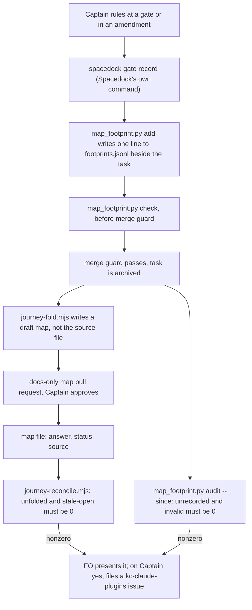
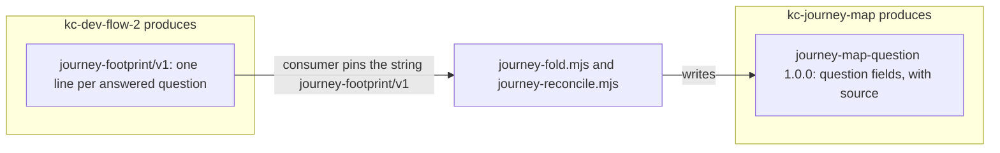

kc-journey-map (the release slice map) and kc-dev-flow-2 meet today through prose split between workflow.md's Release review section and kc-journey-progress's SKILL.md. Nothing tests that prose, and six defects found in an adopter on 2026-10-13 come from that missing interface.

## Captain's words

- 2026-10-13, answering "Should a dev2 design task in kc-claude-plugins handle the journey-map ↔ dev2 interface?": 「可以」.
- 2026-10-13, same turn: 「切片地圖似乎也很適合放 ADR 重點…怎樣同步比較省時省力？」.
- 2026-09-06, the standing ruling on flows: plan, dev and ship are independent plugins joined only by versioned input/output contracts, and each schema lives with its producer.
- 2026-10-13, on keeping the map service deployable later: 「能否在做 dev2 + 地圖整合之餘，在最小程度調整設計讓它變成未來可以部署到特定環境，變成地圖投影服務是可以寄存在外部的？…怎樣才剛好兼顧但不過度設計？」; then 「照你建議」 to the FO's split: this task takes the seam (the CLI can send a token to the map service; the repo-writing `/save` and `/repo-doc` leave the service and stay local; room storage is already set by `JOURNEY_ROOMS_DIR`), and hosting itself stays with task `journey-canvas-hosted-poc`.
- 2026-10-13, on versioning: 「該怎樣維護版本與更新紀錄？我想後者應該是 ADR？」.
- Relayed by an adopter First Officer session, not heard directly: each plugin should be usable alone, with the integration a written two-sided contract, as Spacedock and Spacedock Review are.

## Inputs: defects reported by an adopter FO, 2026-10-13 (kc-journey-map 1.5.1, kc-dev-flow-2 0.20.0)

1. A slug-id workflow could not be read. Fixed in kc-journey-map 1.5.2 (#623); listed here only as the conformance case to keep.
2. An archived task becomes a permanent orphan. A story moved to another release after its task was archived stays listed under `orphans`, and `spacedock status --set` refuses an archived entity, so nothing can clear it.
3. One task can serve only one story, because `journey-story` is a scalar; a task that carries three stories by a Captain ruling shows progress for one.
4. Three meanings of "done" never meet: the map's `status` (an evidence symbol greps), the progress reader's task `done`, and the adopter's deploy record (for example a `staging-verified` commit status).
5. Answers do not flow back to the map. Captain rulings, ADRs, POC findings and validation findings land in task files and ADRs; the map's story `questions` are written by hand.
6. The canvas has no provenance: a drawing records no journey-file commit, so a map ahead of `main` looks current.
7. Release review signal 2 is honour-system: workflow.md says "no script checks that line".

## Input: ADR rulings on the map

A real adopter map (a booking product, release 8) already cites ADRs by hand in story answers and in flow and constraint text: 61 mentions in one journey file, read with `git show origin/next:docs/journey/<file>.yaml | grep -ci adr` on 2026-10-13. Two hand copies already disagree with their sources: one answer says an ADR question is "still open, to fill in", and the same file cites ADRs by two numbering schemes (a separate file `0034`, and a section `26` inside ADR 0001).

## Input: qnow map refresh, reported by qnow's FO session, 2026-10-13

Relayed by that session, not heard directly: the Captain's aim is 「切片地圖會隨著 ADR 以及對話討論內容，逐步自動寫入最新的現況」.

qnow's FO dispatched an ad-hoc dev2 ideation task (`journey-edits-after-merge`, qnow state branch `spacedock-state/dev2`) to refresh its map; neither plugin has a step that reconciles map questions against rulings. Four sub-agents read only the map's notes, dev2 task files, ADRs and `git grep` at a pinned ref; about 45 of about 58 open map questions were answerable, about 13 stay open (counts as reported, not re-read here). Gaps it reports:

1. Captain rulings live in chat, task files and ADRs; the map moves only when someone opens a map-edit task, so it lags every ruling.
2. Some rulings survive only as the map's own paraphrase (a 2026-09-29 batch has no verbatim source in any task file).
3. Map questions carry answer text without `status: answered`, so release boards show them as open.
4. A release-level task (one that covered all five stories of a release) shows as an orphan, because `journey-story` is one story (same as defect 3 above).

Its proposed shape, a suggestion not a ruling: every Captain ruling FO records also emits one map-change record keyed to a story or question id, with verbatim words and date; a reader periodically folds those records and new ADRs into a draft map, rendered to a separate preview room, read back with `journey-read`, and proposed to the Captain as a docs-only PR.

## Direction the Captain accepted, 2026-10-13

The FO proposed this direction in chat across four turns. The Captain answered 「可以」 to the loop, asked about timing and about missed steps, and then said 「可以進入設計」 to the whole of it, including the self-repair placement. Ideation designs against it; it is not yet a design.

1. **Loop:** the map stores only durable facts and reads progress live from dev2; dev2 writes only a minimal footprint, and only at moments where it already stops.
   - **Map → dev2:** planning a release turns gap stories into dev2 tasks carrying story ids; open questions become ideation inputs; constraints become acceptance boundaries.
   - **dev2 → footprint:** the command that records a Captain ruling also writes a footprint. The footprint schema is owned by dev2 and is one record per story or question id. There are four kinds: a question answered (verbatim words, date, source), a new question, an ADR reference, and evidence advancing.
   - **Footprint → map:** at archive, after observer and learn, footprints fold into a preview room and a docs-only map PR that the Captain approves. A new story changes scope and is always his decision.
2. **Timing:**
   - A footprint is written at the gate, and the map reads it live as "answered, fold pending".
   - The durable YAML write happens once per task, at archive.
   - A ruling made outside any task (release planning in chat) goes straight into a map PR, as today.
   - An ADR reference is written with the ADR; its first sentence becomes visible once its PR merges.
3. **"Done" becomes an evidence ladder:** gap → built (merged; the evidence symbol greps) → verified (validation gate accepted) → shipped (deploy record). The map stores the evidence, and the stage is derived from it.
4. **No step may be missed.** Each new step has all three of these:
   - one command that writes both records;
   - a gate check that a line says done, or not needed and why;
   - an after-the-fact reconcile script whose count of unfolded or unmatched items must reach 0 at each release review. Its first run on qnow is expected near the about 45 answers that qnow's FO folded by hand.

   A step that exists only as workflow.md prose is cut, or gets a check.
5. **Self-repair:** the map joins the 自駕路徑 ("autopilot path": 看見 see → 修復 repair → 學習 learn → 代決 decide by precedent; named by the Captain 2026-10-13: 「就叫做自駕路徑」). It gets no mechanism of its own. This task adds the map's 看見 stage: reconcile findings go to the same kc-claude-plugins issue intake that maintain-flow already serves. Docs-only, reversible map PRs may later move to precedent under ADR 0011.

## Open for ideation

- Each schema's owner and version string: what journey-map produces (story, release, goal and question ids; drawn-commit provenance) and what dev2 produces (task tuple and declaration; answers, ADR references and new questions).
- How ADR rulings reach the map. Proposed: by reference, rendered from the ADR at draw time, so no ADR text is copied.
- One conformance test against both a slug-id and an id workflow.
- Versioning, following subspace-relay ADR 0046 ("Relay's HTTP contract has one version", read 2026-10-13): one version per schema, stated in its producer's machine-readable artifact; documents cite it rather than carry their own; a test fails when the schema changes and its version does not. The change record is the producer plugin's release-please CHANGELOG; an ADR records a shape decision or a breaking change.
- The map-service seam named in the Captain's words above.
- Overlap with task `release-acceptance` (defect 7 is its enforced pre-implementation review) and with `journey-canvas-hosted-poc` (defect 6).

## FO alignment

Release: none (package tooling across kc-journey-map and kc-dev-flow-2).
Release review: not needed: no release.
Needed at ideation: not needed: the Captain accepted the direction in chat on 2026-10-13 (recorded above under "Direction the Captain accepted"); ideation lists its unresolved decisions at its gate.
Surfaces: none
Scope note: scope one draws nothing new; after a fold an answered question shows as answered on today's cards. The renderer change is scope two, task journey-map-progress-and-provenance.
Visible change: none

## Design

Base read: kc-claude-plugins origin/main e2524e93025dd0d5d9217b4d722c2b169d01fda6 (`kc-journey-map` 1.5.2: `lib/model.mjs`, `lib/read.mjs`, `lib/add-story.mjs`, `lib/progress.mjs`, `lib/lint.mjs`; `kc-dev-flow-2`: `scripts/decision_ledger.py`, `extensions/learn/EXTENSION.md`, `references/sd/workflow.md`), Spacedock 0.27.2 (`spacedock --version`, `spacedock gate record --help`), qnow map `docs/journey/qnow.yaml` at origin/next df8ee1d25d595fe34e79e5df866290f18d5deae2 and qnow state branch origin/spacedock-state/dev2 d01c37bc4371412a404f6c214515ee0200a21d2b, relay map `docs/journey/spacedock-review.yaml` at origin/main 0295d1637bca62914afdb4233e040e4383e10af2 and relay state branch origin/spacedock-state/dev2 ed63e6a055f953e49d1ac8c1ac5e56205813b5be; all read 2026-10-13. This session loaded package 0.20.0 and origin/main holds 0.21.0; the design follows origin/main. Ideation wrote no repository file. Profile pilot holds; limits are named under Slices.

### Scope one in one paragraph

Scope one lets a Captain ruling reach the map and nothing else. A ruling given at a gate or in an amendment on a task whose story is on the map leaves one line (a "footprint", the ruling's words, date and source, kept beside the task). When the task is archived, one command writes that answer into a draft of the map file, and the Captain approves it as a docs-only pull request. Two scripts count what did not arrive. Two record shapes are versioned: the footprint (kc-dev-flow-2 owns it) and the map's question fields (kc-journey-map owns them). No renderer changes, so no card, layout or reader output changes.

Moved to task `journey-map-progress-and-provenance` (names only; its body lists them): the evidence ladder, ADR by reference with the `Map:` line, fold-pending marks and the UI preview (`journey-map-dev2-contract/preview/` stays where it is, carried by pointer), drawn-commit provenance, the tuple list form and story-id identity, the map-service seam, the schemas `journey-progress`, `journey-task-tuple` and the rest of `journey-map`, and its criteria AC-3, AC-7, AC-8, AC-9 and AC-10. Criteria ids below keep their old numbers so that task's pointers stay valid; the gaps are deliberate.

### PRFAQ

**Press release (future).** When the Captain rules on a question that the release map asks, FO records one line beside the task: his verbatim words, the date and where he said it. When the task is archived, one command writes the answer, its status and its source into a draft of the map file, changing only that question's lines, and he approves the result as a docs-only pull request. At release review two scripts count every ruling on a finished task that has not reached the map; the count is 0 or FO presents the gap to him. The two record shapes carry a version that a test holds.

**FAQ.**

- *The gate record already holds his words. Why a second file?* The gate record has the words but no map question id. The footprint is the join between them. `add` refuses words that are not inside the cited gate record, so the footprint cannot drift from it (`workflow.md` `## Captain amendments` already requires an amendment to carry his words verbatim).
- *Why not make the gate command write it?* `spacedock gate record` belongs to Spacedock, a separate repository; its `--help` (0.27.2) lists no hook, so this package cannot add a step inside it. The write is a package script run right after, and two checks catch a skipped run. This is decision D2.
- *Why write the map only at archive?* The Captain's timing ruling, 2026-10-13: the durable write happens once per task, at archive. Until then the footprint sits in the state checkout and nothing reads it live; the live read is scope two.
- *What about a ruling made in chat with no task?* Unchanged: it goes into a map pull request by hand, as today. The tool for it was not in scope one's list, so it is not here.
- *Does the map stop being the authority?* No. The map file in git stays the authority; a footprint is a proposal until the Captain approves the pull request. A fold creates no story or question; one that is missing is listed as `no-story` or `no-question`.

### Existing-code check (recorded conclusion)

Journey: gate ruling -> footprint -> map answer. Works today: `decision_ledger.py` (`split_task`, `gate_entries`) already parses gate resolutions, their reasons and dates from task frontmatter; the `learn` extension already joins FO before `merge guard` and right after the archive, and its `<task>/observer.md` shows that a file in the task folder is committed with `spacedock state commit <slug>`; `add-story.mjs` already edits the map by splicing text into the original file; `read.mjs` `applyDiff` already sets `answer` on a question found by story id and question id. Incomplete, measured 2026-10-13 with `parseDocument(src).toString({lineWidth: 0, flowCollectionPadding: false})`, the option set `applyDiff` writes with: qnow's map (951 lines, every question a one-line flow map) comes back with 0 differing lines; relay's map (2047 lines, block style, hand-wrapped) comes back with 3803 differing lines (`diff` counts a removed and an added line separately), and the best of ten option sets (`lineWidth` 0/80/90/100/120 with `indentSeq` true/false) still leaves 705. So whole-file rewriting cannot produce a reviewable pull request on a relay-style map, and the fold must splice text as `add-story.mjs` does. `model.mjs` `normalizeQuestions` also drops any field it does not list, so `source` needs one added line to be read back. Two bounded searches found nothing to reuse for the missing parts: `git grep -n -i "footprint" origin/main -- kc-journey-map kc-dev-flow-2` (CHANGELOGs excluded) matched only card-geometry comments in `records.mjs` and `render.mjs`, and `git grep -n -E "journey-(answer|fold|reconcile)|map_footprint"` over the same paths matched nothing. Need: the Captain's accepted direction items 1, 2 and 4. Conclusion: reuse the parser, the splice helpers (export `serializeItem`, `lineStart`, `afterLine`) and the question lookup; add one dev2 script, two kc-journey-map commands and one question field. Unknown: adopters other than qnow and relay were not read.

### The chain



### Two schemas, each owned by its producer



`journey-footprint` 1.0.0, field table printed by `map_footprint.py schema journey-footprint`; one JSON object per line in `<task folder>/footprints.jsonl`:

| field | rule |
|---|---|
| `schema` | the string `journey-footprint/v1` (wire pin: major only) |
| `id` | `fp:<task slug>:<n>` |
| `kind` | `answered`, the only kind in 1.0.0 |
| `task` | task slug |
| `journey`, `story`, `question` | the map's `journey:` value, a story id, a question id inside that story |
| `words` | the Captain's words, verbatim; a substring of the source text |
| `date` | `YYYY-MM-DD`; equals the source's date |
| `source` | `gate-attempt:<id>` (the resolution `reason`) or `amendment:<n>` (its `Captain:` line) |
| `answer` | one line, FO's statement of the decision; becomes the map's `answer` |

`journey-map-question` 1.0.0, printed by `node lib/schemas.mjs journey-map-question`; it covers one question entry only, and its name is narrow on purpose so scope two can decide how the rest of the map file is versioned:

| field | rule |
|---|---|
| `id` | explicit string, unique inside its story (a question without one cannot be folded; all 110 of qnow's and all 220 of relay's questions have one) |
| `ask`, `status`, `because`, `answer`, `doc` | as `model.mjs` reads them today; `status` is `open`, `answered` or `deferred`; `because` is owed when `deferred` |
| `source` (new, optional) | `{kind: gate or amendment, ref: "<task slug>/<footprint source>", words, date}`; written only by the fold |

Version rule, held by tests. Each producer keeps `contract-versions.json` (`{version: sha256 of the printed table without its version}`). A test fails when the printed table's hash differs from the hash recorded for its current version, or when the current version has no recorded hash. Adding an optional field or a kind is a MINOR; removing, renaming or changing a field's meaning is a MAJOR and changes the wire string; wording only is a PATCH. A consumer refuses a different major and ignores an unknown field or an unknown `kind` (listed as `skipped`, not counted). The change record is the producer's release-please CHANGELOG, written from the Conventional Commit that bumps it; an ADR is written for a schema's first shape and for every MAJOR. This follows subspace-relay ADR 0046 (one version per contract, a test that fails when the contract changes and the version does not). D1 asks the Captain to confirm the change record.

### Footprint: add, check, audit (dev2 owns)

Script `kc-dev-flow-2/extensions/journey-map/map_footprint.py`, standard library only (dev2 holds no YAML parser; it imports `split_task` and `gate_entries` from `scripts/decision_ledger.py`).

- `add <task> --question Q --source gate-attempt:<id> --words '...' --answer '...' [--story S]`: `--story` defaults to the task's `journey-story` and `journey` comes from its frontmatter. It refuses (exit 1, naming the cause) words that are not inside the cited resolution `reason` or amendment `Captain:` line, a `date` that differs from the source's, and a `journey` that differs from the task's. Otherwise it appends one line. It does not read the map: an unknown story or question is found later by reconcile.
- `check <task>`: a "journey task" is one whose frontmatter has both `journey` and `journey-story` non-empty; for any other task it exits 0. For a journey task it exits 1 unless `## FO alignment` holds `Map footprints: <n> in footprints.jsonl` with `n` equal to the valid lines and at least 1, or `Map footprints: not needed: <reason>` with a non-empty reason, and every line passes the `add` rules and names a source that resolves. Known limit: release-level tasks that carry `journey` but no `journey-story` (qnow has 3 archived ones with 23 gate resolutions, and 9 live) are outside `check` and `audit`; `add` still accepts them with an explicit `--story`. Scope two's list form is what brings them in.
- `audit <workflow-dir> --since YYYY-MM-DD`: over archived journey tasks that have at least one resolution or amendment dated on or after `--since`, prints `unrecorded <n>` (neither a valid footprint nor a not-needed line) and `invalid <n>` (a bad line); exit 1 when either is above 0, exit 2 without `--since`. The cutover exists because an archived task cannot take a new line (`spacedock status --set` refuses it, and an archived task's state is publish-only). Measured 2026-10-13: without a cutover the audit would report `unrecorded 7` on qnow (its 7 archived journey tasks hold 35 resolutions) and 2 on relay (2 of its 6 journey tasks are archived, with 9 of 14 resolutions), with nothing anyone could repair. The cutover is the date the adopter lists the extension; a start date after the last existing resolution reports 0.
- `schema journey-footprint`: prints the field table and version.

Where it runs: right after each `spacedock gate record` and each amendment on a journey task, FO runs `add` for each map question the ruling answers, or notes that it answers none; before `merge guard`, FO writes the `Map footprints:` line, runs `check` and commits with `spacedock state commit <slug>`. It cannot run after the archive, because the task is then publish-only.

### Fold and reconcile (kc-journey-map owns)

`journey-fold.mjs <journey.yaml> --footprints <path to footprints.jsonl> --out <draft.yaml>`: refuses an `--out` that exists (as `journey-handoff.mjs --out` does) and does not write the source file (AC-5 compares its checksum). For each `answered` footprint whose `journey` equals the map's, it finds the story (ids are unique; `calculateProgress` already refuses a duplicate) and the question by its explicit id, and writes `answer`, `status: answered` and `source`. It removes no field, so a deferred question keeps its `because` (AC-5 asserts it). A question that already has the same `source.ref` is `already` (folding twice gives the same bytes); one that has a different `answer` or `source` is `conflict` and nothing is written for it. The write splices the edited question's own lines into the original text, as `add-story.mjs` does, so every other byte of the file is unchanged; after splicing it re-parses the draft and refuses to write unless the only differences are those questions' fields. One line per footprint: `applied`, `already`, `conflict`, `no-story`, `no-question` or `wrong-journey`; exit 1 on any of the last four.

`journey-reconcile.mjs <journey.yaml> --workflow-dir <dir>`: lists tasks as `progress.mjs` does (`taskListing`, `spacedock status --archived`), reads each journey task's footprints, and prints:

- `unfolded`: footprints on archived tasks that are not in the map file as given (not `already`); includes the `no-story`, `no-question`, `conflict` cases with the reason on its line.
- `stale-open`: a question that is neither answered nor `deferred` with a `because`, on a story named by an archived journey task and by no live one. It catches a ruling nobody recorded, from the map's side.
- `pending` (information; does not change the exit code): footprints on live tasks, not due until archive.
- `unsourced` (information; does not change the exit code): answered questions with no `source`. Without a backfill these cannot reach 0, so they are a baseline, not a gate.

Exit 1 when `unfolded` or `stale-open` is above 0. The map is read from the path given; at release review FO passes the map as it stands on the trunk (`git show <trunk>:<path>` to a temp file).

### Steps: one write, one gate line, one count

| Step | One-command write | Gate line (done, or not needed and why) | Count (must be 0 at release review) |
|---|---|---|---|
| 1 gate footprint | `map_footprint.py add ...` right after `gate record` or the amendment | `Map footprints: <n> in footprints.jsonl` or `Map footprints: not needed: <reason>` under `## FO alignment`; `check <task>` exit 1 without one, before `merge guard` | `map_footprint.py audit --since D`: `unrecorded`, `invalid`; `journey-reconcile.mjs`: `stale-open` |
| 2 archive fold | `journey-fold.mjs ... --out <draft>`, then FO shows the draft diff | FO's archive message states `journey-map fold: <PR url>`, `not needed: <reason>` or `not run: <reason>`, the form `## Extensions` requires | `journey-reconcile.mjs`: `unfolded` |

Opening the pull request follows `## Delivery authority` unchanged; the extension grants none. Self-repair, the Captain's 自駕路徑 ("autopilot path"): a nonzero count is the map's 看見 (see) step; FO presents it and, on his yes through its existing issue-filing approval gate, files a kc-claude-plugins issue, the intake `maintain-flow` already serves. No new mechanism. `workflow.md` is not edited by scope one: an adopter lists `journey-map` under `extensions:`, and a new `kc-dev-flow-2/extensions/journey-map/EXTENSION.md` carries the instruction lines, so the word budget is untouched.

### Will scope two have data as soon as scope one merges and is synced?

No for the fold-pending part, and yes for everything else, because most of scope two's inputs exist today and scope one writes none of them. The Captain's question was whether relay and qnow, being in dense development, would fill scope two immediately. What scope one writes: one `answered` line, forward only, when a ruling at a gate or in an amendment answers a map question on a task that has `journey` and `journey-story`, and only after the adopter lists the extension on a released, synced package; and, later, `answer`, `status` and `source` in the map file, only after the task is archived and he approves the fold pull request. It writes nothing about evidence, ADRs, provenance or tasks with several stories.

| Scope two piece | Its data | When it exists |
|---|---|---|
| evidence ladder (verified, shipped) | approved validation gates in task files, and the adopter's deploy record; scope one writes neither | today for `verified` (qnow: 7 archived tasks with a story; relay: 6, of which 4 are live); `shipped` has no source in either adopter that I read |
| ADR by reference | ADR paths already in the maps: `grep -o 'docs/adr/[^ )"#]*'` finds 23 in qnow's map and 32 in relay's | today |
| drawn-commit, tuple list form, service seam | none needed | not applicable |
| fold-pending marks, `source` shown | footprints, then folded `source` | after (1) both plugins are released and an adopter syncs and lists `journey-map`, (2) a ruling at a gate or amendment on a live journey task answers an open map question, (3) FO runs `add`; the `source` in the map file comes only after archive and his approval |

The supply of answerable questions is bounded and measured. qnow's map has 31 open questions, but 20 are `deferred` with a `because` and 11 are plain open, all on stories not built yet; none of qnow's 7 journey tasks with a story has an open question left, so qnow has no live task that could produce a footprint today. Relay's map has 22 open, 1 deferred and 21 plain open, all on unbuilt stories; the only story that has a live journey task and open questions is `get-started-page` (5 of its 10 questions), served by tasks `agent-front-door` and `agent-front-door-publish`. So the earliest footprint is relay's next ruling on that pair after relay adopts, and the ceiling from questions that exist today is 11 + 21 = 32 footprints across both. I did not classify how many of the 35 qnow and 14 relay gate resolutions answered a map question; the reasons I sampled in one task per adopter were mostly bare approvals. Recommendation to the FO: scope two's ideation does not need to wait for scope-one data except for the fold-pending marks, which it can design against fixtures and relay's live pair.

### Slices, budget and stop condition (proposed, not asked)

Two pull requests, each releasable alone through release-please. (1) kc-dev-flow-2: `extensions/journey-map/` with `EXTENSION.md`, `map_footprint.py`, `test_map_footprint.py`, `contract-versions.json`, and one new step in `.github/workflows/kc-dev-flow-2-tests.yml` (that workflow lists test files one by one, so an unlisted test would run nowhere). It is inert until the second lands. (2) kc-journey-map: `source` through `model.mjs`, `lib/schemas.mjs` with its test and `contract-versions.json`, the exported splice helpers, `journey-fold.mjs`, `journey-reconcile.mjs`, their tests (`node --test lib/*.test.mjs` already runs them), `scripts/journey-dev2-loop-smoke.sh` and a path-filtered workflow that runs it with the pinned Spacedock install. That workflow's cost per pull request is not measured; its path filter is the narrowest that covers both plugins' files. Stop and return to FO on: a change needed in Spacedock; a YAML parser in dev2; a renderer change; a model-judged check inside a script; a third pull request. Profile limit: no credential, no hosting and no new support duty; scope two's seam work is where that could change.

### Non-goals

A live reader of footprints; any card, layout or `journey-read` change; evidence, ADRs, provenance, multi-story tasks; a tool for a ruling made in chat with no task; a backfill of `source` on existing answers (qnow has 79 answered questions, relay 198); creating stories or questions from a fold; any change to Spacedock or `review-release`; the release walk-through (task `release-acceptance`).

### Draft ADRs (named by ruling and short title, no number; FO reserves numbers)

- "A Captain ruling reaches the map as a footprint at the gate and one fold at archive" (the accepted direction's timing paragraph, Captain 2026-10-13).
- "A version binds one field table, and a test holds the binding" (Captain 2026-09-06 and 2026-10-13, following subspace-relay ADR 0046).

### Proposed `## FO alignment` lines (FO owns them; not edited here)

The two recorded lines no longer fit: `Visible change:` promises words, dates, ADR cards, stage lines and pending marks on the map, which are scope two's renderer work. Proposed replacement:

- `Surfaces: none`
- `Visible change: none`

Why: scope one draws nothing new. After a fold the existing answer card shows the answer the way a hand-written one does today, and the words, date and source live in the map file where no renderer reads them. A person sees an answered question where there was an open one, which is a result and not a new surface. If FO keeps `ui`, a `UI proposal:` and a `Preview:` are owed, and the only preview that exists (`journey-map-dev2-contract/preview/preview.tldr`) shows scope two's marks, so it would not be this scope's.

### Unresolved decisions for the Captain

- **D1 how the two record shapes are versioned.** Plainly: each shape gets one version number in one place, and a test turns red if the shape changes without a new number; the question is where the change history is written. Recommend: the release notes that release-please already writes from each commit, plus an ADR for a shape's first form and for every breaking change. Your words 「我想後者應該是 ADR」 read as an ADR for every change; the cost of that reading is one ADR per small additive change that the release notes already record. Worse under the recommendation: a small addition leaves no ADR, so a reader of the ADRs alone will not see it. No past `Override:` line or ADR contradicts this (`git -C docs/dev2/.spacedock-state grep -n 'Override:'` found only a note in `journey-canvas-hosted-poc.md` saying there were none).
- **D2 what "one command" means for the gate footprint.** Plainly: you asked that the command recording your ruling also writes the footprint. Spacedock's own command takes no hook and is another repository, so we cannot add a step inside it. Recommend: a second script run right after it, with two checks that catch a forgotten run (`check` before `merge guard`, `audit` at release review). A wrapper that runs both is possible, but FO would still have to be told to call it, which is the same dependence. Worse under the recommendation: between the gate and `check`, a ruling can exist with no footprint.

## Acceptance criteria

**AC-1**: Each of the two schemas has a field table printed by its producer and a version bound to that table's hash: `python3 kc-dev-flow-2/extensions/journey-map/map_footprint.py schema journey-footprint` and `node kc-journey-map/lib/schemas.mjs journey-map-question` print the table and version; an edited table with an unchanged version, or a current version with no recorded hash, exits 1 naming the schema.
Source: the Captain's open item on versioning, following subspace-relay ADR 0046 (read 2026-10-13: "a test fails when the generated document changes while `info.version` does not").
Verified by: `python3 kc-dev-flow-2/extensions/journey-map/test_map_footprint.py` and `node --test kc-journey-map/lib/schemas.test.mjs` each print the table, pass, then rename one field in a temp copy without a bump and assert exit 1. Falsifier: hashing the table together with its version lets the unbumped edit pass, which the renamed-field case must catch. Not yet verified: neither file exists.

**AC-2**: Consumers refuse another major and accept growth: `journey-fold.mjs` and `journey-reconcile.mjs` exit 1 on a `journey-footprint/v2` line naming that string, accept a `v1` line with an extra field, and list a line of unknown `kind` as `skipped` without counting it; `map_footprint.py check` reports a `v2` line as `invalid`.
Source: the Captain's 2026-09-06 rule (a schema lives with its producer; the consumer pins it).
Verified by: `node --test kc-journey-map/lib/journey-fold.test.mjs kc-journey-map/lib/journey-reconcile.test.mjs` and `test_map_footprint.py`, one case per clause. Falsifier: a reader that ignores `schema` passes the `v2` case. Not yet verified.

**AC-4**: `add` refuses words that are not inside the cited resolution `reason` or amendment `Captain:` line, a date that differs from the source's and a journey that differs from the task's (exit 1 naming the cause), and otherwise appends one `journey-footprint/v1` line; `check <task>` exits 1 for a journey task with neither a footprint nor a not-needed line with a reason, with a count that differs from the valid lines, or with a source that does not resolve, and exits 0 for a task without `journey-story`; `audit --since` prints `unrecorded` and `invalid` and exits 2 without `--since`; two stories that both carry a question `q1` take separate footprints. Baseline: on qnow's state branch d01c37bc, `audit --since 2026-10-14` prints `unrecorded 0` and `--since 2000-01-01` prints `unrecorded 7`.
Source: the accepted direction items 1 and 4 (verbatim words; a gate line that says done or not needed with a reason); the cutover is this design's, from the measurement above.
Verified by: `python3 kc-dev-flow-2/extensions/journey-map/test_map_footprint.py` in a temp state checkout, one case per clause; the baseline by the audit command on a checkout of qnow's state branch at that commit (a validator run, since the repository is not in this one). Falsifier: replacing the substring test with "the source exists" lets a paraphrase through, which the paraphrase case must catch. Not yet verified: the script does not exist; the baseline counts (7 tasks, 35 resolutions) are from reading frontmatter, not from a run.

**AC-5**: A skipped step is caught twice and the loop closes, against the real Spacedock CLI. In a disposable workflow with one journey task and one open map question, after `spacedock gate record` and no footprint: `check` exits 1, and once the task and its folder are moved to `_archive/` (what `merge guard` does; the move is Spacedock's and not under test) `audit --since` prints `unrecorded 1` and `journey-reconcile.mjs` prints `stale-open 1`; after `add`, `check` exits 0 and reconcile prints `unfolded 1`; `journey-fold.mjs` then writes a draft in which the question has `answer`, `status: answered` and a `source` carrying the words and date, and applying the draft makes `unfolded` 0; folding twice gives identical bytes, the source file's checksum is unchanged, an existing `--out` is refused, a `conflict` writes nothing for that question, and a deferred question keeps its `because`. The fold's diff touches only the folded question's lines on both a flow-style fixture (qnow's shape) and a block-style, irregularly wrapped fixture (relay's shape). The smoke runs in a path-filtered CI workflow.
Source: the accepted direction items 1, 2 and 4; the splice requirement is the measurement under Existing-code check.
Verified by: `bash scripts/journey-dev2-loop-smoke.sh`, printing each exit code and count; the CI claim by the check appearing on the pull request (`gh pr checks`). Falsifiers: dropping the `status: answered` write fails the status assertion; skipping `add` is the first case; replacing the splice with whole-file re-serialization fails the block-fixture diff assertion (the same call leaves 3803 differing lines on relay's real map). Not yet verified: no script, workflow or fold exists.

**AC-6**: Baselines on two real maps, each run against a temp workflow directory holding no journey tasks, with identical output on two runs: `journey-reconcile.mjs` on qnow's map at df8ee1d2 prints 171 stories, 0 duplicate story ids, 110 questions (79 answered, 31 open of which 20 deferred and 11 plain), 6 question ids that occur on more than one story, `unsourced 79` and `unfolded 0`, `stale-open 0`, exit 0; on relay's map at 0295d163 it prints 142 stories, 220 questions (198 answered, 22 open of which 1 deferred and 21 plain), `unsourced 198`, `unfolded 0`, `stale-open 0`, exit 0. Folding one synthetic footprint into each real map changes only that question's lines.
Source: the accepted direction item 4 (the first run on qnow is expected near its 45 hand-folded answers; those 45 are release `r1`'s answered questions, read the same way); the counts are the one-off read of 2026-10-13, re-run at the pinned refs and identical to the first attempt's figures for qnow.
Verified by: the script run and a `diff` of its output against these figures, with `git show <ref>:<path>` as the map source; changing one answer on a temp copy changes `unsourced` by 1; a fixture twin of the same shapes runs in CI. Falsifier: a duplicate story id added to a temp copy must make the run report it. Current evidence: the figures are measured by the one-off read; the script is not built, so this is not yet verified.

**AC-11**: Amended by Captain, amendment 1. Each producer's `schema` command prints, under its field table, where the contract's history lives and when to read it (the command itself for the current table, the producer's release-please `CHANGELOG.md` for every version, an ADR for the first shape and each MAJOR), and the extension's `EXTENSION.md` and kc-journey-map's README and SKILL.md send FO and readers to that command and say when to read the CHANGELOG and the ADR.
Source: Captain 2026-10-13, amendment 1: 「這裡的議題應該是要讓讀者或是說 FO 意識到 ARD, release changelog 等都存在，且必要時要去讀」.
Verified by: `python3 kc-dev-flow-2/extensions/journey-map/test_map_footprint.py` (the footer names files that exist; the schema command named in EXTENSION.md is run and prints the pointers) and `node --test kc-journey-map/lib/schemas.test.mjs` (the footer names the CHANGELOG, an existing ADR and a runnable command; README and SKILL.md carry the pointers). Falsifier: changing "Read the CHANGELOG when" in EXTENSION.md, or deleting the ADR file, fails the dev2 test; removing the README section fails the journey-map test.

Limits across the criteria: release-please version bumps appear only on the Release PR after merge, so no criterion here shows a bump; a consumer can lag a MINOR; reconcile and audit cannot see a ruling the Captain made in chat and nobody recorded, and `stale-open` is the only net for it; the baselines in AC-4 and AC-6 use repositories outside this one.

## Number guards

ADR: 0012

## Captain amendments

### Amendment 1 — 2026-10-13, ideation gate approval
Captain: 「那就照建議，這裡的議題應該是要讓讀者或是說 FO 意識到 ARD, release changelog 等都存在，且必要時要去讀」 (in chat, approving the scope-one ideation gate after asking what "a small addition leaves no ADR" means)
Supersedes: none

## Stage Report: ideation

- FAILED: A design that names each schema's producer, version string and consumer pin (journey-map: story/release/question ids and drawn-commit provenance; dev2: task tuple, footprint records, ADR references), consistent with the Captain's accepted direction in the task and subspace-relay ADR 0046's one-version rule
  Not started: held at the ideation entry check, see Hold below.
- FAILED: Every new step in the loop (release-to-task, gate footprint, ADR reference, archive fold, out-of-task ruling) carries its one-command write, its gate line (done or not-needed with reason), and its reconcile-script count; a step with none of the three is cut
  Not started: held at the ideation entry check.
- FAILED: Acceptance criteria with reproducible evidence clauses, including one conformance run against a slug-id and an id workflow and a reconcile-script baseline run on qnow's map, plus the unresolved decisions listed for the Captain
  Not started: held at the ideation entry check; no `## Acceptance criteria` section exists, so `design_surfaces.py check` would also exit non-zero.

### Hold

Cause: the task file has no `## FO alignment` section, and so no `Surfaces:` or `Visible change:` line. Checked with `grep -n -i 'FO alignment\|Surfaces:\|Visible change'` on this file at state commit c493a205 (no match), and the file has no such heading on a full read of 99 lines. The ideation principles (`<package>/skills/ideation/principles.md`) say to stop and report in that case; a sibling task (`journey-canvas-hosted-poc`) does carry the section.

Needed from FO before re-dispatch: a `## FO alignment` section recording alignment result, `Surfaces:` and `Visible change:`. Surface choice is not mine to infer. The one open question it settles: whether showing ADR rulings on the canvas counts as a `ui` surface (then a `UI proposal:` and `Preview:` are owed) or `none`.

No repository file, branch or commit was written; the design, evidence plan and decisions list are not started.

### Summary

Held before design: the entry check requires FO alignment, `Surfaces:` and `Visible change:`, and none is recorded. The Captain's accepted direction, the inputs and the read-only references are untouched and ready once FO records the section.

## Stage Report: ideation

- DONE: A design that names each schema's producer, version string and consumer pin (journey-map: story/release/question ids and drawn-commit provenance; dev2: task tuple, footprint records, ADR references), consistent with the Captain's accepted direction in the task and subspace-relay ADR 0046's one-version rule
  `## Design` "Contract catalogue" table (five schemas: producer, version home, wire pin, consumer pin), the version rule (one version per field table, hash-bound in `contract-versions.json`), the tuple and footprint sections; ADR references are read from an ADR `Map:` line. Read at the cited refs 2026-10-13.
- DONE: Every new step in the loop (release-to-task, gate footprint, ADR reference, archive fold, out-of-task ruling) carries its one-command write, its gate line (done or not-needed with reason), and its reconcile-script count; a step with none of the three is cut
  `## Design` "Steps" table: six rows, each with write, gate line and count (the evidence ladder is row 6); two things cut and named (a "new story" footprint, a task-file line for the fold). Release review enforcement is left to task `release-acceptance`.
- DONE: Acceptance criteria with reproducible evidence clauses, including one conformance run against a slug-id and an id workflow and a reconcile-script baseline run on qnow's map, plus the unresolved decisions listed for the Captain
  `## Acceptance criteria` AC-1..AC-10 (AC-3 is the slug-id and id conformance, AC-6 the qnow baseline); decisions D1-D5 at the end of `## Design`. `design_surfaces.py check` printed "journey-map-dev2-contract.md: design surfaces presentable" (exit 0).
- SKIPPED: AC-1 version binding
  Not yet verified: no schema file exists; verified at implementation by `schemas.test.mjs` and `test_map_footprint.py`.
- SKIPPED: AC-2 consumer pins
  Not yet verified: future implementation test.
- SKIPPED: AC-3 conformance on slug-id and id workflows
  Not yet verified: future change to `progress.test.mjs`; the existing slug-id test (1.5.2) is the base.
- SKIPPED: AC-4 footprint add, check and audit
  Not yet verified: `map_footprint.py` does not exist.
- SKIPPED: AC-5 skipped step caught twice, loop closes
  Not yet verified: needs `scripts/journey-dev2-loop-smoke.sh` and the fold.
- SKIPPED: AC-6 reconcile baseline on qnow's map
  Not yet verified as a script run. Current evidence: a one-off `python3` read of `git show origin/next:docs/journey/qnow.yaml` at 6d958e76 gave 171 stories, 110 questions (79 answered, 31 open), 21 answers without `status: answered`, 0 duplicate story ids, 6 repeated question ids, release r1 45 answered and 13 open; r1's 45 is the "near 45" the Captain expected.
- SKIPPED: AC-7 ADR by reference and provenance render
  Not yet verified: future `render.test.mjs` cases.
- SKIPPED: AC-8 map shows the proposed marks
  Current evidence only for the proposal: `preview/preview.tldr` exported from a disposable room (91 records) and re-imported into a second room (91 records); the page rendered and was read from a screenshot. The marks are typed into today's text fields; the new renderer is not verified.
- SKIPPED: AC-9 token header and local-ops switch
  Not yet verified: future `api-fetch.test.mjs`.
- SKIPPED: AC-10 workflow gates and word budget
  Not yet verified: future `adr_lint.py` change and `lint-skills.py` run.

### Summary

The design gives the map and dev2 five producer-owned schemas under one version rule, a per-task `footprints.jsonl` read live as "fold pending" and folded once at archive, ADRs shown by reference from an ADR `Map:` line, and a stage ladder, in three pull requests; reconcile counts must reach 0 at release review. Mermaid blocks parse with the repository's mermaid 11 build (flowchart-v2, both). Ideation wrote no repository file; the preview folder sits in the task's state folder, and the services I started (ports 5891 and 3791, own rooms directory) were stopped by their captured process ids. Unresolved for the Captain: D1 versions and change record, D2 "one command" reading, D3 story id as identity, D4 three-PR budget, D5 the seam.

## Stage Report: ideation (scope one, after `revise`)

- DONE: A scope-one design: a Captain ruling reaches the map (gate footprint -> archive fold -> docs-only map PR writing answer, status and source -> reconcile counts), with only the footprint schema and the map's question fields, and no renderer change
  `## Design` rewritten: "The chain" (Mermaid), "Two schemas" (`journey-footprint` 1.0.0 and `journey-map-question` 1.0.0), "Footprint: add, check, audit", "Fold and reconcile"; no renderer file is in the plan. Read at origin/main e2524e93, qnow df8ee1d2 and relay 0295d163, 2026-10-13.
- DONE: Each scope-one step keeps its one-command write, its gate line and its reconcile count; everything moved to task journey-map-progress-and-provenance is removed from this design and named there by pointer only
  "Steps" table: two rows (gate footprint, archive fold), each with write, gate line and count. The moved items appear once, as names, under "Scope one in one paragraph"; the preview folder is untouched and named by pointer.
- DONE: Acceptance criteria re-cut from AC-4, AC-5, AC-6 and the parts of AC-1 and AC-2 scope one needs, each with a reproducible evidence clause and falsifier, and D1 and D2 restated for the Captain within scope one
  `## Acceptance criteria` holds AC-1, AC-2, AC-4, AC-5, AC-6 (old numbers kept so the other task's pointers hold); D1 and D2 are restated in plain words at the end of `## Design`, no past `Override:` contradicts either.
- DONE: Answer whether scope two has data once scope one merges and is synced
  "Will scope two have data...": no for fold-pending marks (needs a release, a sync, the extension listed, and a gate ruling on a live journey task); yes today for the evidence ladder's `verified` and ADR links. Measured: qnow has 11 plain-open questions and no live task for them; relay has 21, with the live pair `agent-front-door` and `agent-front-door-publish` on 5 of them; ceiling 32 footprints.
- SKIPPED: AC-1 version binding for the two schemas
  Not yet verified: neither `schemas.test.mjs` nor `test_map_footprint.py` exists; verified at implementation.
- SKIPPED: AC-2 consumers refuse another major and accept growth
  Not yet verified: future tests in `journey-fold.test.mjs`, `journey-reconcile.test.mjs`, `test_map_footprint.py`.
- SKIPPED: AC-4 add, check, audit and the cutover baseline
  Current evidence is a read of frontmatter, not a run: qnow state d01c37bc has 7 archived journey tasks with a story and 35 resolutions; relay ed63e6a0 has 6 (2 archived, 9 of 14 resolutions). The script does not exist; not yet verified.
- SKIPPED: AC-5 skipped step caught twice and the loop closes
  Current evidence for the splice requirement only: re-serializing qnow's 951-line map leaves 0 differing lines; relay's 2047-line map leaves 3803 (best of ten option sets 705). The smoke script, fold and workflow do not exist; not yet verified.
- SKIPPED: AC-6 baselines on qnow and relay
  Figures measured 2026-10-13 with a one-off read at the pinned refs (qnow 171/110/79/31, 0 duplicate story ids, 6 repeated question ids, r1 45 answered and 13 open; relay 142/220/198/22); qnow's match the first attempt's. The reconcile script does not exist; not yet verified.

### FO alignment: proposed lines (FO owns them; not edited)

Surfaces and Visible change both changed. Recorded: `Surfaces: ui`, `Visible change: The journey map shows each answered question with the Captain's words and date, ADR rulings by reference, an evidence stage per story, and answers still awaiting fold marked as pending.` That sentence is scope two's renderer work. Proposed: `Surfaces: none` and `Visible change: none`, reasoning under "Proposed `## FO alignment` lines" in the design. If FO keeps `ui`, a `UI proposal:` and a `Preview:` are owed and the only existing preview shows scope two's marks.

### Checker output

`python3 <package>/scripts/design_surfaces.py check <task>` on the task as recorded: exit 1, "surface 'ui' needs a 'UI proposal:' line with text" and "surface 'ui' needs a 'Preview:' line". On a temp copy with the two proposed lines substituted: "design surfaces presentable", exit 0. `spacedock status --read --ac-scan` lists AC-1, AC-2, AC-4, AC-5, AC-6. The Mermaid blocks were not parsed: no DOM library is installed here to run `mermaid.parse`; both use only the flowchart constructs of the first attempt's diagrams, which did parse.

### Not covered by either scope (noted, not decided)

A ruling made in chat with no task has no tool (`journey-answer.mjs` in the first design was not on scope two's list), and existing answers have no `source` (qnow 79, relay 198); `unsourced` is printed as information for that reason. Neither task's body names these.

### Summary

Scope one is two steps and two record shapes: a footprint line written beside the task at the gate, and one fold at archive that splices the answer into the map as a docs-only pull request, with `unrecorded`, `invalid`, `stale-open` and `unfolded` counted at release review. The fold must splice text, because rewriting relay's map would leave 3803 differing lines. Scope two does not have to wait for scope-one data except for the fold-pending marks. Unresolved for the Captain: D1 (where the schema change history is written) and D2 (what "one command" means for the gate footprint).

## Stage Report: implementation

- DONE: PR 1 (kc-dev-flow-2): extensions/journey-map with EXTENSION.md, map_footprint.py add/check/audit/schema, contract-versions.json and test_map_footprint.py listed in the kc-dev-flow-2 tests workflow; AC-1 and AC-2 (footprint half) and AC-4 green with their falsifiers shown failing
  Draft PR #627 (branch spacedock-ensign/journey-map-dev2-contract, head 89769eb6); CI green on it (unit tests 31s). Falsifiers, each shown failing by a mutation run: words check removed fails the paraphrase case; recorded-hash comparison removed fails the renamed-field-no-bump case (AC-1); schema pin removed fails the v2-line cases (AC-2); declared-count rule, date check and the Captain-only source filter each fail their own test. AC-4 baseline on qnow state d01c37bc: `audit --since 2026-10-14` prints `unrecorded 0`, `--since 2000-01-01` prints `unrecorded 7`.
- DONE: PR 2 (kc-journey-map): source field through model.mjs, lib/schemas.mjs, journey-fold.mjs (splice only), journey-reconcile.mjs, tests, scripts/journey-dev2-loop-smoke.sh and its path-filtered workflow; AC-1/AC-2 (map half), AC-5 and AC-6 green, with the CI cost per PR measured or stated as not measured
  Draft PR #628, stacked (base = PR 1's branch, head d8281e1c); CI green including the new smoke job (16s job duration, as `gh pr checks` reports it; billed minutes not measured). Falsifiers: whole-file re-serialization after the splice fails the block-shape diff assertion; dropping the `status` write fails 4 fold tests; schema pin removed fails the v2 case; duplicate-story and stale-open filters removed fail theirs. AC-5 smoke prints every exit code and count (check 1; audit `unrecorded 1`; reconcile `stale-open 1`; after add check 0, `unfolded 1`; after fold `unfolded 0`; fold twice identical bytes, source checksum unchanged, existing --out refused, v2 refused by fold and reconcile, block fold 0 removed 3 added). AC-6 on the real maps (qnow df8ee1d2, relay 0295d163, empty workflow dir): all baseline figures match the design (qnow 171/0/110, 79 answered, 31 open of which 20 deferred and 11 plain, 6 repeated ids, unsourced 79, unfolded 0, stale-open 0; relay 142/220, 198 answered, 22 open of which 1 deferred and 21 plain, unsourced 198, 0, 0), two runs byte-identical; one synthetic footprint changes 1 line in qnow's map and adds 3 lines in relay's.
- DONE: Amendment 1 (Captain, 2026-10-13): the extension and the journey-map docs tell FO and readers where the contract's history lives (the schema command for the current table, the producer's release-please CHANGELOG for every version, ADRs for the first shape and each MAJOR) and when to read them; written as a new AC "Amended by Captain, amendment 1" with a check that can fail
  New AC-11 (Supersedes: none, nothing moved); `design_surfaces.py check` prints "design surfaces presentable". Checks: `test_the_extension_points_at_a_schema_command_that_runs_and_names_where_history_lives` fails when "Read the CHANGELOG when" is changed in EXTENSION.md (shown), `test_the_history_footer_names_files_that_exist` and schemas.test.mjs fail when the CHANGELOG or the ADR file is absent or the README section is removed.

### Exit items

- ADR: 0012 only (FO merged the two drafts into one): `docs/adr/0012-a-captain-ruling-reaches-the-map-as-a-versioned-footprint.md`, in PR #627; `adr_lint.py docs/adr --require 0012` passes.
- `number_guards.py check --repo <worktree>`: PASS no findings, base e2524e93025d head 89769eb6f51e (no migrations-path declared).
- `comment_ratio.py`: PR 1 against origin/main: code 491, comment 5, 1.0%; PR 2 against PR 1's first commit: code 546, comment 16, 2.9%; maximum 5% met.
- `doc_impact.py`: PR 1 lists `kc-dev-flow-2/README.md`: updated (extension table row). PR 2 lists none; kc-journey-map README and SKILL.md updated anyway for amendment 1.
- RoboRev: PR 1 three runs. Run 1 (roborev:588) High: the extension names kc-journey-map commands absent from this PR; by design they ship in PR 2, so EXTENSION.md `Needs` now names the release. Run 2 (roborev:590) High: an agent:first-officer resolution was accepted as a Captain source; fixed, test added, table wording and hash re-recorded for the first shape (still 1.0.0). Run 3 clean (roborev:591). PR 2: clean on 88940aac (roborev:589).

### Deviations and limits

- `add` takes an optional `--journey`, because AC-4 says add refuses a journey that differs from the task's.
- A footprint source is limited to `person:captain` resolutions; an FO resolution is not "the Captain's words" (RoboRev run 2).
- `audit` counts `unrecorded` per task and `invalid` per bad line. `reconcile` decides archived by the `_archive/` path, since an archived task's listing row carries no `archived:` field unless merge guard wrote it.
- ADR 0012 and the schema hashes name the ADR by its short title in `schema` output, so no number is copied into code.
- Not measured: billed CI minutes for either workflow (job durations only). Not run: the Release PR smoke, anything against a real adopter's live workflow (the qnow/relay runs read git refs of their maps and state branches in throwaway checkouts).
- PR 2 is stacked: after PR 1 squash-merges, retarget #628 to main and merge main back in; its smoke needs PR 1's `map_footprint.py`.

### Summary

Both PRs are open as Drafts with CI green, PR 1 for the footprint side (script, extension, ADR 0012, version-hash binding) and PR 2 for the map side (splice-only fold, reconcile counts, question-field version, real-CLI smoke and workflow). The splice design held on both real map shapes, and every count in AC-6 matched the design's figures. Decision still open for FO: none beyond the stacking order stated above.

## Stage Report: validation

- DONE: Independent verdict on #627 (head 89769eb6) and #628 (head d8281e1c) against AC-1, AC-2, AC-4, AC-5, AC-6 and AC-11, re-running each Verified-by command and at least one falsifier per criterion yourself rather than citing the implementation report
  Recommend PASSED for both heads (PR heads confirmed with `gh pr view`; CI runs 38348907875 and 38348920409 are on those SHAs). Throwaway checkouts of each head; read and run only. AC-1: schema command prints table; renamed field with no bump exits 1, bump with no recorded hash exits 1, a wording-only edit with no bump exits 1 (map_footprint.py); `schemas.test.mjs` fails when the hash compare is dropped. AC-2: fold on a `v1` line with an extra field applies and an unknown `kind` prints `skipped`; reconcile on a real `spacedock status` workflow lists the skipped line and counts only `unfolded 1`; `v2` exits 1 in fold, reconcile (smoke step 4) and `check`; dropping the schema pin fails 2 footprint tests and the fold/reconcile v2 test. AC-4: paraphrase, wrong date, wrong journey, unresolved and non-Captain source each exit 1 naming the cause; two stories with `q1` take separate lines; wrong count, bare `not needed:`, `v2` line and unresolved source make `check` exit 1; non-journey task exits 0; `audit` without `--since` exits 2; on qnow state d01c37bc `audit --since 2026-10-14` prints `unrecorded 0` and `--since 2000-01-01` prints `unrecorded 7`; relay ed63e6a0 gives 0 and 2. AC-5: smoke run in a fresh `env -i` shell printed every exit code and count and ended `all steps passed`; five mutations of the fold (status write, `already`, conflict, schema pin) and of reconcile (stale-open filter) each fail a named test. AC-6: qnow df8ee1d2 and relay 0295d163 with an empty workflow print the figures in the criterion, two runs byte-identical; a duplicate story id on a qnow copy prints `duplicate-story-ids 1` and exits 1; one added answer moves `unsourced` by 1; folding one footprint into 4 qnow and 4 relay questions (including the deferred ones) changed 1 line each in qnow (2 in `diff`) and added 3 lines in relay, except the deferred relay question (1 removed, 3 added: `status: deferred` replaced, `because` and every other line kept; the qnow deferred question keeps its `because` on the same line); folding every open question at once (31 and 22) applied all. AC-11: breaking "Read the CHANGELOG when" in EXTENSION.md, deleting the ADR file and deleting the README section each fail their named test.
- DONE: A minimal acceptance script the Captain can run (three to six steps, exact commands, expected output), run by you exactly as written in a fresh shell from a named checkout, with its observed output
  Script below, run as `env -i HOME PATH zsh -f /tmp/jm-accept.sh` from `/`, on a fresh worktree with no `node_modules`; every step printed the expected line.
- DONE: adr_lint.py docs/adr --since <base> run with its exit code, and unverified obligations named (billed CI minutes, Release PR smoke, live adopter run)
  `adr_lint.py docs/adr --since e2524e93 --require 0012` exits 0 ("12 ADR file(s) checked, 0 legacy") at both heads, under package 0.20.0 and 0.21.0. Other checks: `comment_ratio.py` 1.0% (PR 1), 2.9% (PR 2 over PR 1), 2.0% over base, exit 0; `number_guards.py check` PASS exit 0; `design_surfaces.py check` presentable exit 0; `doc_impact.py` lists `kc-dev-flow-2/README.md`, which the PR updates. Unverified obligations are listed after the script.

### Minimal acceptance script

Needs (named): a kc-claude-plugins clone that has fetched the PR 628 head; node 24 (needs 22.13 or later) with npm; python3; `spacedock` 0.27.2 on PATH; network for `npm ci`. Prerequisite, run once from the clone: `git worktree add --detach /tmp/jm-accept d8281e1c`. Then, in a fresh shell (bash or zsh), from `/tmp/jm-accept`:

1. `(cd kc-journey-map && npm ci >/dev/null 2>&1; echo "npm ci exit $?")` -> `npm ci exit 0`.
2. `bash kc-journey-map/scripts/journey-dev2-loop-smoke.sh > /tmp/jm-smoke.out 2>&1; echo "smoke exit $?"; tail -2 /tmp/jm-smoke.out` -> `smoke exit 0`, `lines removed 0, added 3`, `journey-dev2-loop-smoke: all steps passed`. This is a missed ruling caught by `check`, `audit` and `stale-open`, then folded to `unfolded 0`, on the real Spacedock CLI.
3. `python3 kc-dev-flow-2/extensions/journey-map/map_footprint.py schema journey-footprint | sed -n '1p;$p'; node kc-journey-map/lib/schemas.mjs journey-map-question | sed -n '1p;$p'` -> `journey-footprint 1.0.0`, then the "Read the CHANGELOG when ... read the ADR before ..." line; `journey-map-question 1.0.0`, then its line.
4. `sed -i.bak 's/("question", "a question id/("question_id", "a question id/' kc-dev-flow-2/extensions/journey-map/map_footprint.py; python3 kc-dev-flow-2/extensions/journey-map/map_footprint.py schema journey-footprint >/dev/null; echo "renamed field, no version bump: exit $?"; git checkout -- kc-dev-flow-2/extensions/journey-map/map_footprint.py; rm -f kc-dev-flow-2/extensions/journey-map/map_footprint.py.bak` -> a message `the field table changed but version 1.0.0 did not`, then `renamed field, no version bump: exit 1`; the checkout restores the file.
5. `python3 kc-dev-flow-2/extensions/journey-map/test_map_footprint.py 2>&1 | tail -3; (cd kc-journey-map && node --test lib/*.test.mjs 2>&1 | grep -E '^ℹ (tests|pass|fail)')` -> `Ran 18 tests ... OK`, `ℹ tests 210`, `ℹ pass 210`, `ℹ fail 0`.

Does not cover: a real adopter's FO following EXTENSION.md at a gate, the real `merge guard` archive, an id-style (`sd-b32`) workflow, the two real maps (steps there need the qnow and relay repositories), CI cost, or any release step.

### Findings (none Material)

- Polish: `journey-reconcile` exits 1 on a duplicate story id in the CLI (shown above), but no test asserts that exit code; removing `|| duplicateStories` survives all 21 journey-map tests. AC-6 asks only that the run report it, which it does and tests.
- Deferred risk: `words` is checked as a substring of the source, so a very short quotation passes; `stale-open` can flag an open question that an archived task never meant to answer. Would become Material if an adopter's release review is blocked by a false `stale-open`; both real adopters read 0.
- For FO: `dispatch_records.py` on the task folder exits 1, "no dispatch records under dispatch/" (the ideation, implementation and validation dispatch files exist only in `/tmp/spacedock-dispatch/`). This is a record gap in the task, not in the candidate.

### Minimal necessity (same candidate)

Each retained surface maps to a criterion or a named boundary: `map_footprint.py` and its test (AC-4), `contract-versions.json` and the `schema` commands (AC-1, AC-11), `schemas.mjs`, the fold and reconcile (AC-5, AC-6), the smoke script and its workflow (AC-5's CI clause), README, SKILL.md and EXTENSION.md pointers (AC-11), ADR 0012 (Decision records), the `kc-dev-flow-2/README.md` row (`doc_impact.py`), the `source` line in `model.mjs` (read-back of folded questions), and the two exported helpers in `add-story.mjs` (the fold's splice). Two items have no stated criterion: the `--date` flag on `add` (the only way the date-mismatch refusal in AC-4 can be reached) and the smoke workflow's `push: branches: [main]` trigger (a second CI run per merge touching those paths; without it, only pull requests run the smoke). I did not remove either; the Captain may rule on the push trigger. RoboRev's clean run on #628 (roborev:589) was on 88940aac, not on head d8281e1c (a merge of #627's tip); round counting is FO's.

### Unverified obligations

- Billed CI minutes for `.github/workflows/journey-dev2-loop-smoke.yml` and the added `kc-dev-flow-2-tests.yml` step: only job durations seen (smoke 16s, python unit tests 31s).
- Release PR smoke (the kc-dev-flow-2 and kc-journey-map Release PRs) and release-please bump and CHANGELOG entries: not run; neither CHANGELOG yet holds a `journey-footprint` or `journey-map-question` entry, so the pointers in `schema` output point at the file that will carry them.
- Live adopter run: no adopter lists the `journey-map` extension; no FO has run `add` at a gate. Read-only evidence only: `reconcile` and `audit` ran on qnow (7 archived journey tasks read) and relay (6) with their real maps and state branches in throwaway checkouts. `spacedock state commit` was shown to commit a task-folder `footprints.jsonl` in a throwaway split-root workflow; `merge guard`'s own archive move was not run (smoke moves the files by hand).
- #628 is stacked on #627; after #627 squash-merges, retarget #628 and merge main back in.

### Summary

Both heads pass: the contract checks, the splice-only fold and the counts behave as the criteria state, and each decisive check failed under a mutation that removes it. Recommended verdict PASSED for #627 and #628; no Material finding, one Polish item and one record gap for FO (missing dispatch records). Nothing in the candidates, PRs or main checkout was changed; throwaway worktrees were removed.

### Feedback Cycles

- Cycle 1 (FO, 2026-10-13): validation recommended PASSED on #627 89769eb6 and #628 d8281e1c, but Codex review round 1 left three findings, all to fix (rounds 1 and 2 fix every finding). They go to implementation with the validation Polish item, then a fresh validation recheck. Dispatch held: this FO session loaded package 0.20.0 and the README is 0.21.0 (`package_version.py`); resume from a session on 0.21.0.
  - P1 #627 `map_footprint.py` (around line 265): a declared state checkout that is missing falls back to the workflow dir, and `audit` reports `unrecorded 0` / `invalid 0` without reading anything. Make it a configuration error.
  - P2 #627 `map_footprint.py` (around line 237): `Map footprints: not needed: <reason>` passes when valid footprints exist. Require zero valid lines for that form.
  - P2 #628 `journey-fold.mjs` (around line 72): a block-style question that is the last node, in a file with no trailing newline, gets `answer:` glued to the last line. Insert a newline at a non-newline EOF.
  - Validation Polish: add a test asserting `journey-reconcile` exits 1 on a duplicate story id.
  - For the Captain at the validation gate: keep or drop the smoke workflow's `push: branches: [main]` trigger (a second CI run per merge).
- Cycle 2 (FO, 2026-10-13): validation cycle 2 recommended PASSED on #627 c811de1f and #628 f320d6d3, and FO ran its acceptance script as written (`env -i` bash, every step as expected). Codex review round 2 (#627 review:5499467449, #628 review:5499479672) left two P1 and two P2, all to fix (rounds 1 and 2 fix every finding); investigation first, then FO fix authorization, then a fresh validation recheck. Fresh implementation worker: the context-budget probe found no transcript for the cycle-2 worker.
  - P1 #627 `map_footprint.py` (around line 277): a nonexistent or mistyped workflow directory makes `audit` glob a missing `_archive` and print `unrecorded 0` / `invalid 0`, exit 0. Same class as cycle 1's P1: no path error may produce a clean audit.
  - P2 #627 `map_footprint.py` (around line 51): the amendment regex crosses the next `### Amendment` heading when an amendment has no `Captain:` line, giving it the later amendment's words and date and losing the later one.
  - P1 #628 `journey-fold.mjs` (around line 101): `already` is decided from `source.ref` alone, so an answer reworded after folding is neither restored nor reported as a conflict, and reconcile does not count it in `unfolded`. Require the stored answer and status to match.
  - P2 #628 `journey-fold.mjs` (around line 46): two questions with the same id inside one story fold into the first; require exactly one match.

## Stage Report: implementation (cycle 2)

- DONE: Investigation first, with no candidate change: reproduce each of the four assigned items on #627 head 89769eb6 and #628 head d8281e1c, send FO the reproduction result per item, then wait for FO's fix authorization
  All four reproduced with temp fixtures and no worktree change; item 3 refuses (parse-equality guard, exit 1, no draft) rather than writing a glued draft; item 4 behavior was already correct, only the CLI exit was untested. Sent to FO as the Phase 1 report; fix authorization received for all four.
- DONE: Fix each item FO authorizes, each with a test that fails without the fix (shown failing by a mutation run); push #627, merge (never rebase) its branch into the -map branch, push #628; CI green on both new heads
  #627 head c811de1f (`gh pr checks`: every check pass). #628 head f320d6d3 (merge 474ba8aa of c811de1f, then 9af7a3af, f320d6d3; every check pass, including both node versions and the real-CLI ruling-to-map loop).
  - P1 state dir: `state_dir()` raises when README declares `state` and the directory is missing; `main` turns it into `error: ... is not a directory`, exit 2. `audit` is the only caller. Test `test_a_declared_state_checkout_that_is_missing_is_an_error_naming_the_path` asserts exit 2, no `unrecorded` output, path in stderr, then exit 0 once `_archive` exists. Mutation (restore the `is_dir()` fallback): that test fails (1 of 20); restored, 20 pass.
  - P2 not-needed: `record_state` adds `not needed contradicts N valid line(s)` when valid lines exist. Test `test_not_needed_with_a_valid_footprint_is_a_contradiction` asserts `check` exit 1 with that text. Mutation (delete the branch): that test fails (1 of 20).
  - P2 fold EOF: `editsFor` prefixes `\n` when the insertion point follows a non-newline byte. Test 'block shape: a last question in a file with no trailing newline is folded onto its own lines' asserts outcome `applied`, `ask: Last one\n      answer: ` and status answered. Mutation (`lead = ''`): that test fails; restored, journey-fold 10 pass. Parse-equality guard untouched.
  - Polish: test 'the command exits 1 on a duplicate story id and 0 on distinct ids' spawns `node journey-reconcile.mjs` with a stub `spacedock` first on PATH (no new export). Mutation (`failing ? 1 : 0` in `main`): that test fails (1 of 8); restored, full kc-journey-map suite 212 pass, 0 fail.
- DONE: Stage report: new heads of both PRs, the roborev_gate.py evidence= line per PR, test and mutation results per item, and anything left for FO
  #627 `clean on c811de1fa; evidence=roborev:596` (base 89769eb6, exit 0). #628 `clean on f320d6d3f; evidence=roborev:597` (base d8281e1c, exit 0). Comment lines added: 0.

### Summary

All four items fixed with commits c811de1f (#627) and 9af7a3af, f320d6d3 (#628, on top of merge 474ba8aa); CI green on both heads, roborev clean once per PR with no repair rounds. Left for FO: the smoke workflow `push: branches: [main]` trigger ruling; dispatch records gap; a fresh validation recheck and the next Codex round (no PR comment, review request, ready or merge was done). The `not needed` contradiction is counted as `unrecorded` by `audit` (it has no bad line), which I left as is.

## Stage Report: validation (cycle 2)

- DONE: Independent recheck of the cycle-2 repair on #627 head c811de1f and #628 head f320d6d3: each of the four repaired items (missing state checkout, contradictory not-needed, no-trailing-newline fold, duplicate-story CLI exit) reproduced fixed, its new test shown failing under a mutation you run yourself, and AC-1, AC-2, AC-4, AC-5, AC-6 and AC-11 re-run at the new heads with any change from the cycle-1 figures named
  Recommend PASSED for both heads. Heads confirmed with `gh pr view` (open, c811de1f on base main; f320d6d3 on the -map branch); throwaway checkouts of each head and of the old heads 89769eb6 and d8281e1c, read and run only. Per item, old head then new head: (1) `audit` on a README declaring a missing `.spacedock-state` printed `unrecorded 0`, exit 0, then error naming the path, exit 2; (2) `check` on a not-needed task with one valid footprint exit 0, then exit 1 "contradicts 1 valid line(s)", and not-needed with no footprint still exit 0; (3) `journey-fold.mjs` on a block map ending `ask: Last one` with no newline: refused with no draft, then applied, +3 lines on their own lines (`answer`, `status`, `source`); (4) `journey-reconcile.mjs` on a duplicate story id exited 1 at both heads (behaviour was already right; only the test is new). Mutations I ran, each restored after: restore the `is_dir()` fallback fails `test_a_declared_state_checkout_that_is_missing_is_an_error_naming_the_path` (1 of 20); delete the contradiction branch fails `test_not_needed_with_a_valid_footprint_is_a_contradiction` (1 of 20); `lead = ''` in `editsFor` fails the new no-trailing-newline fold test (1 of 10); `return failing ? 1 : 0` fails `the command exits 1 on a duplicate story id and 0 on distinct ids` (1 of 8). AC-1: schema commands print table and 1.0.0; renamed field with no bump exits 1; dropping the hash compare in `schemas.mjs` fails 1 test. AC-2: `v2` line is `invalid` in `check`, exit 1 in fold and in the smoke's reconcile step; `v1` with an extra field applies and unknown kind prints `skipped`; dropping the schema pin fails 1 test. AC-4: paraphrase, wrong date, wrong journey and unresolved source each exit 1 naming the cause; wrong declared count exits 1; non-journey task exits 0; `audit` without `--since` exits 2; qnow state d01c37bc `--since 2026-10-14` unrecorded 0 and `--since 2000-01-01` unrecorded 7; relay ed63e6a0 gives 0 and 2. AC-5: smoke in a fresh `env -i` shell, exit 0, every code and count printed, `all steps passed`; dropping the `status` write fails 8 of 10 fold tests. AC-6: qnow df8ee1d2 (171 stories, 0 duplicates, 110 questions, 79 answered, 31 open, 20 deferred, 11 plain, 6 repeated ids, unsourced 79, unfolded 0, stale-open 0, exit 0) and relay 0295d163 (142 stories, 220 questions, 198 answered, 22 open, 1 deferred, 21 plain, unsourced 198, 0, 0, exit 0) match the criterion, two runs byte-identical; folding 4 footprints into each real map changed 4 lines in qnow and added 12 in relay with 0 removed; folding every unanswered question applied all (qnow 31: 31 lines replaced; relay 26: 5 removed `status: deferred` lines, each with `because` and `doc` kept). AC-11: changing "Read the CHANGELOG when" in EXTENSION.md and deleting the ADR file each fail the dev2 test, and deleting the ADR file fails `schemas.test.mjs`. Changes from cycle-1 figures: none in any AC figure; the status-write mutation now fails 8 fold tests where cycle 1 said 4 (the suite grew; same cause); full suites 20 Python tests and 212 node tests, all pass.
- DONE: The minimal acceptance script updated to the new heads, run by you exactly as written in a fresh shell from a named checkout, with its observed output
  Written below, run as `env -i HOME PATH zsh -f` and again `env -i HOME PATH bash` from `/`, on a fresh `git worktree add --detach /tmp/jm-accept f320d6d3` with no `node_modules`; every step printed the expected line, and `git status` of the checkout was clean afterwards.
- DONE: adr_lint.py docs/adr --since <base> run at the new heads with its exit code; verdict PASSED or REJECTED with findings classified by the workflow's Review-finding disposition
  `adr_lint.py docs/adr --since e2524e93` and `--require 0012` exit 0 ("12 ADR file(s) checked, 0 legacy") at c811de1f and f320d6d3, package 0.21.0. Verdict PASSED for both heads; findings below are Polish or Deferred risk, none Material.

### Minimal acceptance script

Needs (named): a kc-claude-plugins clone that has fetched the PR 628 head; node 24 (22.13 or later) with npm; python3; `spacedock` 0.27.2 on PATH; network for `npm ci`. Prerequisite, once, from the clone: `git worktree add --detach /tmp/jm-accept f320d6d3`. Then run this file with bash or zsh, from any directory:

```bash
cd /tmp/jm-accept || exit 1
FP=kc-dev-flow-2/extensions/journey-map/map_footprint.py
echo "== 1 install and the ruling-to-map loop on the real Spacedock CLI"
(cd kc-journey-map && npm ci >/dev/null 2>&1; echo "npm ci exit $?")
bash kc-journey-map/scripts/journey-dev2-loop-smoke.sh > /tmp/jm-smoke.out 2>&1; echo "smoke exit $?"; tail -2 /tmp/jm-smoke.out
echo "== 2 schema pointers, then a renamed field with no version bump"
python3 $FP schema journey-footprint | sed -n '1p;$p'; node kc-journey-map/lib/schemas.mjs journey-map-question | sed -n '1p;$p'
sed -i.bak 's/("question", "a question id/("question_id", "a question id/' $FP
python3 $FP schema journey-footprint >/dev/null; echo "renamed field, no version bump: exit $?"
git checkout -- $FP; rm -f $FP.bak
echo "== 3 repair: a declared state checkout that is missing is an error"
T=$(mktemp -d); printf -- '---\nstate: .spacedock-state\n---\n' > "$T/README.md"
python3 $FP audit "$T" --since 2026-10-13; echo "state checkout missing: exit $?"
mkdir -p "$T/.spacedock-state/_archive"
python3 $FP audit "$T" --since 2026-10-13; echo "state checkout present: exit $?"
echo "== 4 repair: 'not needed' with a valid footprint is a contradiction"
cat > "$T/t.md" <<'EOT'
---
title: t
journey: shop
journey-release: r1
journey-story: checkout
gates:
    version: 1
    records:
        - id: gate:t:ideation
          stage: ideation
          attempts:
            - id: gate-attempt:t-ideation-1
              resolution:
                type: Resolution
                by: person:captain
                at: "2026-10-13T03:56:22Z"
                decision: approve
                reason: 'Captain 2026-10-13: 「keep six months」, then yes'
---

## FO alignment

Map footprints: not needed: only approvals
EOT
python3 $FP check "$T/t.md"; echo "not needed, no footprint: exit $?"
python3 $FP add "$T/t.md" --question q1 --source gate-attempt:t-ideation-1 --words "keep six months" --answer "Keep six months." >/dev/null
python3 $FP check "$T/t.md"; echo "not needed, one valid footprint: exit $?"
echo "== 5 repair: fold a last block question in a file with no trailing newline"
printf 'journey: review\nreleases:\n- id: r1\n  goal: first\nsteps:\n- id: agents\n  card: Agents\n  stories:\n  - id: front-door\n    release: r1\n    status: gap\n    card: Pointer\n    questions:\n    - id: tail\n      ask: Last one' > "$T/map.yaml"
echo '{"schema":"journey-footprint/v1","kind":"answered","id":"fp:t:1","task":"t","journey":"review","story":"front-door","question":"tail","words":"yes keep it","date":"2026-10-13","source":"gate-attempt:x","answer":"Keep it."}' > "$T/fp.jsonl"
node kc-journey-map/lib/journey-fold.mjs "$T/map.yaml" --footprints "$T/fp.jsonl" --out "$T/draft.yaml"; echo "fold exit $?"; tail -4 "$T/draft.yaml"
echo "== 6 tests"
python3 kc-dev-flow-2/extensions/journey-map/test_map_footprint.py 2>&1 | tail -3; (cd kc-journey-map && node --test lib/*.test.mjs 2>&1 | grep -E '^ℹ (tests|pass|fail)')
```

Expected and observed (fresh `env -i` shell): `npm ci exit 0`; `smoke exit 0`, `lines removed 0, added 3`, `journey-dev2-loop-smoke: all steps passed`; `journey-footprint 1.0.0` then the "Read the CHANGELOG when ..." line, `journey-map-question 1.0.0` then its line; "the field table changed but version 1.0.0 did not ..." and `renamed field, no version bump: exit 1`; `error: ... declares state '.spacedock-state' but ... is not a directory` and `state checkout missing: exit 2`, then `unrecorded 0`, `invalid 0`, `state checkout present: exit 0`; `t: ok` and `not needed, no footprint: exit 0`, then "`Map footprints: not needed` contradicts 1 valid line(s)", `t: FAIL`, `not needed, one valid footprint: exit 1`; `applied fp:t:1 front-door/tail`, `fold exit 0`, and the tail showing `ask: Last one` followed by `answer: "Keep it."`, `status: answered` and a `source:` line each on its own line; `Ran 20 tests`, `OK`, `ℹ tests 212`, `ℹ pass 212`, `ℹ fail 0`.

Does not cover: a real adopter's FO following EXTENSION.md at a gate, the real `merge guard` archive, an id-style (`sd-b32`) workflow, the two real maps (needs the qnow and relay repositories; I ran them in throwaway checkouts), CI cost, or any release step.

### Findings (none Material)

- Polish: `audit` labels the not-needed contradiction `unrecorded` (the task has a valid footprint, so the word is off; the message text is exact). Implementation named this; no harm to a count that gates release review.
- Deferred risk (unchanged from cycle 1): `words` is a substring check, so a very short quotation passes; `stale-open` can flag an open question an archived task never meant to answer. Material if an adopter's release review is blocked by a false `stale-open`; both real adopters read 0. A question with a `doc` link and `status: deferred` counts as answered in `reconcile` and is folded to `answered` with its `because` kept (relay has 5 such).
- Resolved since cycle 1: the dispatch-record gap (`dispatch_records.py` on the task folder now exits 0, "9 dispatch record(s) complete"); the duplicate-story CLI exit now has a test.
- For the Captain, still open: keep or drop the smoke workflow's `push: branches: [main]` trigger (a second CI run per merge touching those paths); neither PR has its own criterion for it.

### Other checks at the new heads

`comment_ratio.py`: #627 over base 1.0% (5 of 511 code lines), #628 over #627 2.8%, over base 1.9%, all exit 0, cycle 2 added no comment lines. `number_guards.py check`: PASS, exit 0 (no migrations-path). `design_surfaces.py check`: presentable, exit 0. `doc_impact.py e2524e93 f320d6d3`: lists `kc-dev-flow-2/README.md`, marked updated. `gh pr checks`: every check pass on both heads, including the real-CLI loop job (16s). Not verified: billed CI minutes, Release PR smoke, a live adopter run, RoboRev beyond the implementation report's runs, Codex round 2 (FO reads it).

### Summary

Both repaired heads pass. Each of the four fixes reproduces fixed against the old head, its new test fails when I remove the fix, and every AC figure from cycle 1 holds at the new heads. Recommended verdict PASSED for #627 c811de1f and #628 f320d6d3; no Material finding. Throwaway worktrees were removed; nothing was pushed or commented.

## Stage Report: implementation (cycle 3)

- DONE: Investigation first, with no candidate change: reproduce each of the four Codex round-2 items on #627 head c811de1f and #628 head f320d6d3, send FO the reproduction result per item (confirmed or not, with the command and output), then wait for FO's fix authorization message
  All four confirmed from temp copies, no worktree change; the missing-directory class also hit `journey-reconcile.mjs`, and duplicate story ids also folded into the first. FO authorized all four plus both extensions.
- DONE: After FO's fix authorization only: fix each item FO authorizes, each with a test that fails without the fix (shown failing by a mutation run); push #627, merge (never rebase) its branch into the -map branch, push #628; CI green on both new heads
  #627 head 32db1273; #628 head 7d89898e (merge 4085393b of 32db1273, then 7d89898e); `gh pr checks` all pass on both, including both node versions and the real-CLI ruling-to-map loop.
  - P1 workflow dir: `state_dir()` raises when the dir has no README.md (audit exit 2, path named); a missing `_archive` prints `archive none: <path> does not exist`, then `unrecorded 0`/`invalid 0`, exit 0. Reconcile `readTasks` throws the same error (exit 1). Tests `test_a_path_that_is_not_a_workflow_directory_is_an_error_not_a_clean_audit` (nonexistent, a file, an empty dir), `test_a_valid_workflow_with_no_archive_directory_is_a_stated_zero`, and the reconcile test's two bad targets then a valid one. Mutations: audit `return workflow` instead of raising, print removed, reconcile check disabled: each fails exactly its test.
  - P2 amendment: regex stops at the next `#`/`##`/`###` heading, so an amendment without `Captain:` is not a source. Test `test_an_amendment_with_no_captain_line_is_not_a_source_and_does_not_borrow_the_next` asserts amendment:1 absent, amendment:2 keeps its own date and words, `add` on 1 refused. Mutation (old unbounded pattern): fails.
  - P1 already: `already` needs ref, answer and status `answered` to match; else `conflict` ("its answer|status no longer matches"), nothing written. Test 'an answer reworded or a status changed after folding is a conflict...' covers both edits; reconcile test asserts `unfolded 1`, exit-failing, with the reason line. Mutations (always `already`; drop the answer term; drop the status term): each fails. Reconcile counts it as `unfolded`, exit 1.
  - P2 duplicates: `findStories`/`findQuestions` return all matches; more than one gives outcome `ambiguous` (in FAILING) naming story and question; the command throws before writing, exit 1, no draft. Test checks question dup, story dup, stderr text and that the draft file does not exist. Mutations (story check off, question check off, command refusal off): each fails.
  - README additions: no existing test or smoke step needed one except `AuditTests.setUp` (added a README.md to the temp dir) and the reconcile CLI test's temp dir; the real-CLI smoke workflow already writes a README. AC-6's temp-workflow runs are the smoke script, which passed locally and in CI unchanged.
- DONE: Stage report: new heads of both PRs, the roborev_gate.py evidence= line per PR, test and mutation results per item, and anything left for FO
  #627 `clean on 32db12730; evidence=roborev:598` (base c811de1f, exit 0). #628 `clean on 7d89898e4; evidence=roborev:599` (base f320d6d3, exit 0). Comment lines added: 0.

### Limits for FO

- An intentionally reworded answer stays a `conflict` (and `unfolded`, exit 1) until a new ruling replaces it.
- A missing `_archive` under a valid workflow is a stated zero; I did not verify whether Spacedock creates `_archive` at commission.
- `journey-progress.mjs` (not in this diff) still accepts a nonexistent `--workflow-dir`; untouched.
- The `audit` usage docstring still says only "exit 2 without --since" (a sed edit failed and I did not spend another gate run on it).

### Summary

All four items plus both extensions fixed with commits 32db1273 (#627) and 7d89898e (#628, on merge 4085393b); CI green, roborev clean once per PR. Left for FO: the limits above, the smoke workflow `push: branches: [main]` ruling from cycle 1, a fresh validation recheck and the next Codex round (no PR comment, review, ready or merge done).

## Stage Report: validation (cycle 3)

- DONE: Independent recheck of the cycle-3 repair on #627 head 32db1273 and #628 head 7d89898e: each of the four repaired items (missing or README-less workflow dir in audit and reconcile, amendment match bounded to its section, `already` only on a matching answer and status, duplicate story or question id refused) plus cycle 1 and 2 fixes still holding reproduced fixed, its new test shown failing under a mutation you run yourself, and AC-1, AC-2, AC-4, AC-5, AC-6 and AC-11 re-run at the new heads with any change from the cycle-2 figures named
  Recommend PASSED for both heads. Heads confirmed with `gh pr view` (both open; 32db1273 on base main, 7d89898e on the -map branch); throwaway checkouts of each head and of the old heads c811de1f and f320d6d3, read and run only. Per item, old head then new head: (1) `audit` on a nonexistent path, a file, an empty dir and a dir with a README but no `_archive`: old `unrecorded 0`, exit 0 for the first three; new exit 2 naming `<dir>/README.md does not exist` for the first three, and the README-bearing dir prints `archive none: <path> does not exist`, `unrecorded 0`, exit 0; `journey-reconcile.mjs --workflow-dir` on the same three: old exit 0 with full counts, new exit 1 with the same message; (2) amendment 1 with no `Captain:` line: old `add --source amendment:1` took amendment 2's words, and in a task whose last amendment lacked the line it took a `Captain:` line from after `## Stage Report`; new refuses both (exit 1) and amendment 2 keeps its own date and words; (3) fold of a draft whose answer was reworded: old `already`, exit 0; new `conflict ... its answer no longer matches`, exit 1, draft equals its input; status changed to `open`: old `already`, new `conflict ... status no longer matches`; an unchanged draft stays `already` with identical bytes; (4) a repeated question id in one story and a repeated story id: old folded into the first, exit 0; new `refused, no draft written`, exit 1, no output file; `reconcile` on both counts `unfolded 1` with an `ambiguous` line. Cycle 1 and 2 fixes still hold (acceptance script steps 3 to 5: missing state checkout exit 2, contradictory not-needed exit 1, no-newline EOF fold on its own lines, duplicate story exit 1 on qnow copy). Mutations I ran, each restored, `git status` clean after: restore the pre-repair `state_dir` (README optional) fails `test_a_path_that_is_not_a_workflow_directory_is_an_error_not_a_clean_audit`; remove the `archive none` print fails `test_a_valid_workflow_with_no_archive_directory_is_a_stated_zero`; old unbounded amendment pattern fails `test_an_amendment_with_no_captain_line_is_not_a_source_and_does_not_borrow_the_next`; `already` always true fails 2 of 215, dropping the answer term fails 2, dropping the status term fails 1; story-dup check off, question-dup check off, command refusal off, reconcile README check off each fail 1 of 215. Two mutants survive and are equivalent, not gaps: deleting only the `raise` in `state_dir` (the following `read_text` raises an OSError that `main` maps to exit 2, so only the message changes) and removing `ambiguous` from `FAILING` (the fold throws before that exit code is read, and reconcile counts every non-`already` outcome as `unfolded`). AC-1: both `schema` commands print table and 1.0.0; renamed field with no bump exits 1; dropping the hash compare in `schemas.mjs` fails 1 test. AC-2: a `v2` line exits 1 in fold naming the string; a `v1` line with an extra field applies and an unknown kind prints `skipped`; dropping the pin fails 1 node test and 2 python tests. AC-4: baselines unchanged at both heads: qnow state d01c37bc `--since 2026-10-14` `unrecorded 0`, `--since 2000-01-01` `unrecorded 7`; relay ed63e6a0 0 and 2 (the README requirement does not affect either state checkout). AC-5: smoke in fresh `env -i` bash and zsh, exit 0, `lines removed 0, added 3`, `all steps passed`; CI `ruling-to-map loop (real Spacedock CLI)` passes on 7d89898e. AC-6: qnow df8ee1d2 (171 stories, 0 duplicates, 110 questions, 79 answered, 31 open, 20 deferred, 11 plain, 6 repeated ids, unsourced 79, unfolded 0, stale-open 0, exit 0) and relay 0295d163 (142 stories, 220 questions, 198 answered, 22 open, 1 deferred, 21 plain, unsourced 198, 0, 0, exit 0), two runs byte-identical each; duplicate story id on a qnow copy prints `duplicate-story-ids 1`, exit 1. Folding a footprint for every open question with answers holding a colon, hash, quotes, leading dash, CJK, backslash and YAML-special characters: qnow 31 applied, relay 26 applied, then a second fold of the draft gave all `already` with identical bytes, so the stricter `already` test does not break a clean refold; `reconcile` on those drafts still `unfolded 0`. AC-11: changing "Read the CHANGELOG when" and deleting the ADR file each fail the dev2 test; the node ADR-file case fails as before. Changes from cycle-2 figures: none in any figure; two behaviours changed by design: `--workflow-dir` and `audit WORKFLOW_DIR` now need a `README.md` (AC-6's "temp workflow directory holding no journey tasks" must hold a README; an empty dir now exits 1), and tests are 23 Python and 215 node (were 20 and 212).
- DONE: The minimal acceptance script updated to the new heads, run by you exactly as written in a fresh shell from a named checkout, with its observed output
  Written below; run as `env -i HOME PATH bash` and `env -i HOME PATH zsh -f` from `/`, on a fresh `git worktree add --detach /tmp/jm-accept 7d89898e` with no `node_modules`; every step printed the expected line, `git status` of the checkout was clean afterwards, and the worktree was removed so FO can recreate it.
- DONE: adr_lint.py docs/adr --since <base> run at the new heads with its exit code; verdict PASSED or REJECTED with findings classified by the workflow's Review-finding disposition
  `adr_lint.py docs/adr --since e2524e93` and `... --require 0012` exit 0 ("12 ADR file(s) checked, 0 legacy") at 32db1273 and 7d89898e, package 0.21.0. Verdict PASSED for both heads; findings below are Deferred risk or Polish, none Material.

### Minimal acceptance script

Needs (named): a kc-claude-plugins clone that has fetched the PR 628 head; node 24 (22.13 or later) with npm; python3; `spacedock` 0.27.2 on PATH; network for `npm ci`. Prerequisite, once, from the clone: `git worktree add --detach /tmp/jm-accept 7d89898e`. Then run this file with bash or zsh, from any directory:

```bash
cd /tmp/jm-accept || exit 1
FP=kc-dev-flow-2/extensions/journey-map/map_footprint.py
T=$(mktemp -d)
echo "== 1 install and the ruling-to-map loop on the real Spacedock CLI"
(cd kc-journey-map && npm ci >/dev/null 2>&1; echo "npm ci exit $?")
bash kc-journey-map/scripts/journey-dev2-loop-smoke.sh > /tmp/jm-smoke.out 2>&1; echo "smoke exit $?"; tail -2 /tmp/jm-smoke.out
echo "== 2 schema pointers, then a renamed field with no version bump"
python3 $FP schema journey-footprint | sed -n '1p;$p'; node kc-journey-map/lib/schemas.mjs journey-map-question | sed -n '1p;$p'
sed -i.bak 's/("question", "a question id/("question_id", "a question id/' $FP
python3 $FP schema journey-footprint >/dev/null; echo "renamed field, no version bump: exit $?"
git checkout -- $FP; rm -f $FP.bak
echo "== 3 repair: a path that is not a workflow, or a missing state checkout, is an error and never a clean audit"
mkdir "$T/empty" "$T/ws" "$T/valid"
printf -- '---\nstate: .spacedock-state\n---\n' > "$T/ws/README.md"; printf -- '---\ncommit: x\n---\n' > "$T/valid/README.md"
python3 $FP audit "$T/nonexistent" --since 2026-10-13; echo "nonexistent dir: exit $?"
python3 $FP audit "$T/empty" --since 2026-10-13; echo "dir without README: exit $?"
python3 $FP audit "$T/ws" --since 2026-10-13; echo "declared state checkout missing: exit $?"
python3 $FP audit "$T/valid" --since 2026-10-13; echo "valid workflow, no _archive: exit $?"
echo "== 4 repair: an amendment without a Captain line is not a source; 'not needed' with a valid footprint is a contradiction"
cat > "$T/t.md" <<'EOT'
---
title: t
journey: shop
journey-release: r1
journey-story: checkout
---

## FO alignment

Map footprints: not needed: only approvals

## Captain amendments

### Amendment 1 — 2026-10-12, chat
Supersedes: none

### Amendment 2 — 2026-10-13, gate
Captain: 「keep six months」 (in chat)
Supersedes: none
EOT
python3 $FP check "$T/t.md"; echo "not needed, no footprint: exit $?"
python3 $FP add "$T/t.md" --question q1 --source amendment:1 --words "keep six months" --answer "Keep."; echo "add from amendment 1 (no Captain line): exit $?"
python3 $FP add "$T/t.md" --question q1 --source amendment:2 --words "keep six months" --answer "Keep." >/dev/null; echo "add from amendment 2: exit $?"
python3 $FP check "$T/t.md"; echo "not needed, one valid footprint: exit $?"
echo "== 5 repair: fold of a last block question with no trailing newline; a reworded fold or a repeated id is refused; reconcile needs a workflow"
printf 'journey: review\nreleases:\n- id: r1\n  goal: first\nsteps:\n- id: agents\n  card: Agents\n  stories:\n  - id: front-door\n    release: r1\n    status: gap\n    card: Pointer\n    questions:\n    - id: tail\n      ask: Last one' > "$T/map.yaml"
echo '{"schema":"journey-footprint/v1","kind":"answered","id":"fp:t:1","task":"t","journey":"review","story":"front-door","question":"tail","words":"yes keep it","date":"2026-10-13","source":"gate-attempt:x","answer":"Keep it."}' > "$T/fp.jsonl"
node kc-journey-map/lib/journey-fold.mjs "$T/map.yaml" --footprints "$T/fp.jsonl" --out "$T/draft.yaml"; echo "fold exit $?"; tail -4 "$T/draft.yaml"
node kc-journey-map/lib/journey-fold.mjs "$T/draft.yaml" --footprints "$T/fp.jsonl" --out "$T/same.yaml" | head -1
cmp "$T/draft.yaml" "$T/same.yaml" && echo "folded twice: identical bytes"
sed 's/answer: "Keep it."/answer: "Reworded."/' "$T/draft.yaml" > "$T/reworded.yaml"
node kc-journey-map/lib/journey-fold.mjs "$T/reworded.yaml" --footprints "$T/fp.jsonl" --out "$T/again.yaml" > "$T/reworded.out"; echo "fold of a reworded answer: exit $?"; head -1 "$T/reworded.out"
{ cat "$T/map.yaml"; printf '\n    - id: tail\n      ask: Again\n'; } > "$T/dup.yaml"
node kc-journey-map/lib/journey-fold.mjs "$T/dup.yaml" --footprints "$T/fp.jsonl" --out "$T/dupdraft.yaml"; echo "fold with a repeated question id: exit $?"; ls "$T/dupdraft.yaml" 2>&1 | tail -1
node kc-journey-map/lib/journey-reconcile.mjs "$T/map.yaml" --workflow-dir "$T/empty"; echo "reconcile on a dir without README: exit $?"
echo "== 6 tests"
python3 kc-dev-flow-2/extensions/journey-map/test_map_footprint.py 2>&1 | tail -3; (cd kc-journey-map && node --test lib/*.test.mjs 2>&1 | grep -E '^ℹ (tests|pass|fail)')
```

Expected and observed (fresh `env -i` shell): `npm ci exit 0`; `smoke exit 0`, `lines removed 0, added 3`, `journey-dev2-loop-smoke: all steps passed`; `journey-footprint 1.0.0` then the "Read the CHANGELOG when ..." line, `journey-map-question 1.0.0` then its line; "the field table changed but version 1.0.0 did not ..." and `renamed field, no version bump: exit 1`; step 3: `... is not a workflow directory: <dir>/README.md does not exist` with `nonexistent dir: exit 2` and `dir without README: exit 2`, `declares state '.spacedock-state' but ... is not a directory` with `declared state checkout missing: exit 2`, then `archive none: <dir>/_archive does not exist`, `unrecorded 0`, `invalid 0`, `valid workflow, no _archive: exit 0`; step 4: `t: ok` and `not needed, no footprint: exit 0`, `refused: source 'amendment:1' does not resolve ...` with `add from amendment 1 (no Captain line): exit 1`, `add from amendment 2: exit 0`, "`Map footprints: not needed` contradicts 1 valid line(s)", `t: FAIL`, `not needed, one valid footprint: exit 1`; step 5: `applied fp:t:1 front-door/tail`, `fold exit 0`, the tail showing `ask: Last one` followed by `answer: "Keep it."`, `status: answered` and a `source:` line each on its own line, `already fp:t:1`, `folded twice: identical bytes`, `fold of a reworded answer: exit 1` then `conflict fp:t:1 front-door/tail was folded from this ruling but its answer no longer matches`, `refused, no draft written: fp:t:1 question "tail" in story "front-door" matches 2 questions`, `fold with a repeated question id: exit 1`, `ls: ... dupdraft.yaml: No such file or directory`, `... is not a workflow directory: ...` and `reconcile on a dir without README: exit 1`; step 6: `Ran 23 tests`, `OK`, `ℹ tests 215`, `ℹ pass 215`, `ℹ fail 0`.

Does not cover: a real adopter's FO following EXTENSION.md at a gate, the real `merge guard` archive, an id-style (`sd-b32`) workflow, the two real maps (needs the qnow and relay repositories; I ran them in throwaway checkouts), CI cost, or any release step.

### Findings (none Material)

- Deferred risk (new, same class as Codex round 2 P1): the repair rejects a path with no `README.md`, not a wrong path that has one. `journey-reconcile.mjs --workflow-dir <repo root>` (a README, no tasks) printed full counts, `unfolded 0`, `stale-open 0`, exit 0, and `journey-reconcile.mjs --workflow-dir <dir whose README is plain text>` did the same; `spacedock status` returns an empty listing for both. `audit` on a README-bearing wrong dir says `archive none: <path> does not exist`, then `unrecorded 0`, exit 0 (stated, not silent); reconcile prints no such line. Would become Material if an operator or FO command passes a wrong directory that holds a README at release review and reads the clean count as proof (field 4, trigger evidence, is not observed: both real adopters pass the configured workflow dir). A repair, if FO wants one, is a check that the README declares a Spacedock workflow, or a printed "tasks read: N" line in reconcile; FO decides.
- Deferred risk (unchanged): `words` is a substring check, so a very short quotation passes; `stale-open` can flag an open question an archived task never meant to answer; a question with a `doc` link and `status: deferred` counts as answered and folds to `answered` with its `because` kept (relay has 5).
- Polish: `audit` labels the not-needed contradiction `unrecorded`; the `audit` usage docstring still says only "exit 2 without --since" while it now also exits 2 for a non-workflow path (named by the implementation report); `journey-progress.mjs` (not in this diff) still accepts a nonexistent `--workflow-dir`.
- Limits recorded by implementation and confirmed: an intentionally reworded answer stays `conflict` and `unfolded` (exit 1) until a new ruling replaces it; a missing `_archive` under a valid workflow is a stated zero.
- For the Captain, still open: keep or drop the smoke workflow's `push: branches: [main]` trigger; neither PR has its own criterion for it.

### Other checks at the new heads

`comment_ratio.py e2524e93 <head>`: #627 0.9% (5 of 542 code lines), #628 1.8% (21 of 1188), maximum 5%, exit 0; cycle 3 added 0 comment lines (f320d6d3..7d89898e: 0 of 122). `number_guards.py check`: PASS, exit 0 (no migrations-path). `design_surfaces.py check`: presentable, exit 0. `doc_impact.py e2524e93 <head>`: lists `kc-dev-flow-2/README.md` (carried as `updated`, row in the extension table), exit 0. `dispatch_records.py`: "12 dispatch record(s) complete", exit 0. `gh pr checks`: every check passes on both heads, including both node versions and the real-CLI loop (23s). Minimal necessity at this candidate: the cycle-3 diff adds only the four repairs, their four tests and the README guard in reconcile; each maps to a Codex round-2 finding or the cycle-1 and 2 criteria, and the surviving-mutant check above shows no added branch is dead except the `FAILING` entry for `ambiguous` (no test reaches it, and no path reads it; harmless, a removal candidate for FO). Not verified: billed CI minutes, Release PR smoke, a live adopter run, Codex round 3 (FO reads it), RoboRev beyond the implementation report.

### Summary

Both repaired heads pass. Each of the four fixes reproduces fixed against the old head, its new test fails when I remove the fix, the earlier cycles' fixes still hold, and every AC figure from cycle 2 holds at 32db1273 and 7d89898e. Recommended verdict PASSED for #627 and #628; no Material finding, one new Deferred risk (a wrong directory that has a README still gives a clean reconcile) for FO to rule on. Throwaway worktrees (including the qnow and relay state checkouts) were removed; nothing was pushed or commented.
