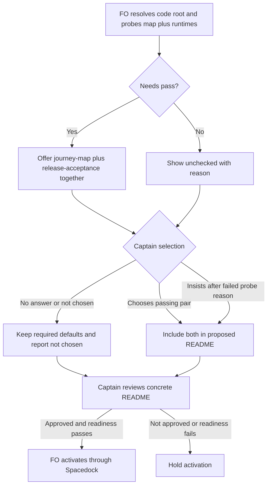

## Scope

- Source: the Captain 「開」 (chat, 2026-10-26), answering FO's ask to file this and the Codex-reader task.
- Bite: Codex P2 on iamcxa/kc-claude-plugins#716 (head 8340c3ba, 2026-10-25T04:30:35Z), unaddressed at merge: `kc-dev-flow-2/references/sd/adoption.md` probes `docs/journey/*.yaml`, but kc-journey-map's README documents `docs/journey/<product>/<journey>.yaml` for multi-product adopters, so the probe rejects valid maps and leaves both journey extensions off. Still on origin/main c70f1b22 (`git show origin/main:kc-dev-flow-2/references/sd/adoption.md`, 2026-10-26).
- Upstream first: kc-journey-map README (map locations) and its own map-finding code, before writing a new glob.

## FO alignment

Alignment: not needed: a recorded review finding against the documented map layout.
Surfaces: none
Visible change: none
Release review: not needed: workflow maintenance, on no journey map.
Reviewer: kc-dev-flow-2:chief-engineer opus 2026-10-27 — batch 8 review at the ideation gate (the Captain's batch ruling 2026-10-27): per-task disposition, the Captain's decisions, order and batch risk.

## Design

### PRFAQ

**Proposition.** On installation, the First Officer (FO) can offer journey-map and release-acceptance together when the repository keeps its journey YAML inside a product folder. The Captain still selects the pair and reviews the concrete configuration before activation.

**Who benefits?** Multi-product adopters following kc-journey-map's documented `docs/journey/<product>/<journey>.yaml` layout. Single-product repositories keep the flat layout.

**What changes?** In `kc-dev-flow-2/references/sd/adoption.md`, Extensions step 1, replace only `needs a docs/journey/*.yaml file` and its immediately adjoining runtime phrase with the following exact wording (backticks retained):

> `release-acceptance` needs a `.yaml` file under `docs/journey/`, including product folders
> (`find docs/journey -type f -name '*.yaml' -print` from the code root), `python3` and `node`;

The command is recursive without a depth limit, uses a quoted filename pattern, lists regular files, and runs from the already-resolved repository code root. A successful traversal with at least one printed path passes the file-presence part. Empty output fails that part; a missing/unreadable root or traversal error is a failed probe with its reason, not a pass inferred from partial stdout. Keep the existing runtime and extension Needs checks. This is file discovery, not a YAML schema validator or proof that a release walk works.

**Does finding a map turn extensions on?** No. Preserve Extensions steps 2–6, including the single paired choice, required defaults, failed-probe reason, the existing Captain-insistence exception, and no-answer reporting. Passing the probe makes the pair eligible for selection; it does not select it. Re-sync preserves an adopter's existing extension list.

**Why a command instead of another glob?** A literal `**/*.yaml` depends on the invoking shell's recursive-glob settings. The existing `find` utility traverses the documented layouts without that setting. No runtime helper, dependency, map migration, host/server change, or new architecture decision record (ADR) is needed. No workflow template, extension tier, adopter file, CI trigger or version file changes.

**What is not included?** Recognizing `.yml`, following symlinked map directories, parsing arbitrary YAML as a valid journey, choosing a map among several, probing a hosted canvas, automatically enabling extensions, or repairing older adopter selections. The documented source suffix is `.yaml`; the downstream journey commands continue receiving explicit paths.



### Chain and bounded existing-code check

Source: `git fetch origin` succeeded on 2026-10-27; pinned `origin/main` is `8bf4f3582411e8e4238f19fbadda8ddeca6767be`. Its `kc-dev-flow-2/.claude-plugin/plugin.json` says `0.32.0`. This is current fetched source, not a claim about live GitHub PR/review state; the GitHub API was not used.

1. **Spacedock first:** read installed 0.27.3 commission and refit source. Commission takes the selected template's adoption inputs; refit reviews scaffolding and proposed changes. A search of its Markdown sources found no `extensions:` entry. It does not own this package-specific map probe; no Spacedock patch is proposed.
2. **kc-dev-flow-2:** adoption Extensions step 1 still names `docs/journey/*.yaml`; both extension documents describe a map *under* `docs/journey/` without restricting depth. `lint-skills.py` checks required tiers against the template list, not map discovery. The defect is the already-named adoption seam, not a missing extension mechanism.
3. **kc-journey-map's own authority:** README lines 203–214 and skill lines 185–186 document flat and product-folder paths. `lib/journey-lint.mjs` accepts an explicit path; `lib/read.mjs:496` loads that supplied path with `parse(readFileSync(path, 'utf8'))`; `lib/journey-walk.mjs` resolves the supplied path and records its repository-relative source. Searches for recursive directory readers/globs and for journey path consumers found no reusable map-discovery CLI in this package. Thus the compatibility claim is documented placement plus explicit-path loading, not an invented upstream discovery API. Server room/asset discovery is outside this seam.
4. **Sibling adopters, read-only local snapshots:** relay `dhaka` has `docs/journey/spacedock-review.yaml`, qnow `qnow-adopt-dev2` has `docs/journey/qnow.yaml`, and web `dev2-fo` has no `docs/journey/*.yaml` at any depth. Their current local README lists are respectively `[learn]`, `[roborev, codex, copilot, learn, peers, journey-map]`, and `[learn, peers, roborev]`. These observations neither infer remote state nor authorize edits; the nested regression uses synthetic fixtures.

ADR 0035 (extension defaults and install choice) already rules the paired selection and preservation of adopter choices; the design follows it. ADR 0018 (shared journey host core) preserves YAML/readback behavior and does not make hosting an installation prerequisite. ADR titles were listed from current source and the assigned checkout; no task-local or top-level live-task `Override:` line was found that changes these decisions. No new ADR or number reservation is proposed.

### Probe evidence and reproduction

The ideation ran the exact proposed command through `sh -c` in seven disposable fixture roots. Results:

| Fixture | Old flat pattern: paths | Proposed command: paths | Exit |
| --- | ---: | ---: | ---: |
| `docs/journey/a.yaml` | 1 | 1 | 0 |
| `docs/journey/product/a.yaml` | 0 | 1 | 0 |
| `docs/journey/product A/domain/a map.yaml` | 0 | 1 | 0 |
| Empty `docs/journey/` | 0 | 0 | 0 |
| Only `.tldr`, `.yml`, and `.yaml` outside `docs/journey/` | 0 | 0 | 0 |
| Directory named `docs/journey/directory.yaml` | 0 | 0 | 0 |
| Missing `docs/journey/` | 0 | 0 | 1 |

The old-pattern baseline used `Path.glob('*.yaml')` filtered by `is_file()` because the existing adoption text has no executable probe. It reproduces the path-depth defect, not historical agent behavior. Fixtures contain a synthetic `journey: synthetic` line; presence testing deliberately does not claim complete schema validity. Mutations adding `-maxdepth 1`, changing the suffix to `.yml`, or selecting directories instead of files each lost the expected map and were caught by the fixture assertions.

Reproduce the decisive cases without any repository write:

```sh
python3 - <<'PYPROBE'
from pathlib import Path
from tempfile import TemporaryDirectory
import subprocess
command = "find docs/journey -type f -name '*.yaml' -print"
cases = {
    'flat': ['docs/journey/a.yaml'],
    'nested': ['docs/journey/product/a.yaml'],
    'deep-space': ['docs/journey/product A/domain/a map.yaml'],
    'empty': [],
    'non-map': ['docs/journey/a.tldr', 'docs/journey/a.yml', 'other/a.yaml'],
    'yaml-directory': [],
    'missing': [],
}
with TemporaryDirectory() as tmp:
    for name, files in cases.items():
        root = Path(tmp) / name
        root.mkdir()
        if name != 'missing':
            (root / 'docs/journey').mkdir(parents=True)
        if name == 'yaml-directory':
            (root / 'docs/journey/directory.yaml').mkdir()
        for filename in files:
            path = root / filename
            path.parent.mkdir(parents=True, exist_ok=True)
            path.write_text('journey: synthetic\n')
        result = subprocess.run(['sh', '-c', command], cwd=root,
                                capture_output=True, text=True)
        expected = sorted(p for p in files
                          if p.startswith('docs/journey/') and p.endswith('.yaml'))
        assert sorted(result.stdout.splitlines()) == expected, name
        assert (result.returncode != 0) == (name == 'missing'), name
        if name == 'nested':
            assert not list((root / 'docs/journey').glob('*.yaml'))
        print(name, result.returncode, sorted(result.stdout.splitlines()))
PYPROBE
```

Implementation adds a focused case in existing `kc-dev-flow-2/scripts/test_lint_skills.py` that extracts the inline `find` command from adoption Extensions step 1 and executes it in these temporary fixtures. Do not hard-code a separate candidate command in the test: reverting the documentation to the flat pattern must make the extraction/behavior test fail, and adding a depth limit must fail the nested case. No new CI job or test dependency is needed; the existing test runner already exercises that file.

Diagram evidence: rendered with the locally installed Mermaid CLI 12.0.0 and inspected as an image; actors, failed-probe exception, selection, approval and hold branches match the prose. The sandbox initially blocked Chromium startup; the approved local renderer retry succeeded. The cache is a convenience, not a required package dependency: reproduction uses any installed `mmdc` with the fenced source as input. Disposable image and probe output are under `/var/folders/tm/dk0m7pgx4h3gxqv_v2v8nds00000gp/T/journey-probe-ideation-2j3ky060/`; the reproducible source and outcomes are retained here.

### Words FO reads at each lifecycle moment

Count convention: whitespace split, same as the package budget. At installation or a refit that revisits the recommendation, FO reads the complete adoption reference: **2069 before, 2085 after (+16)**; within that read, Extensions is **350 before, 366 after**. The proposed reference was formed by the exact replacement above; all other bytes were preserved. This cost buys a shell-independent command and an explicit repository root; it is not a word-reduction claim.

| Lifecycle moment | Before → after | Why |
| --- | --- | --- |
| Installation / refit recommendation | 2069 → 2085 | Complete adoption reference; +16 words once per read |
| Startup | Unchanged, +0 | Workflow, startup/idle mod and printed instructions unchanged |
| Idle on an open PR | Unchanged, +0 | Same `pr_watch.py` output and mod instructions for identical state |
| Idle on a merged PR | Unchanged, +0 | Same `pr_watch.py`/observer/learn instructions for identical state |
| Merge ask | Unchanged, +0 | Delivery check, reviewer text and journey-footprint rules unchanged |
| After archive | Unchanged, +0 | Same learn and journey folding instructions for identical state |

These zeroes are deltas across all affected passages and instruction-producing scripts, not invented totals for arbitrary task-dependent output. No text moves into another lifecycle moment. The flat and nested success paths each print one whitespace-free fixture path; the empty case prints none; the missing-root error is shown as the failed-probe reason. Paths with spaces have variable output word counts and are evidence data, not new instructions. A later diff touching workflow/mod/output producers invalidates this table and requires a recount.

### Unresolved decisions for the Captain

None beyond the ordinary design gate. Recommendation: approve the bounded recursive-discovery correction while keeping the existing selection policy. Cost: 16 extra adoption words, and the presence probe still cannot distinguish valid journey YAML from unrelated `.yaml`; adding schema validation or auto-selection would widen this task and is not recommended here. No new retained state, paid resource, production duty or profile change arises.

### Batch overlap

Files this design would change: `kc-dev-flow-2/references/sd/adoption.md` (Extensions step 1) and `kc-dev-flow-2/scripts/test_lint_skills.py` (execute that documented command). No shared ADR index, numbered record, workflow budget step, or extension tier table changes. Task files below were read as they stood on 2026-10-27; batch-8 siblings mostly have Scope only, so implementation must recheck their eventual file lists.

| Other task | Same file or check; ordering consequence |
| --- | --- |
| `archive-waits-for-observer-report` — require observer before archive | No same file currently named; observer/merge-hook checks are separate. Shared package lint run only. |
| `idle-hook-names-merged-tasks-without-learn` — remind about missing learning | No same file currently named; idle output/mod changes require its own per-moment word count. Shared package lint run only. |
| `copilot-not-run-line-carries-quote` — complete reviewer evidence | No same file currently named; delivery/reviewer checks separate. Shared package lint run only. |
| `dispatch-carries-reserved-adr-number` — retain reserved decision number | No same file currently named; dispatch/number-guard checks separate. Shared package lint run only. |
| `seed-check-requires-schema-fields` — enforce required task fields | No same file currently named; `design_surfaces.py` and schema checks separate. This design uses the currently installed checker and must be rechecked if that one changes. |
| `journey-probe-finds-nested-maps` — this install-probe correction | Owns the two paths above; no second writer. |
| `read-adr-honors-adr-folder` — honor caller's decision-record folder | No same file; kc-adr source/copy sync is separate. Shared package lint run only. |
| `adr-required-statement` — require decision-record statements | Historically edits `adoption.md` in another section. Its body explicitly records Captain closure on 2026-10-20 despite stale validation frontmatter; do not revive or absorb it. Recheck if FO reopens it. |
| `journey-server-host-pilot` — private shared journey host | No same file/check; `journey-server-host-pilot/index.md` and ADR 0018 preserve YAML behavior. Host/source changes are read-only dependencies here. |
| `ops-inbox-r1-setup-and-isolation` — isolate operations workflow setup | No same file/check; owns `kc-ops-inbox/**`, its workflow and decision records. |
| `pr-review-lite-value-pilot` — test useful lightweight PR review | No same file/check; review-capability scripts and its journey are separate. |
| `adr-silent-undo-probe` — measure unrequested decision reversal | No same file/check; fictional scenario harness in archived task state. |
| `comment-check-reaches-delivery-gate` — bind comment evidence to delivered head | No same file; delivery scripts/validation principles separate. Shared package lint run only. |
| `journey-canvas-hosted-poc` — test persistent hosted canvas | No same file/check; hosted sync/auth proof separate; no YAML-format migration. |

Recommended order: this correction can proceed independently of the currently named files; rebase/recheck the two-path diff after other batch designs land, serialize any later `test_lint_skills.py` or adoption edits, and rerun shared package checks on the combined candidate. No peer session was messaged and no sibling task was edited.

## Acceptance criteria

**AC-1** The documented probe finds regular `.yaml` files at flat, product-folder and deeper paths below the resolved code root's `docs/journey/`, including spaces, without enabling shell globstar. Evidence: execute the command extracted from candidate adoption text in those three fixtures and compare printed paths. Falsifier: restore the flat pattern or add `-maxdepth 1`; the nested expectation must fail. Ideation: seven-case probe and flat-only mutation passed; candidate extraction test is not yet implemented.

**AC-2** Empty/missing roots, non-map suffixes, outside-root YAML and `.yaml` directories do not satisfy map presence; traversal failure is shown as a failed probe. Evidence: execute the four negative fixtures above, assert output and exit code, and read the retained failed-probe wording. Falsifier: remove the file-type/suffix/root constraint or treat empty stdout/nonzero exit as success. Ideation: empty, missing, suffix/outside-root and directory cases passed; permission-error handling and actual host presentation remain unverified.

**AC-3** Discovery alone neither enables the pair nor changes runtime requirements, default tiers, no-answer handling, Captain-insistence exception, re-sync preservation, or approval before activation. Evidence: candidate diff is confined to the replacement and executable regression test; compare Extensions steps 2–6 and Before activation byte-for-byte with the pinned base, and run package `test_lint_skills.py` plus `lint-skills.py`. Falsifier: changing a required default or replacing the selection step fails the preservation review. Ideation: proposed reference preserves all non-replacement bytes; live Ask UI and real adoption are not exercised.

**AC-4** The package change adds 16 adoption words and no instruction words at startup, either idle path, merge ask, or archive. Evidence: whitespace-split the pinned base and candidate reference, verify 2069→2085 / Extensions 350→366, and inspect the complete diff for workflow, mod or output-producer changes; independently recount before approval if wording changes. Falsifier: an added runtime instruction or any different adoption count invalidates the measurement. Ideation: exact replacement measured; final implementation recount is outstanding.

**AC-5** The design remains a two-file package correction with matching PRFAQ and rendered Mermaid, and no adopter/host/schema/version change. Evidence: `design_surfaces.py check <task>` exits 0 now; later candidate `git diff --name-only <base> HEAD` names the two designed paths, and focused regression tests execute the documented command. Falsifier: removing a Mermaid branch/approval boundary, missing an acceptance declaration, or adding an adopter mutation breaks this evidence. Ideation: diagram rendered and visually compared; implementation candidate and its tests do not yet exist.

## Stage Report: ideation

- DONE: A design for the journey-extension install probe in kc-dev-flow-2/references/sd/adoption.md to find maps in nested product folders the way kc-journey-map's own README and code locate them, with the probe run against a flat and a nested fixture
  Pinned source 8bf4f3582411e8e4238f19fbadda8ddeca6767be / dev2 0.32.0; upstream documents both layouts and loads explicit paths. All seven reproduced fixtures pass; the old flat pattern misses nested/deeper maps.
- DONE: A `### Batch overlap` section naming each file the design would change and each other batch task (archive-waits-for-observer-report, idle-hook-names-merged-tasks-without-learn, copilot-not-run-line-carries-quote, dispatch-carries-reserved-adr-number, seed-check-requires-schema-fields, journey-probe-finds-nested-maps, read-adr-honors-adr-folder) and live task of other sessions (adr-required-statement, journey-server-host-pilot, ops-inbox-r1-setup-and-isolation, pr-review-lite-value-pilot, adr-silent-undo-probe, comment-check-reaches-delivery-gate, journey-canvas-hosted-poc (driven by other sessions; read only)) that changes the same file or check, so FO can order implementation
  All 14 named tasks accounted for; two proposed package paths; historical adoption overlap explicitly marked closed in its body, with stale validation frontmatter preserved.
- DONE: The words FO reads at each lifecycle moment, before and after, per root learning.md "Measure the words FO reads at each moment, not one file's size"
  Adoption 2069→2085, Extensions 350→366; startup, open/merged PR idle, merge ask and archive each +0 for identical task state; no moved instruction or output producer.
- DONE: Acceptance criteria with reproducible evidence clauses and falsifiers, and unresolved decisions for the Captain, each with a recommendation and what gets worse under it
  AC-1 through AC-5 each state proof and falsifier; no unresolved material choice beyond the design gate; +16 adoption words and presence-only validation are the stated tradeoffs.
- DONE: AC-1 current ideation evidence
  Flat/nested/deeper-space cases execute the proposed command; flat-only mutation loses the nested path. Candidate extraction test remains future implementation evidence.
- DONE: AC-2 current ideation evidence
  Empty/missing/non-map/outside-root/directory cases pass; wrong suffix and directory-only mutations lose expected maps. Permission errors and actual host reason presentation remain unverified.
- DONE: AC-3 current ideation evidence
  Disposable reference changes only the one probe phrase; preserved choices, runtimes and activation reviewed against ADR 0035. Candidate lint/test runs and live Ask UI remain unverified.
- DONE: AC-4 current ideation evidence
  Same whitespace counter over pinned base and exact proposed replacement yields +16; final candidate recount remains owed at implementation/validation.
- DONE: AC-5 current ideation evidence
  Installed design_surfaces.py exits 0: "journey-probe-finds-nested-maps.md: design surfaces presentable"; Mermaid CLI 12.0.0 renders and image matches branches/approvals; no implementation candidate yet.
- SKIPPED: Live GitHub PR/review state and hosted adoption
  Assignment permits git/local evidence; fetch succeeded, GitHub API not used. Neither provider state nor actual model-driven installation is claimed.

### Summary

Designed one recursive, read-only map-presence probe with no new helper or selection policy, plus a regression test that executes the documentation's command. Seven fixture cases and three falsifying mutations distinguish the fix from the flat-only defect; design checks and rendered diagram pass, while implementation and live installation evidence remain outstanding. Pilot scope and existing Captain approval boundaries remain unchanged.
