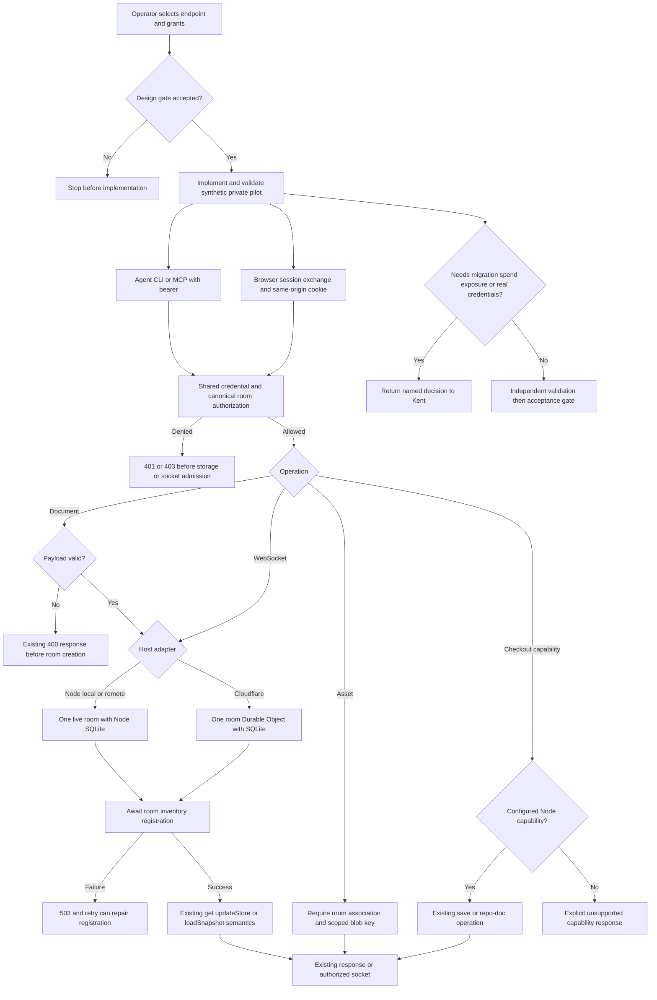

Kent approved a minimal reusable server-host refactor, with the same agent access model (base URL and a per-agent credential) for Node.js locally/remotely and Cloudflare. This is a new pilot task; it does not reopen, migrate, or replace the older hosted POC tasks.

## Scope

Captain authorization, 2026-10-13: "可以，就照這個最小範圍，用 dev2 的 poc profile 開始做，保留 Node 本機／遠端跟 Cloudflare 兩種接法，房間切換 UI 跟並發規則先不動。還是你認為應該走 pilot？" The explicit subsequent profile decision was "改用 pilot（建議）" in response to the question describing a retained Node/Cloudflare shared server with room-switching UI and concurrency unchanged.

Preserve kc-jmap's canvas behavior, YAML authority, record/schema formats, current API paths and read/write semantics. Extract shared room/doc operations; keep platform storage, room lifecycle, room inventory, assets and transport adapters separate. MCP wraps the same operations and authorization policy, never another business-logic implementation. Node local and remote use the same adapter. Cloudflare uses Durable Objects. Agent configuration is base URL plus credential; do not add provider-specific agent workflows.

Preserve GET-created rooms and immediate /health room visibility after successful creation. Preserve the current absence of expected-version checks; POC 409 rejection is not the baseline contract. Keep default local output unchanged. Explicit minimal exceptions: configurable pageLink base and optional CLI credential injection; authentication and room authorization are new access conditions across HTTP, MCP, WebSocket and assets. Node /save and /repo-doc remain available when their filesystem/checkout capability is configured, including remote Node. Cloudflare capability gaps must be visible and explicitly bounded, not described as full parity.

Use the existing repository and the simplest adapters that can serve this one private journey. Sites remains the existing entry; do not replace or redeploy the accepted live POC in this task's design stage. Netlify integration, room/project management UI, room switching UI, new /api/v1 paths, concurrency upgrades, record migrations, new product behavior, broad exposure, paid-plan upgrades, merge and production rollout are excluded. Local hostname/IP coexistence is configuration documentation, not a DNS service or certificate-authority project.

Execution budget: one bounded ideation worker before the design gate; no provider spend or deployment during ideation. Implementation and independent validation follow the approved design. Stop and return a concrete decision if preserving an existing observable contract is impossible, credentials or shared resources must be broadened, a paid service is necessary, or real-data migration is needed. Do not silently widen scope to satisfy a check.

## Evidence and context

Source baseline at admission: iamcxa/kc-claude-plugins main 6d0f8da951b5ea9ea50fca6bd3685fc360bf502f; installed dev2 and adopted source workflow are 0.21.0.

Accepted consultation: /Users/kent/Documents/Codex/2026-10-11/tldraw-tldraw-gpt-plugin/work/kc-jmap-host-refactor-consultation-2026-10-13.md. Two live FO rounds agreed to preserve read-created rooms and immediate room-list visibility; /save and /repo-doc require a capable Node host, not literal localhost.

Existing POC evidence is at /Users/kent/Documents/Codex/2026-10-11/tldraw-tldraw-gpt-plugin/work/kc-jmap-sync-poc/.worktrees/spacedock-ensign-durable-room-free-probe/durable-room-probe/evidence/validation-canvas-review.md. It proves bounded A/B synthetic-note MCP behavior, not full journey-render/read parity. Do not inspect credential files in neighboring directories. Formal tldraw licensing, actual billing, large PATCH free-tier limits and new A/B hibernation remain unverified.

## FO alignment

Alignment: not needed before ideation: Kent approved the exact minimal scope and explicitly selected pilot. Design authors may resolve routine mechanisms within it but must identify actual capability gaps and decisions at the design gate.
Surfaces: db
Visible change: none
Release review: not needed: this is a server-host infrastructure refactor with no user-approved journey release membership; do not invent or alter release mappings.

## Acceptance criteria

**AC-1**: The same journey read/render operations and MCP wrapper can access an authorized room on Node local, Node remote and Cloudflare using only endpoint and credential configuration, preserving record formats and existing canvas behavior.
Verified by: One reproducible fictional journey exercised through the existing CLI and thin MCP entry on each adapter, with browser readback and explicit separation of local/emulated versus hosted evidence. Design must name actual commands and unavailable steps; implementation must not claim all three from a local-only run.

**AC-2**: Existing observable doc and room contracts remain unchanged apart from the explicitly approved authentication conditions and configurable origin.
Verified by: Baseline-versus-candidate checks for GET/PATCH/PUT response and mutation semantics, immediate /health visibility after successful room creation, unchanged local output and page links by default, and unchanged concurrent-write rules.

**AC-3**: Allowed principals share the same room while unauthorized access and A/B cross-room access are denied consistently across supported HTTP/MCP/WebSocket/assets entry points.
Verified by: At least two independent test principals, positive same-room read/write readback and negative credential/room checks; no production credentials or personal data in evidence.

**AC-4**: Platform adapters preserve stored room data and provide explicit file/checkout capability boundaries suitable for bounded real use.
Verified by: Node restart and Cloudflare hibernation/reconnect readback, room-inventory consistency, asset roundtrip where supported, and tests/documented behavior for Node /save and /repo-doc and Cloudflare unsupported capability handling. Evidence distinguishes existing proof from checks rerun on this candidate.

**AC-5**: The retained implementation is minimal, recoverable and does not broaden the approved product scope.
Verified by: Shared operation ownership and adapter dependency review, a bounded setup/recovery/rollback procedure using synthetic data, no room-switching UI/concurrency/API-v1 changes, and explicit remaining deployment, cost and license limitations.

## Number guards

ADR: 0015
Not applied: no deployment, provider provisioning or persistent retained-data migration is authorized. Implementation uses fresh synthetic private storage only; no migrations directory is configured.


## Pilot PRFAQ

**Proposition — one private journey, three endpoint choices.** Kent and two approved agents will read and render the same fictional journey through the existing CLI and a thin Model Context Protocol (MCP) adapter. Selecting local Node, remote Node, or Cloudflare changes the endpoint and credential, not the YAML, record schema, room URL, or complete-record write rules. This design is proposed for the design gate; it is not implementation or hosted acceptance.

**Who uses it?** One operator controls one private pilot installation and its allowed rooms. Two synthetic principals exercise a shared room and separate private rooms. The pilot has no account registration, invitation product, project hierarchy, room switcher, or public anonymous endpoint. The existing Sites entry and old Cloudflare proof remain untouched. Real private data, production credentials, new cloud resources and spend are outside the implementation authority this design alone supplies.

**What is reused?** Extract the current `validateRecord`, GET/PATCH/PUT document operations and response construction into one host-independent module. It receives a `TLSocketRoom` (tldraw's live room coordinator); it does not implement a second store or a new optimistic-lock protocol. HTTP and MCP call those operations after the same authorization function. WebSocket admission, restored sessions and assets use that same principal/room policy. Keep the existing CLI renderer, readback, annotation carry, schema and YAML files authoritative. Node local and remote share the current SQLite/filesystem adapter; a remote HTTPS reverse proxy can reach its loopback listener. Cloudflare uses one SQLite-backed Durable Object (a persistent per-room coordinator) for each canonical room ID.

**What does changing host preserve?** GET still creates a room. A successful room-creating GET, PATCH, PUT or WebSocket admission returns only after the room appears in the strongly consistent inventory. PATCH validates the complete `put` batch before creating/mutating a room, executes puts then removals in one `updateStore`, and keeps `{roomId, put, removed, clock}`. PUT continues `loadSnapshot` replacement. There is no expected-version check and no new 409: two stale writes to one record still permit last-writer replacement, as the baseline probe demonstrates. Do not substitute the earlier proof's concurrency protocol.

**How do agents connect?** Keep `JOURNEY_API` and its current loopback default. Add optional `JOURNEY_API_TOKEN` for one opaque per-agent bearer credential, consumed by a single CLI request helper at all existing read/render/import/writeback fetch sites. The MCP endpoint is `<JOURNEY_API>/mcp`; a stateless Streamable HTTP transport exposes `get_doc`, `patch_doc`, `put_doc` and `health`, with the same arguments, result bodies and authorization outcomes as HTTP. No second renderer or provider-specific agent tool is needed. Credentials never enter tool arguments, canvas records, YAML, query strings, logs or page links. CLI failures must stop with a credential/HTTP error rather than interpreting an unauthorized JSON response as an empty room.

**How does a browser authenticate without a login product?** A narrow `POST /session` exchange accepts the same bearer credential, checks it, and sets an opaque HttpOnly, Secure, SameSite=Strict, host-only session cookie; the JSON response contains no credential. An authorized local browser setup command performs that exchange in its own context, then opens the normal `/?room=...` page. The existing page sends the cookie on its same-origin HTTP, WebSocket and image requests. This is authentication plumbing, with no new canvas controls. Sessions expire after 15 minutes and are bounded by the parent credential's expiry/revocation; every request resolves the parent policy. WebSocket admission checks the exact configured Origin, and the adapter expires/closes admitted sockets at that deadline; HTTP writes using a cookie also check Origin. Agent bearer requests need no browser cookie. Cross-origin Sites embedding, third-party cookies and authenticated export automation remain NOT RUN: a deployment that cannot supply a same-origin browser boundary is not accepted by this design, and must return to the gate rather than silently putting long-lived credentials in URLs.

**How are credentials managed?** A small operator-maintained grant document has credential ID, SHA-256 digest of a random 256-bit secret, principal ID, canonical room allowlist, expiry and revoked flag. The bearer form is `credentialId.secret`; deny by default. The same policy rule is used by all transports; live sessions carry the authorized credential ID and deadline, and a resumed socket re-resolves its current grant before messages or delivery resume. Private mode has no implicit anonymous principal. Existing no-credential behavior remains only in the loopback legacy-local mode; private remote Node and Cloudflare refuse startup without policy. Issue/rotate/revoke is an operator setup operation, not a public admin API or identity service. Revocation first marks the grant revoked, then sends an internal close-by-credential request to each room in its bounded allowlist (including attached hibernated sockets); no public admin route or background reconciler is added. A revoke operation is complete only after affected sockets are closed and the new policy is read back; failure to close or refresh is a reported partial revocation, never a success. Implementation must show the smallest host-specific way to enforce this before claiming credential lifecycle acceptance. No production credential is needed for local tests.

**How are assets isolated?** The current global `/uploads/:id` route has no room ownership; identical IDs overwrite the same file, observed with synthetic bytes. Keep the route and `asset:<id>` record format, but private-mode browser transport adds the current non-secret `room` query to upload and resolve requests. Authorize the canonical room first, then map `(roomId, sanitizedAssetId)` to a room-scoped blob key. Two rooms may safely use the same asset ID; a forged query cannot grant access. Asset metadata and successful blob writes must be committed before success is acknowledged. Existing unassociated assets are not assigned to a room by guessing or by a record reference. Legacy loopback mode keeps its current asset layout. Private pilot mode starts with separate empty storage; if retained assets/data must be adopted, stop for an explicit migration decision. No migration is proposed here.

**What can each host actually do?** See the capability table below. `/save` and `/repo-doc` depend on configured writable storage and mapped Git checkouts, so capable remote Node can support them. Private-mode transport also supplies/checks room context for these calls; mapping a checkout grants only the operator-configured repository capability to the allowed room. Cloudflare cannot run local Git or write a user's checkout. Its `/repo-doc` returns the existing `{state:'unavailable', reason:...}` shape. `/save` is unavailable, with a non-JSON 501 response so the current SaveButton probe hides it without changing UI. That hiding is not evidence of parity: the capabilities manifest, setup instructions and validation report must all say unsupported.

**What happens on failure?** Validate/authenticate before any room creation. For Cloudflare, create/open the room store, then await an idempotent registry upsert, then respond; registry failure returns 503 rather than acknowledging an invisible room. A retry repairs a created-but-unregistered room. The registry is the enumerator, not another copy of the document. Its failures must not fall back to an empty successful `/health`. Reads of `/health.rooms` are direct strongly consistent registry reads, filtered by room grants, never eventually consistent cache reads. PATCH/PUT retry after a lost response retains current semantics: the outcome may be unknown; do not add deduplication or claim a safe new retry contract.

**What requires a decision?** The only proposed compatibility exception beyond the already authorized auth/origin changes is Cloudflare `/health.active` telemetry: Node reports its in-memory room map; Cloudflare has no equivalent global resident process. Recommend preserving the field shape but returning a freshly sampled list of authorized registered room coordinators with session/clock values, explicitly documented as a sample that can wake those rooms. `port` remains the configured logical API port (Node default 5858; Cloudflare external endpoint port, normally 443), covered by configurable origin. The `rooms` existence/timing contract remains exact. If Kent requires identical process-residency meaning for `active`, hold the Cloudflare adapter; do not invent a background coordinator or silently claim parity. Approval of this exception is pending at the design gate.

### Flow and authority



Read the operation box as validation followed by the existing mutation: invalid PATCH/PUT is rejected before adapter creation; the diagram's shared core box contains only execution after admission. The design gate, runtime denials, registry failure and later acceptance gate have distinct owners and outcomes. A successful Mermaid render only proves diagram syntax; the author separately compared these actors, branches and stop points with this prose.

## Schema and capability sketch

Migration source: This task's schema sketch is the design source of truth; there is no SQL migration, ADR number, provider resource or product schema change in ideation. Implementation must retain tldraw 5.4.0-owned document/tombstone/metadata tables through its existing wrappers. New private-pilot metadata is separate and applies only to fresh synthetic storage; importing retained data requires a new decision.

| Entity / field | Key or type | Authority and invariant |
| --- | --- | --- |
| CredentialGrant.credentialId | primary key string | Operator-assigned handle, not verified human identity |
| CredentialGrant.secretDigest, principalId | SHA-256 digest, opaque string | No plaintext secret stored; multiple credentials may identify one principal |
| CredentialGrant.rooms, expiresAt, revoked | canonical room-ID set, timestamp, boolean | Same rule for HTTP/MCP/WS/assets; validate IDs after the existing sanitizer before membership checks |
| BrowserSession.sessionDigest | primary key digest | Opaque cookie secret resolves to a grant; never placed in URL |
| BrowserSession.credentialId, expiresAt | foreign key, timestamp | Expiry at most 15 minutes and never beyond parent grant; revocation closes associated sockets |
| RoomInventory.roomId, createdAt | primary key canonical ID, timestamp | Only records a successfully initialized room; idempotent registration awaited before successful response |
| AssetOwnership.roomId, assetId | composite primary key | Room must exist and be authorized; use existing asset sanitization before lookup |
| AssetOwnership.blobKey, contentType, size | scoped key, string, integer | Bytes stored by adapter; acknowledge only after bytes and association are durable |
| Room document | existing RoomSnapshot / TLStoreSnapshot | Unchanged tldraw schema, full-record PATCH and snapshot PUT semantics |
| HostCapabilities.save, repoDoc, assets | configured booleans | Returned by authenticated `/capabilities`; not inferred from a hidden UI button |
| HostCapabilities.roomRepoMap, saveDir | Node-only explicit mapping/path | Room capability to a configured checkout; no user-supplied arbitrary host path |

One small strongly consistent registry Durable Object owns Cloudflare inventory, grant/session lookup and asset ownership; a separate per-room Durable Object owns tldraw's existing SQLite tables. Node uses a separate metadata SQLite file alongside its unchanged per-room databases. The exact schema initialization can be chosen at implementation; there is no general account, organization, project or naming database. Host adapter APIs are `openRoom`, `listRooms`, `readCapabilities`, `putAsset/getAsset` and policy/session persistence; storage interfaces do not own rendering or rewrite record contents.

| Capability | Node local | Node remote | Cloudflare |
| --- | --- | --- | --- |
| Existing doc operations and MCP wrapper | Same core | Same Node adapter/core | Same core in room coordinator |
| Room creation and immediate inventory | Current `.db` behavior | Same | Await strong registry acknowledgement |
| SQLite persistence / live WebSocket | Current wrapper | Same; one process owns each room | Package wrapper + platform socket lifecycle; candidate unverified |
| Asset bytes | Existing fs in legacy mode; scoped private directory | Same | Scoped object-storage adapter; provider/bucket not provisioned |
| `/save` | Configured filesystem | Configured filesystem | Unsupported; explicit capability false / non-JSON 501 |
| `/repo-doc` | Configured checkout | Configured checkout | Existing unavailable result shape |
| Browser readback / export behind auth | Must test session | Must test HTTPS origin | Must test same-origin route and session; not proven by old Sites proof |
| `/health.active` | Current resident map | Current resident map | Proposed sampled telemetry exception; gate decision required |

`GET /capabilities` and `POST /session` are narrow setup/auth additions. Existing `/doc`, `/health`, `/connect/:roomId`, `/uploads/:id`, `/save` and `/repo-doc` paths remain. There is no `/api/v1` or room/project management API. Browser transport changes add room context, never a room switcher or a new stored asset URL format. Default page links remain byte-for-byte `http://localhost:3737/...`; an optional `JOURNEY_CANVAS_BASE` changes only newly rendered pageLink URLs. Existing snapshots are not rewritten by startup or migration.

## Evidence, proposed acceptance and limits

Baseline: `6d0f8da951b5ea9ea50fca6bd3685fc360bf502f` on `main`, clean before design. Consultation source was older `9e68eb87`; its claims were checked against this checkout. Specifically: `server/canvas-server.ts` owns the four room-creating paths and response bodies; `server/rooms.ts` owns canonicalization and synchronous SQLite creation; `server/assets.ts` has global file IDs; `server/client/App.tsx` supplies no auth and uploads/resolves without room; `records.mjs:103` hardcodes the page link; `read.mjs`, `render.mjs` and `journey-tldr.mjs` use configurable base URLs without credential headers. `SaveButton.tsx` distinguishes non-JSON; `DocPopup.tsx` catches fetch/JSON failure as unavailable. Browser effects have not been claimed from this source read.

Existing-code check used two bounded searches: (1) server/lib/package for auth, credentials, MCP, DurableObject and bearer/header wiring; (2) README/skill and client routes for callers, health use and capability behavior. No existing kc-jmap authorization/MCP/Cloudflare adapter was found in that boundary. External private wrappers and dormant integrations are unknown, not declared nonexistent. Preserve accepted ADR “A re-render carries a hand-drawn shape with the cards it overlaps”; this refactor must not reimplement carry behavior. No applicable `Override:` record or existing server-host ADR was found. `learning.md` requires real instrument output and real browser origin checks; curl alone will not prove browser origin behavior.

Current executable evidence is [baseline-result.json](evidence/baseline-result.json), produced by [run-baseline.mjs](evidence/run-baseline.mjs) against byte-compared source copies, synthetic rooms and ephemeral loopback ports. It checks GET/health order, validation-before-removal, stale complete-record overwrite, PUT, binary asset collision, default link, fictional CLI render/read and Node restart. It also checks the installed pinned package exports `DurableObjectSqliteSyncWrapper` and `handleSocketResume`; exporting functions is source/API compatibility evidence, not Cloudflare runtime or hibernation proof. A test would fail if read-created inventory were deferred, 409 preconditions were added, failed PATCH removed records, last-writer semantics changed, or record persistence disappeared.

The initial sandbox run could not resolve npm or bind a socket. Public locked dependencies were then installed with empty npm configuration and install scripts disabled; the local probe ran with loopback permission. An exploratory text/plain upload returned empty bytes because the existing Fastify text parser consumed that content type; the collision proof uses supported opaque binary content instead. This is an existing route limitation, not a repaired defect or a claim that all asset MIME types work. No candidate implementation or hosted resource was used.

Current package source and [tldraw sync documentation](https://tldraw.dev/docs/sync) support using its existing storage wrappers and one room coordinator. [Cloudflare storage documentation](https://developers.cloudflare.com/durable-objects/best-practices/access-durable-objects-storage/) describes strongly consistent per-object storage; it does not create a cross-object transaction. [Cloudflare WebSocket documentation](https://developers.cloudflare.com/durable-objects/best-practices/websockets/) describes hibernation resetting memory and restoring socket attachments. Implementation must wire the package resume APIs or document/test normal reconnect; a live socket that silently loses authorization after hibernation fails acceptance.

### Reproduce current local evidence

From a fresh clone at the baseline, set `WT` to its absolute root and `TASK` to this state task folder. No credentials or provider access are used. Node >=22.13 is required (observed 24.18.0); package downloads and loopback socket permission are required. The preparation script copies only source plus the locked package manifest into the ignored task scratch directory.

```sh
rtk proxy python3 "$TASK/evidence/prepare-baseline.py" "$WT"
rtk proxy npm ci --prefix "$TASK/evidence/.scratch/baseline" --ignore-scripts --no-audit --no-fund --fetch-retries=0 --userconfig="$TASK/evidence/.scratch/empty.npmrc" --globalconfig=/dev/null --cache="$TASK/evidence/.scratch/npm-cache"
rtk proxy node "$TASK/evidence/run-baseline.mjs" "$WT"
rtk proxy python3 /Users/kent/.codex/plugins/cache/kc-claude-plugins/kc-dev-flow-2/0.21.0/scripts/design_surfaces.py check "$TASK/index.md"
```

The package checker path is this commissioned installation, not a hidden dependency of kc-jmap; on another machine use the installed 0.21.0 package root named in its dispatch. Runtime copies, SQLite files and npm cache are ignored/disposable. The retained report and probe script contain only synthetic data. Delete the task's `.scratch` after stopping its own processes if storage cleanup is wanted; never delete browser profiles or adjacent configuration.

### Implementation acceptance contract — not yet implemented or passed

Implementation should add one bounded `scripts/host-contract-check.mjs` acceptance runner, with explicit modes below, using existing package APIs and a synthetic fixture. The commands are a deliverable contract, not an assertion that this script exists today. It must exit nonzero on an assertion failure and emit separate source, local-emulator and hosted evidence, including candidate SHA, exact package/runtime versions and target URL.

```sh
# Local runner starts/stops disposable servers; uses synthetic grants only.
rtk proxy node "$WT/kc-journey-map/scripts/host-contract-check.mjs" --adapter node --synthetic
rtk proxy node "$WT/kc-journey-map/scripts/host-contract-check.mjs" --adapter cloudflare-local --synthetic
# Only after separate authorization provides disposable hosted targets and a secret wrapper:
<approved-wrapper> node "$WT/kc-journey-map/scripts/host-contract-check.mjs" --adapter node-remote --synthetic
<approved-wrapper> node "$WT/kc-journey-map/scripts/host-contract-check.mjs" --adapter cloudflare-hosted --synthetic
```

The last two are explicitly NOT RUN and non-executable placeholders until FO records a wrapper/endpoint authorization; this task has no configured secret wrapper. The runner's real delivered interface and exact runnable commands must be recorded before implementation completes. Do not claim hosted parity from `cloudflare-local` or a second loopback port.

- **AC-1 future evidence:** Existing `journey-render.mjs` then `journey-read.mjs` on a fictional YAML, followed by independent MCP get and browser record readback, on each named adapter. Compare meaningful record fields/default pageLink and CLI result bodies to baseline. Hostname and IP browser cases use a genuine top-level origin (the existing Chromium DNS mapping technique where needed). Fails if any transport has a separate renderer or lacks credentials. Current: baseline CLI only; candidate, MCP and browser all unverified.
- **AC-2 future evidence:** Reuse baseline GET/PATCH/PUT/health order checks against candidate, including denied/noncanonical aliases, invalid batch no creation/mutation, stale same-record writes and a removed-then-put snapshot. Compare default renderer outputs unchanged with no credential/base override; configured link changes only the URL field. Inject registry failure and assert 503 then successful retry visibility. Current: unchanged Node baseline observations, not candidate parity.
- **AC-3 future evidence:** Two principals may both mutate shared room S; principal A alone gets room A and B alone gets room B. For HTTP, MCP, browser WebSocket and asset routes, verify missing/invalid/expired/revoked credentials and cross-room attempts fail before creation, metadata or bytes leak. Attempt the same asset ID in both rooms, unauthorized overwrite, guessed unassociated legacy asset and sanitizer aliases. Exercise session exchange, origin denial, expiry, revoke with an already open socket, and wake/resume with a revoked principal. Current: global asset gap proven; no candidate auth proof.
- **AC-4 future evidence:** Node restart, Cloudflare local eviction/reconnect and separately hosted hibernation/reconnect must preserve a digest of synthetic records and asset bytes. Verify two rooms, fresh health inventory after each create, capabilities, capable remote Node save/repo-doc using a disposable committed fixture checkout, and Cloudflare's explicit unsupported responses with browser readback. Current: Node baseline restart; no candidate, Cloudflare or recovery proof.
- **AC-5 future evidence:** Review imports to confirm one operation core and platform-only adapters, then export one disposable room snapshot plus its associated asset bytes/manifest; restore to fresh storage, compare records/assets and reconnect. Revoke synthetic grants, stop candidate, and rerun old Node against its untouched legacy directories. Check product diff contains no room-switcher, 409, API-v1, schema/record migration, Sites/Netlify deployment or production credentials. Current: design-only clean product tree; candidate rollback and complete recovery not run.

### Bounded delivery and stops

Implement only the shared core, Node adapter/auth, Cloudflare adapter/inventory, room-associated assets, minimal MCP/session/capability transports, optional CLI credential/base configuration and one acceptance runner. No standing CI system is required by this design; CI cost was not measured and no CI changes are proposed. Keep private pilot directories/namespaces distinct from existing rooms and the retained POC. Test the central seams above; do not build a general identity platform, global naming service or background inventory reconciler.

Before retained real use: independently validate candidate code locally, settle the `/health.active` exception, prove a full fictional journey on the authorized hosted targets, and confirm provider limits, tldraw licensing and actual cost. There is no assumed free-tier budget, plan upgrade or measured hosted cost. Large PATCH CPU/body limits, formal tldraw use rights, provider bill, real A/B hibernation and complete recovery are unverified. If any of these requires paid provisioning, a persistent migration, real/production credentials, broader exposure or changed observable write behavior, stop for a named decision. Published upgrade/versioning and any deployment require their own later authority.

## ADR draft — One room-operation core with host adapters

Proposed ruling, unnumbered: retain the current tldraw operation and record contract in one shared core; use one Node adapter for local and remote hosts and one Durable Object per Cloudflare room, with a separate strongly consistent metadata registry. Authorized transports share policy; private assets require explicit room ownership. Preserve YAML authority, GET auto-create, immediate acknowledged inventory, last-writer full-record PATCH and full PUT replacement. Reject multi-process shared-SQLite coordination, a second MCP business layer, eventually consistent inventory acknowledgements, implicit legacy-asset ownership and a concurrent-write protocol upgrade. The Cloudflare health telemetry exception remains pending, and no retained-data migration or hosted acceptance follows from this draft.


## Stage Report: ideation

- DONE: Produce a minimal source-grounded Pilot PRFAQ and matching Mermaid for one private journey across Node local/remote and Cloudflare, preserving existing API/data/concurrency behavior and naming only authorized exceptions.
  PRFAQ, rendered flow and source audit above; Cloudflare `/health.active` is explicitly a pending compatibility decision, never an accepted exception.
- DONE: Define the smallest room inventory/auth/assets schema and capability boundaries, with reproducible risk evidence that distinguishes source/local proof from unrun hosted, license, cost and recovery checks.
  Schema/capability tables plus evidence/baseline-result.json; unchanged binary asset IDs demonstrably overwrite globally, so private assets require room association and no implicit legacy migration.
- DONE: Provide decisive acceptance commands, bounded implementation/validation scope and open decisions in the exact ideation report; run the required design-surface checks without changing product code or deploying.
  Commands and falsifiers above; design_surfaces.py exited 0: `index.md: design surfaces presentable`; product main remains clean at 6d0f8da951b5ea9ea50fca6bd3685fc360bf502f.
- DONE: AC-1 current evidence and limit assessed.
  Unchanged CLI rendered/read a fictional 12-shape journey; candidate MCP, browser and all hosted adapter equivalence are NOT RUN.
- DONE: AC-2 current evidence and limit assessed.
  Baseline GET/health timing, invalid PATCH no removal, stale PATCH 200/200 with final x=0,y=789, PUT restoration and default pageLink passed; a 409/concurrency change would fail this probe; candidate parity NOT RUN.
- DONE: AC-3 current evidence and limit assessed.
  Same-ID binary upload returned the second room's intended bytes in the global baseline; falsifies ownership-by-authentication alone. New policy/session/transport isolation is NOT RUN.
- DONE: AC-4 current evidence and limit assessed.
  Baseline Node restart preserved 14 records and inventory; pinned 5.4.0 storage/resume exports exist. Candidate restart, Cloudflare A/B hibernation, assets/recovery and checkout UI behavior are NOT RUN.
- DONE: AC-5 current evidence and limit assessed.
  Product checkout remains untouched; task-only probes used synthetic data, ephemeral ports and no credentials. Candidate dependency review, restore/rollback, provider cost and licensing are NOT RUN.
- DONE: Render and compare the required diagram with the design.
  Mermaid 11.16.1 browser render reported `passed`, one SVG; evidence/design-flow.png visually checked against actors, validation-before-creation, registry failure and approval stops. Render success alone is not semantic or hosted proof.
- SKIPPED: Hosted deployment, billing, license acceptance, persistent migration and production credential checks.
  Outside authorized ideation; no provider access, secret reads, real canvas data, product branch, PR or deployment. Required before any claim of retained hosted readiness.

### Summary

One shared-operation design, a minimal metadata schema and an unnumbered ADR draft are ready for the design gate, with executable unchanged-Node evidence and explicit future acceptance commands. Cloudflare health `active` sampling is the sole new compatibility decision; immediate `rooms` visibility and current writes remain required, while legacy asset adoption is excluded. This completes ideation authoring only; implementation, independent validation and hosted acceptance remain pending.

## Stage Report: implementation

- DONE: Deliver the approved shared document-operation and authorization core with Node local/remote and Cloudflare adapters, thin HTTP/MCP/session/asset transports, preserving existing canvas/schema/YAML/read-write behavior and the explicitly accepted health.active exception.
  Local candidate `4f678cd88eddbcc171df7e2037dd19d2fbf4065b`, base `6d0f8da951b5ea9ea50fca6bd3685fc360bf502f`: shared core/policy, one Node adapter, Durable Object/R2 adapter, scoped assets, session exchange and operator recovery; Cloudflare sampled `health.active` follows the recorded Captain approval.
- DONE: Exercise one synthetic private journey and two-principal room isolation through the delivered CLI, MCP, browser and assets; report reproducible Node and Cloudflare-local results separately from unrun hosted, billing, license and hibernation claims.
  [Node 19 groups](evidence/implementation-node-result.json) and [Cloudflare-local 20 groups](evidence/implementation-cloudflare-local-result.json) PASS at the exact clean candidate; Node v24.18.0, tldraw 5.4.0, Miniflare 4.20260730.0, Playwright 1.56.1, esbuild 0.28.2.
- DONE: Deliver bounded setup, recovery and rollback instructions, ADR 0015 and affected-document updates; run required candidate checks and commit only this task's product/evidence changes plus an honest implementation Stage Report.
  `kc-journey-map/docs/private-host.md` documents credentials, capabilities, setup, archive/restore and rollback; ADR `0015-one-private-journey-operation-core.md` records the accepted decision. Full number-guard configuration remains a reported failure below, not a passing check.
- DONE: Preserve the full number_guards exit-2 configuration error and all accepted migration/data boundaries; complete unaffected implementation and checks.
  [FO clarification](dispatch/implementation-1-number-guard-clarification.md) preserves `Surfaces: db`, fresh synthetic storage and no migration; neither helper nor workflow was changed to manufacture a passing configuration.
- DONE: Supply narrowly labelled read-only ADR reservation and SQL-diff evidence without representing it as a passing full migration guard.
  Supplement only: helper without `--task` exits 0 with `migration guard skipped: no migrations-path declared; R4 skipped: no --task given; PASS: no findings`; actual added ADR is reserved 0015 and base-to-candidate diff adds/changes no SQL files.
- DONE: Preserve observable document, CLI and concurrency contracts through real adapter requests.
  Baseline/candidate record fields and stacking order match (random index suffixes excluded); GET immediately appears in filtered health, invalid PATCH/PUT changes nothing, and stale full-record writes still overwrite with no 409. Cloudflare registry fault yields 503 then retry visibility; deferred acknowledgement or a new concurrency rule fails these checks.
- DONE: Exercise access policy, sessions and private asset isolation at transport boundaries.
  Missing/invalid/expired/revoked/cross-room credentials, sanitizer aliases, wrong origins, guessed legacy assets and unauthorized same-ID overwrites are denied; both principals can write the shared room. Credential leakage, cross-room bytes or unauthorized creation would fail the runner.
- DONE: Exercise genuine browser origins and the existing canvas.
  Actual HTTPS `pilot.test` and `127.0.0.1` top-level origins exchange HttpOnly/Secure/Strict cookies, read CLI records over tldraw WebSocket, export the native snapshot and fetch scoped assets; test-only certificates/DNS mapping add no production service. Screenshots: [Node hostname](evidence/implementation-node-hostname.png), [Node IP](evidence/implementation-node-ip.png), [Cloudflare hostname](evidence/implementation-cloudflare-local-hostname.png), [Cloudflare IP](evidence/implementation-cloudflare-local-ip.png).
- DONE: Exercise restart, complete recovery, expiry, revocation and rollback.
  Records/inventory/bytes survive restart or emulator eviction; snapshot plus every associated asset restores into empty storage and reconnects; expiry/revocation closes live sockets and persists across restart; unchanged baseline reopens untouched legacy storage. Lost assets, reopened revoked access or altered legacy data would fail.
- DONE: Report the observed Cloudflare-local close boundary without a hosted claim.
  Server sockets must reach CLOSED before revoke success (otherwise partial/503); Miniflare's Node WebSocket client close event took 30.548 s, with expiry group 38.431 s including its deadline. The runner requires the actual close event within bounded 35/40 s limits; hosted timing and platform hibernation remain NOT RUN.
- DONE: Run code, documentation and committed-review checks.
  TypeScript, Vite build, existing 215 library tests and `git diff --check` pass; version/config parity and 68 skill manifests pass. `design_surfaces.py`: presentable; `adr_lint.py --since BASE --require 0015`: 14 ADRs, 0 legacy; roborev: `clean on 4f678cd88; evidence=roborev:621`. These detect wiring/type/regression/doc/review faults; the build retains its large-chunk warning.
- DONE: Apply the required comment and affected-document checks.
  `comment_ratio.py BASE HEAD --repo WT --workflow-dir WT/docs/dev2`: PASS, code 1148, comment 0, ratio 0.0%, maximum 5%. `doc_impact.py`: private-host.md updated; `docs/journey/kc-journey-map/README.md` unaffected because its default legacy import/export journey and canonical format remain valid. Plugin README and canvas reference were also updated.
- DONE: Apply the existing-code and minimality check at the approved boundary.
  The accepted two-search audit found no in-boundary authorization/MCP/Cloudflare seam; baseline global asset collisions falsify private isolation without this change. Core/policy/adapters map to those missing seams, recovery to the lifecycle obligation, and esbuild/Miniflare/Playwright to bundling/emulation/browser proof; existing dependency versions are unchanged. Replaced rooms.ts behavior now lives in the Node adapter; no room UI, record migration, CI, background service or provider provisioning was added.
- SKIPPED: Full task-aware number_guards check is unavailable in the accepted no-migration scope; CONFIG ERROR, explicitly NOT PASS.
  `number_guards.py check --repo WT --workflow-dir WT/docs/dev2 --task TASK/index.md --base BASE` exits 2: `number_guards: task has Surfaces: db but no migrations-path is declared (pass --migrations-path or set migrations-path: in the workflow README)`. This fresh-storage task has no truthful baseline migration directory; [FO's report-only disposition](dispatch/implementation-2.md) classifies the full guard as unavailable/inapplicable, preserving the failed attempt and requiring independent validation to rerun/report it and verify the no-migration boundary.
- SKIPPED: Hosted Node/Cloudflare, actual provider hibernation, billing, licensing, retained-data migration, deployment and PR publication.
  Not authorized/run; local emulator evidence does not establish these claims. No product branch push, PR, merge, provider resource, real canvas or production credential was used; no CI cost per PR was measured.

### Summary

The approved private pilot is locally implemented and committed; actual Node and Cloudflare-local journeys, browser origins, failure paths and recovery pass. Independent validation and the full number-guard configuration disposition remain with FO; this report grants no hosted or acceptance approval.
Reproduce with `WT` set to the assigned candidate worktree, `BASE` to the SHA above, `TASK` to this task directory and `PKG` to the explicitly restored 0.21.0 root in [package recovery](dispatch/implementation-1-package-recovery.md): `rtk proxy node "$WT/kc-journey-map/scripts/host-contract-check.mjs" --adapter node --synthetic`, then the same command with `--adapter cloudflare-local`. Locked install/browser prerequisites are in private-host.md; hosted adapter modes intentionally reject absent authorization.
[Candidate-check receipt](evidence/implementation-checks.json) retains exact check commands/results and supplemental guard evidence. Task-owned processes were checked stopped; product tree was clean on the candidate before report/state synchronization.

## Stage Report: implementation (cycle 2)

- DONE: Correct only the report disposition of the inapplicable full migration-number check, preserving its exit-2 attempt and raw evidence; label the unavailable full guard SKIPPED, never PASS, so independent product validation can proceed without a false migration claim.
  The report classification above follows [the bounded FO disposition](dispatch/implementation-2.md); the prior failed report remains at state commit `08825b953d9f7cd345eaad0f444be3b32a8e8ca7`, and the raw receipt is unchanged. Supplementary no-task output still reports R4 skipped; the ADR reservation comparison and empty SQL diff remain separate observations.
- DONE: Commit the task-only report and this bounded FO disposition; retain the exact product candidate unchanged and report its clean identity.
  The disposition is already committed in `90a391a4`; this continuation changes only the task report. `git status --short --branch` and `git rev-parse --show-toplevel HEAD` confirm the assigned product worktree is clean on `spacedock-ensign/journey-server-host-pilot` at `4f678cd88eddbcc171df7e2037dd19d2fbf4065b`; no product or acceptance-criterion edits and no additional tests.
- SKIPPED: Full task-aware migration-number guard is unavailable/inapplicable, explicitly NOT PASS.
  Preserved command: `rtk proxy python3 "$PKG/scripts/number_guards.py" check --repo "$WT" --workflow-dir "$WT/docs/dev2" --task "$TASK/index.md" --base "$BASE"`; exit 2 and exact error above remain in the unchanged [raw receipt](evidence/implementation-checks.json). The pinned helper requires preexisting numbered SQL, which this accepted fresh-storage/no-migration task lacks; no fake path, changed surface or modified helper is substituted.

### Summary

Only the unavailable-check report disposition changed; the product candidate and earlier evidence are unchanged. Independent validation must read the failed attempt, rerun/report the guard, verify the no-migration boundary and judge the remaining evidence; this is not full acceptance, hosted readiness or delivery approval. A changed candidate, real migration, conflicting reservation or new evidence returns this disposition to FO.
