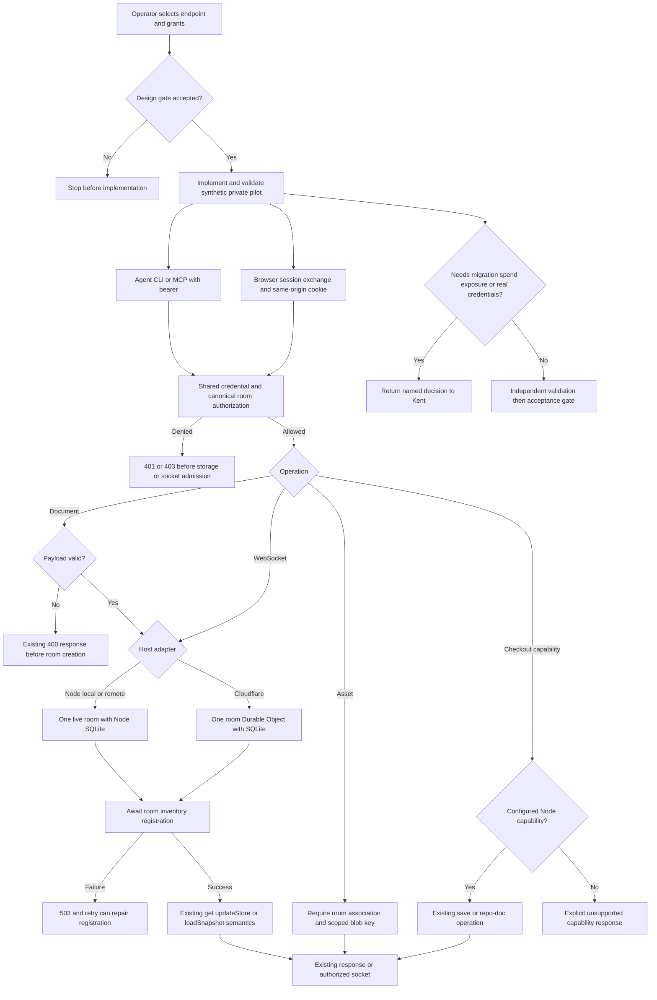

Kent approved a minimal reusable server-host refactor, with the same agent access model (base URL and a per-agent credential) for Node.js locally/remotely and Cloudflare. This is a new pilot task; it does not reopen, migrate, or replace the older hosted POC tasks.

## Scope

Captain authorization, 2026-10-13: "可以，就照這個最小範圍，用 dev2 的 poc profile 開始做，保留 Node 本機／遠端跟 Cloudflare 兩種接法，房間切換 UI 跟並發規則先不動。還是你認為應該走 pilot？" The explicit subsequent profile decision was "改用 pilot（建議）" in response to the question describing a retained Node/Cloudflare shared server with room-switching UI and concurrency unchanged.

Preserve kc-jmap's canvas behavior, YAML authority, record/schema formats, current API paths and read/write semantics. Extract shared room/doc operations; keep platform storage, room lifecycle, room inventory, assets and transport adapters separate. MCP wraps the same operations and authorization policy, never another business-logic implementation. Node local and remote use the same adapter. Cloudflare uses Durable Objects. Agent configuration is base URL plus credential; do not add provider-specific agent workflows.

Preserve GET-created rooms and immediate /health room visibility after successful creation. Preserve the current absence of expected-version checks; POC 409 rejection is not the baseline contract. Keep default local output unchanged. Explicit minimal exceptions: configurable pageLink base and optional CLI credential injection; authentication and room authorization are new access conditions across HTTP, MCP, WebSocket and assets. Node /save and /repo-doc remain available when their filesystem/checkout capability is configured, including remote Node. Cloudflare capability gaps must be visible and explicitly bounded, not described as full parity.

Use the existing repository and the simplest adapters that can serve this one private journey. Sites remains the existing entry; do not replace or redeploy the accepted live POC in this task's design stage. Netlify integration, room/project management UI, room switching UI, new /api/v1 paths, concurrency upgrades, record migrations, new product behavior, broad exposure, paid-plan upgrades, merge and production rollout are excluded. Local hostname/IP coexistence is configuration documentation, not a DNS service or certificate-authority project.

Execution budget: one bounded ideation worker before the design gate; no provider spend or deployment during ideation. Implementation and independent validation follow the approved design. Stop and return a concrete decision if preserving an existing observable contract is impossible, credentials or shared resources must be broadened, a paid service is necessary, or real-data migration is needed. Do not silently widen scope to satisfy a check.

## Evidence and context

Source baseline at admission: iamcxa/kc-claude-plugins main 6d0f8da951b5ea9ea50fca6bd3685fc360bf502f; installed dev2 and adopted source workflow are 0.21.0.

Accepted consultation: /Users/kent/Documents/Codex/2026-10-11/tldraw-tldraw-gpt-plugin/work/kc-jmap-host-refactor-consultation-2026-10-13.md. Two live FO rounds agreed to preserve read-created rooms and immediate room-list visibility; /save and /repo-doc require a capable Node host, not literal localhost.

Existing POC evidence is at /Users/kent/Documents/Codex/2026-10-11/tldraw-tldraw-gpt-plugin/work/kc-jmap-sync-poc/.worktrees/spacedock-ensign-durable-room-free-probe/durable-room-probe/evidence/validation-canvas-review.md. It proves bounded A/B synthetic-note MCP behavior, not full journey-render/read parity. Do not inspect credential files in neighboring directories. Formal tldraw licensing, actual billing, large PATCH free-tier limits and new A/B hibernation remain unverified.

## FO alignment

Alignment: not needed before ideation: Kent approved the exact minimal scope and explicitly selected pilot. Design authors may resolve routine mechanisms within it but must identify actual capability gaps and decisions at the design gate.
Surfaces: db
Visible change: none
Release review: not needed: this is a server-host infrastructure refactor with no user-approved journey release membership; do not invent or alter release mappings.

## Acceptance criteria

**AC-1**: The same journey read/render operations and MCP wrapper can access an authorized room on Node local, Node remote and Cloudflare using only endpoint and credential configuration, preserving record formats and existing canvas behavior.
Verified by: One reproducible fictional journey exercised through the existing CLI and thin MCP entry on each adapter, with browser readback and explicit separation of local/emulated versus hosted evidence. Design must name actual commands and unavailable steps; implementation must not claim all three from a local-only run.

**AC-2**: Existing observable doc and room contracts remain unchanged apart from the explicitly approved authentication conditions and configurable origin.
Verified by: Baseline-versus-candidate checks for GET/PATCH/PUT response and mutation semantics, immediate /health visibility after successful room creation, unchanged local output and page links by default, and unchanged concurrent-write rules.

**AC-3**: Allowed principals share the same room while unauthorized access and A/B cross-room access are denied consistently across supported HTTP/MCP/WebSocket/assets entry points.
Verified by: At least two independent test principals, positive same-room read/write readback and negative credential/room checks; no production credentials or personal data in evidence.

**AC-4**: Platform adapters preserve stored room data and provide explicit file/checkout capability boundaries suitable for bounded real use.
Verified by: Node restart and Cloudflare hibernation/reconnect readback, room-inventory consistency, asset roundtrip where supported, and tests/documented behavior for Node /save and /repo-doc and Cloudflare unsupported capability handling. Evidence distinguishes existing proof from checks rerun on this candidate.

**AC-5**: The retained implementation is minimal, recoverable and does not broaden the approved product scope.
Verified by: Shared operation ownership and adapter dependency review, a bounded setup/recovery/rollback procedure using synthetic data, no room-switching UI/concurrency/API-v1 changes, and explicit remaining deployment, cost and license limitations.

## Number guards

ADR: 0015
Applied at: disposable Cloudflare validation 869b9d6ca2d4b02a9bb4f38c7613e5096373f83f
Not applied: no deployment, provider provisioning or persistent retained-data migration is authorized. Implementation uses fresh synthetic private storage only; no migrations directory is configured.


## Pilot PRFAQ

**Proposition — one private journey, three endpoint choices.** Kent and two approved agents will read and render the same fictional journey through the existing CLI and a thin Model Context Protocol (MCP) adapter. Selecting local Node, remote Node, or Cloudflare changes the endpoint and credential, not the YAML, record schema, room URL, or complete-record write rules. This design is proposed for the design gate; it is not implementation or hosted acceptance.

**Who uses it?** One operator controls one private pilot installation and its allowed rooms. Two synthetic principals exercise a shared room and separate private rooms. The pilot has no account registration, invitation product, project hierarchy, room switcher, or public anonymous endpoint. The existing Sites entry and old Cloudflare proof remain untouched. Real private data, production credentials, new cloud resources and spend are outside the implementation authority this design alone supplies.

**What is reused?** Extract the current `validateRecord`, GET/PATCH/PUT document operations and response construction into one host-independent module. It receives a `TLSocketRoom` (tldraw's live room coordinator); it does not implement a second store or a new optimistic-lock protocol. HTTP and MCP call those operations after the same authorization function. WebSocket admission, restored sessions and assets use that same principal/room policy. Keep the existing CLI renderer, readback, annotation carry, schema and YAML files authoritative. Node local and remote share the current SQLite/filesystem adapter; a remote HTTPS reverse proxy can reach its loopback listener. Cloudflare uses one SQLite-backed Durable Object (a persistent per-room coordinator) for each canonical room ID.

**What does changing host preserve?** GET still creates a room. A successful room-creating GET, PATCH, PUT or WebSocket admission returns only after the room appears in the strongly consistent inventory. PATCH validates the complete `put` batch before creating/mutating a room, executes puts then removals in one `updateStore`, and keeps `{roomId, put, removed, clock}`. PUT continues `loadSnapshot` replacement. There is no expected-version check and no new 409: two stale writes to one record still permit last-writer replacement, as the baseline probe demonstrates. Do not substitute the earlier proof's concurrency protocol.

**How do agents connect?** Keep `JOURNEY_API` and its current loopback default. Add optional `JOURNEY_API_TOKEN` for one opaque per-agent bearer credential, consumed by a single CLI request helper at all existing read/render/import/writeback fetch sites. The MCP endpoint is `<JOURNEY_API>/mcp`; a stateless Streamable HTTP transport exposes `get_doc`, `patch_doc`, `put_doc` and `health`, with the same arguments, result bodies and authorization outcomes as HTTP. No second renderer or provider-specific agent tool is needed. Credentials never enter tool arguments, canvas records, YAML, query strings, logs or page links. CLI failures must stop with a credential/HTTP error rather than interpreting an unauthorized JSON response as an empty room.

**How does a browser authenticate without a login product?** A narrow `POST /session` exchange accepts the same bearer credential, checks it, and sets an opaque HttpOnly, Secure, SameSite=Strict, host-only session cookie; the JSON response contains no credential. An authorized local browser setup command performs that exchange in its own context, then opens the normal `/?room=...` page. The existing page sends the cookie on its same-origin HTTP, WebSocket and image requests. This is authentication plumbing, with no new canvas controls. Sessions expire after 15 minutes and are bounded by the parent credential's expiry/revocation; every request resolves the parent policy. WebSocket admission checks the exact configured Origin, and the adapter expires/closes admitted sockets at that deadline; HTTP writes using a cookie also check Origin. Agent bearer requests need no browser cookie. Cross-origin Sites embedding, third-party cookies and authenticated export automation remain NOT RUN: a deployment that cannot supply a same-origin browser boundary is not accepted by this design, and must return to the gate rather than silently putting long-lived credentials in URLs.

**How are credentials managed?** A small operator-maintained grant document has credential ID, SHA-256 digest of a random 256-bit secret, principal ID, canonical room allowlist, expiry and revoked flag. The bearer form is `credentialId.secret`; deny by default. The same policy rule is used by all transports; live sessions carry the authorized credential ID and deadline, and a resumed socket re-resolves its current grant before messages or delivery resume. Private mode has no implicit anonymous principal. Existing no-credential behavior remains only in the loopback legacy-local mode; private remote Node and Cloudflare refuse startup without policy. Issue/rotate/revoke is an operator setup operation, not a public admin API or identity service. Revocation first marks the grant revoked, then sends an internal close-by-credential request to each room in its bounded allowlist (including attached hibernated sockets); no public admin route or background reconciler is added. A revoke operation is complete only after affected sockets are closed and the new policy is read back; failure to close or refresh is a reported partial revocation, never a success. Implementation must show the smallest host-specific way to enforce this before claiming credential lifecycle acceptance. No production credential is needed for local tests.

**How are assets isolated?** The current global `/uploads/:id` route has no room ownership; identical IDs overwrite the same file, observed with synthetic bytes. Keep the route and `asset:<id>` record format, but private-mode browser transport adds the current non-secret `room` query to upload and resolve requests. Authorize the canonical room first, then map `(roomId, sanitizedAssetId)` to a room-scoped blob key. Two rooms may safely use the same asset ID; a forged query cannot grant access. Asset metadata and successful blob writes must be committed before success is acknowledged. Existing unassociated assets are not assigned to a room by guessing or by a record reference. Legacy loopback mode keeps its current asset layout. Private pilot mode starts with separate empty storage; if retained assets/data must be adopted, stop for an explicit migration decision. No migration is proposed here.

**What can each host actually do?** See the capability table below. `/save` and `/repo-doc` depend on configured writable storage and mapped Git checkouts, so capable remote Node can support them. Private-mode transport also supplies/checks room context for these calls; mapping a checkout grants only the operator-configured repository capability to the allowed room. Cloudflare cannot run local Git or write a user's checkout. Its `/repo-doc` returns the existing `{state:'unavailable', reason:...}` shape. `/save` is unavailable, with a non-JSON 501 response so the current SaveButton probe hides it without changing UI. That hiding is not evidence of parity: the capabilities manifest, setup instructions and validation report must all say unsupported.

**What happens on failure?** Validate/authenticate before any room creation. For Cloudflare, create/open the room store, then await an idempotent registry upsert, then respond; registry failure returns 503 rather than acknowledging an invisible room. A retry repairs a created-but-unregistered room. The registry is the enumerator, not another copy of the document. Its failures must not fall back to an empty successful `/health`. Reads of `/health.rooms` are direct strongly consistent registry reads, filtered by room grants, never eventually consistent cache reads. PATCH/PUT retry after a lost response retains current semantics: the outcome may be unknown; do not add deduplication or claim a safe new retry contract.

**What requires a decision?** The only proposed compatibility exception beyond the already authorized auth/origin changes is Cloudflare `/health.active` telemetry: Node reports its in-memory room map; Cloudflare has no equivalent global resident process. Recommend preserving the field shape but returning a freshly sampled list of authorized registered room coordinators with session/clock values, explicitly documented as a sample that can wake those rooms. `port` remains the configured logical API port (Node default 5858; Cloudflare external endpoint port, normally 443), covered by configurable origin. The `rooms` existence/timing contract remains exact. If Kent requires identical process-residency meaning for `active`, hold the Cloudflare adapter; do not invent a background coordinator or silently claim parity. Approval of this exception is pending at the design gate.

### Flow and authority



Read the operation box as validation followed by the existing mutation: invalid PATCH/PUT is rejected before adapter creation; the diagram's shared core box contains only execution after admission. The design gate, runtime denials, registry failure and later acceptance gate have distinct owners and outcomes. A successful Mermaid render only proves diagram syntax; the author separately compared these actors, branches and stop points with this prose.

## Schema and capability sketch

Migration source: This task's schema sketch is the design source of truth; there is no SQL migration, ADR number, provider resource or product schema change in ideation. Implementation must retain tldraw 5.4.0-owned document/tombstone/metadata tables through its existing wrappers. New private-pilot metadata is separate and applies only to fresh synthetic storage; importing retained data requires a new decision.

| Entity / field | Key or type | Authority and invariant |
| --- | --- | --- |
| CredentialGrant.credentialId | primary key string | Operator-assigned handle, not verified human identity |
| CredentialGrant.secretDigest, principalId | SHA-256 digest, opaque string | No plaintext secret stored; multiple credentials may identify one principal |
| CredentialGrant.rooms, expiresAt, revoked | canonical room-ID set, timestamp, boolean | Same rule for HTTP/MCP/WS/assets; validate IDs after the existing sanitizer before membership checks |
| BrowserSession.sessionDigest | primary key digest | Opaque cookie secret resolves to a grant; never placed in URL |
| BrowserSession.credentialId, expiresAt | foreign key, timestamp | Expiry at most 15 minutes and never beyond parent grant; revocation closes associated sockets |
| RoomInventory.roomId, createdAt | primary key canonical ID, timestamp | Only records a successfully initialized room; idempotent registration awaited before successful response |
| AssetOwnership.roomId, assetId | composite primary key | Room must exist and be authorized; use existing asset sanitization before lookup |
| AssetOwnership.blobKey, contentType, size | scoped key, string, integer | Bytes stored by adapter; acknowledge only after bytes and association are durable |
| Room document | existing RoomSnapshot / TLStoreSnapshot | Unchanged tldraw schema, full-record PATCH and snapshot PUT semantics |
| HostCapabilities.save, repoDoc, assets | configured booleans | Returned by authenticated `/capabilities`; not inferred from a hidden UI button |
| HostCapabilities.roomRepoMap, saveDir | Node-only explicit mapping/path | Room capability to a configured checkout; no user-supplied arbitrary host path |

One small strongly consistent registry Durable Object owns Cloudflare inventory, grant/session lookup and asset ownership; a separate per-room Durable Object owns tldraw's existing SQLite tables. Node uses a separate metadata SQLite file alongside its unchanged per-room databases. The exact schema initialization can be chosen at implementation; there is no general account, organization, project or naming database. Host adapter APIs are `openRoom`, `listRooms`, `readCapabilities`, `putAsset/getAsset` and policy/session persistence; storage interfaces do not own rendering or rewrite record contents.

| Capability | Node local | Node remote | Cloudflare |
| --- | --- | --- | --- |
| Existing doc operations and MCP wrapper | Same core | Same Node adapter/core | Same core in room coordinator |
| Room creation and immediate inventory | Current `.db` behavior | Same | Await strong registry acknowledgement |
| SQLite persistence / live WebSocket | Current wrapper | Same; one process owns each room | Package wrapper + platform socket lifecycle; candidate unverified |
| Asset bytes | Existing fs in legacy mode; scoped private directory | Same | Scoped object-storage adapter; provider/bucket not provisioned |
| `/save` | Configured filesystem | Configured filesystem | Unsupported; explicit capability false / non-JSON 501 |
| `/repo-doc` | Configured checkout | Configured checkout | Existing unavailable result shape |
| Browser readback / export behind auth | Must test session | Must test HTTPS origin | Must test same-origin route and session; not proven by old Sites proof |
| `/health.active` | Current resident map | Current resident map | Proposed sampled telemetry exception; gate decision required |

`GET /capabilities` and `POST /session` are narrow setup/auth additions. Existing `/doc`, `/health`, `/connect/:roomId`, `/uploads/:id`, `/save` and `/repo-doc` paths remain. There is no `/api/v1` or room/project management API. Browser transport changes add room context, never a room switcher or a new stored asset URL format. Default page links remain byte-for-byte `http://localhost:3737/...`; an optional `JOURNEY_CANVAS_BASE` changes only newly rendered pageLink URLs. Existing snapshots are not rewritten by startup or migration.

## Evidence, proposed acceptance and limits

Baseline: `6d0f8da951b5ea9ea50fca6bd3685fc360bf502f` on `main`, clean before design. Consultation source was older `9e68eb87`; its claims were checked against this checkout. Specifically: `server/canvas-server.ts` owns the four room-creating paths and response bodies; `server/rooms.ts` owns canonicalization and synchronous SQLite creation; `server/assets.ts` has global file IDs; `server/client/App.tsx` supplies no auth and uploads/resolves without room; `records.mjs:103` hardcodes the page link; `read.mjs`, `render.mjs` and `journey-tldr.mjs` use configurable base URLs without credential headers. `SaveButton.tsx` distinguishes non-JSON; `DocPopup.tsx` catches fetch/JSON failure as unavailable. Browser effects have not been claimed from this source read.

Existing-code check used two bounded searches: (1) server/lib/package for auth, credentials, MCP, DurableObject and bearer/header wiring; (2) README/skill and client routes for callers, health use and capability behavior. No existing kc-jmap authorization/MCP/Cloudflare adapter was found in that boundary. External private wrappers and dormant integrations are unknown, not declared nonexistent. Preserve accepted ADR “A re-render carries a hand-drawn shape with the cards it overlaps”; this refactor must not reimplement carry behavior. No applicable `Override:` record or existing server-host ADR was found. `learning.md` requires real instrument output and real browser origin checks; curl alone will not prove browser origin behavior.

Current executable evidence is [baseline-result.json](evidence/baseline-result.json), produced by [run-baseline.mjs](evidence/run-baseline.mjs) against byte-compared source copies, synthetic rooms and ephemeral loopback ports. It checks GET/health order, validation-before-removal, stale complete-record overwrite, PUT, binary asset collision, default link, fictional CLI render/read and Node restart. It also checks the installed pinned package exports `DurableObjectSqliteSyncWrapper` and `handleSocketResume`; exporting functions is source/API compatibility evidence, not Cloudflare runtime or hibernation proof. A test would fail if read-created inventory were deferred, 409 preconditions were added, failed PATCH removed records, last-writer semantics changed, or record persistence disappeared.

The initial sandbox run could not resolve npm or bind a socket. Public locked dependencies were then installed with empty npm configuration and install scripts disabled; the local probe ran with loopback permission. An exploratory text/plain upload returned empty bytes because the existing Fastify text parser consumed that content type; the collision proof uses supported opaque binary content instead. This is an existing route limitation, not a repaired defect or a claim that all asset MIME types work. No candidate implementation or hosted resource was used.

Current package source and [tldraw sync documentation](https://tldraw.dev/docs/sync) support using its existing storage wrappers and one room coordinator. [Cloudflare storage documentation](https://developers.cloudflare.com/durable-objects/best-practices/access-durable-objects-storage/) describes strongly consistent per-object storage; it does not create a cross-object transaction. [Cloudflare WebSocket documentation](https://developers.cloudflare.com/durable-objects/best-practices/websockets/) describes hibernation resetting memory and restoring socket attachments. Implementation must wire the package resume APIs or document/test normal reconnect; a live socket that silently loses authorization after hibernation fails acceptance.

### Reproduce current local evidence

From a fresh clone at the baseline, set `WT` to its absolute root and `TASK` to this state task folder. No credentials or provider access are used. Node >=22.13 is required (observed 24.18.0); package downloads and loopback socket permission are required. The preparation script copies only source plus the locked package manifest into the ignored task scratch directory.

```sh
rtk proxy python3 "$TASK/evidence/prepare-baseline.py" "$WT"
rtk proxy npm ci --prefix "$TASK/evidence/.scratch/baseline" --ignore-scripts --no-audit --no-fund --fetch-retries=0 --userconfig="$TASK/evidence/.scratch/empty.npmrc" --globalconfig=/dev/null --cache="$TASK/evidence/.scratch/npm-cache"
rtk proxy node "$TASK/evidence/run-baseline.mjs" "$WT"
rtk proxy python3 /Users/kent/.codex/plugins/cache/kc-claude-plugins/kc-dev-flow-2/0.21.0/scripts/design_surfaces.py check "$TASK/index.md"
```

The package checker path is this commissioned installation, not a hidden dependency of kc-jmap; on another machine use the installed 0.21.0 package root named in its dispatch. Runtime copies, SQLite files and npm cache are ignored/disposable. The retained report and probe script contain only synthetic data. Delete the task's `.scratch` after stopping its own processes if storage cleanup is wanted; never delete browser profiles or adjacent configuration.

### Implementation acceptance contract — not yet implemented or passed

Implementation should add one bounded `scripts/host-contract-check.mjs` acceptance runner, with explicit modes below, using existing package APIs and a synthetic fixture. The commands are a deliverable contract, not an assertion that this script exists today. It must exit nonzero on an assertion failure and emit separate source, local-emulator and hosted evidence, including candidate SHA, exact package/runtime versions and target URL.

```sh
# Local runner starts/stops disposable servers; uses synthetic grants only.
rtk proxy node "$WT/kc-journey-map/scripts/host-contract-check.mjs" --adapter node --synthetic
rtk proxy node "$WT/kc-journey-map/scripts/host-contract-check.mjs" --adapter cloudflare-local --synthetic
# Only after separate authorization provides disposable hosted targets and a secret wrapper:
<approved-wrapper> node "$WT/kc-journey-map/scripts/host-contract-check.mjs" --adapter node-remote --synthetic
<approved-wrapper> node "$WT/kc-journey-map/scripts/host-contract-check.mjs" --adapter cloudflare-hosted --synthetic
```

The last two are explicitly NOT RUN and non-executable placeholders until FO records a wrapper/endpoint authorization; this task has no configured secret wrapper. The runner's real delivered interface and exact runnable commands must be recorded before implementation completes. Do not claim hosted parity from `cloudflare-local` or a second loopback port.

- **AC-1 future evidence:** Existing `journey-render.mjs` then `journey-read.mjs` on a fictional YAML, followed by independent MCP get and browser record readback, on each named adapter. Compare meaningful record fields/default pageLink and CLI result bodies to baseline. Hostname and IP browser cases use a genuine top-level origin (the existing Chromium DNS mapping technique where needed). Fails if any transport has a separate renderer or lacks credentials. Current: baseline CLI only; candidate, MCP and browser all unverified.
- **AC-2 future evidence:** Reuse baseline GET/PATCH/PUT/health order checks against candidate, including denied/noncanonical aliases, invalid batch no creation/mutation, stale same-record writes and a removed-then-put snapshot. Compare default renderer outputs unchanged with no credential/base override; configured link changes only the URL field. Inject registry failure and assert 503 then successful retry visibility. Current: unchanged Node baseline observations, not candidate parity.
- **AC-3 future evidence:** Two principals may both mutate shared room S; principal A alone gets room A and B alone gets room B. For HTTP, MCP, browser WebSocket and asset routes, verify missing/invalid/expired/revoked credentials and cross-room attempts fail before creation, metadata or bytes leak. Attempt the same asset ID in both rooms, unauthorized overwrite, guessed unassociated legacy asset and sanitizer aliases. Exercise session exchange, origin denial, expiry, revoke with an already open socket, and wake/resume with a revoked principal. Current: global asset gap proven; no candidate auth proof.
- **AC-4 future evidence:** Node restart, Cloudflare local eviction/reconnect and separately hosted hibernation/reconnect must preserve a digest of synthetic records and asset bytes. Verify two rooms, fresh health inventory after each create, capabilities, capable remote Node save/repo-doc using a disposable committed fixture checkout, and Cloudflare's explicit unsupported responses with browser readback. Current: Node baseline restart; no candidate, Cloudflare or recovery proof.
- **AC-5 future evidence:** Review imports to confirm one operation core and platform-only adapters, then export one disposable room snapshot plus its associated asset bytes/manifest; restore to fresh storage, compare records/assets and reconnect. Revoke synthetic grants, stop candidate, and rerun old Node against its untouched legacy directories. Check product diff contains no room-switcher, 409, API-v1, schema/record migration, Sites/Netlify deployment or production credentials. Current: design-only clean product tree; candidate rollback and complete recovery not run.

### Bounded delivery and stops

Implement only the shared core, Node adapter/auth, Cloudflare adapter/inventory, room-associated assets, minimal MCP/session/capability transports, optional CLI credential/base configuration and one acceptance runner. No standing CI system is required by this design; CI cost was not measured and no CI changes are proposed. Keep private pilot directories/namespaces distinct from existing rooms and the retained POC. Test the central seams above; do not build a general identity platform, global naming service or background inventory reconciler.

Before retained real use: independently validate candidate code locally, settle the `/health.active` exception, prove a full fictional journey on the authorized hosted targets, and confirm provider limits, tldraw licensing and actual cost. There is no assumed free-tier budget, plan upgrade or measured hosted cost. Large PATCH CPU/body limits, formal tldraw use rights, provider bill, real A/B hibernation and complete recovery are unverified. If any of these requires paid provisioning, a persistent migration, real/production credentials, broader exposure or changed observable write behavior, stop for a named decision. Published upgrade/versioning and any deployment require their own later authority.

## ADR draft — One room-operation core with host adapters

Proposed ruling, unnumbered: retain the current tldraw operation and record contract in one shared core; use one Node adapter for local and remote hosts and one Durable Object per Cloudflare room, with a separate strongly consistent metadata registry. Authorized transports share policy; private assets require explicit room ownership. Preserve YAML authority, GET auto-create, immediate acknowledged inventory, last-writer full-record PATCH and full PUT replacement. Reject multi-process shared-SQLite coordination, a second MCP business layer, eventually consistent inventory acknowledgements, implicit legacy-asset ownership and a concurrent-write protocol upgrade. The Cloudflare health telemetry exception remains pending, and no retained-data migration or hosted acceptance follows from this draft.


## Stage Report: ideation

- DONE: Produce a minimal source-grounded Pilot PRFAQ and matching Mermaid for one private journey across Node local/remote and Cloudflare, preserving existing API/data/concurrency behavior and naming only authorized exceptions.
  PRFAQ, rendered flow and source audit above; Cloudflare `/health.active` is explicitly a pending compatibility decision, never an accepted exception.
- DONE: Define the smallest room inventory/auth/assets schema and capability boundaries, with reproducible risk evidence that distinguishes source/local proof from unrun hosted, license, cost and recovery checks.
  Schema/capability tables plus evidence/baseline-result.json; unchanged binary asset IDs demonstrably overwrite globally, so private assets require room association and no implicit legacy migration.
- DONE: Provide decisive acceptance commands, bounded implementation/validation scope and open decisions in the exact ideation report; run the required design-surface checks without changing product code or deploying.
  Commands and falsifiers above; design_surfaces.py exited 0: `index.md: design surfaces presentable`; product main remains clean at 6d0f8da951b5ea9ea50fca6bd3685fc360bf502f.
- DONE: AC-1 current evidence and limit assessed.
  Unchanged CLI rendered/read a fictional 12-shape journey; candidate MCP, browser and all hosted adapter equivalence are NOT RUN.
- DONE: AC-2 current evidence and limit assessed.
  Baseline GET/health timing, invalid PATCH no removal, stale PATCH 200/200 with final x=0,y=789, PUT restoration and default pageLink passed; a 409/concurrency change would fail this probe; candidate parity NOT RUN.
- DONE: AC-3 current evidence and limit assessed.
  Same-ID binary upload returned the second room's intended bytes in the global baseline; falsifies ownership-by-authentication alone. New policy/session/transport isolation is NOT RUN.
- DONE: AC-4 current evidence and limit assessed.
  Baseline Node restart preserved 14 records and inventory; pinned 5.4.0 storage/resume exports exist. Candidate restart, Cloudflare A/B hibernation, assets/recovery and checkout UI behavior are NOT RUN.
- DONE: AC-5 current evidence and limit assessed.
  Product checkout remains untouched; task-only probes used synthetic data, ephemeral ports and no credentials. Candidate dependency review, restore/rollback, provider cost and licensing are NOT RUN.
- DONE: Render and compare the required diagram with the design.
  Mermaid 11.16.1 browser render reported `passed`, one SVG; evidence/design-flow.png visually checked against actors, validation-before-creation, registry failure and approval stops. Render success alone is not semantic or hosted proof.
- SKIPPED: Hosted deployment, billing, license acceptance, persistent migration and production credential checks.
  Outside authorized ideation; no provider access, secret reads, real canvas data, product branch, PR or deployment. Required before any claim of retained hosted readiness.

### Summary

One shared-operation design, a minimal metadata schema and an unnumbered ADR draft are ready for the design gate, with executable unchanged-Node evidence and explicit future acceptance commands. Cloudflare health `active` sampling is the sole new compatibility decision; immediate `rooms` visibility and current writes remain required, while legacy asset adoption is excluded. This completes ideation authoring only; implementation, independent validation and hosted acceptance remain pending.

## Stage Report: implementation

- DONE: Deliver the approved shared document-operation and authorization core with Node local/remote and Cloudflare adapters, thin HTTP/MCP/session/asset transports, preserving existing canvas/schema/YAML/read-write behavior and the explicitly accepted health.active exception.
  Local candidate `4f678cd88eddbcc171df7e2037dd19d2fbf4065b`, base `6d0f8da951b5ea9ea50fca6bd3685fc360bf502f`: shared core/policy, one Node adapter, Durable Object/R2 adapter, scoped assets, session exchange and operator recovery; Cloudflare sampled `health.active` follows the recorded Captain approval.
- DONE: Exercise one synthetic private journey and two-principal room isolation through the delivered CLI, MCP, browser and assets; report reproducible Node and Cloudflare-local results separately from unrun hosted, billing, license and hibernation claims.
  [Node 19 groups](evidence/implementation-node-result.json) and [Cloudflare-local 20 groups](evidence/implementation-cloudflare-local-result.json) PASS at the exact clean candidate; Node v24.18.0, tldraw 5.4.0, Miniflare 4.20260730.0, Playwright 1.56.1, esbuild 0.28.2.
- DONE: Deliver bounded setup, recovery and rollback instructions, ADR 0015 and affected-document updates; run required candidate checks and commit only this task's product/evidence changes plus an honest implementation Stage Report.
  `kc-journey-map/docs/private-host.md` documents credentials, capabilities, setup, archive/restore and rollback; ADR `0015-one-private-journey-operation-core.md` records the accepted decision. Full number-guard configuration remains a reported failure below, not a passing check.
- DONE: Preserve the full number_guards exit-2 configuration error and all accepted migration/data boundaries; complete unaffected implementation and checks.
  [FO clarification](dispatch/implementation-1-number-guard-clarification.md) preserves `Surfaces: db`, fresh synthetic storage and no migration; neither helper nor workflow was changed to manufacture a passing configuration.
- DONE: Supply narrowly labelled read-only ADR reservation and SQL-diff evidence without representing it as a passing full migration guard.
  Supplement only: helper without `--task` exits 0 with `migration guard skipped: no migrations-path declared; R4 skipped: no --task given; PASS: no findings`; actual added ADR is reserved 0015 and base-to-candidate diff adds/changes no SQL files.
- DONE: Preserve observable document, CLI and concurrency contracts through real adapter requests.
  Baseline/candidate record fields and stacking order match (random index suffixes excluded); GET immediately appears in filtered health, invalid PATCH/PUT changes nothing, and stale full-record writes still overwrite with no 409. Cloudflare registry fault yields 503 then retry visibility; deferred acknowledgement or a new concurrency rule fails these checks.
- DONE: Exercise access policy, sessions and private asset isolation at transport boundaries.
  Missing/invalid/expired/revoked/cross-room credentials, sanitizer aliases, wrong origins, guessed legacy assets and unauthorized same-ID overwrites are denied; both principals can write the shared room. Credential leakage, cross-room bytes or unauthorized creation would fail the runner.
- DONE: Exercise genuine browser origins and the existing canvas.
  Actual HTTPS `pilot.test` and `127.0.0.1` top-level origins exchange HttpOnly/Secure/Strict cookies, read CLI records over tldraw WebSocket, export the native snapshot and fetch scoped assets; test-only certificates/DNS mapping add no production service. Screenshots: [Node hostname](evidence/implementation-node-hostname.png), [Node IP](evidence/implementation-node-ip.png), [Cloudflare hostname](evidence/implementation-cloudflare-local-hostname.png), [Cloudflare IP](evidence/implementation-cloudflare-local-ip.png).
- DONE: Exercise restart, complete recovery, expiry, revocation and rollback.
  Records/inventory/bytes survive restart or emulator eviction; snapshot plus every associated asset restores into empty storage and reconnects; expiry/revocation closes live sockets and persists across restart; unchanged baseline reopens untouched legacy storage. Lost assets, reopened revoked access or altered legacy data would fail.
- DONE: Report the observed Cloudflare-local close boundary without a hosted claim.
  Server sockets must reach CLOSED before revoke success (otherwise partial/503); Miniflare's Node WebSocket client close event took 30.548 s, with expiry group 38.431 s including its deadline. The runner requires the actual close event within bounded 35/40 s limits; hosted timing and platform hibernation remain NOT RUN.
- DONE: Run code, documentation and committed-review checks.
  TypeScript, Vite build, existing 215 library tests and `git diff --check` pass; version/config parity and 68 skill manifests pass. `design_surfaces.py`: presentable; `adr_lint.py --since BASE --require 0015`: 14 ADRs, 0 legacy; roborev: `clean on 4f678cd88; evidence=roborev:621`. These detect wiring/type/regression/doc/review faults; the build retains its large-chunk warning.
- DONE: Apply the required comment and affected-document checks.
  `comment_ratio.py BASE HEAD --repo WT --workflow-dir WT/docs/dev2`: PASS, code 1148, comment 0, ratio 0.0%, maximum 5%. `doc_impact.py`: private-host.md updated; `docs/journey/kc-journey-map/README.md` unaffected because its default legacy import/export journey and canonical format remain valid. Plugin README and canvas reference were also updated.
- DONE: Apply the existing-code and minimality check at the approved boundary.
  The accepted two-search audit found no in-boundary authorization/MCP/Cloudflare seam; baseline global asset collisions falsify private isolation without this change. Core/policy/adapters map to those missing seams, recovery to the lifecycle obligation, and esbuild/Miniflare/Playwright to bundling/emulation/browser proof; existing dependency versions are unchanged. Replaced rooms.ts behavior now lives in the Node adapter; no room UI, record migration, CI, background service or provider provisioning was added.
- SKIPPED: Full task-aware number_guards check is unavailable in the accepted no-migration scope; CONFIG ERROR, explicitly NOT PASS.
  `number_guards.py check --repo WT --workflow-dir WT/docs/dev2 --task TASK/index.md --base BASE` exits 2: `number_guards: task has Surfaces: db but no migrations-path is declared (pass --migrations-path or set migrations-path: in the workflow README)`. This fresh-storage task has no truthful baseline migration directory; [FO's report-only disposition](dispatch/implementation-2.md) classifies the full guard as unavailable/inapplicable, preserving the failed attempt and requiring independent validation to rerun/report it and verify the no-migration boundary.
- SKIPPED: Hosted Node/Cloudflare, actual provider hibernation, billing, licensing, retained-data migration, deployment and PR publication.
  Not authorized/run; local emulator evidence does not establish these claims. No product branch push, PR, merge, provider resource, real canvas or production credential was used; no CI cost per PR was measured.

### Summary

The approved private pilot is locally implemented and committed; actual Node and Cloudflare-local journeys, browser origins, failure paths and recovery pass. Independent validation and the full number-guard configuration disposition remain with FO; this report grants no hosted or acceptance approval.
Reproduce with `WT` set to the assigned candidate worktree, `BASE` to the SHA above, `TASK` to this task directory and `PKG` to the explicitly restored 0.21.0 root in [package recovery](dispatch/implementation-1-package-recovery.md): `rtk proxy node "$WT/kc-journey-map/scripts/host-contract-check.mjs" --adapter node --synthetic`, then the same command with `--adapter cloudflare-local`. Locked install/browser prerequisites are in private-host.md; hosted adapter modes intentionally reject absent authorization.
[Candidate-check receipt](evidence/implementation-checks.json) retains exact check commands/results and supplemental guard evidence. Task-owned processes were checked stopped; product tree was clean on the candidate before report/state synchronization.

## Stage Report: implementation (cycle 2)

- DONE: Correct only the report disposition of the inapplicable full migration-number check, preserving its exit-2 attempt and raw evidence; label the unavailable full guard SKIPPED, never PASS, so independent product validation can proceed without a false migration claim.
  The report classification above follows [the bounded FO disposition](dispatch/implementation-2.md); the prior failed report remains at state commit `08825b953d9f7cd345eaad0f444be3b32a8e8ca7`, and the raw receipt is unchanged. Supplementary no-task output still reports R4 skipped; the ADR reservation comparison and empty SQL diff remain separate observations.
- DONE: Commit the task-only report and this bounded FO disposition; retain the exact product candidate unchanged and report its clean identity.
  The disposition is already committed in `90a391a4`; this continuation changes only the task report. `git status --short --branch` and `git rev-parse --show-toplevel HEAD` confirm the assigned product worktree is clean on `spacedock-ensign/journey-server-host-pilot` at `4f678cd88eddbcc171df7e2037dd19d2fbf4065b`; no product or acceptance-criterion edits and no additional tests.
- SKIPPED: Full task-aware migration-number guard is unavailable/inapplicable, explicitly NOT PASS.
  Preserved command: `rtk proxy python3 "$PKG/scripts/number_guards.py" check --repo "$WT" --workflow-dir "$WT/docs/dev2" --task "$TASK/index.md" --base "$BASE"`; exit 2 and exact error above remain in the unchanged [raw receipt](evidence/implementation-checks.json). The pinned helper requires preexisting numbered SQL, which this accepted fresh-storage/no-migration task lacks; no fake path, changed surface or modified helper is substituted.

### Summary

Only the unavailable-check report disposition changed; the product candidate and earlier evidence are unchanged. Independent validation must read the failed attempt, rerun/report the guard, verify the no-migration boundary and judge the remaining evidence; this is not full acceptance, hosted readiness or delivery approval. A changed candidate, real migration, conflicting reservation or new evidence returns this disposition to FO.

## Stage Report: validation

- DONE: Independently assess the exact candidate against the accepted pilot contract and all five acceptance criteria, separating source evidence, executed local/browser/emulator behavior and unrun hosted/provider obligations; establish both goal sufficiency and minimal necessity.
  Verdict PASSED for dispatched local/emulated validation at clean candidate `4f678cd88eddbcc171df7e2037dd19d2fbf4065b`; [independent review](evidence/validation-review.md) maps all five criteria and retained modules, with no demonstrated Material defect or new scope decision.
- DONE: Attack room authorization, live-socket expiry/revocation, same-ID asset isolation and recovery claims with bounded synthetic counterexamples at the real transport boundary; preserve existing GET/health/PATCH/PUT/default-output behavior and verify the approved Cloudflare health.active exception without product edits.
  [Node](evidence/validation-node-result.json) and [Cloudflare-local](evidence/validation-cloudflare-local-result.json) each passed four focused groups: cross-room cookie denial/bytes, invalid or populated restore refusal/fresh recovery, initialized and idle socket revocation, and parent expiry. Global asset keys, stale grant reuse or post-revoke delivery would fail these checks.
- DONE: Run the required ADR, number, comment, document-impact and dispatch-record checks, report findings under the workflow categories, and deliver an honest validation Stage Report plus an exact three-to-six-step acceptance script runnable in a fresh shell within five minutes.
  [Exact helper receipts](evidence/validation-checks.json), [four-step acceptance](evidence/validation-acceptance.sh) and [prerequisites/observations](evidence/validation-acceptance.md) are retained; all helper checks pass except the explicitly unavailable full number guard below.
- DONE: Verify the candidate's shared-core contract and minimal retained responsibility boundaries.
  Core/policy/transport are shared; Node local/remote use one adapter; Cloudflare uses actual local Durable Object/R2 interfaces. Recovery, grant/session setup and the three locked development dependencies serve accepted lifecycle/seam proof; no hypothetical platform service, room UI, schema or concurrency work was retained.
- DONE: Distinguish read implementation receipts from independent executed evidence for AC-1/AC-2/AC-4.
  Read exact-candidate CLI/browser, baseline comparison, stale PATCH/PUT, registry-failure, capabilities, restart/reconnect and rollback receipts; visually inspected both hostname screenshots. Their broad suites/browser runs were not rerun solely for independence; hosted and real hibernation remain unproven.
- DONE: Measure the Cloudflare-local revocation close boundary and deny access during its client delay.
  Server acknowledgement: 31 ms with `complete:true`; initialized client close: 21 ms; idle client CLOSING at acknowledgement and actual close: 30,023 ms. HTTP/MCP/assets/new sockets returned 401 and no post-revoke update was delivered; actual close code 1008 was required within 35 seconds.
- DONE: Verify cookie expiry, persisted revocation and recovery negative controls.
  Expired initialized sockets closed 3 ms (Node) / 5 ms (Cloudflare-local) after deadline; cookies lost access across transports. Restore refused populated rooms and duplicate assets, then fresh snapshot plus latest bytes survived restart; Node recorded two explicit operator failures as well as unchanged/absent target state.
- DONE: Run ADR/comment/design/dispatch checks and assess each affected retained document.
  ADR lint: 14 records, 0 legacy, required 0015; comment ratio: 1148 code/0 added comment lines, 0.0% <=5%; six dispatch records complete; surfaces presentable; diff check clean. private-host.md is updated; journey README remains valid for its unchanged legacy-local canonical import/export route.
- DONE: Independently compare the authoritative ADR reservation and migration boundary.
  Current reservation is 0015; base-to-candidate diff adds only that ADR and changes no SQL. No real migration, applied deployment or conflicting reservation was found; supplementary no-task guard exits 0 while explicitly skipping migration checks and R4, not replacing the full guard.
- DONE: Supply a minimal fresh-shell acceptance script and verify its prerequisites/cleanup.
  Four exact steps confirm candidate/dependencies, execute Node, execute Cloudflare-local and check unchanged product/stopped processes; focused groups took about 17 + 36 seconds. Each invocation is capped at 110 seconds; all data is synthetic and isolated under ignored scratch, with no production credentials.
- SKIPPED: Full task-aware number_guards check is unavailable/inapplicable in the accepted fresh-storage/no-migration scope, explicitly NOT PASS.
  Required rerun exits 2: `number_guards: task has Surfaces: db but no migrations-path is declared (pass --migrations-path or set migrations-path: in the workflow README)`. [Committed FO disposition](dispatch/implementation-2.md) permits this accurate classification; no fake path, changed surface or helper edit.
- SKIPPED: Hosted Node/Cloudflare, true provider hibernation, billing, formal licensing, retained-data migration and delivery operations.
  Not authorized/run. Missing hosted evidence is a Deferred risk with all four workflow evidence fields in the review, not a demonstrated supported-workflow defect. No product push, PR, merge, provision, deployment or CI change; cost per PR unmeasured.
- SKIPPED: Remote synchronization of this task's committed validation report and evidence.
  Local report/evidence commit `8617aaf7` is complete. Automatic approval review rejected `git push origin spacedock-state/dev2`: the destination was considered unverified and exporting internal reports/scripts/paths/evidence not specifically authorized. No alternate transfer or retry was attempted; FO must route destination/authorization confirmation.

### Summary

Independent local/emulated validation passes at the unchanged exact candidate; retained modules serve accepted goals or safety/lifecycle boundaries, and no Material finding requires repair. The full number guard is unavailable/NOT PASS under the existing FO disposition, while hosted/provider obligations remain NOT RUN; this grants neither deployment nor full hosted acceptance. FO must execute the four-step script unchanged, present its actual outputs and route the Captain's existing validation/delivery gate.

## Captain amendments

### Amendment 1 — 2026-10-13, chat
Captain: 「可以，保留目前候選版，繼續補遠端 Node、Cloudflare 與真實休眠恢復驗證。Cloudflare 維持免費方案，房間切換 UI 跟並發規則不動。同時注意量測一下使用率上升的程度，觀察使用量」 (this conversation)
Asked: 「是否同意保留目前候選版、暫緩交付，待遠端與真實休眠驗證補齊？」
Supersedes: none

### Amendment 2 — 2026-10-13, chat
Captain: 「略過遠端 node 主機，目前遠端應該只有 Cloudflare 一個 adapter 對嗎？本機則就只有 node 一種？而理論上交換也可以跑，對嗎？」 (this conversation)
Asked: 「遠端 Node 驗證要部署在哪個既有主機？請提供可用的 SSH 主機別名／網址，或指定原先提到的 exe.dev。這次尚未指定 Node 主機；我會先繼續 Cloudflare 免費方案的準備與用量基準量測。」
Supersedes: none

### Amendment 3 — 2026-10-13, chat
Captain: 「用量報告只留本機，GitHub 只記錄驗證結論（建議）」 (this conversation)
Asked: 「這次 Cloudflare 用量報告要放哪裡？目前工作流程使用的 GitHub 儲存庫 iamcxa/kc-claude-plugins 是公開的；報告會含請求數、運算／儲存用量與測試資源名稱，但不含帳號 ID、email 或密鑰。」
Supersedes: none

### Amendment 4 — 2026-10-13, chat
Captain: 「遠端 node 可以交給 claude 部署到 exe.dev，但是現在可能暫時不適合，應該先 local 驗證過，然後你給我 prompt 我讓 claude 去部署，也要讓它知道萬一壞了怎樣錯誤還原」 (this conversation)
Supersedes: none

### Amendment 5 — 2026-10-13, chat
Captain: 「同意最小修正並重測（建議）」 (this conversation, async reply)
Asked: 「雲端 HTTP／MCP 讀寫已通過，但候選版有持續計時器，會妨礙房間休眠。你這輪要求保留候選版並補驗證；是否同意另做一個最小修正版本，只調整 Cloudflare 的休眠設定，再驗證休眠恢復與用量？原候選 commit 保留，Node、房間切換 UI 與並發規則不變。」
Supersedes: none


## Stage Report: implementation

- DONE: Preserve the exact clean product candidate and collect only the authorized hosted evidence continuation.
  Candidate remains `4f678cd88eddbcc171df7e2037dd19d2fbf4065b`; no product repair, commit, push, PR, merge, schema, room UI or concurrency change. Earlier local/emulated validation remains a separate result.
- DONE: Verify a bounded hosted HTTP/MCP document subset on the unchanged candidate.
  Private admission, explicit unavailable-asset behavior, HTTP-to-MCP and MCP-to-HTTP complete-record readback, forbidden-room denial, origin/session checks, actual WebSocket upgrade/close and readback after bounded idle PASS. This is not a browser, socket synchronization, hibernation or reconstruction pass.
- DONE: Preserve the first failed attempt and the final allowed deployment-wiring correction.
  The initial capabilities request returned an unexpected HTTP 404; the original response body was not retained and cause remains unresolved. The external harness added bounded readiness and sanitized diagnostics, after which the functional subset passed without product edits or authenticated retries. No further deployment is authorized by this report.
- DONE: Verify teardown independently of the CLI's overall exit status and stop owned processes.
  Deletion migration succeeded; Worker deletion reported a later unrelated inventory-permission error. Independent provider inventory nevertheless confirmed the new Worker and both namespaces absent. Owned test processes are stopped; temporary synthetic credential files were removed. Existing POC/Sites were not mutation targets.
- DONE: Keep provider/account evidence local and publish conclusions only.
  The detailed continuation report, original and corrected receipts, provider queries, configuration, resource inventory and four short acceptance commands are retained outside task state at `/Users/kent/Documents/Codex/2026-10-11/tldraw-tldraw-gpt-plugin/outputs/journey-server-host-pilot-usage/implementation-continuation.md`. No account-derived values, resource names, endpoints or raw provider receipts are included in this report change.
- FAILED: Establish true provider hibernation/reconstruction and lifecycle recovery for the candidate.
  Material finding: `JourneyRoom.open()` in `kc-journey-map/server/host/cloudflare.ts` leaves tldraw's finite default client timeout enabled. Source inspection and a bounded external runtime observer establish a recurring pruning timer, which violates Cloudflare's timer-free hibernation requirement. The candidate is preserved on HOLD; successful idle readback does not prove natural hibernation.
- DONE: Return the smallest proposed lifecycle correction to FO without implementing it or opening another gate.
  Consider Cloudflare-only `clientTimeout: Infinity` with bounded event/alarm cleanup, then verify expiry/revocation and real hibernation/reconstruction. The earlier POC is a source reference only. FO's finding disposition requires a repair decision before product edits or another independent review/acceptance gate.
- SKIPPED: Actual provider usage increase is NOT SHOWN, not zero.
  Baseline and bounded after queries were attempted under the authorized access path; scoped analytics yielded no usable measurements. A provider analytics throttle was respected, and the final delayed read ended further queries. Client operation counts are kept local and are not substituted for provider duration, requests, rows, storage, CPU or billing.
- SKIPPED: Hosted assets/browser, full socket synchronization, remote Node, billing and retained-data migration.
  Asset service would require enrollment outside the Free-only authority; no substitute was provisioned. Browser/static delivery and broader lifecycle work were outside the narrowed post-finding run. Remote Node remains deferred by Captain direction. No passing claim is inferred from local tests or another deployment.
- SKIPPED: Full task-aware number guard remains CONFIG ERROR/unavailable and explicitly NOT PASS under the existing FO disposition.
  Preserved failed attempt and supplemental ADR/no-SQL evidence remain unchanged. No fake migration path, surface removal or workflow/helper change was introduced. Unchanged product bytes did not justify repeating the earlier green suites.

### Summary

The bounded hosted document subset and teardown pass; the candidate remains on HOLD for the demonstrated lifecycle defect. Provider usage delta remains unmeasured. The local report and four-command acceptance distinguish newly executed hosted behavior, local timer evidence and receipt verification. FO must obtain the minimal repair decision before reopening the formal feedback/review path; this stage report does not grant full delivery acceptance.

## Stage Report: implementation

- DONE: Apply Captain amendment 4 as a local verification and future handoff continuation while preserving the exact clean candidate.
  Product remains `4f678cd88eddbcc171df7e2037dd19d2fbf4065b`; no product changes, remote deployment, target login or message to Claude. [Dispatch 4](dispatch/implementation-4.md) records this bounded scope; frontmatter remains unchanged.
- DONE: Execute the existing focused Node probe once in fresh synthetic scratch.
  Room/cookie/MCP/asset isolation, export/refused/fresh restore with restart, live/idle socket revocation and expiry all PASS. These are synthetic clients, not native Claude/Codex integration. Installed dependencies match the lockfile; owned test processes are stopped and the product tree is clean.
- DONE: Read and preserve prior full Node evidence without repeating its green suite.
  Existing HTTP/MCP/CLI, hostname/IP browser, asset and legacy rollback controls remain separate historical local evidence. The code baseline is not an observed deployed version. This turn's room restore does not prove remote service/proxy/code-pointer rollback or full policy backup restoration.
- DONE: Produce the directly pasteable English Claude deployment prompt and local verification report.
  `/Users/kent/Documents/Codex/2026-10-11/tldraw-tldraw-gpt-plugin/outputs/journey-server-host-pilot-node-handoff/claude-exe-dev-prompt.md` requires future target/cost/source authorization, unpublished-candidate acquisition, two authentication layers, isolated code/service/data, trusted browser/socket verification, usable local stdin control and exact rollback prerequisites. `local-validation.md` in the same directory preserves the new raw receipt, prior-evidence boundary and stopped-process proof. Detailed artifacts remain local; no provider/account values are added here.
- DONE: Make rollback and access preservation prerequisites in the future handoff.
  Inventory the actual prior deployment; stop writers before consistent backup, test fresh restore, preserve authorization separately, prevent revoked-credential resurrection and retain new writes for reconciliation. Before-switch failure leaves old entry untouched; after-switch rollback requires exact prior code/config/proxy/data verification. No prior deployment means removal/reversion of candidate wiring, not an invented old version.
- DONE: Apply required helper checks without expanding product verification.
  Comment ratio PASS against baseline `6d0f8da951b5ea9ea50fca6bd3685fc360bf502f`; the existing maximum is met. No dependency, ADR, migration, standing harness or general deployment tool was added; temporary probe output remains isolated local evidence.
- SKIPPED: Full task-aware number guard remains CONFIG ERROR/unavailable and explicitly NOT PASS.
  The current required invocation exits 2 because `Surfaces: db` has no truthful baseline migrations path. The prior FO disposition remains unchanged; no path, surface or helper was altered to manufacture a pass.
- DONE: Correct the misplaced FO ruling under explicit FO authority and rerun the affected dispatch-record helper.
  The initial helper failed because a ruling was stored among dispatch records. Its content was moved unchanged to [the FO ruling location](fo-rulings/hosted-evidence-continuation.md), preserving rename history rather than inventing dispatch identity fields. The single rerun PASS confirms complete dispatch records; the initial failure and identical-content proof remain in the local receipt.
- SKIPPED: Remote Node deployment/acceptance, actual service/entry rollback rehearsal, production licensing and native Claude/Codex client integration.
  These require the future authorized target and real execution; synthetic local success is not remote acceptance. Cloudflare repair, hibernation and its existing Material hold are unchanged and require a separate Captain decision.

### Summary

Local Node recovery/admission verification passes and the requested handoff is ready for Kent to give Claude later. Source and evidence are preserved; the prompt makes unknown authority, target, source, access or rollback readiness a stop before remote mutation. This report closes only the local handoff work, not the overall pilot or the Cloudflare lifecycle finding.

## Stage Report: implementation

- DONE: Apply Captain amendment 5 and the distinct FO fix ruling: preserve 4f678cd88eddbcc171df7e2037dd19d2fbf4065b and make only the minimal Cloudflare hibernation correction, leaving Node, room UI and concurrency unchanged.
  New clean local candidate `869b9d6ca2d4b02a9bb4f38c7613e5096373f83f` adds `clientTimeout: Infinity` and exact application ping/pong auto-response in the Cloudflare adapter, plus adjacent operator documentation. The original candidate and Node handoff are preserved.
- FAILED: Verify timer eligibility, actual hosted hibernation and resumed document/socket behavior with authorization lifecycle checks under the Free-only operation budget, measuring scoped usage honestly and fully cleaning disposable resources.
  Local eligibility, protocol mutation, heartbeat auto-response and expiry/revocation PASS. Hosted lifecycle and post-wake authorization remain NOT RUN: bounded unauthenticated readiness failed at the connection layer; the permitted wiring correction also timed out. This is an unresolved external verification boundary, not evidence of a candidate application failure.
- DONE: Produce a clean new local candidate and durable conclusions-only report with local raw evidence, required checks and an exact bounded acceptance procedure; do not publish product, broaden scope or claim full pilot acceptance.
  Local report: `/Users/kent/Documents/Codex/2026-10-11/tldraw-tldraw-gpt-plugin/outputs/journey-server-host-pilot-usage/hibernation-fix/report.md`; adjacent receipts retain both failed attempts, exact source identity, focused local results, provider observations and bounded read-only acceptance.
- DONE: Exercise the two directly changed lifecycle settings at a meaningful local boundary.
  Continuous synthetic application pings receive data-free pongs without entering the room handler; a protocol mutation persists; expiry and revoke still close sockets and deny later access. Restoring finite pruning or removing automatic response fails these checks. External instrumentation forwards real timers and never forces eviction.
- DONE: Preserve hosted evidence limits and clean every disposable resource.
  Both attempts' deletion migrations and independent Worker/namespace absence checks PASS; synthetic secrets were removed and owned test processes stopped. The deletion CLI's later permission error remains recorded separately from the verified removal. No third deployment, product push, PR or merge occurred.
- DONE: Run focused and required committed-candidate checks.
  TypeScript, diff check, design surfaces, ADR lint and dispatch records PASS. Correction-only committed review: `clean on 869b9d6ca; evidence=roborev:632`. Comment ratio: code 1150, comments 0, 0.0%, maximum 5%. Earlier green Node/browser/library suites were not repeated.
- DONE: Account for affected documents and the no-migration boundary.
  `kc-journey-map/docs/private-host.md` updated; `docs/journey/kc-journey-map/README.md` unaffected because its legacy import/export journey and canonical format are unchanged. No ADR changed in this repair; task-wide added ADR remains reserved 0015, and the SQL diff remains empty. The two configuration lines map directly to the authorized lifecycle defect.
- SKIPPED: Full task-aware number guard remains unavailable and explicitly NOT PASS.
  Base `6d0f8da951b5ea9ea50fca6bd3685fc360bf502f`; exact exit 2: `number_guards: task has Surfaces: db but no migrations-path is declared (pass --migrations-path or set migrations-path: in the workflow README)`. Supplemental no-task check passes its available checks with R4 skipped; it does not replace the full guard.
- SKIPPED: Actual provider usage, full hosted lifecycle acceptance and other unrun integration obligations.
  Scoped before/after and delayed analytics yield no measurement rows: usage NOT SHOWN, never zero cost. Native Claude/Codex MCP clients, browser/static deployment, hosted assets/R2, remote Node, licensing and large-payload acceptance remain NOT RUN. All provider/resource/transport details stay local under amendment 3.

### Summary

The authorized minimal correction is committed and locally verified. The bounded hosted attempt could not pass connection readiness, so actual same-socket hibernation and post-wake protections remain unverified; independent validation must retain that distinction.
Minimal acceptance is the read-only command `rtk proxy node /Users/kent/Documents/Codex/2026-10-11/tldraw-tldraw-gpt-plugin/outputs/journey-server-host-pilot-usage/hibernation-fix/verify-evidence.mjs`: it verifies exact candidate/diff, local assertions, preserved connection failures, cleanup, required-check disposition and measurement availability without network access. Its output explicitly says hosted lifecycle NOT RUN; receipt integrity is not delivery approval.

## Stage Report: validation

- DONE: Independently review the new Cloudflare-only correction against Captain amendment 5 and all unchanged contract boundaries; compare the preserved original candidate and assess the actual hibernation, recovery and authorization claims.
  The exact clean correction candidate preserves the original candidate; only the Cloudflare adapter and adjacent private-host documentation differ. Node, UI, shared contract/schema, concurrency and dependencies are unchanged.
- DONE: Attack the proof boundary using the exact source, external observer and raw local receipts: distinguish real same-socket reconstruction with continuous heartbeats from eligibility, idle readback, redeployment and emulator evidence; assess measurement attribution and cleanup.
  Observer source/bundle identity matches; timer wrappers delegate to real timers, sockets remain initialized, heartbeat continues, and prepared wake assertions require a new constructor generation with the same sessions and document/auth readback. No hosted socket or lifecycle round executed; prepared assertions are not proof.
- DONE: Deliver an honest bounded verdict, required checks and an exact three-to-six-step acceptance procedure, with detailed provider evidence local only and conclusions-only workflow state; no product repair or additional hosted deployment.
  Detailed review and the four-step acceptance/output are retained locally for the First Officer; no product change, provider operation, PR or merge was performed by validation.
- DONE: Assess the known defect and the owned local runtime evidence without duplicating already-green suites.
  Setting `clientTimeout: Infinity` bypasses the known finite-timeout prune interval; exact application ping/pong auto-response bypasses room handling. Owned local protocol persistence, expiry and revoke checks pass; restoring the finite timeout or removing auto-response would fail them. Interval absence alone cannot establish complete eligibility or actual provider hibernation.
- DONE: Independently run required deterministic checks on the current candidate.
  ADR lint, comment ratio, document impact, dispatch records, design surfaces and diff check pass; exact commands/exits remain local. Invalid reservations, excessive comments, incomplete dispatch records or missing required design surfaces would fail their corresponding checks.
- DONE: Preserve the number and document boundaries.
  The task uses its reserved architecture-decision record and adds no SQL migration. Private-host documentation is updated; journey README remains unaffected because legacy import/export and canonical format are unchanged. The correction adds no new abstraction or dependency.
- SKIPPED: Full task-aware number guard is unavailable and explicitly NOT PASS.
  The full guard remains unavailable because the database surface has no declared migration path; exact diagnostics remain local. The supplementary check passes only available checks and does not replace the full guard; the prior First Officer disposition remains in force.
- FAILED: Complete amended hosted acceptance and measurement.
  Recommendation REJECTED for complete hosted acceptance: bounded readiness attempts ended before application sockets, so real same-socket hibernation/recovery and post-wake protections are NOT RUN; scoped usage is NOT SHOWN, never zero cost. Local correction evidence is acceptable; no new Material product defect was demonstrated.
- DONE: Retain actionable advisory findings with the four required evidence fields.
  Needs decision: user/workflow = private pilot operator idles and resumes existing sessions; harm = complete-delivery claims would lack required proof, not an observed data/auth failure; boundary = `value-ac[AC-4]` and `captain-ruling[2026-10-13]`; trigger = empty hosted lifecycle receipts and absent scoped measurement, with this run's allowance exhausted.
- SKIPPED: Unexecuted integration obligations remain deferred risks rather than invented defects.
  User/workflow = future authorized native-agent/browser/remote-host use; harm = unmeasured behavior, none demonstrated here; boundary = `value-ac[AC-1]`, `value-ac[AC-4]`, `value-ac[AC-5]`; trigger = native clients, browser/static delivery, hosted assets/R2, remote Node, licensing, large payload and billing acceptance were not run. Material and Polish: none newly established.
- DONE: Preserve cleanup and publication boundaries.
  Saved cleanup receipts and independent inventories support removal; the separate deletion CLI error remains retained locally. Synthetic secrets are absent and final read-only inventory found no owned validation server/emulator. Provider counters, times, identities, endpoints, inventories and raw receipts stay local under amendment 3.
- DONE: Execute the bounded acceptance procedure and retain every exact step with output.
  The four-step offline acceptance procedure exits 0; its exact commands and full output remain local. It verifies identity, receipt integrity, guard disposition and cleanup; changed source, altered receipts or live owned processes would fail. It performs no network/provider operation and is not hosted acceptance.

### Summary

The minimal correction is supported by exact-source review and owned local runtime evidence, with no new Material defect found. Full amended hosted acceptance remains REJECTED because actual provider reconstruction and post-wake protections are NOT RUN and usage is NOT SHOWN; no further cloud action is authorized here.
Detailed assessment, exact acceptance helper modes and captured output are retained in the local handback. FO must run and show the four compact steps unchanged before routing the Captain's remaining acceptance decision; validation did not change any gate, frontmatter or correction-round event.

## Stage Report: implementation

- DONE: Preserve the corrected candidate and diagnose connectivity first; distinguish sandbox, DNS, TCP, TLS and HTTP failures using bounded read-only controls without changing network/security settings.
  Exact clean candidate `869b9d6ca2d4b02a9bb4f38c7613e5096373f83f` is unchanged. Restricted execution failed at DNS; ordinary approved execution obtained validated TLS and actual HTTP responses. Current readiness is established without claiming the earlier timeout cause is resolved.
- DONE: After readiness is demonstrated, run the new bounded Free-only hosted same-socket hibernation, recovery and authorization test with scoped usage before/after and at most one delayed read; clean all disposable resources on every outcome.
  Actual reconstruction with continuous application heartbeats, original initialized sockets, attached-session restoration, resumed persistent mutation and peer broadcast PASS. Post-wake revocation and expiry-alarm reconstruction close the affected sockets and deny subsequent access; the retained document remains readable to an authorized principal. Scoped provider measurements are partially available; missing datasets remain NOT SHOWN.
- DONE: Write conclusions-only durable state and a detailed local report with exact receipts, unchanged-source proof and a three-to-six-step offline acceptance procedure; do not change product or publish private details.
  The private handback contains the detailed report, exact windows/selectors, measured values, client accounting, preserved failure receipts, source identity and five short offline acceptance steps with full outputs. All steps exit successfully. No provider metadata or private evidence paths are included in this report.
- DONE: Map newly executed lifecycle evidence to AC-4, the persistence and platform-capability criterion.
  This run establishes real hosted reconstruction and post-wake data/access behavior for the bounded synthetic journey. The external observer delegates actual candidate timers, handlers and alarms; no forced eviction, redeployment during idle, suppressed heartbeat or observer room polling substitutes for natural reconstruction. Earlier local restart/capability evidence remains historical; hosted assets and the complete browser journey are not established here.
- DONE: Preserve AC-5, the minimal and recoverable scope criterion, and retain the failed first attempt.
  Source, original candidate and Node handoff are unchanged. The first attempt passed document requests but failed before socket initialization; no concrete URL, protocol or credential mismatch was established. The single permitted harness correction improved bounded readiness and diagnostics only. Both attempts applied namespace deletion migrations and independent inventory confirmed complete disposable-resource removal. A later deletion-CLI permission error is preserved separately from verified cleanup; synthetic secrets and owned processes are absent.
- DONE: Keep earlier AC-1, AC-2 and AC-3 evidence distinct from this run.
  These criteria cover cross-host journey access, contract compatibility and admission isolation. Existing CLI/MCP/browser, baseline-compatibility and broad authorization receipts were preserved without repeating green suites. This run adds hosted synthetic protocol readback and lifecycle denial evidence; it does not newly prove the full host/client matrix.
- DONE: Run applicable deterministic checks and retain the unchanged implementation boundaries.
  Design surfaces, ADR lint, document impact, dispatch records and diff check PASS. Comment ratio: 1150 code lines, zero comments, 0.0%, within the 5% maximum. Task-wide added ADR remains reserved 0015; no SQL migration changes. Private-host documentation is already updated; the journey README remains unaffected because canonical import/export behavior is unchanged. No new dependency, abstraction, source change, product push, PR or merge.
- SKIPPED: Complete provider usage attribution and billing acceptance.
  Delayed task-scoped Durable Object request, duration, CPU and database-row measurements are available. Worker measurements and stored-byte datasets remain NOT SHOWN. Empty before/immediate-after results do not establish zero baseline, an account-wide increase or zero cost. Client operation counts and provider metering remain distinct; failed-attempt missing usage is not replaced by final-attempt measurements. No further provider reads or monitoring remain.
- SKIPPED: Full task-aware number guard remains CONFIG ERROR/unavailable and explicitly NOT PASS under the existing disposition.
  The required invocation exits 2 because the database surface has no declared migration path. Supplementary checks pass only available checks with R4 skipped; they do not replace the full guard. No fake path, surface removal or helper/workflow modification was introduced.
- SKIPPED: Deferred integration and complete-pilot acceptance.
  Native Claude/Codex MCP integration, hosted browser/static delivery, hosted assets, remote Node, formal licensing, large-payload and complete cost acceptance remain unrun. Synthetic clients cannot establish native-agent or production-browser proof. No paid enrollment, existing POC/Sites mutation, real data or wider product change occurred.

### Summary

The unchanged corrected candidate now has actual bounded hosted hibernation/recovery and post-wake authorization evidence, partial provider measurements and verified cleanup. This resolves the previously missing lifecycle execution boundary for this synthetic scope; independent validation and Captain acceptance remain required. The local handback preserves exact evidence and a five-step offline verification procedure; this report does not declare the complete pilot accepted.

## Stage Report: validation

- DONE: Independently assess the unchanged corrected candidate and new saved hosted evidence: actual same-socket reconstruction with continuous heartbeats, persistent resumed mutation/broadcast, and post-wake revoke/expiry protection.
  Recommendation PASSED for this bounded continuation. Exact candidate and observer identity match preserved evidence; actual constructor changes retain the initialized sessions while application heartbeats continue. Resumed mutation, peer broadcast, persistent readback and post-wake access denial are supported.
- DONE: Attack measurement attribution and proof limits: client versus provider counts, delayed scoped observations versus missing baseline/account-wide/billing data, preserved failed attempt and independent resource/credential/process cleanup; no new provider calls.
  Independent offline review confirms final-run selectors/window exclude the failed attempt, some scoped datasets contain observations, and others remain missing. Client accounting is separate from provider metering; measurement is PARTIAL, not a complete bill or measured savings.
- DONE: Produce a bounded verdict against this continuation and the remaining whole-pilot boundary, with explicit AC mapping and minimal unchanged five-step offline acceptance; keep details local and public state conclusions-only.
  The unchanged five offline steps pass; exact commands, outputs, source identities, detailed receipts and private paths remain in the local handback. This report publishes only scope, verdict and limitations.
- DONE: Assess observer behavior and the actual expiry wake rather than infer hibernation from eligibility alone.
  Timers and handlers delegate to the candidate; saved chronology shows continuous pongs, no idle room polling, retained sessions and new constructor generations. On the expiry wake, constructor revalidation closes the expired session before the alarm observation is saved; it is not attributed solely to the alarm method body.
- DONE: Test the decisive receipt boundary using the existing acceptance check.
  Offline temporary counterexamples with an unchanged generation or closure before expiry are rejected. Original receipts and acceptance commands are unchanged; no runtime suite or provider operation was repeated.
- DONE: Map new persistence and scope evidence explicitly.
  `value-ac[AC-4]`: bounded hosted reconstruction, resumed persistent work and expiry/revoke protection now pass; remaining platform capabilities are separate. `value-ac[AC-5]`: unchanged scope, preserved failures/candidate and confirmed temporary-resource cleanup support the minimal, recoverable boundary.
- DONE: Preserve earlier contract and client evidence without promoting it to a blanket pass.
  `value-ac[AC-1]`: new hosted synthetic readback only; other client/host coverage remains historical or unrun. `value-ac[AC-2]`: source unchanged, broad compatibility suite not repeated. `value-ac[AC-3]`: new hosted post-wake denial passes; the full entry-point and cross-room matrix was not rerun.
- DONE: Recheck required workflow and document obligations.
  ADR lint, comment ratio, document impact, design surfaces, dispatch records and diff check pass; reserved architecture record and no-SQL-change boundary remain. Invalid records or incomplete dispatch/design surfaces would fail their checks. Private-host documentation remains updated; legacy journey documentation remains unaffected because its format and behavior did not change.
- SKIPPED: Full task-aware number guard remains CONFIG ERROR / SKIPPED / NOT PASS.
  The database surface still lacks a declared migration path; the existing First Officer disposition remains. The supplemental check passes available checks only and does not replace the full guard; exact diagnostics stay local.
- DONE: Review cleanup using independent absence evidence and current local checks.
  Deletion migrations succeeded; later deletion-CLI errors remain recorded separately. Successful independent inventories support removal, synthetic credentials are absent, and no owned probe process remains. No new cloud call, product change, product publication, PR or merge occurred during validation.
- SKIPPED: Remaining measurement and integration obligations are deferred risks, not new demonstrated defects.
  User/workflow: future native-client, browser, asset, remote-host or ongoing-cost use; harm: no failure demonstrated here, coverage remains absent; boundary: `value-ac[AC-1]`, `value-ac[AC-4]`, `value-ac[AC-5]`; trigger: synthetic clients and partial datasets do not establish those journeys or complete billing. A failure in an authorized promised journey would make the relevant issue Material.
- DONE: Return the remaining delivery decision without taking gate authority.
  Needs decision: Captain/limited-use delivery; harm: a blanket readiness claim would overstate coverage; boundary: `value-ac[AC-1]`, `value-ac[AC-4]`, `value-ac[AC-5]`; trigger: partial/historical/unrun obligations remain. Material and Polish: none newly established. The bounded pass grants no merge or complete-pilot approval.

### Summary

PASSED for the authorized connection-first hosted continuation: real same-socket recovery and post-wake protection are now supported, measurement is PARTIAL, and cleanup is supported. Full pilot delivery remains a separate Captain decision with the stated unrun obligations and unavailable full guard retained.
The minimal five-step acceptance stays unchanged and verifies saved claims plus current source/process state, not a new cloud run. Detailed evidence remains local; gate, frontmatter and correction-round records were not modified.

## Stage Report: implementation

- DONE: Prepare bounded native Claude/Codex and Sites browser validation against the unchanged corrected candidate, with explicit endpoint/build/auth mapping and rollback before mutation.
  Product remains clean at `869b9d6ca2d4b02a9bb4f38c7613e5096373f83f`. Temporary private build/proxy and per-process client configuration preserve Node, room UI, concurrency, shared contract, schema and dependencies. Earlier accepted lifecycle evidence is unchanged.
- DONE: Execute actual native-client read/write and browser create/edit/readback in two synthetic rooms.
  Claude Code and Codex CLI discovered and called the candidate MCP tools, wrote the same room and read each other's retained content. Actual Sites owner browser access displayed both notes, created and edited a third, and recovered all content after reload. Both native clients then read the same browser-written record and text. This proves the tested CLI clients, not the existing desktop/plugin connection.
- DONE: Verify bounded sharing, admission and room isolation without changing concurrency policy.
  The restricted native principal was denied the other room. The other room's original document, page and sentinel records remain identical and contain no shared-room shapes. A later browser-associated user record is explicitly retained in the evidence; source supports normal current-user registration, but its exact creation time was not sampled. The first overly strict whole-array offline assertion is preserved with the corrected record-specific check.
- DONE: Preserve the initial CLI configuration failure and the sole allowed wiring correction.
  The first Codex tool call was denied locally because the temporary noninteractive configuration lacked tool approval; no document request or mutation occurred. The correction permits only the named test tools and keeps shell, apps, plugins, hooks and delegation disabled. The initial disposable backend was fully removed before the corrected attempt; no product repair or global permission change occurred.
- DONE: Restore original served Site/configuration/data and remove disposable backend resources and processes.
  Native deployment restored the exact prior saved version, removed only the temporary secret and preserved original room records/revisions. The temporary browser route is gone; the original canvas renders. Saved test source/version remains unserved provenance. Both backend attempts' deletion migrations and independent Worker/namespace absence checks pass; later deletion-CLI errors remain distinct from verified cleanup. Owned test processes stopped and temporary in-memory credentials were cleared.
- DONE: Retain detailed local evidence, applicable checks and one five-mode offline acceptance script; publish conclusions only.
  All final offline modes pass for candidate/build identity, actual native payloads, browser/readback, exact restoration/cleanup and guard/measurement dispositions. The original assertion failure remains available. Required design, ADR, comment, document-impact, dispatch and diff checks pass; reserved ADR and no-SQL-change boundaries remain. No broad green suite or lifecycle test was repeated, and no candidate product push, PR or merge occurred.
- DONE: Map the new evidence to the existing acceptance boundaries without granting whole-pilot acceptance.
  AC-1 gains actual native CLI/Sites cooperation on Cloudflare; remote Node and other client bindings remain separate. AC-2 retains the unchanged contract. AC-3 gains bounded sharing/denial/isolation, not a new exhaustive admission or race matrix. AC-4 gains browser-edit/reload/native persistence. AC-5 gains source preservation, exact prior Site/data restoration and disposable-resource cleanup.
- SKIPPED: Complete metering and exact browser wire-operation accounting remain unverified.
  Scoped provider request, duration, CPU and database-row observations are partially available; stored bytes and missing first-attempt datasets remain NOT SHOWN. Native tool attempts and browser lifetimes/actions are recorded separately. Browser WebSocket frames were not counted, so the planned aggregate operation ceiling is not claimed as independently measured. No complete bill, account-wide delta, zero-cost result or long-term cost estimate is inferred. Final delayed analytics is complete; no monitoring or further provider read remains.
- SKIPPED: Full task-aware number guard remains CONFIG ERROR / SKIPPED / NOT PASS under the existing disposition.
  The database surface still lacks a truthful declared migration path. The supplemental check skips task reservation checks and does not replace the full guard. No fake migration path or workflow/helper change was introduced.
- SKIPPED: Whole-pilot delivery, remote Node, hosted assets, formal licensing, large-payload and full-cost acceptance remain outside this bounded pass.
  Sites human login with a narrow server-side principal mapping is the tested browser entry; direct candidate session-entry UX and other native-chat bindings are not newly established. Independent validation and Captain's held-delivery decision remain required. No paid enrollment or scope expansion occurred.

### Summary

The frozen corrected candidate now passes actual Claude Code/Codex CLI and private Sites browser cooperation, reload persistence and bounded room isolation, with original Site/data restored and disposable resources removed. Measurement remains partial and exact browser wire counts unavailable. Detailed receipts and the five-step offline acceptance stay local; this conclusions-only report does not accept the whole pilot or change gate/frontmatter state.

## Stage Report: validation

- DONE: Independently verify the frozen corrected candidate against raw native Claude/Codex tool receipts and Sites browser evidence: shared-room read/write, browser create/edit/reload/readback, room isolation and scoped denial; distinguish CLI proof from the old chat plugin.
  PASSED for bounded operation coverage: actual native tool-result payloads and inspected browser images support shared notes, browser editing/reload, exact cross-client shape identity, separate-room shape isolation and scoped denial. Old desktop-plugin results and final model prose are not used as new-candidate proof.
- DONE: Verify private Site restoration and disposable backend/configuration cleanup, Free-only scope and local-only usage detail; assess missing measurements honestly without inventing exact wire counts or a complete bill.
  Exact saved Site version and original records/revisions are restored; temporary configuration and served test entry are removed. Separate successful inventories support backend removal despite later deletion-CLI errors. Plan scope is preserved; provider measurement is PARTIAL and exact aggregate wire-budget compliance is unproven.
- DONE: Preserve Node, room UI, concurrency and product-source boundaries; provide a conclusions-only validation report with a minimal reproducible acceptance script and an explicit bounded result while whole-pilot delivery stays held.
  Candidate and dependencies remain frozen and clean. The unchanged five-mode offline acceptance passes; exact commands, outputs and detailed evidence remain local. No product change, deployment, provider call, new native/browser run or broad suite was performed by validation.
- DONE: Review native-client provenance and preserved failure evidence.
  Actual Claude tool-use/result pairs and Codex native tool completions prove the reads and writes. The first Codex local approval denial remains preserved; the sole wiring correction affects ephemeral per-tool configuration only. The first controller serialization defect reconstructs to the retained parsed receipt without changing product behavior.
- DONE: Independently compare browser identity and the narrower isolation claim.
  Both native readbacks contain identical full shared-room shape states and exact browser-created identity. All prior separate-room records remain equal; only the matching browser user record is added. Unchanged source supports user registration, but the precise creation time was not sampled; whole-array identity is not claimed.
- DONE: Inspect visual and restoration evidence beyond checker summaries.
  Recovered shared-room, isolated-room, rollback-not-found and original-canvas images agree with raw native and provider receipts. The exact immutable baseline is served again; original data and environment keys are preserved, and only original browser tabs remain in the saved final inventory. Test history remains recoverable and unserved.
- DONE: Map new client and authorization coverage explicitly.
  `value-ac[AC-1]`: adds real native command-line clients and Sites-browser cooperation on the hosted candidate, not the old chat plugin or remote Node. `value-ac[AC-3]`: shared-room success, separate-room shape/prior-record preservation and scoped denial pass; direct session-entry and exhaustive admission/race matrices are not newly verified.
- DONE: Preserve compatibility, persistence and minimal-scope boundaries.
  `value-ac[AC-2]`: frozen contracts and concurrency, prior broad checks not repeated. `value-ac[AC-4]`: browser reload and exact native readback pass; accepted lifecycle evidence is unchanged. `value-ac[AC-5]`: reversible private wiring and cleanup are supported; complete operational and license acceptance is not inferred.
- DONE: Rerun only required narrow workflow checks and existing offline acceptance.
  ADR lint, comment ratio, document impact, design surfaces, dispatch records and diff check pass; the reserved architecture record and no-SQL-change boundary remain. Private-host documentation remains updated; legacy journey documentation is unaffected. Missing browser notes, altered original records or dirty candidate would fail the existing acceptance.
- SKIPPED: Full task-aware number guard remains CONFIG ERROR / SKIPPED / NOT PASS.
  The declared database surface still lacks a migration path; the existing disposition remains. The supplemental available check does not replace the full guard, and no path, surface or helper was changed to turn it green.
- SKIPPED: Complete measurement, direct entry and remaining whole-pilot obligations remain outside the proven result.
  Deferred risk: future direct browser/plugin, remote-host, asset or production use; no harm demonstrated here; boundaries `value-ac[AC-1]`, `value-ac[AC-3]`, `value-ac[AC-4]`, `value-ac[AC-5]`; trigger evidence is scoped native/proxy development use with remaining unrun routes. A supported promised-route failure would make the relevant issue Material.
- DONE: Return the measurement and delivery decision without broadening authority.
  Needs decision: Captain's limited-use acceptance; harm would be overstating exact budget compliance or full readiness; boundary `value-ac[AC-5]`; trigger is missing browser frame counts plus partial billing/platform/license evidence. No overrun or new Material product defect is demonstrated. Material and Polish: none newly established.

### Summary

PASSED for the authorized native-client/Sites operation coverage, with supported restoration and cleanup. Usage remains PARTIAL, exact aggregate wire-cap compliance is unproven, and whole-pilot delivery remains held.
The unchanged five offline steps verify saved evidence and source identity without a live retest. Detailed evidence stays local; validation did not alter gate, frontmatter or correction-round state, and grants no product publication or merge authority.
