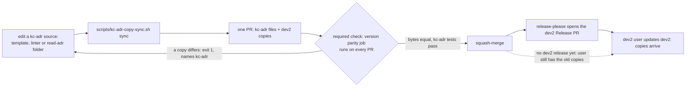

## Scope

- Source: the Captain, 2026-10-22: 「可以」 to FO's recommendation 「工具搬到 kc-adr，但用 dev2 的人只要裝 dev2 一個」: kc-adr is the source of the ADR template, the ADR format check and the ADR part of numbering; before each dev2 release CI copies them from kc-adr into dev2; CI fails when the copy and the source differ. Earlier the same day: kc-adr is the package for agents reading and writing ADRs, dev2 its first consumer and moneyflow its second (ruled in the kc-adr session, relayed), and 「安裝方式要再想想，我不想要那麼麻煩」.
- Evidence: dev2-poc task kc-adr-dependency-poc (validated, closed 2026-10-22): run-time resolution met all four bars on both hosts; Claude's native dependency works but Codex has none; symlinks are frozen on Claude and dropped on Codex. The copy-at-release shape was not tested there.
- First step, a test before any move: a real copied directory (not a link) inside dev2 installs on Claude Code and Codex from the marketplace with isolated configs, and a kc-adr change reaches dev2 users only through a dev2 release.
- Constraints: `number_guards.py` reserves ADR and migration numbers in one script and one reservation file (ADR 0002); the move states who owns the reservation file. The four adopters' README lines that call `adr_lint.py`, `number_guards.py` or the template change only if the copy's path changes.
- Partners: the kc-adr session (Paseo agent 1bcf070c) designs its side; this FO owns dev2's side and the CI copy.
- Upstream first: kc-adr's boundary contract (PR #691), release-please extra-files, version-parity-check.sh.
- Non-goals: run-time resolution; Claude native dependencies; changing any adopter's install.

## Captain amendments

### Amendment 1 — 2026-10-22, chat
Captain: 「ADR 工具要改用 kc-adr 那邊轉述的縮小版。」 (chat, 2026-10-22)
Asked: 「ADR 工具要不要改用 kc-adr 那邊轉述的縮小版？」, which FO had stated as: kc-adr is the source of the template and the format check only; the numbering script stays in dev2 unchanged; dev2's copy is generated by a sync script and a required check compares the two byte for byte; the format stays as dev2 has it, with "FO" changed to "the recommender".
Supersedes: none
Design: kc-adr is the source of `adr-template.md` and `adr_lint.py` (with its tests); `number_guards.py` stays whole in dev2; dev2 keeps byte-identical copies at `scripts/adr_lint.py` and `references/adr-template.md`, generated from kc-adr by a sync script; a byte compare of the two files runs in a required check and names kc-adr as the place to edit; the template's "the worker or FO" wording becomes "the recommender".

### Amendment 2 — 2026-10-23, chat
Captain: 「對」 (chat, 2026-10-23)
Asked: 「kc-adr 那邊說你批准了這件事：先做「ADR 工具副本」這張任務，並把 kc-adr 剛加的「保護檔案」兩項檢查也一起同步到 dev2。這是你的意思嗎？我建議照做。」 (confirming the kc-adr FO's relay of his 「准」 in its session)
Supersedes: none
Design: this task is the next priority; the sync also carries what iamcxa/kc-claude-plugins#712 merged into kc-adr (squash fd630b2a): the `**Protects:** none` label in kc-adr/references/adr-template.md, kc-adr/skills/read-adr/writing.md steps 4 to 6, and the two new kc-adr/scripts/adr_lint.py checks (an Accepted ADR's listed file exists and points at it; a listed file does not point at a Superseded ADR).

## FO alignment

Captain rulings (ideation sitting, 2026-10-23, chat, one at a time; to be bound at the ideation gate):
- D1 「對，除非有更好的做法，不然先這樣應該才可以確保結果。或是，除非這個 read-adr 技能對 dev2 沒用」, answering 「D1 改成「附上，把讀 ADR 技能複製進 dev2」，可以嗎？」 (after his 「為何不要？技能如果搬過去變成 dev2 的其實沒關係，對吧？」): the read-adr skill is copied into kc-dev-flow-2/skills/read-adr (resolving as kc-dev-flow-2:read-adr), kept identical to kc-adr's by the same sync and compare as the two tools; the design director and other dev2 text name the dev2 copy. FO checks before implementation that read-adr is used by dev2 (consumers: the design-director skill, the AGENTS.md ADR pointer, new-work-checks-what-exists-first) and whether its text names kc-adr paths that a byte copy cannot carry. Override: recommended only the two tools (design D1); Captain chose copying the skill too; area: single-install scope.
- D2 「可以」, answering 「寫 ADR 的「保護檔案」規則，不另外手寫，直接用複製過來的那份，可以嗎？」: no hand-written Protects rule in kc-dev-flow-2/skills/implementation/principles.md; the rule arrives with the copied read-adr skill folder (writing.md steps 4 to 6), byte-identical to kc-adr's. Override: recommended hand-writing it (design D2); Captain chose the copied skill's text; area: Protects rule placement. Also answered in chat: Claude Code supports plugin dependencies and Codex does not (dev2-poc kc-adr-dependency-poc, 2026-10-22), so one copy mechanism serves both hosts.
- D3 「要」, answering 「kc-adr 自己的測試，要不要放進那個「每個 PR 都要通過」的版本檢查裡一起跑？」: kc-adr/scripts/test_adr_lint.py, the byte compare and its test run as steps of the required parity job in marketplace-parity.yml.
- D4 「可以，除非找到更好的做法。這裡可以立一張票未來再繼續研究有沒有更好的做法」, answering 「以後改 kc-adr 的工具時，要同一個 PR 一起改兩個外掛，這樣可以嗎？」: a kc-adr tool change is one PR touching both plugins after the sync script runs, released with the next dev2 version; a backlog task (kc-adr-dev2-sharing-better-way) studies a better way.

Alignment: needed at ideation; the reservation-file owner and the copy's path are the Captain's to accept.
Result: aligned 2026-10-23 by Captain Amendments 1 and 2: the copy keeps dev2's paths; number_guards.py and the reservation stay in dev2; the remaining choices are the design's Captain decisions.
Surfaces: none
Visible change: none
Release review: not needed: workflow maintenance, on no journey map.

## Design

Surfaces: none. Profile: pilot. Design read at origin/main fd630b2a (kc-dev-flow-2 0.28.0, kc-adr 0.1.1), re-read 2026-10-23 for cycle 2. Scratch evidence: `kc-adr-tools-with-dev2-copy/ideation-evidence/` (build.sh, skills_list.py, kc-adr-copy-sync.sh, now three pairs). Cycle 2 folds Captain rulings D1 to D4 (FO alignment, 2026-10-23); each is marked ruled below.

### PRFAQ

**Headline:** A dev2 user installs one package and gets the ADR template, the format check and the `read-adr` skill that kc-adr owns; a kc-adr change reaches dev2 users in a dev2 release, and CI refuses a PR where the two copies differ.

**FAQ**
- *Who edits what?* Anyone changing the template, the linter or the skill edits kc-adr (`kc-adr/references/adr-template.md`, `kc-adr/scripts/adr_lint.py`, `kc-adr/skills/read-adr/`), runs `scripts/kc-adr-copy-sync.sh sync`, and commits both plugins' files in one PR (D4, ruled). The dev2 copies carry no marker (they are byte copies), so the CI message is the signpost.
- *What does a dev2 user get?* The template and linter at the paths every adopter README names (`<package>/references/adr-template.md`, `<package>/scripts/adr_lint.py`; no README line changes) and a skill that resolves as `kc-dev-flow-2:read-adr` (D1, ruled). The design director invokes that name, not `kc-adr:read-adr`.
- *When does a dev2 user get a kc-adr change?* In the next dev2 release (observed below, both hosts).
- *Who owns the reservation file?* dev2: `number_guards.py` stays whole in dev2 and the one reservation file stays where ADR 0002 puts it (Amendment 1).
- *What if both packages are installed?* Both skills list, as `kc-adr:read-adr` and `kc-dev-flow-2:read-adr` with one description, on Claude Code and Codex (observed below); the listing costs the description twice.

### Chain check (2026-10-23)

- Spacedock 0.27.3 plugin cache: `grep -rIl` for adr_lint, adr-template, kc-adr (cycle 1) and `read-adr` (cycle 2) finds nothing; no ADR tooling, skill or copy sync upstream.
- kc-dev-flow-2: holds today's template and linter copies; kc-adr (merged #710, #712) is the source. Repo-level checks live in `scripts/` as `X.sh` plus `X.test.sh` pairs run from `marketplace-parity.yml`; `scripts/kc-dev-flow-contract-test.py` already compares one vendored file byte for byte, so a byte compare in that job has precedent. No existing script syncs a copy.
- Sibling adopters: `git grep read-adr origin/main` in the local clones of subspace-relay, qnow and subspace-web finds no hit (clones as last fetched, read-only); the README lines that name `adr_lint.py` stay valid because the copy's paths do not change.
- Third-party mechanisms (install layout, skill discovery) were read from the hosts themselves: `claude plugin details`, `codex plugin list`, and the Codex app-server `skills/list` method, not from an adopter's setup.

### Two-host install test (Claude Code 2.1.309, codex-cli 0.162.1)

Isolation: one directory `/tmp/kc-adr-copy-sb` holding HOME, CLAUDE_CONFIG_DIR, CODEX_HOME and a `GIT_CONFIG_GLOBAL` URL rewrite to a local bare git repo; marketplace built from `git archive origin/main` of kc-dev-flow-2, kc-adr and the marketplace file (entries trimmed to those two). Install via `claude plugin install` and `codex plugin add`; skills read through `claude plugin details` and Codex `skills/list`. Cycle 1 rows A to C stand; cycle 2 rebuilt the sandbox (build.sh) and added row D.

| Variant | Claude Code | Codex |
|---|---|---|
| A: whole kc-adr directory copied to `kc-dev-flow-2/kc-adr/` | installs; 9 files byte-equal; **read-adr not discovered** (Skills 11) | installs; same; **read-adr not discovered** (11 dev2 skills) |
| B: kc-adr's `skills/read-adr` copied to `kc-dev-flow-2/skills/read-adr` (the ruled shape, D1) | installs; Skills 12 incl. `read-adr`, namespaced `kc-dev-flow-2:read-adr` | installs; `kc-dev-flow-2:read-adr` listed |
| C: the two files only; kc-adr also installed | installed copies byte-equal to kc-adr's | same |
| C update: kc-adr 0.1.1 to 0.1.2, dev2 untouched | `update kc-dev-flow-2` said "already at the latest version"; dev2's copy no longer equal | `marketplace upgrade`; dev2 copy stayed old |
| C update: dev2 bumped to 0.28.1 with the synced copy | 0.28.0 to 0.28.1; copy equal again | 0.28.1 cache copy equal |
| D (cycle 2): variant B with kc-adr also installed | `details kc-dev-flow-2@mk` lists 12 skills incl. `read-adr` (~120 tokens listed, ~970 loaded); `details kc-adr@mk` lists `read-adr` (~110, ~970); `diff -r` of the two skill folders in the cache: equal | `skills/list` returns both `kc-adr:read-adr` and `kc-dev-flow-2:read-adr`; `diff -r` of the two cache folders: equal |

In D the copied folder sits at `<dev2 root>/skills/read-adr`, so the skill's own rule "`<kc-adr>` is the folder two levels above this file's folder" lands on the dev2 root, which holds `references/adr-template.md` and `scripts/adr_lint.py` (both exist in the Claude cache; checked with `ls`). Not run: a live model session (isolated config has no login), Claude auto-update, release-please tag cutting, OMP. Real-config check after cycle 2: `shasum -c` of the four real config files (`~/.claude/plugins/known_marketplaces.json`, `installed_plugins.json`, `settings.json`, `~/.codex/config.toml`) against hashes taken at build: all OK; every Codex probe ran with CODEX_HOME in the sandbox.

### Existing-code check

Capability: a single source for the ADR template, the format check and the ADR skill. Completeness: all three work end to end in dev2 today or in kc-adr (kc-adr's `test_adr_lint.py`: 21 tests pass, 0.9 s). Need: Captain's rulings (Amendments 1, 2; D1 to D4). Bounded searches: `git grep test_adr_lint` and the workflow list at origin/main find `kc-adr/scripts/test_adr_lint.py` run by no workflow (observed 2026-10-23); `.github/workflows/kc-dev-flow-2-tests.yml` triggers only on `kc-dev-flow-2/**`. Unknown: local-only adopter pins.

**Does dev2 use read-adr (the check the alignment asked for)?** `git grep -n read-adr origin/main` outside `kc-adr/`: one dev2 consumer, the "ADR folder" section of `kc-dev-flow-2/skills/design-director/SKILL.md` (it invokes `kc-adr:read-adr`; passes 1a and 2a). Root `AGENTS.md` line 5 tells agents to `ls docs/adr` and names no skill; the dev2 README, workflow.md and the stage skills name none. The task `new-work-checks-what-exists-first` is not in this state checkout (not found, not read). So one consumer exists and read-adr is used by dev2.

**What a byte copy of the skill cannot carry (the other half of the check).**
- Paths: none. SKILL.md and writing.md name no kc-adr path; the tools are found as `<kc-adr>` two levels above the skill folder, which holds for the dev2 copy (row D).
- Two lines of writing.md are false or noisy in the dev2 copy: "`${CLAUDE_PLUGIN_ROOT}` is this plugin's root, not kc-dev-flow-2's" (in the copy it is dev2's root), and "written against 0.28.0, found X", which a worker reports each time dev2 is not 0.28.0. Neither blocks: the resolution list still ends in the dispatch's `Package root:` line. Fixing them is an edit to kc-adr's text, which is the kc-adr session's; the copy stays byte-equal either way (known limit, below).
- `kc-dev-flow-2/scripts/lint-skills.py` rejects the copied folder with four FAILs (observed on a scratch tree with the folder copied, 2026-10-23): `read-adr: expected one exact variant Invocation`; `writing.md: script adr_lint.py is named without <package>/scripts/`; the same for `number_guards.py`; `SKILL.md: uses <package> but has no 'Package root:' line`; `test_lint_skills.py` fails with them (6 failures). The other 23 `test_*.py` files (24 run, scripts and extensions) give the same exit codes as the base (2 of them already fail at base in this environment: `test_sd_dispatch.py`, `journey-map/test_map_footprint.py`). Prototype fix on the scratch tree: a constant `SYNCED_SKILLS = {"read-adr"}` and three filters in `lint_tree` (the per-skill Invocation loop, the doc-script check, the `<package>` root-line loop). With it: `lint-skills.py` PASS, `workflow.md: 5389 of 5389`, `test_lint_skills.py` 37 OK. The exemption is the cost of D1: that folder is no longer checked by dev2's lint, only by the byte compare against kc-adr, whose own check is `skill-frontmatter-lint.sh`.

### Sync, check, CI

- `scripts/kc-adr-copy-sync.sh sync|check` (prototype in ideation-evidence, tried on a scratch tree at fd630b2a). Three pairs: the template, the linter, and the `read-adr` folder. `sync` is `cp` (the folder: remove the destination, then `cp -R`, so a file deleted in kc-adr leaves the copy); `check` is `cmp -s` for the files and `diff -rq` for the folder, no transform. Failure message: `<copy> differs from <source>. Edit <source> (kc-adr is the source), run scripts/kc-adr-copy-sync.sh sync, and commit both plugins' files.` Prototype results: at base (template and linter differ) exit 1 naming both; after sync 0; copy file changed 1; extra file in the copy 1; copy file deleted 1; copy folder deleted 1; source changed alone 1; source folder deleted 1; bad mode 2. Paired `scripts/kc-adr-copy-sync.test.sh` follows the `release-metadata.test.sh` pattern.
- Placement (D3, ruled): steps in the `parity` job of `.github/workflows/marketplace-parity.yml`: `./scripts/kc-adr-copy-sync.test.sh`, `./scripts/kc-adr-copy-sync.sh check`, then `python3 kc-adr/scripts/test_adr_lint.py`. Verified 2026-10-23: the workflow has `pull_request:` with no `paths:`, and `gh api repos/iamcxa/kc-claude-plugins/branches/main/protection` lists `version parity (plugin.json / marketplace.json / codex / README)` as a required context; so the steps run on a kc-adr-only PR. `kc-dev-flow-2-tests.yml` stays as is: once the compare is required, a change to a source file cannot merge without its copy changing under `kc-dev-flow-2/**`, which triggers it (it also runs `lint-skills.py` and `test_lint_skills.py`).
- Why kc-adr's own test needs a step: mutation (pointer check `elif ...cited_by(site)` replaced by `elif False:` in both files, so the compare passes): `test_adr_doc_checks.py` exit 0, `kc-adr/scripts/test_adr_lint.py` exit 1 (4 failures). The test file is not synced (dev2's holds DocImpactTests too).
- Cost per PR: added work is `cmp`/`diff -rq` of three paths plus 21 unit tests, 0.9 s for the tests locally on macOS; CI minutes not measured.
- #712 content: the template's `**Protects:** none`, the two linter checks and writing.md steps 4 to 6 all arrive by sync (the folder pair carries writing.md). The synced linter passes dev2's `test_adr_doc_checks.py`, `test_lint_skills.py`, `lint-skills.py` and `test_number_guards.py` on the scratch tree. No Protects text is written into `skills/implementation/principles.md` (D2, ruled; `git grep -c -i protects origin/main` over both principles files finds none).
- Next kc-adr change: edit kc-adr, run `sync`, one PR touching both plugins, the compare is red until the copies match, then users get it with the next dev2 release (D4, ruled). release-please attributes by path (root CLAUDE.md, empty-commit note), so I expect that PR to bump both plugins; not run here. Backlog task `kc-adr-dev2-sharing-better-way` (exists, status backlog) studies a better way.

### Words FO and workers read at each moment (root learning.md; `wc -w` on origin/main, whitespace split)

| Moment | Base | Candidate |
|---|---|---|
| FO startup / resume: `references/sd/workflow.md` | 5389 | 5389 (not edited; `lint-skills.py` on the prototype tree prints 5389 of 5389) |
| FO startup / resume: the host's skill listing line for `read-adr` (description, 77 words; name and description 78) | 0 | **78 more words per session with dev2 enabled** (Claude's `plugin details`: ~120 tokens listed; 156 words / ~230 tokens if kc-adr is also installed). A rise, caused by D1; no check counts it |
| Idle on an open PR (CI line FO reads) | 0 | 0 on pass; 18 words once on a red compare (the message above) |
| Idle on a merged PR / after the archive / the merge ask | unchanged | unchanged: no FO-read script (`delivery_gate.py`, `pr_watch.py`, `number_guards.py`) is edited |
| Implementation worker: `skills/implementation/principles.md` | 703 | 703 (D2: nothing hand-written); 713 if D5 is accepted (10 words) |
| Design director, passes 1a and 2a: `skills/design-director/SKILL.md` (871) plus the skill it invokes | 871 plus 775 (`SKILL.md` of kc-adr's skill, only when kc-adr is installed; else `adrs_read: unavailable`) | 871 (one name replaced, same word count) plus 775 every time (the copy always resolves); `writing.md` (457) and `prefix.md` (141) are read on demand; ~970 tokens loaded per `plugin details` |
| A worker writing an ADR who loads the skill | 0 (no pointer; only kc-adr users) | 775 + 457 |

## Acceptance criteria

**AC-1** The three copies install on both hosts byte-equal to their kc-adr sources, and the skill resolves as `kc-dev-flow-2:read-adr` (D1). Evidence: build a local bare marketplace from the PR head with isolated HOME, CLAUDE_CONFIG_DIR, CODEX_HOME (ideation-evidence/build.sh pattern); `claude plugin install kc-dev-flow-2@mk` and `codex plugin add kc-dev-flow-2@mk`; `cmp` the installed `scripts/adr_lint.py` and `references/adr-template.md`, and `diff -r` the installed `skills/read-adr`, against the PR's kc-adr paths: exit 0 each, each host; `claude plugin details kc-dev-flow-2@mk` lists `read-adr` among 12 skills; Codex `skills/list` (ideation-evidence/skills_list.py) lists `kc-dev-flow-2:read-adr`; with kc-adr also installed both hosts list `kc-adr:read-adr` and `kc-dev-flow-2:read-adr`. Falsifier: build with `kc-dev-flow-2/skills/read-adr` removed: the listing shows 11 dev2 skills and no `kc-dev-flow-2:read-adr` (cycle 1 variant C, observed); and one byte added to the kc-adr file before building makes `cmp` exit non-zero.

**AC-2** `scripts/kc-adr-copy-sync.sh check` exits 1 with a message naming the kc-adr source for every mutation below, 0 after `sync`, 2 for a bad mode. Evidence: `scripts/kc-adr-copy-sync.test.sh` on a scratch tree asserts exit and source path for: a changed copy file, an extra file in the copy folder, a deleted copy file, a deleted copy folder, a changed source file, a deleted source folder (prototype: all exit 1). Falsifier: replace `diff -rq` with `true` in the script: the extra-file and changed-copy cases then exit 0 and the test exits non-zero.

**AC-3** The check runs on every PR and blocks an unsynced copy. Evidence: `grep -n 'paths:' .github/workflows/marketplace-parity.yml` has no hit; the protection API lists the parity context. On the implementation PR itself: the first push holds the sync script and the workflow steps with the copies not yet synced (they differ at origin/main fd630b2a), the parity job is red with the compare message (run id recorded); the second push holds the `sync` result and the job is green (run id recorded). Falsifier: the first push is green.

**AC-4** kc-adr's own linter tests run in the required job (D3). Evidence: the parity job log on the PR head shows `python3 kc-adr/scripts/test_adr_lint.py` ran and passed; locally on the PR head, with the pointer check `elif int(path.name[:4]) not in cited_by(site):` replaced by `elif False:` identically in kc-adr and the copy, `scripts/kc-adr-copy-sync.sh check` exits 0 while `python3 kc-adr/scripts/test_adr_lint.py` exits non-zero (observed: 4 failures) and `kc-dev-flow-2/scripts/test_adr_doc_checks.py` exits 0; nothing broken is pushed. Falsifier: `test_adr_lint.py` exits 0 under the mutation.

**AC-5** No Protects text is hand-written in dev2 (D2); the rule reaches dev2 only as the copied skill's writing.md steps 4 to 6. Evidence: `git grep -c -i protects -- kc-dev-flow-2/skills/implementation/principles.md kc-dev-flow-2/skills/validation/principles.md` has no hit on the PR head; `cmp` of `kc-dev-flow-2/skills/read-adr/writing.md` with kc-adr's exits 0 and the file contains steps 4 to 6. Falsifier: a hand-written line containing "Protects" in either principles file makes the grep hit.

**AC-6** dev2's lint accepts the copied skill and still rejects an unlisted one. Evidence: `python3 kc-dev-flow-2/scripts/lint-skills.py` and `test_lint_skills.py` exit 0 on the PR head; a new case in `test_lint_skills.py` asserts that a skill folder not in `SYNCED_SKILLS` without an `Invocation` line still fails, and that the listed folder passes. Falsifier: remove `read-adr` from `SYNCED_SKILLS`: `lint-skills.py` prints the four FAILs above (observed).

**AC-7** The design director names the dev2 copy (D1). Evidence: `git grep -n 'kc-adr:read-adr' -- kc-dev-flow-2` has no hit and `git grep -n 'kc-dev-flow-2:read-adr' -- kc-dev-flow-2` hits the "ADR folder" section of `skills/design-director/SKILL.md`; `lint-skills.py` exits 0. Falsifier: delete `kc-dev-flow-2/skills/read-adr` and `lint-skills.py` prints `unknown variant skill kc-dev-flow-2:read-adr` (observed).

**AC-8** A kc-adr change reaches dev2 users in a dev2 release, and no adopter README line changes (D4). Evidence: in the AC-1 sandbox, publish kc-adr +0.0.1 with an edited `read-adr/SKILL.md` and dev2 unchanged: dev2's installed folder differs from kc-adr's on both hosts; then dev2 +0.0.1 with the synced folder: equal on both hosts. `git diff --stat origin/main` on the PR head lists no `docs/dev2/README.md` and no `kc-dev-flow-2/references/sd/workflow.md`. Falsifier: dev2's copy equal after only the kc-adr bump.

**AC-9** The FO-read words are as the table says. Evidence: `wc -w kc-dev-flow-2/references/sd/workflow.md` prints 5389 and `lint-skills.py` exits 0 without a budget step; `wc -w` of `skills/implementation/principles.md` is at most 703 (713 if D5 is accepted) and of `skills/design-director/SKILL.md` is 871; the PR body states the added listing line (78 words, ~120 tokens by `claude plugin details`). Falsifier: a count above any number.

## Decisions for the Captain

Ruled (Captain, 2026-10-23, chat; recorded under FO alignment; to be bound at the ideation gate):

- **D1 ruled:** the read-adr skill folder is copied into `kc-dev-flow-2/skills/read-adr`, kept byte-identical by the same sync and compare; the design director names `kc-dev-flow-2:read-adr`. Override of my cycle 1 recommendation (two tools only); folded into Design and AC-1, AC-2, AC-6, AC-7. Install probe: row D, both hosts. Consequences I did not rule: the lint exemption (Design), the listing cost (Words), two same-description skills when both packages are installed.
- **D2 ruled:** no hand-written Protects rule in implementation principles; AC-5.
- **D3 ruled:** kc-adr's tests, the byte compare and its test run in the required parity job; AC-3, AC-4.
- **D4 ruled:** a kc-adr tool change is one two-plugin PR released with dev2; backlog task `kc-adr-dev2-sharing-better-way` studies a better way; AC-8.

Open:

**D5: Add one pointer sentence to `skills/implementation/principles.md`: "To write the record, load `kc-dev-flow-2:read-adr` and follow its `writing.md`."** (10 words, 703 to 713; it is a pointer, not the Protects rule D2 forbade.) Recommend yes. Without it nothing in the implementation worker's text sends it to `writing.md`: the ADR paragraph names only the template and the linter, the template has no Protects instruction, and `**Protects:** none` is a valid ADR, so the linter would not object; the rule would reach a worker only if it chose to load the skill from its description. Prototype: with the sentence, `lint-skills.py` PASS and `test_lint_skills.py` OK. Worse: one more worker-read sentence that points at a skill; dev2 loads 775 plus 457 words whenever a worker obeys it. If you say no, AC-5 stands and the rule's reach to workers is unmeasured, not proved.

Known limits (not decisions): the two false lines in the copied writing.md (Design) stay until the kc-adr session edits its text; OMP behavior with two same-name skills not run (the backlog task names it); no live model session loaded the copied skill.

### Batch overlap

Files the design would change: new `scripts/kc-adr-copy-sync.sh` and `scripts/kc-adr-copy-sync.test.sh`; `.github/workflows/marketplace-parity.yml` (three steps); the copies `kc-dev-flow-2/references/adr-template.md`, `kc-dev-flow-2/scripts/adr_lint.py` and new `kc-dev-flow-2/skills/read-adr/` (3 files); `kc-dev-flow-2/scripts/lint-skills.py` and `test_lint_skills.py` (the `SYNCED_SKILLS` exemption and a case); `kc-dev-flow-2/skills/design-director/SKILL.md` (one name); `kc-dev-flow-2/skills/implementation/principles.md` only if D5 is accepted. It does not edit kc-adr, `workflow.md` or any adopter README.

| Task (state read 2026-10-23) | Overlap |
|---|---|
| new-work-starts-from-a-story-map, codex-reader-reads-receipt-marker, merge-ask-holds-missing-clauses, idle-names-failing-seeds (archived, done) | none: they changed `workflow.md` and `lint-skills.py` earlier; their mentions of `adr_lint.py` are check runs |
| fo-write-checks-parse-top-level (ideation) | `lint-skills.py` (its cycle record names it; it edits the budget steps and checks, I edit the skill loops and a constant: different hunks, whichever merges second rebases) |
| release-review-staleness-held-at-dispatch (validation, #711) | `lint-skills.py`: appends a step to `WORKFLOW_BUDGET_STEPS`, a different hunk; open PR #711 touches `kc-dev-flow-2/scripts/lint-skills.py` |
| release-walk-picky-reviewers-and-director (implementation) | `skills/design-director/SKILL.md`: it adds pass `3`; I replace one name inside the "ADR folder" section; same file, rebase for whichever lands second. Its task text names no `kc-adr:read-adr` rewrite |
| design-director-model-follows-task (backlog) | same file as above (its description line); no shared text |
| comment-check-reaches-delivery-gate (ideation) | none: edits `validation/principles.md`, `delivery_gate.py`; not implementation principles or lint-skills |
| agent-reads-governing-adr (archived, done) | none now: added `adr-path-check.yml` and `scripts/adr-path-check*` |
| adr-protected-path-guard (archived, merged as #712) | the source this sync carries; no open work |
| kc-decision-log-cli (archived, done) | none: kc-adr plugin creation; its text cites the dev2 paths this keeps |
| kc-decision-log-handoff-trial (backlog), pr-review-lite-value-pilot (implementation), journey-canvas-hosted-poc (ideation) | none by their task text (no shared file or check) |
| deprecate-kc-dev-flow-v1 (backlog) | names `marketplace-parity.yml` and the OMP same-name collision; no edit in common |
| kc-adr-dev2-sharing-better-way (backlog, mine) | follow-up to D4; edits nothing now |
| kc-decision-log-p1, release-acceptance, journey-server-host-pilot | no task file for kc-decision-log-p1 and journey-server-host-pilot in this state checkout; release-acceptance (other session) mentions `workflow.md` and the `lint-skills.py` run, not my hunks. Open PR list 2026-10-23: #707 (release PR, kc-adr version files) and #711 (`lint-skills.py`, `workflow.md`) |

Recommended order: #707 merges first (it carries the version marker in `workflow.md`); #711 and release-walk before or after this task in either order (different hunks; the second rebases); this task's first PR is the first to run the new required steps, so it merges before any other PR that edits `kc-adr/scripts`, `kc-adr/references` or `kc-adr/skills`.

## Stage Report: ideation

- DONE: Design dev2's side of the ADR-tool copy per Captain Amendments 1 and 2: first run the two-host install test of a copied kc-adr directory (a real copied directory inside the kc-dev-flow-2 plugin, not a link) on Claude Code and Codex with isolated configs, and report what installs and resolves; then design the sync script that copies kc-adr/references/adr-template.md and kc-adr/scripts/adr_lint.py (with the #712 Protects label, writing.md steps 4 to 6 reference and the two new checks) to kc-dev-flow-2/references/adr-template.md and kc-dev-flow-2/scripts/adr_lint.py, the byte compare placed in a required check (verify whether version-parity in marketplace-parity.yml runs on every PR) with a failure message naming kc-adr as the place to edit, CI on kc-adr/ paths, and whether kc-adr/scripts/test_adr_lint.py runs in CI; state how the next kc-adr linter change (the peer task adr-protected-path-guard) reaches dev2; read intake/kc-adr-fo-interface-2026-10-23.md
  Install test on three variants (nested dir: files install, read-adr not discovered on either host; skill-folder copy: resolves as kc-dev-flow-2:read-adr; two files: byte-equal on both hosts, kc-adr change reaches dev2 only via a dev2 bump). parity job has no `paths:` and its context is a required check; test_adr_lint.py runs in no workflow; adr-protected-path-guard merged as #712 so its delivery is the first sync. See Design.
- DONE: A `### Batch overlap` section naming each file the design would change and each other batch task and live task of other sessions that changes the same file or check, so FO can order implementation
  Section at the end of the task body; three live tasks have no file in this state checkout and are stated as not read; open PRs #707 and #711 read, no shared file.
- DONE: The words FO reads at each lifecycle moment, before and after, per root learning.md "Measure the words FO reads at each moment, not one file's size"
  Table under Design: startup 5389 to 5389, other FO moments unchanged, worker-read principles.md 703 to 798; counted with `wc -w` at origin/main.
- DONE: Acceptance criteria with reproducible evidence clauses and falsifiers, and unresolved decisions for the Captain, each with a recommendation and what gets worse under it
  AC-1 to AC-7 each with an evidence command and a falsifier; D1 to D4 each with recommendation and the worse side. design_surfaces.py check (package 0.27.0, the loaded skill's root) printed "design surfaces presentable", exit 0.

### Summary

FO alignment has no `Result:` line (it records alignment as needed at ideation); I proceeded because Amendments 1 and 2 answer both named questions (the copy path is unchanged, `number_guards.py` and the reservation file stay in dev2); FO to record the `Result:` or reject.

The two-file copy (template and linter) installs byte-exact on Claude Code and Codex and reaches dev2 users only through a dev2 release; a nested kc-adr directory installs but its skill is not discovered. The byte compare and kc-adr's own tests go in the required parity job, which runs on every PR; the prototype sync script failed in all four mutations and passed after sync. Four decisions remain for the Captain, D1 (does "one package" include the read-adr skill) first. Disclosed: `~/.codex/config.toml` changed hash during my run with no probe string in it, cause unattributed; the dispatch's package root is 0.28.0 but the loaded skill is 0.27.0, and I ran the design check from the skill's root.

## Stage Report: ideation (cycle 2)

- DONE: Cycle 2: fold the Captain rulings D1 to D4 recorded under FO alignment (2026-10-23) into ## Design and ## Acceptance criteria and mark each ruled (D1 read-adr folder copied into kc-dev-flow-2/skills/read-adr, same sync and compare, design-director names the dev2 copy, install probe on both hosts; D2 no hand-written Protects rule; D3 kc-adr tests, compare and its test in the required parity job; D4 one two-plugin PR, backlog kc-adr-dev2-sharing-better-way); recount the words FO and workers read
  D1 to D4 marked ruled under Decisions and folded into AC-1 to AC-9. Probe row D: both hosts list `kc-dev-flow-2:read-adr`, and `kc-adr:read-adr` beside it when both are installed. Consumer check: one dev2 consumer (design-director "ADR folder" section). Prototype on a scratch tree: `lint-skills.py` rejects the copied folder with 4 FAILs and `test_lint_skills.py` fails (6); a `SYNCED_SKILLS` exemption makes both pass; sync check exits 1 in 6 mutations, 0 after sync, 2 bad mode. New open decision D5 (pointer sentence).
- DONE: A `### Batch overlap` section naming each file the design would change and each other batch task and live task of other sessions that changes the same file or check, so FO can order implementation
  Rewritten under Decisions; new overlaps found: `lint-skills.py` (#711, fo-write-checks-parse-top-level), `design-director/SKILL.md` (release-walk, design-director-model-follows-task); three live tasks have no file here, stated as not read.
- DONE: The words FO reads at each lifecycle moment, before and after, per root learning.md "Measure the words FO reads at each moment, not one file's size"
  Table: workflow.md 5389 to 5389; one rise found and disclosed, the skill listing line +78 words (~120 tokens by `claude plugin details`) per session with dev2 enabled; implementation principles 703 to 703 (713 with D5); design director loads 775 words every time instead of only when kc-adr is installed.
- DONE: Acceptance criteria with reproducible evidence clauses and falsifiers, and unresolved decisions for the Captain, each with a recommendation and what gets worse under it
  AC-1 to AC-9 each with an evidence command and a falsifier; open decision D5 with recommendation and the worse side; known limits listed separately.

### Summary

D1 to D4 are folded in and marked ruled. Copying the read-adr folder is not free of consequences the Captain did not rule on: dev2's `lint-skills.py` rejects a byte copy (4 FAILs observed) so it needs a small exemption, the skill listing adds 78 words per session (the one FO-read rise), and the copied writing.md carries two lines that are false in dev2 (known limit). One decision remains, D5, whether a 10-word pointer in implementation principles is how the Protects rule reaches a worker. Disclosed: no live model session loaded the copied skill; the isolated sandbox was rebuilt and `shasum -c` of the four real config files passed; the dispatch's package root is 0.28.0.
