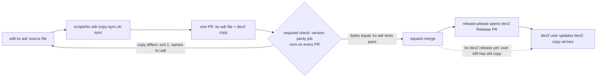

## Scope

- Source: the Captain, 2026-10-22: 「可以」 to FO's recommendation 「工具搬到 kc-adr，但用 dev2 的人只要裝 dev2 一個」: kc-adr is the source of the ADR template, the ADR format check and the ADR part of numbering; before each dev2 release CI copies them from kc-adr into dev2; CI fails when the copy and the source differ. Earlier the same day: kc-adr is the package for agents reading and writing ADRs, dev2 its first consumer and moneyflow its second (ruled in the kc-adr session, relayed), and 「安裝方式要再想想，我不想要那麼麻煩」.
- Evidence: dev2-poc task kc-adr-dependency-poc (validated, closed 2026-10-22): run-time resolution met all four bars on both hosts; Claude's native dependency works but Codex has none; symlinks are frozen on Claude and dropped on Codex. The copy-at-release shape was not tested there.
- First step, a test before any move: a real copied directory (not a link) inside dev2 installs on Claude Code and Codex from the marketplace with isolated configs, and a kc-adr change reaches dev2 users only through a dev2 release.
- Constraints: `number_guards.py` reserves ADR and migration numbers in one script and one reservation file (ADR 0002); the move states who owns the reservation file. The four adopters' README lines that call `adr_lint.py`, `number_guards.py` or the template change only if the copy's path changes.
- Partners: the kc-adr session (Paseo agent 1bcf070c) designs its side; this FO owns dev2's side and the CI copy.
- Upstream first: kc-adr's boundary contract (PR #691), release-please extra-files, version-parity-check.sh.
- Non-goals: run-time resolution; Claude native dependencies; changing any adopter's install.

## Captain amendments

### Amendment 1 — 2026-10-22, chat
Captain: 「ADR 工具要改用 kc-adr 那邊轉述的縮小版。」 (chat, 2026-10-22)
Asked: 「ADR 工具要不要改用 kc-adr 那邊轉述的縮小版？」, which FO had stated as: kc-adr is the source of the template and the format check only; the numbering script stays in dev2 unchanged; dev2's copy is generated by a sync script and a required check compares the two byte for byte; the format stays as dev2 has it, with "FO" changed to "the recommender".
Supersedes: none
Design: kc-adr is the source of `adr-template.md` and `adr_lint.py` (with its tests); `number_guards.py` stays whole in dev2; dev2 keeps byte-identical copies at `scripts/adr_lint.py` and `references/adr-template.md`, generated from kc-adr by a sync script; a byte compare of the two files runs in a required check and names kc-adr as the place to edit; the template's "the worker or FO" wording becomes "the recommender".

### Amendment 2 — 2026-10-23, chat
Captain: 「對」 (chat, 2026-10-23)
Asked: 「kc-adr 那邊說你批准了這件事：先做「ADR 工具副本」這張任務，並把 kc-adr 剛加的「保護檔案」兩項檢查也一起同步到 dev2。這是你的意思嗎？我建議照做。」 (confirming the kc-adr FO's relay of his 「准」 in its session)
Supersedes: none
Design: this task is the next priority; the sync also carries what iamcxa/kc-claude-plugins#712 merged into kc-adr (squash fd630b2a): the `**Protects:** none` label in kc-adr/references/adr-template.md, kc-adr/skills/read-adr/writing.md steps 4 to 6, and the two new kc-adr/scripts/adr_lint.py checks (an Accepted ADR's listed file exists and points at it; a listed file does not point at a Superseded ADR).

## FO alignment

Alignment: needed at ideation; the reservation-file owner and the copy's path are the Captain's to accept.
Result: aligned 2026-10-23 by Captain Amendments 1 and 2: the copy keeps dev2's paths; number_guards.py and the reservation stay in dev2; the remaining choices are the design's Captain decisions.
Surfaces: none
Visible change: none
Release review: not needed: workflow maintenance, on no journey map.

## Design

Surfaces: none. Profile: pilot. Design read at origin/main fd630b2a (kc-dev-flow-2 0.28.0, kc-adr 0.1.1), 2026-10-23. Scratch evidence: `kc-adr-tools-with-dev2-copy/ideation-evidence/` (build.sh, skills_list.py, kc-adr-copy-sync.sh).

### PRFAQ

**Headline:** A dev2 user installs one package and gets the ADR template and format check that kc-adr owns; a kc-adr change reaches dev2 only inside a dev2 release, and CI refuses a PR where the two disagree.

**FAQ**
- *Who edits what?* Anyone changing the template or linter edits kc-adr/references/adr-template.md or kc-adr/scripts/adr_lint.py, runs `scripts/kc-adr-copy-sync.sh sync`, and commits both plugins' files in one PR. The copies at kc-dev-flow-2/references/adr-template.md and kc-dev-flow-2/scripts/adr_lint.py carry no marker (they are byte copies), so the CI message is the signpost.
- *What does a dev2 user get?* The two files at the paths every adopter README already names (`<package>/scripts/adr_lint.py`, `<package>/references/adr-template.md`): no adopter README line changes (Amendment 1). The `kc-adr:read-adr` skill still needs kc-adr installed (Decision D1).
- *When does a dev2 user get a kc-adr change?* Only after the next dev2 release (observed below, both hosts).
- *Who owns the reservation file?* dev2: `number_guards.py` stays whole in dev2 and the one reservation file stays where ADR 0002 puts it (Amendment 1). Nothing moves.

### Chain check (2026-10-23)

- Spacedock 0.27.3 plugin cache: `grep -rIl` for adr_lint, adr-template, kc-adr finds nothing; no ADR tooling or copy sync upstream.
- kc-dev-flow-2: holds today's copies; kc-adr (merged #710, #712) is the new source. Repo-level checks live in `scripts/` as `X.sh` plus `X.test.sh` pairs run from `marketplace-parity.yml`; `scripts/kc-dev-flow-contract-test.py` already compares one vendored file byte for byte, so a byte compare in that job has precedent. No existing script syncs a copy.
- Sibling adopters: README lines only; unchanged because the paths do not change.
- Third-party mechanisms (install layout, skill discovery) were read from the hosts themselves: `claude plugin details`, `codex plugin list`, and the Codex app-server `skills/list` method (listed in `codex app-server generate-json-schema`), not from an adopter's setup.

### Two-host install test (the first step; Claude Code 2.1.309, codex-cli 0.162.1)

Isolation: one `mktemp`-style directory `/tmp/kc-adr-copy-sb` per variant holding HOME, CLAUDE_CONFIG_DIR, CODEX_HOME and a `GIT_CONFIG_GLOBAL` URL rewrite to a local bare git repo; marketplace built from `git archive origin/main` of kc-dev-flow-2, kc-adr and the marketplace file (entries trimmed to those two). Install via `claude plugin install` and `codex plugin add`; skills read through `claude plugin details` and Codex `skills/list`.

| Variant | Claude Code | Codex |
|---|---|---|
| A: whole kc-adr directory copied to `kc-dev-flow-2/kc-adr/` | installs; all 9 files byte-equal in the cache under `<dev2 root>/kc-adr/`; **read-adr not discovered** (Skills 11, none read-adr) | installs; same 9 files; **read-adr not discovered** (skills/list 11 dev2 skills, no read-adr) |
| B: kc-adr's `skills/read-adr` copied to `kc-dev-flow-2/skills/read-adr` | installs; Skills 12 incl. `read-adr` (namespaced `kc-dev-flow-2:read-adr`) | installs; `kc-dev-flow-2:read-adr` listed |
| C: the two files only (the design); kc-adr also installed | installs; installed dev2 `scripts/adr_lint.py` and `references/adr-template.md` byte-equal to kc-adr's; kc-adr Skills (1) read-adr | same; `kc-adr:read-adr` listed from the kc-adr cache |
| C update: kc-adr 0.1.1 to 0.1.2 (adr_lint.py edited), dev2 untouched at 0.28.0 | `update kc-adr` took 0.1.2; `update kc-dev-flow-2` said "already at the latest version (0.28.0)"; dev2's copy no longer equal to kc-adr's | `marketplace upgrade` then kc-adr 0.1.2 installed; dev2 copy stayed old |
| C update: dev2 bumped to 0.28.1 with the synced copy | `update kc-dev-flow-2` 0.28.0 to 0.28.1; copy equal again | `marketplace upgrade` + `plugin add kc-dev-flow-2@mk`; 0.28.1 cache copy equal |

What it shows: a real nested directory installs and survives on both hosts, but a skill inside it does not resolve (A); a copied skill folder does, but under dev2's namespace, not the `kc-adr:read-adr` that dev2's design-director text cites (B); the two-file design installs byte-exact on both hosts and a kc-adr change reaches dev2 only through a dev2 version bump (C). Not run: a live model session (isolated config has no login), Claude auto-update, release-please tag cutting. Real-config check: the four real config files (`~/.claude/plugins/known_marketplaces.json`, `installed_plugins.json`, `settings.json`, `~/.codex/config.toml`) hold no probe string; `~/.codex/config.toml` has a different hash than at 18:30:00 and mtime 18:30:55 while other Codex sessions run on this machine; I ran every Codex probe with CODEX_HOME in the sandbox and cannot attribute the change either way.

### Existing-code check

Capability: a single source for the ADR template and format check. Completeness: both tools work end to end in dev2 today (test_adr_doc_checks.py passes, adopters call them); kc-adr's copy works (21 tests pass, 0.9 s). Need: Captain's ruling (Amendments 1, 2). Bounded searches: `git grep test_adr_lint` and the workflow list at origin/main find kc-adr/scripts/test_adr_lint.py run by no workflow and no workflow mentioning kc-adr (observed 2026-10-23); `.github/workflows/kc-dev-flow-2-tests.yml` triggers only on `kc-dev-flow-2/**`. Excluded: unmerged branches other than the open PR list (#707, #711 read). Unknown: local-only adopter pins.

### Sync, check, CI

- `scripts/kc-adr-copy-sync.sh sync|check` (prototype in ideation-evidence, tried on a scratch tree). Two pairs, plain `cp` and `cmp -s`, no transform. `check` exit 1 with `<copy> differs from <source>. Edit <source> (kc-adr is the source), run scripts/kc-adr-copy-sync.sh sync, and commit both files.` Prototype results on a scratch tree at fd630b2a: before sync exit 1 naming both files; after sync 0; one byte changed in the copy 1; source changed alone 1; copy deleted 1; bad mode 2. Paired `scripts/kc-adr-copy-sync.test.sh` follows the `release-metadata.test.sh` pattern.
- Placement: two new steps in the `parity` job of `.github/workflows/marketplace-parity.yml`: `./scripts/kc-adr-copy-sync.test.sh` and `./scripts/kc-adr-copy-sync.sh check`, then `python3 kc-adr/scripts/test_adr_lint.py`. Verified: the workflow has `pull_request:` with no `paths:`, and `gh api repos/iamcxa/kc-claude-plugins/branches/main/protection` lists the context `version parity (plugin.json / marketplace.json / codex / README)` as required (2026-10-23); so the check runs on a kc-adr-only PR, and a path-filtered workflow (not required) would not block one. `kc-dev-flow-2-tests.yml` stays as is: once the compare is required, a change to a source file cannot merge without its copy changing in `kc-dev-flow-2/**`, which triggers it.
- Why kc-adr's own test needs a step: mutation (pointer check `elif ...cited_by(site)` replaced by `elif False:` in both files, so the compare passes): `test_adr_doc_checks.py` exit 0, `kc-adr/scripts/test_adr_lint.py` exit 1 (4 failures). dev2's tests do not cover the two #712 checks; kc-adr's do (the test file is not synced: dev2's holds DocImpactTests too).
- Cost per PR: added work is `cmp` of two files plus 21 unit tests, 0.9 to 1.5 s wall locally on macOS; CI minutes not measured.
- #712 content in dev2: the template's `**Protects:** none` and the two linter checks arrive by sync (synced copy passes dev2's `test_adr_doc_checks.py`, `test_lint_skills.py`, `lint-skills.py`, `test_number_guards.py` on a scratch tree). writing.md steps 4 to 6 are a skill file and are not byte-copyable (steps 1 to 3 and 7 are kc-adr's); dev2 workers read `skills/implementation/principles.md`, whose ADR paragraph never mentions Protects, so the design adds to it one sentence pair (95 words), with the `<package>/scripts/adr_lint.py` spelling `lint-skills.py` requires (a bare `adr_lint.py` fails it: observed).
- Next kc-adr linter change: it is `adr-protected-path-guard`, which merged as #712 and is already in kc-adr, so its delivery to dev2 is this task's first sync. A later one reaches dev2 the same way: edit kc-adr, run `sync`, one PR touching both plugins, the compare is red until the copy matches, then it reaches users with the next dev2 release. release-please attributes by path (root CLAUDE.md, empty-commit note), so I expect that PR to bump both plugins; not run here.

### Words FO reads at each moment (root learning.md; counted with `wc -w` at origin/main)

This change is not a cut, so the bar is "no moment rises".

| Moment | Base | Candidate |
|---|---|---|
| Startup / resume (references/sd/workflow.md) | 5389 | 5389 (file not edited; `lint-skills.py` reports 5389 of 5389) |
| Idle on an open PR (CI line FO reads) | 0 | 0 on pass; 17 words once, on a red compare only |
| Idle on a merged PR / after the archive / the merge ask | unchanged | unchanged: the design edits no FO-read script (`delivery_gate.py`, `pr_watch.py`, `number_guards.py`) |
| Implementation worker (not FO): implementation/principles.md | 703 | 798 |

## Acceptance criteria

**AC-1** The copy installs on both hosts byte-equal to its source. Evidence: build a local bare marketplace from the PR head with isolated HOME, CLAUDE_CONFIG_DIR, CODEX_HOME (ideation-evidence/build.sh pattern), `claude plugin install kc-dev-flow-2@mk` and `codex plugin add kc-dev-flow-2@mk`, then `cmp` the installed `scripts/adr_lint.py` and `references/adr-template.md` against the PR's kc-adr files: exit 0 on each host. Falsifier: add one byte to the kc-adr file before building the marketplace; `cmp` exits non-zero.

**AC-2** `scripts/kc-adr-copy-sync.sh check` fails with a message naming kc-adr in four mutations and passes after `sync`. Evidence: `scripts/kc-adr-copy-sync.test.sh` on a scratch tree asserts exit 1 plus the source path in the message for: a changed copy, a changed source, a deleted copy, a deleted source; exit 0 after `sync`. Falsifier: replace `cmp -s` with `true` in the script; the test exits non-zero.

**AC-3** The check runs on every PR and blocks an unsynced copy. Evidence: `grep -n 'paths:' .github/workflows/marketplace-parity.yml` has no hit; the protection API lists the parity context. On the implementation PR itself: the first push holds the sync script and the workflow step with the copies not yet synced (they differ at origin/main fd630b2a), and the parity job is red with the compare message (run id recorded); the second push holds the `sync` result and the job is green (run id recorded). Falsifier: the first push is green.

**AC-4** kc-adr's own linter tests run in a required job. Evidence: the parity job log on the PR head shows the `python3 kc-adr/scripts/test_adr_lint.py` step ran and passed; and on the PR head, locally, with the pointer check `elif int(path.name[:4]) not in cited_by(site):` replaced by `elif False:` identically in kc-adr and the copy, `scripts/kc-adr-copy-sync.sh check` exits 0 while `python3 kc-adr/scripts/test_adr_lint.py` exits non-zero (observed at ideation: 4 failures) and `kc-dev-flow-2/scripts/test_adr_doc_checks.py` exits 0; nothing broken is pushed. Falsifier: `test_adr_lint.py` exits 0 under the mutation.

**AC-5** The Protects rule reaches a dev2 implementation worker. Evidence: `kc-dev-flow-2/skills/implementation/principles.md` names the `**Protects:** none` line, the per-file list form, the pointer comment and the three failures, with `<package>/scripts/adr_lint.py`; `python3 kc-dev-flow-2/scripts/lint-skills.py` and `test_lint_skills.py` exit 0. Falsifier: spelling it `adr_lint.py` without `<package>/scripts/` makes `lint-skills.py` print FAIL.

**AC-6** A kc-adr change reaches dev2 users only through a dev2 release, and an adopter's README lines do not change. Evidence: in the AC-1 sandbox, publish kc-adr +0.0.1 with an edited linter and dev2 unchanged: dev2's installed copy differs on both hosts; then dev2 +0.0.1 with the synced copy: equal on both hosts. `git diff --stat origin/main` lists no `docs/dev2/README.md` and no `kc-dev-flow-2/references/sd/workflow.md`. Falsifier: dev2's copy equal after only the kc-adr bump.

**AC-7** No FO-read moment rises. Evidence: `wc -w kc-dev-flow-2/references/sd/workflow.md` prints 5389, `lint-skills.py` exits 0 without a budget step; implementation/principles.md is at most 798 words. Falsifier: a count above either number.

## Decisions for the Captain

**D1: Does 「用 dev2 的人只要裝 dev2 一個」 cover the `kc-adr:read-adr` skill, or only the template and linter?** Recommend only the two tools (this design). Worse: a dev2-only user has no ADR-reading skill; design-director already writes `adrs_read: unavailable` when it is missing. Option B (copy the skill folder into dev2, observed to resolve as `kc-dev-flow-2:read-adr`) breaks the `kc-adr:read-adr` name dev2's text cites, and a user with both packages sees two skills with one description; it also needs a second byte-compare because writing.md carries kc-adr-only text.

**D2: Hand-write the Protects rule into implementation/principles.md (+95 words, one worker-read moment)?** Recommend yes: without it a dev2 worker sees `**Protects:** none` in the template with no instruction. Worse: a second copy of the rule's prose, which no byte compare guards; it can drift from kc-adr's writing.md.

**D3: Run kc-adr's linter tests in the required parity job, not a separate kc-adr workflow?** Recommend the parity job: a path-filtered workflow is not a required check, and the mutation above passes every other check. Worse: a flaky kc-adr test would block every PR in the repo, and the required job grows by about 1 to 2 s.

**D4: Accept that a kc-adr tool change is a two-plugin PR, so dev2 cuts a release for it?** Recommend accept; root CLAUDE.md says a feature PR touches only its plugin's files, so this is a stated exception. Worse: dev2 releases (and adopters see a version bump) for a tool change that alters nothing else in dev2.

No decision needed: the copy path and the reservation-file owner are fixed by Amendment 1 (paths unchanged, `number_guards.py` stays in dev2); FO alignment line 'needed at ideation' is answered by those two amendments, for FO to confirm.

### Batch overlap

Files the design changes: `scripts/kc-adr-copy-sync.sh` and `.test.sh` (new), `.github/workflows/marketplace-parity.yml` (two steps), `kc-dev-flow-2/scripts/adr_lint.py` and `kc-dev-flow-2/references/adr-template.md` (copy), `kc-dev-flow-2/skills/implementation/principles.md` (one sentence pair). It does not edit kc-adr, `workflow.md`, `lint-skills.py` or any adopter README.

| Task (state read 2026-10-23) | Overlap |
|---|---|
| new-work-starts-from-a-story-map, codex-reader-reads-receipt-marker, merge-ask-holds-missing-clauses, idle-names-failing-seeds (archived, done) | none: they changed `workflow.md` and `lint-skills.py`; their mentions of `adr_lint.py` are check runs in reports |
| fo-write-checks-parse-top-level (ideation) | none: `workflow.md`, `lint-skills.py` only; its mention of both files is not mine |
| agent-reads-governing-adr (archived, done) | none now: added `adr-path-check.yml` and `scripts/adr-path-check*`, a different workflow; design-director's `kc-adr:read-adr` reference stays (D1) |
| adr-protected-path-guard (archived, merged as #712) | the source this sync carries; no open work |
| kc-decision-log-cli (archived, done) | none: kc-adr plugin creation; its wrap-in-place text cites the dev2 paths this keeps |
| kc-decision-log-handoff-trial (backlog), pr-review-lite-value-pilot (implementation), journey-canvas-hosted-poc (ideation) | none by their task text (no file or check named) |
| kc-decision-log-p1, release-acceptance, journey-server-host-pilot | no task file in this state checkout; not read. Open PR list (2026-10-23): #707 release PR touches `kc-adr` and `kc-dev-flow-2` version files and `workflow.md` (marker), #711 touches `workflow.md` and `lint-skills.py`; neither touches my files, but #707 moves the dev2 version my PR's release follows |

Recommended order: #707 merges first (it carries the version marker in workflow.md); then this task's implementation, whose first sync PR is the first one that runs the new required step, so it should merge before any other PR that edits `kc-adr/scripts` or `kc-adr/references`.

## Stage Report: ideation

- DONE: Design dev2's side of the ADR-tool copy per Captain Amendments 1 and 2: first run the two-host install test of a copied kc-adr directory (a real copied directory inside the kc-dev-flow-2 plugin, not a link) on Claude Code and Codex with isolated configs, and report what installs and resolves; then design the sync script that copies kc-adr/references/adr-template.md and kc-adr/scripts/adr_lint.py (with the #712 Protects label, writing.md steps 4 to 6 reference and the two new checks) to kc-dev-flow-2/references/adr-template.md and kc-dev-flow-2/scripts/adr_lint.py, the byte compare placed in a required check (verify whether version-parity in marketplace-parity.yml runs on every PR) with a failure message naming kc-adr as the place to edit, CI on kc-adr/ paths, and whether kc-adr/scripts/test_adr_lint.py runs in CI; state how the next kc-adr linter change (the peer task adr-protected-path-guard) reaches dev2; read intake/kc-adr-fo-interface-2026-10-23.md
  Install test on three variants (nested dir: files install, read-adr not discovered on either host; skill-folder copy: resolves as kc-dev-flow-2:read-adr; two files: byte-equal on both hosts, kc-adr change reaches dev2 only via a dev2 bump). parity job has no `paths:` and its context is a required check; test_adr_lint.py runs in no workflow; adr-protected-path-guard merged as #712 so its delivery is the first sync. See Design.
- DONE: A `### Batch overlap` section naming each file the design would change and each other batch task and live task of other sessions that changes the same file or check, so FO can order implementation
  Section at the end of the task body; three live tasks have no file in this state checkout and are stated as not read; open PRs #707 and #711 read, no shared file.
- DONE: The words FO reads at each lifecycle moment, before and after, per root learning.md "Measure the words FO reads at each moment, not one file's size"
  Table under Design: startup 5389 to 5389, other FO moments unchanged, worker-read principles.md 703 to 798; counted with `wc -w` at origin/main.
- DONE: Acceptance criteria with reproducible evidence clauses and falsifiers, and unresolved decisions for the Captain, each with a recommendation and what gets worse under it
  AC-1 to AC-7 each with an evidence command and a falsifier; D1 to D4 each with recommendation and the worse side. design_surfaces.py check (package 0.27.0, the loaded skill's root) printed "design surfaces presentable", exit 0.

### Summary

FO alignment has no `Result:` line (it records alignment as needed at ideation); I proceeded because Amendments 1 and 2 answer both named questions (the copy path is unchanged, `number_guards.py` and the reservation file stay in dev2); FO to record the `Result:` or reject.

The two-file copy (template and linter) installs byte-exact on Claude Code and Codex and reaches dev2 users only through a dev2 release; a nested kc-adr directory installs but its skill is not discovered. The byte compare and kc-adr's own tests go in the required parity job, which runs on every PR; the prototype sync script failed in all four mutations and passed after sync. Four decisions remain for the Captain, D1 (does "one package" include the read-adr skill) first. Disclosed: `~/.codex/config.toml` changed hash during my run with no probe string in it, cause unattributed; the dispatch's package root is 0.28.0 but the loaded skill is 0.27.0, and I ran the design check from the skill's root.
