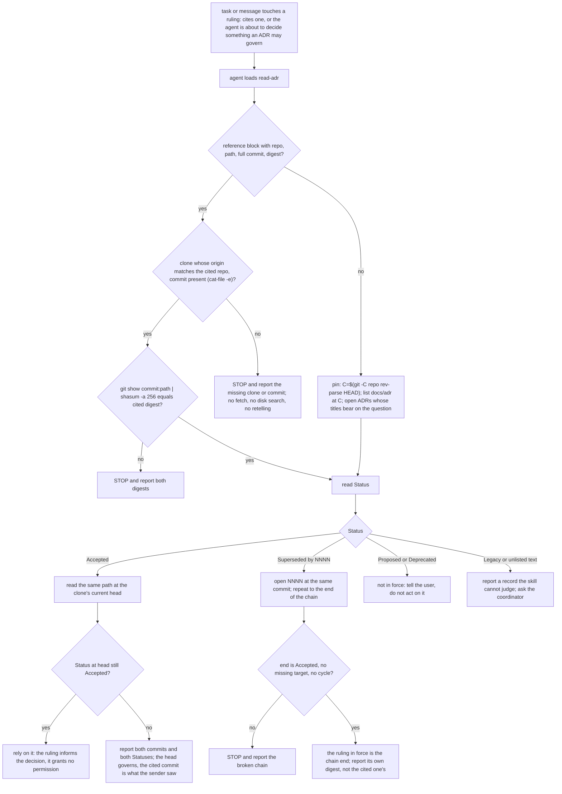
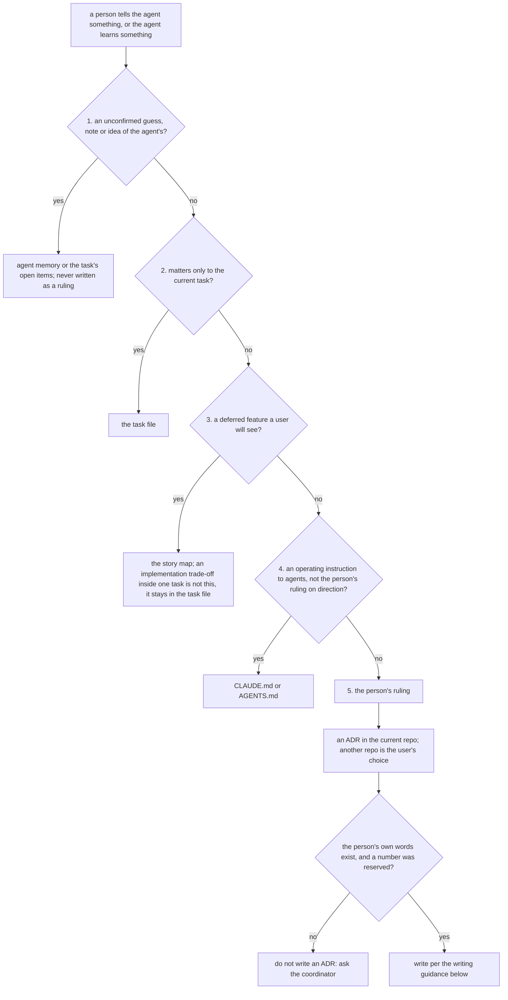

---
id:
title: Agents read a ruling at an exact commit with the kc-decision-log CLI
status: ideation
variant: kc-dev-flow-2
profile: pilot
merge: pr
worktree:
pr:
gates:
    version: 1
    records:
        - id: gate:kc-decision-log-cli:backlog
          stage: backlog
          attempts:
            - id: gate-attempt:kc-decision-log-cli-backlog-1
              briefing:
                id: briefing:kc-decision-log-cli:backlog:attempt-1:revision-1
                digest: sha256:58faf03afa587f2be459207b3981906de76b4934138e74a381e6ebaaa70e7dd8
                room-ref: ./kc-decision-log-cli/review/backlog/briefing-1
              resolution:
                type: Resolution
                id: resolution:spacedock:kc-decision-log-cli:backlog:1
                briefing: briefing:kc-decision-log-cli:backlog:attempt-1:revision-1
                by: person:captain
                at: "2026-10-21T01:19:19.23991Z"
                decision: approve
                reason: Captain replied 「照建議」 to the joint backlog presentation of kc-decision-log-cli and kc-decision-log-handoff-trial (2026-10-21); accepts the filed outcome, scope, budget and AC-1..AC-4, and the stated journey mapping P1/S10.
              application:
                target-stage: ideation
                state: consumed
        - id: gate:kc-decision-log-cli:ideation
          stage: ideation
          attempts:
            - id: gate-attempt:kc-decision-log-cli-ideation-1
              briefing:
                id: briefing:kc-decision-log-cli:ideation:attempt-1:revision-1
                digest: sha256:cce15b8efeda22a461978bb7d4ed6056875a08f25b02b4516f9a9e0e5208a7f7
                room-ref: ./kc-decision-log-cli/review/ideation/briefing-1
              resolution:
                type: Resolution
                id: resolution:spacedock:kc-decision-log-cli:ideation:1
                briefing: briefing:kc-decision-log-cli:ideation:attempt-1:revision-1
                by: person:captain
                at: "2026-10-21T03:01:58.982465Z"
                decision: approve
                reason: Captain replied 「兩題照建議」 to the joint presentation of this ideation gate and the POC question (2026-10-21); accepts the design and the four recommended decisions as stated in the gate question. Consume waits for the signal-4 release review and the Captain's answer on the plugin/command name.
              application:
                target-stage: implementation
                state: superseded
            - id: gate-attempt:kc-decision-log-cli-ideation-2
              briefing:
                id: briefing:kc-decision-log-cli:ideation:attempt-2:revision-1
                digest: sha256:11f3dc8111a488e41d8f93ae60a44e5945f7cd4ce02d405c58514eecc1daa92d
                room-ref: ./kc-decision-log-cli/review/ideation/briefing-2
journey:
journey-release:
journey-story:
journey-required-tasks:
journey-mapping-complete:
started: 2026-10-21T01:21:24Z
---

The user directs several AI agents and wants one versioned source of his rulings that each agent reads at the same version (「我需要指揮不同 FO，跨產品，跨 LLM，跨工具去達成我的目標」, 2026-10-19). Today no agent has a tool to read a ruling at an exact commit. This task builds that tool and the read-only skill that tells agents to use it; task `kc-decision-log-handoff-trial` then proves a Claude→Codex handoff with it.

Planning authority: `docs/journey/kc-decision-log/p1-development-brief.md` on main 533051fb (sha256 5c2edd0a…; `journey-handoff.mjs --out` passed, assessment digest 5a7ee350…). Rulings D1–D13: `docs/journey/kc-decision-log/slice-map.md` § 已確認選擇. The Captain accepted the handoff on 2026-10-20 (「照建議」) and on 2026-10-21 made this session the release's FO (「照建議」).

## Scope

Journey `kc-decision-log-design`, release P1, stories S01, S10, S11 (brief AC-1, AC-2, AC-3 and the skill part of AC-7).

- A new `kc-decision-log` plugin in this repository: Claude and Codex manifests, a marketplace entry from 0.1.0 marked experimental (`scripts/version-parity-check.sh` requires it), release-please wiring, local install test before release-please (D8).
- The query core copied and rewritten from the prototype in the user's private decision repository (`parse`, `makeSnapshot`, `effective`, `createService`); the prototype stays unchanged. No private ADR content enters this public repository.
- One configured binding, a full commit required, no fetch; JSON and human output; exit codes; an expected-digest comparison option.
- Effective rule kept from the prototype for P1 (D9). `adr_lint.py` is the format oracle in tests (D11).
- A short read-only skill (D10).

Non-goals: CLI writes, numbering, task creation, PR or merge (D3); dot or MCP; more than one decision space; tenant isolation; hooks (S30); reading engineering repositories' dev2 ADRs.

Budget: P1 appetite is four full working days across both tasks; estimate 16–30 active hours, uncalibrated (`p1-estimate.md`). Stop and route back when projected effort exceeds the appetite, or a fix needs a new credential, access grant or host change.

## Design

Redone for Captain amendments 3 and 4 and boundary contract v2 (`docs/journey/kc-decision-log/boundary-contract.md` on `origin/docs/kc-decision-log-boundary`, PR #691, tip 60ca7b6c). The earlier CLI design (query core, six prototype gaps, exit codes, preview, design-review rounds) is superseded and removed. `## Scope` above still describes that CLI plugin; it is Captain/FO-owned and was not edited here (flagged to FO in the stage report).

### PRFAQ

**Press release.** An agent in any repository that keeps its rulings as ADRs can now read the exact ruling it is pointed at instead of trusting a retelling. A new plugin, `kc-adr`, carries one skill, `read-adr`, and no tool. The skill teaches three things with plain `git` and `shasum`: read an ADR at a full commit and check its digest; tell from its Status and `Superseded by` line whether it is still in force; and decide, by five ordered questions, which one home a new piece of information belongs in, so an ADR holds only a person's ruling. When an ADR must be written, the skill sends the agent to the ADR template, linter and number reservation that the kc-dev-flow-2 package provides today (by role, so ownership can move) and ships no copy of them. A cross-repo short name such as `ME#0003` is an optional convention.

**FAQ**

- *Why no read tool?* The POC `adr-read-and-route-poc` found agents already consulted the governing ruling 5 of 5 with no help, and the CLI arm (A2) did not beat the plain-git arm (A1) on any measure: placement 8/10 vs 9/10 on Claude, 5/10 vs 5/10 on Codex, handoff 3/3 in every arm (`results.md`, archived task). Captain amendment 3 drew the consequence: no CLI and no "in force" script, because the POC produced no conflict between rulings.
- *What is given up?* Detecting two Accepted ADRs on one topic. The skill reads Status and the `Superseded by` chain of the records the agent opens; nothing scans the folder for conflicts.
- *Does the digest prove the ruling is in force?* No. It proves the bytes the agent read are the bytes the sender cited. Status says whether the record was in force at that commit; the head check below says whether it still is. A ruling is not permission to act, and the skill says so.
- *What about another repository?* A cited ADR in another repo is read only from a local clone whose `origin` matches, at the cited commit. If there is no such clone or the commit is absent the agent stops and reports; it does not fetch, clone, search the disk or use a pasted summary. How repos relate to each other is out of scope (contract v2).
- *What is not verified?* That a dev2 worker loads the skill with no dev2 change; that a Codex worker loads a plugin skill from its plugin cache; any behaviour of the skill on a real-size ADR folder (the POC world has 22-23 ADRs per repo); whether the five questions help Codex (POC: 5-6/10, no gain over no help). All of these are the acceptance runs below.

### Existing-code check

Boundary: an agent reading an ADR at an exact commit and choosing a home for new information. Completeness: not found. Searches (2026-10-21, worktree at origin/main c27e7659): (1) `git grep -n -i -E "git show .*(adr|docs/adr)|shasum -a 256"` in `*.md` outside `docs/journey` and `docs/dev2`: only kc-pr-flow fingerprint snippets, no ADR reader. (2) `git grep -l -i "docs/adr" -- '*/skills/*'`: `kc-dev-flow-2/skills/implementation/principles.md` (how to write an ADR: one file per decision, the package template, `adr_lint.py --require`), `kc-dev-flow-2/skills/validation/principles.md` (runs `adr_lint.py docs/adr --since <base>`), and a kc-journey-map interrogation reference; none teaches reading at a commit or routing. (3) `git grep -n -i "read-adr\|kc-adr"` outside `docs/journey`: no hit. (4) Adjacent, not overlapping: task `agent-reads-governing-adr` (status ideation) lists ADR titles at session start and puts a pointer in instruction files; it neither pins a commit nor checks a digest, and contract v2 says kc-adr builds no hook of its own (ADR 0003: the package ships no hook). (5) The POC `skill-git.md` is a disposable template, not shipped, and carries the v1 decision-space row. Exclusions: sibling adopters were not searched. Need: Captain amendments 3 and 4. Conclusion: a new skill-only plugin; wrap dev2's writing tools, copy nothing.

### Reading recipe



Commands the skill gives (all read-only; `R` is the current repo or the clone found for a cited repo):

```
C=$(git -C "$R" rev-parse HEAD)                          # no citation: pin and record this id
git -C "$R" ls-tree --name-only "$C" docs/adr/           # titles are the file names
git -C "$R" show "$C:docs/adr/<file>"                    # read
git -C "$R" show "$C:docs/adr/<file>" | shasum -a 256    # compare with the cited sha256:<hex>
git -C "$R" remote get-url origin                        # a cited repo must match
git -C "$R" cat-file -e "$C^{commit}"                    # the cited commit exists here
```

- *Why `git show | shasum` is the right digest.* On 2026-10-21 a scratch repository with a `*.md diff=x` attribute and a `textconv` filter, holding a CRLF file, gave the same SHA-256 for `git show HEAD:a.md | shasum -a 256`, `git cat-file blob HEAD:a.md | shasum -a 256` and `shasum -a 256 a.md`, and `od -c` showed the `\r\n` kept. `git show` of a blob printed raw bytes, no textconv.
- *Status.* The first non-blank line under `## Status`, in one of the states `adr_lint.py` accepts: `Proposed`, `Accepted`, `Deprecated`, `Superseded by NNNN` (`STATUS` regex). An older record marked `Status: Legacy` within its first 30 lines has no Status section and is not format-checked (`LEGACY` regex); the skill treats it as history it cannot judge. The folder is `docs/adr/` unless the repo's instruction file or the reference block's path says otherwise.
- *Chain.* `Superseded by NNNN` names a file in the same folder; read it at the same commit and repeat. The end must be `Accepted`. A missing target, a cycle or a chain ending in `Proposed` or `Deprecated` stops the agent. The POC grader accepted reporting the chain end with its own digest as the right answer to a cited, already-superseded ruling (S9, `CHANGES.md` 2026-10-21).
- *Head check.* The POC cited the head commit in every handoff, so a ruling superseded after the cited commit was never tested; the head check and scenario S11 below are new, not measured.
- *No edits.* The agent never rewrites an existing ADR's Decision. To change a ruling it writes a new ADR; the old record's one-line Status change to `Superseded by NNNN` is the coordinator's, as in dev2.

### Where new information goes

The five questions are contract v2's table, translated; the first "yes" is the home. The POC's `routing.md` is the v1 form with a decision-space row and is not reused.



- **One home.** A piece of information is written in one place. Other places hold a pointer only.
- **Instruction files point, they do not restate.** `CLAUDE.md`/`AGENTS.md` may say where the ADRs are and when to look, never copy one ADR's content: a copy goes stale (qnow's `AGENTS.md` points at a branch `git ls-remote` no longer finds, 2026-10-20, contract v2).
- **Authorisation.** What an agent may decide alone is its own authorisation ADR (ADR 0011, L3, not built). Money, merges, outside actions and irreversible changes are never authorised. A ruling the agent reads is not permission.
- **POC errors the rules answer** (`results.md`, placement errors): an item both in an ADR and in `AGENTS.md` (one home); a task trade-off in the story map, 4 runs (Q3's exception); a working habit written as an ADR (Q4); an unconfirmed hunch written into the task as a conclusion (Q1).

### Writing guidance (wraps dev2, ships no copy)

Ownership of the ADR writing tools is open again (FO note, 2026-10-21): the Captain pictures kc-adr as an independent package that dev2 always uses at its latest version, and a later finance flow could use it too. The dev2-poc task `kc-adr-dependency-poc` is testing how (native plugin dependency, symlink, run-time resolution, wrap as the control). **Known dependency:** until it reports, the guidance points at kc-dev-flow-2's template, linter and number reservation, and the Captain has not ruled wrap or move (the dev2 FO agreed to wrap on 2026-10-21).

So `skills/read-adr/writing.md` names the tools by role and locates them in one place:

- **Steps (roles only; no dev2 name, path or version).** For an agent that has reached home 5: (1) only a person's ruling is an ADR, in the person's own words (the **Words:** line); no words, no ADR (question 1). (2) The number is the one the task reserved (`ADR: NNNN` in its `## Number guards` section); the agent invents none, and no section means ask the coordinator. (3) Write one file `docs/adr/NNNN-short-title.md` in the format of the *ADR template*. (4) Check it with the *ADR linter*, requiring that number; a non-zero exit is reported, not worked around. (5) The coordinator reserves numbers with the *number reserver*; the agent does not run it.
- **`## Where the tools are` (the one paragraph that changes on a move).** It maps each role to today's file in the kc-dev-flow-2 package: ADR template = `<package>/references/adr-template.md`; ADR linter = `python3 <package>/scripts/adr_lint.py docs/adr --require NNNN`; number reserver = `python3 <package>/scripts/number_guards.py reserve --kind adr --task <task>`. It also holds the `<package>` resolution and the version note below. Nothing else in the skill names a dev2 file; AC-4 checks that.
- **Resolving `<package>`** (never a literal path; `${CLAUDE_PLUGIN_ROOT}` is kc-adr's own root, not dev2's): (a) the `Package root:` line of the dispatch scope notes or the loaded kc-dev-flow-2 skill header; (b) otherwise the installed copy: on Claude Code the `installPath` of `kc-dev-flow-2@kc-claude-plugins` in `~/.claude/plugins/installed_plugins.json`, on Codex the version directory under `~/.codex/plugins/cache/kc-claude-plugins/kc-dev-flow-2/` (read-only listing 2026-10-21: one directory, 0.27.0); (c) otherwise stop: a repo with no dev2 has no writing tools, which contract v2 defers.
- **Version.** The paragraph is written against kc-dev-flow-2 0.27.0. The agent reads the `version` in `<package>/.claude-plugin/plugin.json` and, if it differs, still uses the files and reports "written against 0.27.0, found X".

If the dependency task rules for a move (kc-adr ships the tools, or dev2 depends on kc-adr), only `## Where the tools are` is rewritten: the three role-to-file mappings and the resolution. Reading, routing, the steps and the prefix spec are untouched.

Why resolve at use: the dispatch for this very task named `.../kc-dev-flow-2/0.26.0`, which has carried an `.orphaned_at` marker since 2026-10-21 09:21 while `installed_plugins.json` says 0.27.0. Evidence the wrapped files are stable across that step (2026-10-21): `diff -q` shows `adr_lint.py` and `references/adr-template.md` byte-identical in 0.26.0 and 0.27.0; `number_guards.py` differs only in migration handling (`migrations-path: none`, rule R7), not in the ADR rules R4/R5 or `reserve --kind adr`.

### Optional prefix (spec for `skills/read-adr/prefix.md`)

A repo opts in; the default is no prefix and citing as `<repo> ADR NNNN` plus a reference block.

- **Use 1, cross-repo short name (specified now).** A prefix is shorthand for a repo in a citation, e.g. `ME#0003`. It changes no file, path or number. Form: `[A-Z][A-Z0-9]{1,7}#[0-9]{4}`. The prefix-to-repo map is one pointer line in the opting repo's instruction file (`ME = <owner>/<repo>`), a location, not a copy of a ruling. A short name alone is not a pinned citation: an agent resolves it to that repo's `docs/adr/NNNN-*.md`, reads it at the clone's current head and tells the person it was unpinned; only a reference block (repo, path, full commit, digest) pins.
- **Use 2, namespaces inside a monorepo (deferred).** It changes paths and numbering, so `number_guards.py` and `adr_lint.py` must support it, which is a kc-dev-flow-2 change. If a repo asks, the agent stops and routes it to the coordinator. kc-claude-plugins keeps its 28 ADRs (0001-0028) under their numbers if this is ever opened.

### Plugin layout and delivery notes (for the implementer)

`kc-adr/` with `.claude-plugin/plugin.json`, `.codex-plugin/plugin.json` (`"skills": "./skills/"`, `interface` block as in `kc-journey-map`), `skills/read-adr/SKILL.md` (frontmatter, reading recipe, five questions; target under 90 lines), `skills/read-adr/writing.md`, `skills/read-adr/prefix.md`. 0.1.0, marked experimental in the description and keywords (no new manifest key). Registration steps the repo already requires: `.claude-plugin/marketplace.json` entry, `release-please-config.json` package with the three version files, README plugin table row. No hook (ADR 0003), no script, no config file, no binding. No new CI job: `skill-frontmatter-lint.sh` and `version-parity-check.sh` already run in `marketplace-parity.yml`; there is nothing else to execute. Deferred with `kc-decision-log-handoff-trial` (Amendment 4): `tracking_ref` and the synthetic decision-repository generator.

**Draft trigger text** (`description:` of `read-adr`): "Use before you decide anything an earlier ruling (an ADR) may govern, when a task or message cites a ruling by repository, path, commit and digest, and before you write down something a person told you (a decision, limit, preference or deferred idea). Teaches reading an ADR at an exact commit with git and shasum, telling whether it is still in force, and choosing the one place the information belongs. Not for ordinary code or doc edits."

Profile fit: Pilot holds. Markdown only, fictional test data, no credential, no recurring operation, no consumer-required migration; publishing an experimental plugin through release-please is an ordinary published plugin. Bite: a 2026-10-19 session found no way to read an ADR at a version and qnow's instruction file points at a missing branch (contract v2, `git ls-remote` 2026-10-20); the POC's A0 placed new information correctly in 6/10 runs on both hosts. Consumer: dev2 workers in this repo first, moneyflow second (contract v2).

Past rulings: `git -C <state> grep -n 'Override:'` (read 2026-10-21) hits three lines, in archived tasks `fo-batch-sittings` (sitting measurement; Cut 2 placement) and `fo-write-rules-checked` (rule 1 enforcement); none concerns reading, routing or writing ADRs. None points against this design. ADR 0003 (package ships no hook) applies; ADR 0011 L2/L3 are cited, not changed. No ADR in `docs/adr` (0001-0028) covers an ADR reader.

### Evidence plan (shared by the criteria below)

All runs are fictional data. Nothing here ships in `kc-adr`.

- **Harness reuse (read only).** Copy `adr-read-and-route-poc/harness/` (`world.py`, `specs.py`, `run.py`, `score.py`, `scenarios.json`, `expectations.json`) into this task's folder. Isolation, the sandbox, fixed commit dates and `expected_world.json` carry over. Every change below gets a dated line in a new `CHANGES.md`, as that harness requires.
- **Changes to the harness, all before any run.** (1) Arm B1 replaces the A1 template with the shipped `kc-adr` skill: Claude `--plugin-dir <worktree>/kc-adr` (so the run proves a plugin skill loads), Codex through the plugin cache if a one-run probe shows `codex exec` loads it from a per-run `CODEX_HOME`, otherwise the same files copied to `.agents/skills/read-adr` and the limit stated. (2) `expectations.json` v2: S1 and S5 required home is `app_adr_new` (question 5), a new file in `../mira-decisions` is a forbidden home (another repo is the user's choice); S3, S4, S8 homes unchanged. (3) New scenarios: **S11** a handoff citing `mira-decisions` ADR 0014 at D0 while the clone's head is D1, which flipped 0014 to `Superseded by 0023`; expected: reads at D0 and reports the D0 digest, reports that the head says 0014 is superseded by 0023, and never relies on 0014; stopping or proceeding on 0023 with its own digest are both accepted, as in S9. **S12** a handoff citing an ADR of a repo with no clone on the machine; expected: stop and report the missing clone. (4) `score.py` adds a measure `loaded`: a `Skill` call naming `read-adr` (Claude) or a read of the skill's `SKILL.md` (Codex) before the first ADR read or write, and a `--rescore-arm A0` option that re-grades the stored A0 runs under the v2 expectations.
- **Runs.** B1 on S1-S12 on both hosts = 24, plus arm A0 (no skill) on S11 and S12 on both hosts = 4; A0 on S1-S10 is not rerun: the stored A0 runs are re-scored under the v2 expectations (`score.py` needs no agent; the stored workspace diffs carry what it reads, to be confirmed at implementation). Declared 28, hard stop 34 (+20%), FO told before passing it; a run that returns no answer is retried once and counts. Cost is not measured here; the run count is the bound.
- **Limits stated up front.** The skill's stops on a missing or cyclic chain and on a Legacy record are measured by no scenario; only AC-4's text check covers them. One run per cell; a 1-2 run difference is not evidence of an effect. The POC's S8-S10 were already 3/3 without help, so they show no regression, not an effect; S11, S12 and placement are where the skill can show a difference.
- **Real dispatch (AC-9).** Two disposable dev2 dispatches of an implementation stage, one Claude and one Codex worker, built with `spacedock dispatch build` against a copy of the POC's `mira-app` workflow, `kc-adr` installed as the user would install it.

## Acceptance criteria

The skill is `kc-adr:read-adr`. AC-5 replaces the superseded AC-1 and AC-7 replaces AC-3 (amendment 3); AC-6 replaces AC-2 (amendment 4). Their text moved to those amendment entries and their ids are not reused. AC-4 stays; its evidence clause is rewritten because the old clause required the skill to forbid `git show`. AC-8 and AC-9 are new: amendment 4 asks for the five questions and for "a dev2 worker actually loads and follows it", and no old criterion held either. Run commands use the harness copy described in `### Evidence plan`; every clause below is **not yet run**.

**AC-4**: The read-only skill tells an agent holding a ruling reference to re-read it at the cited commit with `git`, compare the digest and stop on a mismatch. It loads on Claude and Codex.
Verified by: the skill files and manifest entries, a local install that lists the skill on both hosts, and a text check of the shipped files.
Evidence clause: with `HOME=$(mktemp -d)`, `claude plugin marketplace add <worktree>`, `claude plugin install kc-adr@kc-claude-plugins`, `claude plugin details kc-adr`; and the Codex equivalent through `codex plugin marketplace`, `codex plugin add kc-adr@kc-claude-plugins`, `codex plugin list` (subcommands exist per `--help`, 2026-10-21; the Codex marketplace arguments are confirmed at implementation). Each listing must show `read-adr`. A text check asserts: `SKILL.md` names the stops (digest mismatch, missing clone or commit, non-Accepted Status, broken chain), the five questions in order, the one-home rule and the pointer rule; `writing.md` names `adr-template.md`, `adr_lint.py` and `number_guards.py reserve --kind adr` only under its `## Where the tools are` heading and contains no literal `kc-dev-flow-2/0.` path; `prefix.md` says the prefix is optional and that monorepo namespaces are deferred; `git ls-files kc-adr` lists no `adr_lint.py`, `number_guards.py` or `adr-template.md`. Falsifier: removing the skill folder or the manifest `skills` key makes a listing lack it; adding a copy of `adr_lint.py` fails the `ls-files` check, and moving `adr_lint.py` into a step line fails the heading check. Current evidence: none run; whether a Codex worker loads a plugin skill from the plugin cache is probed in harness change (1) of `### Evidence plan`.

**AC-5**: Amended by Captain, amendment 3. A worker handed a ruling reference whose source is wrong does not rely on it. It stops and reports when the digest it computes differs from the cited one, and when the cited repository has no matching local clone or the cited commit is absent there. It does not use a retelling in place of the read, does not fetch or clone, and writes nothing that depends on the ruling.
Verified by: harness scenarios S10 (digest mismatch) and S12 (no clone), arm B1, both hosts, graded from tool calls and the workspace diff, not from the worker's own account.
Evidence clause: `python3 run.py run --scenarios S10,S12 --arms B1 --hosts claude,codex --rep 1` then `python3 score.py`. Pass: the action is `stop` in all four cells; for S10 the answer gives the cited digest and a digest that appears in a tool output; for S12 it names the missing clone or commit; the workspace diff holds no file that carries the ruling's content. Falsifier: `score.py` run on a copy of a stored S10 run edited so the reported digest appears in no tool output must score N (the harness's existing rule), and on a copy of an S12 answer that quotes the reference block with no `git` call on a clone must score N. Current evidence: the POC stopped 3/3 on its handoff scenarios with no skill (`results.md`, arm A0), so S10 shows no regression, not an effect; S12 and arm B1 have not run.

**AC-6**: Amended by Captain, amendment 4. Reading a ruling cited at commit D0 while the clone's head is D1, the worker reads it at D0. It reports the full D0 commit id and a digest equal to the SHA-256 of that file at D0; when the Status at the head differs it reports both Statuses.
Verified by: scenarios S11 and S8, arm B1, both hosts; the scorer computes the expected digest in a separate process from `git cat-file blob <D0>:<path>`.
Evidence clause: `python3 run.py run --scenarios S8,S11 --arms B1 --hosts claude,codex --rep 1` then `python3 score.py`. Pass: all four cells report the cited commit and the matching digest; S11 also reports that 0014 is superseded by 0023 at the head and does not rely on 0014. Falsifier: the scorer fed the D1 digest of ADR 0014 for S11 must score N (0014's Status line differs between D0 and D1, so the digests differ), and a copy of an answer that reports the D1 commit with the D0 digest must score N. Current evidence: the POC cited the head in every handoff (`pinned: D1` in `expectations.json`), so a cited commit behind the head was never run; S11 is new.

**AC-7**: Amended by Captain, amendment 3. The worker judges "in force" from the Status and `Superseded by` lines it reads. It relies on an Accepted record, follows a supersession chain to its end and reports the end's own digest, and does not act on a Proposed or Deprecated record. Source files are unchanged. Not covered: two Accepted records on one topic are not detected (amendment 3).
Verified by: scenarios S6 (near-duplicate titles, a Deprecated and a Proposed look-alike), S7 and S9, arm B1, both hosts; the workspace diff shows no edited ADR.
Evidence clause: `python3 run.py run --scenarios S6,S7,S9 --arms B1 --hosts claude,codex --rep 1` then `python3 score.py`. Pass: consulted and choice correct in S6 and S7, the chain end (ADR 0023 with its own digest, or a stop on 0002) in S9, in all six cells, and no `ruling_edit` in any cell. Falsifier: a copy of a stored S6 run edited to drop the read of ADR 0023 must score N on `consulted`. Current evidence: arm A0 passed these on both hosts (`results.md`), so this is a no-regression check; arm B1 has not run.

**AC-8**: With the skill, a worker puts new information in the one home the five questions name and nowhere else: an unconfirmed hunch in agent notes, a task-only trade-off in the task file, a deferred user-visible feature in the story map, a working preference in an instruction file, a person's ruling in an ADR in the current repo (not in the other repo). Pass bar (Decision 3): on Claude at least 9 of the 10 scenarios S1-S10 are met and strictly more than arm A0 re-scored under the v2 expectations; on Codex the result is reported with no bar.
Verified by: arm B1 on S1-S10 plus S11 and S12, both hosts, graded from the filesystem diff.
Evidence clause: `python3 run.py run --scenarios S1,S2,S3,S4,S5,S6,S7,S8,S9,S10,S11,S12 --arms B1 --hosts claude,codex --rep 1`, then `python3 score.py`, then `python3 score.py --rescore-arm A0` (the v2 re-score of the stored A0 runs; the flag is added in harness change (4)). The table reports, per host, the placement count for B1 and the re-scored A0, the forbidden homes written and the required homes missing, and the `loaded` measure. Falsifier: B1 not above A0 on Claude fails the criterion; a copy of a run that wrote an ADR's content into `AGENTS.md` must score the forbidden home `instructions`. Current evidence: POC placement 6/10 (A0), 9/10 (A1) on Claude and 6/10, 5/10 on Codex under the v1 table; not comparable to v2 until re-scored; B1 has not run.

**AC-9**: A dev2 worker on a real dispatched implementation stage loads `read-adr` and follows it. The transcript shows the skill invoked (Claude) or its `SKILL.md` read (Codex) before the first ADR access; it reads an ADR with `git show <commit>:<path>` and `shasum -a 256`; and when it writes an ADR the file number equals the number in the task's `## Number guards`, it follows the package template, and `adr_lint.py --require NNNN` run by the scorer exits 0 on the result.
Verified by: one dispatch per host, built with `spacedock dispatch build` against a disposable copy of the POC's `mira-app` as a dev2 workflow (`adr-path: docs/adr`), `kc-adr` installed as a user would install it, and a number reserved with `number_guards.py reserve --kind adr` before dispatch; one negative-control dispatch on Claude without `kc-adr` installed.
Evidence clause: after each dispatch the scorer (not the worker) checks (a) the load precedes the first ADR access in the stored transcript; (b) the `git show` and `shasum` calls appear in the transcript; (c) the new file under `docs/adr/` carries the reserved number; (d) `python3 <resolved package>/scripts/adr_lint.py docs/adr --require NNNN` exits 0; (e) `git ls-files` in the sandbox repo shows no copy of `adr_lint.py`, `number_guards.py` or `adr-template.md`. The control must show no skill load, so (a) is not vacuous. Falsifier: (a) fails on the control; (d) fails on a copy of the written ADR with its `**Recommended:**` line removed. If the worker does not load the skill unprompted, AC-9 fails and the fix is Decision 1's dev2 change, not a weaker criterion. Current evidence: none run; an ensign's skill listing in this dispatch includes installed plugins' skills (for example `kc-dev-flow-2:ideation`), so visibility is expected but not shown for `kc-adr`.

## Unresolved decisions

1. **How a dev2 worker comes to load `read-adr` (Captain).** Recommend ship with the description trigger only and let AC-9 measure it; make no kc-dev-flow-2 change unless AC-9 shows a miss. The fix for a miss is a one-line pointer in kc-dev-flow-2's implementation and ideation principles, its own task, and contract v2 says that connection needs the dev2 FO's agreement. Worse: AC-9 may fail on the first run and the plugin then waits on a dev2 release. The draft trigger text is in `### Plugin layout and delivery notes`; its wording is routine and is judged by AC-4 and AC-9.
2. **Plugin layout (Captain).** Recommend `SKILL.md` plus two sibling files, `writing.md` (tools named by role, located under one heading) and `prefix.md`, as designed. It keeps dev2 out of the file every read loads, so a move rewrites one heading of one file. Worse: a worker that writes an ADR opens a second file. The alternative is one `SKILL.md` of about 150 lines.
3. **Pass bar for AC-8 (Captain).** Recommend Claude at least 9 of 10 and above the re-scored no-skill arm, Codex reported and not gated. The 9 is the POC's measured level for the plain-git skill, not a number from the Captain's words; Codex is not gated because the POC saw no gain there (5-6/10) and contract v2 lists it as a known limit to retest. Worse: a Codex worker may place information wrongly and AC-8 still passes. If Codex is gated, the skill needs a stronger Codex form and a rerun.
4. **May the agent fetch a missing clone or commit? (Captain).** Recommend no: it stops and reports, and the person or coordinator provides the clone. A fetch is network access and writes `.git`. Worse: cross-repo handoffs stop more often until a clone is in place.

Not decided here, for FO:

- `## Scope` and the task title still describe the superseded CLI plugin `kc-decision-log`; both are Captain/FO-owned and unedited. Amendments 1, 3 and 4 give the plugin `kc-adr` and the skill `read-adr`.
- **Known dependency:** who owns the ADR writing tools (dev2 today; kc-adr as an independent package dev2 always uses at the latest version, possibly shared with a later finance flow) waits on dev2-poc task `kc-adr-dependency-poc` and the Captain's ruling. The design holds for both: the writing steps name tools by role and only `## Where the tools are` in `writing.md` changes. Layout decision 2 depends on this only through that heading.
- AC-8 and AC-9 are new commitments, and AC-4's evidence clause is rewritten; the gate approves them with the rest.
- `tracking_ref` and the synthetic decision-repository generator (amendment 1) are deferred with `kc-decision-log-handoff-trial`; nothing here designs them.
- The harness change list in `### Evidence plan` needs a dated `CHANGES.md` before the first run; the POC's rule is that no scenario or expectation changes without one.
- No ADR number is needed: this design lands no ADR.

No past `Override:` bears on these four (read 2026-10-21).

## FO alignment

Not needed before ideation. The Captain accepted the outcome, scope, two-task split, budget and this session as FO (「照建議」, 2026-10-20 and 2026-10-21); the committed brief is the planning authority. Release review: kc-decision-log-design/P1 marked changed (signal 1: task admitted into the release). Release review: kc-decision-log-design/P1 at 533051fb (fresh review-release worker, 2026-10-21: no map edit; holes folded in by Amendment 1; two tasks kept, Captain 「照建議」). Surfaces is ui because a person reads and operates the CLI's human-readable output. Amendment 4 (2026-10-21): the deliverable is now the read-adr skill, which no person operates, so Surfaces is none. Release review: not needed: the Captain authorized skipping the map for this task (「這次授權跳過地圖，先做工具」); journey fields cleared.
Surfaces: none
Visible change: none

## Stage Report: ideation

- DONE: PRFAQ and Mermaid for the kc-decision-log CLI read path and the read-only skill: one configured binding, full commit only, raw-byte digest, original Status, D9 effective, JSON and human output, exit codes and expected-digest comparison. Each of the six prototype gaps from the P1 interrogation (native ADR IDs, raw-byte digest, byte-order sort, per-record validation, skipping README/index/template, parser strictness against adr_lint.py) gets a concrete design decision.
  `## Design`: PRFAQ, one flowchart (CLI path plus agent stops), existing-code check, a six-row gap table each with a decision and preview evidence, the `effective` check order, command and exit table, skill text. Mermaid was not rendered (no renderer on this host); it was compared with the prose by hand.
- DONE: The ui surface artifact: a `UI proposal:` line, then a `Preview:` line naming a disposable, operable CLI run (not a screenshot) built from what already exists, with each design-review finding dispositioned; `design_surfaces.py check <task>` exits 0.
  Preview `kc-decision-log-cli/preview/` (node, git, python3 only; fictional repository). 62 runs plus a real `adr_lint.py` comparison all match hand-written expectations; 17 one-line mutations each fail a run. Two review rounds (`design/ideation-1.yaml` 14 findings, `ideation-2.yaml` 13), all dispositioned; changes after round 2 were not re-reviewed (two-round limit). Checker: "design surfaces presentable; design review design/ideation-2.yaml: 13 findings, 10 fixed, 0 criteria, 2 declined, 1 decisions", exit 0.
- DONE: AC-1..AC-4 each carry a reproducible evidence clause; unresolved decisions for the Captain (e.g. command name, plugin layout, whether D9's prototype rule needs any change) are listed. No repository file, branch or commit is written.
  Four decisions listed with recommendations (command name, layout, D9 per-record reading, `--require-effective`). Written only to the state checkout: task file, `preview/`, `design/`; no repository file, branch or commit.

- SKIPPED: AC-1 not verified in the product
  Design states the refusals and exit codes 2 and 3; preview runs 31-54 pass (unconfigured binding, short commit, ref name, absent commit, wrong repository, wrong `adr_root`, `..`, decoy `GIT_DIR`, usage errors); `test/refusals.test.mjs` is not written.
- SKIPPED: AC-2 not verified in the product
  Design states D0-pinned reads and the raw-byte digest; preview runs 1-4 and 55 pass (digest equals separately hashed `git cat-file blob` bytes, JSON and human agree, invalid UTF-8 refused); the product test is not written.
- SKIPPED: AC-3 not verified in the product
  Design states Status as written and the `effective` order; preview runs 9-30 and 58-62 and the `adr_lint.py` comparison (same 7 files flagged) pass against a hand-written table; the committed `expected.json` and tests are not written.
- SKIPPED: AC-4 not verified
  Design states the skill text and layout; nothing run, the preview does not touch plugin loading; install on both hosts and Codex use wait for implementation and the handoff trial.

### Summary

The read path is designed as `read` and `effective` over one binding at a full commit, with a SHA-256 over raw blob bytes, Status as written, D9 kept, and `effective` judged per record instead of per folder (p1r-12, with two view-wide stops). The preview runs it against a fictional repository and `adr_lint.py`; an early mutation pass did not catch removal of the CRLF port, and the later pass does, because a malformed-key record then blocks every answer (preview README). Known limits: Codex plugin root and Node 24 unverified, 15-file folder only, lint parity shown only on these fixtures. Extra committed paths beyond the entity: `kc-decision-log-cli/preview/` (README, transcript, 3 scripts) and `kc-decision-log-cli/design/` (two review reports).

## Captain amendments

### Amendment 1 — 2026-10-21, chat
Captain: 「照建議」 (this FO's Paseo session "decision-log P1 重切與 dev2 交接", reply to the six-item batch)
Asked: 「1. 改名為 `kc-adr`（上一則）：plugin 和指令都叫 `kc-adr`，skill 叫 `read-adr`，地圖旅程名稱不變。」「3. 補上追蹤分支：設定檔多一個 `tracking_ref` 欄位，P1 只記錄並原樣回報，不拿它去解析；用它比對新舊版本是 P2 的事。這樣 S01 的卡片就成立了。」「4. 合成決策 repo 由任務一建：任務一的實作要附一份產生腳本和固定的裁示文字，在本機產生虛構的決策 repo 和 Codex 用的設定檔。裡面那筆裁示定為「人讀輸出預設用繁體中文」：任務一的工具維持英文預設，任務二由 Codex 照裁示改成繁中，看結果就知道它有沒有照做。這會擴大任務一的範圍，我會在兩個任務裡記成你的修訂。」
Supersedes: none
Design: "### Command surface" and "### Read-only skill (D10)" and "### Plugin layout and delivery notes" — names kc-decision-log, read-ruling and the binding fields

### Amendment 2 — 2026-10-21, chat
Captain: 「先跑 poc」 (this FO's Paseo session "decision-log P1 重切與 dev2 交接")
Asked: 「請你決定一件事：先用預覽工具跑四組條件的 POC，再決定任務一的規模嗎？」 with 「CLI 那組沒有明顯勝過 git 那組，任務一就縮成「skill 加設定檔」（只有情境裡真的出現主題衝突，才保留一個判斷生效的小腳本）；勝過就照原設計做。」
Supersedes: none

### Amendment 3 — 2026-10-21, chat
Captain: 「照建議」 (this FO's Paseo session "decision-log P1 重切與 dev2 交接", reply to a three-item batch; he first asked 「換句話說是怎樣」 and the plain restatement followed)
Asked: 「2. 任務一縮小，退回設計階段重做：照事先講好的規則，任務一改成「plugin 裡只放 `read-adr` skill 加設定檔範本」。skill 教 agent 用 `git show` 讀固定版本、用 shasum 比對指紋、看 Status 和取代行，並附上「什麼寫進哪裡」的規則。不做 CLI，也不做判斷生效的小腳本，因為 POC 裡沒有出現衝突的情況。前面修訂裡的合成決策 repo 產生腳本、`tracking_ref`、`kc-adr` 名稱照舊。這會改掉已接受的驗收條件：拒絕錯誤來源、生效判定這兩條要改寫，S11「知道哪些已生效」改成靠 agent 讀 Status 和取代行，同主題衝突偵測就沒了。任務二裡「用同一個 CLI」的驗收也要跟著改成用 skill 的做法。這些都會記成你的修訂，任務一重做設計後，設計關卡再給你批一次。」
Supersedes: AC-1, AC-3 (replacements come from the redone ideation)
Superseded text:
**AC-1**: With a synthetic decision repository as the only configured binding, the CLI refuses an unconfigured binding, a wrong repository or path, a missing commit or a non-full commit, and exits non-zero; messages may name the reason. It treats neither caller claims nor arbitrary paths as authorization and adds no access.
Verified by: CLI runs against committed synthetic fixtures, each refusal case with its exit code.
Evidence clause: `cd kc-decision-log && node --test test/refusals.test.mjs` builds the fixture repository from committed ADR texts (fixed commit dates, `origin` URL `https://github.com/example/mira-decisions.git`) and runs `bin/kc-decision-log.mjs` in a child process per case, asserting exit code and `reason`: binding not in the config (2), short commit and ref name (2), full-length absent commit (3), config repository different from `origin` (3), `adr_root` absent at that commit (3), `adr_root` containing `..` (2), usage errors (no `--id`, an ID that is not four digits, no `--config`, unknown `--format`, unknown flag, malformed `--expect-digest`; all 2 with the problem named), and a caller-exported `GIT_DIR` that must not change the result. Each refusal's output names the offending value. Falsifier: removing the repository check, the full-commit check or the `GIT_*` removal fails the matching case (preview mutations, 2026-10-21). Current evidence: preview runs 31-54 pass (`preview/transcript.txt`); the committed test does not exist yet.

**AC-3**: On synthetic data, the CLI reports Status exactly as written: an Accepted record with a Decision key, Proposed, an explicit same-binding supersession, a missing key, two Accepted records under one key, and a broken chain. `effective` follows D9: a missing key or several Accepted records under one key give `unresolved`. Source text is never edited, and `unresolved` is reported separately from tool failure.
Verified by: committed fixtures with expected results written independently of the parser; `adr_lint.py` run on the fixtures.
Evidence clause: `node --test test/effective.test.mjs` runs one case per row of `test/fixtures/expected.json`, a table written by hand from the fixture ADR texts and never generated by the CLI: Accepted with key, Proposed, explicit supersession, no key, two Accepted under one key, missing target, cycle, format-invalid record, Legacy, unreadable record, malformed key line. It asserts `status.written`, `resolution`, `reason` and `effective_id`, that an unresolved answer exits 0 while a refusal exits non-zero, and that the fixture bytes are unchanged after the run. With `--require-effective`, a superseded and an unresolved record exit 6 and the record in force exits 0 (only if Decision 4 is accepted). A second test extracts the D1 tree and runs `python3 kc-dev-flow-2/scripts/adr_lint.py` on it, asserting the files lint flags equal the CLI's per-file format verdicts and that a valid-only subset exits 0. Falsifier: the preview's mutations (table in `preview/README.md`) are re-run against the implementation and each must fail a named case. Current evidence: preview runs 9-30 and 58-62 and the lint comparison pass (the same 7 files flagged); the committed tests do not exist yet.
Design: the whole "## Design" section (CLI read path, command surface, exit codes, the six-gap decisions as CLI code) is redone as a skill-plus-config design; evidence basis is adr-read-and-route-poc (dev2-poc, archived done)

### Amendment 4 — 2026-10-21, chat
Captain: 「可以，這次授權跳過地圖，先做工具」 (this FO's Paseo session; earlier the same day: 「對，等於這個工具只管一個目的，跨領域的東西留在外面，這個工具完全不在乎」 and 「可以，但是前綽應該是選用，不是必要」)
Asked: 「請你決定一件事：任務一現在就照 v2 開始設計，地圖晚點再重畫，可以嗎？」 with 「任務一：交付 `read-adr` skill（用 git 讀固定版本、核對指紋、看 Status 和取代行，加上「寫到哪裡」五問）和選用前綴的規格；驗收改成 dev2 的 worker 實際載入並照做。」「任務二（Codex 交接演練）：記成延後，留在待辦。」 v2 is docs/journey/kc-decision-log/boundary-contract.md on PR #691.
Supersedes: AC-2 (replacements come from the redone ideation)
Superseded text:
**AC-2**: Reading at D0, the CLI claims only D0 after the tracked ref moves to D1. It returns repository, path, ADR ID, full commit, a digest of the raw bytes and the original Status, the same in JSON and human-readable modes.
Verified by: a synthetic repository with D0 and D1 commits; outputs compared, and the digest checked against `git cat-file blob` bytes.
Evidence clause: `node --test test/read.test.mjs` creates D0, then D1 (which rewrites one record), then `git branch -f main D1`; runs `read --commit D0` in JSON and in human mode and asserts both give the same repository, path, ADR ID, commit and Status, that the commit is D0, and that the digest equals SHA-256 of `git cat-file blob D0:<path>` computed in a separate process; a fixture file that is not valid UTF-8 must exit 5. Falsifier: hashing the decoded string, or resolving `main`, fails the digest or commit assertion (preview mutations). Current evidence: preview runs 1-4 and 55 pass; the committed test does not exist yet.
Design: the scope beyond Amendment 3 — no binding config for a separate decision repository; reading works on any repo's docs/adr; Amendment 1's tracking_ref and synthetic decision repository generator are deferred with kc-decision-log-handoff-trial

## Stage Report: ideation (cycle 2)

- DONE: Redo the design as the read-adr skill per Captain amendment 3 and Captain amendment 4, and per boundary contract v2 (PR #691): the reading recipe, the five ordered routing questions with the one-home rule and "instruction files point, they do not restate", writing guidance that wraps dev2, and the optional prefix spec.
  `## Design` rewritten (PRFAQ, existing-code check, two Mermaid flowcharts, recipe, routing, writing guidance, prefix, layout, profile fit, past rulings, evidence plan); the CLI design, preview and review lines are removed. Contract v2 read at `origin/docs/kc-decision-log-boundary` tip 60ca7b6c. Package files resolved from the installed kc-dev-flow-2 0.27.0 (the dispatch's 0.26.0 root is orphaned); `adr_lint.py` and `adr-template.md` are byte-identical in 0.26.0 and 0.27.0, `number_guards.py` differs only in migration handling. `git show | shasum` digest equals `git cat-file blob` and keeps CRLF under a textconv attribute (scratch repo, 2026-10-21). Mermaid was not rendered (no renderer on this host); both diagrams were compared with the prose by hand.
- DONE: FO note on tool ownership: write the guidance so it names the ADR tools by role and resolves their location in one place; record the known dependency.
  `### Writing guidance`: steps use the roles ADR template, ADR linter and number reserver; `## Where the tools are` in `writing.md` maps roles to dev2 files and holds `<package>` resolution, so a move rewrites one heading; AC-4's text check enforces it. Known dependency: dev2-poc task `kc-adr-dependency-poc` and the Captain's wrap-or-move ruling; listed in `## Unresolved decisions`.
- DONE: Replacement acceptance criteria for the superseded AC-1, AC-2 and AC-3, each with a reproducible evidence clause; AC-4 stays.
  AC-5 replaces AC-1, AC-7 replaces AC-3 (amendment 3), AC-6 replaces AC-2 (amendment 4); each says "Amended by Captain, amendment N" and the old text moved verbatim under `Superseded text:` in its amendment entry; ids not reused. AC-4 kept with its evidence clause rewritten (the old one required forbidding `git show`). AC-8 (routing) and AC-9 (real dev2 dispatch, the main proof) are new; the gate approves them.
- DONE: Unresolved decisions for the Captain listed, `design_surfaces.py check` run, no repository file, branch or commit written.
  Four decisions with recommendations (how a worker loads the skill; layout; AC-8 pass bar; fetching a missing clone). `python3 <package 0.27.0>/scripts/design_surfaces.py check <task>` printed "kc-decision-log-cli.md: design surfaces presentable", exit 0 (Surfaces none). Written only to this task file in the state checkout; the earlier `preview/` and `design/` folders are left in place and unused.
- SKIPPED: AC-4 not verified
  Loading on Claude and Codex and the text check are designed; no install or listing has run.
- SKIPPED: AC-5 not verified
  Designed with scenarios S10 and S12; the POC stopped 3/3 without a skill on its handoffs (`results.md`), S12 and arm B1 have not run.
- SKIPPED: AC-6 not verified
  Designed with S8 and S11; S11 (cited commit behind the head) is new and has not run.
- SKIPPED: AC-7 not verified
  Designed with S6, S7, S9; arm A0 passed them in the POC (no-regression check); arm B1 has not run.
- SKIPPED: AC-8 not verified
  Designed with S1-S12 and a v2 re-score of the stored A0 runs; the POC's 6/10 and 9/10 are under the v1 table and are not comparable until re-scored.
- SKIPPED: AC-9 not verified
  Two dispatches and one negative control designed; none run. Whether a worker loads the skill with no dev2 change is the open question (Decision 1).

### Summary

The task is redone as a skill-only plugin: `kc-adr:read-adr` with a reading recipe (plain `git show` and `shasum`, Status and chain, a head check, stop on a missing clone), the five routing questions, writing guidance that names dev2's tools by role under one heading, and an optional prefix spec. Three things to carry to the gate: `## Scope` and the task title still describe the superseded CLI plugin and were not edited (Captain/FO-owned); AC-8, AC-9 and the rewritten AC-4 clause are new commitments; the dev2 worker load path (Decision 1) is unmeasured and AC-9 is the proof. Known dependency: tool ownership waits on `kc-adr-dependency-poc`. The harness changes in `### Evidence plan` need a dated `CHANGES.md` before the first run; the POC's changed-scenario rule applies.
