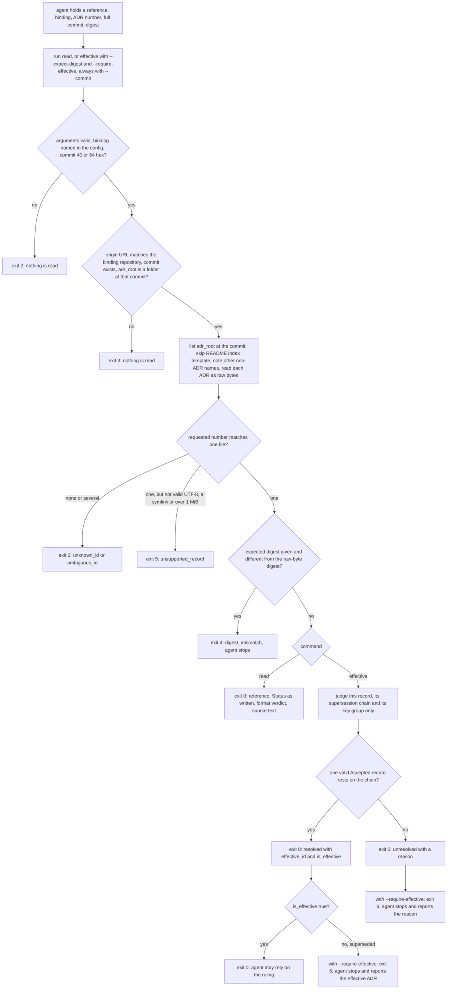

---
id:
title: Agents read a ruling at an exact commit with the kc-decision-log CLI
status: ideation
variant: kc-dev-flow-2
profile: pilot
merge: pr
worktree:
pr:
gates:
    version: 1
    records:
        - id: gate:kc-decision-log-cli:backlog
          stage: backlog
          attempts:
            - id: gate-attempt:kc-decision-log-cli-backlog-1
              briefing:
                id: briefing:kc-decision-log-cli:backlog:attempt-1:revision-1
                digest: sha256:58faf03afa587f2be459207b3981906de76b4934138e74a381e6ebaaa70e7dd8
                room-ref: ./kc-decision-log-cli/review/backlog/briefing-1
              resolution:
                type: Resolution
                id: resolution:spacedock:kc-decision-log-cli:backlog:1
                briefing: briefing:kc-decision-log-cli:backlog:attempt-1:revision-1
                by: person:captain
                at: "2026-10-21T01:19:19.23991Z"
                decision: approve
                reason: Captain replied 「照建議」 to the joint backlog presentation of kc-decision-log-cli and kc-decision-log-handoff-trial (2026-10-21); accepts the filed outcome, scope, budget and AC-1..AC-4, and the stated journey mapping P1/S10.
              application:
                target-stage: ideation
                state: consumed
        - id: gate:kc-decision-log-cli:ideation
          stage: ideation
          attempts:
            - id: gate-attempt:kc-decision-log-cli-ideation-1
              briefing:
                id: briefing:kc-decision-log-cli:ideation:attempt-1:revision-1
                digest: sha256:cce15b8efeda22a461978bb7d4ed6056875a08f25b02b4516f9a9e0e5208a7f7
                room-ref: ./kc-decision-log-cli/review/ideation/briefing-1
              resolution:
                type: Resolution
                id: resolution:spacedock:kc-decision-log-cli:ideation:1
                briefing: briefing:kc-decision-log-cli:ideation:attempt-1:revision-1
                by: person:captain
                at: "2026-10-21T03:01:58.982465Z"
                decision: approve
                reason: Captain replied 「兩題照建議」 to the joint presentation of this ideation gate and the POC question (2026-10-21); accepts the design and the four recommended decisions as stated in the gate question. Consume waits for the signal-4 release review and the Captain's answer on the plugin/command name.
              application:
                target-stage: implementation
                state: pending
journey: kc-decision-log-design
journey-release: P1
journey-story: S10
journey-required-tasks: '["kc-decision-log-cli"]'
journey-mapping-complete: true
started: 2026-10-21T01:21:24Z
---

The user directs several AI agents and wants one versioned source of his rulings that each agent reads at the same version (「我需要指揮不同 FO，跨產品，跨 LLM，跨工具去達成我的目標」, 2026-10-19). Today no agent has a tool to read a ruling at an exact commit. This task builds that tool and the read-only skill that tells agents to use it; task `kc-decision-log-handoff-trial` then proves a Claude→Codex handoff with it.

Planning authority: `docs/journey/kc-decision-log/p1-development-brief.md` on main 533051fb (sha256 5c2edd0a…; `journey-handoff.mjs --out` passed, assessment digest 5a7ee350…). Rulings D1–D13: `docs/journey/kc-decision-log/slice-map.md` § 已確認選擇. The Captain accepted the handoff on 2026-10-20 (「照建議」) and on 2026-10-21 made this session the release's FO (「照建議」).

## Scope

Journey `kc-decision-log-design`, release P1, stories S01, S10, S11 (brief AC-1, AC-2, AC-3 and the skill part of AC-7).

- A new `kc-decision-log` plugin in this repository: Claude and Codex manifests, a marketplace entry from 0.1.0 marked experimental (`scripts/version-parity-check.sh` requires it), release-please wiring, local install test before release-please (D8).
- The query core copied and rewritten from the prototype in the user's private decision repository (`parse`, `makeSnapshot`, `effective`, `createService`); the prototype stays unchanged. No private ADR content enters this public repository.
- One configured binding, a full commit required, no fetch; JSON and human output; exit codes; an expected-digest comparison option.
- Effective rule kept from the prototype for P1 (D9). `adr_lint.py` is the format oracle in tests (D11).
- A short read-only skill (D10).

Non-goals: CLI writes, numbering, task creation, PR or merge (D3); dot or MCP; more than one decision space; tenant isolation; hooks (S30); reading engineering repositories' dev2 ADRs.

Budget: P1 appetite is four full working days across both tasks; estimate 16–30 active hours, uncalibrated (`p1-estimate.md`). Stop and route back when projected effort exceeds the appetite, or a fix needs a new credential, access grant or host change.

## Design

### PRFAQ

**Press release.** An agent that is handed a ruling reference can now read the exact ruling instead of trusting a pasted claim. `kc-decision-log read` or `effective` takes a binding name, a full commit and a four-digit ADR number, and returns the ruling's repository, path, commit, a digest of its raw bytes and its Status exactly as written. When the decision repository's branch moves on, a reference made at D0 still reads D0. `effective` says whether that record is still the ruling in force; when it cannot say, it answers `unresolved` with a reason and exits 0, so "not known" is never mistaken for a tool failure. A short read-only skill tells Claude and Codex agents to run `effective` with the expected digest and `--require-effective`, and to stop on any non-zero exit: a digest mismatch, an unresolved answer or a superseded record each stop the agent.

**FAQ**

- *Who uses it?* Agents, through the skill: a Claude first officer writes the reference into a task, a Codex worker re-reads it in its own environment (the second task, `kc-decision-log-handoff-trial`). The Captain reads the human output when he checks a handoff.
- *What does the digest prove?* That the bytes at that commit are the bytes the sender saw. It does not prove the ruling is Accepted or in force, and it is not permission to act: every result carries `authorization: none`, and the tool never executes text it reads.
- *What is `effective`?* D9, kept: an Accepted record with a Decision key and no other Accepted record under that key, or the Accepted end of an explicit `Superseded by` chain inside the binding. A missing key or several Accepted records under one key give `unresolved`.
- *Why does one broken ADR no longer make everything unresolved?* The prototype answered `unresolved` for every record when any record in the snapshot had an issue (its own test "malformed source elsewhere conservatively blocks effective decisions"). The accepted answer to p1r-12 is per-record judgement. D9's two rules do not change; only which records an answer depends on (gap 4).
- *Why port `adr_lint.py` instead of running it?* It is Python and reads files on disk; the CLI reads blobs at a commit in Node. The rules are ported without being stricter, and the tests run the real script on the same fixtures and compare file verdicts (gap 6).
- *Is this a security boundary?* No. The config names one clone and one folder, so a caller cannot point the tool elsewhere; reading still needs the caller's own OS rights. A caller's exported `GIT_*` variables are dropped (preview run 54), so an inherited `GIT_DIR` cannot redirect the read.
- *What is not verified?* Codex can run Node 24 and read the clone; how a Codex skill finds the package root; a real-size ADR folder (the preview reads 15 fictional ADR files); lint parity beyond the preview's fixtures. These stay open until implementation and the handoff trial.

### Mermaid

Without `--require-effective` the S and S2 answers exit 0 and the caller must read `resolution` and `is_effective`; the skill always passes the flag, so a non-zero exit is the only stop signal it needs. What the agent does after each exit is the skill's text.

### Existing-code check

Boundary: reading one ADR at an exact commit and reporting its Status. Completeness: not found. Searches (2026-10-21, worktree at origin/main f08a1f14): (1) `git grep` for `cat-file`/`ls-tree` in non-doc files: `laws_check.py`, `number_guards.py` and `observer_check.py` list or probe paths on a ref for their own guards; none returns an ADR's bytes, digest or Status. `adr_lint.py` checks a directory on disk, not a commit. (2) `spacedock --help` lists no command matching `adr|decision|ruling`; kc-dev-flow-2's skills carry no ADR reader, and the backlog task `agent-reads-governing-adr` (pointer and title-list hook) may later call this CLI. (3) The only reader is the prototype in the Captain's private decision repository: unit-tested, no CLI entry, six gaps. Exclusions: sibling adopters were not searched (no access claim made about them). Need: goal and consumer are the Captain's 2026-10-19 words and the handoff-trial task. Conclusion: build the CLI by copying and rewriting the prototype's `parse`, `makeSnapshot`, `effective` and `createService` shapes (scope, D8); reuse `adr_lint.py` as the oracle, not as code.

### The six prototype gaps

| # | Prototype today | Decision | Evidence so far (preview, all fictional data) |
| --- | --- | --- | --- |
| 1 Native ADR IDs | Path must match `projects/KEY/docs/adr/NNNN-…md`; ID is `KEY#NNNN`. | ID is the four digits of `NNNN-*.md` directly inside the binding's `adr_root` (non-recursive, like `adr_lint.py`). Select with `--id NNNN` only; there is no `--path`. Two files with one number refuse with `ambiguous_id` and name both paths. The reference carries binding id and repository, never a clone path (each machine's config maps id to its own clone). | runs 53 (unknown id) and 52 (twin files) |
| 2 Raw-byte digest | `digest(text)` hashes the string decoded from `git show` with `encoding: 'utf8'`; invalid bytes become U+FFFD first (checked with node on 2026-10-21: the string and byte digests differ). | `sha256:<hex>` over the blob's bytes, taken before any decoding; decode afterwards as strict UTF-8 keeping the BOM; a file that is not valid UTF-8, is a symlink or submodule, or is over 1 MiB is refused with exit 5, never hashed as substituted text. | runs 1-4 and 54 match `git cat-file blob <commit>:<path>` hashed separately; run 55 refuses the invalid-UTF-8 file |
| 3 Byte-order sort | `localeCompare` orders projects and records, so order follows the runtime's locale. | Everything the CLI orders (records by path, non-ADR names, group lists) uses `Buffer.compare` over UTF-8 bytes. | run 62 lists `Zebra.md, alpha.md, notes.md`; the locale-sort mutation fails it |
| 4 Per-record validation | Any issue in the snapshot makes every `effective` answer `unresolved`; the build throws on any issue. | `effective` for record X depends only on X, X's supersession chain and the records that carry X's Decision key. Two view-wide stops remain, both because the record's key cannot be known: a record that cannot be read at all (`view_has_unreadable_record`), and an Accepted record whose Decision key line is doubled or malformed (`view_has_unplaceable_record`). Format-invalid records elsewhere do not matter. This is p1r-12; D9's two rules are untouched. | runs 9-18: 0001 at D1 (run 11) stays `resolved` while 0011 and 0013 are format-invalid; runs 58-61 show the two view-wide stops, each naming the blocking file |
| 5 Skip non-ADR files | Any path that is not an ADR throws `Unexpected source entry` and fails the whole build. | Skip `README.md`, `index.md`, `template.md` silently (`adr_lint.py`'s `SKIP`). Ignore sub-folders and non-`.md` entries (lint globs `*.md` in one folder). Any other `.md` name is listed under `view.nonconforming` and blocks nothing; lint does flag it, so the format comparison counts it. | run 62 and the lint comparison |
| 6 Parser strictness vs `adr_lint.py` | Stricter in places, more lenient in others (below). | A record's format verdict is exactly `adr_lint.py`'s per-file verdict plus the directory-level checks it makes (superseded target exists, number used once, file name pattern). The Decision key rule is a separate layer: exactly one `**Decision key:** slug` line outside code fences, anywhere in the file. A Legacy record (`Status: Legacy` in the first 30 lines) is not format-checked, as in lint, and is never effective. | the lint comparison: `adr_lint.py` and the preview flag the same 7 files on the D1 tree |

Gap 6 detail. Dropped because lint does not check them: calendar-valid Date, the `「…」 — name, date` shape of Words, Words/Options/Recommended exactly once and non-empty, Recommended required, the whole Status section equal to a state (lint reads the first non-blank line), a zero-padded title, the title on the very first line (lint: first non-blank line). Differences that run the other way: the prototype blanks fenced code before splitting sections and finding labels, which is more lenient than lint on a `## ` or `**Words:**` inside a fence; the port follows lint for the format verdict and uses fence-blanking only for the Decision key. Python-versus-JavaScript traps the port must keep: Python's `read_text` turns `\r\n` and lone `\r` into `\n`; Python's `strip()` whitespace set differs from JavaScript's `trim()` (a BOM is whitespace to JavaScript, not to Python); `TextDecoder` drops a BOM unless `ignoreBOM: true`; a Python `$` and a JavaScript multiline `$` agree only after newline normalisation. The preview ported these, and removing any one of the BOM, strict-decoder, newline-normalisation and locale-sort ports fails a run (preview README, mutation table); without the newline normalisation a CRLF record's Decision key line stops matching, which blocks every `effective` answer in the folder.

### What `effective` checks, in order

| Check | Unresolved reason | Source |
| --- | --- | --- |
| some record in the view cannot be read | `view_has_unreadable_record` | gap 4 |
| some Accepted (or unreadable-Status) record has a doubled or malformed key line, so no key group can contain it | `view_has_unplaceable_record` | gap 4 |
| the record is Legacy | `legacy_record` | gap 6 |
| the record fails the format verdict | `record_invalid` | gap 6 |
| the record has two key lines or a malformed one | `decision_key_invalid` | D9 layer |
| the record has no Decision key | `decision_key_missing` | D9 |
| a record with the same key has a Status that is not a dev2 state | `record_invalid` | gap 4 |
| more than one Accepted record carries the key | `conflicting_accepted_records` | D9 |
| walking `Superseded by`: a cycle, an invalid member, a member with another key, a missing or ambiguous target, an end that is not Accepted | `cycle`, `record_invalid`, `target_key_mismatch`, `missing_target`, `ambiguous_target`, `no_explicit_accepted_target` | prototype chain rules, per record |
| otherwise | `resolved`, `effective_id`, `is_effective` (true when the requested record is the effective one) | D9 |

An unresolved answer exits 0 and never edits or reclassifies a source record.

### Command surface (a recommendation, not an accepted API)

`kc-decision-log <read|effective> --binding <id> --commit <full sha> --id <NNNN> [--expect-digest sha256:<64 hex>] [--require-effective] [--format json|human] [--config <file>]`. `--require-effective` belongs to `effective` only (a decision for the Captain, below). The config is one JSON file, `{ "bindings": [ { "id", "repository", "clone_path", "adr_root" } ] }`, named by `--config` or `KC_DECISION_LOG_CONFIG`; no default search path, so nothing is read that the caller did not name. There is no `--path`, no `--ref`, no fetch, no write. Git runs with an argv list, a 10 s timeout, the caller's `GIT_*` variables removed and `GIT_NO_REPLACE_OBJECTS`, `GIT_NO_LAZY_FETCH`, `GIT_OPTIONAL_LOCKS=0`, `GIT_TERMINAL_PROMPT=0` set.

| Exit | Meaning | Reasons named in the output |
| --- | --- | --- |
| 0 | completed, including `unresolved` | none |
| 1 | internal failure | uncaught error |
| 2 | input refused, nothing read; the output names the offending value or the problem | `bad_arguments`, `bad_expected_digest`, `config_unreadable`, `binding_not_configured`, `invalid_binding`, `commit_not_full`, `unknown_id`, `ambiguous_id` |
| 3 | source unavailable | `repository_mismatch`, `commit_not_found`, `adr_root_missing` |
| 4 | expected digest differs | `digest_mismatch` with expected and actual |
| 5 | the requested record cannot be read | `unsupported_record` with `why` |
| 6 | with `--require-effective` only: the answer is not "this record is the ruling in force" (superseded, or unresolved); the answer is still printed | none |

JSON (default) and human output carry the same facts: `ok`, `command`, `tool {name, version, format_baseline}`, `reference {binding, repository, path, adr_id, commit, digest}`, `status {written, state}`, `decision_key`, `format {legacy, errors}`, `authorization`, and `text` (read) or `resolution`, `reason`, `chain`, `effective_id`, `is_effective`, `effective_reference`, `view` (effective). A failure is `{ok: false, reason, detail}` where `detail` names the offending value (the commit, the ID, the configured and found repository, the `adr_root`, the usage problem) on stdout in JSON mode and one `REFUSED` line in human mode. Human mode prints control characters in the source text escaped (`\r` for a carriage return, `\uXXXX` otherwise), never raw, and writes a refusal to stderr; JSON refusals go to stdout. Output is plain text with no colour and is identical on a pipe; `read` prints the whole record (the 1 MiB limit bounds it), and the list of non-ADR names is not capped in P1 (the preview folder has 3). An unresolved answer names the blocking file when one record blocks it, and a matching `--expect-digest` is stated (`digest_check` in JSON, `Digest check` in human). Messages name the reason because P1 claims no isolation. `format_baseline` records the kc-dev-flow-2 version the rules were ported from (p1r-09).

### Read-only skill (D10)

One short skill, `read-ruling`. Given a reference (binding, ADR number, full commit, digest), it tells the agent to run `effective` with `--expect-digest` and `--require-effective`, to stop and report on any non-zero exit (4 digest mismatch, 6 not the ruling in force or unresolved, others refusals), and to read the Resolution line in the report; it forbids `git show` as a stand-in and treats `authorization: none` as binding. `--expect-digest` is compared with the digest of the record named by `--id`, the one the sender holds, never with the ruling in force. It finds the CLI relative to its own location (the package root is two directories above its `SKILL.md`, the same rule `kc-dev-flow-2:ideation` states), because `${CLAUDE_PLUGIN_ROOT}` is a Claude Code variable and its Codex equivalent is unverified.

### Plugin layout and delivery notes (implementation, for the record)

`kc-decision-log/` with `.claude-plugin/plugin.json`, `.codex-plugin/plugin.json`, `skills/read-ruling/SKILL.md`, `bin/kc-decision-log.mjs`, `lib/` (binding, git source, parse, effective, output) and `test/`. Marketplace entry at 0.1.0 marked experimental in its description and keywords (no new manifest key; `plugin.json` rejects unknown keys). Tests build the synthetic repository at run time from committed ADR text files with fixed commit dates, because a nested `.git` cannot be committed; the hand-written expected results are a committed JSON file written from the fixture texts, never produced by the parser. Order per D8: tests, then local install check on both hosts, then release-please wiring. A path-filtered workflow `kc-decision-log-tests.yml` runs `node --test` (same shape as `kc-journey-map-tests.yml`; per-PR cost unmeasured). No dependency is added.

UI proposal: a person or agent runs `kc-decision-log read|effective --binding <id> --commit <full sha> --id NNNN [--expect-digest sha256:...] [--require-effective] [--config <file>] [--format human]`; human output opens with one Reference block (Binding, Repository, ADR, Path, Commit, Digest) that can be pasted into a task description unchanged, then Status exactly as written, Decision key and one format verdict line, a `Digest check` line when an expected digest was given, and for `effective` a Resolution line that leads with the answer for this record (EFFECTIVE, NOT EFFECTIVE with the ADR in force, or UNRESOLVED with its reason in plain words and the blocking file named); a refusal is one REFUSED block on stderr with its reason and a distinct exit code; JSON on stdout carries the same facts.

Preview: ./kc-decision-log-cli/preview/README.md

### Design review

Design review: design/ideation-2.yaml
Design finding 1: fixed: every refusal now names its offending value (commit, ID, configured and found repository, `adr_root`, the usage problem) in the JSON `detail` and the human REFUSED block; human refusals are runs 31-37 and usage errors runs 38-44 of `preview/transcript.txt`
Design finding 2: Needs decision: `effective` exits 0 for EFFECTIVE, NOT EFFECTIVE and UNRESOLVED because AC-3 and D9 ask for unresolved to be reported apart from tool failure; the opt-in `--require-effective` (exit 6, preview runs 24-26) is Decision 4
Design finding 3: fixed: `--expect-digest` is compared with the record named by `--id`, stated in the skill and command text; `effective --expect-digest` is run 22, and the digest of the ruling in force is refused in run 23
Design finding 4: fixed: the human Status row prints the written text, `(empty)` for an empty section, and the "not a dev2 state" note moved to the Format line (run 29)
Design finding 5: fixed: the unresolved line leads with the plain reason and puts the code in parentheses (runs 25, 27-30); the Resolution line stays after the Reference block because that block is what is pasted into a task
Design finding 6: fixed: the human label is now Nonconforming, as in JSON; the folder lines stay because they say what the answer did not read
Design finding 7: fixed: the repeated "not a failure" sentence is gone from the output; the Blocking line sits with the Resolution line
Design finding 8: fixed: a superseded record's human output adds Ruling ADR (same commit), Ruling path and Ruling digest (run 19)
Design finding 9: fixed: REFUSED blocks use the Reference block's padded-column style (runs 8, 31-37)
Design finding 10: fixed: excerpt JSON runs use the full output's field names (`status`, `decision_key`), and run 20 shows an `effective` answer in full
Design finding 11: fixed: usage errors with exit codes added (runs 38-44) and to AC-1's evidence clause; long lists are not capped and long text is bounded by the 1 MiB limit, now stated in the command text
Design finding 12: declined: values are not wrapped so ids, paths and digests copy intact, and the output is plain text with no colour, identical on a pipe (stated in the command text)
Design finding 13: declined: JSON is the default because agents are the stated users; the exit-code table is in this design and becomes `--help` text at implementation; no terminal hint is added

Round 1 (`design/ideation-1.yaml`, 14 findings: 4 MAJOR, 10 MINOR) led to the redraw of the human layout, the per-run field subsets and the missing refusal and `Digest check` runs; round 2 reviewed that redraw. The limit of two rounds is reached, so the changes after round 2 (findings 1-13 above, including the `--require-effective` flag) were not reviewed again.

Profile fit: Pilot holds. The data is a fictional repository and a local clone: no production data, no credential, no recurring operation, no consumer-required migration; publishing a new experimental plugin through release-please is an ordinary published plugin, and publication alone does not select Production. Bite: on 2026-10-19 a session found no tool to read an ADR at all, and agent memories are per agent and unversioned (brief, "The problem"). Consumer: the read-only skill and the second task `kc-decision-log-handoff-trial`, whose Codex worker re-reads a ruling with this CLI.

Past rulings: `git -C <state> grep -n 'Override:'` (read 2026-10-21) hits only prose in archived designs and observer reports, none about reading or reporting an ADR; ADR 0022 governs the design review above and no ADR in `docs/adr` (0001-0028) covers an ADR reader.

## Acceptance criteria

**AC-1**: With a synthetic decision repository as the only configured binding, the CLI refuses an unconfigured binding, a wrong repository or path, a missing commit or a non-full commit, and exits non-zero; messages may name the reason. It treats neither caller claims nor arbitrary paths as authorization and adds no access.
Verified by: CLI runs against committed synthetic fixtures, each refusal case with its exit code.
Evidence clause: `cd kc-decision-log && node --test test/refusals.test.mjs` builds the fixture repository from committed ADR texts (fixed commit dates, `origin` URL `https://github.com/example/mira-decisions.git`) and runs `bin/kc-decision-log.mjs` in a child process per case, asserting exit code and `reason`: binding not in the config (2), short commit and ref name (2), full-length absent commit (3), config repository different from `origin` (3), `adr_root` absent at that commit (3), `adr_root` containing `..` (2), usage errors (no `--id`, an ID that is not four digits, no `--config`, unknown `--format`, unknown flag, malformed `--expect-digest`; all 2 with the problem named), and a caller-exported `GIT_DIR` that must not change the result. Each refusal's output names the offending value. Falsifier: removing the repository check, the full-commit check or the `GIT_*` removal fails the matching case (preview mutations, 2026-10-21). Current evidence: preview runs 31-54 pass (`preview/transcript.txt`); the committed test does not exist yet.

**AC-2**: Reading at D0, the CLI claims only D0 after the tracked ref moves to D1. It returns repository, path, ADR ID, full commit, a digest of the raw bytes and the original Status, the same in JSON and human-readable modes.
Verified by: a synthetic repository with D0 and D1 commits; outputs compared, and the digest checked against `git cat-file blob` bytes.
Evidence clause: `node --test test/read.test.mjs` creates D0, then D1 (which rewrites one record), then `git branch -f main D1`; runs `read --commit D0` in JSON and in human mode and asserts both give the same repository, path, ADR ID, commit and Status, that the commit is D0, and that the digest equals SHA-256 of `git cat-file blob D0:<path>` computed in a separate process; a fixture file that is not valid UTF-8 must exit 5. Falsifier: hashing the decoded string, or resolving `main`, fails the digest or commit assertion (preview mutations). Current evidence: preview runs 1-4 and 55 pass; the committed test does not exist yet.

**AC-3**: On synthetic data, the CLI reports Status exactly as written: an Accepted record with a Decision key, Proposed, an explicit same-binding supersession, a missing key, two Accepted records under one key, and a broken chain. `effective` follows D9: a missing key or several Accepted records under one key give `unresolved`. Source text is never edited, and `unresolved` is reported separately from tool failure.
Verified by: committed fixtures with expected results written independently of the parser; `adr_lint.py` run on the fixtures.
Evidence clause: `node --test test/effective.test.mjs` runs one case per row of `test/fixtures/expected.json`, a table written by hand from the fixture ADR texts and never generated by the CLI: Accepted with key, Proposed, explicit supersession, no key, two Accepted under one key, missing target, cycle, format-invalid record, Legacy, unreadable record, malformed key line. It asserts `status.written`, `resolution`, `reason` and `effective_id`, that an unresolved answer exits 0 while a refusal exits non-zero, and that the fixture bytes are unchanged after the run. With `--require-effective`, a superseded and an unresolved record exit 6 and the record in force exits 0 (only if Decision 4 is accepted). A second test extracts the D1 tree and runs `python3 kc-dev-flow-2/scripts/adr_lint.py` on it, asserting the files lint flags equal the CLI's per-file format verdicts and that a valid-only subset exits 0. Falsifier: the preview's mutations (table in `preview/README.md`) are re-run against the implementation and each must fail a named case. Current evidence: preview runs 9-30 and 58-62 and the lint comparison pass (the same 7 files flagged); the committed tests do not exist yet.

**AC-4**: The read-only skill tells an agent holding a ruling reference to re-read it with the CLI, compare the digest, and stop on a mismatch. It loads on Claude and Codex.
Verified by: the skill file and manifest entries, plus a local install that lists the skill on both hosts. Use by a Codex worker is verified in `kc-decision-log-handoff-trial`.
Evidence clause: with `HOME=$(mktemp -d)`, `claude plugin marketplace add <worktree>`, `claude plugin install kc-decision-log@kc-claude-plugins`, `claude plugin details kc-decision-log`; and the Codex equivalent through `codex plugin marketplace`, `codex plugin add kc-decision-log@kc-claude-plugins`, `codex plugin list` (the subcommands exist per `--help`, 2026-10-21; the Codex marketplace arguments are confirmed at implementation). Each listing must show the `read-ruling` skill. A test asserts the skill text names the stop conditions (non-zero exit including 6, mismatch, unresolved or superseded) and forbids `git show`; that is a text check only, and use is proven by the handoff trial. Falsifier: removing the skill folder or the manifest `skills` key makes the listing lack it. Current evidence: none run; the preview does not touch plugin loading.

## Unresolved decisions

1. **Command name and how agents invoke it (Captain).** Recommend `kc-decision-log`, run as `node <package root>/bin/kc-decision-log.mjs ...` with the path taken from the skill's own location; no PATH shim and no npm publish. It works on both hosts with no install step beyond the plugin. Worse: the skill's command line is longer, and a bare `kc-decision-log` on PATH would need an install step that neither host has today.
2. **Plugin layout (Captain).** Recommend `bin/` plus `lib/` modules (binding, git source, parse, effective, output) over one file. The parse and effective rules are tested alone with no repository, and the prototype is already two modules. Worse: more files for a few hundred lines.
3. **D9's prototype rule (Captain).** Recommend no change to its two rules. One reading needs his confirmation: I took p1r-12 ("one broken file made everything unresolved; change to per-record") to mean `effective` depends only on the record, its chain and its key group, with two view-wide stops (an unreadable record; an Accepted record whose Decision key line is doubled or malformed) because those cannot be placed in any group. If he wants the prototype's "any issue anywhere blocks everything" kept, preview runs 9-18 and AC-3's per-record case change, and one bad ADR blocks every ruling in the repository again.

4. **A flag that makes "not the ruling in force" a non-zero exit (Captain).** The brief asks for an expected-digest option, not this one; round 2 of the design review found that an agent testing only the exit code would treat "unresolved" and "superseded" as a pass. Recommend `effective --require-effective`, exit 6, off by default so AC-3's "unresolved is reported separately from tool failure" holds for every other caller; the skill always passes it. Worse: one more flag and one more exit code to keep; without it the skill must read the Resolution line, which a hurried agent can skip.

No past `Override:` bears on these four (read 2026-10-21). Not decided here, recorded for the implementer: exit 4 is reused for a digest mismatch (the technical contract's cancelled candidate 4 meant something else and is not carried over); an unknown ADR number is a refusal (exit 2), not `unresolved`, so a handoff naming a missing record stops loudly; whether Codex exposes a plugin-root variable and runs Node 24 is verified in the handoff trial, not here.

## FO alignment

Not needed before ideation. The Captain accepted the outcome, scope, two-task split, budget and this session as FO (「照建議」, 2026-10-20 and 2026-10-21); the committed brief is the planning authority. Release review: kc-decision-log-design/P1 marked changed (signal 1: task admitted into the release). Release review: kc-decision-log-design/P1 at 533051fb (fresh review-release worker, 2026-10-21: no map edit; holes folded in by Amendment 1; two tasks kept, Captain 「照建議」). Surfaces is ui because a person reads and operates the CLI's human-readable output.
Surfaces: ui
Visible change: Agents can run a `kc-decision-log` CLI and load a read-only skill to read one ruling at an exact commit.

## Stage Report: ideation

- DONE: PRFAQ and Mermaid for the kc-decision-log CLI read path and the read-only skill: one configured binding, full commit only, raw-byte digest, original Status, D9 effective, JSON and human output, exit codes and expected-digest comparison. Each of the six prototype gaps from the P1 interrogation (native ADR IDs, raw-byte digest, byte-order sort, per-record validation, skipping README/index/template, parser strictness against adr_lint.py) gets a concrete design decision.
  `## Design`: PRFAQ, one flowchart (CLI path plus agent stops), existing-code check, a six-row gap table each with a decision and preview evidence, the `effective` check order, command and exit table, skill text. Mermaid was not rendered (no renderer on this host); it was compared with the prose by hand.
- DONE: The ui surface artifact: a `UI proposal:` line, then a `Preview:` line naming a disposable, operable CLI run (not a screenshot) built from what already exists, with each design-review finding dispositioned; `design_surfaces.py check <task>` exits 0.
  Preview `kc-decision-log-cli/preview/` (node, git, python3 only; fictional repository). 62 runs plus a real `adr_lint.py` comparison all match hand-written expectations; 17 one-line mutations each fail a run. Two review rounds (`design/ideation-1.yaml` 14 findings, `ideation-2.yaml` 13), all dispositioned; changes after round 2 were not re-reviewed (two-round limit). Checker: "design surfaces presentable; design review design/ideation-2.yaml: 13 findings, 10 fixed, 0 criteria, 2 declined, 1 decisions", exit 0.
- DONE: AC-1..AC-4 each carry a reproducible evidence clause; unresolved decisions for the Captain (e.g. command name, plugin layout, whether D9's prototype rule needs any change) are listed. No repository file, branch or commit is written.
  Four decisions listed with recommendations (command name, layout, D9 per-record reading, `--require-effective`). Written only to the state checkout: task file, `preview/`, `design/`; no repository file, branch or commit.

- SKIPPED: AC-1 not verified in the product
  Design states the refusals and exit codes 2 and 3; preview runs 31-54 pass (unconfigured binding, short commit, ref name, absent commit, wrong repository, wrong `adr_root`, `..`, decoy `GIT_DIR`, usage errors); `test/refusals.test.mjs` is not written.
- SKIPPED: AC-2 not verified in the product
  Design states D0-pinned reads and the raw-byte digest; preview runs 1-4 and 55 pass (digest equals separately hashed `git cat-file blob` bytes, JSON and human agree, invalid UTF-8 refused); the product test is not written.
- SKIPPED: AC-3 not verified in the product
  Design states Status as written and the `effective` order; preview runs 9-30 and 58-62 and the `adr_lint.py` comparison (same 7 files flagged) pass against a hand-written table; the committed `expected.json` and tests are not written.
- SKIPPED: AC-4 not verified
  Design states the skill text and layout; nothing run, the preview does not touch plugin loading; install on both hosts and Codex use wait for implementation and the handoff trial.

### Summary

The read path is designed as `read` and `effective` over one binding at a full commit, with a SHA-256 over raw blob bytes, Status as written, D9 kept, and `effective` judged per record instead of per folder (p1r-12, with two view-wide stops). The preview runs it against a fictional repository and `adr_lint.py`; an early mutation pass did not catch removal of the CRLF port, and the later pass does, because a malformed-key record then blocks every answer (preview README). Known limits: Codex plugin root and Node 24 unverified, 15-file folder only, lint parity shown only on these fixtures. Extra committed paths beyond the entity: `kc-decision-log-cli/preview/` (README, transcript, 3 scripts) and `kc-decision-log-cli/design/` (two review reports).

## Captain amendments

### Amendment 1 — 2026-10-21, chat
Captain: 「照建議」 (this FO's Paseo session "decision-log P1 重切與 dev2 交接", reply to the six-item batch)
Asked: 「1. 改名為 `kc-adr`（上一則）：plugin 和指令都叫 `kc-adr`，skill 叫 `read-adr`，地圖旅程名稱不變。」「3. 補上追蹤分支：設定檔多一個 `tracking_ref` 欄位，P1 只記錄並原樣回報，不拿它去解析；用它比對新舊版本是 P2 的事。這樣 S01 的卡片就成立了。」「4. 合成決策 repo 由任務一建：任務一的實作要附一份產生腳本和固定的裁示文字，在本機產生虛構的決策 repo 和 Codex 用的設定檔。裡面那筆裁示定為「人讀輸出預設用繁體中文」：任務一的工具維持英文預設，任務二由 Codex 照裁示改成繁中，看結果就知道它有沒有照做。這會擴大任務一的範圍，我會在兩個任務裡記成你的修訂。」
Supersedes: none
Design: "### Command surface" and "### Read-only skill (D10)" and "### Plugin layout and delivery notes" — names kc-decision-log, read-ruling and the binding fields
