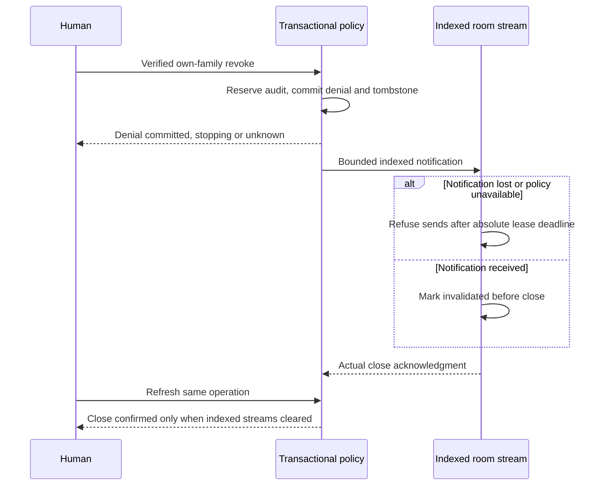

# Delegation revocation candidate

This bounded Pilot candidate repairs outgoing revocation in the optional
[human-entry](human-entry.md) and [agent-pairing](agent-pairing.md) path.
Keep both opt-ins disabled outside fresh synthetic acceptance. No provider,
production credential, deployment, public entry or formal merge is changed.
[ADR 0029](../../docs/adr/0029-denial-commits-before-bounded-stream-stop.md) owns
the accepted authority, stream, audit and recovery decisions.

## Denial and stream status

Own-family revoke resolves the authorizer from the verified browser session.
A supplied member label, another member's family, agent or legacy bearer cannot
obtain human/operator authority. Browser logout revokes only that browser session;
independent agents retain their own authority. The protected operator channel
owns member disable, room grant removal and legacy revoke. New HTTP, MCP, assets,
socket admission and renewal use current authority. Previously admitted writes
may finish using the existing complete-record concurrency semantics.

Denial, generation/tombstone and audit commit before notification. The response
includes an operation ID, the transaction's `deniedAt` event time and, on a fresh
human/agent denial, `denialCommitObservedAt` sampled after the transaction returns.
Neither timestamp proves a transport close. Registered-stream state is `stopping`
while acknowledgment is pending, `unknown` after an expired/unconfirmed lease or
notification failure, and `stopped` only after corresponding close acknowledgments
remove the indexed streams. Updating the native account sheet resumes bounded
notification progress. A failed or lost result must not be called stopped.

Socket visibility precedes final authoritative stream registration. A denial
during registration invalidates the visible socket before initial sync data.
Cloudflare checks the latest attachment after asynchronous policy work so a
concurrent invalidation cannot be overwritten.

Every actual outgoing send checks known invalidation, original credential and exact room-grant expiry
and an absolute lease of at most 30 seconds. Receiving activity alone does not
authorize a write or extend authority. Node renews through one-shot socket timers.
Cloudflare persists attachments and one earliest alarm per connected room; wake
and alarm recheck current policy before resume/renew. At most 64 policy checks
run concurrently per room event; excess due sockets close for reconnect. The
notification cursor visits only indexed affected rooms in bounded batches. Missed
fanout, a late alarm or unavailable policy cannot bypass the local send deadline.
The experimental observed stop target is at most 60 seconds, not a provider SLA.

The pinned sync library uses finite snapshot/tombstone cleanup timers; its
Cloudflare client timeout remains Infinity to avoid periodic idle pruning. Actual
local-workerd hibernation is tested separately from provider sleep/CPU behavior.
No permanent Cloudflare interval, all-room revoke scan or paid service is added.

## Audit and synthetic cutover

Lifecycle/security transitions reserve their receipt inside the metadata
transaction before changing authority. Document, asset, save and socket mutation
batches reserve first and finish separately. A socket receipt records admitted
processing; it does not claim the library accepted or committed every record.
A failed final receipt exposes admitted/committed-with-receipt-pending plus the
operation ID and `retry: false`; the document may already have changed. Reusing
that operation ID is refused before another mutation. There is no exactly-once
or cross-store transaction claim. Audit excludes secrets, digests and payloads.

Operator-only bounded pruning removes expired ordinary final receipts; cursors
continue across the receipt sets. Pending/unknown receipts, generations,
revocation records, consumed requests and spent repair proof remain security
state. Ordinary app requests cannot call the internal metadata/operator methods.

The synthetic-only cutover helper takes an immutable explicit complete consumer
inventory per shared legacy credential. Each declared new family must currently
be permitted in the original room and complete attributable sentinel read/write,
cleanup and exact original-record comparison. An unverified second consumer,
wrong room, failed verification, expired legacy grant or changed current policy
prevents matching cutover. Completeness is the operator's explicit inventory
attestation; the app cannot discover unknown copies of a shared secret. Legacy
expiry is preserved. No live cutover command or automatic migration is enabled.

## Security recovery and rollback

Backups include a separate `journey-security-1` metadata section. Protect this
archive as operator data. Fresh recovery retains denial/generation/spent/consumed
records and quarantines archived members, families, browser sessions and legacy
IDs. It requires explicitly configured new backend/member and credential IDs;
there is no automatic owner adoption or reenable. A human-enabled recovery
refuses an archive lacking security state. Document restore does not restore
authorization, and in-place security rewind is unsupported.

Private Node initialization advances its existing directory marker to
`.journey-private-v2`. Immutable human metadata records minimum security version
2 on both hosts. The accepted earlier Node binary refuses the versioned directory;
the earlier workerd binary refuses the changed immutable configuration. Keep
these markers and complete current metadata during rollback; do not edit them
away, replace the database from an older image or deploy an unaware build.
Arbitrary administrator storage/config rollback is outside supported recovery
and must remain offline. Reauthorization needs explicit operator action and
fresh IDs; disabled pairing remains disabled until separately authorized.

## Fresh local acceptance

After locked dependencies and the browser are installed, run from this package:

1. `node --import tsx --test scripts/agent-pairing.test.ts scripts/human-entry.test.ts scripts/agent-consent-context.test.ts`
2. `JOURNEY_REVOKE_REPAIR_ONLY=true node scripts/revocation-check.mjs node && JOURNEY_REVOKE_REPAIR_ONLY=true node scripts/revocation-check.mjs cloudflare-local`
3. `node scripts/revocation-check.mjs node && node scripts/revocation-check.mjs cloudflare-local && JOURNEY_REVOKE_SEAMS_ONLY=true node scripts/revocation-check.mjs cloudflare-local`

These targeted steps take under five minutes on the measured local fixture.
Loopback listening and the existing macOS helper's application-only Keychain
roundtrip require normal host access. All identities, stores and rooms are fresh
synthetic fixtures. The tests keep denial/last enqueue/client receipt/close
separate. Registration barriers stall actual adapter bootstrap while denial commits;
early room expiry uses actual elapsed time. The native sheet can be checked
separately with `node scripts/agent-pairing-browser-check.mjs`. Policy/fanout faults, expired queued lease and presentation states are
explicitly injected; lease timing and network clients use real time. Detailed
usage/timings remain in ignored local `.host-check` and task evidence.

Physical mobile, live provider/Access, configured remote HTTPS, representative
Free requests/CPU/storage fit and provider alarm scheduling are NOT RUN. Local
request/record counts and the arithmetic 2,880 room alarms/day are not a measured
account fit. Independent validation of the exact committed candidate is still
required before any retained activation or delivery.

