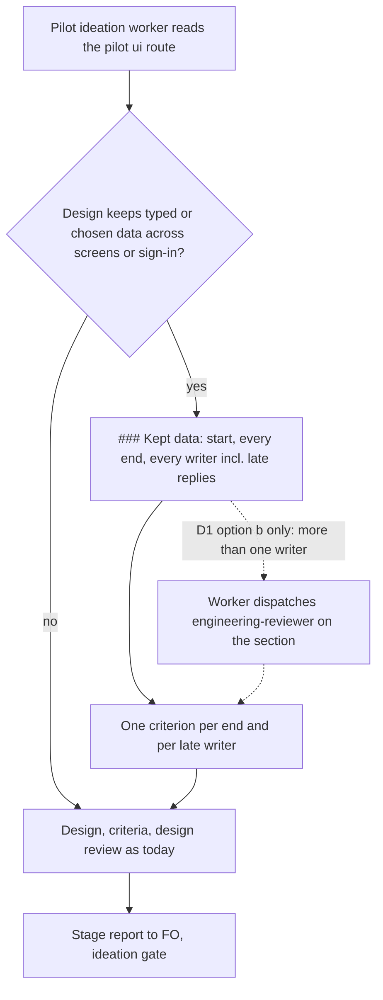

## Scope

- Source: the Captain 「准」 (chat, 2026-11-09, given in both the qnow dev2 FO session and this one), answering the qnow dev2 FO's question 「准不准他們照下面的條件去做？」, which put P1-P3 of /tmp/qnow-case/proposal.md and p1-revised.md (FO scratch, 2026-11-09) with their ship conditions.
- Bite: qnow task owner-vehicle-kept-after-name: 5 repair passes, 3 Material validations and 7 dispatches on one Symptom. Adopted 0.35.0 `role_triggers.py <state> <slug> --rev <state commit>` (run by the qnow dev2 FO, 2026-11-09) already owed a chief-engineer call (3 implementation dispatches on one symptom) and an engineering-reviewer call (replacing amendments 1-6) at state ee29b0a8 before implementation-4, and again at 27f04824 and 03829bf0 before implementations 5 and 6; FO never ran it and recorded neither a call nor a decline. Amendments 4 and 6 created data kept across screens and across sign-in with more than one writer, including a late async writer; no ideation text asked where that data starts, every way it ends, and who writes it.
- Change: the pilot ui ideation route requires, for data kept across screens or sign-in, its start, every end and every writer (late async writers included); the design director hands it to the engineering reviewer when it names more than one writer.
- Expected signal for the replay: the nine stand-in checks the qnow engineering reviewer's report lists under `## FO alignment` of owner-vehicle-kept-after-name.
- Non-goals: non-ui routes; a new reviewer role.

## Budget
- One package PR; workflow word budget unchanged unless the design names a raise.

## Stop condition
- Behaviour replay of ideation at amendments 4 and 6, current wording vs revised, 3 runs each: count the nine expected checks each design names. Ships only if the revised wording beats the current; otherwise this task closes with the table.
- Results go to the qnow dev2 FO for its Captain report.

## FO alignment

Alignment: not needed; the Captain approved the direction and ship condition.
Surfaces: none
Visible change: none
Release review: not needed: workflow maintenance, on no journey map.

## Design

### PRFAQ

When a pilot ui design keeps something a person typed or chose while they move between screens or through sign-in, the ideation worker now writes a `### Kept data` section before any code: where that data starts, every way it ends, and everything that writes it, including a reply that lands after the person has moved on, with a criterion for each end and each late writer. In the qnow case that took 5 repair passes and 3 Material validations, these were the questions the engineering reviewer answered only after validation-3, as nine separate checks in the code. The change ships only if a replay of that case's ideation shows the new wording makes designs name more of those nine checks than the current wording does.

FAQ

- Who reads the new text? The ideation worker on a pilot task, from `skills/ideation/profiles/pilot.md`. FO reads none of it (see the word count below).
- Why the worker and not a script? Whether a design keeps data across screens is read from the surface, not from a diff; the Captain-approved proposal (P3 in /tmp/qnow-case/proposal.md) says "no script heuristic".
- Why not the design director? Its passes read "no task file, no diff, no source code" (`skills/design-director/SKILL.md`, the `Pass:` paragraph); it sees pictures only, so it cannot count writers. See decision D1.
- What if the replay does not beat the current wording? The task closes with the table and no package PR, per the Stop condition.

### Flow



Under the recommended D1 (option a) the dotted branch does not exist; the existing role_triggers.py amendment call stays the route to the engineering reviewer.

### Bounded existing-code check

Checked in chain order on 2026-11-09:
- Spacedock 0.27.3 (`~/.claude/plugins/cache/spacedock/spacedock/0.27.3`): no stage or ensign text about client state, late replies or writers (`grep -rliE 'client state|async writer|late reply'`: no match).
- kc-dev-flow-2 origin/main (0.36.0): `git grep -niE 'lifecycle|late (async|reply|result|writer)|across sign-in|kept across|writers?'` over skills, references and agents finds only profile-level "lifecycle obligation" words (implementation and validation principles, prod profile); no ideation text asks where kept data starts, ends or who writes it. The ideation pilot route is five lines: "Define the smallest useful end-to-end slice … leave that decision with the user."
- kc-dev-flow (v1) origin/main: production shape/build/verify name "lifecycle" generically; nothing for pilot ui kept data.
- Sibling adopter qnow origin/main: `.claude/skills/react-patterns/SKILL.md` covers stale closures at code level (useRef, effect cleanup), not a design-stage question.
- Existing capability that already reaches the engineering reviewer: `role_triggers.py` owes an engineering-reviewer call "for each `### Amendment N` … whose `Supersedes:` or `Design:` value does not start with `none`" (its module docstring). qnow amendments 4 (`Design: plate placement at the summary …`) and 6 (`Design: the summary's signed-out and missing-name/consent states …`) both qualify, so the call was already owed at the two moments the kept data was created; the qnow FO confirmed it was owed and not run (task Scope, Bite). Task a-worker-holds-while-a-role-call-is-owed is what makes that existing call bind.
Conclusion: no existing text asks the kept-data question, so the pilot route gains one paragraph; the engineering-reviewer hand-off is not rebuilt (D1).

### The change

Append to `kc-dev-flow-2/skills/ideation/profiles/pilot.md` (the exact text the replay's revised arm ran):

```markdown
## Data kept across screens or sign-in

When a `ui` design keeps something a person typed or chose while they move between
screens or through sign-in, add `### Kept data` to the design. For each item, state
where it starts; every way it ends: sent, abandoned by back or another tab, replaced
by a newer choice, a different person or session, a reload; and every writer,
including a reply that lands after the person has moved on, and what that reply may
still change. Give each end and each late writer an acceptance criterion.
```

No script, README, agent or test text changes under D1 option a. `scripts/lint-skills.py` exits 0 on origin/main with and without this patch (scratch copy of origin/main, logs `~/.local/state/kc-dev-flow-2-replays/kept-data-lifecycle-at-ui-ideation/lint-base.txt` and `lint-rev.txt`, 2026-11-09).

### Behaviour replay (Stop condition)

Result: the revised wording beats the current wording at both amendments, so by the Stop condition this task ships. Amendment 4: 19 vs 11 checks summed over 3 runs each. Amendment 6: 22 vs 10. A second, independent scoring pass gives 20 vs 11 and 22 vs 5.

Method, fixed before any run (rubric file written 2026-11-09 22:46:47, before the first run was launched; the second pair launched at 22:50:44). The reproduction kit is `kept-data-lifecycle-at-ui-ideation/ideation/replay/` in this state checkout: `rubric.md`, `build.sh` (the exact `replay_dispatch.py build` call), `run-codex.sh`, `extract.sh`, `score.sh`, `parse.py`, `scope.txt`, `pilot-revised.diff`, `results.tsv`, `blind-map.txt`, `kept-words.txt`.
- Replayed dispatches: qnow ideation-6 (state e387a77b3, the commit amendment 4 was dispatched from) and ideation-10 (state c934dfb11, amendment 6). Code base 232344ce. Built with the package's `replay_dispatch.py build` from 0.36.0; arms differ only in `skills/ideation/profiles/pilot.md` (current = tag kc-dev-flow-2-v0.36.0, revised = that tag plus the paragraph under "The change"). Adopter README: qnow's, merged from its synced base kc-dev-flow-2-v0.35.0. The pilot ideation text is the same in 0.35.0 and 0.36.0 (`git diff --stat` on `skills/ideation` and `references/profiles` between the two tags: empty).
- Checklist: the original FO checklist items with the pictures item removed; scope notes say text only, no pictures, preview, browser, design review or agents, no commit. Neither names the rule under test (`grep -ciE 'lifecycle|writer|late repl|kept data'`: 0 in all three files).
- Host: Codex `gpt-6-astra`, `model_reasoning_effort=xhigh`, the host and model the original cycles ran on (dispatch headers). 12 runs, each a fresh `codex exec`; every run exited 0 in 615–975 s and committed nothing.
- Scored text: the lines each run added or changed in the task file. Scorer: a fresh Claude Sonnet (`claude -p --tools ""`) per text, given only the rubric and the text under a hashed file name; each hit must quote the text, and a quote not found verbatim scores 0. Pass 1 is the pre-registered score; pass 2 is a re-run of the same scorer to show noise.
- The nine checks, from the follow-up qnow task booking-attempt-identity ("Checks the reviewer found standing in for an attempt identity at candidate 6bd09a1c"), each confirmed in qnow code at 6bd09a1c, and the design question each answers: C1 send counter (a late send reply does not clear or block a newer attempt); C2 car key (a car change ends data held for the old car); C3 owner (another person signing in gets no carried draft); C4 session (session end ends the data); C5 draft revision (a late save reply does not undo a newer edit); C6 screen active (a reply after the person left the screen neither navigates nor writes); C7 screen visit (a reply from an earlier visit is ignored after return); C8 route context (a reply for an older shop, service or slot does not apply); C9 draft generation (a discarded draft cannot be written by a late reply, and the next booking starts clean).

| Amendment | Arm | Run | Pass 1 | Checks hit (pass 1) | Pass 2 | `### Kept data` words |
| --- | --- | --- | --- | --- | --- | --- |
| 4 | historical cycle 6 (0.35.0) | — | 5 | C2 C3 C4 C5 C9 | — | — |
| 4 | current | a4-cur-1 | 4 | C2 C3 C4 C9 | 4 | — |
| 4 | current | r02 | 5 | C2 C3 C4 C5 C9 | 4 | — |
| 4 | current | r05 | 2 | C2 C3 | 3 | — |
| 4 | revised | a4-rev-1 | 6 | C1 C2 C3 C4 C5 C9 | 7 | 845 |
| 4 | revised | r01 | 8 | C1 C2 C3 C4 C5 C6 C8 C9 | 7 | 986 |
| 4 | revised | r06 | 5 | C1 C2 C3 C4 C9 | 6 | 801 |
| 6 | historical cycle 10 (0.35.0) | — | 2 | C3 C4 | — | — |
| 6 | current | a6-cur-1 | 3 | C3 C4 C5 | 2 | — |
| 6 | current | r03 | 4 | C3 C4 C6 C7 | 1 | — |
| 6 | current | r08 | 3 | C2 C3 C4 | 2 | — |
| 6 | revised | a6-rev-1 | 8 | C2 C3 C4 C5 C6 C7 C8 C9 | 8 | 526 |
| 6 | revised | r04 | 8 | C2 C3 C4 C5 C6 C7 C8 C9 | 7 | 597 |
| 6 | revised | r07 | 6 | C2 C3 C4 C5 C6 C9 | 7 | 667 |

Sums, pass 1: amendment 4 current 11, revised 19; amendment 6 current 10, revised 22. Every revised run wrote a `### Kept data` section; no current run did. The historical cycles (current wording, full ideation with pictures) score 5 and 2: inside the current arm's range at amendment 4 and one below it at amendment 6. C1 (late send reply) was named only by revised runs at amendment 4, 3 of 3; C6–C8 (leaving or returning to a screen, older route) by 4 of 6 revised runs and 1 of 6 current runs. No run named all nine.

Limits:
- One corpus: the wording was written knowing this case, and its list of ends (back, another tab, newer choice, different person or session, reload) points at several checks. A second ui task with kept data was not replayed; the gain may be smaller on one.
- The rubric and the wording have the same author (this worker); the scorer was blind to the arm and its quotes are checked, but its calls are lenient in places (for example C9 "discard clears the draft" counted without a stated late-reply rule) in both arms. Pass-2 noise reaches 3 checks on one run (r03: 4 then 1); the arm difference is larger at both amendments in both passes.
- Revised designs are longer at amendment 6 (scored words: revised mean 9985, current 8440), so more text had more chances to name a check.
- Isolation: the first four runs lived under `/tmp/qnow-case/p3-replay/runs/<arm>-<n>` (arm visible in the path); one of them (a4-rev-1) listed files across `/tmp/qnow-case` but read none of the proposal, the rubric or another arm's package (`grep` of its log). The other eight ran under `/tmp/p3r/runs/r01..r08` with the rubric moved out of reach.
- Codex only; the Claude host was not replayed. Text only: whether the section survives picture cycles and the design review was not tested.
- The engineering-reviewer hand-off (D1 option b) was not replayed: no run dispatched anyone.
- The qnow-derived evidence (both scorer passes, the scored texts, each run's final task file and dispatch, and the two replay checklists) stays on this machine at `~/.local/state/kc-dev-flow-2-replays/kept-data-lifecycle-at-ui-ideation`, not in this state checkout: it is qnow product text and this branch is published with a public repository. A re-run needs only the kit, qnow state and code at the named commits, and those checklists (FO's ideation-6 and ideation-10 checklists with the pictures item removed).

### Words read at each moment

Counted with `wc -w` on the package files at tag kc-dev-flow-2-v0.36.0 (equal to origin/main for every file below) and on the revised arm (`~/.local/state/kc-dev-flow-2-replays/kept-data-lifecycle-at-ui-ideation/pkgrepo`, tag `revised`), 2026-11-09.

| Reader and moment | Before | After |
| --- | --- | --- |
| FO at startup, resume, idle on an open PR, idle on a merged PR, after the archive, the merge ask | unchanged: no passage or script output FO loads at these moments changes (`references/sd/workflow.md` 5931 → 5931; no script, agent or FO skill file changes; `git grep 'profiles/pilot.md\|ideation/profiles'` over scripts, references/sd, skills/dev and agents: no hit) | same |
| FO at ideation gate preparation of a pilot ui task that keeps data | package text unchanged; `design_surfaces.py` output unchanged | the task design FO presents gains the `### Kept data` section: mean 737 words (526–986) over the 6 revised replay runs, read by FO and the Captain at that gate |
| Ideation worker on a pilot ui task (SKILL.md, references/profiles/pilot.md, principles.md, profiles/pilot.md, design-review.md) | 1690 | 1784 (+94; `profiles/pilot.md` 37 → 131) |

The workflow word budget (`WORKFLOW_BUDGET_*` in `scripts/lint-skills.py`) is unchanged, and that file-size number is not the measure here.

### Batch overlap

Files this design changes: `kc-dev-flow-2/skills/ideation/profiles/pilot.md` only (D1 option a). Option b would add `skills/ideation/profiles/pilot.md` text plus the engineering-reviewer brief and its report file; option c would change `scripts/role_triggers.py` and `scripts/test_role_triggers.py`.
- a-worker-holds-while-a-role-call-is-owed (batch 19, ideation): implementation and validation stage skills, `dispatch_stage.py`, tests. No shared file or check. Logical dependency: the D1 recommendation relies on it making the existing amendment call to the engineering reviewer bind.
- role-call-asks-for-the-mechanism (batch 19, ideation): `role_triggers.py` question text and the decline form. No shared file under option a; shares `role_triggers.py` and its test under option c.
- step-back-answer-has-a-record-line (held at ideation): `role_triggers.py`, `test_role_triggers.py`, `references/sd/workflow.md`, `skills/observer/SKILL.md`. No shared file under option a; shares `role_triggers.py` under option c.
- counts-name-the-run-that-produced-them (batch 18, live): `delivery_gate.py`, `learning.py`, `count_tokens.py`, `skills/evaluate-learning/SKILL.md`, `skills/validation/principles.md`, `references/sd/workflow.md`. None shared.
- delivery-gate-ignores-url-paths-and-data-fences (batch 18, live): `delivery_gate.py`, `test_delivery_gate.py`, `lint-skills.py`, `skills/validation/principles.md`. None shared.
No ADR number, budget step or other numbered record is taken.
Recommended order: any; this PR touches one file. If D1 is option c, land it after role-call-asks-for-the-mechanism and step-back-answer-has-a-record-line, which edit `role_triggers.py` first.

## Acceptance criteria

**AC-1**: The package PR changes `kc-dev-flow-2/skills/ideation/profiles/pilot.md` by appending exactly the paragraph under "The change", and no other package file (under D1 option a).
Verified by: `git diff --name-only origin/main...<PR head> -- kc-dev-flow-2` lists only that file, and `git diff origin/main...<PR head> -- kc-dev-flow-2/skills/ideation/profiles/pilot.md` has the same added lines as `kept-data-lifecycle-at-ui-ideation/ideation/replay/pilot-revised.diff` in this state checkout. Falsifier: any reworded line, or any second package file, fails this criterion; a reworded paragraph also voids AC-3 until the replay is rerun.

**AC-2**: The package's own skill lint still passes and the adopted README's word count and budget are unchanged.
Verified by: at the PR head, `python3 kc-dev-flow-2/scripts/lint-skills.py` exits 0 and reports `references/sd/workflow.md: 5931 of 5931 words`. Falsifier: placing the paragraph in `references/sd/workflow.md` instead raises that count above 5931 and the budget check fails.

**AC-3**: The shipped wording is the wording that won the replay: revised beats current at both amendments on the pre-registered rubric.
Verified by: the table under "Behaviour replay" (pass 1: amendment 4, 19 vs 11; amendment 6, 22 vs 10; 3 Codex gpt-6-astra xhigh runs per arm), with AC-1's byte match tying the PR to the replayed text. Validation re-runs one run per arm at one amendment with the kit's `build.sh`, `run-codex.sh`, `extract.sh` and `score.sh` and reports whether the arm order holds; where the local evidence at `~/.local/state/kc-dev-flow-2-replays/kept-data-lifecycle-at-ui-ideation` still exists, re-scoring two saved texts (one per arm) is the cheaper check. Falsifier: if the PR text differs from the replayed paragraph, or a re-run of both arms at either amendment (same build commands and rubric) gives revised a sum no higher than current, the criterion fails and the task closes with the table.

**AC-4**: No passage or script output that FO reads at startup, resume, idle on an open PR, idle on a merged PR, after the archive or at the merge ask changes.
Verified by: AC-1's file list (the one file is loaded only by the ideation worker through `skills/ideation/SKILL.md`'s route table), and `git grep -n 'profiles/pilot.md\|ideation/profiles' <PR head> -- kc-dev-flow-2/scripts kc-dev-flow-2/references/sd kc-dev-flow-2/skills/dev kc-dev-flow-2/agents` returning no line outside test files. Falsifier: a hit in any of those paths, or any change to `references/sd/workflow.md`.

## Unresolved decisions

**D1: who sends a several-writer kept-data section to the engineering reviewer?** The Captain's approved proposal says the design director hands it over, but the director reads only pictures ("no task file, no diff, no source code", `skills/design-director/SKILL.md`), so it cannot see the section or count its writers.
- (a) Recommended: no new hand-off in this task. The existing `role_triggers.py` call is already owed for every Captain amendment that replaces the design, and in this case it was owed at both amendments that created the kept data (4 and 6); task a-worker-holds-while-a-role-call-is-owed makes that call bind before the next worker. What gets worse: a first design (no amendment yet) with several writers reaches the ideation gate without an engineering reviewer, and this narrows what the Captain approved in P3.
- (b) The ideation worker dispatches `kc-dev-flow-2:engineering-reviewer` on the section when it names more than one writer, saves the report and writes a disposition per finding, as Production ideation does for its security review (ADR 0019) and ui ideation for the design review (ADR 0022). About 120 more worker-read words and one report per such task; its effect is unmeasured (no replay run dispatched anyone), so shipping it now would ship an untested claim.
- (c) A new `role_triggers.py` event. Not recommended: ADR 0026 rules that role calls are owed on counts read from task records and "does not match phrases", and a writer count in free design prose is a phrase match; it would also share `role_triggers.py` with two live tasks.
Precedent: no `Override:` line in this workflow's gate records bears on reviewer hand-offs (`git -C <state> grep -n 'Override:'`, 2026-11-09).

## Stage Report: ideation

- DONE: Run the replays your stop condition names now, as scratch prototypes under /tmp (never a repository file), and put the result table in the design: replay inputs are listed in /tmp/qnow-case/paths.md (qnow state: read-only detached worktrees only, never the live checkout); the case proposal is /tmp/qnow-case/proposal.md and p1-revised.md; for this task: ideation replays at amendments 4 and 6, current vs revised pilot ui wording, 3 runs each, scored against the nine stand-in checks in the qnow engineering reviewer's report
  12 Codex gpt-6-astra xhigh runs from qnow state e387a77b3 and c934dfb11, rubric fixed before the first run; pass 1: amendment 4 revised 19 vs current 11, amendment 6 revised 22 vs 10 (pass 2: 20 vs 11, 22 vs 5); table and limits under `### Behaviour replay`; replay worktrees removed; kit in `ideation/replay/`, qnow-derived evidence at `~/.local/state/kc-dev-flow-2-replays/kept-data-lifecycle-at-ui-ideation`. For the qnow FO: the engineering reviewer's full report is not committed in qnow state (owner-vehicle-kept-after-name's `## FO alignment` holds only its `Reviewer:` line), so the nine checks were taken from booking-attempt-identity.md and each confirmed in qnow code at 6bd09a1c.
- DONE: A `### Batch overlap` section naming each file the design would change and each other batch task (a-worker-holds-while-a-role-call-is-owed, role-call-asks-for-the-mechanism, kept-data-lifecycle-at-ui-ideation) and live task of other sessions (step-back-answer-has-a-record-line (held at ideation), counts-name-the-run-that-produced-them and delivery-gate-ignores-url-paths-and-data-fences (batch 18, live)) that changes the same file or check, so FO can order implementation
  One file (`skills/ideation/profiles/pilot.md`) under D1 option a; no shared file with any of the five tasks; option c would share `role_triggers.py` with two; recommended order: any.
- DONE: The words FO reads at each lifecycle moment, before and after, per root learning.md "Measure the words FO reads at each moment, not one file's size"
  `### Words read at each moment`: FO package text unchanged at every moment (workflow.md 5931 → 5931); the ideation gate design grows by a Kept data section, mean 737 words over 6 revised runs; worker load 1690 → 1784.
- DONE: Acceptance criteria with reproducible evidence clauses and falsifiers, and unresolved decisions for the Captain, each with a recommendation and what gets worse under it
  AC-1..AC-4 each with a command and falsifier; D1 (who hands kept data to the engineering reviewer) recommends option a and states what gets worse.
- DONE: AC-1 (only pilot.md changes, text equal to the replayed paragraph): not yet verified; no PR exists. The paragraph exists as `ideation/replay/pilot-revised.diff` in this task's folder.
- DONE: AC-2 (lint passes, README 5931 words): verified on a scratch copy of origin/main with the patch, `lint-skills.py` exit 0 and "5931 of 5931 words" (`~/.local/state/kc-dev-flow-2-replays/kept-data-lifecycle-at-ui-ideation/lint-rev.txt`); not yet verified at a PR head.
- DONE: AC-3 (revised beats current): verified by this replay, both scorer passes, both amendments; validation's re-score not yet run.
- DONE: AC-4 (no FO-read text changes): verified for the replayed patch by `git grep 'profiles/pilot.md\|ideation/profiles'` over scripts, references/sd, skills/dev and agents (no hit outside tests); not yet verified at a PR head.
- DONE: design_surfaces.py check
  `python3 <package>/scripts/design_surfaces.py check` on this task: "design surfaces presentable", exit 0 (it also printed the standing gate-question `next:` line).

### Summary

Ideation for the Pilot ui kept-data rule: one paragraph appended to the ideation pilot route asks a ui design that keeps typed or chosen data across screens or sign-in for its start, every end and every writer including late replies, each with a criterion. A pre-registered replay of qnow's ideation at amendments 4 and 6 (Codex, 3 runs per arm) found the revised wording names more of the engineering reviewer's nine checks at both amendments (19 vs 11, 22 vs 10), so by the Stop condition the task ships; limits are one corpus, same-author rubric and wording, and longer revised designs. D1 asks the Captain to drop the design-director hand-off, which cannot work because the director reads only pictures, and to rely on the existing amendment call to the engineering reviewer plus task a-worker-holds-while-a-role-call-is-owed. The results are ready for the qnow dev2 FO's Captain report; this worker sent nothing.

## Stage Report: implementation

- DONE: Implement the approved design and acceptance criteria using only the files the design names, based on origin/main.
  Branch `spacedock-ensign/kept-data-lifecycle-at-ui-ideation`; base `82c9e67ae892b80647c3f6a8b6929f993e42dbc2`; candidate `8470611d718f19aa8ef1f7ae66ba9f72c3c01422`; one file, `kc-dev-flow-2/skills/ideation/profiles/pilot.md`, nine added lines; clean code worktree after commit.
- DONE: Apply the Captain's D1 option a: no design-director hand-off; one paragraph in the ideation pilot route.
  Ideation gate 2026-11-09T15:40:07.656743Z accepts 「跨畫面資料：不交給設計總監（它只看圖），靠既有的工程審查員呼叫加上第 (1) 張」; candidate adds the approved paragraph without a new reviewer route or budget change.
- DONE: AC-1 — exactly the replayed paragraph, no second package file.
  Candidate blob equals base blob plus the added lines of `ideation/replay/pilot-revised.diff`; `git diff --name-only <base>...<candidate> -- kc-dev-flow-2` lists only pilot.md. The scratch acceptance check rejects both a reworded line and a second file edit.
- DONE: AC-2 — repository skill lint passes; workflow word count and budget unchanged.
  `python3 -B kc-dev-flow-2/scripts/lint-skills.py` exits 0, `references/sd/workflow.md: 5931 of 5931 words`; base and candidate agree. Moving the paragraph into workflow.md in the cache-free scratch tree exits 1: 6025 exceeds 5931.
- DONE: AC-3 — shipped wording is the wording that won the approved replay.
  Exact candidate-byte match above; re-ran saved `parse.py` with `python3 -B` on all 12 saved texts and each of the two saved scorer passes, reproducing revised/current 19/11 and 22/10, then 20/11 and 22/5. Rewording the candidate fails the replay-text binding; these are saved model outputs, not new model runs.
- DONE: AC-4 — no FO-read passage or script output changes at the named lifecycle moments.
  Only the worker pilot route changes; candidate `git grep` over scripts, references/sd, skills/dev and agents finds test references only. A scratch startup reference is detected; a workflow text change is rejected. FO's task-design reading at the ideation gate can grow as already stated in the design.
- DONE: Show each named acceptance falsifier failing by a mutation run using python3 -B, caches cleared.
  `/tmp/impl-kept-data-lifecycle-at-ui-ideation/verify.py` exits 0 with 63 assertions; four mutations exercise reworded text, another package file, paragraph moved into workflow, and a new FO route. Scratch copies exclude `__pycache__`, `*.pyc`, `*.pyo`; temporary fixtures removed; no product bytes changed after candidate commit.
- DONE: Run the repository copy of kc-dev-flow-2/scripts/lint-skills.py, package adr_lint.py, number_guards.py and comment_ratio.py.
  All exit 0 at candidate: ADR lint checks 64 records; fresh number guards reports `PASS: no findings` at base 82c9e67ae892 / head 8470611d718f, no migrations-path declared; comment ratio is code 0, comments 0, 0.0%, maximum 5% not enforced below 20 added code lines. Logs: `/tmp/impl-kept-data-lifecycle-at-ui-ideation/{lint,adr-lint,number-guards-fresh,comment-ratio}.log`.
- DONE: Check design surfaces and affected documents.
  Package `design_surfaces.py check <task>` exits 0, design surfaces presentable; `doc_impact.py <base> HEAD` exits 0, 0 documents listed. pilot.md is updated; its ideation SKILL.md route remains the reader entry; no affected diagram or other retained claim changes. Existing-code audit from ideation remains applicable at the pinned base.
- DONE: Commit locally, do not bump versions, and prepare PR text for FO.
  Candidate above is local only; title/body at `/tmp/impl-kept-data-lifecycle-at-ui-ideation-pr.md`; pre-work all-state branch PR lookup returned `[]`. No product push, PR comment, review request, ready action or merge performed.
- SKIPPED: One Draft PR in iamcxa/kc-claude-plugins; FO pushes and opens the Draft PR.
  No PR opened: no push grant. The enabled Paseo exception assigns product publication to FO; branch, base, full candidate and prepared text are supplied above.
- SKIPPED: RoboRev, fresh independent validation (including the saved-text model rescore or new replay) and hosted CI.
  FO owns these checks; none was run or claimed clean. The implementation re-parses saved scoring JSON and verifies its quotes, not a fresh scorer judgment. CI cost per PR was not measured; no CI workflow changes.
- SKIPPED: New ADR, numbered reservation and workflow-budget raise.
  Approved option a names only pilot.md and explicitly takes no ADR number or budget step; no unapproved decision, script or test text was added.

### Summary

Implemented the approved Pilot ui kept-data paragraph in local candidate `8470611d718f19aa8ef1f7ae66ba9f72c3c01422`, with exact replay-text binding, unchanged workflow words/budget, mutation falsifiers and all prescribed local checks passing. FO still owns product publication, RoboRev, fresh independent validation and CI; saved single-case replay evidence and its limits remain as recorded under Design.
