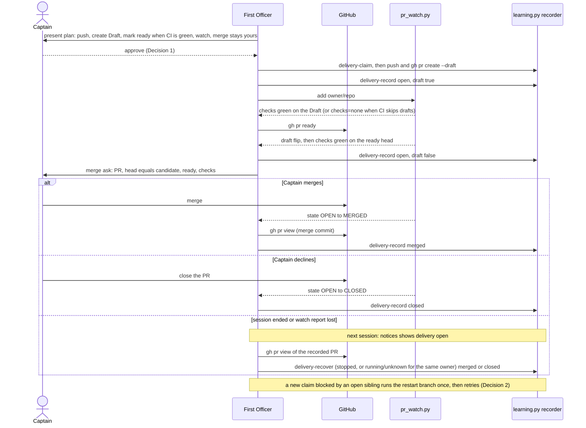

`kc-dev-flow-2:learn` (0.21.0 and 0.22.0, `skills/learn/SKILL.md`) creates the learning.md PR with `gh pr create --draft` and records the observation at creation, then stops. It names no step to mark the PR ready once CI is green, no `pr_watch.py add`, and no step to record the later merge or close. On 2026-10-13 FO asked the Captain to merge learning PR iamcxa/kc-claude-plugins#637 while it was still a Draft, and recorded its merge only after the Captain said it had merged. Until a delivery is recorded merged, closed or released, `learning.py claim` refuses every new learning job in the store, so the next task's learn step stalls. The workflow README's Delivery authority (ready after CI green, `pr_watch.py add`) covers task PRs, not learn's PR.

## Captain's words

Captain 2026-10-13, in chat: 「如果建議我合併的 PR應該要設成 ready，這是 dev2 缺陷嗎？你應該也要主動追蹤他的合併狀態，還是是 learn 的流程沒補強到？」, then 「向 kc-dev-flow-2 回報的問題可以回報，這個是否可以排進清單處理修復跟補強？」

## Scope

- learn's delivery: mark the PR ready once CI is green before asking for merge, add it to `pr_watch.py`, and record the merged or closed observation when the watch reports it.
- Non-goals: any merge automation (ADR 0009 keeps merge with the Captain); a change to `learning.py`, `pr_watch.py`, Spacedock or the `pr-merge` mod; task PRs (their Delivery authority is unchanged); a scanner, hook or background launcher for learning PRs; a `delivery-sync` command (Decision 3).

## Acceptance criteria

All paths are relative to `kc-dev-flow-2/` in `iamcxa/kc-claude-plugins` unless marked `<state>`. `<package>` is the package root. The 2026-10-13 case is learning job `be609ffc0af1f8d10ce78f5404078db17304c867faa1337876800078e382b24f` and PR `iamcxa/kc-claude-plugins#637`; its facts below were read on 2026-10-13 from `gh api repos/iamcxa/kc-claude-plugins/issues/637/events`, `gh pr view 637 --json createdAt,mergedAt,statusCheckRollup`, and the job directory under `$(git rev-parse --path-format=absolute --git-common-dir)/kc-dev-flow-2/learning/` (file times by `TZ=UTC stat`). The new section of `skills/learn/SKILL.md` is called "the section" and is headed `## Follow the delivery to a recorded end`. New tests go in `scripts/test_learning.py`, which CI already runs (`kc-dev-flow-2-tests.yml`, step `test_learning.py`), with a stub `gh` on `PATH` that records every call and answers from a JSON file.

**AC-1** The section orders the steps FO runs after the Draft is recorded.
Evidence: a test reads `skills/learn/SKILL.md`, takes the section, and asserts these strings appear in this order: `pr_watch.py add`, `checks` green on the Draft, `gh pr ready`, a `delivery-record` observation with `draft` false, the merge ask, then `delivery-record` with state `merged` or `closed`. It also asserts the section says that when the Draft shows `checks=none` (CI skips drafts) FO marks ready first and waits for green on the ready head, as #637 needed: its first `multi-profile route gate` run was 10:42:39Z-10:42:44Z on the Draft, and a second ran 10:52:29Z-10:52:36Z after `ready_for_review` at 10:52:24Z.
Falsifier: move the merge ask before `gh pr ready`, or delete the `pr_watch.py add` line; the order assertion goes red.
Not yet verified: that an FO following the text does this. The assertion proves the sentences exist and are ordered, not that they are followed (AC-7 is the live check).

**AC-2** Replay of 2026-10-13: the stall is reproduced by the old procedure and absent under the new one, with no Captain message in the sequence.
Evidence: the fixture is #637's recorded timeline: Draft opened 10:42:33Z; checks green 10:43:23Z; the notice acknowledged as presented (`acknowledgement.json`) 10:51:21Z, before the PR was ready; `ready_for_review` 10:52:24Z; merged 10:53:14Z with merge commit `70b88d7511cd6cb3aca05382ba973aee752f1152`; merged recorded 10:54:27Z (`delivery.json` mtime), 73 s after the merge, after the Captain said it had merged. Control arm: claim a job, deliver it, record the Draft `open` and stop (what `skills/learn/SKILL.md` says today); a second job's `claim` exits 1 with `blocking` naming the first job with `delivery: open`. New arm: run `pr_watch.py --state <tmp> add` and `check` against the stub, which serves the PR as Draft with pending then green checks; the test then follows the section: `gh pr ready` (stub flips `isDraft`), `delivery-record` with `draft` false, the stub serves `MERGED` with `mergeCommit.oid`, `delivery-record` merged; the second job's `claim` then exits 0. The `check` output contains `checks pending -> green`, then `draft True -> False`, then `state OPEN -> MERGED`.
Falsifier: skip the merged `delivery-record`; the second `claim` still exits 1 and the test is red. The control arm is the proof the fixture can fail: it must exit 1 on today's text.

**AC-3** A restarted FO, or one whose token was hidden, settles an open delivery from GitHub before presenting it.
Evidence: fixture with a delivery recorded `open`, the token discarded, the stub serving `MERGED`. Following the section: `notices` shows `delivery.state` `open` and `delivery.observation.pr`; `gh pr view` of that PR; `delivery-recover --owner-state stopped` with the plan taken from `notices --all` and the observation built from the `gh` read; then `notices` shows `merged` and the next job's `claim` exits 0. The 2026-10-13 job is the precedent for a hidden token: its `delivery.json` `recovery.reason` reads "lost the one-time delivery token to an output filter". The same test asserts `skills/learn/SKILL.md` (Present the result) and `skills/dev/SKILL.md` (notices paragraph) each tell FO to read the PR before presenting an `open` delivery.
Falsifier: omit the `delivery-recover` step; `notices` still shows `open` and the claim exits 1.

**AC-4** A PR closed without merge settles the delivery; a Captain who declines an open PR closes it rather than running `release`.
Evidence: stub serves `CLOSED`; `delivery-record` with state `closed` makes the next `claim` exit 0 and `notices` show `closed`. A `release` on an open delivery exits 1 with `delivery is open, merged or closed; release refused` (existing recorder; pinned by `test_release_refusals_and_irreversibility`), and the section says a declined open PR is closed by the Captain and then recorded `closed`.
Falsifier: text telling FO to `release` an open delivery; the same `release` call exits 1.

**AC-5** Merge stays the Captain's.
Evidence: the stub exits 1 and fails the test on any `gh pr merge` call or `--auto` flag across the AC-2 to AC-4 runs; a text assertion finds neither string in the section. The section's merge ask names the PR, its head SHA equal to the plan's `candidate_commit`, `ready`, and the checks state.
Falsifier: add `gh pr merge` to the section; both assertions go red.

**AC-6** Nothing outside the learn texts moves.
Evidence: `git diff --stat origin/main` of the delivery PR lists only `skills/learn/SKILL.md`, `skills/dev/SKILL.md`, `extensions/learn/EXTENSION.md` and `scripts/test_learning.py`; `python3 scripts/lint-skills.py`, `test_learning.py`, `test_pr_watch.py`, `test_lint_skills.py` and `test_observer_check.py` exit 0 (all were 0 on an `origin/main` export, 2026-10-13: `test_pr_watch` 28 tests OK, `test_learning` advance test OK).
Falsifier: a change to `learning.py`, `pr_watch.py`, `references/sd/workflow.md`, `lint-skills.py` or the CI workflow appears in the diff stat.

**AC-7** (live; not yet verified) The next real learning PR follows the order with no Captain message needed to record it.
Evidence at validation or first dogfood: `gh api repos/<repo>/issues/<N>/events` shows `ready_for_review` after the first green checks and before FO's merge ask; `learning.py notices` shows `merged` or `closed` in the same FO session as the `pr_watch.py wait` exit, with the Captain's message not the source.
Falsifier: `ready_for_review` after the merge ask, or `notices` still `open` after the PR merged.

## Design

### Chain check

- Spacedock (`_mods/pr-merge.md`, v0.27.0, read 2026-10-13): its startup and idle hooks scan workflow entities with a `pr` field. A learning PR is not an entity: its job lives under the Git common directory's `kc-dev-flow-2/learning/`, so no Spacedock hook ever sees it. Nothing to reuse; nothing to ask Spacedock for.
- kc-dev-flow-2 at origin/main `70b88d75` (package 0.22.0). Existing and tested, none of it reachable from the learn texts: `scripts/pr_watch.py add|check|wait` reports a draft flip, CI green and a merge or close, and drops a merged or closed PR after reporting it once (`test_pr_watch.py`, 28 tests OK on an export, 2026-10-13); `scripts/learning.py delivery-record` takes `open` to `merged` or `closed` for the same PR with the delivery token; `delivery-recover` does the same without it (`--owner-state running|unknown` for the same owner, `stopped` otherwise; `test_delivery_recover_advances_own_open_observation_to_merged` OK); `claim` refuses while a sibling delivery is `open` and accepts once it is `merged` or `closed` (`test_new_claim_held_by_in_flight_sibling`, subTest `proposal-delivery-open`, and the `delivery-merged` case in the settled-delivery test). Search 1: `git grep -E 'pr_watch|gh pr ready'` over `skills/learn`, `skills/dev`, `skills/evaluate-learning` and `extensions/learn` at origin/main: zero hits. Search 2: `git grep -E 'delivery-record|delivery-recover'` outside `scripts/`: only `skills/learn/SKILL.md`, which stops at "Verify the resulting PR binding and Draft state, then record it". So the mechanism is complete and tested; the learn texts never route to it.
- `references/sd/workflow.md` Delivery authority already says "FO adds each PR it opens or pushes to with `pr_watch.py add`" and, for task PRs, ready after CI is green. By its letter that covers the learning PR; it is FO-only text that does not name learn, and the learn skill never points at it. The rule existed and the learn path never reached it.
- Sibling adopters: `grep -rIl 'delivery-record|learning\.py'` over `carlove` and `spacedock` (`*.md`, `*.py`) printed nothing, 2026-10-13. No adopter carries a competing mechanism.
- ADRs and rulings: ADR 0009 keeps merge with the Captain and says changes to authority, approval or merge rules never unlock; this design adds no merge authority. `git -C <state> grep -n 'Override:'` on 2026-10-13 shows no gate override bearing on delivery of a learning PR.
- Real case, read 2026-10-13 (details in the criteria): the Draft was opened 10:42:33Z, its checks were green by 10:43:23Z, the notice was presented 10:51:21Z while it was still Draft, the PR was marked ready 10:52:24Z, merged 10:53:14Z, and `delivery.json` recorded `merged` at 10:54:27Z. The job's `delivery.json` `recovery.reason` also records that the one-time delivery token was lost to an output filter before the push, so the token path is fragile in practice.

### PRFAQ

**Plain account.** When the learning step proposes a new rule, it opens a pull request and leaves it as a draft, a request that cannot yet be reviewed, and records that fact. Today it stops there. Nobody marks the request ready once its automatic checks pass, nobody watches it, and the record of what happened to it is updated only when the Captain says it merged. That record matters, because the learning step refuses to start the next job while the previous request is unsettled. After this change the step carries the request through: it marks it ready once the checks are green, watches it, asks the Captain to merge, and writes down the merged or closed outcome the moment the watch reports it. If the session that opened the request has ended, the next session reads the request from GitHub before it presents the result, so an unrecorded outcome cannot block the next learning job. The Captain still merges.

**Press release (future).** `kc-dev-flow-2:learn` now carries its `learning.md` pull request to a recorded end. After recording the Draft it adds the PR to `pr_watch.py`, marks it ready when CI is green on the Draft, waits for green on the ready head, and asks for the merge naming the PR, its head and its checks. When the watch reports a merge or close, it records that observation. Any later `notices` run that finds an `open` delivery reads the PR first and settles it, so a lost token, a lost watch report or a restarted session no longer leaves the next learning claim blocked.

**FAQ.**
- *Why no new script?* The recorder and the watch already do every step and are tested (chain check). What failed on 2026-10-13 was routing, and the `workflow.md` sentence that covers the PR is read by FO, not by the learn path. Decision 3 asks whether to add a one-command sync later.
- *Why mark ready before the merge ask?* The Captain should be asked about a PR that can be merged, and ready triggers a second CI run on the ready head (#637: 10:52:29Z-10:52:36Z). On #637 the first green on the Draft (10:43:23Z) came 9 minutes before the flip, so asking while Draft spent that time and left the second run unstarted. Decision 1 covers the authority.
- *Why settle on read and not only on the watch?* `pr_watch.py` reports a merge once, then drops the PR, and its state file is per machine. A session that dies after the merge never hears it. The `notices` read is the floor; the watch is the timely path.
- *What if the Captain does not want the proposal?* He closes the PR and FO records `closed`. `release` is refused once a delivery is `open`.
- *Does this change what is recorded about a merge?* No. A merged observation stays a caller-recorded fact; the recorder does not read GitHub.

### Flow

Order in prose: FO presents the plan and the Captain approves; FO claims, pushes, creates the Draft and records it `open` with `draft` true, then adds the PR to the watch. When the watch reports green on the Draft, or at once when the Draft shows `checks=none` because CI skips drafts, FO runs `gh pr ready`, waits for green on the ready head, records `open` with `draft` false, and asks the Captain to merge. A merge or close reported by the watch is read from GitHub and recorded. When no watch report arrives (session ended, report lost), the next `notices` run that shows `open` reads the PR and settles it before presenting, and a `claim` refused by an `open` sibling runs the same read once and retries once; if the PR is still open, FO reports `learn not run: blocked by job <id>` naming the PR.

### Files, and what is shared with `fo-record-checks`

Edited here: `skills/learn/SKILL.md` (new section; one clause in Present the result), `skills/dev/SKILL.md` (one sentence in the learning-notices paragraph), `extensions/learn/EXTENSION.md` (the `Cannot run` bullet: a refused claim reconciles an `open` blocker first), `scripts/test_learning.py` (new tests; already run by CI, so no workflow file change).
Expected to be changed by both tasks:
- `extensions/learn/EXTENSION.md`: this task edits the `learn not run: blocked by job <id>` sentence; `fo-record-checks` may edit the same bullet if it rewrites the `<name> not run: <reason>` form there. Same lines possible; land one, rebase the other.
- `skills/dev/SKILL.md`: possible if `fo-record-checks` names a script path there; different paragraph.
Not touched here, and expected to be changed by `fo-record-checks`: `references/sd/workflow.md` (`WORKFLOW_WORD_BUDGET` in `scripts/lint-skills.py` is 5415 and the file is 5415 words, measured on origin/main 2026-10-13), `scripts/lint-skills.py`, `.github/workflows/kc-dev-flow-2-tests.yml`. Staying out of them removes the shared word-budget edit. New text must not repeat a 12-word run from `workflow.md` (the lint refuses it), so the section links to Delivery authority and does not quote it.
The adopter copy `docs/dev2/README.md` is changed by a sync PR after release, not by this task.

### Limits

- Prose-enforced. Spacedock has no hook for a non-entity PR, and nothing in kc-dev-flow-2 forces FO to run the section. The floor (read on `notices`, read on a refused `claim`) sits on paths FO already runs, but only FO's reading triggers it. AC-1 to AC-5 prove the commands and the order are right and recorded correctly; only AC-7 can show an FO following them.
- `delivery-record` and `delivery-recover` record what the caller read; the recorder does not authenticate GitHub (kc-dev-flow-2 `README.md`, Learning loop). A mis-read could mark merged early and unblock claims early.
- `pr_watch.py` state is a per-machine file and a merged PR is reported once; the `notices` read is what covers a lost report.
- `gh pr ready` is an outward write and invites review: on #637 `ready_for_review` at 10:52:24Z was followed by a Codex `mentioned` event at 10:52:39Z (Decision 1).
- A candidate rewritten after a requested change is recorded by the existing `delivery-recover` rule for a changed candidate; unchanged here.
- Not built: a `delivery-sync` command (Decision 3); any merge automation (ADR 0009).

### ADR

No ADR. The ruling "the learning PR is carried to a recorded end" is a procedure in the learn texts; it reverses no ADR and adds no merge authority (ADR 0009 followed).

## Unresolved decisions for the Captain

1. **Does your approval of the learning PR's push and creation also cover marking it ready once CI is green?** Recommend yes: FO's plan presentation names "create Draft, mark ready when CI is green, watch; merge stays yours", so your approval of that text is the grant (it is accepted only because the question says so). It mirrors how FO already marks task PRs ready under your authority. Gets worse: ready invites a Codex review (#637 got a `mentioned codex` event 15 s after it) and a second CI run, and FO acts on a PR without a per-PR nod beyond the plan's text. If declined, FO asks you to mark it ready and AC-1's order assertion changes to name that ask.
2. **When a new learning claim is refused because an earlier proposal's PR is recorded `open`, may FO read that PR from GitHub, record merged or closed itself, and retry the claim once?** Recommend yes. Recording a fact GitHub already shows is not your merge decision, and it is what makes "a later learning claim is never blocked by an unrecorded delivery" true. Gets worse: the recorder does not verify FO's reading, so a mis-read unblocks claims early; and `claim` gains a `gh` read in FO's path. If declined, FO reports the blocker with the PR number and waits for you to say it merged, which is the 2026-10-13 behaviour.
3. **Add a `learning.py delivery-sync` command (reads the recorded PR from GitHub and records open, merged or closed in one call) in this task or later?** Recommend later: the recorder and the watch already work, the text fix is the smallest step that closes the case, and a one-command sync can be justified by the first run where the hand-built observation is skipped or wrong. Gets worse: the restart path stays three hand-built files (`plan.json` from `notices --all`, the observation, the digest), and the 2026-10-13 token loss shows that path gets used; a skipped step there is the residual risk until the command exists.

## FO alignment

Alignment: not needed before ideation; the Captain asked for the fix.
Release review: not needed: workflow maintenance, on no journey map.
Surfaces: none
Visible change: none

## Stage Report: ideation

- DONE: A design (PRFAQ and Mermaid) for how the learn loop carries its learning.md PR from creation to a recorded merge or close: ready once CI is green and before the merge ask, a watch, and the merged or closed observation recorded when the watch reports it, so a later learning claim is never blocked by an unrecorded delivery; within what kc-dev-flow-2 controls
  `## Design`: chain check (Spacedock pr-merge keys on entities, so no reuse; `pr_watch.py` and `learning.py` already do every step and are tested; two zero-hit searches show the learn texts never route to them), PRFAQ, sequence diagram with merge, close and lost-report branches, files shared with `fo-record-checks`, Limits. `design_surfaces.py check` (package 0.22.0) printed "learn-delivery-follow-through.md: design surfaces presentable", exit 0. No script change; the fix is routing text plus a read-before-present floor.
- DONE: Acceptance criteria with reproducible evidence clauses and falsifiers, including one replaying the 2026-10-13 case (learning PR #637 left a Draft at the merge ask; its merge recorded only after the Captain said so)
  AC-1 section order: not yet verified (section and test not written).
  AC-2 #637 replay with control arm: timeline measured (created 10:42:33Z, green 10:43:23Z, acked 10:51:21Z, ready 10:52:24Z, merged 10:53:14Z, recorded 10:54:27Z); the stalled control arm is covered by the existing `proposal-delivery-open` subTest, the new arm is not yet verified.
  AC-3 restart and lost-token settle: `test_delivery_recover_advances_own_open_observation_to_merged` OK on an origin/main export, 2026-10-13; the `notices`-driven sequence and text assertions are not yet verified.
  AC-4 closed and decline: the `release` refusal is pinned by `test_release_refusals_and_irreversibility` (existing); the new fixture is not yet verified.
  AC-5 merge stays the Captain's: not yet verified.
  AC-6 scope guard: lint and suites exit 0 on an origin/main export (`test_pr_watch` 28 OK); the diff-stat clause is not yet verified.
  AC-7 live: not yet verified; needs the next real learning PR.
- DONE: Unresolved decisions for the Captain, each with a recommendation and what gets worse under it
  Three under `## Unresolved decisions for the Captain`: (1) does the PR approval cover `gh pr ready` after CI green (recommend yes), (2) may FO settle an `open` blocker from GitHub on a refused claim and retry once (recommend yes), (3) add a `delivery-sync` command now or later (recommend later). No past `Override:` bears on these.

### Summary

The gap is routing, not mechanism: `skills/learn/SKILL.md` stops after recording the Draft, and neither it, `skills/dev/SKILL.md` nor the learn extension names `pr_watch.py`, `gh pr ready` or a merged or closed record, while the recorder and the watch already support every step. The design adds a learn section plus a read-before-present floor, edits four files (`skills/learn/SKILL.md`, `skills/dev/SKILL.md`, `extensions/learn/EXTENSION.md`, `scripts/test_learning.py`) and stays out of `workflow.md`, `lint-skills.py` and the CI workflow, which `fo-record-checks` will likely edit; the one possible line overlap is the `Cannot run` bullet of the learn extension. Nothing here proves an FO follows the text; AC-7 is the live check.

## Stage Report: implementation

- DONE: One Draft PR (fix(kc-dev-flow-2): ...) from a branch off origin/main changing only skills/learn/SKILL.md, skills/dev/SKILL.md, extensions/learn/EXTENSION.md and scripts/test_learning.py; AC-1 to AC-6 green with each falsifier shown failing by a mutation run, AC-2's control arm shown stalling on today's text; AC-7 named as live-only
  Draft PR https://github.com/iamcxa/kc-claude-plugins/pull/639, head f16898491a5d4fadbb189373fbbe89754013dddc, one commit on base 70b88d7511cd6cb3aca05382ba973aee752f1152 (origin/main, fetched); `git diff --stat origin/main` lists exactly the four files (211 insertions, 3 deletions); no version edit. Five new tests in `test_learning.py` with a stub `gh` on `PATH` that exits 1 on `pr merge` or `--auto`.
  AC-1 `test_follow_section_orders_ready_before_merge_ask` asserts six markers appear in order (`pr_watch.py add`, green on the Draft, `gh pr ready`, `draft` false, ask the Captain to merge, state merged or closed) and the `checks=none` rule; mutations: merge ask moved before `gh pr ready`, `pr_watch.py add` renamed, `checks=none` rule cut: each RED.
  AC-2 `test_replay_of_the_stalled_learning_pr_ends_recorded_without_a_captain_message`: control arm (Draft recorded `open`, stop) is refused with `blocking` delivery `open`; new arm runs `pr_watch.py add`/`check` against the stub through `checks pending -> green`, `draft True -> False`, `state OPEN -> MERGED`, records merged, next `claim` exits 0; mutation: skip the merged `delivery-record`, RED. Run on origin/main text the control arm is the stall (green by design) and the replay itself stays green because its steps are commands, not text; the text dependence is AC-1.
  AC-3 `test_open_delivery_with_lost_token_settles_from_github`: `open` with token discarded, stub serves MERGED, claim refused, `delivery-recover --owner-state stopped` from `notices --all` plan and a `gh pr view` read, then notices `merged` and claim exits 0; also asserts `gh pr view` in Present the result and the dev notices paragraph; mutations: delivery-recover omitted ('open' != 'merged'), `gh pr view` dropped from either text, each RED.
  AC-4 `test_closed_pr_settles_and_release_of_open_delivery_is_refused`: `release` on an open delivery exits 1 (`release refused`), CLOSED recorded `closed`, claim exits 0, section says the Captain closes the PR and "Do not `release` an open delivery"; mutation: text telling FO to `release`, RED.
  AC-5 `test_follow_section_leaves_merge_to_the_captain` plus `no_merge_called` in AC-2 to AC-4: no `gh pr merge` or `--auto` in the section, merge ask names PR, head SHA = `candidate_commit`, ready, checks state; mutations: `gh pr merge` added to the section, a `pr merge` call added to a test arm, each RED. On origin/main text the four text tests error or fail, as expected.
  AC-6 diff stat above; `lint-skills.py`, `test_learning.py`, `test_pr_watch.py`, `test_lint_skills.py`, `test_observer_check.py` all exit 0 locally; no change to `learning.py`, `pr_watch.py`, `workflow.md`, `lint-skills.py` or the workflow file.
  AC-7 live only, not verified: needs the next real learning PR (`ready_for_review` before the merge ask, `notices` merged or closed in the same FO session).
- DONE: roborev_gate.py evidence= line, CI green on the PR head, lint-skills.py green, and the CI cost per PR measured or stated as not measured
  `clean on f16898491; evidence=roborev:624` (exit 0, package 0.22.0 script, base 70b88d75). CI on head f16898491: `unit tests (python3)` pass 47s, `version parity` pass 57s, `multi-profile route gate` pass 5s, GitGuardian pass; CI ran on the Draft. `lint-skills.py` exit 0. `comment_ratio.py 70b88d75 HEAD`: code lines 150, comment lines 0, 0.0%, maximum 5% met.
  CI cost: the five new tests ran 6.6 s locally; their share of the 47 s CI job is not measured, and no workflow file or step was added.

### Summary

The fix is routing text plus tests: learn gets a section that orders watch, ready after green, merge ask and the merged or closed record, with a read-from-GitHub settle on `notices` and on a refused claim; the recorder, the watch and CI are unchanged. Package root differed (dispatch 0.21.0, loaded skill 0.22.0), so the 0.22.0 scripts were used. Two points for FO: the `Cannot run` bullet of `extensions/learn/EXTENSION.md` is edited (four lines), so `fo-record-checks` may need a rebase there; and Decision 1's `gh pr ready` grant rests on FO's plan text naming the step, which only FO's reading enforces.

## Stage Report: validation

- DONE: Independent verdict on #639 head f1689849 against AC-1 to AC-6, re-running each evidence command and at least one falsifier per criterion yourself, including AC-2's control arm stalling on origin/main text and the new arm settling; AC-7 named as an unverified live obligation
  Candidate f16898491a5d4fadbb189373fbbe89754013dddc (one commit on base 70b88d75, PR still Draft, CI green on that head, GitHub says MERGEABLE/CLEAN against moved main f493d9b0). Package scripts from 0.22.0 (the loaded skill; dispatch said 0.21.0). Throwaway detached worktree, removed afterwards; no real learning store touched (tests use temp stores).
  AC-1: section read; `test_follow_section_orders_ready_before_merge_ask` green. Falsifiers I ran: `pr_watch.py add` renamed -> RED; step 5 moved before step 3 and "First ask the Captain to merge" inserted before `gh pr ready` -> RED (positions out of order).
  AC-2: on 70b88d75 text with the candidate's tests the replay test stays GREEN, so its control arm does stall there (claim exit 1, `blocking` delivery `open`); new arm green through `checks pending -> green`, `draft True -> False`, `state OPEN -> MERGED`, then claim exit 0, and a claim between ready and merge exits 1. Falsifier: merged `delivery-record` removed -> RED (claim 1 != 0, blocking job `open`).
  AC-3: `test_open_delivery_with_lost_token_settles_from_github` green; falsifier `delivery-recover` removed -> RED ('open' != 'merged'); on base text the `gh pr view` text assertions fail.
  AC-4: green; falsifier text telling FO to `release` an open delivery -> RED. `release` refusal ("release refused") is asserted in the test itself.
  AC-5: green; falsifier `FO runs gh pr merge --auto` in the section -> RED; stub exits 1 on any `pr merge` or `--auto` and `no_merge_called` ran in three arms.
  AC-6: `git diff --stat 70b88d75 f1689849` and `gh pr view 639 --json files` list exactly the four files (211 insertions, 3 deletions). Against moved origin/main the raw diff is noisy because main advanced; use the merge-base. `lint-skills.py` 0, `test_learning.py` 38 OK, `test_pr_watch.py` 28 OK, `test_lint_skills.py` 26 OK, `test_observer_check.py` 16 OK, all exit 0 at f1689849. Merge probe (origin/main f493d9b0 + candidate, throwaway commit): `lint-skills.py` 0 and `test_learning.py` 38 OK.
  AC-7 NOT VERIFIED (live): needs the next real learning PR; `ready_for_review` before the merge ask and `notices` merged or closed in the same FO session, not from a Captain message.
- DONE: A minimal acceptance script the Captain can run (three to six steps, exact commands, expected output), run by you exactly as written in a fresh shell from a named checkout, with its observed output
  Script below, five lines, run as `env -i HOME=$HOME PATH=/usr/bin:/bin:/usr/local/bin:/opt/homebrew/bin bash --noprofile --norc /tmp/val-accept.sh`; every observed line matched the expectation.
- DONE: adr_lint.py docs/adr --since <base> run with its exit code; verdict PASSED or REJECTED naming the head, with findings classified by the workflow's Review-finding disposition
  `adr_lint.py docs/adr --since 70b88d75`: "14 ADR file(s) checked, 0 legacy", exit 0 (no ADR added, none required). `comment_ratio.py 70b88d75 HEAD`: code 150, comment 0, 0.0%, exit 0. `doc_impact.py`: 0 documents, exit 0. `dispatch_records.py`: 3 records complete, exit 0. `design_surfaces.py check`: presentable, exit 0. No `## Number guards` section, so none run. Minimal necessity: every changed surface maps to an AC or Decision (SKILL.md section to AC-1/4/5, dev sentence to AC-3, EXTENSION.md bullet to Decision 2, tests to AC-1..5); nothing outside the four files.
  VERDICT PASSED for head f16898491a5d4fadbb189373fbbe89754013dddc. No Material finding.
  Deferred risk: the text is prose-enforced; the AC-2 replay is command-driven and stays green on the old text, so text dependence rests on AC-1 alone, and only AC-7 can show an FO following it. Becomes material if the next learning PR is merge-asked while Draft.
  Deferred risk: `delivery-recover` fixture runs against a stub `gh`, not real GitHub; plan and observation are hand-built (Decision 3 already defers `delivery-sync`). Becomes material if a restart settle is skipped or mis-built in real use.
  Polish: the AC-1 order check matches case-sensitively, so a capitalised "Ask the Captain to merge" placed before `gh pr ready` is not caught (I observed this with my first mutation; a lowercase insertion or a block move is caught).
  Polish: dispatch named package 0.21.0, loaded skill is 0.22.0; 0.22.0 scripts used.

### Minimal acceptance script

Needs git, python3 3.x, network access to GitHub; no secret. Save as a file and run `bash <file>` (the five commands, in order):

    D=$(mktemp -d) && git clone --quiet https://github.com/iamcxa/kc-claude-plugins.git "$D/repo" && cd "$D/repo" && git checkout --quiet f1689849 && git log --oneline -1
    cd kc-dev-flow-2 && sed -n '/^## Follow the delivery to a recorded end/,/^## Present the result/p' skills/learn/SKILL.md | grep -nE '^[1-6]\. ' | cut -c1-70
    python3 -B scripts/test_learning.py -k follow_section -k stalled_learning_pr -k lost_token_settles -k release_of_open_delivery 2>&1 | tail -3
    git diff --stat 70b88d7511cd6cb3aca05382ba973aee752f1152 HEAD | tail -5
    git checkout --quiet 70b88d7511cd6cb3aca05382ba973aee752f1152 -- skills extensions && python3 -B scripts/test_learning.py -k follow_section -k stalled_learning_pr -k lost_token_settles -k release_of_open_delivery 2>&1 | tail -3

Expected and observed: (1) `f1689849 fix(kc-dev-flow-2): learn carries its learning.md PR to a recorded merge or close`; (2) six numbered steps, 1 `pr_watch.py add`, 3 `gh pr ready`, 5 "Only then ask the Captain to merge", 6 the merged/closed record; (3) `Ran 5 tests` and `OK`; (4) exactly four files, `4 files changed, 211 insertions(+), 3 deletions(-)`; (5) with the old learn/dev/extension text restored, `Ran 5 tests` and `FAILED (failures=1, errors=3)`.
Does not cover: an FO actually following the text (AC-7), real GitHub calls (the tests use a stub `gh`), CI, or merge.

### Summary

PASSED for f16898491a5d4fadbb189373fbbe89754013dddc. I re-ran the evidence commands and a falsifier for each of AC-1 to AC-5, saw the control arm stall on the old text and the new arm settle with no Captain message, confirmed the four-file scope, and all package checks exit 0. AC-7 (an FO following the order on the next real learning PR) is unverified and live-only; the main limit is that the text is prose-enforced.

### Feedback Cycles

- Cycle 1 (FO, 2026-10-13): validation recommended PASSED on #639 f1689849. Codex review round 1 (review:5502750442) left two P1 and one P2, all to fix (a P1 blocks in every round; rounds 1 and 2 fix every finding); investigation first, then FO fix authorization, then a fresh validation recheck.
  - P1 #639 `skills/learn/SKILL.md` (around line 221): the merged or restart settle reads `headRefOid` but never requires it to equal the plan's `candidate_commit`, so a different commit can be recorded as the reviewed proposal's delivery. Compare and hold on a mismatch before `delivery-record` or `delivery-recover`.
  - P1 #639 `skills/learn/SKILL.md` (around line 214): a repository with no PR checks, or path filters that exclude a learning-only change, shows `checks=none` before and after ready; requiring green on the ready head waits forever and keeps the delivery `open`. Tell draft-skipped CI from no applicable checks and say whether that case is accepted or held.
  - P2 #639 `skills/learn/SKILL.md` (around line 230): a live owner whose watch missed the merge is sent to `delivery-recover --owner-state stopped`, a false attestation that archives its record and rotates its token. Reserve stopped recovery for a stopped owner; a live token holder records with `delivery-record`.
- Cycle 2 (FO, 2026-10-13): validation cycle 2 recommended PASSED on #639 8d15a0c0; FO accepts the implementation's added mergeStateStatus BLOCKED rule (it only narrows the ask path and adds no merge authority; validation judged it in scope; unexercised against a protected repository). Codex review round 2 (review:5502957038) left one P1 and one P2, both to fix (rounds 1 and 2 fix every finding); investigation first, then FO fix authorization, then a fresh validation recheck.
  - P1 #639 `skills/learn/SKILL.md` (around line 247): when the original session stops after recording the Draft and before ready, a restarted session lacks the token step 4 needs, and the text leaves the open PR untouched because stopped-owner recovery is reached only for MERGED or CLOSED; the delivery stays open and blocks later claims. A restarted session recovers the open observation with an honest stopped-owner attestation and continues the lifecycle.
  - P2 #639 `skills/learn/SKILL.md` (around line 265): plain `notices` returns only unread snapshots; an open delivery acknowledged before a session ended is never re-read, so a later merge or close stays unrecorded. Use `notices --all` to find acknowledged open deliveries while presenting only unread results.
- Cycle 3 (FO, 2026-10-13): validation cycle 3 recommended PASSED on #639 24029378 with no Material finding. Codex review round 3 (review:5503254597) left one P1, to fix (a P1 blocks in every round); investigation first, then FO fix authorization, then a fresh validation recheck. The validator's three Polish items are declined under the round-3 rule, to be filed as a backlog task.
  - P1 #639 `skills/learn/SKILL.md` (around line 266): a restarted session that recreates a missing `pr_watch.py` entry for an already-ready PR snapshots `draft=False`, so the step needing the draft True -> False transition waits forever and the open delivery blocks every later learning claim.
  - Polish (declined): the head-check guard in `test_learning.py` no longer catches its removal from the settle sentence; `kc-dev-flow-2/README.md` (outside the PR) still calls `notices --all` explicit inspection; the order check is case-sensitive.

## Stage Report: implementation (cycle 2, repair of Cycle 1 findings)

- DONE: Investigation first, with no candidate change: reproduce the three Codex round-1 findings on #639 head f1689849, send FO the result per finding and the proposed fix, then wait for FO's fix authorization message
  Reproduced all three with a throwaway subclass of LearningTests in /tmp/repro-639/repro.py (temp stores, stub gh), no worktree edit; sent to main, FO authorized (1)-(3) as proposed.
- DONE: After FO's fix authorization only: fix them with tests that fail without the fix (shown failing by a mutation run); push to #639's branch; CI green on the new head
  Head 8d15a0c0717f5d4a2da149fdb0eb070723301f2b (commits aeccfe34, 8d15a0c0), pushed without force; CI on that head: unit tests, version parity, route gate, GitGuardian all pass. PR still Draft; no comment, review request, ready or merge by me. Diff vs the PR base stays the four files.
  Fix 1: new "Head check" paragraph; steps 4, 6 and the settle paragraph each reference it; mismatch records nothing, leaves `open`, reports both SHAs. Tests `test_head_check_guards_every_record_and_recovery` (text), `test_recorder_cannot_see_a_different_head_so_the_check_is_the_readers` (a different head makes the helper refuse; the recorder alone accepted it in the repro). Mutations RED: step 6 loses the reference, settle loses it, hold sentence replaced.
  Fix 2: "No applicable checks" paragraph: two `pr_watch.py check` reads at least 60 s apart both `checks=none`, record ready, ask with `checks=none: no check ran on the ready head`. The 60 s is a chosen value and UNMEASURED (only #637's first ready-head run starting about 5 s after `ready_for_review` is measured). Added after roborev round 1: also requires `gh pr view --json mergeStateStatus` not `BLOCKED` (field read live on #639: CLEAN); BLOCKED means a required check or review is outstanding, so FO holds and reports instead of asking to merge. That BLOCKED meaning is GitHub behaviour I did not exercise against a real required-check repository. Test `test_no_applicable_checks_ends_in_a_disclosed_ask_not_a_wait` (empty-rollup stub through ready, merge, claim). Mutations RED: disclosure removed, "does not wait" turned to "waits", 60 s gap dropped, BLOCKED rule removed, mergeStateStatus read removed.
  Fix 3: final paragraph split by actor (token holder `delivery-record`; live owner without token `delivery-recover` same `--owner`, `running`/`unknown`, no new token; stopped only for a confirmed-stopped owner or a different taking-over session). Test `test_settle_is_split_by_actor_and_a_token_holder_needs_no_recovery` runs both new arms (holder: recovery null, no `prior-delivery-*` archive; live owner: no `delivery_token`, state merged) plus order/text asserts. Mutations RED: holder sent to stopped, live owner sent to `stopped`, "Never attest stopped" sentence removed. The existing stopped-path test stays green.
  Suites at 8d15a0c0: test_learning 42 OK, test_pr_watch 28 OK, test_lint_skills 26 OK, test_observer_check 16 OK, lint-skills.py 0.
- DONE: Stage report: new head, the roborev_gate.py evidence= line, test and mutation results, and anything left for FO
  roborev_gate.py --base f1689849: run 1 on aeccfe34 exit 1, `evidence=roborev:627`, one High finding (two empty rollups do not prove no required check applies) -> fixed in 8d15a0c0; run 2 exit 0 `clean on 8d15a0c07; evidence=roborev:628`. My first commit also failed lint-skills (unbound `pr_watch.py` name), fixed in the same second commit.

### Summary

All three findings are fixed in the learn text with tests whose mutations go red; the recorder is unchanged, so the head check and the no-check judgement stay prose-enforced (tests prove sentences and the helper arms, not an FO following them; AC-7 live check still open). Left for FO: a fresh validation recheck of 8d15a0c0; the 60 s gap is unmeasured; the BLOCKED meaning is unexercised against a real required-check repo; the held-mismatch path asks the Captain and has no automatic re-plan.

## Stage Report: validation (cycle 2)

- DONE: Independent recheck of the cycle-1 repair on #639 head 8d15a0c0: the three Codex round-1 findings (no head-equals-candidate check; checks=none forever; a live owner sent to stopped recovery) reproduced fixed against f1689849, the new tests shown failing under mutations you run yourself, the mergeStateStatus BLOCKED rule the worker added (from roborev:627) judged against the authorization, and AC-1 to AC-6 re-run at the new head with any change from validation cycle 1 named
  Candidate 8d15a0c0717f5d4a2da149fdb0eb070723301f2b (3 commits on base 70b88d75; PR still Draft, CI green, GitHub mergeStateStatus CLEAN). Package scripts from 0.22.0 (the loaded skill; dispatch said 0.21.0). Throwaway detached worktrees and temp stores only; both removed.
  Finding 1 (head): reproduced on f1689849 text with the real recorder: a PR read with headRefOid `e`*40 != plan candidate_commit was recorded `merged` (the recorder takes candidate_commit from the plan, never from the read). At 8d15a0c0 step 4, step 6 and the settle paragraph each say to pass the "Head check" (mismatch: record nothing, stay `open`, report both SHAs). New tests on f1689849 text: `test_head_check_guards_every_record_and_recovery` ERROR. Fix is prose-enforced; the recorder is unchanged (by the task's non-goals).
  Finding 2 (checks=none): reproduced on f1689849 text: after `gh pr ready` on an empty rollup `pr_watch.py check` prints `checks=none` on every read ("no change since the last look") and never `green`, so "wait for green on the ready head" never ends. At 8d15a0c0 the "No applicable checks" paragraph ends in a disclosed ask after two reads 60 s apart; `test_no_applicable_checks_ends_in_a_disclosed_ask_not_a_wait` runs ready, merge, claim on an empty-rollup stub and passes; on f1689849 text it ERRORs.
  Finding 3 (live owner): reproduced the harm with the real recorder: `delivery-recover --owner-state stopped` on a live owner issues a new token and records "stopped (caller attestation)", archives the record and makes the original token stale. The `running` path records "reconciled to same owner (recorded observation advanced)", outputs no token, and also archives and rotates the stored token (original token stale afterwards). So the text's "issues no new token" means none is handed out; the holder arm correctly avoids recovery altogether (recovery null, no `prior-delivery-*` archive, asserted). On f1689849 text `test_settle_is_split_by_actor_and_a_token_holder_needs_no_recovery` ERRORs.
  Mutations I ran on a copy (each against 9 selected tests, only the named test went red unless noted): step 6 loses head-check reference RED; settle loses it RED; mismatch hold sentence replaced RED; "does not wait" -> "waits" RED; BLOCKED sentence removed RED; "at least 60 seconds apart" removed RED; mergeStateStatus read removed RED; token holder sent to `--owner-state stopped` RED; live owner sent to `stopped` RED; "Never attest stopped" removed RED; `FO runs gh pr merge --auto` added RED; merge ask moved before `gh pr ready` (lowercase "ask the Captain to merge") RED; `pr_watch.py add` deleted from step 1 RED. Two of my mutations were green and are not detections: renaming step 5's number only (text position unchanged, not a reorder) and `add` -> `addx` (substring still matches). Known gap, unchanged from cycle 1: a capitalised "Ask the Captain to merge" placed before `gh pr ready` is not caught.
  BLOCKED rule: judged within the authorization, with limits. FO authorized fix 2 as "two reads >= 60 s apart both checks=none, then record ready and ask with the disclosure"; the worker added a third precondition (`mergeStateStatus` not `BLOCKED`) after roborev:627 and a hold-and-report branch. It narrows the ask path, adds no merge authority and no wait loop (the Captain is told), and stays inside the four files, so I find it within the dispatch's "fix findings inside your scope" but FO should know it exceeds the literal authorization text. Its premise is not exercised: GitHub's schema (`gh api graphql` MergeStateStatus, 2026-10-13) says only "BLOCKED: The merge is blocked."; "a required check or review is outstanding" is the common meaning, not GitHub's wording, and no open PR in this repo was non-CLEAN to observe. UNKNOWN, DIRTY and BEHIND also pass the rule and reach the ask.
  AC-1 to AC-6 at 8d15a0c0, changes from cycle 1 named: AC-1 section now has steps 1-6 plus Head check, No applicable checks and a three-arm settle; order test green, the cycle-1 falsifiers still red. AC-2 replay green (new arm still reaches claim exit 0), control arm still stalls on old text. AC-3 live-owner arm now uses `--owner-state running` with no output token (was `stopped`), plus a token-holder arm with no recovery. AC-4 and AC-5 unchanged and green (`no_merge_called` in the arms; `gh pr merge --auto` mutation RED). AC-6 `git diff --stat 70b88d75 HEAD`: the same four files, 333 insertions and 3 deletions (cycle 1: 211 and 3); `lint-skills.py` 0 (workflow.md still 5415 of 5415); `test_learning.py` 42 OK (was 38), `test_pr_watch.py` 28, `test_lint_skills.py` 26, `test_observer_check.py` 16, all OK. AC-7 still NOT VERIFIED (live).
- DONE: The minimal acceptance script updated to the new head, run by you exactly as written in a fresh shell, with its observed output
  Saved as /tmp/val-accept-639c2.sh, run as `env -i HOME=$HOME PATH=/usr/bin:/bin:/usr/local/bin:/opt/homebrew/bin bash --noprofile --norc /tmp/val-accept-639c2.sh`; every observed line matched. It clones the public repo and checks out the full head SHA, so it needs #639's branch to exist on origin.
- DONE: adr_lint.py docs/adr --since <base> run at the new head with its exit code; verdict PASSED or REJECTED naming the head, with findings classified by the workflow's Review-finding disposition
  `python3 <package>/scripts/adr_lint.py docs/adr --since 70b88d75`: "14 ADR file(s) checked, 0 legacy", exit 0. `comment_ratio.py 70b88d75 HEAD --workflow-dir <dir>`: code 240, comment 0, 0.0%, exit 0 (no `#` comment line added). `doc_impact.py`: 0 documents, exit 0. `dispatch_records.py`: 6 records complete, exit 0 (implementation-3 traces to FO's fix authorization). `design_surfaces.py check`: presentable, exit 0. No `## Number guards`.
  VERDICT PASSED for head 8d15a0c0717f5d4a2da149fdb0eb070723301f2b. No Material finding.
  Deferred risk: the 60 s gap is a chosen, unmeasured value (only #637's first ready-head run starting about 5 s after `ready_for_review` is measured); a repository whose CI starts later than 60 s would get an ask stating "no check ran" that a later run falsifies. Material if such a repository's learning PR is merge-asked with that disclosure and a check then fails.
  Deferred risk: the `BLOCKED` gloss ("required check or review outstanding") is unexercised against a protected repository and GitHub's own description is only "The merge is blocked." Material if a repository with a required check yields a non-BLOCKED state in the no-check window.
  Deferred risk: the head check, the actor split and the no-check judgement are prose-enforced; the recorder cannot see a foreign head (reproduced). Tests prove sentences and helper arms, not an FO following them. Material if the next learning PR records a delivery whose head differs from `candidate_commit`.
  Polish: "issues no new token" for the live-owner arm is true of the output only; the stored token rotates and a prior archive is written (observed), harmless because that arm exists for a lost token.
  Polish: the order check is case-sensitive (capitalised "Ask the Captain to merge" before `gh pr ready` is not caught); the merge ask names checks state but not DIRTY/BEHIND.

### Minimal acceptance script

Needs git, python3 3.x, network access to GitHub; no secret. Save as a file and run `bash <file>` (five commands, in order); the file is /tmp/val-accept-639c2.sh:

    D=$(mktemp -d) && git clone --quiet https://github.com/iamcxa/kc-claude-plugins.git "$D/repo" && cd "$D/repo" && git checkout --quiet 8d15a0c0717f5d4a2da149fdb0eb070723301f2b && git log --oneline -1
    cd kc-dev-flow-2 && sed -n '/^## Follow the delivery to a recorded end/,/^## Present the result/p' skills/learn/SKILL.md | grep -nE '^([1-6]\. |Head check:|No applicable checks:|- FO holds|- A live owner|- An owner confirmed)' | cut -c1-70
    python3 -B scripts/test_learning.py -k follow_section -k stalled_learning_pr -k lost_token_settles -k release_of_open_delivery -k head_check -k recorder_cannot -k no_applicable -k settle_is_split 2>&1 | tail -3
    git diff --stat 70b88d7511cd6cb3aca05382ba973aee752f1152 HEAD | tail -5
    git checkout --quiet 70b88d7511cd6cb3aca05382ba973aee752f1152 -- skills extensions && python3 -B scripts/test_learning.py -k follow_section -k stalled_learning_pr -k lost_token_settles -k release_of_open_delivery -k head_check -k recorder_cannot -k no_applicable -k settle_is_split 2>&1 | tail -3

Expected and observed: (1) `8d15a0c0 fix(kc-dev-flow-2): no-check case reads mergeStateStatus and names scripts under the package root`; (2) eleven lines: numbered 1-6, then `Head check:`, `No applicable checks:` and the three settle bullets (`- FO holds`, `- A live owner`, `- An owner confirmed`); (3) `Ran 9 tests` and `OK`; (4) exactly four files, `4 files changed, 333 insertions(+), 3 deletions(-)`; (5) with the base learn/dev/extension text restored, `Ran 9 tests` and `FAILED (failures=1, errors=6)`.
Does not cover: an FO actually following the text (AC-7), real GitHub calls (the tests use a stub `gh`), a repository with required checks (BLOCKED), CI, or merge.

### Summary

PASSED for 8d15a0c0717f5d4a2da149fdb0eb070723301f2b. All three Codex round-1 findings reproduce on the old text with the real recorder and are fixed in the learn text, each guarded by a test that goes red under my own mutations; the BLOCKED rule narrows the ask path and is within scope but exceeds FO's literal authorization and is unexercised. Main limit: everything here is prose-enforced and AC-7 (an FO following it on a real learning PR) stays unverified.

## Stage Report: implementation (cycle 3, repair of Cycle 2 findings)

- DONE: Investigation first, with no candidate change: reproduce the two Codex round-2 findings on #639 head 8d15a0c0 (a restarted session cannot resume an open learning PR recorded before ready; an acknowledged open delivery is invisible to plain notices), send FO the result per finding and your proposed fix, then wait for FO's fix authorization message
  Reproduced both with /tmp/repro-639b/repro.py (throwaway LearningTests subclass, temp stores, stub gh), nothing edited; sent to main, FO authorized 1-4 as proposed. P1: text said "leave it as it is", delivery stayed open, claim exit 1; recorder refuses running/unknown on open->open, accepts stopped (new token, old stale). P2: after ack and an off-session merge, plain `notices` is `[]`, `notices --all` shows open/unread False.
- DONE: After FO's fix authorization only: fix them with tests that fail without the fix (shown failing by a mutation run); push to #639's branch; CI green on the new head
  Head 240293789 (one commit on 8d15a0c0), pushed without force; CI on that head: unit tests, version parity, route gate, GitGuardian all pass. PR still Draft; no comment, review request, ready or merge by me. Diff stays the same four files (EXTENSION.md unchanged: it does not contradict).
  Fix 1: settle paragraph's "leave it as it is" becomes "continue as the next paragraph says"; new OPEN paragraph by actor: token holder carries on; restarted/taking-over session with previous owner confirmed stopped runs the head check, then `delivery-recover --owner-state stopped` from `notices --all` plan and digest, and uses the new `delivery_token` from step 4; live owner without token skips the draft-false record and settles at MERGED/CLOSED through the existing running arm.
  Fix 2: learn Present the result and the dev notices paragraph read `notices --all`, settle every `open` delivery acknowledged or not, present only `unread` true, ack only what was presented.
  Tests: `test_still_open_delivery_is_resumed_by_actor_not_left_blocking` (text order and content of the OPEN paragraph; restart arm: running refused, stopped accepted, old token stale, ready, record, merged, claim exit 0; live-owner arm: running recover closed with no token); `test_acknowledged_open_delivery_is_found_by_notices_all_and_presented_once_settled` (texts say `--all`, unread-only, ack none other; ack, off-session merge, plain notices empty, `--all` shows open, settle, plain notices shows merged unread, ack empties it). Both go RED on the 8d15a0c0 text (failures=2).
  Mutations RED (only the named test each): arm removed back to "leave it"; live owner sent to delivery-recover; restart arm attests running; restart arm drops the head check; Present uses plain notices; dev paragraph uses plain notices; "and for none other" dropped; "acknowledged or not" dropped from Present. Suites at 240293789: test_learning 44 OK, test_pr_watch 28 OK, test_lint_skills 26 OK, test_observer_check 16 OK, lint-skills.py 0 (workflow.md 5415 of 5415).
- DONE: Stage report: new head, the roborev_gate.py evidence= line, test and mutation results, and anything left for FO
  `roborev_gate.py --base 8d15a0c0` on 240293789: exit 0, `clean on 240293789; evidence=roborev:629`.

### Summary

Both round-2 findings are fixed in the learn and dev texts with tests whose mutations go red; the recorder is unchanged, so the resume arms stay prose-enforced (tests prove sentences and helper arms, not an FO following them; AC-7 still open). Left for FO: a fresh validation recheck of 240293789; the stopped attestation for a restarted session is the FO's judgement that the prior owner ended (the recorder cannot check it); README line 257 still describes plain `notices` as the unread exposure (outside the four files, not contradicted).

## Stage Report: validation (cycle 3)

- DONE: Independent recheck of the cycle-2 repair on #639 head 24029378: both Codex round-2 findings (a restarted session cannot resume an open learning PR; an acknowledged open delivery is invisible to plain notices) reproduced fixed against 8d15a0c0, the new tests shown failing under mutations you run yourself, the round-1 fixes still holding, and AC-1 to AC-6 re-run at the new head with any change from validation cycle 2 named; note whether kc-dev-flow-2/README.md (outside the PR) now contradicts the learn text on notices
  Candidate 24029378937bc97055346afcb8999e09fd406b3d (one commit on 8d15a0c0; PR still Draft, CI green on four checks, mergeStateStatus CLEAN). Package scripts from 0.22.0 (loaded skill; dispatch said 0.21.0). Throwaway detached worktrees and temp stores only; all removed, real learning store untouched, no push, comment or ready.
  P1 (restart): at 8d15a0c0 the OPEN branch reads "leave it as it is" (the c3 tests fail on that text). With the real recorder (my own repro /tmp/repro-639c3/repro.py, temp stores, stub gh): a restarted session has no token (wrong token refused "stale or foreign delivery token"), `--owner-state running` and `unknown` on open->open are refused ("verify delivery owner stopped"), the next claim exits 1 and notices stays `open`. At 24029378 the restart arm (`stopped`, plan and digest from `notices --all`, new token) reaches claim exit 0 both from a Draft and from a PR already ready (recovered observation draft false, then record, merge, claim 0). A live owner without the token settles at MERGED through `running` with no token output, claim 0.
  P2 (acknowledged open): after ack, plain `notices` is `[]` and `notices --all` shows `open`, unread false; the next claim exits 1. After a stopped recovery plain `notices` shows `merged` unread true, and after ack both views stop presenting it. learn Present the result and dev now say `notices --all`, settle every open delivery acknowledged or not, present only `unread` true, ack none other.
  Mutations I ran on a copy (13 on the new tests, each only the named test red): OPEN branch back to "leave it as it is"; restart arm `running`; restart arm without head check; without new-token step; `notices` for `notices --all` there; live owner sent to delivery-recover; live owner loses skip-draft-false; Present plain `notices`; Present drops "acknowledged or not"; drops unread-only; drops "for none other"; dev plain `notices`; dev drops "acknowledged or not". Round-1 and AC mutations on the full selected set (11): step 6 loses head check, no-wait->waits, BLOCKED removed, 60 s dropped, Never-attest removed, holder sent to stopped, `pr_watch.py add` removed, `gh pr merge --auto` added, merge ask before `gh pr ready`, `release` text: all RED. One GREEN: removing "pass the head check" from the settle paragraph's first sentence (RED at cycle 2): `test_head_check_guards_every_record_and_recovery` slices "settle" to the end of the section, which now includes the restart bullet's "after the head check". The MERGED/CLOSED arm still inherits the check through step 6 (which it cites), so no behaviour is lost; the guard is weaker (Polish).
  AC-1..AC-6 at 24029378, change from cycle 2: AC-1 section gains the OPEN paragraph (order test green); AC-2 replay green, control arm stalls; AC-3 and the Present/dev text now say `notices --all`; AC-4, AC-5 green (`no_merge_called`, merge --auto mutation RED); AC-6 `git diff --stat 70b88d75 HEAD` same four files, 436 insertions, 7 deletions (was 333/3); `lint-skills.py` 0 (workflow.md 5415 of 5415); test_learning 44 OK (was 42), test_pr_watch 28, test_lint_skills 26, test_observer_check 16, all OK. AC-7 NOT VERIFIED (live).
  README: kc-dev-flow-2/README.md line 257 says `notices` exposes unread results on dev or learn invocation and that `notices --all` is for "explicit inspection/recovery". It does not contradict (plain `notices` still does that) but it is now stale: dev and learn run `notices --all` on every invocation. `doc_impact.py` lists 0 documents, so no gate catches it. Polish; fix is outside the PR.
- DONE: The minimal acceptance script updated to the new head, run by you exactly as written in a fresh shell, with its observed output
  Saved as /tmp/val-accept-639c3.sh, run as `env -i HOME=$HOME PATH=/usr/bin:/bin:/usr/local/bin:/opt/homebrew/bin bash --noprofile --norc /tmp/val-accept-639c3.sh`; every line matched. Needs #639's branch on origin.
- DONE: adr_lint.py docs/adr --since <base> run at the new head with its exit code; verdict PASSED or REJECTED naming the head, with findings classified by the workflow's Review-finding disposition
  `adr_lint.py docs/adr --since 70b88d75`: "14 ADR file(s) checked, 0 legacy", exit 0. `comment_ratio.py`: code 319, comment 0, 0.0%, exit 0. `doc_impact.py` 0 documents, exit 0. `dispatch_records.py`: 9 records complete, exit 0. `design_surfaces.py check`: presentable, exit 0. No `## Number guards`.
  VERDICT PASSED for head 24029378937bc97055346afcb8999e09fd406b3d. No Material finding.
  Deferred risk: the restart arm needs FO to attest the prior owner stopped; the recorder cannot check it (a wrong attestation rotates a live owner's token). Material if a live owner's session is attested stopped and then records with its old token.
  Deferred risk: carried from cycle 2, unchanged: 60 s no-check gap unmeasured, `BLOCKED` gloss unexercised on a protected repo, head check and actor split prose-enforced. Tests prove sentences and helper arms against a stub `gh`, not an FO following them.
  Polish: head-check guard in `test_head_check_guards_every_record_and_recovery` no longer detects its removal from the settle sentence (above). Polish: README line 257 is stale. Polish: case-sensitive order check, carried from cycle 1.

### Minimal acceptance script

Needs git, python3 3.x, network access to GitHub; no secret. Save as /tmp/val-accept-639c3.sh and run `bash /tmp/val-accept-639c3.sh` (six commands, in order):

    D=$(mktemp -d) && git clone --quiet https://github.com/iamcxa/kc-claude-plugins.git "$D/repo" && cd "$D/repo" && git checkout --quiet 24029378937bc97055346afcb8999e09fd406b3d && git log --oneline -1
    cd kc-dev-flow-2 && sed -n '/^## Follow the delivery to a recorded end/,/^## Present the result/p' skills/learn/SKILL.md | grep -nE '^([1-6]\. |Head check:|No applicable checks:|- FO holds|- A live owner|- An owner|- A restarted|If the PR is `OPEN`)' | cut -c1-70
    grep -n 'notices --all' skills/learn/SKILL.md skills/dev/SKILL.md | cut -c1-100
    python3 -B scripts/test_learning.py -k follow_section -k stalled_learning_pr -k lost_token_settles -k release_of_open_delivery -k head_check -k recorder_cannot -k no_applicable -k settle_is_split -k still_open_delivery -k acknowledged_open 2>&1 | tail -3
    git diff --stat 70b88d7511cd6cb3aca05382ba973aee752f1152 HEAD | tail -5
    git checkout --quiet 8d15a0c0717f5d4a2da149fdb0eb070723301f2b -- skills extensions && python3 -B scripts/test_learning.py -k still_open_delivery -k acknowledged_open 2>&1 | tail -3

Expected and observed: (1) `24029378 fix(kc-dev-flow-2): a restarted session resumes a still-open learning PR and notices --all finds acknowledged open deliveries`; (2) fifteen lines: numbered 1-6, `Head check:`, `No applicable checks:`, three settle bullets, `If the PR is `OPEN``, three resume bullets; (3) five lines naming `notices --all` (learn lines 171, 253, 265, 277; dev line 24); (4) `Ran 11 tests` and `OK`; (5) four files, `4 files changed, 436 insertions(+), 7 deletions(-)`; (6) with the cycle-2 learn and dev text restored, `Ran 2 tests` and `FAILED (failures=2)`.
Does not cover: an FO actually following the text (AC-7), real GitHub calls (stub `gh`), a repository with required checks, CI, or merge.

### Summary

PASSED for 24029378937bc97055346afcb8999e09fd406b3d. Both round-2 findings reproduce at 8d15a0c0 with the real recorder (restarted session stays blocked; acknowledged open delivery invisible to plain `notices`) and are fixed in the learn and dev text, each guarded by tests that go red under 13 mutations I ran; the round-1 fixes hold except one guard that has weakened (Polish). Main limit: still prose-enforced, AC-7 unverified.
