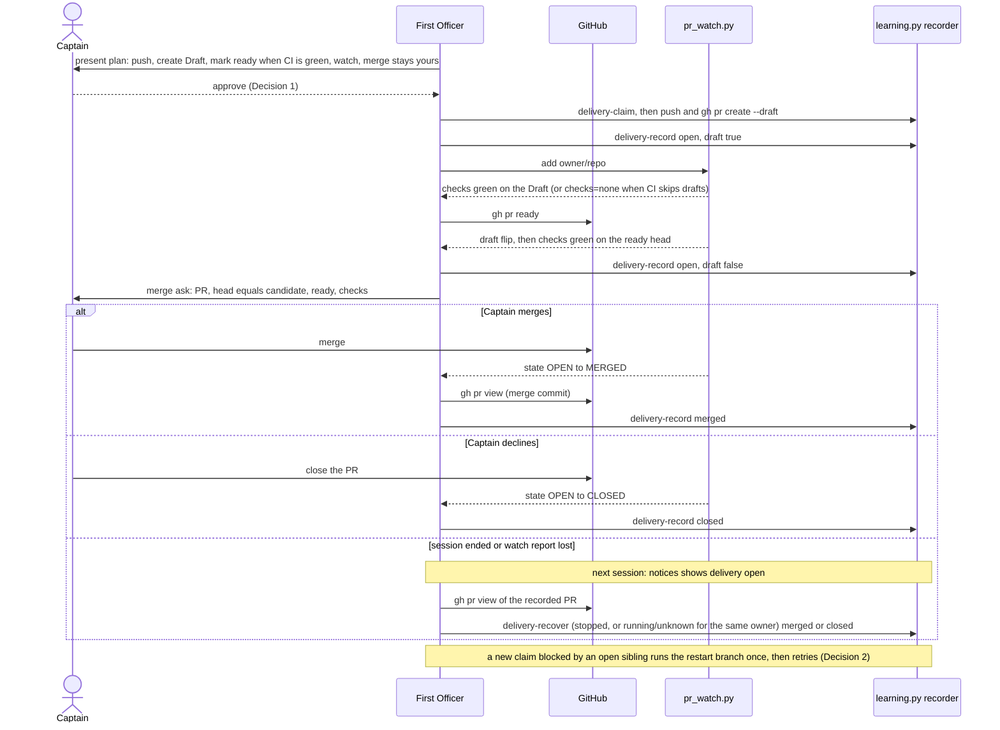

`kc-dev-flow-2:learn` (0.21.0 and 0.22.0, `skills/learn/SKILL.md`) creates the learning.md PR with `gh pr create --draft` and records the observation at creation, then stops. It names no step to mark the PR ready once CI is green, no `pr_watch.py add`, and no step to record the later merge or close. On 2026-10-13 FO asked the Captain to merge learning PR iamcxa/kc-claude-plugins#637 while it was still a Draft, and recorded its merge only after the Captain said it had merged. Until a delivery is recorded merged, closed or released, `learning.py claim` refuses every new learning job in the store, so the next task's learn step stalls. The workflow README's Delivery authority (ready after CI green, `pr_watch.py add`) covers task PRs, not learn's PR.

## Captain's words

Captain 2026-10-13, in chat: 「如果建議我合併的 PR應該要設成 ready，這是 dev2 缺陷嗎？你應該也要主動追蹤他的合併狀態，還是是 learn 的流程沒補強到？」, then 「向 kc-dev-flow-2 回報的問題可以回報，這個是否可以排進清單處理修復跟補強？」

## Scope

- learn's delivery: mark the PR ready once CI is green before asking for merge, add it to `pr_watch.py`, and record the merged or closed observation when the watch reports it.
- Non-goals: any merge automation (ADR 0009 keeps merge with the Captain); a change to `learning.py`, `pr_watch.py`, Spacedock or the `pr-merge` mod; task PRs (their Delivery authority is unchanged); a scanner, hook or background launcher for learning PRs; a `delivery-sync` command (Decision 3).

## Acceptance criteria

All paths are relative to `kc-dev-flow-2/` in `iamcxa/kc-claude-plugins` unless marked `<state>`. `<package>` is the package root. The 2026-10-13 case is learning job `be609ffc0af1f8d10ce78f5404078db17304c867faa1337876800078e382b24f` and PR `iamcxa/kc-claude-plugins#637`; its facts below were read on 2026-10-13 from `gh api repos/iamcxa/kc-claude-plugins/issues/637/events`, `gh pr view 637 --json createdAt,mergedAt,statusCheckRollup`, and the job directory under `$(git rev-parse --path-format=absolute --git-common-dir)/kc-dev-flow-2/learning/` (file times by `TZ=UTC stat`). The new section of `skills/learn/SKILL.md` is called "the section" and is headed `## Follow the delivery to a recorded end`. New tests go in `scripts/test_learning.py`, which CI already runs (`kc-dev-flow-2-tests.yml`, step `test_learning.py`), with a stub `gh` on `PATH` that records every call and answers from a JSON file.

**AC-1** The section orders the steps FO runs after the Draft is recorded.
Evidence: a test reads `skills/learn/SKILL.md`, takes the section, and asserts these strings appear in this order: `pr_watch.py add`, `checks` green on the Draft, `gh pr ready`, a `delivery-record` observation with `draft` false, the merge ask, then `delivery-record` with state `merged` or `closed`. It also asserts the section says that when the Draft shows `checks=none` (CI skips drafts) FO marks ready first and waits for green on the ready head, as #637 needed: its first `multi-profile route gate` run was 10:42:39Z-10:42:44Z on the Draft, and a second ran 10:52:29Z-10:52:36Z after `ready_for_review` at 10:52:24Z.
Falsifier: move the merge ask before `gh pr ready`, or delete the `pr_watch.py add` line; the order assertion goes red.
Not yet verified: that an FO following the text does this. The assertion proves the sentences exist and are ordered, not that they are followed (AC-7 is the live check).

**AC-2** Replay of 2026-10-13: the stall is reproduced by the old procedure and absent under the new one, with no Captain message in the sequence.
Evidence: the fixture is #637's recorded timeline: Draft opened 10:42:33Z; checks green 10:43:23Z; the notice acknowledged as presented (`acknowledgement.json`) 10:51:21Z, before the PR was ready; `ready_for_review` 10:52:24Z; merged 10:53:14Z with merge commit `70b88d7511cd6cb3aca05382ba973aee752f1152`; merged recorded 10:54:27Z (`delivery.json` mtime), 73 s after the merge, after the Captain said it had merged. Control arm: claim a job, deliver it, record the Draft `open` and stop (what `skills/learn/SKILL.md` says today); a second job's `claim` exits 1 with `blocking` naming the first job with `delivery: open`. New arm: run `pr_watch.py --state <tmp> add` and `check` against the stub, which serves the PR as Draft with pending then green checks; the test then follows the section: `gh pr ready` (stub flips `isDraft`), `delivery-record` with `draft` false, the stub serves `MERGED` with `mergeCommit.oid`, `delivery-record` merged; the second job's `claim` then exits 0. The `check` output contains `checks pending -> green`, then `draft True -> False`, then `state OPEN -> MERGED`.
Falsifier: skip the merged `delivery-record`; the second `claim` still exits 1 and the test is red. The control arm is the proof the fixture can fail: it must exit 1 on today's text.

**AC-3** A restarted FO, or one whose token was hidden, settles an open delivery from GitHub before presenting it.
Evidence: fixture with a delivery recorded `open`, the token discarded, the stub serving `MERGED`. Following the section: `notices` shows `delivery.state` `open` and `delivery.observation.pr`; `gh pr view` of that PR; `delivery-recover --owner-state stopped` with the plan taken from `notices --all` and the observation built from the `gh` read; then `notices` shows `merged` and the next job's `claim` exits 0. The 2026-10-13 job is the precedent for a hidden token: its `delivery.json` `recovery.reason` reads "lost the one-time delivery token to an output filter". The same test asserts `skills/learn/SKILL.md` (Present the result) and `skills/dev/SKILL.md` (notices paragraph) each tell FO to read the PR before presenting an `open` delivery.
Falsifier: omit the `delivery-recover` step; `notices` still shows `open` and the claim exits 1.

**AC-4** A PR closed without merge settles the delivery; a Captain who declines an open PR closes it rather than running `release`.
Evidence: stub serves `CLOSED`; `delivery-record` with state `closed` makes the next `claim` exit 0 and `notices` show `closed`. A `release` on an open delivery exits 1 with `delivery is open, merged or closed; release refused` (existing recorder; pinned by `test_release_refusals_and_irreversibility`), and the section says a declined open PR is closed by the Captain and then recorded `closed`.
Falsifier: text telling FO to `release` an open delivery; the same `release` call exits 1.

**AC-5** Merge stays the Captain's.
Evidence: the stub exits 1 and fails the test on any `gh pr merge` call or `--auto` flag across the AC-2 to AC-4 runs; a text assertion finds neither string in the section. The section's merge ask names the PR, its head SHA equal to the plan's `candidate_commit`, `ready`, and the checks state.
Falsifier: add `gh pr merge` to the section; both assertions go red.

**AC-6** Nothing outside the learn texts moves.
Evidence: `git diff --stat origin/main` of the delivery PR lists only `skills/learn/SKILL.md`, `skills/dev/SKILL.md`, `extensions/learn/EXTENSION.md` and `scripts/test_learning.py`; `python3 scripts/lint-skills.py`, `test_learning.py`, `test_pr_watch.py`, `test_lint_skills.py` and `test_observer_check.py` exit 0 (all were 0 on an `origin/main` export, 2026-10-13: `test_pr_watch` 28 tests OK, `test_learning` advance test OK).
Falsifier: a change to `learning.py`, `pr_watch.py`, `references/sd/workflow.md`, `lint-skills.py` or the CI workflow appears in the diff stat.

**AC-7** (live; not yet verified) The next real learning PR follows the order with no Captain message needed to record it.
Evidence at validation or first dogfood: `gh api repos/<repo>/issues/<N>/events` shows `ready_for_review` after the first green checks and before FO's merge ask; `learning.py notices` shows `merged` or `closed` in the same FO session as the `pr_watch.py wait` exit, with the Captain's message not the source.
Falsifier: `ready_for_review` after the merge ask, or `notices` still `open` after the PR merged.

## Design

### Chain check

- Spacedock (`_mods/pr-merge.md`, v0.27.0, read 2026-10-13): its startup and idle hooks scan workflow entities with a `pr` field. A learning PR is not an entity: its job lives under the Git common directory's `kc-dev-flow-2/learning/`, so no Spacedock hook ever sees it. Nothing to reuse; nothing to ask Spacedock for.
- kc-dev-flow-2 at origin/main `70b88d75` (package 0.22.0). Existing and tested, none of it reachable from the learn texts: `scripts/pr_watch.py add|check|wait` reports a draft flip, CI green and a merge or close, and drops a merged or closed PR after reporting it once (`test_pr_watch.py`, 28 tests OK on an export, 2026-10-13); `scripts/learning.py delivery-record` takes `open` to `merged` or `closed` for the same PR with the delivery token; `delivery-recover` does the same without it (`--owner-state running|unknown` for the same owner, `stopped` otherwise; `test_delivery_recover_advances_own_open_observation_to_merged` OK); `claim` refuses while a sibling delivery is `open` and accepts once it is `merged` or `closed` (`test_new_claim_held_by_in_flight_sibling`, subTest `proposal-delivery-open`, and the `delivery-merged` case in the settled-delivery test). Search 1: `git grep -E 'pr_watch|gh pr ready'` over `skills/learn`, `skills/dev`, `skills/evaluate-learning` and `extensions/learn` at origin/main: zero hits. Search 2: `git grep -E 'delivery-record|delivery-recover'` outside `scripts/`: only `skills/learn/SKILL.md`, which stops at "Verify the resulting PR binding and Draft state, then record it". So the mechanism is complete and tested; the learn texts never route to it.
- `references/sd/workflow.md` Delivery authority already says "FO adds each PR it opens or pushes to with `pr_watch.py add`" and, for task PRs, ready after CI is green. By its letter that covers the learning PR; it is FO-only text that does not name learn, and the learn skill never points at it. The rule existed and the learn path never reached it.
- Sibling adopters: `grep -rIl 'delivery-record|learning\.py'` over `carlove` and `spacedock` (`*.md`, `*.py`) printed nothing, 2026-10-13. No adopter carries a competing mechanism.
- ADRs and rulings: ADR 0009 keeps merge with the Captain and says changes to authority, approval or merge rules never unlock; this design adds no merge authority. `git -C <state> grep -n 'Override:'` on 2026-10-13 shows no gate override bearing on delivery of a learning PR.
- Real case, read 2026-10-13 (details in the criteria): the Draft was opened 10:42:33Z, its checks were green by 10:43:23Z, the notice was presented 10:51:21Z while it was still Draft, the PR was marked ready 10:52:24Z, merged 10:53:14Z, and `delivery.json` recorded `merged` at 10:54:27Z. The job's `delivery.json` `recovery.reason` also records that the one-time delivery token was lost to an output filter before the push, so the token path is fragile in practice.

### PRFAQ

**Plain account.** When the learning step proposes a new rule, it opens a pull request and leaves it as a draft, a request that cannot yet be reviewed, and records that fact. Today it stops there. Nobody marks the request ready once its automatic checks pass, nobody watches it, and the record of what happened to it is updated only when the Captain says it merged. That record matters, because the learning step refuses to start the next job while the previous request is unsettled. After this change the step carries the request through: it marks it ready once the checks are green, watches it, asks the Captain to merge, and writes down the merged or closed outcome the moment the watch reports it. If the session that opened the request has ended, the next session reads the request from GitHub before it presents the result, so an unrecorded outcome cannot block the next learning job. The Captain still merges.

**Press release (future).** `kc-dev-flow-2:learn` now carries its `learning.md` pull request to a recorded end. After recording the Draft it adds the PR to `pr_watch.py`, marks it ready when CI is green on the Draft, waits for green on the ready head, and asks for the merge naming the PR, its head and its checks. When the watch reports a merge or close, it records that observation. Any later `notices` run that finds an `open` delivery reads the PR first and settles it, so a lost token, a lost watch report or a restarted session no longer leaves the next learning claim blocked.

**FAQ.**
- *Why no new script?* The recorder and the watch already do every step and are tested (chain check). What failed on 2026-10-13 was routing, and the `workflow.md` sentence that covers the PR is read by FO, not by the learn path. Decision 3 asks whether to add a one-command sync later.
- *Why mark ready before the merge ask?* The Captain should be asked about a PR that can be merged, and ready triggers a second CI run on the ready head (#637: 10:52:29Z-10:52:36Z). On #637 the first green on the Draft (10:43:23Z) came 9 minutes before the flip, so asking while Draft spent that time and left the second run unstarted. Decision 1 covers the authority.
- *Why settle on read and not only on the watch?* `pr_watch.py` reports a merge once, then drops the PR, and its state file is per machine. A session that dies after the merge never hears it. The `notices` read is the floor; the watch is the timely path.
- *What if the Captain does not want the proposal?* He closes the PR and FO records `closed`. `release` is refused once a delivery is `open`.
- *Does this change what is recorded about a merge?* No. A merged observation stays a caller-recorded fact; the recorder does not read GitHub.

### Flow

Order in prose: FO presents the plan and the Captain approves; FO claims, pushes, creates the Draft and records it `open` with `draft` true, then adds the PR to the watch. When the watch reports green on the Draft, or at once when the Draft shows `checks=none` because CI skips drafts, FO runs `gh pr ready`, waits for green on the ready head, records `open` with `draft` false, and asks the Captain to merge. A merge or close reported by the watch is read from GitHub and recorded. When no watch report arrives (session ended, report lost), the next `notices` run that shows `open` reads the PR and settles it before presenting, and a `claim` refused by an `open` sibling runs the same read once and retries once; if the PR is still open, FO reports `learn not run: blocked by job <id>` naming the PR.

### Files, and what is shared with `fo-record-checks`

Edited here: `skills/learn/SKILL.md` (new section; one clause in Present the result), `skills/dev/SKILL.md` (one sentence in the learning-notices paragraph), `extensions/learn/EXTENSION.md` (the `Cannot run` bullet: a refused claim reconciles an `open` blocker first), `scripts/test_learning.py` (new tests; already run by CI, so no workflow file change).
Expected to be changed by both tasks:
- `extensions/learn/EXTENSION.md`: this task edits the `learn not run: blocked by job <id>` sentence; `fo-record-checks` may edit the same bullet if it rewrites the `<name> not run: <reason>` form there. Same lines possible; land one, rebase the other.
- `skills/dev/SKILL.md`: possible if `fo-record-checks` names a script path there; different paragraph.
Not touched here, and expected to be changed by `fo-record-checks`: `references/sd/workflow.md` (`WORKFLOW_WORD_BUDGET` in `scripts/lint-skills.py` is 5415 and the file is 5415 words, measured on origin/main 2026-10-13), `scripts/lint-skills.py`, `.github/workflows/kc-dev-flow-2-tests.yml`. Staying out of them removes the shared word-budget edit. New text must not repeat a 12-word run from `workflow.md` (the lint refuses it), so the section links to Delivery authority and does not quote it.
The adopter copy `docs/dev2/README.md` is changed by a sync PR after release, not by this task.

### Limits

- Prose-enforced. Spacedock has no hook for a non-entity PR, and nothing in kc-dev-flow-2 forces FO to run the section. The floor (read on `notices`, read on a refused `claim`) sits on paths FO already runs, but only FO's reading triggers it. AC-1 to AC-5 prove the commands and the order are right and recorded correctly; only AC-7 can show an FO following them.
- `delivery-record` and `delivery-recover` record what the caller read; the recorder does not authenticate GitHub (kc-dev-flow-2 `README.md`, Learning loop). A mis-read could mark merged early and unblock claims early.
- `pr_watch.py` state is a per-machine file and a merged PR is reported once; the `notices` read is what covers a lost report.
- `gh pr ready` is an outward write and invites review: on #637 `ready_for_review` at 10:52:24Z was followed by a Codex `mentioned` event at 10:52:39Z (Decision 1).
- A candidate rewritten after a requested change is recorded by the existing `delivery-recover` rule for a changed candidate; unchanged here.
- Not built: a `delivery-sync` command (Decision 3); any merge automation (ADR 0009).

### ADR

No ADR. The ruling "the learning PR is carried to a recorded end" is a procedure in the learn texts; it reverses no ADR and adds no merge authority (ADR 0009 followed).

## Unresolved decisions for the Captain

1. **Does your approval of the learning PR's push and creation also cover marking it ready once CI is green?** Recommend yes: FO's plan presentation names "create Draft, mark ready when CI is green, watch; merge stays yours", so your approval of that text is the grant (it is accepted only because the question says so). It mirrors how FO already marks task PRs ready under your authority. Gets worse: ready invites a Codex review (#637 got a `mentioned codex` event 15 s after it) and a second CI run, and FO acts on a PR without a per-PR nod beyond the plan's text. If declined, FO asks you to mark it ready and AC-1's order assertion changes to name that ask.
2. **When a new learning claim is refused because an earlier proposal's PR is recorded `open`, may FO read that PR from GitHub, record merged or closed itself, and retry the claim once?** Recommend yes. Recording a fact GitHub already shows is not your merge decision, and it is what makes "a later learning claim is never blocked by an unrecorded delivery" true. Gets worse: the recorder does not verify FO's reading, so a mis-read unblocks claims early; and `claim` gains a `gh` read in FO's path. If declined, FO reports the blocker with the PR number and waits for you to say it merged, which is the 2026-10-13 behaviour.
3. **Add a `learning.py delivery-sync` command (reads the recorded PR from GitHub and records open, merged or closed in one call) in this task or later?** Recommend later: the recorder and the watch already work, the text fix is the smallest step that closes the case, and a one-command sync can be justified by the first run where the hand-built observation is skipped or wrong. Gets worse: the restart path stays three hand-built files (`plan.json` from `notices --all`, the observation, the digest), and the 2026-10-13 token loss shows that path gets used; a skipped step there is the residual risk until the command exists.

## FO alignment

Alignment: not needed before ideation; the Captain asked for the fix.
Release review: not needed: workflow maintenance, on no journey map.
Surfaces: none
Visible change: none

## Stage Report: ideation

- DONE: A design (PRFAQ and Mermaid) for how the learn loop carries its learning.md PR from creation to a recorded merge or close: ready once CI is green and before the merge ask, a watch, and the merged or closed observation recorded when the watch reports it, so a later learning claim is never blocked by an unrecorded delivery; within what kc-dev-flow-2 controls
  `## Design`: chain check (Spacedock pr-merge keys on entities, so no reuse; `pr_watch.py` and `learning.py` already do every step and are tested; two zero-hit searches show the learn texts never route to them), PRFAQ, sequence diagram with merge, close and lost-report branches, files shared with `fo-record-checks`, Limits. `design_surfaces.py check` (package 0.22.0) printed "learn-delivery-follow-through.md: design surfaces presentable", exit 0. No script change; the fix is routing text plus a read-before-present floor.
- DONE: Acceptance criteria with reproducible evidence clauses and falsifiers, including one replaying the 2026-10-13 case (learning PR #637 left a Draft at the merge ask; its merge recorded only after the Captain said so)
  AC-1 section order: not yet verified (section and test not written).
  AC-2 #637 replay with control arm: timeline measured (created 10:42:33Z, green 10:43:23Z, acked 10:51:21Z, ready 10:52:24Z, merged 10:53:14Z, recorded 10:54:27Z); the stalled control arm is covered by the existing `proposal-delivery-open` subTest, the new arm is not yet verified.
  AC-3 restart and lost-token settle: `test_delivery_recover_advances_own_open_observation_to_merged` OK on an origin/main export, 2026-10-13; the `notices`-driven sequence and text assertions are not yet verified.
  AC-4 closed and decline: the `release` refusal is pinned by `test_release_refusals_and_irreversibility` (existing); the new fixture is not yet verified.
  AC-5 merge stays the Captain's: not yet verified.
  AC-6 scope guard: lint and suites exit 0 on an origin/main export (`test_pr_watch` 28 OK); the diff-stat clause is not yet verified.
  AC-7 live: not yet verified; needs the next real learning PR.
- DONE: Unresolved decisions for the Captain, each with a recommendation and what gets worse under it
  Three under `## Unresolved decisions for the Captain`: (1) does the PR approval cover `gh pr ready` after CI green (recommend yes), (2) may FO settle an `open` blocker from GitHub on a refused claim and retry once (recommend yes), (3) add a `delivery-sync` command now or later (recommend later). No past `Override:` bears on these.

### Summary

The gap is routing, not mechanism: `skills/learn/SKILL.md` stops after recording the Draft, and neither it, `skills/dev/SKILL.md` nor the learn extension names `pr_watch.py`, `gh pr ready` or a merged or closed record, while the recorder and the watch already support every step. The design adds a learn section plus a read-before-present floor, edits four files (`skills/learn/SKILL.md`, `skills/dev/SKILL.md`, `extensions/learn/EXTENSION.md`, `scripts/test_learning.py`) and stays out of `workflow.md`, `lint-skills.py` and the CI workflow, which `fo-record-checks` will likely edit; the one possible line overlap is the `Cannot run` bullet of the learn extension. Nothing here proves an FO follows the text; AC-7 is the live check.
