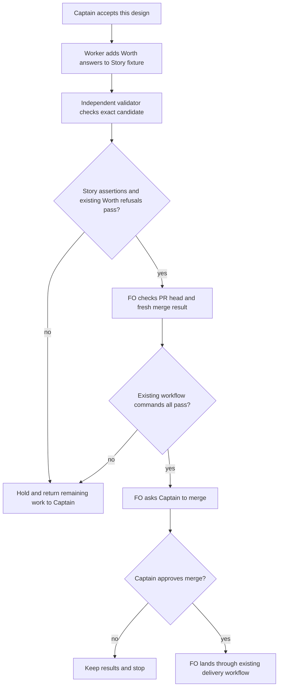

## Scope

- Source: the Captain chose 「開優先修正任務（建議）」 (host question dialog, 2026-11-11), answering 「main 上壞掉的那一項測試要怎麼修？我建議：開一張優先修正任務插進這批，派工人查清楚「找不到 spacedock 程式時檢查該怎麼反應」，只修造成這次失敗的地方，走完整的驗證再請你合併；發版等它。另一個做法是先把 #841 退回（revert）讓 main 變綠、優先修正先發版給 qnow，預算任務修好後再送一次。」
- Bite (FO read 2026-11-11, `gh run view 42991036147 --repo iamcxa/kc-claude-plugins --log-failed`): on main 571a7bd8a, the squash of PR #841, the `kc-dev-flow-2 tests` workflow fails one of 226 tests in `kc-dev-flow-2/scripts/test_design_surfaces.py`: `JourneyStoryTests.test_design_compares_story_record_to_counted_field_only_in_map_workflows` expects no refusal and gets `task.md: cannot read stage for Worth questions: [Errno 2] No such file or directory: 'spacedock'`. The run on eeee00230, the commit before, passed. The test came with PR #843 and the Worth questions check with PR #841; each PR's own checks passed, and FO did not rerun acceptance on the merged result before the #841 merge ask (stated in that ask).
- Effect: main is red, so Release PR #840 cannot pass its required check, and the fix in PR #844 that an adopter waits for cannot ship.
- Outcome: the `kc-dev-flow-2 tests` workflow passes on main with both changes in place, and what PR #841's accepted criteria say about a stage that cannot be read (the check refuses) still holds.
- Open for the design: whether the defect is the test's setup (it runs the design check where no `spacedock` program exists) or the check's behaviour when the program is absent in real use; the design shows which by running both, and names every other test or caller that reaches the Worth questions check without the program.
- Non-goals: the two Codex findings and the Deferred risk the Captain accepted as not repaired at the #841 merge ask; the fifteen sibling findings; cumulative agent minutes; any change to what the Story record rule or the Budget rule decides.

## Budget
- One ideation, one implementation and one validation cycle, in one package PR to the file or files the design names under `kc-dev-flow-2/scripts/`.

## Stop condition
- The `kc-dev-flow-2 tests` workflow is green on the PR head and FO has run the same test command on the result of merging the head with main at the time of the merge ask. Return to the Captain if the fix needs a change to what the Worth questions check refuses, or to a file outside `kc-dev-flow-2/scripts/`.

## FO alignment

Alignment: not needed: the Captain chose the forward fix and its bound in the question quoted under Scope; no direction is open that he has not ruled.
Surfaces: none
Visible change: none
Release review: not needed: workflow maintenance, on no journey map.

## Design

### PRFAQ

**Proposition.** Restore the package test run by making the Story test's task a valid ideation design. Change only the fixture text in `kc-dev-flow-2/scripts/test_design_surfaces.py`, inside `JourneyStoryTests.check`: add a visible `### Worth questions` section under a `## PRFAQ` heading, before Acceptance criteria. Its short answer can say: “Asked: check Story agreement; without: mismatches pass; premise: records can disagree, compare the fixture.” Keep every existing assertion, Story input, status, extension choice and seed/full mode.

**Why this fix?** On fetched main `571a7bd8a24ce08fac149fbcc91c4561610834c7`, the original test fails both without Spacedock (`cannot read stage for Worth questions`) and with the real 0.27.2 program (`design needs '### Worth questions'`). Installing the program earlier would only change the failure message. The fixture describes `status: ideation` but omits a required part of that design; the checker is doing the accepted refusal.

**What stays protected?** The real checker and native stage reader stay unchanged, including refusal when a needed stage read cannot run. No mock, swallowed diagnostic, changed expected result, skipped test, workflow/CI change, historical-task backfill or new fallback parser. ADR 0076 (Story record agreement) and ADR 0077 (budget and Worth questions), read at that main revision, both remain satisfied. The accepted old-design refusal and the findings excluded by Scope remain outside this task.

**Who finishes it?** After the Captain accepts this design, implementation changes the fixture, independent validation checks the resulting commit, and FO runs the existing workflow commands on the PR head and on its merge result with freshly fetched main before requesting merge. Merge and release remain separate Captain/FO actions. This is Pilot, one cycle per stage, one package PR.

### Worth questions

- **Fixture repair:** serves 「只修造成這次失敗的地方」. Without a complete ideation fixture, the Story positive case fails before its agreement assertions can be exercised. The premise that would remove this repair is that the fixture already passes with the required program; the cheap run below disproves it on both PATH variants.
- **Preserve refusals and test the merge result:** serves the approved outcome that an unreadable stage still refuses and 「合併進 main 之後的結果」 must be checked before the merge ask. Without these checks, a false pass or another cross-PR fixture conflict could be called repaired. The premise that would remove the first concern is that the program-absent check is intended to pass; the approved rule and direct CLI runs disprove it. No scope part lacks Captain words.

### Source chain and observed evidence

Checked 2026-11-11, in this order:

1. **Spacedock:** its own `skills/fo-status-viewer/SKILL.md` assigns parsed state/path resolution to `spacedock status`; the installed binary reports 0.27.2. Actual `status --read --json` and the existing native-stage tests read the task rather than an adopter's regex workaround. No upstream capability is missing.
2. **Package:** fetched main is the full SHA above; its plugin manifest still says released version 0.38.1. `design_surfaces.py:1077-1094,1198-1206` asks the native reader only when there is neither a visible Worth heading nor an explicit Design section that already proves the requirement. `test_design_surfaces.py:343-375` builds precisely that missing-heading ideation fixture. CI runs this suite before installing Spacedock. The named broken seam is the test setup, not a missing product abstraction.
3. **Sibling adopters, read only:** relay `/Users/kent/conductor/workspaces/subspace-relay/beirut-dev2` at `0fce82296710d7bf3b89c2871adefd71db2e2957`, web `/Users/kent/conductor/workspaces/subspace-web/dev2-fo` at `85aa72aa29ae6c3be3c9d08fd4cb8a004211c63d`, and qnow `/Users/kent/conductor/repos/qnow-adopt-dev2` at `429b4673e0cff4088adf5ee75db64830de441917`: their `docs/dev2/README.md` and `docs/dev2-poc/README.md` invoke the package seed/full check; they supply no substitute stage reader. These are local snapshots, not claims about deployed package versions or actual historical PATHs. No adopter repair is needed for a test-only fix.

The source was exported with `git archive` to one owned scratch directory; no product checkout was modified. Reproduction uses the absolute Python executable with `SPACEDOCK_BIN` removed, `PATH=/usr/bin:/bin` for absence, and `PATH=/Users/kent/.local/bin:/usr/bin:/bin` for presence. The latter resolves real Spacedock 0.27.2. `PYTHONDONTWRITEBYTECODE=1`; temporary fixtures live under the owned scratch directory.

| Exercise on unchanged main | No program on PATH | Real program on PATH |
| --- | --- | --- |
| `test_design_surfaces.py JourneyStoryTests.test_design_compares_story_record_to_counted_field_only_in_map_workflows` | exit 1, cannot read stage, missing executable | exit 1, design needs Worth questions |
| Full `test_design_surfaces.py` | 226 tests, 1 failure, 0 errors, 4 existing optional skips | 226 tests, same 1 failure, 0 errors, same 4 skips |
| Direct `design_surfaces.py check` on a valid split-root workflow with ideation task but missing Worth section | exit 1, cannot read stage; no presentable message | exit 1, design needs Worth questions |
| Same direct task with visible Worth answers | exit 0, design surfaces presentable | exit 0, design surfaces presentable |
| Independent Story fixture matrix, adding only the visible Worth/PRFAQ text | 10/10 expected verdicts | 10/10 expected verdicts |

The matrix contains five `(Story, journey-story)` pairs (matching story; none/empty; story/empty; two different stories; none/nonempty) under both `[journey-map]` and `[]`. The three mismatches refuse only with journey-map; the seven other rows pass. It exercises the unchanged checker on data, not a candidate implementation. The direct CLI fixture reports `scope check not run: no closed backlog approval`; that distinct scope check is not claimed as exercised here.

The existing native tests `DispatchStageTests.test_worth_requirement_uses_native_stage_for_yaml_status_values` and `test_unreadable_native_stage_does_not_make_design_presentable` also passed (2 tests, exit 0) with `SPACEDOCK_BIN=/Users/kent/.local/bin/spacedock`. They cover quoted/commented ideation status in flat/folder tasks; missing executable, malformed JSON, non-string status and wrong task identity all refuse. The prior #841 validation report explicitly judged native failure/timeout and the legacy-design refusal; this design preserves that behavior, without reclassifying its accepted findings.

### Other tests and callers at this boundary

Two bounded inventories were used: all tracked main references/imports of `design_surfaces`, and a profile trace of every executed `worth_stage` call during both full 226-test runs. In either run the only native-stage call was the failing JourneyStory test (one call before its first assertion stopped it). No other default-suite test attempted this native read. This is not a claim that other tests never execute the surrounding Worth-heading logic.

- `WorthQuestionsTests.test_html_comments_cannot_supply_the_worth_heading` and `test_design_without_worth_questions_is_refused_even_with_fenced_example` exercise missing/hidden/visible headings without needing a program: the explicit `## Design` section establishes the requirement. Both remain unchanged.
- `test_dispatch_stage.py` has exactly the two native Worth tests named above. The unreadable-stage test deliberately selects a nonexistent program in one subcase; that refusal is intentional. The other cases require the real binary. CI installs its pinned 0.27.2 before this file.
- `test_sd_dispatch.py` runs full checks in its `parity` helper with an explicit Design/Worth section, and uses `check --seed` elsewhere; those routes do not require a Worth-stage lookup. Its own native dispatch/scan work separately requires Spacedock.
- Optional `AmendmentCorpusTests.test_every_pinned_task_and_artifact_with_per_file_verdicts` and `AmendmentHistoricalTests.test_real_form_bites_and_single_field_repairs_with_event_artifacts` launch full CLI checks on supplied historical tasks and inherit the caller's environment. They can reach the native reader when those bytes lack both Design and visible Worth. They were skipped, not silently declared passing; absence must still refuse. The other two optional historical methods run laws checks and a lifecycle-reading manifest respectively, not this Worth reader.
- Runtime full-check callers are FO before the ideation/validation gates (`references/sd/workflow.md:195,233`), workers checking the task (`:453`, `skills/ideation/principles.md:32`), and the observer replay (`skills/observer/SKILL.md:60`). Manual CLI use has the same dependency when the stage must be read. None promises program-free full checks. The adopted sibling README calls above are the same route.
- `pr_watch.py:458`, backlog admission and observer backlog replay use `check --seed`, which returns before Worth checks. `dispatch_records.py`, `dispatch_stage.py`, `delivery_gate.py`, `validation_security.py` and `laws_check.py` import other symbols, not `check_task`/`worth_stage`; `test_laws_check.py` also runs named amendment tests, not the Story test. `test_role_triggers.py` reads constants/headings. These references do not create additional native-stage callers.

External/manual invocations beyond these tracked callers and the three adopter README pairs are not exhaustively discoverable. No caller is changed by this design.

### Words FO reads at each lifecycle moment

This is a fixture repair, with no reduction claim. Count by whitespace splitting, using an independent recount of the existing `AmendmentHistoricalTests.test_declared_reading_manifest_and_fixture_stdout` manifest, on main's package and the loaded Spacedock 0.28.0 plugin documents (the executable is separately 0.27.2). This is a declared synthetic reading scenario, not an assertion about every live FO session. The proposed candidate preserves every input byte; after-values below are acceptance obligations, not measured candidate results.

| Moment / complete manifest inputs | Measured before | Proposed after |
| --- | --- | --- |
| Startup: workflow + dev skill + lifecycle mod + upstream startup hook + open-PR fixture output | 7251 | 7251 |
| Idle on open PR: mod + upstream idle hook + Delivery authority + Extensions + open-PR output | 889 | 889 |
| Idle on merged PR: same passages + merged-PR output | 860 | 860 |
| After archive: mod + learn extension + archived-task output | 333 | 333 |
| Merge ask: Delivery authority + Extensions + gate lifecycle skill + present-gate skill + four-awaiting-gates output | 2446 | 2446 |
| Gate check output, valid direct task / absent program / missing Worth with real program | 74 / 23 / 27 | 74 / 23 / 27 |
| Before dispatch: existing passages and dispatch/role output | unchanged input set | identical; 0 added, 0 removed |

Recount inputs in words: workflow 6008, dev 801, mod 48, upstream startup 365, upstream idle 100, Delivery authority 488, Extensions 224, learn 280, gate lifecycle 969, present-gate 675. Reproduce the existing manifest's `test_pr_watch.TasksTests` scenarios (`readme("roborev")` plus task `o/r#7` OPEN/MERGED; `readme("learn")` plus archived `some-task`; four validation gates awaiting Captain): output words are respectively 29, 0, 5 and 90; all four fixture commands exited 0. Count each named `##` section through its next level-two heading, and whole files where named. These components reproduce the five totals without relying on that optional test's historical hard-coded totals. For gate output the same synthetic task and environment described above give the three measured counts. Validation checks the one-file diff and independently recounts this same manifest. CI triggers/jobs stay unchanged; per-PR CI cost was not measured.

### Batch overlap

The complete proposed changed-file set is `kc-dev-flow-2/scripts/test_design_surfaces.py`, solely `JourneyStoryTests.check` fixture text. No shared index, ADR, schema, workflow, other test file or check behavior changes. Batch 21 has no other task in this priority exception.

The eight named other-session tasks were read as they stand at state HEAD `e3501ac6c90059d49a3b2988ec68fd9fa7e30b53`: `adoption-asks-which-extensions` changes dispatch/number/laws files; `adr-required-statement` changes ADR/number/workflow checks; `adr-silent-undo-probe` changes its fictional scenario harness; `comment-check-reaches-delivery-gate` changes delivery-gate files; `journey-canvas-hosted-poc` and `journey-server-host-pilot` change canvas/server work; `ops-inbox-r1-setup-and-isolation` changes ops-inbox; `pr-review-lite-value-pilot` changes PR-review work. None declares a change to this fixture/file or Worth behavior. Their use of the package checker is not edit overlap.

The broader active task inventory additionally finds three ideation designs sharing this test file: `captain-ruling-sources-checked` (new ruling-source cases), `fo-write-checks-parse-top-level` (`ScopeCheckTests`), and `seed-check-requires-alignment-result` (seed cases). None names JourneyStory or changes the Worth-stage reader. They are file-level overlaps and must be rechecked when implementation starts; their stage labels do not prove a worker is running.

Recommended order: land this Captain-approved priority fixture repair first; rebase any later shared-file work and run the unchanged full suite again. Do not expand this one-cycle task to repair or redesign sibling checks.

## Acceptance criteria

**AC-1** The original Story test and full design-surfaces suite pass with and without a Spacedock program after only the fixture text is completed. Evidence: at the exact candidate, run `python3 -B kc-dev-flow-2/scripts/test_design_surfaces.py JourneyStoryTests` and the full file under both PATH variants described above, with `SPACEDOCK_BIN` unset; record resolver result, exits and test/skip totals. All existing positive, mismatch and extension-disabled assertions remain. Falsifier: remove the newly added fixture section; the named original test must fail as reproduced above. Current evidence: main fails both modes; the unchanged checker passes the 10-row completed-data matrix in both; candidate suite not yet verified.

**AC-2** A task whose Worth requirement needs a native stage read still refuses when that read is unavailable, and real quoted/commented ideation values still require visible Worth answers. Evidence: run the two existing `DispatchStageTests` methods named above with pinned Spacedock 0.27.2, plus the direct checker fixture with `SPACEDOCK_BIN` unset and no executable on PATH; assert exit 1 and `cannot read stage for Worth questions`, no presentable message, and task bytes unchanged. Falsifier: temporarily swallow the native-read exception; the direct absent-program check and existing unreadable-stage test must fail. Current evidence: both existing tests and all direct main controls were exercised; candidate preservation not yet verified.

**AC-3** The patch changes only `kc-dev-flow-2/scripts/test_design_surfaces.py` fixture text, with no changed assertions or checker/Story/Budget decisions. Evidence: exact base-to-candidate diff review, main-versus-candidate `design_surfaces.py` byte equality, and the lifecycle input equality/word table above. Falsifier: any implementation, expected-result, skip, runtime/document/CI or second-file change fails this criterion and returns to the Captain. Current evidence: one-file design only; no product candidate exists.

**AC-4** Before the merge ask, the existing `kc-dev-flow-2 tests` workflow passes at the PR head and FO has run every existing command in `.github/workflows/kc-dev-flow-2-tests.yml` against the result of merging that head with then-current fetched main. Evidence: hosted PR check identity/head, both merge parents and the tested result SHA/tree, command exit statuses, and the absent/present Story checks on that result. Use CI's pinned Spacedock binary/root for native tests. Falsifier: stale main, a different tested tree, any nonzero command, or merely quoting the two old PRs' green checks does not satisfy this criterion. Main advancing invalidates the merge-result evidence until rerun. Current evidence: future implementation/validation/FO work; the current main failure is reproduced, not repaired.

## Unresolved decisions for the Captain

None beyond the ordinary design gate. Recommend the single-fixture repair; its tradeoff is that it repairs this test interaction without preventing every future independently merged fixture conflict. The approved merge-result rerun remains the protection for that broader risk. A request to tolerate missing Spacedock or grandfather historical designs would change an accepted refusal and must return as a separate Captain decision.

## Stage Report: ideation

- DONE: Reproduce the failing test on origin/main 571a7bd8a with and without a spacedock program on PATH; show whether the defect is the test's setup or the check's behaviour when the program is absent in real use, by running both; list every other test and caller that reaches the Worth questions check without the program; propose the smallest fix inside kc-dev-flow-2/scripts/ that keeps PR #841's accepted criterion that an unreadable stage refuses
  Both original runs fail; direct CLI refuses unreadable stage and missing Worth as expected; completed-data matrix 10/10 in each environment. One fixture addition, with caller/optional-test inventory above; removing the added section restores the failure.
- DONE: A `### Batch overlap` section naming each file the design would change and each other batch task and live task of other sessions that changes the same file or check, so FO can order implementation
  One file; none of the eight named sessions shares it, three additional ideation designs share other tests in that file; priority repair first, then rebase/retest.
- DONE: The words FO reads at each lifecycle moment, before and after, per root learning.md "Measure the words FO reads at each moment, not one file's size"
  Independent lifecycle recount gives 7251/889/860/333/2446 words; direct checker outputs 74/23/27. Candidate equality remains an explicit acceptance obligation, not a claimed completed measurement.
- DONE: Acceptance criteria with reproducible evidence clauses and falsifiers, and unresolved decisions for the Captain, each with a recommendation and what gets worse under it
  AC-1 through AC-4 above; no new material decision. The single-fixture recommendation preserves the accepted refusal and leaves broader conflict prevention with the merge-result check.
- DONE: Current design definition and its required artifacts
  Installed 0.38.1 and exported main checkers both exit 0: `main-tests-pass-with-worth-check-and-story-test.md: design surfaces presentable`; original task/frontmatter bytes preserved. PRFAQ/Mermaid branches reviewed together; no UI or database artifact owed.
- SKIPPED: AC-1 candidate test success
  No candidate in ideation; main failure and completed-data controls are observed, not delivery evidence.
- SKIPPED: AC-2 candidate refusal preservation
  Main native controls pass; independent candidate rerun and reverse falsifier belong to validation.
- SKIPPED: AC-3 candidate scope and word equality
  Design names one fixture; implementation diff does not yet exist.
- SKIPPED: AC-4 hosted PR and fresh merge-result acceptance
  FO-owned later evidence; no product branch, PR, merge or release was created.

### Summary

The failure is an incomplete Story test fixture: providing the real Spacedock program does not cure it. Complete that fixture while keeping all Story assertions and native-reader refusals; current code/CLI observations support the bounded design, with candidate and delivery proof still outstanding.

## Stage Report: implementation

- DONE: The fixture-only repair the design's Proposition names, inside JourneyStoryTests.check in kc-dev-flow-2/scripts/test_design_surfaces.py; no other product file; only the files the design names
  Base 571a7bd8a24ce08fac149fbcc91c4561610834c7; candidate 9b9be172c7cb2453ae74a79f10322344bf9ab32f adds two fixture-text lines; every existing Story test AST and the checker bytes are unchanged. All raw checks/commands: [implementation evidence](main-tests-pass-with-worth-check-and-story-test/implementation-evidence.json).
- DONE: AC-1 original Story test and full design-surfaces suite pass with and without a Spacedock program; falsifier fails
  At the committed candidate with caches cleared and python3 -B, JourneyStoryTests passes 2/2 and full suite runs 226, exit 0, 4 existing optional skips in each PATH mode; SPACEDOCK_BIN unset, resolver absent versus /Users/kent/.local/bin/spacedock. Removing the added section fails the original test in both modes (exit 1).
- DONE: AC-2 unreadable native stage refuses; real quoted/commented ideation requires Worth answers; falsifier fails
  Real Spacedock 0.27.2 passes both existing DispatchStageTests Worth methods (2/2). Direct absent-program CLI exits 1 with cannot-read-stage and no presentable message, preserving task bytes; visible Worth passes. Swallowing the exception in an owned scratch copy fails the direct refusal assertion and existing unreadable-stage test; product source unchanged.
- DONE: AC-3 exact scope, unchanged decisions and lifecycle reading equality; falsifiers refuse
  Diff is one file/two fixture lines; 118 other package paths and design_surfaces.py bytes equal base. Independent recount preserves 7251/889/860/333/2446 lifecycle words, normal-status direct outputs 74/23/27, and dispatch inputs. Scope predicate refuses a second product path or assertion edit.
- SKIPPED: AC-4 hosted PR-head workflow and every existing workflow command on a fresh merge result before the merge ask
  FO-owned after publication: record current main, both merge parents and tested SHA/tree, run all existing workflow commands and both Story PATH modes, then read hosted CI at the PR head. This implementation report is not merge-result or hosted-CI acceptance.
- DONE: kc-dev-flow-2/scripts/lint-skills.py (the repository copy CI runs) exit 0
  Frontmatter/routes/bindings/script paths pass; workflow 6008 of 6008 words, unchanged; no word-budget raise.
- DONE: Package adr_lint.py docs/adr --since <base> exit 0
  70 ADR files checked, 0 legacy; no new decision record owed or added for the task-local fixture repair; accepted ADRs 0048/0076/0077 pinned and hashed in evidence.
- DONE: Package number_guards.py check exit 0
  Explicit assigned repo/workflow/task/base/candidate: PASS no findings; migration guard skipped because no migrations-path. The sandbox state-fetch warning was resolved by an authorized rerun with successful sync, not accepted as fresh evidence.
- DONE: Package comment_ratio.py within its maximum
  2 code lines, 0 comment lines, 0.0%; maximum 5%, not enforced below 20 added code lines (script's rule).
- DONE: Package doc_impact.py and task design_surfaces.py exit 0
  0 affected documents, so none need updated/unaffected entries; task surfaces presentable, scope check intentionally not run at implementation stage.
- DONE: Commit locally on the assigned branch, no push; PR text written for FO
  Branch spacedock-ensign/main-tests-pass-with-worth-check-and-story-test; candidate 9b9be172c7cb2453ae74a79f10322344bf9ab32f. Conventional Commit title/body prepared at /tmp/impl-main-tests-pass-with-worth-check-and-story-test-pr.md; no versions changed.
- SKIPPED: One Draft PR from a branch off origin/main; FO pushes, opens the Draft PR and reads CI
  No PR opened: no product push grant. Read-only GitHub query returned no open PR for this branch; publication and delivery remain FO-owned.
- SKIPPED: RoboRev
  Not run: dispatch delegates local review to FO because this sandbox cannot reach its daemon; no clean-review claim.
- DONE: CI cost measured or stated as not measured
  CI cost per PR not measured; triggers/jobs unchanged and no additional hosted job introduced.

### Summary

The approved Pilot repair is one locally committed fixture addition; committed-candidate tests and reverse controls preserve Story assertions and native-stage refusal. Durable commands, outputs, source equality and lifecycle recount are linked above; product publication, RoboRev, hosted CI, independent validation and fresh-main merge-result acceptance remain with FO. No /tmp scratch was created except the required PR-text handoff, which is retained; the owned worktree scratch is removed after this evidence commit.
