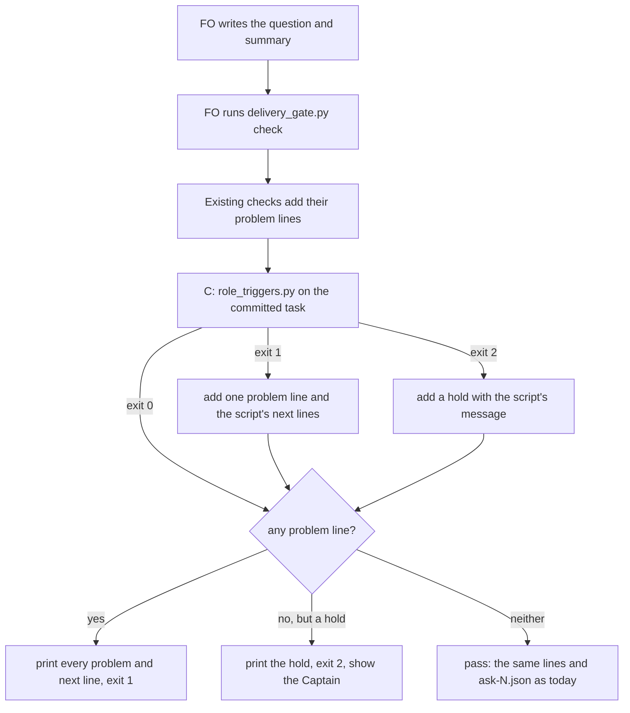

## Scope

- Source: the Captain's 「可以」 (chat, 2026-10-21) to FO's batch-4 close question 「A、B、C 要不要合成一張任務，排進第五批？」, where A, B and C were package-issue candidates from the four batch-4 learn runs (all no-change: each observer finding restated an existing rule FO had not followed).
- A. The gate summary names no external-round count although the README requires "FO counts rounds and records the count in the committed gate summary": observer findings on commissioned-by-names-spacedock, db-surface-without-migrations and (partial) fo-write-rules-checked.
- B. The delivery question omits clauses the README's Delivery authority requires (approval also covers later external-review rounds on the same PR, merging the full head unless he says he merges or holds, removing the clean pushed worktree): observer findings on fo-batch-sittings and fo-write-rules-checked (partial).
- C. fo-batch-sittings merged while `role_triggers.py` owed an engineering-reviewer call for replacing Captain amendments 1 to 3; the observer found it after the merge and FO recorded it as not run.
- Shape asked for: `delivery_gate.py check`, which FO already runs before every merge ask, holds on each of A, B and C, so no new script and no new FO step.
- Upstream first: `delivery_gate.py` (its Sufficiency/Necessity clause checks are the precedent for A and B), `role_triggers.py` (C), the observer.
- Non-goals: the other candidates of the same list (D: seed check before a backlog gate; E: amendment wording and Override placement; F: single occurrences), each the Captain's separate call.

## FO alignment

Delivery (FO, 2026-10-22): the worker's push was refused by the permission check; FO pushed head 1e47b8c6 and opened Draft iamcxa/kc-claude-plugins#703 on the Captain's 「准」 (chat, 2026-10-22), answering 「「合併提問補漏」的分支，可以讓我推上去並開 Draft PR 嗎？」.

Reviewer: engineering-reviewer opus 2026-10-21 — do holds A, B and C in delivery_gate.py, and the ADR 0023 and 0026 amendments, keep the Captain's merge and approval authority, or block an ask he should be able to receive or let one through he should not? Called under the special-role combination the Captain agreed (「同意這個組合」, 2026-10-20): a change to merge, authority or approval rules calls the engineering-reviewer.

Alignment: not needed before ideation; the Captain chose the combination and the check.
Surfaces: none
Visible change: none
Release review: not needed: workflow maintenance, on no journey map.

## Design

Narrowed on the Captain's ruling at the ideation gate (revise, 2026-10-22: 「這問題過去壞過什麼？嚴重嗎」 then 「可以」, chat): only hold C stays. Holds A (the round count) and B (the carried clauses), the ADR 0023 amendment and the old D1 (how strict B is) are removed; they are not built, measured or claimed below. The ADR 0026 amendment is kept, narrowed to C.

### PRFAQ

**Headline.** `delivery_gate.py check`, which FO already runs before every merge ask, holds the ask while the task's committed state owes a chief-engineer call (four repair passes) or an engineering-reviewer call (a replacing Captain amendment). It does not hold a call owed for review rounds (D2), an edit not yet state-committed, or a folder task. No new script, no new FO step, no README word.

**What hurts today (read 2026-10-22 from the batch-4 observer reports and the saved state).**
- At fo-batch-sittings' validation briefing commit, `role_triggers.py` prints `next: fo-batch-sittings has replacing amendments 1, 2, 3; dispatch kc-dev-flow-2:engineering-reviewer on opus ...` (exit 1). `pr_watch.py tasks`, which FO runs at idle, already prints that line; the task merged anyway, the batch-4 observer found the owed call after the merge, and FO recorded it as not run.
- The Captain's ruling names it the one observed skipped check among holds A, B and C, and dropped the two that caused no harm.
- Measured harm beyond that finding: none observed (no wrong merge). The bite is that a call the Captain's own rule owes is skipped when only an idle-time line carries it. The consumer is the Captain at the merge ask, and the batch observer.

**What changes, all in `kc-dev-flow-2/scripts/delivery_gate.py` and its test file.**
1. A function `owed_role_calls(task)` runs `role_triggers.py <task folder> <task stem>` (the script in the same package directory, no `--review-rounds`) and returns its exit code and stdout lines. `check()` calls it once, after the existing checks. Exit 1: the ask exits 1 with one problem line (`<stem> owes a special-role call (role_triggers.py reads the task as committed)`) and each `next:` line the script printed, verbatim. Exit 2: the ask exits 2 with the script's message. Exit 0: nothing new is printed.
2. Residual, stated: `role_triggers.py` reads the task from committed bytes at HEAD of the state checkout, never the disk (its docstring); `check()` reads the same task from disk. An amendment or repair-pass report written but not yet state-committed is not seen (the check lets the ask through), and a call written but not yet committed does not clear (the ask holds; FO commits and asks again). Measured in Measurements.
3. The task is a flat `<slug>.md` file, as everywhere else in `check()`. For a folder task `<slug>/index.md`, `dispatched_candidates` already finds no dispatch record (re-measured 2026-10-22: it returns `([], None)`), so the ask holds on that before C matters.
4. The module docstring gains one sentence. ADR 0026 gets one Amended paragraph, because its Consequences say FO "is told once per task and role, in the line `pr_watch.py tasks` already prints": still true, but a skipped call now also refuses the merge ask, and a reader of that ADR should find it there. No ADR is added, so no number is reserved; `ask-N.json` gains no key.

**FAQ.**
- *Why not a README or mod word?* FO already runs `check` before every merge ask and already reads `next:` lines; the hold only adds the same line it prints at idle.
- *Cost per ask.* One subprocess (measured 0.44 to 0.45 s wall, three runs, on the largest live task, 318 KB) and no GitHub call; no CI change. The suite: the narrowed prototype's 80 existing tests took 154.1 s in one run here (earlier prototypes: 97.7 s, 120.3 s, 129.6 s); the five unmocked wiring cases add about 8 s at the 1.2 to 1.9 s per-case rate of those runs (estimate).

### Flow

Past the input checks that return 2 at once (unreadable task or text file, malformed `--pr`), every check runs and every problem prints; exit 1 wins over exit 2 as today, and a problem found earlier does not skip C.

### Existing-code check (chain: Spacedock, kc-dev-flow-2, sibling adopters)

- Spacedock 0.27.2 (`spacedock gate prepare --help`, `spacedock merge guard --help`, read 2026-10-22): `gate prepare` takes `--question`, `--artifact`, `--summary`, `--reference`, `--workflow-dir` and no check or hook option; `merge guard` takes `--verdict` and `--rework` and does not make the merge verdict. Nothing there runs an adopter check at a merge ask.
- kc-dev-flow-2 at origin/main c27e7659 (0.27.0, unchanged since 2026-10-21). `git grep -n role_triggers origin/main -- kc-dev-flow-2/scripts kc-dev-flow-2/extensions kc-dev-flow-2/references` (non-test hits): `references/sd/workflow.md` says the script "lists calls owed"; `pr_watch.py` runs it at idle for every live task and prints its `next:` lines; `delivery_gate.py` does not run it. The capability is built and wired at idle only (advisory); need is the one observed skipped call. The precedent reused is `role_triggers.py` called as is, the way `pr_watch.py` calls it (same interpreter, captured output, exit 1 prints, other nonzero is a hold).
- Siblings: `git ls-tree -r --name-only origin/HEAD` in subspace-relay, subspace-web and qnow finds no `role_triggers` or `delivery_gate` file in any of the three (0, 0, 0, read 2026-10-22), so none keeps a copy of either script; the adopters take them from the package.

### Measurements (method, so validation can re-run)

Throwaway prototype in `/tmp/mah_proto/pkg5` (not kept; nothing in the repository), built this cycle: `git archive origin/main kc-dev-flow-2 | tar -x`, then `owed_role_calls` and the block at the end of `check()` on `delivery_gate.py`, and `mock.patch.object(gate, "owed_role_calls", return_value=(0, []))` in the two check helpers of `test_delivery_gate.py`. Replay corpus: the 10 archived tasks of `spacedock-state/dev2` that have `merge/ask-N.json` (the check ran on them). C replay: `role_triggers.py <state> <slug> --rev <commit that added the approved validation briefing>` (`git log --all --format=%H --diff-filter=A -- <slug>/review/validation/briefing-1/index.json _archive/<slug>/review/validation/briefing-1/index.json | tail -1`), by the package's real script.

Replay of the 10 asks, C alone (`/tmp/mah_replay/replay5.py`, run 2026-10-22):

| Task (approved) | C at its briefing commit | In window |
| --- | --- | --- |
| number-guards-readme-shrink | exit 0 | no: before the Delivery authority sentences |
| fo-write-checks | exit 1: 4 repair passes owe chief-engineer | no: before `role_triggers.py` counted (special-role-calls-fire-when-needed, archived 10-20) |
| captain-question-load | exit 0 | yes |
| chat-only-evidence-observer-blind | exit 0 | yes |
| delivery-gate-settles-skipped-checks | exit 0 | yes |
| special-role-calls-fire-when-needed | exit 0 | yes |
| commissioned-by-names-spacedock | exit 0 | batch 4 |
| db-surface-without-migrations | exit 0 | batch 4 |
| fo-batch-sittings | exit 1: engineering-reviewer owed (replacing amendments 1, 2, 3) | batch 4: the observed omission |
| fo-write-rules-checked | exit 0 (its three calls are recorded) | batch 4 |

C holds the one ask the observer flagged (fo-batch-sittings) and no complete ask; fo-write-checks holds only because it predates the counts. With `--review-rounds` set to the review ids that left inline comments (2026-10-21 reading: captain-question-load 2, fo-write-rules-checked 2, fo-write-checks 3), the first two still exit 0 because their chief-engineer calls are recorded, so D2 below would not newly hold a batch-3 or batch-4 ask.

Wiring (prototype, the real `role_triggers.py`, a temporary git state; `/tmp/mah_proto/c_integration5.py`, run 2026-10-22):

| Case | Exit |
| --- | --- |
| committed task, no amendment | 0 |
| committed amendment, no call | 1, with the script's `next:` line |
| committed amendment and a dated `Reviewer:` call | 0 |
| committed task, an amendment written on disk only | 0 (the omission is not seen) |
| committed amendment, a dated call written on disk only | 1 (fails closed) |
| state not a git work tree | 2: "is not a git work tree. Hold and report the cause." |

Mutation: with the one call line `code, said = owed_role_calls(task)` replaced by `code, said = 0, []` (`pkg5m`), all six wiring cases exit 0, so every wiring case that expects 1 turns to 0; the mutant also passes all 80 existing cases (OK, 174.5 s), because the cases patch `owed_role_calls` itself and cannot see its removal. Without the patch, 39 of the 80 existing cases exit 2 ("is not a git work tree"), because their temporary task directory is not a git state; patching the two check helpers leaves 6 failing, in `ProdSecurityReviewTests`, until the three other direct `gate.main` call sites (`ProdSecurityReviewTests` twice, `HoldTests` once) are patched too; with all five the prototype passes 80 of 80 (OK, 154.1 s, 2026-10-22). The implementation either patches the five sites or completes the fixtures with a committed task.

Committed bytes versus disk: of the 23 saved `ask-N.json` files, 7 were committed together with the task file (`git log --diff-filter=A --name-only -- '*/merge/ask-*.json'`, then `git show --name-only` per commit, read 2026-10-21). Six add only gate-record frontmatter lines (`git show -U0` on each); one, fo-batch-sittings `ask-2`, adds the post-merge `Reviewer: ... not run` waiver. None adds an amendment or an implementation report. So the let-through is possible and unobserved in 23, and the false hold is unobserved or at most once in 23. Choice: leave it as a residual rather than hold on any dirty task file, because a dirty-file hold would also fire on frontmatter edits like the six, and nothing shows when those were written relative to the check.

Pass path: stdout and `ask-1.json` keys are identical to base on three fixtures (pilot docs-only, script-with-test, release-please head; `/tmp/mah_proto/pass_identical5.py`, 2026-10-22).

Live tasks that owe a call today (`role_triggers.py <state> <slug>` at state HEAD 5549f4de, 2026-10-22), flat files whose merge ask will hold after this ships until the call or a dated waiver is committed: adr-required-statement (replacing amendment 1), codex-reader-reads-receipt-marker (replacing amendments 1, 2, 3), kc-decision-log-cli (replacing amendments 1, 3, 4, 5, 6), kc-decision-log-handoff-trial (replacing amendment 2), new-work-starts-from-a-story-map (replacing amendment 1), pr-review-lite-value-pilot (31 repair passes). Folder task journey-server-host-pilot (9 repair passes) is held earlier on the missing dispatch record. A dated FO-written waiver clears C (ADR 0026's choice) and nothing in a passing run shows it to the Captain; that stays as ADR 0026 left it.

### Batch overlap

Files the design would change: `kc-dev-flow-2/scripts/delivery_gate.py` (one function, one block at the end of `check()`, one docstring sentence), `kc-dev-flow-2/scripts/test_delivery_gate.py` (the two check helpers and three direct `gate.main` call sites patched or given a committed task, new cases), and `docs/adr/0026-role-calls-are-owed-on-counts-read-from-task-records-and-a-dated-call-clears-them.md` (one Amended paragraph). Not changed: `role_triggers.py` (called as is), `pr_watch.py`, `references/sd/workflow.md` and the adopted READMEs, the mod, every skill, `lint-skills.py`, the `ask-N.json` shape, ADR 0023.

Task statuses read from the state checkout at HEAD 5549f4de, 2026-10-22.

| Task | Same file or check | Order |
| --- | --- | --- |
| fo-write-checks-parse-top-level (batch 5, ideation) | yes: `delivery_gate.py` (`declined_items`, `DECLINE_END`, the docstring sentence on item runs) and `FoWriteRuleTests` in `test_delivery_gate.py`; its Batch overlap says "implement first" for this task. The narrowed design no longer touches the clause table, so the overlap is the docstring and the end of the test file | this task first; textual conflicts only |
| codex-reader-reads-receipt-marker (batch 5, validation) | no file: `extensions/codex/`, `pr_watch.py`. Check overlap: it owes an engineering-reviewer call today (replacing amendments 1, 2, 3), so its merge ask holds after this ships until the call or a waiver is committed | none for implementation; if it merges after release, FO records the call first |
| new-work-starts-from-a-story-map (batch 5, ideation) | no file: `pr_watch.py`, skills, README. Check overlap: it owes a call (replacing amendment 1) | none |
| idle-names-failing-seeds (batch 5, implementation) | `pr_watch.py` and its tests only; its design records `delivery_gate.py`, `role_triggers.py`: not changed | none |
| agent-reads-governing-adr (batch 5, ideation) | none: adopter hooks and instruction files; its Batch overlap says no shared file | none |
| override-reaches-gate-and-criteria-wait (backlog, last in batch 5) | none known: Scope names `design_surfaces.py`, `decision_ledger.py` and the README; same file if its Override hold lands in `delivery_gate.py` | after this one |
| merge-guard-stops-unasked-merges (backlog) | reads `ask-N.json` `head`: unchanged | none |
| comment-check-reaches-delivery-gate (ideation, resolved `hold`) | would share `check()`, `write_record` and the test file if reopened | none now; if reopened, after this one |
| kc-decision-log-cli, kc-decision-log-handoff-trial, pr-review-lite-value-pilot, adr-required-statement (flat, other sessions or unassigned, read only) | no file: `grep -c -E "delivery_gate\|role_triggers\|pr_watch\|test_delivery_gate"` over each task file is 0. Check overlap: each owes a call today (above), so its merge ask holds after release until FO records the call or a waiver | none; tell those sessions' FOs at release |
| journey-canvas-hosted-poc, journey-server-host-pilot, release-acceptance (other sessions, read only) | no file: grep count 0 each. Folder tasks, which `delivery_gate.py` does not support today, so C never fires on them | none |
| kc-decision-log-p1 | not a live task: it is under `_archive/` at state HEAD, and `role_triggers.py` reads 0 events for it | none |
| ADR index | no new ADR number; only ADR 0026 amended, and no other live task names it except idle-names-failing-seeds, to follow it | none |

Recommended order: this task before fo-write-checks-parse-top-level; the other batch tasks in any order.

### Words FO reads at each moment

Whitespace split, the counter `lint-skills.py` uses. Base is origin/main c27e7659 (0.27.0). Measured 2026-10-21 and unchanged: the Delivery authority section of `workflow.md` is 444 words and a passing ask prints 57 words (13 + 2 + 2 + 40); the whole `workflow.md` is 5374.

| Moment | Before | After |
| --- | --- | --- |
| Startup | `workflow.md` 5374 + mod 48 + idle hook output | unchanged: no `workflow.md`, mod or skill edit |
| Idle on an open PR | `pr_watch.py tasks` output | unchanged: `pr_watch.py` not edited (C reuses the line it already prints) |
| Idle on a merged PR | `pr_watch.py` and `observer_check.py` output | unchanged |
| After the archive | `observer_check.py` output | unchanged |
| Merge ask, gate passes | Delivery authority 444 + printed 57 = 501 | 501: stdout and record keys identical on three fixtures |
| Merge ask, gate holds on C | the existing hold lines | plus 63 words for fo-batch-sittings (an 11-word problem line and the script's own 52-word `next:` line), 55 for fo-write-checks (11 + 44). The 52 and 44 words are lines FO already reads at idle. Exit 2 (not a git work tree) prints the script's 22-word message plus the existing 10-word hold line |

Every moment is at or below base except the hold lines, which print only when an ask is refused. The module docstring grows by about 40 words (estimate); FO reads it only through `--help`. Compared with the cycle-2 design: the hold lines fall from at most 106 words to 63, and the docstring estimate from about 70 to about 40.

## Acceptance criteria

**AC-1** `check` runs the real `role_triggers.py` on `<task folder>` and `<task stem>`: exit 1 holds the ask with one problem line and the script's `next:` lines verbatim, exit 2 holds with exit 2 and its message, exit 0 prints nothing new; a replacing amendment not yet state-committed passes and a call not yet state-committed holds.
Verified by: a test that builds a temporary git state checkout and runs `main` without mocking the script, the six cases of Measurements (no amendment 0; amendment with no call 1; amendment with a dated call 0; amendment on disk only 0; call on disk only 1; not a git work tree 2), the last two pinning the residual instead of hiding it. Falsifier: deleting the call to `owed_role_calls` turns cases 2 and 5 to exit 0 (measured on `pkg5m`: all six exit 0); a test that mocks `owed_role_calls` cannot fail when the call is removed, so only the unmocked cases count; reading the disk instead of HEAD turns case 4 to exit 1, which the documented residual would no longer describe.

**AC-2** Replay result: the observed omission holds and no complete ask holds. C holds fo-batch-sittings at its briefing commit with the engineering-reviewer line; captain-question-load, chat-only-evidence-observer-blind, delivery-gate-settles-skipped-checks, special-role-calls-fire-when-needed, commissioned-by-names-spacedock, db-surface-without-migrations and fo-write-rules-checked exit 0.
Verified by: validation re-runs the replay of Measurements on the candidate's own scripts and records the 10-row table. Limit: fo-write-checks (exit 1) and number-guards-readme-shrink predate the counts and the sentences, and the table says so; the held-out test is the batch-5 asks themselves, counted by the batch-5 observer as holds FO judged false. Falsifier: any complete ask in the table holding, or fo-batch-sittings passing.

**AC-3** A passing ask prints the same stdout and saves the same `ask-N.json` keys as base; a hold on C prints at most 63 words of new lines on the fo-batch-sittings text; `references/`, `skills/`, `extensions/`, the mod, `pr_watch.py`, `role_triggers.py` and ADR 0023 are untouched.
Verified by: running base and candidate on the pilot docs-only, script-with-test and release-please-head fixtures and comparing stdout with the temp path masked and the record keys (identical on all three in the prototype); counting the whitespace-split words of the new lines at the fo-batch-sittings briefing commit (63 in the prototype); `git diff --stat origin/main...HEAD` at the candidate lists `delivery_gate.py`, `test_delivery_gate.py` and the ADR 0026 file only; `python3 kc-dev-flow-2/scripts/lint-skills.py` exit 0. Falsifier: any new line on a passing run changes the comparison; an edit to `workflow.md` makes the lint print a budget line.

**AC-4** The existing suite passes with its helpers completed, the module docstring names the hold and says it reads the task as committed, and ADR 0026 carries one Amended paragraph citing the Captain's ideation-gate words.
Verified by: `python3 -B -m unittest discover -s kc-dev-flow-2/scripts` exit 0; `python3 kc-dev-flow-2/scripts/delivery_gate.py --help` shows `role_triggers.py` and `committed`; `python3 kc-dev-flow-2/scripts/adr_lint.py docs/adr` exit 0. Falsifier: removing the hold from `check()` makes the AC-1 unmocked cases fail while the old 80 still pass, which is the proof the old cases do not cover it.

**AC-5** Dogfood at this task's own PR: FO runs the candidate's `delivery_gate.py check` (the candidate worktree as `<package>`) on the PR's ask text and gets exit 0 (the committed task owes no call); and on a scratch copy of the state checkout at this task's head with one `### Amendment 1` under `## Captain amendments` carrying `Supersedes: AC-1` and no `Reviewer:` call committed, exit 1 with the engineering-reviewer `next:` line. FO's validation scope notes quote the new hold, because the installed package (0.27.0) does not yet say it.
Verified by: the two outputs recorded in the validation report. Limit: it shows the gate and one real ask agree on one PR, not that FO records the call unprompted after release; the next adopter ask that owes a call is that observation.

## Non-goals

- No hold on a call owed for review rounds (D2), none on an uncommitted task edit (residual in Measurements), and none on the holds the Captain dropped: the round count and the carried clauses of the merge question (holds A and B), and the other candidates of the batch-4 list (D: seed check before a backlog gate; E: amendment wording and Override placement; F: single occurrences).
- No new FO step, no README or mod word, no skill edit, no change to `pr_watch.py` or `role_triggers.py`, no new key in `ask-N.json`, no ADR 0023 amendment.
- No folder-task (`<slug>/index.md`) support in `delivery_gate.py`, which `dispatched_candidates` and `write_record` already lack.
- The PR title follows the bounded claim, not the entity title: `feat(kc-dev-flow-2): hold a merge ask on a task whose committed state owes a repair-pass or amendment call`. The entity title still says the check holds a question that omits the round count or the carried clauses, which this task no longer does; it is frontmatter, which FO owns.

## Needs decision

**D2. Does C pass `--review-rounds` as `pr_watch.py tasks` does (recommended: no)?** (The label D2 is kept from the earlier cycles; D1, how strict the carried-clause check is, lapsed with holds A and B.) Without it the merge ask holds on repair passes and replacing amendments in the committed task bytes, which is the observed omission; with it the ask also holds on two review ids with inline comments, at the cost of one paginated `gh api` call, an import of `pr_watch.review_rounds`, a stub in the test harness, and the recorded risk that a reply comment carries its own review id (special-role-calls-fire-when-needed-followups, 0 replies in 82 inline comments). The replay shows no batch-3 or batch-4 ask newly held either way (captain-question-load and fo-write-rules-checked both recorded the call). What gets worse without it: a task with two review rounds and no chief-engineer call passes the merge check though `pr_watch.py tasks` printed it at idle; no ask in the window shows that case.
Gate-question sentence if approved as recommended: "Approving accepts D2: the merge-ask check holds on repair passes and replacing amendments in the committed task, and not on review rounds."

## Stage Report: ideation

- DONE: Design holds A, B and C in kc-dev-flow-2/scripts/delivery_gate.py check, measured by replaying the batch-4 merge asks of the archived tasks (merge/ask-N.json and the validation briefings): each observed omission holds and no ask the Captain approved as complete newly holds
  `### Measurements` replays the 10 archived asks that have `ask-N.json`: A holds commissioned-by-names-spacedock and db-surface-without-migrations; B holds fo-batch-sittings and fo-write-rules-checked (plus commissioned and db-surface, which two observers did not flag on B: D1); C holds fo-batch-sittings; the four batch-3 asks pass all three. Limits: fo-write-rules-checked's A "partial" is a round-classification omission the text check cannot see (not held, stated); number-guards-readme-shrink and fo-write-checks hold on B only because they predate the rules; patterns are in sample.
- DONE: A `### Batch overlap` section naming each file the design would change and each other batch task (new-work-starts-from-a-story-map, codex-reader-reads-receipt-marker, merge-ask-holds-missing-clauses, fo-write-checks-parse-top-level, idle-names-failing-seeds, agent-reads-governing-adr) and live task of other sessions (kc-decision-log-p1, kc-decision-log-cli, kc-decision-log-handoff-trial, pr-review-lite-value-pilot, release-acceptance, journey-canvas-hosted-poc, journey-server-host-pilot (driven by other sessions; read only)) that changes the same file or check, so FO can order implementation
  `### Batch overlap`: four files (`delivery_gate.py`, `test_delivery_gate.py`, ADR 0023, ADR 0026); only fo-write-checks-parse-top-level shares a file (this task first); three other-session tasks owe role calls today and will hold at their merge ask; `Recommended order:` line present.
- DONE: The words FO reads at each lifecycle moment, before and after, per root learning.md "Measure the words FO reads at each moment, not one file's size"
  `### Words FO reads at each moment`: five moments, whitespace split; merge ask passing 501 words before and after (identical stdout on three fixtures), a hold adds at most 97 words; no `workflow.md`, mod or skill edit.
- DONE: Acceptance criteria with reproducible evidence clauses and falsifiers, and unresolved decisions for the Captain, each with a recommendation and what gets worse under it
  AC-1 to AC-7, each with a test or command and a falsifier; current evidence is a throwaway prototype (no candidate exists): AC-1, AC-2, AC-3 and AC-5 hold on it, AC-4's table is its output, AC-6 and AC-7 are not yet verified. D1 (strictness of B, recommended strict) and D2 (review rounds in C, recommended no).

### Summary

The three holds are built from what already exists: `clause()` for the round count, three phrase patterns for the carried sentences, and `role_triggers.py` called as `pr_watch.py` calls it, so the README, mod and skills do not change and a passing ask prints the same. The replay holds every flagged omission it can see and none of the four complete asks; the Captain's call is how strict B is, because it also holds two batch-4 asks their observers did not flag and a relay ask that keeps the merge with him.

### Notes for FO

- `python3 <package>/scripts/design_surfaces.py check` on this file (package 0.27.0): "merge-ask-holds-missing-clauses.md: design surfaces presentable", exit 0.
- Before I saw the read-only rule for adopter state I ran `git fetch origin -q` in `/Users/kent/conductor/repos/subspace-relay`, `subspace-web` and `qnow`; it updated remote-tracking refs only, no branch or working tree. All later adopter reads were `git show` and file reads.
- Throwaway prototype and replay scripts are in `/tmp/mah_proto` and `/tmp/mah_replay`; nothing was written to the repository, no branch, no commit outside this state file.

## Stage Report: ideation (cycle 2)

- DONE: Fold merge-ask-holds-missing-clauses/reviews/engineering-reviewer-1.md items 1 to 7 into the design and criteria: D1 gains the explicit-keep option (hold a silent ask; pass all three phrases or a clause()-read keep line) and states, if strict stays recommended, that approval withdraws ADR 0023's fails-safe consequence and makes all three grants mandatory, two accepted as optional (ADR 0023 D1 text; ruling #564(a)); correct the relay sentence; fix AC-2's pattern or falsifier; state the Release PR exemption has never run and what B does when PR facts cannot load; name C's HEAD-versus-disk difference with a measured choice or a residual; bound the title claim; fix the flowchart; rerun the replay
  Item 1: D1 is now (a) `Not carried:` keep line, recommended, (b) strict, (c) FO-merge-only; (b) states the withdrawal of "fails safe", all three grants mandatory, two accepted as optional (ADR 0023 D1 "lets ... carry", #564(a) in 8134645d), and a ready gate-question sentence for (a) and (b). Strict is no longer the recommendation.
  Item 2: relay `account-publish-ceiling` (PR #400, `profile: prod`) is a validation gate on a PR the report calls "still a draft", so `check` exits 1 on draft first; read from the relay state, read-only.
  Item 3: AC-2 pattern now needs `external` (`later` to `external` to `rounds`, 20 characters each); `a later round` and `later review rounds` are named cases; the two patterns agree on all 47 approved briefings.
  Item 4: the Release PR exemption has run on 0 of 23 saved asks (synthetic fixture only) and is unreachable anyway: a Release PR has no task `Candidate:` line, so the prototype exits 2 before any pass, and learning PRs never name `delivery_gate.py`; no exemption under either D1 reading, and B reads no PR fact, so an unreadable PR cannot turn exit 2 into exit 1 on B's account.
  Item 5: C reads committed HEAD, B the disk; measured on a temp git state (uncommitted amendment exit 0, uncommitted call exit 1) and on the 23 ask commits (7 carry the task file: 6 gate-record lines, 1 post-merge waiver, 0 amendments); chosen: residual, pinned by AC-3 cases.
  Items 6 and 7: headline and PR title bounded to repair passes and replacing amendments in committed state (entity title is frontmatter, left to FO); flowchart now runs A, B and C every time into one "any problem line?" node. Replay rerun on `/tmp/mah_proto/pkg4` at origin/main c27e7659: same 10-row result.
- DONE: A `### Batch overlap` section naming each file the design would change and each other batch task (new-work-starts-from-a-story-map, codex-reader-reads-receipt-marker, merge-ask-holds-missing-clauses, fo-write-checks-parse-top-level, idle-names-failing-seeds, agent-reads-governing-adr) and live task of other sessions (kc-decision-log-p1, kc-decision-log-cli, kc-decision-log-handoff-trial, pr-review-lite-value-pilot, release-acceptance, journey-canvas-hosted-poc, journey-server-host-pilot (driven by other sessions; read only)) that changes the same file or check, so FO can order implementation
  Re-read at state 3de81609: same four files, only fo-write-checks-parse-top-level shares one (this task first); the seven other-session tasks name none of the files (grep count 0 each); comment-check-reaches-delivery-gate row corrected to its `hold` resolution.
- DONE: The words FO reads at each lifecycle moment, before and after, per root learning.md "Measure the words FO reads at each moment, not one file's size"
  Five moments unchanged except the hold lines: a passing ask 501 words before and after; a hold adds at most 106 words under (a) (97 under (b)), measured on the prototype.
- DONE: Acceptance criteria with reproducible evidence clauses and falsifiers, and unresolved decisions for the Captain, each with a recommendation and what gets worse under it
  AC-1 to AC-7 revised (AC-2, 3, 5, 6, 7 changed); D1 (a/b/c, recommended a) and D2 (no); the prototype is still not a candidate, so AC-6 and AC-7 are unverified.

### Summary

All seven reviewer items are in the design. The main change is D1: the check now holds a silent ask but lets a `Not carried:` line keep a sentence with him, so ADR 0023's "may" and its "fails safe" stay true, and no head-name exemption is needed (a Release PR and a learning PR never reach a passing check); strict stays available with its full cost stated for the gate question. C's HEAD-versus-disk gap is a measured residual, not a hold.

### Notes for FO

- `design_surfaces.py check` (package 0.27.0) on this file: "design surfaces presentable", exit 0, after the cycle-2 edits.
- The cycle-1 report above says "at most 97 words" and "D1 recommended strict"; cycle 2 supersedes both (106 under (a), 97 under (b); (a) recommended).
- Prototype and replay scripts: `/tmp/mah_proto/pkg4`, `/tmp/mah_replay` (`replay4.py`, `mut4.py`); nothing written to the repository. Adopter state read only through file reads (relay state checkout).

## Stage Report: ideation (cycle 3)

- DONE: Narrow the design per the Captain ruling in the ideation gate resolution reason (revise, 2026-10-22): only hold C remains (kc-dev-flow-2/scripts/delivery_gate.py check holds while kc-dev-flow-2/scripts/role_triggers.py reports an owed special-role call, with the HEAD-versus-disk residual stated); remove holds A and B, their criteria, the ADR 0023 amendment and D1; keep or drop the ADR 0026 amendment as the narrowed change needs; rerun the replay for C alone and recount the words FO reads
  `## Design` to `## Needs decision` rewritten for C alone; A, B, the ADR 0023 amendment and D1 are gone (named only as dropped). ADR 0026 amendment kept, one paragraph: its Consequences ("told ... in the line `pr_watch.py tasks` already prints") stay true but a skipped call now also refuses the merge ask. Residual stated in item 2 and pinned by AC-1 cases 4 and 5. New prototype `/tmp/mah_proto/pkg5` (C only) at origin/main c27e7659: replay of 10 asks (fo-batch-sittings exit 1, fo-write-checks exit 1 out of window, eight exit 0), six unmocked wiring cases (0, 1, 0, 0, 1, 2), mutant `pkg5m` (call removed): all six exit 0 and the existing 80 tests still pass (174.5 s); candidate suite 80 of 80 after patching five call sites (154.1 s); pass path identical on three fixtures; role_triggers 0.44 to 0.45 s on a 318 KB task.
- DONE: A `### Batch overlap` section naming each file the design would change and each other batch task (new-work-starts-from-a-story-map, codex-reader-reads-receipt-marker, merge-ask-holds-missing-clauses, fo-write-checks-parse-top-level, idle-names-failing-seeds, agent-reads-governing-adr) and live task of other sessions (kc-decision-log-p1, kc-decision-log-cli, kc-decision-log-handoff-trial, pr-review-lite-value-pilot, release-acceptance, journey-canvas-hosted-poc, journey-server-host-pilot (driven by other sessions; read only)) that changes the same file or check, so FO can order implementation
  Re-read at state HEAD 5549f4de, 2026-10-22: three files (`delivery_gate.py`, `test_delivery_gate.py`, ADR 0026); only fo-write-checks-parse-top-level shares a file (this task first). New: codex-reader-reads-receipt-marker, new-work-starts-from-a-story-map, adr-required-statement, kc-decision-log-cli, kc-decision-log-handoff-trial and pr-review-lite-value-pilot owe a call today, so their merge asks hold after release; kc-decision-log-p1 is archived.
- DONE: The words FO reads at each lifecycle moment, before and after, per root learning.md "Measure the words FO reads at each moment, not one file's size"
  Five moments unchanged except the hold lines: a passing ask 501 words before and after; a hold adds 63 words (fo-batch-sittings; 52 of them already read at idle), down from at most 106 in cycle 2; docstring about 40 words (estimate).
- DONE: Acceptance criteria with reproducible evidence clauses and falsifiers, and unresolved decisions for the Captain, each with a recommendation and what gets worse under it
  AC-1 to AC-5, each with a command or test and a falsifier (AC-1's is the `pkg5m` mutant); one open decision, D2 (review rounds in C, recommended no, what gets worse stated). AC-1 to AC-3 hold on the prototype; AC-4 and AC-5 are not verifiable before a candidate exists.

### Summary

The design is now one hold: `check` runs the real `role_triggers.py` on the committed task and refuses the merge ask while a repair-pass or amendment call is owed, at a cost of 0.45 s and 63 words only when it holds. The replay holds the one observed omission (fo-batch-sittings) and no complete ask; the Captain's remaining call is D2, whether review rounds also count.

### Notes for FO

- `design_surfaces.py check` (package 0.27.0) on this file: "design surfaces presentable", exit 0, after the cycle-3 edits.
- The entity title and the `## Scope` bullets A and B still describe the three-hold task; the title is frontmatter (FO owns it) and Scope records the Captain's original source. The `## FO alignment` Reviewer line asks the engineering-reviewer about holds A, B and C; the narrowed design is a strict subset of what it reviewed, so whether another call is owed is FO's judgment.
- ADR 0026's amendment is the one durable choice I made for the Captain: dropping it changes no behaviour, and the Captain's ruling left it to the narrowed change.
- Prototypes and scripts: `/tmp/mah_proto/pkg5`, `/tmp/mah_proto/pkg5m`, `/tmp/mah_proto/c_integration5.py`, `/tmp/mah_replay/replay5.py`; nothing was written to the repository. Adopter repositories were read with `git ls-tree` only.

## Stage Report: implementation

- DONE: One Draft PR (feat(kc-dev-flow-2): ...) from a branch off origin/main (e66c9b32) implementing the narrowed cycle-3 design, only those files
  Commit 1e47b8c6 on `spacedock-ensign/merge-ask-holds-missing-clauses` (based on origin/main e66c9b32): `delivery_gate.py` (+19), `test_delivery_gate.py`, ADR 0026 (one Amended paragraph); no review-round count. FAILED part: the push was refused by the permission check ("Out-of-Place Publication"), so the branch is local and no PR exists; stopped per the dispatch, not worked around.
- DONE: Every acceptance criterion green with the evidence each names, each falsifier shown failing by a mutation (python3 -B, caches cleared), replay over the archived merge asks, HEAD-versus-disk residual stated
  AC-1: six `OwedRoleCallTests` run the real `role_triggers.py` (amendment no call 1; no amendment 0; amendment+call 0; disk-only amendment 0; disk-only call 1; not a git tree 2). Mutations on copies in /tmp/mah_mut: call removed fails 5 of 6; role_triggers read from disk fails the disk-only case; exit-2 branch off fails 2; `nexts.extend(said)` dropped fails 2.
  AC-2: replay of 10 archived asks with the candidate's `role_triggers.py` (/tmp/mah_replay/replay6.py): fo-batch-sittings exit 1 (engineering-reviewer, amendments 1, 2, 3), fo-write-checks exit 1 (predates the counts), the other eight exit 0.
  AC-3: pass path stdout and record keys identical to base e66c9b32 on three fixtures (/tmp/mah_proto/pass_identical7.py); new hold lines at fo-batch-sittings 11 + 52 = 63 words; `git diff --stat` lists only the three files.
  AC-4: `python3 -B -m unittest discover -s kc-dev-flow-2/scripts -p test_delivery_gate.py` 86 tests OK (80 old + 6 new, 192.5 s); `delivery_gate.py --help` names `role_triggers.py` and `committed`; the five old call sites patch `owed_role_calls` through `quiet_roles()`.
  AC-5: not run here (validation owns it); `role_triggers.py` on this task in the state checkout exits 0, 0 events.
  Residual for the PR body: `role_triggers.py` reads the task at HEAD of the state checkout and `check()` reads the disk, so an amendment not yet state-committed is let through and a call not yet committed holds; pinned by two cases.
- DONE: lint-skills.py and adr_lint.py exit 0; roborev evidence= line
  `lint-skills.py` exit 0; `adr_lint.py docs/adr --since e66c9b32` exit 0 (28 files); roborev exit 1, `evidence=roborev:1006`, one High finding, not rerun (below).
- FAILED: push without force and without -u; CI green on the PR head; CI cost measured or stated as not measured
  The push was denied by the permission check, so there is no remote branch, no PR and no CI run. CI cost: no workflow edit; the suite is already run by `kc-dev-flow-2-tests.yml`, and the six new cases add about 7 s locally (measured, 6 tests in 5 to 7 s); CI minutes not measured.

### Summary

The hold is built as designed and green locally, but not published: the push was refused, so FO or the Captain must push or grant it. roborev's one finding (folder-form tasks get slug `index`) is not a regression: `dispatched_candidates` returns `([], None)` for `<slug>/index.md` (run 2026-10-22), so such an ask already exits 2 before the new block, and folder support is a stated non-goal.

### Notes for FO

- roborev finding, High, `delivery_gate.py` `owed_role_calls`: folder task passes `<state>/<slug>` and slug `index`. Declined as out of scope (Non-goals); not reran roborev.
- Push the code branch (no -u, no force) and open the Draft PR titled `feat(kc-dev-flow-2): hold a merge ask on a task whose committed state owes a repair-pass or amendment call`; PR body must carry the HEAD-versus-disk residual and the replay table.
- After release, tasks that owe a call hold at their merge ask (codex-reader-reads-receipt-marker, new-work-starts-from-a-story-map and the others in Batch overlap); intended.
- Mutation copies and scripts are in /tmp/mah_mut, /tmp/mah_replay, /tmp/mah_proto; nothing outside the three files in the repository.
