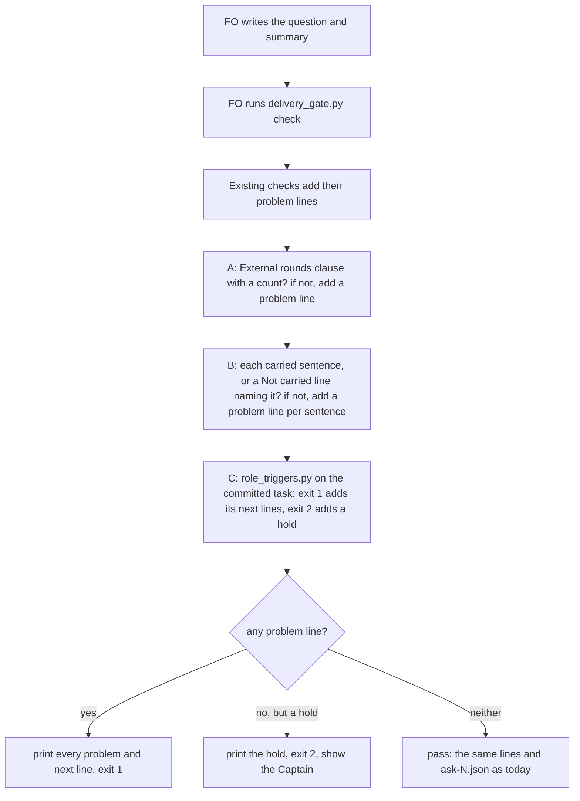

## Scope

- Source: the Captain's 「可以」 (chat, 2026-10-21) to FO's batch-4 close question 「A、B、C 要不要合成一張任務，排進第五批？」, where A, B and C were package-issue candidates from the four batch-4 learn runs (all no-change: each observer finding restated an existing rule FO had not followed).
- A. The gate summary names no external-round count although the README requires "FO counts rounds and records the count in the committed gate summary": observer findings on commissioned-by-names-spacedock, db-surface-without-migrations and (partial) fo-write-rules-checked.
- B. The delivery question omits clauses the README's Delivery authority requires (approval also covers later external-review rounds on the same PR, merging the full head unless he says he merges or holds, removing the clean pushed worktree): observer findings on fo-batch-sittings and fo-write-rules-checked (partial).
- C. fo-batch-sittings merged while `role_triggers.py` owed an engineering-reviewer call for replacing Captain amendments 1 to 3; the observer found it after the merge and FO recorded it as not run.
- Shape asked for: `delivery_gate.py check`, which FO already runs before every merge ask, holds on each of A, B and C, so no new script and no new FO step.
- Upstream first: `delivery_gate.py` (its Sufficiency/Necessity clause checks are the precedent for A and B), `role_triggers.py` (C), the observer.
- Non-goals: the other candidates of the same list (D: seed check before a backlog gate; E: amendment wording and Override placement; F: single occurrences), each the Captain's separate call.

## FO alignment

Reviewer: engineering-reviewer opus 2026-10-21 — do holds A, B and C in delivery_gate.py, and the ADR 0023 and 0026 amendments, keep the Captain's merge and approval authority, or block an ask he should be able to receive or let one through he should not? Called under the special-role combination the Captain agreed (「同意這個組合」, 2026-10-20): a change to merge, authority or approval rules calls the engineering-reviewer.

Alignment: not needed before ideation; the Captain chose the combination and the check.
Surfaces: none
Visible change: none
Release review: not needed: workflow maintenance, on no journey map.

## Design

### PRFAQ

**Headline.** `delivery_gate.py check`, which FO already runs before every merge ask, holds the ask when its text has no external-round count, when it neither carries each of the three sentences Delivery authority requires nor names the ones that stay with him (D1), or when the committed task owes a chief-engineer call for repair passes or an engineering-reviewer call for a replacing amendment. It does not hold a call owed for review rounds (D2), an edit not yet state-committed, or a folder task. No new script, no new FO step, no README word.

**What hurts today (read 2026-10-21 from the four batch-4 observer reports and their approved validation briefings).**
- A, the round count: 2 of 4 asks (commissioned-by-names-spacedock, db-surface-without-migrations) say "Codex clean on the head (evidence=...)" and give no count. The other two write `External rounds: Codex N`. A third observer finding (fo-write-rules-checked, "partial") is about classifying round-2 findings, not the count: its ask carries `External rounds: Codex 3`, so A does not hold it and is not claimed to.
- B, the carried clauses: 4 of 4 asks lack at least one of the three README sentences (later external-review rounds; merging the full head unless he says he merges or holds; removing the clean, pushed worktree). Observers flagged fo-batch-sittings and fo-write-rules-checked; the db-surface observer wrote `ok` on the merge part and noted "Worktree removal is not in the question"; the commissioned observer wrote nothing on it. The four batch-3 asks (captain-question-load, chat-only-evidence-observer-blind, delivery-gate-settles-skipped-checks, special-role-calls-fire-when-needed) carry all three.
- C, the owed call: at fo-batch-sittings' briefing commit `role_triggers.py` prints `next: fo-batch-sittings has replacing amendments 1, 2, 3; dispatch kc-dev-flow-2:engineering-reviewer on opus ...` (exit 1). `pr_watch.py tasks`, which FO runs at idle, already prints that line; the task merged anyway and FO recorded the call as not run after the observer found it.
- Measured harm beyond those findings: none observed (no wrong merge). The bite is that the Captain's own README rules are skipped when only prose carries them, and FO acts (cleanup, later-round repair pushes, merge) on authority the question never stated. The consumer is the Captain at the merge ask, and the batch observer that reads `merge/ask-N.json`.

**What changes, all in `kc-dev-flow-2/scripts/delivery_gate.py` and its test file.**
1. A. The gate text must hold a clause `External rounds:` (or `External rounds on this PR:`), read with the existing `clause()` (line start or after a sentence end), whose body begins with a count: an integer, a reviewer name of up to two words then an integer (`Codex 1`, `Codex round 2`), or `none`. Otherwise exit 1 with one problem line and one `next:` line. Presence of a count only; whether it equals the number of `evidence=` ids is not read.
2. B (as D1 recommends). The gate text must contain each of three phrases: `later` then `external` then `rounds` each within 20 characters of the last (the README's "later external-review rounds"), `unless ... merge... ... hold` within one sentence, and `remov... ... worktree` within 30 characters. A phrase may instead be named by a `Not carried: <rounds, merge, worktree> (<reason>)` clause, read with `clause()`: the words before its first bracket name the phrases it keeps with him, and the bracket must hold two or more words (the rule `unreasoned_items` applies to declined items). The clause clears only the phrases it names. Each missing phrase prints its own problem line and the three share one `next:` line, which also prints the `Not carried:` form. No head-name exemption under either D1 reading (see FAQ). Under D1(b) strict the `Not carried:` clause goes and nothing else changes.
3. C. The check runs `role_triggers.py <task folder> <task stem>` (no `--review-rounds`). Exit 1: the ask exits 1, one problem line plus each `next:` line the script printed, verbatim. Exit 2: the ask exits 2 with the script's message. Exit 0: nothing new is printed. `role_triggers.py` reads the task from committed bytes at HEAD of the state checkout, never the disk (its docstring); `check()` reads the same task from disk. So an amendment or repair-pass report written but not yet state-committed is not seen (residual, measured in Measurements), and a call written but not yet committed does not clear (fail closed). The task is a flat `<slug>.md` file, as everywhere else in `check()`: for a folder task `<slug>/index.md`, `dispatched_candidates` already finds no dispatch record (measured 2026-10-21: it returns `([], None)`), so the ask holds on that before C matters.
4. The module docstring gains one sentence per hold; ADR 0023 and ADR 0026 each get one Amended paragraph (their Consequences say an omitted sentence "fails safe" and that FO is told "in the line `pr_watch.py tasks` already prints"; both stop being the whole story). No ADR is added, so no number is reserved. `ask-N.json` gains no key (nothing reads one: the briefing holds the text).

**FAQ.**
- *Why presence and not truth?* Like Sufficiency and Necessity today. A negated sentence ("does not cover later rounds") or a label after "e.g." passes; the latter is the recorded `clause()` limit in `chat-only-evidence-observer-blind-followups`. The Captain reads the real text.
- *Why no Release PR or learning PR exemption?* Neither can reach a passing `check`, so B's behaviour on them is unreachable under both readings. `check` needs a task with a `Candidate:` line in its validation dispatch record; a Release PR has no task, and the prototype (`run_check` with no dispatch record, a `release-please--` head and a complete text, 2026-10-21) exits 2 with "no latest validation dispatch record ... has a 'Candidate: <40-hex head>'". A learning PR (head `learning/JOB`) is delivered under learn's own delivery authority: `git grep -n delivery_gate origin/main -- kc-dev-flow-2/skills/learn kc-dev-flow-2/extensions/learn` finds nothing. The `release_pr` branch in `check()` is reached only by a task-backed PR with a `release-please--` head; 0 of the 23 saved `ask-N.json` files is one, and the test fixture's release head is synthetic. ADR 0023 D2 keeps both one-ask-each, which holds with or without this task.
- *Why is a `Not carried:` line safe to accept?* It is presence plus a two-word reason, like a declined item; `Not carried: rounds, merge, worktree (not now)` passes. The Captain reads the real text, and the clause moves nothing he has not been asked, because the ASK line still merges only "if the approved question named the merge".
- *Why not read the head SHA or `--match-head-commit` in the text?* No observed omission; all four batch-4 asks carry the full head.
- *Why not hold fo-write-rules-checked's round-classification omission?* It lives in stage prose a text check cannot see; it stays with the observer.
- *Cost per ask.* One subprocess (measured 0.43 s wall on a 310 KB task) and three regex passes; no GitHub call; no CI change. three full runs of `test_delivery_gate.py` (80 tests) on the prototypes took 97.7 s, 120.3 s and 129.6 s here; about fifteen new cases add roughly 25 s at that per-case rate (estimate).

### Flow



Past the input checks that return 2 at once (unreadable task or text file, malformed `--pr`), every check runs and every problem prints; exit 1 wins over exit 2 as today, and a problem found earlier in the run does not skip A, B or C.

### Existing-code check (chain: Spacedock, kc-dev-flow-2, sibling adopters)

- Spacedock 0.27.2 (`spacedock gate prepare --help`, `spacedock merge guard --help`, read 2026-10-21): `gate prepare` takes `--question`, `--artifact`, `--summary` and lists no check or hook option; `merge guard` takes `--verdict` and `--rework` and says it does not make the merge verdict. Nothing there reads a question's words (idle-names-failing-seeds' Scope records the same: no hook for an adopter check at `gate prepare`).
- kc-dev-flow-2 at origin/main c27e7659 (0.27.0). Search 1, `git grep -n -i -E "External rounds|later external|clean, pushed worktree" origin/main -- kc-dev-flow-2/scripts kc-dev-flow-2/extensions`: no script or extension reads those words; the one hit in `test_delivery_gate.py` is filler text in `MentionedLabelTests`. Search 2, `git grep -n role_triggers origin/main -- kc-dev-flow-2/scripts`: `pr_watch.py` runs it at idle and prints its `next:` lines; `delivery_gate.py` does not; `role_triggers.py`'s docstring says it reads the task at REV (default HEAD) from committed bytes, never the disk. The capability is built and wired at idle only; completeness is "wired, advisory"; need is the three observed omissions. The precedent to reuse is `clause()`/`CONFIRMATIONS` (Sufficiency, Necessity) and the `SECOND_REVIEWER` outcome check, and `role_triggers.py` called as is, the way `pr_watch.py` calls it.
- Siblings: subspace-relay (origin/HEAD 70884016), subspace-web (0ee9b56) and qnow (origin/next) carry the same Delivery authority sentences in `docs/dev2/README.md` (grep counts of "says he merges or holds": 1, 1, 1) and name `delivery_gate.py` only in their READMEs; none keeps a copy of the script. Exclusions: no dynamic consumer of `merge/ask-N.json` beyond the observer SKILL (which reads `sufficiency`, `necessity`, `head`, `time`) was searched for; qnow's `next` branch was read by `git show`, not a checkout.

### Measurements (method, so validation can re-run)

Throwaway prototype in `/tmp/mah_proto/pkg4` (not kept; nothing in the repository), rebuilt in this cycle: `git archive origin/main kc-dev-flow-2 | tar -x`, then the diff below on `delivery_gate.py`. Replay corpus: `spacedock-state/dev2` archive read 2026-10-21, the 10 archived tasks that have `merge/ask-N.json` (the check ran on them). Text of an ask = the validation briefing's `question`, a newline, then each artifact `summary`, from `<slug>/review/validation/briefing-N/index.json` of the briefing whose gate-record attempt has `resolution.decision: approve`. C replay: `role_triggers.py <state> <slug> --rev <commit that added that briefing>` (`git log --all --format=%H --diff-filter=A -- <slug>/review/validation/briefing-1/index.json _archive/<slug>/review/validation/briefing-1/index.json | tail -1`). origin/main was c27e7659 (0.27.0) at both the first and this run.

```diff
+ROUNDS_LABEL = r"External rounds(?: on this PR)?"
+ROUNDS_COUNT = re.compile(r"\W*(?:\d+\b|[A-Za-z][\w.-]*(?:[ \t]+[A-Za-z][\w.-]*)?[ \t]+\d+\b|none\b)", re.I)
+CARRIES = (("later external-review rounds on the same PR", re.compile(r"\blater\b[^.?\n]{0,20}\bexternal\b[^.?\n]{0,20}\brounds?\b", re.I), re.compile(r"\brounds?\b", re.I)),
+           ("merging the full head unless he says he merges or holds", re.compile(r"\bunless\b[^.?\n]{0,40}\bmerg\w*\b[^.?\n]{0,20}\bhold", re.I), re.compile(r"\bmerg", re.I)),
+           ("removing its clean, pushed worktree", re.compile(r"\bremov\w*\b[^.?\n]{0,30}\bworktree\b", re.I), re.compile(r"\bworktree\b", re.I)))
+def unstated_rounds(text):
+    body = clause(text, ROUNDS_LABEL)
+    return body is None or not ROUNDS_COUNT.match(body)
+def missing_carries(text, keep=True):
+    kept = clause(text, "Not carried") if keep else None
+    kept = kept if kept and any(len(b.split()) >= 2 for b in brackets(kept)) else ""
+    named = re.split(r"[(\[]", kept, maxsplit=1)[0]
+    return [name for name, found, key in CARRIES if not found.search(text) and not key.search(named)]
+def owed_role_calls(task):
+    done = subprocess.run([sys.executable, str(Path(__file__).resolve().parent / "role_triggers.py"), str(task.parent), task.stem],
+                          capture_output=True, text=True)
+    return done.returncode, done.stdout.strip().splitlines()
```

Replay of the 10 asks (the prototype's functions on the text, rerun this cycle with the tightened rounds pattern; C by the real `role_triggers.py`). `keep=False` gives the strict reading; the two readings agree on all 10 because none of the 10 asks has a `Not carried:` line:

| Task (approved) | A holds | B missing | C | In window |
| --- | --- | --- | --- | --- |
| number-guards-readme-shrink (10-19 04:37) | no | unless, worktree | exit 0 | no: the sentences were merged at 10-19 14:31 (captain-question-load), synced to the adopter 10-20 |
| fo-write-checks (10-19 08:09) | no | unless, worktree | exit 1: 4 repair passes owe chief-engineer | no: before the sentences and before `role_triggers.py` counts (special-role-calls, archived 10-20 03:10) |
| captain-question-load (10-19 14:21) | no | none | exit 0 | yes, complete |
| chat-only-evidence-observer-blind | no | none | exit 0 | yes, complete |
| delivery-gate-settles-skipped-checks | no | none | exit 0 | yes, complete |
| special-role-calls-fire-when-needed | no | none | exit 0 | yes, complete |
| commissioned-by-names-spacedock | yes | rounds, unless, worktree | exit 0 | batch 4: A flagged |
| db-surface-without-migrations | yes | rounds, unless, worktree | exit 0 | batch 4: A flagged |
| fo-batch-sittings | no | rounds, unless, worktree | exit 1: engineering-reviewer owed | batch 4: B and C flagged |
| fo-write-rules-checked | no | rounds, unless | exit 0 (its three calls are recorded) | batch 4: B flagged |

Of the 47 approved briefings, the 10 since 2026-10-19 are exactly these rows; the table above is therefore the whole window; the tightened and the first rounds pattern agree on all 47 (`/tmp/mah_replay`, run this cycle). With `--review-rounds` set to the review ids that left inline comments (read with `gh api repos/iamcxa/kc-claude-plugins/pulls/N/comments --paginate --slurp`), captain-question-load (2) and fo-write-rules-checked (2) still exit 0 because their chief-engineer calls are recorded; fo-write-checks (3) owes one. So D2 below would not newly hold a batch-3 or batch-4 ask.

Wider text-only corpus: of 47 approved validation briefings, A holds the 14 approved 2026-09-16 to 2026-10-07 (the two-step delivery then: "open its Draft PR", no PR rounds exist) and 2 of the 33 approved 2026-10-13 and later (the two batch-4 asks above). Second corpus, read-only on the working trees: subspace-relay has 59 approved validation briefings and 1 since 2026-10-20, `account-publish-ceiling` (PR #400, approved 2026-10-20 14:21, `profile: prod`). Its question ends "...mark it ready once CI is green, and covers later external-review rounds whose repair validates with no Material finding; merging stays the Captain's", and the validation report it cites says "PR still a draft". It is not a merge ask: `check` would already exit 1 on "the PR is a draft" before B. Run on its text, A holds and B misses unless and worktree; under the `Not carried:` reading it would write `Not carried: merge, worktree (...)`. subspace-web has 0 since 2026-10-20. Neither saves `merge/ask-N.json`, so only the text check could be replayed there.

Mutations of an approved complete ask (special-role-calls-fire-when-needed), prototype `pkg4`:

| Mutation | A | B, `Not carried:` reading | B, strict |
| --- | --- | --- | --- |
| none (control) | passes | passes | passes |
| drop the `External rounds` sentence | holds | | |
| keep the label, replace the count with `Codex clean (evidence=summary:6293976188)` | holds | | |
| `External rounds: none (Codex not run: quota)` | passes | | |
| drop the later-rounds sentence | | rounds | rounds |
| replace it with `also covers a later round` (the first pattern passed this) | | rounds | rounds |
| replace it with `later review rounds` (no `external`) | | rounds | rounds |
| drop `unless you say you merge or hold` / drop the worktree removal | | names exactly that one | names exactly that one |
| all three dropped, plus `Not carried: rounds, merge, worktree (this PR is a validation gate only; he merges)` | | passes | all three |
| `Not carried: merge, worktree (he merges and cleans up)` | | rounds still held | all three |
| the same three names with no bracket / with `(n/a)` | | all three held | all three |
| label after "e.g." (`add a clause, e.g. External rounds: Codex 1`) | passes: the known `clause()` limit | | |
| `add a line, e.g. Not carried: rounds, merge, worktree (he merges)` with the three sentences dropped | | passes: the same limit | all three |
| `does not cover later external-review rounds` | | passes: presence only | passes |

Committed bytes versus disk (C), prototype `pkg4`, real `role_triggers.py` on a temporary git state: (1) task committed with no amendment, a replacing amendment written to disk and not committed: exit 0 (the omission is not seen); (2) amendment committed, no call: exit 1; (3) amendment committed, a dated `Reviewer:` call written to disk and not committed: exit 1 (fails closed; FO commits and asks again); (4) after the commit: exit 0; (5) a directory that is not a git work tree: exit 2 with "is not a git work tree". How often the two states occur at an ask: of the 23 saved `ask-N.json` files, 7 were committed together with the task file (`git log --diff-filter=A --name-only -- '*/merge/ask-*.json'`, then `git show --name-only` per commit). Six of the seven add only gate-record frontmatter lines (`git show -U0` on each); one, fo-batch-sittings `ask-2`, adds the post-merge `Reviewer: ... not run` waiver, so it is the case (3) direction if that line was on disk before the check ran, which the record does not say. None adds an amendment or an implementation report. So the let-through is possible and unobserved in 23, and the false hold is unobserved or at most once in 23. Choice: leave it as a residual rather than hold on any dirty task file, because a dirty-file hold would also fire on frontmatter edits like the six, and nothing shows when those were written relative to the check.

Wiring (prototype, real `role_triggers.py`, a temporary git state): a task with a replacing amendment and no call exits 1 with the script's `next:` line; the same task with a dated `Reviewer:` call exits 0; a state that is not a git work tree exits 2 with "is not a git work tree". Pass path: stdout and `ask-1.json` keys are identical to base on three fixtures (pilot docs-only, script-with-test, release-please head). Existing suite (rerun this cycle): with the `CLAUSES` constant extended and `owed_role_calls` mocked in the two helpers, 19 of 80 cases in `ConfirmationTests`, `MentionedLabelTests` and `ProdSecurityReviewTests` still fail (129.6 s), because they assert exact line counts or call `main` directly; they need their fixtures completed, which is the implementation's test work. Live tasks that owe a call today (`role_triggers.py` run by slug at state HEAD, 2026-10-21): adr-required-statement, kc-decision-log-cli and new-work-starts-from-a-story-map (replacing amendment 1 each), pr-review-lite-value-pilot (31 repair passes), journey-server-host-pilot (9 repair passes and replacing amendment 6, Fable). The first four are flat files, so their merge asks will hold after this ships until the call or a dated waiver is committed; journey-server-host-pilot is a folder task, which the gate already holds on the missing dispatch record. A dated FO-written waiver clears C (ADR 0026's choice) and nothing in a passing run shows it to the Captain; that stays as ADR 0026 left it.

### Batch overlap

Files the design would change: `kc-dev-flow-2/scripts/delivery_gate.py` (three constants, three functions, one block at the end of `check()`, docstring), `kc-dev-flow-2/scripts/test_delivery_gate.py` (`CLAUSES`, the two check helpers, new cases, completed fixtures), `docs/adr/0023-a-delivery-gate-question-may-carry-the-merge-of-the-validated-head.md` and `docs/adr/0026-role-calls-are-owed-on-counts-read-from-task-records-and-a-dated-call-clears-them.md` (one Amended paragraph each). Not changed: `role_triggers.py` (called as is), `pr_watch.py`, `references/sd/workflow.md` and the adopted READMEs, the mod, every skill, `lint-skills.py`, the `ask-N.json` shape.

| Task | Same file or check | Order |
| --- | --- | --- |
| fo-write-checks-parse-top-level (batch 5, ideation) | yes: `delivery_gate.py` (`declined_items`, `DECLINE_END`, the docstring sentence on item runs) and `FoWriteRuleTests`; textual conflicts in the docstring and at the end of the test file (re-read at state 3de81609, 2026-10-21: its Batch overlap says "implement first" for this task) | this task first; its design already says it rebases onto this one |
| idle-names-failing-seeds | `pr_watch.py` and its tests only; its design writes "`delivery_gate.py`, `role_triggers.py`: not changed here" | none |
| codex-reader-reads-receipt-marker | `extensions/codex/codex_review.py` only | none |
| new-work-starts-from-a-story-map | none known: ideation held, no design yet; recheck when its design lands | none |
| agent-reads-governing-adr | none: adopter hooks and instruction files | none |
| override-reaches-gate-and-criteria-wait (backlog, last in batch 5) | none known: Scope names `design_surfaces.py`, `decision_ledger.py` and the README; same file if its Override hold lands in `delivery_gate.py` | after this one |
| merge-guard-stops-unasked-merges (backlog) | reads `ask-N.json` `head`: unchanged by this design | none |
| comment-check-reaches-delivery-gate | frontmatter `status: ideation`, but its ideation gate resolved `hold` 2026-10-20 (「那就按建議不做」, D1 not built); fo-write-checks-parse-top-level still lists it as live. Would share `check()`, `write_record` and the test file if reopened | none now; if reopened, after this one |
| kc-decision-log-p1, kc-decision-log-cli, kc-decision-log-handoff-trial, pr-review-lite-value-pilot, journey-canvas-hosted-poc, journey-server-host-pilot, release-acceptance (other sessions, read only) | no file: `grep -c -E "delivery_gate\|role_triggers\|pr_watch\|test_delivery_gate"` over each task file is 0 (release-acceptance names `workflow.md` and `test_sd_dispatch.py`, neither changed here). Check overlap: pr-review-lite-value-pilot and kc-decision-log-cli (flat tasks) owe calls today (above), so their merge asks hold after release until FO records the call or a waiver; journey-server-host-pilot and kc-decision-log-p1 and release-acceptance are folder tasks, which `delivery_gate.py` does not support today | none; tell those sessions' FOs at release |
| ADR index | no new ADR number; ADR 0023 and 0026 amended, and no other live task names either (`grep` over the live tasks: only idle-names-failing-seeds mentions 0026, to follow it) | none |

Recommended order: this task before fo-write-checks-parse-top-level; the other batch tasks in any order.

### Words FO reads at each moment

Whitespace split, the counter `lint-skills.py` uses. Base is origin/main c27e7659 (0.27.0). Measured: the Delivery authority section of `workflow.md` is 444 words and a passing ask prints 57 words (13 + 2 + 2 + 40); the whole `workflow.md` is 5374.

| Moment | Before | After |
| --- | --- | --- |
| Startup | `workflow.md` 5374 + mod 48 + idle hook output | unchanged: no `workflow.md`, mod or skill edit |
| Idle on an open PR | `pr_watch.py tasks` output | unchanged: `pr_watch.py` not edited (C reuses the line it already prints) |
| Idle on a merged PR | `pr_watch.py` and `observer_check.py` output | unchanged |
| After the archive | `observer_check.py` output | unchanged |
| Merge ask, gate passes | Delivery authority 444 + printed 57 = 501 | 501: stdout and record keys identical on three fixtures |
| Merge ask, gate holds | the existing hold lines | plus at most 106 words when A and all three carries are missing (6 lines, measured 2026-10-21 on `/tmp/mah_proto/pkg4` for commissioned-by-names-spacedock and db-surface-without-migrations); 66 for fo-batch-sittings' three carries; 55 for fo-write-rules-checked's two. The 25-word `next:` line carries the `Not carried:` form; under D1(b) strict it is 16 words and the three figures are 97, 57 and 46. C adds an 11-word problem line and the script's own `next:` line (52 words, already printed at idle) |

Every moment is at or below base except the hold lines, which print only when an ask is refused. FO learns the `Not carried:` form from that `next:` line and from `--help`, not from `workflow.md`. The module docstring grows by about 70 words (estimate); FO reads it only through `--help`.

## Acceptance criteria

ACs 2, 4, 5 and 7 are written for D1(a), the `Not carried:` reading the design recommends; D1(b) strict drops the `Not carried:` cases (AC-2 names the replacement case).

**AC-1** A gate text with no `External rounds:` or `External rounds on this PR:` clause, or one whose body does not begin with a count, exits 1 with a problem line naming the label and one `next:` line; a body that begins with an integer, a reviewer name of up to two words and an integer, or `none` passes A.
Verified by: new cases in `test_delivery_gate.py` for each accepted form (`Codex 1, clean`, `Codex round 2`, `2 (Codex ...)`, `none`, `External rounds on this PR: Codex 1`) and each refused one (label absent, label with empty body, `Codex clean (evidence=summary:6293976188)`); the replay of the 10 asks gives A holds on exactly commissioned-by-names-spacedock and db-surface-without-migrations. Prototype, 2026-10-21: the same two. Falsifier: reading any digit in the body passes `Codex clean (evidence=summary:6293976188)`; deleting the check passes both batch-4 texts.

**AC-2** A gate text lacking any of the three carried phrases exits 1 with one problem line per missing phrase, each naming that phrase, unless a `Not carried:` clause names it with a bracketed reason of two or more words; a text with all three passes B; no head name exempts a PR.
Verified by: one case per removal from an approved complete ask (later-rounds sentence, `unless you say you merge or hold`, worktree removal), each failing on its own line only; a complete text passing; `a later round` and `later review rounds` in place of `later external-review rounds` each holding the rounds phrase; and four `Not carried:` cases on a text with all three dropped: names all three with a reason passes; names `merge, worktree` only leaves rounds held; names three with no bracket holds all three; names three with `(n/a)` holds all three. Replay: B holds the six asks marked in the table (number-guards-readme-shrink, fo-write-checks, commissioned-by-names-spacedock, db-surface-without-migrations, fo-batch-sittings, fo-write-rules-checked) and passes the four batch-3 asks. Falsifier: loosening the rounds pattern to `later ... rounds` passes `a later round`, which its case catches; letting `Not carried:` clear every phrase whatever it names passes the `merge, worktree` case; dropping the bracket rule passes the no-bracket and `(n/a)` cases. If D1(b) is chosen: the `Not carried:` cases are dropped and a text with `Not carried: rounds, merge, worktree (...)` and none of the three sentences holds all three.

**AC-3** `check` runs the real `role_triggers.py` on `<task folder>` and `<task stem>`: exit 1 holds the ask with the script's `next:` lines verbatim, exit 2 holds with exit 2 and its message, exit 0 prints nothing new; a replacing amendment not yet state-committed passes and a call not yet state-committed holds.
Verified by: a test that builds a temporary git state checkout and runs `main` without mocking the script: a replacing amendment with no `Reviewer:` call exits 1, the same task with a dated call exits 0, a directory that is not a git work tree exits 2, and the two committed-versus-disk cases of Measurements (an uncommitted amendment exits 0; a committed amendment with an uncommitted call exits 1), which pin the residual instead of hiding it. Replay: fo-batch-sittings at its briefing commit exits 1 with the engineering-reviewer line; the four batch-3 asks and commissioned, db-surface and fo-write-rules-checked exit 0. Falsifier: a test that mocks `owed_role_calls` cannot fail when the call is removed, so only the unmocked case counts; dropping the call turns the first case to exit 0; reading the disk instead of HEAD turns the uncommitted-amendment case to exit 1, which the documented residual would no longer describe.

**AC-4** Replay result: every flagged omission holds and no complete ask holds. A holds commissioned-by-names-spacedock and db-surface-without-migrations; B holds fo-batch-sittings and fo-write-rules-checked (and the two others in the table); C holds fo-batch-sittings; captain-question-load, chat-only-evidence-observer-blind, delivery-gate-settles-skipped-checks and special-role-calls-fire-when-needed pass A, B and C.
Verified by: validation re-runs the replay on the candidate's own `delivery_gate.py` by the method in Measurements and records the 10-row table. Limit: the clause patterns were written after reading the four complete asks (in sample); the held-out test is the batch-5 asks themselves, counted by the batch-5 observer as holds FO judged false. number-guards-readme-shrink and fo-write-checks hold on B (and the second on C) only because they predate the rules; the table says so. Falsifier: any complete ask in the table holding, or any flagged omission passing.

**AC-5** A passing ask prints the same stdout and saves the same `ask-N.json` keys as base; a text missing A and all three carried phrases prints at most 110 words of new lines from A and B; `references/`, `skills/`, `extensions/`, the mod and `pr_watch.py` are untouched.
Verified by: running base and candidate on the pilot docs-only, script-with-test and release-please-head fixtures and comparing stdout with the temp path masked and the record keys (identical on all three in the prototype, rerun on `pkg4` 2026-10-21); counting the whitespace-split words of the new lines on the commissioned-by-names-spacedock text (106 in the prototype); `git diff --stat origin/main...HEAD` at the candidate lists `delivery_gate.py`, `test_delivery_gate.py` and the two ADRs only; `python3 kc-dev-flow-2/scripts/lint-skills.py` exit 0. Falsifier: any new line on a passing run changes the comparison; an edit to `workflow.md` makes the lint print a budget line.

**AC-6** The existing suite passes with its fixtures completed, the module docstring names each of the three holds and the `Not carried:` form, and ADR 0023 and ADR 0026 each carry one Amended paragraph citing the Captain's ideation-gate words.
Verified by: `python3 -B -m unittest discover -s kc-dev-flow-2/scripts` exit 0; `python3 kc-dev-flow-2/scripts/delivery_gate.py --help` shows `External rounds`, the carried phrases, `Not carried` and `role_triggers.py`; `python3 kc-dev-flow-2/scripts/adr_lint.py docs/adr` exit 0. The ADR 0023 paragraph says what D1 chose in the words of the gate question (below). Falsifier: removing a hold from `check()` makes its new case fail while the old 80 still pass, which is the proof the old cases do not cover it.

**AC-7** Dogfood at this task's own PR: FO runs the candidate's `delivery_gate.py check` (the candidate worktree as `<package>`) on the PR's ask text and gets exit 0 with a complete text, exit 1 naming the `unless` phrase on a copy with that phrase deleted, and exit 0 on that copy with `Not carried: merge (he merges this one)` added. FO's validation scope notes quote the three new holds, because the installed package (0.27.0) does not yet say them.
Verified by: the three outputs recorded in the validation report. Limit: it shows the gate and one real ask agree on one PR, not that FO writes the sentences unprompted after release; the next adopter ask is that observation.

## Non-goals

- No check that the round count equals the number of `evidence=` ids, that a quoted head equals the PR head, or that a carried phrase is affirmative: presence only, as for Sufficiency and Necessity.
- No hold on fo-write-rules-checked's round-classification omission (stage prose, left to the observer), none on a review-round call (D2), none on D, E, F of the Captain's list, and none on an uncommitted task edit (residual in Measurements).
- No new FO step, no README or mod word, no skill edit, no change to `pr_watch.py` or `role_triggers.py`, no new key in `ask-N.json`.
- No folder-task (`<slug>/index.md`) support in `delivery_gate.py`, which `dispatched_candidates` and `write_record` already lack.
- The PR title follows the bounded claim, not the entity title: `feat(kc-dev-flow-2): hold a merge ask with no round count, silent on the carried sentences, or on a task whose committed state owes a repair-pass or amendment call`. The entity title says "a task that owes a special-role call" and is frontmatter, which FO owns; the review-round case is not held.

## Needs decision

**D1. When a merge ask is silent on one of the three sentences, is it held with a way to keep that sentence with him (a), held with none (b), or held only when it names an FO merge (c)?** Recommendation: (a), a `Not carried: <which> (<reason>)` line clears what it names.
- (a) Holds all four batch-4 asks, two of which their observers did not flag on B (db-surface even wrote `ok` on the merge part). ADR 0023's "fails safe" consequence stays true, his grants stay optional as he accepted them, and a merge-only or validation-only ask (the form subspace-relay used) writes one line instead of granting what it withholds. What gets worse: a grammar FO writes by hand (the old `Not carried:` non-goal, now in); a lazy `Not carried: rounds, merge, worktree (not now)` passes, since the check reads presence and two words; and the README's Delivery authority still says the question "says" the three sentences with no word for `Not carried:`, so the observer, which reads the README and the briefing text, may report a compliant `Not carried:` ask as omitting them. Fixing that costs one README clause (against "no README word") or relying on ADR 0023's Amended paragraph, which the observer is not shown to read; I recommend no README word and counting those false reports in the batch-5 observer (AC-4's limit).
- (b) Same holds, no `Not carried:`. Approval then withdraws ADR 0023's "fails safe" consequence and makes all three grants mandatory in every checked merge ask: "if FO omits the sentence he is asked again" becomes "the ask cannot be sent". Two of the three he accepted as optional (ADR 0023 D1 text "lets a delivery gate question carry the merge ... and the cleanup of its worktree"; ruling #564(a) of 2026-10-11, commit 8134645d, "a delivery approval that says so covers later external-review repair pushes"); the merge itself rests on his amendment 1 (「當我同意/核准驗證關卡時，等於授權你也合併 PR，除非我有顧慮暫時不合併」). It needs no exemption (see FAQ), but a merge-only or validation-only ask can no longer be sent without granting what it withholds, and the README needs no word because the check and the README then say the same thing.
- (c) Spares forms that never name an FO merge but passes any merge worded differently, so it fits the four fixtures rather than the class.
Gate-question sentence if (a): "Approving accepts D1(a): the merge-ask check holds a question silent on later rounds, merging unless you say you merge or hold, or removing the worktree, unless it names which stays with you; your grants stay optional." If (b): "Approving accepts D1(b): the check holds any merge question that lacks all three sentences; this withdraws ADR 0023's rule that an omitted sentence only makes FO ask again, and makes the later-rounds, merge and worktree grants required in every checked merge question, two of which you accepted as optional."

**D2. Does C pass `--review-rounds` as `pr_watch.py tasks` does (recommended: no)?** Without it the merge ask holds on repair passes and replacing amendments, the committed task bytes, which is the observed omission; with it the ask also holds on two review ids with inline comments, at the cost of one paginated `gh api` call, an import of `pr_watch.review_rounds`, a stub in the test harness, and the recorded risk that a reply comment carries its own review id (special-role-calls-fire-when-needed-followups, 0 replies in 82 inline comments). The replay shows no batch-3 or batch-4 ask newly held either way (captain-question-load and fo-write-rules-checked both recorded the call). What gets worse without it: a task with two review rounds and no chief-engineer call passes the merge check though `pr_watch.py tasks` printed it at idle; no ask in the window shows that case.

D1 and D2 are independent.

## Stage Report: ideation

- DONE: Design holds A, B and C in kc-dev-flow-2/scripts/delivery_gate.py check, measured by replaying the batch-4 merge asks of the archived tasks (merge/ask-N.json and the validation briefings): each observed omission holds and no ask the Captain approved as complete newly holds
  `### Measurements` replays the 10 archived asks that have `ask-N.json`: A holds commissioned-by-names-spacedock and db-surface-without-migrations; B holds fo-batch-sittings and fo-write-rules-checked (plus commissioned and db-surface, which two observers did not flag on B: D1); C holds fo-batch-sittings; the four batch-3 asks pass all three. Limits: fo-write-rules-checked's A "partial" is a round-classification omission the text check cannot see (not held, stated); number-guards-readme-shrink and fo-write-checks hold on B only because they predate the rules; patterns are in sample.
- DONE: A `### Batch overlap` section naming each file the design would change and each other batch task (new-work-starts-from-a-story-map, codex-reader-reads-receipt-marker, merge-ask-holds-missing-clauses, fo-write-checks-parse-top-level, idle-names-failing-seeds, agent-reads-governing-adr) and live task of other sessions (kc-decision-log-p1, kc-decision-log-cli, kc-decision-log-handoff-trial, pr-review-lite-value-pilot, release-acceptance, journey-canvas-hosted-poc, journey-server-host-pilot (driven by other sessions; read only)) that changes the same file or check, so FO can order implementation
  `### Batch overlap`: four files (`delivery_gate.py`, `test_delivery_gate.py`, ADR 0023, ADR 0026); only fo-write-checks-parse-top-level shares a file (this task first); three other-session tasks owe role calls today and will hold at their merge ask; `Recommended order:` line present.
- DONE: The words FO reads at each lifecycle moment, before and after, per root learning.md "Measure the words FO reads at each moment, not one file's size"
  `### Words FO reads at each moment`: five moments, whitespace split; merge ask passing 501 words before and after (identical stdout on three fixtures), a hold adds at most 97 words; no `workflow.md`, mod or skill edit.
- DONE: Acceptance criteria with reproducible evidence clauses and falsifiers, and unresolved decisions for the Captain, each with a recommendation and what gets worse under it
  AC-1 to AC-7, each with a test or command and a falsifier; current evidence is a throwaway prototype (no candidate exists): AC-1, AC-2, AC-3 and AC-5 hold on it, AC-4's table is its output, AC-6 and AC-7 are not yet verified. D1 (strictness of B, recommended strict) and D2 (review rounds in C, recommended no).

### Summary

The three holds are built from what already exists: `clause()` for the round count, three phrase patterns for the carried sentences, and `role_triggers.py` called as `pr_watch.py` calls it, so the README, mod and skills do not change and a passing ask prints the same. The replay holds every flagged omission it can see and none of the four complete asks; the Captain's call is how strict B is, because it also holds two batch-4 asks their observers did not flag and a relay ask that keeps the merge with him.

### Notes for FO

- `python3 <package>/scripts/design_surfaces.py check` on this file (package 0.27.0): "merge-ask-holds-missing-clauses.md: design surfaces presentable", exit 0.
- Before I saw the read-only rule for adopter state I ran `git fetch origin -q` in `/Users/kent/conductor/repos/subspace-relay`, `subspace-web` and `qnow`; it updated remote-tracking refs only, no branch or working tree. All later adopter reads were `git show` and file reads.
- Throwaway prototype and replay scripts are in `/tmp/mah_proto` and `/tmp/mah_replay`; nothing was written to the repository, no branch, no commit outside this state file.

## Stage Report: ideation (cycle 2)

- DONE: Fold merge-ask-holds-missing-clauses/reviews/engineering-reviewer-1.md items 1 to 7 into the design and criteria: D1 gains the explicit-keep option (hold a silent ask; pass all three phrases or a clause()-read keep line) and states, if strict stays recommended, that approval withdraws ADR 0023's fails-safe consequence and makes all three grants mandatory, two accepted as optional (ADR 0023 D1 text; ruling #564(a)); correct the relay sentence; fix AC-2's pattern or falsifier; state the Release PR exemption has never run and what B does when PR facts cannot load; name C's HEAD-versus-disk difference with a measured choice or a residual; bound the title claim; fix the flowchart; rerun the replay
  Item 1: D1 is now (a) `Not carried:` keep line, recommended, (b) strict, (c) FO-merge-only; (b) states the withdrawal of "fails safe", all three grants mandatory, two accepted as optional (ADR 0023 D1 "lets ... carry", #564(a) in 8134645d), and a ready gate-question sentence for (a) and (b). Strict is no longer the recommendation.
  Item 2: relay `account-publish-ceiling` (PR #400, `profile: prod`) is a validation gate on a PR the report calls "still a draft", so `check` exits 1 on draft first; read from the relay state, read-only.
  Item 3: AC-2 pattern now needs `external` (`later` to `external` to `rounds`, 20 characters each); `a later round` and `later review rounds` are named cases; the two patterns agree on all 47 approved briefings.
  Item 4: the Release PR exemption has run on 0 of 23 saved asks (synthetic fixture only) and is unreachable anyway: a Release PR has no task `Candidate:` line, so the prototype exits 2 before any pass, and learning PRs never name `delivery_gate.py`; no exemption under either D1 reading, and B reads no PR fact, so an unreadable PR cannot turn exit 2 into exit 1 on B's account.
  Item 5: C reads committed HEAD, B the disk; measured on a temp git state (uncommitted amendment exit 0, uncommitted call exit 1) and on the 23 ask commits (7 carry the task file: 6 gate-record lines, 1 post-merge waiver, 0 amendments); chosen: residual, pinned by AC-3 cases.
  Items 6 and 7: headline and PR title bounded to repair passes and replacing amendments in committed state (entity title is frontmatter, left to FO); flowchart now runs A, B and C every time into one "any problem line?" node. Replay rerun on `/tmp/mah_proto/pkg4` at origin/main c27e7659: same 10-row result.
- DONE: A `### Batch overlap` section naming each file the design would change and each other batch task (new-work-starts-from-a-story-map, codex-reader-reads-receipt-marker, merge-ask-holds-missing-clauses, fo-write-checks-parse-top-level, idle-names-failing-seeds, agent-reads-governing-adr) and live task of other sessions (kc-decision-log-p1, kc-decision-log-cli, kc-decision-log-handoff-trial, pr-review-lite-value-pilot, release-acceptance, journey-canvas-hosted-poc, journey-server-host-pilot (driven by other sessions; read only)) that changes the same file or check, so FO can order implementation
  Re-read at state 3de81609: same four files, only fo-write-checks-parse-top-level shares one (this task first); the seven other-session tasks name none of the files (grep count 0 each); comment-check-reaches-delivery-gate row corrected to its `hold` resolution.
- DONE: The words FO reads at each lifecycle moment, before and after, per root learning.md "Measure the words FO reads at each moment, not one file's size"
  Five moments unchanged except the hold lines: a passing ask 501 words before and after; a hold adds at most 106 words under (a) (97 under (b)), measured on the prototype.
- DONE: Acceptance criteria with reproducible evidence clauses and falsifiers, and unresolved decisions for the Captain, each with a recommendation and what gets worse under it
  AC-1 to AC-7 revised (AC-2, 3, 5, 6, 7 changed); D1 (a/b/c, recommended a) and D2 (no); the prototype is still not a candidate, so AC-6 and AC-7 are unverified.

### Summary

All seven reviewer items are in the design. The main change is D1: the check now holds a silent ask but lets a `Not carried:` line keep a sentence with him, so ADR 0023's "may" and its "fails safe" stay true, and no head-name exemption is needed (a Release PR and a learning PR never reach a passing check); strict stays available with its full cost stated for the gate question. C's HEAD-versus-disk gap is a measured residual, not a hold.

### Notes for FO

- `design_surfaces.py check` (package 0.27.0) on this file: "design surfaces presentable", exit 0, after the cycle-2 edits.
- The cycle-1 report above says "at most 97 words" and "D1 recommended strict"; cycle 2 supersedes both (106 under (a), 97 under (b); (a) recommended).
- Prototype and replay scripts: `/tmp/mah_proto/pkg4`, `/tmp/mah_replay` (`replay4.py`, `mut4.py`); nothing written to the repository. Adopter state read only through file reads (relay state checkout).
