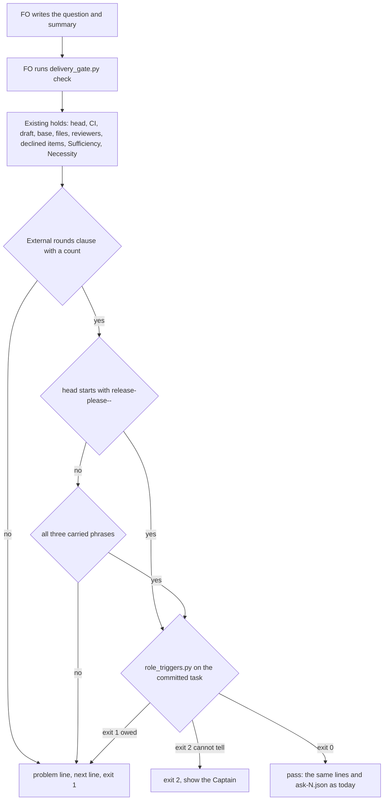

## Scope

- Source: the Captain's 「可以」 (chat, 2026-10-21) to FO's batch-4 close question 「A、B、C 要不要合成一張任務，排進第五批？」, where A, B and C were package-issue candidates from the four batch-4 learn runs (all no-change: each observer finding restated an existing rule FO had not followed).
- A. The gate summary names no external-round count although the README requires "FO counts rounds and records the count in the committed gate summary": observer findings on commissioned-by-names-spacedock, db-surface-without-migrations and (partial) fo-write-rules-checked.
- B. The delivery question omits clauses the README's Delivery authority requires (approval also covers later external-review rounds on the same PR, merging the full head unless he says he merges or holds, removing the clean pushed worktree): observer findings on fo-batch-sittings and fo-write-rules-checked (partial).
- C. fo-batch-sittings merged while `role_triggers.py` owed an engineering-reviewer call for replacing Captain amendments 1 to 3; the observer found it after the merge and FO recorded it as not run.
- Shape asked for: `delivery_gate.py check`, which FO already runs before every merge ask, holds on each of A, B and C, so no new script and no new FO step.
- Upstream first: `delivery_gate.py` (its Sufficiency/Necessity clause checks are the precedent for A and B), `role_triggers.py` (C), the observer.
- Non-goals: the other candidates of the same list (D: seed check before a backlog gate; E: amendment wording and Override placement; F: single occurrences), each the Captain's separate call.

## FO alignment

Alignment: not needed before ideation; the Captain chose the combination and the check.
Surfaces: none
Visible change: none
Release review: not needed: workflow maintenance, on no journey map.

## Design

### PRFAQ

**Headline.** `delivery_gate.py check`, which FO already runs before every merge ask, holds the ask when its text has no external-round count, when it leaves out any of the three sentences Delivery authority requires, or when the task owes a chief-engineer or engineering-reviewer call. No new script, no new FO step, no README word.

**What hurts today (read 2026-10-21 from the four batch-4 observer reports and their approved validation briefings).**
- A, the round count: 2 of 4 asks (commissioned-by-names-spacedock, db-surface-without-migrations) say "Codex clean on the head (evidence=...)" and give no count. The other two write `External rounds: Codex N`. A third observer finding (fo-write-rules-checked, "partial") is about classifying round-2 findings, not the count: its ask carries `External rounds: Codex 3`, so A does not hold it and is not claimed to.
- B, the carried clauses: 4 of 4 asks lack at least one of the three README sentences (later external-review rounds; merging the full head unless he says he merges or holds; removing the clean, pushed worktree). Observers flagged fo-batch-sittings and fo-write-rules-checked; the db-surface observer wrote `ok` on the merge part and noted "Worktree removal is not in the question"; the commissioned observer wrote nothing on it. The four batch-3 asks (captain-question-load, chat-only-evidence-observer-blind, delivery-gate-settles-skipped-checks, special-role-calls-fire-when-needed) carry all three.
- C, the owed call: at fo-batch-sittings' briefing commit `role_triggers.py` prints `next: fo-batch-sittings has replacing amendments 1, 2, 3; dispatch kc-dev-flow-2:engineering-reviewer on opus ...` (exit 1). `pr_watch.py tasks`, which FO runs at idle, already prints that line; the task merged anyway and FO recorded the call as not run after the observer found it.
- Measured harm beyond those findings: none observed (no wrong merge). The bite is that the Captain's own README rules are skipped when only prose carries them, and FO acts (cleanup, later-round repair pushes, merge) on authority the question never stated. The consumer is the Captain at the merge ask, and the batch observer that reads `merge/ask-N.json`.

**What changes, all in `kc-dev-flow-2/scripts/delivery_gate.py` and its test file.**
1. A. The gate text must hold a clause `External rounds:` (or `External rounds on this PR:`), read with the existing `clause()` (line start or after a sentence end), whose body begins with a count: an integer, a reviewer name of up to two words then an integer (`Codex 1`, `Codex round 2`), or `none`. Otherwise exit 1 with one problem line and one `next:` line. Presence of a count only; whether it equals the number of `evidence=` ids is not read.
2. B. The gate text must contain each of three phrases: `later ... rounds` within 30 characters, `unless ... merge... ... hold` within one sentence, and `remov... ... worktree` within 30 characters. Each missing one prints its own problem line and the three share one `next:` line. A PR whose head starts with `release-please--` is exempt (ADR 0023 D2: the Release PR is asked one at a time, so its ask carries no grant).
3. C. The check runs `role_triggers.py <task folder> <task stem>` (no `--review-rounds`). Exit 1: the ask exits 1, one problem line plus each `next:` line the script printed, verbatim. Exit 2: the ask exits 2 with the script's message. Exit 0: nothing new is printed. The task is a flat `<slug>.md` file, as everywhere else in `check()`: for a folder task `<slug>/index.md`, `dispatched_candidates` already finds no dispatch record (measured 2026-10-21: it returns `([], None)`), so the ask holds on that before C matters.
4. The module docstring gains one sentence per hold; ADR 0023 and ADR 0026 each get one Amended paragraph (their Consequences say an omitted sentence "fails safe" and that FO is told "in the line `pr_watch.py tasks` already prints"; both stop being the whole story). No ADR is added, so no number is reserved. `ask-N.json` gains no key (nothing reads one: the briefing holds the text).

**FAQ.**
- *Why presence and not truth?* Like Sufficiency and Necessity today. A negated sentence ("does not cover later rounds") or a label after "e.g." passes; the latter is the recorded `clause()` limit in `chat-only-evidence-observer-blind-followups`. The Captain reads the real text.
- *Why does the Release PR skip B but not A or C?* B asks for a grant (worktree removal, later rounds) the Release PR cannot have. A takes `External rounds: none`; C reads whichever task FO names.
- *Why not read the head SHA or `--match-head-commit` in the text?* No observed omission; all four batch-4 asks carry the full head.
- *Why not hold fo-write-rules-checked's round-classification omission?* It lives in stage prose a text check cannot see; it stays with the observer.
- *Cost per ask.* One subprocess (measured 0.43 s wall on a 310 KB task) and three regex passes; no GitHub call; no CI change. the prototype's two full runs of `test_delivery_gate.py` (80 tests) took 97.7 s and 120.3 s here; about ten new cases add roughly 15 s at that per-case rate (estimate).

### Flow



Every check runs and every problem prints; exit 1 wins over exit 2 as today. The arrows match the prose: A always, B unless the Release PR, C always.

### Existing-code check (chain: Spacedock, kc-dev-flow-2, sibling adopters)

- Spacedock 0.27.2 (`spacedock gate prepare --help`, `spacedock merge guard --help`, read 2026-10-21): `gate prepare` takes `--question`, `--artifact`, `--summary` and lists no check or hook option; `merge guard` takes `--verdict` and `--rework` and says it does not make the merge verdict. Nothing there reads a question's words (idle-names-failing-seeds' Scope records the same: no hook for an adopter check at `gate prepare`).
- kc-dev-flow-2 at origin/main c27e7659 (0.27.0). Search 1, `git grep -n -i -E "External rounds|later external|clean, pushed worktree" origin/main -- kc-dev-flow-2/scripts kc-dev-flow-2/extensions`: no script or extension reads those words; the one hit in `test_delivery_gate.py` is filler text in `MentionedLabelTests`. Search 2, `git grep -n role_triggers origin/main -- kc-dev-flow-2/scripts`: `pr_watch.py` runs it at idle and prints its `next:` lines; `delivery_gate.py` does not. The capability is built and wired at idle only; completeness is "wired, advisory"; need is the three observed omissions. The precedent to reuse is `clause()`/`CONFIRMATIONS` (Sufficiency, Necessity) and the `SECOND_REVIEWER` outcome check, and `role_triggers.py` called as is, the way `pr_watch.py` calls it.
- Siblings: subspace-relay (origin/HEAD 70884016), subspace-web (0ee9b56) and qnow (origin/next) carry the same Delivery authority sentences in `docs/dev2/README.md` (grep counts of "says he merges or holds": 1, 1, 1) and name `delivery_gate.py` only in their READMEs; none keeps a copy of the script. Exclusions: no dynamic consumer of `merge/ask-N.json` beyond the observer SKILL (which reads `sufficiency`, `necessity`, `head`, `time`) was searched for; qnow's `next` branch was read by `git show`, not a checkout.

### Measurements (method, so validation can re-run)

Throwaway prototype in `/tmp/mah_proto` (not kept; nothing in the repository): `git archive origin/main kc-dev-flow-2 | tar -x`, then the diff below on `delivery_gate.py`. Replay corpus: `spacedock-state/dev2` archive read 2026-10-21, the 10 archived tasks that have `merge/ask-N.json` (the check ran on them). Text of an ask = the validation briefing's `question`, a newline, then each artifact `summary`, from `<slug>/review/validation/briefing-N/index.json` of the briefing whose gate-record attempt has `resolution.decision: approve`. C replay: `role_triggers.py <state> <slug> --rev <commit that added that briefing>` (`git log --all --format=%H --diff-filter=A -- <slug>/review/validation/briefing-1/index.json _archive/<slug>/review/validation/briefing-1/index.json | tail -1`).

```diff
+ROUNDS_LABEL = r"External rounds(?: on this PR)?"
+ROUNDS_COUNT = re.compile(r"\W*(?:\d+\b|[A-Za-z][\w.-]*(?:[ \t]+[A-Za-z][\w.-]*)?[ \t]+\d+\b|none\b)", re.I)
+CARRIES = (("later external-review rounds on the same PR", re.compile(r"\blater\b[^.?\n]{0,30}\brounds?\b", re.I)),
+           ("merging the full head unless he says he merges or holds", re.compile(r"\bunless\b[^.?\n]{0,40}\bmerg\w*\b[^.?\n]{0,20}\bhold", re.I)),
+           ("removing its clean, pushed worktree", re.compile(r"\bremov\w*\b[^.?\n]{0,30}\bworktree\b", re.I)))
+def unstated_rounds(text):
+    body = clause(text, ROUNDS_LABEL)
+    return body is None or not ROUNDS_COUNT.match(body)
+def missing_carries(text):
+    return [name for name, found in CARRIES if not found.search(text)]
+def owed_role_calls(task):
+    done = subprocess.run([sys.executable, str(Path(__file__).resolve().parent / "role_triggers.py"), str(task.parent), task.stem],
+                          capture_output=True, text=True)
+    return done.returncode, done.stdout.strip().splitlines()
```

Replay of the 10 asks (the prototype's functions on the text; C by the real `role_triggers.py`):

| Task (approved) | A holds | B missing | C | In window |
| --- | --- | --- | --- | --- |
| number-guards-readme-shrink (10-19 04:37) | no | unless, worktree | exit 0 | no: the sentences were merged at 10-19 14:31 (captain-question-load), synced to the adopter 10-20 |
| fo-write-checks (10-19 08:09) | no | unless, worktree | exit 1: 4 repair passes owe chief-engineer | no: before the sentences and before `role_triggers.py` counts (special-role-calls, archived 10-20 03:10) |
| captain-question-load (10-19 14:21) | no | none | exit 0 | yes, complete |
| chat-only-evidence-observer-blind | no | none | exit 0 | yes, complete |
| delivery-gate-settles-skipped-checks | no | none | exit 0 | yes, complete |
| special-role-calls-fire-when-needed | no | none | exit 0 | yes, complete |
| commissioned-by-names-spacedock | yes | rounds, unless, worktree | exit 0 | batch 4: A flagged |
| db-surface-without-migrations | yes | rounds, unless, worktree | exit 0 | batch 4: A flagged |
| fo-batch-sittings | no | rounds, unless, worktree | exit 1: engineering-reviewer owed | batch 4: B and C flagged |
| fo-write-rules-checked | no | rounds, unless | exit 0 (its three calls are recorded) | batch 4: B flagged |

With `--review-rounds` set to the review ids that left inline comments (read with `gh api repos/iamcxa/kc-claude-plugins/pulls/N/comments --paginate --slurp`), captain-question-load (2) and fo-write-rules-checked (2) still exit 0 because their chief-engineer calls are recorded; fo-write-checks (3) owes one. So D2 below would not newly hold a batch-3 or batch-4 ask.

Wider text-only corpus: of 47 approved validation briefings, A holds the 14 approved 2026-09-16 to 2026-10-07 (the two-step delivery then: "open its Draft PR", no PR rounds exist) and 2 of the 33 approved 2026-10-13 and later (the two batch-4 asks above). Second corpus, read-only on the working trees: subspace-relay has 59 approved validation briefings and 1 since 2026-10-20 (`account-publish-ceiling`, a validation gate that says "merging stays the Captain's"): A holds, B misses unless and worktree. subspace-web has 0 since 2026-10-20. Neither saves `merge/ask-N.json`, so only the text check could be replayed there.

Mutations of an approved complete ask (special-role-calls-fire-when-needed), prototype:

| Mutation | Result |
| --- | --- |
| none (control) | passes A and B |
| drop the `External rounds` sentence | A holds |
| keep the label, replace the count with `Codex clean (evidence=summary:6293976188)` | A holds |
| `External rounds: none (Codex not run: quota)` | passes |
| drop the later-rounds sentence / drop `unless you say you merge or hold` / drop the worktree removal | B names exactly that one |
| label after "e.g." (`add a clause, e.g. External rounds: Codex 1`) | passes: the known `clause()` limit |
| `does not cover later external-review rounds` | passes: presence only |

Wiring (prototype, real `role_triggers.py`, a temporary git state): a task with a replacing amendment and no call exits 1 with the script's `next:` line; the same task with a dated `Reviewer:` call exits 0; a state that is not a git work tree exits 2 with "is not a git work tree". Pass path: stdout and `ask-1.json` keys are identical to base on three fixtures (pilot docs-only, script-with-test, release-please head). Existing suite: with the `CLAUSES` constant extended and `owed_role_calls` mocked in the two helpers, 19 cases in `ConfirmationTests`, `MentionedLabelTests` and `ProdSecurityReviewTests` still fail, because they assert exact line counts or call `main` directly; they need their fixtures completed, which is the implementation's test work. Live tasks that owe a call today (`role_triggers.py` run by slug at state HEAD, 2026-10-21): adr-required-statement, kc-decision-log-cli and new-work-starts-from-a-story-map (replacing amendment 1 each), pr-review-lite-value-pilot (31 repair passes), journey-server-host-pilot (9 repair passes and replacing amendment 6, Fable). The first four are flat files, so their merge asks will hold after this ships until the call or a dated waiver is committed; journey-server-host-pilot is a folder task, which the gate already holds on the missing dispatch record.

### Batch overlap

Files the design would change: `kc-dev-flow-2/scripts/delivery_gate.py` (three constants, three functions, one block at the end of `check()`, docstring), `kc-dev-flow-2/scripts/test_delivery_gate.py` (`CLAUSES`, the two check helpers, new cases, completed fixtures), `docs/adr/0023-a-delivery-gate-question-may-carry-the-merge-of-the-validated-head.md` and `docs/adr/0026-role-calls-are-owed-on-counts-read-from-task-records-and-a-dated-call-clears-them.md` (one Amended paragraph each). Not changed: `role_triggers.py` (called as is), `pr_watch.py`, `references/sd/workflow.md` and the adopted READMEs, the mod, every skill, `lint-skills.py`, the `ask-N.json` shape.

| Task | Same file or check | Order |
| --- | --- | --- |
| fo-write-checks-parse-top-level (batch 5, ideation) | yes: `delivery_gate.py` (`declined_items`, `DECLINE_END`, the docstring sentence on item runs) and `FoWriteRuleTests`; textual conflicts in the docstring and at the end of the test file | this task first; its design already says it rebases onto this one |
| idle-names-failing-seeds | `pr_watch.py` and its tests only; its design writes "`delivery_gate.py`, `role_triggers.py`: not changed here" | none |
| codex-reader-reads-receipt-marker | `extensions/codex/codex_review.py` only | none |
| new-work-starts-from-a-story-map | none known: ideation held, no design yet; recheck when its design lands | none |
| agent-reads-governing-adr | none: adopter hooks and instruction files | none |
| override-reaches-gate-and-criteria-wait (backlog, last in batch 5) | none known: Scope names `design_surfaces.py`, `decision_ledger.py` and the README; same file if its Override hold lands in `delivery_gate.py` | after this one |
| merge-guard-stops-unasked-merges (backlog) | reads `ask-N.json` `head`: unchanged by this design | none |
| comment-check-reaches-delivery-gate | closed at its ideation gate 2026-10-20 (D1 not built); would share `check()`, `write_record` and the test file if reopened | none now |
| kc-decision-log-p1, kc-decision-log-cli, kc-decision-log-handoff-trial, pr-review-lite-value-pilot, journey-canvas-hosted-poc, journey-server-host-pilot, release-acceptance (other sessions, read only) | no file: `grep -c -E "delivery_gate\|role_triggers\|pr_watch\|test_delivery_gate"` over each task file is 0 (release-acceptance names `workflow.md` and `test_sd_dispatch.py`, neither changed here). Check overlap: pr-review-lite-value-pilot and kc-decision-log-cli (flat tasks) owe calls today (above), so their merge asks hold after release until FO records the call or a waiver; journey-server-host-pilot and kc-decision-log-p1 and release-acceptance are folder tasks, which `delivery_gate.py` does not support today | none; tell those sessions' FOs at release |
| ADR index | no new ADR number; ADR 0023 and 0026 amended, and no other live task names either (`grep` over the live tasks: only idle-names-failing-seeds mentions 0026, to follow it) | none |

Recommended order: this task before fo-write-checks-parse-top-level; the other batch tasks in any order.

### Words FO reads at each moment

Whitespace split, the counter `lint-skills.py` uses. Base is origin/main c27e7659 (0.27.0). Measured: the Delivery authority section of `workflow.md` is 444 words and a passing ask prints 57 words (13 + 2 + 2 + 40); the whole `workflow.md` is 5374.

| Moment | Before | After |
| --- | --- | --- |
| Startup | `workflow.md` 5374 + mod 48 + idle hook output | unchanged: no `workflow.md`, mod or skill edit |
| Idle on an open PR | `pr_watch.py tasks` output | unchanged: `pr_watch.py` not edited (C reuses the line it already prints) |
| Idle on a merged PR | `pr_watch.py` and `observer_check.py` output | unchanged |
| After the archive | `observer_check.py` output | unchanged |
| Merge ask, gate passes | Delivery authority 444 + printed 57 = 501 | 501: stdout and record keys identical on three fixtures |
| Merge ask, gate holds | the existing hold lines | plus at most 97 words when A and all three carries are missing (6 lines, measured on commissioned-by-names-spacedock and db-surface-without-migrations); 57 for fo-batch-sittings' three carries; 46 for fo-write-rules-checked's two; C adds an 11-word problem line and the script's own `next:` line (52 words, already printed at idle) |

Every moment is at or below base except the hold lines, which print only when an ask is refused. The module docstring grows by about 60 words; FO reads it only through `--help`.

## Acceptance criteria

**AC-1** A gate text with no `External rounds:` or `External rounds on this PR:` clause, or one whose body does not begin with a count, exits 1 with a problem line naming the label and one `next:` line; a body that begins with an integer, a reviewer name of up to two words and an integer, or `none` passes A.
Verified by: new cases in `test_delivery_gate.py` for each accepted form (`Codex 1, clean`, `Codex round 2`, `2 (Codex ...)`, `none`, `External rounds on this PR: Codex 1`) and each refused one (label absent, label with empty body, `Codex clean (evidence=summary:6293976188)`); the replay of the 10 asks gives A holds on exactly commissioned-by-names-spacedock and db-surface-without-migrations. Prototype, 2026-10-21: the same two. Falsifier: reading any digit in the body passes `Codex clean (evidence=summary:6293976188)`; deleting the check passes both batch-4 texts.

**AC-2** A gate text lacking any of the three carried phrases exits 1 with one problem line per missing phrase, each naming that phrase; a text with all three passes B; a PR whose head starts with `release-please--` is not held on B.
Verified by: one case per removal from an approved complete ask (later-rounds sentence, `unless you say you merge or hold`, worktree removal), each failing on its own line only; a complete text passing; a `release-please--` head with none of the three passing B. Replay: B holds the six asks marked in the table (number-guards-readme-shrink, fo-write-checks, commissioned-by-names-spacedock, db-surface-without-migrations, fo-batch-sittings, fo-write-rules-checked) and passes the four batch-3 asks. Falsifier: matching `later` anywhere in the text passes a summary that only says "a later round"; dropping the release exemption holds a Release PR ask.

**AC-3** `check` runs the real `role_triggers.py` on `<task folder>` and `<task stem>`: exit 1 holds the ask with the script's `next:` lines verbatim, exit 2 holds with exit 2 and its message, exit 0 prints nothing new.
Verified by: a test that builds a temporary git state checkout and runs `main` without mocking the script: a replacing amendment with no `Reviewer:` call exits 1, the same task with a dated call exits 0, a directory that is not a git work tree exits 2. Replay: fo-batch-sittings at its briefing commit exits 1 with the engineering-reviewer line; the four batch-3 asks and commissioned, db-surface and fo-write-rules-checked exit 0. Falsifier: a test that mocks `owed_role_calls` cannot fail when the call is removed, so only the unmocked case counts; dropping the call turns the first case to exit 0.

**AC-4** Replay result: every flagged omission holds and no complete ask holds. A holds commissioned-by-names-spacedock and db-surface-without-migrations; B holds fo-batch-sittings and fo-write-rules-checked (and the two others in the table); C holds fo-batch-sittings; captain-question-load, chat-only-evidence-observer-blind, delivery-gate-settles-skipped-checks and special-role-calls-fire-when-needed pass A, B and C.
Verified by: validation re-runs the replay on the candidate's own `delivery_gate.py` by the method in Measurements and records the 10-row table. Limit: the clause patterns were written after reading the four complete asks (in sample); the held-out test is the batch-5 asks themselves, counted by the batch-5 observer as holds FO judged false. number-guards-readme-shrink and fo-write-checks hold on B (and the second on C) only because they predate the rules; the table says so. Falsifier: any complete ask in the table holding, or any flagged omission passing.

**AC-5** A passing ask prints the same stdout and saves the same `ask-N.json` keys as base; a text missing A and all three carried phrases prints at most 100 words of new lines; `references/`, `skills/`, `extensions/`, the mod and `pr_watch.py` are untouched.
Verified by: running base and candidate on the pilot docs-only, script-with-test and release-please-head fixtures and comparing stdout with the temp path masked and the record keys (identical on all three in the prototype); `git diff --stat origin/main...HEAD` at the candidate lists `delivery_gate.py`, `test_delivery_gate.py` and the two ADRs only; `python3 kc-dev-flow-2/scripts/lint-skills.py` exit 0. Falsifier: any new line on a passing run changes the comparison; an edit to `workflow.md` makes the lint print a budget line.

**AC-6** The existing suite passes with its fixtures completed, the module docstring names each of the three holds, and ADR 0023 and ADR 0026 each carry one Amended paragraph citing the Captain's ideation-gate words.
Verified by: `python3 -B -m unittest discover -s kc-dev-flow-2/scripts` exit 0; `python3 kc-dev-flow-2/scripts/delivery_gate.py --help` shows `External rounds`, the carried phrases and `role_triggers.py`; `python3 kc-dev-flow-2/scripts/adr_lint.py docs/adr` exit 0. Falsifier: removing a hold from `check()` makes its new case fail while the old 80 still pass, which is the proof the old cases do not cover it.

**AC-7** Dogfood at this task's own PR: FO runs the candidate's `delivery_gate.py check` (the candidate worktree as `<package>`) on the PR's ask text and gets exit 0 with a complete text, and exit 1 naming the `unless` phrase on a copy with that phrase deleted. FO's validation scope notes quote the three new holds, because the installed package (0.27.0) does not yet say them.
Verified by: both outputs recorded in the validation report. Limit: it shows the gate and one real ask agree on one PR, not that FO writes the sentences unprompted after release; the next adopter ask is that observation.

## Non-goals

- No check that the round count equals the number of `evidence=` ids, that a quoted head equals the PR head, or that a carried phrase is affirmative: presence only, as for Sufficiency and Necessity.
- No hold on fo-write-rules-checked's round-classification omission (stage prose, left to the observer), and none on D, E, F of the Captain's list.
- No new FO step, no README or mod word, no skill edit, no change to `pr_watch.py` or `role_triggers.py`, no new key in `ask-N.json`.
- No `Not carried:` decline form (see D1), and no folder-task (`<slug>/index.md`) support in `delivery_gate.py`, which `dispatched_candidates` and `write_record` already lack.

## Needs decision

**D1. How strict is B: hold any ask that is silent on any of the three sentences (recommended), or only an ask that names an FO merge?** Under the recommendation, 4 of 4 batch-4 asks hold, two of which their observers did not flag on B (db-surface even wrote `ok` on the merge part), and subspace-relay's one ask since 2026-10-20, a validation gate that says "merging stays the Captain's", holds too. What gets worse: ADR 0023 says an omitted sentence "fails safe" (he is asked again), and a strict B turns that into "the ask cannot be sent"; an ask that deliberately withholds the grant must still write "unless you say you merge or hold" and the worktree sentence, which grant. The alternative (hold only when the text names `FO merges` or `gh pr merge`) spares relay's form but passes any merge worded differently, so it fits the four fixtures rather than the class. A `Not carried: <reason>` form would fit both and adds a grammar FO writes by hand.

**D2. Does C pass `--review-rounds` as `pr_watch.py tasks` does (recommended: no)?** Without it the merge ask holds on repair passes and replacing amendments, the committed task bytes, which is the observed omission; with it the ask also holds on two review ids with inline comments, at the cost of one paginated `gh api` call, an import of `pr_watch.review_rounds`, a stub in the test harness, and the recorded risk that a reply comment carries its own review id (special-role-calls-fire-when-needed-followups, 0 replies in 82 inline comments). The replay shows no batch-3 or batch-4 ask newly held either way (captain-question-load and fo-write-rules-checked both recorded the call). What gets worse without it: a task with two review rounds and no chief-engineer call passes the merge check though `pr_watch.py tasks` printed it at idle; no ask in the window shows that case.

D1 and D2 are independent.

## Stage Report: ideation

- DONE: Design holds A, B and C in kc-dev-flow-2/scripts/delivery_gate.py check, measured by replaying the batch-4 merge asks of the archived tasks (merge/ask-N.json and the validation briefings): each observed omission holds and no ask the Captain approved as complete newly holds
  `### Measurements` replays the 10 archived asks that have `ask-N.json`: A holds commissioned-by-names-spacedock and db-surface-without-migrations; B holds fo-batch-sittings and fo-write-rules-checked (plus commissioned and db-surface, which two observers did not flag on B: D1); C holds fo-batch-sittings; the four batch-3 asks pass all three. Limits: fo-write-rules-checked's A "partial" is a round-classification omission the text check cannot see (not held, stated); number-guards-readme-shrink and fo-write-checks hold on B only because they predate the rules; patterns are in sample.
- DONE: A `### Batch overlap` section naming each file the design would change and each other batch task (new-work-starts-from-a-story-map, codex-reader-reads-receipt-marker, merge-ask-holds-missing-clauses, fo-write-checks-parse-top-level, idle-names-failing-seeds, agent-reads-governing-adr) and live task of other sessions (kc-decision-log-p1, kc-decision-log-cli, kc-decision-log-handoff-trial, pr-review-lite-value-pilot, release-acceptance, journey-canvas-hosted-poc, journey-server-host-pilot (driven by other sessions; read only)) that changes the same file or check, so FO can order implementation
  `### Batch overlap`: four files (`delivery_gate.py`, `test_delivery_gate.py`, ADR 0023, ADR 0026); only fo-write-checks-parse-top-level shares a file (this task first); three other-session tasks owe role calls today and will hold at their merge ask; `Recommended order:` line present.
- DONE: The words FO reads at each lifecycle moment, before and after, per root learning.md "Measure the words FO reads at each moment, not one file's size"
  `### Words FO reads at each moment`: five moments, whitespace split; merge ask passing 501 words before and after (identical stdout on three fixtures), a hold adds at most 97 words; no `workflow.md`, mod or skill edit.
- DONE: Acceptance criteria with reproducible evidence clauses and falsifiers, and unresolved decisions for the Captain, each with a recommendation and what gets worse under it
  AC-1 to AC-7, each with a test or command and a falsifier; current evidence is a throwaway prototype (no candidate exists): AC-1, AC-2, AC-3 and AC-5 hold on it, AC-4's table is its output, AC-6 and AC-7 are not yet verified. D1 (strictness of B, recommended strict) and D2 (review rounds in C, recommended no).

### Summary

The three holds are built from what already exists: `clause()` for the round count, three phrase patterns for the carried sentences, and `role_triggers.py` called as `pr_watch.py` calls it, so the README, mod and skills do not change and a passing ask prints the same. The replay holds every flagged omission it can see and none of the four complete asks; the Captain's call is how strict B is, because it also holds two batch-4 asks their observers did not flag and a relay ask that keeps the merge with him.

### Notes for FO

- `python3 <package>/scripts/design_surfaces.py check` on this file (package 0.27.0): "merge-ask-holds-missing-clauses.md: design surfaces presentable", exit 0.
- Before I saw the read-only rule for adopter state I ran `git fetch origin -q` in `/Users/kent/conductor/repos/subspace-relay`, `subspace-web` and `qnow`; it updated remote-tracking refs only, no branch or working tree. All later adopter reads were `git show` and file reads.
- Throwaway prototype and replay scripts are in `/tmp/mah_proto` and `/tmp/mah_replay`; nothing was written to the repository, no branch, no commit outside this state file.
