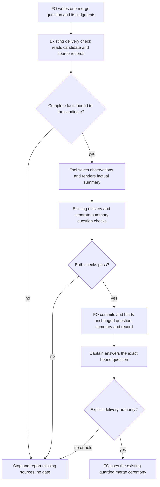

## Scope

- Source: the Captain 「3. 要」 (chat, 2026-11-13), answering FO's item 3: 「下一輪顧問試跑要不要現在開始準備，以及是否把「合併前這一段」的三個摩擦點各開一張任務。」 Evidence: the route trial of 2026-11-13, FO's hand-kept log and result (worker stages took 15 to 30 minutes; validated to merge ask took 85 to 120 minutes on three tasks).
- Bite: FO typed each delivery summary by hand on 2026-11-12 and 2026-11-13 (seven PRs, 15 to 20 minutes each by FO's log), copying the head, the validation verdict, the check counts, the review evidence ids and the merge-result run from records already in the task folder; hand-typed lines were refused by the checker four times and one observer found the external round count wrong.
- Upstream first, open for the design: what the delivery check, the validation skill text and the listed extensions already do for this, and whether a smaller change to one of them is enough.
- Non-goals: to be set at ideation.

## Budget
1 implementation and 2 validation cycles, in one package PR.

## Stop condition
- For the seven recorded deliveries, a generated summary passes the delivery check with no hand edit, and the Captain's question stays FO-written.

## FO alignment

Alignment: not needed before ideation: an observed friction with counts; the mechanism is compared in the design.
Surfaces: none
Visible change: none
Release review: not needed: workflow maintenance, on no journey map.


## Design

### Recommendation and source boundary

Return one decision to the Captain before implementation: permit automatic saving of the facts the existing delivery check and configured readers already obtain, rather than treating the historical hand-written summaries as independent generation inputs. The probe overturned the premise that all required first-ask facts already have a complete, common saved producer contract. The current stop condition is **not met**: nine passing readback controls are not nine independently generated first asks. Do not record a delegated design approval on a claim that the probe passed that outcome.

The seed names seven deliveries; the 2026-11-13 dispatch explicitly supplies nine. This design uses those nine public package deliveries, PRs 852, 853, 854, 855, 856, 858, 859, 860 and 861. PR 864 is the tenth contemporary delivery, which introduced probe permission and is excluded from this replay corpus. Scope, budget, original Captain words, task frontmatter and other tasks are unchanged; the evidence interpretation below needs the Captain's decision rather than a silent criterion amendment.

### PRFAQ

**Proposition (after approval and implementation).** The First Officer (FO) writes the merge question, including the goal-sufficiency and minimum-necessity judgments. One invocation of the existing delivery check collects its already-needed observations, writes a source-linked factual summary and checks that summary with the question. FO binds that output unchanged into the existing gate; no copying of commit identifiers, review identifiers or check totals is required.

- **What remains a judgment?** Whether the candidate meets the goal, whether every changed path is needed, whether to decline a finding, and what the Captain is asked to authorize. These belong in the FO-written question or existing disposition record. The renderer quotes the latest independent report; it never infers approval from a passing test, CI, a ready PR or a stored verdict.
- **Why not reuse `ask-N.json` alone?** Its confirmation clauses are capped at 200 characters, its changed-path points are display-capped, and it does not preserve the CI/run/required-check observations. All nine ask records lack that complete snapshot contract. Six tasks do have partial CI snapshots at the final candidate elsewhere; one also has a saved watcher observation of its final Codex review. Reuse those observations where their identity and provenance are usable; do not call them a complete event-time source set.
- **Why not extract the old Briefing's summary?** That reproduces FO's already-written prose and its mistakes. The offline control passes the real `check()` function nine times with synthetic green provider facts; three of those accepted summaries include local RoboRev jobs in `External rounds`. This is a concrete false assurance, not an automatic-generation result.
- **Which reviews count?** Preserve the workflow's remote-review verdict rule and each extension's outcome rules. Deduplicate eligible observations by provider, PR, candidate and evidence identity; a local RoboRev job, Copilot quota refusal, security-only pass, running state or unrecognized response is not a round. A qualifying review on an earlier head remains historical evidence of the delivery, with its head attached; it is not a clean review of the new head. Missing observations mean unknown, not zero. The historical FO source lines imply 4→2 for PR 854 and 3→1 for each of PRs 856 and 861 after removing local RoboRev entries; the raw remote outputs were not independently authenticated here.
- **What happens when facts or required decisions are missing?** No successful ask is printed or gate prepared. Return the existing failure exit and the specific missing source, or use an existing expressly permitted not-run declaration in the FO question. Never synthesize a clean review, waive a finding, execute acceptance commands or request a review to make the summary pass.
- **Does this save time?** Not measured. The task log's historical estimates remain reported observations, not a causal result of this probe.

### Chain checked, in dependency order

1. **Spacedock**, the workflow runtime: installed skill package 0.28.0, actual CLI 0.27.2. Its own `fo-gate-lifecycle`, `present-gate` and `gate prepare --help` show that preparation accepts supplied question/summary text and fingerprints referenced committed files. It supplies the binding, not a package delivery-summary producer. No native preparation or approval was exercised.
2. **kc-dev-flow-2**, this workflow package: fetched `origin/main` is `6a1eaf837bd6087cd0b8b665dc19beaed3c44dff` (PR 864); its manifest is still 0.41.0. Read `delivery_gate.py`'s `check`, `question`, `matching_delivery_record`, count/source disclosures, `merge_result_problem` and Captain-steps reader; the validation principles; the workflow recipe; and the Codex, Copilot and RoboRev extensions' own contracts. They already collect/check most live facts, but no summary-producing command or complete saved input contract was found. `pr_watch` records latest observations, not a complete immutable review history.
3. **Sibling adopters**, read only: three repositories were readable; two tracked delivery helpers were read, both expose check/question and neither exposes a summary command; 21 tracked workflow README paths were counted, not treated as 21 active workflows. Private source bytes, identifiers, titles, rulings, logs and hashes are not archived. Evidence is counts only in `evidence/ideation-1/adopter-*.json`.

Two bounded searches support the capability finding: the package's command/function and extension entry points; then the nine task folders' asks, saved structured snapshots, reader/watch observations and Briefings. Manual FO summaries and compatibility callers are real consumers, not evidence that a new first-ask producer exists. Excluded: authenticated live provider reads, private task contents, dormant untracked scripts and dynamic host behavior. This design extends the existing check; it does not replace Spacedock, the review adapters, the gate or the merge mechanism.

Accepted governing decisions read at the pinned source: ADRs 0004 (external-review rounds), 0020 (workflow word budget), 0044 (optional summary input), 0051 (round-count presence), 0054 (FO records exercised Captain steps), 0062 (the exact bound question controls its grant), 0071 (delivery record bound before preparation), 0072 (automatic count disclosure), 0078 (moved-trunk merge-result evidence), and 0084 (local Pilot probe). Their bytes/status are recorded in `evidence/ideation-1/adr-provenance.json`. The task's only Override concerns build model/effort, not these contracts. A future accepted producer change warrants an ADR draft titled “The delivery check produces its factual summary”; no ADR number is reserved or invented in ideation.

### Probe

Probe: branch `poc/merge-ask-is-produced-from-records`; base `6a1eaf837bd6087cd0b8b665dc19beaed3c44dff`; last commit `9cf3499dd0af60bb16861428860cad3f4cf3b05e`; portable copy `evidence/ideation-1/probe.patch`. The worktree is removed before completion and the local branch is retained, without a product push, PR, deployment, model call or credential use.

- **Hypothesis: the nine saved inputs already suffice for an independent first-ask summary. Overturned.** `audit/audit.json` finds zero complete common record-contract inputs. `snapshot-scan.json` and `review-identity-scan.json` qualify that conclusion: partial source evidence exists and should be reused, but eight tasks lack the final remote identity outside the hand-written control and none has the whole uniform producer contract. This is a bounded completeness finding, not a claim that every fact is absent from every file.
- **Hypothesis: a green historical replay proves the proposed automation. Falsified.** `replay/readback.json` has nine passing calls to the actual checker, using the already-written summary and explicitly synthetic provider readiness, paths, ancestor trunk and role-call result. Those controls preserve the question bytes, join the same head and clauses, and reject nine stale-head and nine missing-round counterexamples. They establish text compatibility only, not generation or live delivery eligibility.
- **Hypothesis: the current checker verifies the truth of the review count. Falsified on three real cases.** The same control accepts three local-job-inclusive counts. The adapters' own documented local/remote distinction supplies the falsifier; no new imaginary input forms were tested.
- **Hypothesis: the recipe need not grow. Supported for a concrete static proposal.** The saved recipe is 80→52 whitespace words, workflow 6099→6071. End-to-end output reading and elapsed time remain unmeasured.

The first native task read without an explicit workflow directory exited 1; the corrected read with `--workflow-dir` exited 0. Initial audit output and its correction are both retained: the corrected scanner includes saved watcher tokens and non-Briefing review files instead of assuming only `evidence=` tokens could be useful. `criterion-commands.json` records the actual command, exit and output per criterion; probe success and product acceptance are distinguished.

### Proposed smallest integrated change, conditional on the decision

Add optional `--summary-file` to `delivery_gate.py check`; retain existing callers and exit conventions. Use the existing live PR/head/check/run/file/trunk queries and configured review adapters as the producers. Save only the normalized observations needed by the summary into the existing `merge/ask-N.json` envelope, with candidate, observed time, source identity/digest, reader outcome and summary/question digests. Do not archive raw provider payloads or PR bodies. A public evidence destination must not receive private-source identifiers or logs; this probe used public cases only, and does not establish a general public-evidence classifier.

The input join must be explicit: latest validation dispatch Candidate; Spacedock-parsed latest exact validation report and its source digest; PR facts at that head; eligible remote review observations with their original heads and identities; existing Captain-step record; current trunk plus its matching merge-result record or the permitted FO-written not-run declaration. Reuse source observations with proven bindings; a prose mention or a local-job number is not automatically a remote verdict. Persist observations as the existing adapters are read, so a mutable summary comment cannot erase a previously observed round. The exact capture seam and completeness on repairs must be exercised before choosing its production contract; the current probe did not implement it.

Render factual lines and a bounded quoted validation result with source pointers. Take Sufficiency, Necessity, finding dispositions and the authorization from the question/existing task records, without rewriting or shortening them. Run the existing delivery and separate-summary question checks; route computed source/count disclosures into the generated summary, preserving the question bytes. On failure, leave an explicitly unbound draft and diagnostics, not an eligible ask; on success, save the delivery record and print the existing state-commit/reference preparation steps. The saved summary is the exact text FO binds. Generation alone grants no gate or merge authority.

No acceptance-script execution, PR ready transition, review request/comment, recurring watch, worker dispatch, merge, release, adoption, new dependency, CI change or repository-setting change belongs here. The sibling validator-command task owns command transport; this task consumes its record rather than introducing another script runner. Budget remains one implementation and two validation cycles in one package PR; if the capture seam cannot fit that budget, return to FO before implementing another mechanism.



Actors, order and stops were checked against the prose. Mermaid rendering was not executed; no rendered-layout claim is made. No new UI or schema surface is proposed: the already-recorded `Surfaces: none` remains authoritative. Additional durable observation fields are nevertheless a stored-data change and are identified in Round 1.

### Words FO reads at each moment

`evidence/ideation-1/words.json`, `reading/words.json` and `output-words.json` use whitespace splitting on identical base inputs and a saved, unimplemented recipe proposal. Startup/resume's known workflow-plus-mod text is 6147→6119 words; open-PR idle, merged-PR idle and after-archive mod text is 48→48 each; merge-ask recipe text is 80→52. The workflow itself is 6099→6071 and its budget step would decrease by 28 in the same implementation.

These are known static components, not complete lifecycle totals. Both arms still owe the same startup/idle hook outputs, PR watcher state, merge hook, learning/observer output and applicable loaded extension passages. Their live dynamic totals were not measured. The nine actual control-check stdout lengths are saved individually; no new first-ask success output exists to compare with them. Therefore neither a total per-moment reading reduction nor a delivery-speed improvement is established. Validation must recount every due passage and output on the implemented route rather than subtracting one file size.

### Worth questions

- **Factual summary production:** serves the Captain's admitted merge-summary outcome. Without it, FO keeps retyping already-observed facts. The premise that an existing producer already does it would make this task unnecessary; the command/adapter and three-adopter checks did not find one.
- **Automatic source saving:** serves the same outcome without silently copying a prior FO summary or inventing counts. Without it, the nine-case corpus provides a circular success control rather than independent producer proof. The cheap source-completeness probe overturned the “already saved in a common form” premise; accepting that additional work is the decision below.
- **Question ownership and unchanged checks:** serves the task's explicit FO-written-question boundary and existing Captain authorization. Without it, tool output could accidentally author the grant or turn readiness into authority. Hash preservation and stale-head/count controls exercise this boundary; full native binding remains a later proof.
- **No additional outcomes:** no new review trigger, message sender, generic report schema, scheduler or reading-speed target is recommended. They serve no additional accepted Captain words in this task.

### One decision for the Captain

**Recommendation:** allow the existing check/readers to save their observations automatically in this same bounded change, keep the nine historical cases as explicitly labeled compatibility/counterexample evidence, and require independent first-ask generation at a candidate with complete captured inputs before claiming the outcome. Do not accept the old summary as its own generation oracle. FO should ask this as one evidence/scope decision, identifying that the exact historical event-time source set cannot be reconstructed from the currently saved records.

**What gets worse:** the change adds durable observation ownership and a completeness rule across repairs; historical nine-case evidence alone can no longer close acceptance. It may need a fresh eligible delivery to finish the proof. There is no current authority to fetch credential-backed historical provider data, reconstruct unavailable mutable comments, change the stop condition, or begin implementation. If the Captain retains a strict record-only historical requirement, recommend holding the task for the missing original producer evidence rather than publishing a copying tool or requesting factual hand-entry from FO.

### Batch overlap

Proposed production files, all conditional: `kc-dev-flow-2/scripts/delivery_gate.py` (producer/render/check seam); `kc-dev-flow-2/scripts/test_delivery_gate.py` (the nine public cases and reproduced failures); `kc-dev-flow-2/references/sd/workflow.md` (replace the two delivery paragraphs); `kc-dev-flow-2/scripts/lint-skills.py` (minus-28 workflow budget step); and one FO-reserved `docs/adr/<reserved>-the-delivery-check-produces-its-factual-summary.md`. Any additional extension-reader source change needs its exact seam and overlap reported to FO before coding.

- `merge-ask-is-produced-from-records`: owns the five files above and generated-summary input contract.
- `ready-pr-gets-a-codex-code-review-without-fo-noticing`: current design names `pr_watch.py`, its test and the Codex extension reference. No current exact-file overlap; the Codex outcome/evidence identity is a shared contract, and capture must not trigger or duplicate that task's review request.
- `validator-commands-fit-the-delivery-check`: current seed has no design file list yet. Its accepted stop shares the Captain-steps reader in `delivery_gate.py` and the delivery check tests; do not invent a settled seam before its worker returns. The dispatch already orders the two tasks in sequence.
- `adoption-asks-which-extensions`: shared workflow and lint files; its dispatch-record extension-window logic is separate. Recount/rebase the workflow after whichever lands first.
- `adr-required-statement`: shared workflow and potentially its budget test; ADR drafting/index conventions also need coordination. Its ledger/ADR-lint implementation is separate.
- `adr-silent-undo-probe`: no exact proposed-file overlap found; keep its experiment/report separate.
- `comment-check-reaches-delivery-gate`: direct overlap in `delivery_gate.py` and `test_delivery_gate.py`; preserve its comment-check result and hold behavior when refactoring the checker. It also names `lint-skills.py` in its record.
- `journey-canvas-hosted-poc`, `journey-server-host-pilot`, `ops-inbox-r1-setup-and-isolation`, `pr-review-lite-value-pilot`: their current public task definitions were read; no exact proposed-file overlap found. The ops task owns its separate reserved ADR, not this task's unnumbered draft; do not reuse a number.

Recommended order: FO settles the source/evidence decision first; establish the validator-command task's returned seam; implement this summary producer before the validator-command integration as the batch dispatch requires; serialize direct checker changes with `comment-check-reaches-delivery-gate`, then recount the workflow/lint step after any adoption or ADR-ledger change. The ready-review task may proceed separately only while its reader contract remains compatible. Evidence: `evidence/ideation-1/overlap.json`; this is ordering advice, not permission to edit another task or message its session.

## Acceptance criteria

Each evidence command was run on the probe or reused from the same actual execution, with command, exit, output and provenance in `evidence/ideation-1/criterion-commands.json`. Exit 0 from a diagnostic is not a pass of the product criterion. The original historical stop remains unmet and may be changed only by the Captain's decision above.

**AC-1** A factual summary for each of the nine recorded deliveries is produced without hand edits and passes the delivery check with provenance showing its actual inputs; the hand-written Briefing summary may be a comparison control, never its own independent oracle. Verified by: `python3 poc/merge_summary_probe.py audit --state <pinned state checkout> --out <owned scratch>/audit` and `replay ...` at the probe commit; current result is zero complete record-contract inputs and nine circular text controls, so **not met**. Future evidence must identify the missing producer facts or the Captain-approved alternate first-ask corpus. Falsifier: remove independent review/CI inputs while leaving the old summary; the producer must hold rather than pass by copying it.

**AC-2** The question remains byte-for-byte FO-written and every summary source is bound to the dispatched candidate; the output identifies the latest independent validation report rather than manufacturing a verdict. Verified by: `replay` records nine unchanged question hashes and matching delivery joins. Replacing the merge head with another 40-hex value refuses all nine existing joins. Current limit: this covers the readback seam; first-ask rendering and source-digest mutation must be exercised on the implemented producer, not claimed passed now.

**AC-3** The round count derives from distinct eligible remote verdict observations with their head/source identities, excluding local jobs and non-verdict states under each extension's existing rules. Verified by: `audit` reproduces the three real local-job-inclusive count discrepancies; a corrected inventory removes two local entries from each affected case. Current limit: the historical remote identities are mostly FO-reported controls, so an independently authenticated full inventory is **not proved**. Falsifier: add a local `roborev:` evidence token to the inventory; it must not raise External rounds, and a missing remote observation must not silently become zero. Do not create a new reviewer outcome grammar from hypothetical cases.

**AC-4** Generated output follows the existing `check`→`question`→committed reference→gate preparation order and retains legacy callers, identity guards, CI/readiness/required-check holds, unread reviewer declarations, source/count disclosures, Captain steps and moved-trunk evidence. Verified by: `replay` exercises the actual `check()` with explicitly synthetic provider responses; nine absent-round and stale-head falsifiers refuse. Full `question()`, authentic live provider state, role-call evaluation, not-run placement and the native gate sequence are **not proved** here. Future validation must run existing relevant delivery tests plus those concrete corpus cases against both base and candidate; a stale check record, changed question or failed/mismatched merge-result record must still hold.

**AC-5** Integrate through the existing delivery command within one package PR, preserve unrelated live work and privacy, and measure all due reading rather than claiming a speedup from a shorter file. Verified by: `python3 poc/merge_summary_probe.py words --state <pinned state checkout> --out <owned scratch>/reading` reproduces 80→52 recipe and 6099→6071 workflow words; same-mod text remains 48. Evidence identifies unmeasured dynamic lifecycle totals and count-only adopter inspection. Full production integration, lint-budget parity, cleanup and a fresh independent no-hand-edit first ask remain future validation obligations. Falsifier: restore hand-copy instructions, alter the question, grow a due passage without accounting, or archive private-source text; validation must fail the corresponding bound, not infer success from this static measurement.

## Not provable now

- **AC-1:** independent generation for the nine event-time deliveries; complete compatible source captures do not currently exist in a common contract. Authenticated historical provider fetches and new real delivery observations were outside the probe grant.
- **AC-2:** implemented renderer/source-digest refusal and its first native binding; only the existing readback identity seam was exercised.
- **AC-3:** a complete independently authenticated remote-review inventory, especially for mutable historical summary comments; local/remote mistakes are reproducible, actual remote truth remains qualified.
- **AC-4:** all live delivery predicates and the native gate/merge lifecycle. Synthetic green controls do not establish real merge readiness or binding compliance.
- **AC-5:** total dynamic words per lifecycle moment, elapsed-time savings, production integration, hosted CI, release/adoption and public-evidence classification for private consumers. No CI definition changed; cost per PR was not measured.
- Mermaid rendered layout: source/prose semantics were checked, rendering was not run.


## Stage Report: ideation

- DONE: Run this ideation probe-first, before writing the design, on the named local branch from origin/main, and record hypotheses, criterion commands and provenance.
  Local probe 9cf3499dd on base 6a1eaf837; audit finds 0/9 complete common record-contract inputs; the deliberately circular readback control passes 9/9. Removing independent source inputs must hold, not pass by copying the old summary; evidence/ideation-1/provenance.json and criterion-commands.json qualify every result.
- DONE: Check the existing chain first: Spacedock, kc-dev-flow-2, then sibling adopters; read third-party mechanisms in their own docs or source.
  Native CLI 0.27.2/skill 0.28.0, source package 0.41.0 plus PR 864, existing check/readers and three read-only adopters inspected; only counts from private sources archived. Six partial final-head CI snapshots and one saved final-head review observation qualify the missing complete contract.
- DONE: The words FO reads at each lifecycle moment, before and after, per root learning.md.
  Static known components are documented for startup/resume, open-PR idle, merged-PR idle, after archive and merge ask; recipe 80→52 and workflow 6099→6071 are reproducible, not a complete dynamic-word or speed claim. words.json and output-words.json retain the limits.
- DONE: Acceptance criteria with reproducible evidence clauses and falsifiers, and unresolved decisions for the Captain, each with a recommendation and what gets worse under it.
  Five bold AC declarations and per-criterion commands are present; one material evidence/scope decision recommends automatic observation capture and an independently sourced first-ask proof, with added durable-state ownership and incomplete historical proof named.
- DONE: AC-1 current evidence and limit.
  Original independent nine-delivery generation is not met: audit diagnostic exits 0 while strict source completeness is 0/9; nine checker-control passes do not establish the proposed producer. A missing source must refuse instead of using the old summary as its oracle.
- DONE: AC-2 current evidence and limit.
  Nine question hashes are unchanged and the existing identity join matches; substituting the named merge head refuses all nine. First-ask rendering, source-digest refusal and native binding remain unverified.
- DONE: AC-3 current evidence and limit.
  Three real local-RoboRev-inclusive counts reproduce against the extension contract; the source lines imply 4→2, 3→1 and 3→1. Raw authenticated remote inventory is not established, so this is a counterexample, not a complete true-count certification.
- DONE: AC-4 current evidence and limit.
  The actual delivery check runs on all nine controls with explicitly synthetic provider readiness/paths/trunk/role results; all nine absent-round counterexamples refuse. Full question(), real CI, roles and moved-trunk behavior were not exercised and are not claimed passed.
- DONE: AC-5 current evidence and limit.
  The portable words command reproduces the proposed static reduction, privacy check finds no known private path in the selected archive, and only the local poc/ probe differs from base. Production integration, full lifecycle reading and cost per PR are not measured.
- DONE: A Batch overlap section naming each proposed file and each named batch/live task that changes the same file or check.
  Five proposed production paths are named; direct checker overlap with validator-commands-fit-the-delivery-check and comment-check-reaches-delivery-gate, workflow/lint overlaps and all other named tasks are qualified. No peer session was messaged or task edited.
- DONE: Retain public evidence, remove the probe worktree, keep its branch, run the exact scratch close command, and commit the task-owned state paths.
  Probe worktree removed clean; branch 9cf3499dd retained; portable patch and 41 public/count-only evidence files retained. State commit/push follows this report; no product branch was pushed or PR opened.
- SKIPPED: Begin implementation, use credentials/live shared providers, present or record a gate, deploy, merge, or claim an approved alternate stop condition.
  This is Pilot ideation only. The overturned input premise and new stored-observation contract return to the Captain through FO; the original stop is not silently weakened. Mermaid source/prose agreement was checked; rendering was not run.

### Summary

Ideation is complete with a material evidence/scope decision, not a passed automation outcome. Recommend extending the existing delivery check to save its observations and render the facts while FO writes the question and retains all judgments; reject copied historical prose as independent first-ask proof. The current original stop remains unmet and implementation has not begun.

Scratch close output (exit 0, exact command in the dispatch):

```text
Scratch removed: /private/tmp/dev2/kc-claude-plugins-3042bb224e995ded/merge-ask-is-produced-from-records/ideation-1 (1028450 bytes)
Evidence: evidence/ideation-1/ (41 files, 140.0 KiB)
```

### Round 1

Start: 2026-11-13 21:43:38 Asia/Taipei; probe/design end: 2026-11-13 22:01:16 Asia/Taipei. Time source: clock.curr_time UTC observations +08:00. Base: 6a1eaf837bd6087cd0b8b665dc19beaed3c44dff; probe: 9cf3499dd0af60bb16861428860cad3f4cf3b05e. Fired: premise overturned; a decision only the Captain can make (evidence/scope and the historical stop); a boundary between source readers and a complete durable summary input with no current contract; stored data touched by the proposed capture. None: production data or credentials used, broad exposure, migration, unattended recurring operation, support/release/rollback duty accepted, screen touched, implementation outside the named files or budget. State publication is subsequent close-out, not a stage transition.
