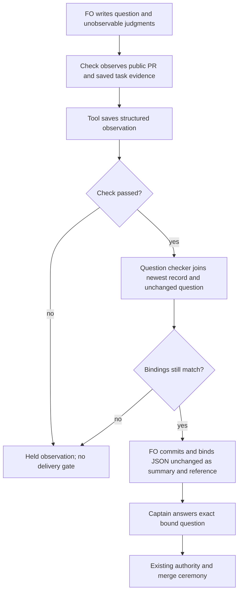

## Scope

- Source: the Captain 「3. 要」 (chat, 2026-11-13), answering FO's item 3: 「下一輪顧問試跑要不要現在開始準備，以及是否把「合併前這一段」的三個摩擦點各開一張任務。」 Evidence: the route trial of 2026-11-13, FO's hand-kept log and result (worker stages took 15 to 30 minutes; validated to merge ask took 85 to 120 minutes on three tasks).
- Bite: FO typed each delivery summary by hand on 2026-11-12 and 2026-11-13 (seven PRs, 15 to 20 minutes each by FO's log), copying the head, the validation verdict, the check counts, the review evidence ids and the merge-result run from records already in the task folder; hand-typed lines were refused by the checker four times and one observer found the external round count wrong.
- Upstream first, open for the design: what the delivery check, the validation skill text and the listed extensions already do for this, and whether a smaller change to one of them is enough.
- Non-goals: to be set at ideation.

## Budget
1 implementation and 2 validation cycles, in one package PR.

## Stop condition
- For the seven recorded deliveries, a generated summary passes the delivery check with no hand edit, and the Captain's question stays FO-written.

## FO alignment

Alignment: not needed before ideation: an observed friction with counts; the mechanism is compared in the design.
Surfaces: none
Visible change: none
Release review: not needed: workflow maintenance, on no journey map.
Correction (FO, 2026-11-13): the ideation gate record of this task quotes the Captain's grant for the five-task route trial (「五張都准，授權代記設計關卡（建議）」) and that trial's admission question. FO's helper script carried the old text; that grant does not cover this task. The authority FO acted under is the standing grant: 「給常設授權：符合條件的小任務，第一輪沒踩停止條件時由你代記設計關卡、同一個 worker 接著實作；准入和合併照舊問我」 (chat, 2026-11-13). The gate record itself is left as written; the Captain is told and may reopen the gate.
Reviewer: kc-dev-flow-2:engineering-reviewer not run 2026-11-13: amendment 1 replaces the task's outcome before any design was approved or anything built (the worker held its first ideation round); the replacement is designed in the next round and judged at the design gate.

## Captain amendments

### Amendment 1 — 2026-11-13, chat
Captain: 「合併提問那張改成：合併檢查把查到的事實存成紀錄，拿掉 FO 手寫摘要的要求；我只寫問題和工具查不到的事」 (chat, 2026-11-13), after his 「為什麼要做這個？」 (host question dialog, 2026-11-13)
Asked: 「這張要怎麼走？」 with FO's recommended option 「改成：檢查結果存成紀錄，拿掉手寫摘要（建議）」 and its stated cost 「每次合併會多一份檔案寫進公開的狀態分支，內容是 PR 編號、版本、檢查結果，不含私有內容。以及關卡紀錄裡給人讀的那段文字會變成工具輸出的格式，沒那麼好讀。」
Supersedes: AC-1, AC-2, AC-3, AC-4, AC-5
Superseded text:

**AC-1** A factual summary for each of the nine recorded deliveries is produced without hand edits and passes the delivery check with provenance showing its actual inputs; the hand-written Briefing summary may be a comparison control, never its own independent oracle. Verified by: `python3 poc/merge_summary_probe.py audit --state <pinned state checkout> --out <owned scratch>/audit` and `replay ...` at the probe commit; current result is zero complete record-contract inputs and nine circular text controls, so **not met**. Future evidence must identify the missing producer facts or the Captain-approved alternate first-ask corpus. Falsifier: remove independent review/CI inputs while leaving the old summary; the producer must hold rather than pass by copying it.

**AC-2** The question remains byte-for-byte FO-written and every summary source is bound to the dispatched candidate; the output identifies the latest independent validation report rather than manufacturing a verdict. Verified by: `replay` records nine unchanged question hashes and matching delivery joins. Replacing the merge head with another 40-hex value refuses all nine existing joins. Current limit: this covers the readback seam; first-ask rendering and source-digest mutation must be exercised on the implemented producer, not claimed passed now.

**AC-3** The round count derives from distinct eligible remote verdict observations with their head/source identities, excluding local jobs and non-verdict states under each extension's existing rules. Verified by: `audit` reproduces the three real local-job-inclusive count discrepancies; a corrected inventory removes two local entries from each affected case. Current limit: the historical remote identities are mostly FO-reported controls, so an independently authenticated full inventory is **not proved**. Falsifier: add a local `roborev:` evidence token to the inventory; it must not raise External rounds, and a missing remote observation must not silently become zero. Do not create a new reviewer outcome grammar from hypothetical cases.

**AC-4** Generated output follows the existing `check`→`question`→committed reference→gate preparation order and retains legacy callers, identity guards, CI/readiness/required-check holds, unread reviewer declarations, source/count disclosures, Captain steps and moved-trunk evidence. Verified by: `replay` exercises the actual `check()` with explicitly synthetic provider responses; nine absent-round and stale-head falsifiers refuse. Full `question()`, authentic live provider state, role-call evaluation, not-run placement and the native gate sequence are **not proved** here. Future validation must run existing relevant delivery tests plus those concrete corpus cases against both base and candidate; a stale check record, changed question or failed/mismatched merge-result record must still hold.

**AC-5** Integrate through the existing delivery command within one package PR, preserve unrelated live work and privacy, and measure all due reading rather than claiming a speedup from a shorter file. Verified by: `python3 poc/merge_summary_probe.py words --state <pinned state checkout> --out <owned scratch>/reading` reproduces 80→52 recipe and 6099→6071 workflow words; same-mod text remains 48. Evidence identifies unmeasured dynamic lifecycle totals and count-only adopter inspection. Full production integration, lint-budget parity, cleanup and a fresh independent no-hand-edit first ask remain future validation obligations. Falsifier: restore hand-copy instructions, alter the question, grow a due passage without accounting, or archive private-source text; validation must fail the corresponding bound, not infer success from this static measurement.

## Not provable now

- **AC-1:** independent generation for the nine event-time deliveries; complete compatible source captures do not currently exist in a common contract. Authenticated historical provider fetches and new real delivery observations were outside the probe grant.
- **AC-2:** implemented renderer/source-digest refusal and its first native binding; only the existing readback identity seam was exercised.
- **AC-3:** a complete independently authenticated remote-review inventory, especially for mutable historical summary comments; local/remote mistakes are reproducible, actual remote truth remains qualified.
- **AC-4:** all live delivery predicates and the native gate/merge lifecycle. Synthetic green controls do not establish real merge readiness or binding compliance.
- **AC-5:** total dynamic words per lifecycle moment, elapsed-time savings, production integration, hosted CI, release/adoption and public-evidence classification for private consumers. No CI definition changed; cost per PR was not measured.
- Mermaid rendered layout: source/prose semantics were checked, rendering was not run.

## Design

### Outcome and PRFAQ

**Recommendation:** use the Captain's replacement outcome. Remove the First Officer's (FO's) factual-summary obligation; extend the existing delivery record and bind its JSON directly. FO writes the question, declined findings with reasons, accepted limits and other judgments the tool cannot observe. No prose generator, summary template, additional workflow stage or new service is proposed.

**What is removed?** On the new record route, FO does not type the candidate, CI totals, reviewer evidence/outcome lines, external round count, validation verdict/rounds, Captain-step record pointer or merge-result description. The record takes their place. The checker no longer requires FO-written Sufficiency/Necessity labels, External rounds, second-reviewer outcome sentences, Copilot refusal quote/retry boilerplate or a Captain steps summary line on that route. Sufficiency and necessity remain FO's judgments in the question; removing field-presence tests does not make the tool decide them.

**Which observations already existed?** The base check queries PR/head/CI/workflow runs/required checks, changed files and trunk, and reads validation dispatches and merge-result records. It did not independently read a validation verdict or remote review verdicts: it checked FO's supplied reviewer strings. The probe reads existing configured review adapters and the latest saved validation report, then records their observed/reported status. Local RoboRev results unavailable to those reads stay `not-observed`; FO may supply that unobservable fact in the question. A report's PASSED word is a reported verdict, not independent certification by the checker.

**What does the gate carry?** The exact saved JSON bytes become the artifact summary, with the same file as `--reference`; the task/report remains the artifact. `gate prepare` accepts this directly. There is no new human-readable summary to author. FO reads the record and writes only the decision and unobservable judgments. The gate still grants only what its exact question says, and a passing record grants no merge authority.

**What does not change?** CI/readiness/head/trunk checks, special-role checks, finding-disposition ownership, protected merge-result omissions, the exact bound merge grant, and the existing guarded merge ceremony remain. The old text route remains compatibility behavior for existing adopters; its summary checks are not silently migrated. No PR comment/edit/review request, ready transition, acceptance-command execution, deployment, release, adoption or CI change belongs to this task.

### What round 1 showed

The nine public deliveries do not have a complete common historical input record; six have partial final-head CI snapshots and one has a saved final-head watcher review observation. Copying the old hand-written summary passed nine text controls but was circular, and three accepted counts included local RoboRev jobs. Those findings justified the Captain's removal decision; reconstructing nine historical summaries is no longer this task's outcome. Round-one evidence and its stage report remain unchanged.

### Record contract and ownership

The existing `delivery_gate.py check --record-facts` writes `delivery-facts/v1` (the saved observation format) under the task's `merge/` folder. A passing observation uses `ask-N.json`; a held observation uses `observation-N.json`. Both share one increasing number sequence. This distinction is required by the existing merge audit, which treats `merge/ask-N.json` with PR/head as a successful ask; a held fact record must not create that false audit evidence.

The writer is the delivery check. Readers are its `question --facts-record` path, FO, Spacedock's normal summary/reference binding, and later human/observer review. The merge audit retains its existing successful-ask filename and PR/head contract; it is not modified. No observer, adapter, skill or native runtime source change is required by the probe.

The saved fields are:

- `schema`, `tool_version`, `time`, `public`, `pr`, `head`: format/tool identity, observation time and public PR identity.
- `candidate`: the dispatched candidate that equals the observed public PR head; unrelated dispatched identifiers are not copied.
- `pr_state`, `ci`, `workflow_runs`, `required_checks`: observed readiness and allowlisted statuses/identifiers. No PR body, title, diff, reviewer prose or log is stored.
- `trunk`, `merge_result`: observed trunk position/head and the existing matching result-record name, the allowed not-run marker, or no owed result.
- `validation`: latest dispatch name, count of numbered validation dispatches, latest report digest and its candidate-bound reported PASSED/REJECTED value; absent/unrecognized evidence stays `not-observed`.
- `reviewers`: configured reviewer, observed head, adapter exit/outcome, evidence identity and PR/local scope. Copilot `answered` is not silently renamed clean; a local job or non-verdict has no eligible remote-round identity.
- `external_rounds`, `round_scope`: the count and its explicit coverage of saved observations, not a reconstruction of unobserved history.
- `captain_steps`: existing record's relative path, digest and candidate-match observation. Its actual execution remains the existing FO duty, not a claim inferred from a hash.
- `question_sha256`, `role_calls`, `result`: unchanged-question binding, role-reader exit, and result exit/problem/unreadable counts. Human declines, reasons, risk acceptance and the question text are not machine-authored or copied into the record.

The new route verifies public repository visibility before saving; private/unknown visibility is refused. Raw private repository content is outside this contract and is not archived by this stage. This bounds the pilot to public inputs; private adopters keep their current route pending their own authorized design, rather than receiving an implicit rollout.

`question --facts-record` accepts the newest observation only when the current dispatch, question digest, validation report and Captain-step record still match. A nonzero check remains a delivery hold. After a repair push, FO reruns the check with the newly dispatched candidate and question; it writes a new observation and preserves earlier records. An old successful ask cannot stand in for the new head or a later held observation.

### One round-count rule

Count each distinct `(reviewer, head, evidence identity)` once across this task's saved PR-scope verdict observations (`clean`, `answered`, `findings`). Exclude local scope, refusals, security-only/running/unrecognized responses and missing identities. Repeat reads do not add rounds; a new observed verdict/head does. The pilot is one delivery PR, and the count does not claim to include reviews the check never observed.

On the three real problematic inventories, the rule changes PR 854 from 4 to 2, PR 856 from 3 to 1, and PR 861 from 3 to 1. These inputs use the original FO-recorded remote identities as replay fixtures; they do not authenticate historical provider truth. Reintroducing local-job counting fails all three cases. The existing adapters remain the outcome authority; FO still classifies and disposes findings under the workflow's existing rules.

### Flow



The positive local probes exercised actors C through B and compared the bound summary digest with the record. The live negative case exercised C through X. A separate direct native prepare of that held record tested JSON transport only; it bypassed the delivery preflight and is not a passing route. Mermaid source/prose agreement was checked; rendered layout remains unverified.

### Probe, actual evidence and limits

Probe: `poc/merge-ask-is-produced-from-records`; initial source base `6a1eaf837bd6087cd0b8b665dc19beaed3c44dff`; integrated current main `bfc53d825` (PR 867, one Codex extension documentation line); last commit is recorded in `evidence/ideation-1-message-1/provenance.json`. The round-two patch changes only the four permitted files; the old round-one probe is retained in local branch history. The worktree is removed before reporting and the branch/portable patch retained.

- Two real archived task/report/dispatch inputs, PRs 860 and 856, pass through the package's own GitHub test double and controlled reviewer/role observations. Both check and question exits are 0; native local gate preparation exits 0; question bytes are unchanged and the bound JSON digest equals the record. Actual validation dispatch counts are 1 and 3. No old summary is supplied to those checks. Running the base check on the same question-only inputs holds with exit 1 for the missing manual fields.
- A live read-only run against public PR 865 writes its actual observed record, with check exit 1 and question exit 1. It records pending review evidence and missing local Captain-step evidence instead of claiming readiness. Direct native preparation in an isolated fixture accepts the JSON, but this is an explicitly separate binding experiment, not a successful live delivery preflight. No real PR/gate decision or mutation was performed.
- The three real round inventories produce 2/1/1 and deduplicate repeated observations. A reverse mutation restoring local-job eligibility is detected. A second probe found the merge audit's filename contract; a reverse mutation writing a held observation as `ask-N.json` is detected by the new consumer regression.
- The initial 232-test delivery run had three source-mutation anchor failures and one optional skip. Their anchors were repaired without removing the mutations. The final six changed/regression checks pass, as does package lint. No final single clean full delivery-suite or whole-package run is claimed; the probe is not an implementation validation.
- Two focused verifier/mutation invocations used Python's auto-cleaned default temporary directory. Their contexts exited and removed those directories; the cited final six-test run explicitly sets `TMPDIR` to the assigned scratch. All retained temporary files and local repositories are under that scratch, and no unrelated repository file was changed.

### Removed instructions and measured size

The workflow replaces its two manual delivery-summary paragraphs with the record/check/reference route, removes the manually supplied Captain-step summary pointer and round-count instruction, and puts FO declines and unobservable trigger judgments in the question. The new checker route removes the corresponding text-presence requirements; the existing text path remains compatibility behavior. Trigger/disposition semantics remain owned by the existing workflow, not inferred from record formatting. The probe does not establish every conditional second-reviewer path or downstream adopter/observer behavior.

At the measured bytes, workflow text is **6099→6069 words, 636→635 lines**, with a matching **−30** lint-budget step. The two sampled hand-written factual summaries shrink **239→0** and **329→0** authored words; each is replaced by an actual **148-word, 78-line JSON record**, rather than 15/18 prose lines. The record is more structured and less readable, the cost already stated in amendment 1. Final source counts and hashes, including checker/test growth, are in `counts.json`; removal of an authoring obligation is not a claim that the checker source shrank.

Known startup/resume workflow-plus-mod text is **6147→6117** words; open-PR idle, merged-PR idle and after-archive mod text remains **48→48** each. Complete dynamic hook, watcher, learning/observer and preparation output totals were not measured in both arms. Merge-ask prose/record sizes above are measured, but full per-moment reading reduction and delivery-speed improvement are not established. No CI definition changed; cost per PR was not measured.

### Worth questions

- **Remove the manual factual summary:** serves the Captain's exact amendment. Without it, FO still recopies observations. The cheap disproof would be a question-only base check already passing and saving the facts; both real replay controls hold on base.
- **Save the existing check's observations:** serves “把查到的事實存成紀錄.” Without it, removing the summary loses inspectable evidence. The native digest comparisons and held-record regression check that the record, not a new prose artifact, is the source.
- **Keep unobservable judgments FO-written:** serves “我只寫問題和工具查不到的事.” Without it, the tool would invent dispositions or acceptance. Question hashes remain unchanged; the live unknown states remain unknown/held. No new generator, service, source schema beyond this bounded record, scheduler or independent goal is retained.

### Decisions and batch overlap

No replacement outcome decision remains open: amendment 1 settled it. FO still owns design-gate routing, any implementation dispatch and any new scope/ADR-file authorization; this probe creates no numbered ADR or fifth production file. Production completeness, private-adopter support and a green live delivery are not assumed from this result.

The four proposed files are `kc-dev-flow-2/scripts/delivery_gate.py`, `kc-dev-flow-2/scripts/test_delivery_gate.py`, `kc-dev-flow-2/references/sd/workflow.md` and `kc-dev-flow-2/scripts/lint-skills.py`.

- `merge-ask-is-produced-from-records` owns those four paths. `validator-commands-fit-the-delivery-check` shares the checker/test and the Captain-step join; integrate it after this task as already ordered, preserving the record route rather than restoring summary fields.
- `ready-pr-gets-a-codex-code-review-without-fo-noticing` owns watcher/adapter-reference work, not these four paths. Its PR 867 is now main and was integrated; no review request is issued by this probe.
- `comment-check-reaches-delivery-gate` directly overlaps the checker/test; preserve its result/hold behavior during implementation. `adoption-asks-which-extensions` and `adr-required-statement` overlap workflow/lint and require a fresh budget recount when integrated.
- `adr-silent-undo-probe`, `journey-canvas-hosted-poc`, `journey-server-host-pilot`, `ops-inbox-r1-setup-and-isolation` and `pr-review-lite-value-pilot`: no exact four-file overlap found in the round-one checked definitions; they are not edited. The runtime and package/adopter chain check from round one is reused; the changed native binding seam was exercised now against actual Spacedock 0.27.2, and current main's own Codex documentation was reread.

Recommended order: FO reviews this removal design, then dispatches within the four-file budget; sequence its checker integration with the validator-command task and the comment-check task, and recount the workflow budget after any concurrent workflow change. No other session was messaged.

## Acceptance criteria

**AC-6** Amended by Captain, amendment 1. 合併檢查把查到的事實存成紀錄，拿掉 FO 手寫摘要的要求；我只寫問題和工具查不到的事。

Verified by: the second-round `round2_probe.py replay`, `rounds`, and `live` commands, the question-only base comparison and the two reverse mutations, with command/exit/output/provenance in `evidence/ideation-1-message-1/criterion-commands.json`. Two real archive inputs pass check/question/native preparation without a manual summary; the live public query saves a held observation and its delivery question stays held. JSON is bound unchanged and questions retain their hashes. The final six relevant tests and lint pass. Falsifiers: restoring the old required summary fields makes the two question-only cases fail; counting local RoboRev jobs inflates the three real inventories; naming a held observation `ask-N.json` creates false merge-audit evidence; replacing the dispatched head makes the prior binding fail. These are observed corpus/probe failures, not invented input forms.

## Not provable now

- **AC-6:** a green live delivery preflight was not observed. PR 865's recorded review evidence was pending, and the isolated observation task has no real Captain-step execution record; check/question hold. The direct native JSON binding experiment is not claimed as that passing route.
- **AC-6:** final full-suite/whole-package validation, every conditional second-reviewer trigger/waiver and finding disposition, full moved-trunk lifecycle, downstream observer/adopter compatibility, private-repository use, deployed adoption, complete dynamic reading and elapsed-time improvement remain future validation obligations. The existing local report/step records are observations, not authenticated execution proof.
- **AC-6:** Mermaid rendered layout and a general private-content/secret classifier were not tested. The record uses a public-repository gate and allowlisted fields; raw private content is not part of this probe.

## Stage Report: ideation

- DONE: Run this ideation probe-first, before writing the design, on the named local branch from origin/main, and record hypotheses, criterion commands and provenance.
  Local probe 9cf3499dd on base 6a1eaf837; audit finds 0/9 complete common record-contract inputs; the deliberately circular readback control passes 9/9. Removing independent source inputs must hold, not pass by copying the old summary; evidence/ideation-1/provenance.json and criterion-commands.json qualify every result.
- DONE: Check the existing chain first: Spacedock, kc-dev-flow-2, then sibling adopters; read third-party mechanisms in their own docs or source.
  Native CLI 0.27.2/skill 0.28.0, source package 0.41.0 plus PR 864, existing check/readers and three read-only adopters inspected; only counts from private sources archived. Six partial final-head CI snapshots and one saved final-head review observation qualify the missing complete contract.
- DONE: The words FO reads at each lifecycle moment, before and after, per root learning.md.
  Static known components are documented for startup/resume, open-PR idle, merged-PR idle, after archive and merge ask; recipe 80→52 and workflow 6099→6071 are reproducible, not a complete dynamic-word or speed claim. words.json and output-words.json retain the limits.
- DONE: Acceptance criteria with reproducible evidence clauses and falsifiers, and unresolved decisions for the Captain, each with a recommendation and what gets worse under it.
  Five bold AC declarations and per-criterion commands are present; one material evidence/scope decision recommends automatic observation capture and an independently sourced first-ask proof, with added durable-state ownership and incomplete historical proof named.
- DONE: AC-1 current evidence and limit.
  Original independent nine-delivery generation is not met: audit diagnostic exits 0 while strict source completeness is 0/9; nine checker-control passes do not establish the proposed producer. A missing source must refuse instead of using the old summary as its oracle.
- DONE: AC-2 current evidence and limit.
  Nine question hashes are unchanged and the existing identity join matches; substituting the named merge head refuses all nine. First-ask rendering, source-digest refusal and native binding remain unverified.
- DONE: AC-3 current evidence and limit.
  Three real local-RoboRev-inclusive counts reproduce against the extension contract; the source lines imply 4→2, 3→1 and 3→1. Raw authenticated remote inventory is not established, so this is a counterexample, not a complete true-count certification.
- DONE: AC-4 current evidence and limit.
  The actual delivery check runs on all nine controls with explicitly synthetic provider readiness/paths/trunk/role results; all nine absent-round counterexamples refuse. Full question(), real CI, roles and moved-trunk behavior were not exercised and are not claimed passed.
- DONE: AC-5 current evidence and limit.
  The portable words command reproduces the proposed static reduction, privacy check finds no known private path in the selected archive, and only the local poc/ probe differs from base. Production integration, full lifecycle reading and cost per PR are not measured.
- DONE: A Batch overlap section naming each proposed file and each named batch/live task that changes the same file or check.
  Five proposed production paths are named; direct checker overlap with validator-commands-fit-the-delivery-check and comment-check-reaches-delivery-gate, workflow/lint overlaps and all other named tasks are qualified. No peer session was messaged or task edited.
- DONE: Retain public evidence, remove the probe worktree, keep its branch, run the exact scratch close command, and commit the task-owned state paths.
  Probe worktree removed clean; branch 9cf3499dd retained; portable patch and 41 public/count-only evidence files retained. State commit/push follows this report; no product branch was pushed or PR opened.
- SKIPPED: Begin implementation, use credentials/live shared providers, present or record a gate, deploy, merge, or claim an approved alternate stop condition.
  This is Pilot ideation only. The overturned input premise and new stored-observation contract return to the Captain through FO; the original stop is not silently weakened. Mermaid source/prose agreement was checked; rendering was not run.

### Summary

Ideation is complete with a material evidence/scope decision, not a passed automation outcome. Recommend extending the existing delivery check to save its observations and render the facts while FO writes the question and retains all judgments; reject copied historical prose as independent first-ask proof. The current original stop remains unmet and implementation has not begun.

Scratch close output (exit 0, exact command in the dispatch):

```text
Scratch removed: /private/tmp/dev2/kc-claude-plugins-3042bb224e995ded/merge-ask-is-produced-from-records/ideation-1 (1028450 bytes)
Evidence: evidence/ideation-1/ (41 files, 140.0 KiB)
```

### Round 1

Start: 2026-11-13 21:43:38 Asia/Taipei; probe/design end: 2026-11-13 22:01:16 Asia/Taipei. Time source: clock.curr_time UTC observations +08:00. Base: 6a1eaf837bd6087cd0b8b665dc19beaed3c44dff; probe: 9cf3499dd0af60bb16861428860cad3f4cf3b05e. Fired: premise overturned; a decision only the Captain can make (evidence/scope and the historical stop); a boundary between source readers and a complete durable summary input with no current contract; stored data touched by the proposed capture. None: production data or credentials used, broad exposure, migration, unattended recurring operation, support/release/rollback duty accepted, screen touched, implementation outside the named files or budget. State publication is subsequent close-out, not a stage transition.


## Stage Report: ideation

- DONE: Ideation round 2 under Captain amendment 1 replaces the outcome; design it as a removal rather than a generator.
  Replaced Design in place and kept a short What round 1 showed section; protected-section.json verifies the Captain amendment and frontmatter unchanged. AC-6 is the active outcome; the superseded criteria and prior report remain historical.
- DONE: Say which factual summary lines are saved, which unobservable judgments stay FO-written, what the gate carries, and which workflow words/checker rules are removed, with word and line counts.
  The exact JSON record replaces authored factual prose; FO retains the question/declines/accepted limits. Workflow 6099→6069 words and 636→635 lines; sampled authored summaries 239/329→0 words, replaced by 148-word, 78-line records. counts.json records actual four-file growth too.
- DONE: State the structured record fields, writer/readers, repair-push behavior and public-content boundary.
  Design defines the delivery-facts/v1 fields, latest-record/head/question/report/step joins, successful ask versus held observation filenames, public visibility and allowlisted fields; no raw body/title/diff/reviewer prose or private adopter payload is archived.
- DONE: Count external review rounds from saved verdicts by one rule and show the three recorded discrepancies.
  rounds.json gives PR 854: 4→2, PR 856: 3→1 and PR 861: 3→1, with duplicate reads unchanged. Restoring local-job eligibility fails all three; historical input identities are FO-recorded fixtures, not authenticated old API truth.
- DONE: Probe at least two of the nine recorded deliveries through the package's own test doubles and one live read-only public PR run, including record writes and native gate binding with only an FO question.
  PRs 860/856 check=0, question=0, native prepare=0 and unchanged question/record-summary hashes; the actual dispatch counts are 1/3. Live PR 865 check=1/question=1 saves a held observation; direct native prepare=0 proves JSON transport only and is explicitly not a valid delivery preflight.
- DONE: Every criterion's evidence command runs once with command, exit and output path; unavailable proof is named under Not provable now.
  AC-6 has replay/live/count/base/mutation/test/lint entries in criterion-commands.json with provenance and the underlying live hold. A green live delivery, full final validation, conditional reviewer paths, private adoption, dynamic reading and Mermaid rendering are not claimed.
- DONE: Add tests only for failures the corpus or probe shows; keep the change inside the four permitted files.
  Question-only base controls hold twice; count and held-ask filename mutations are detected. Final six relevant tests and lint pass. The initial 232-test run's three mutation-anchor failures and optional skip are preserved; repaired anchors are rerun, not deleted, and no final whole-suite pass is asserted.
- DONE: Check the chain and batch overlaps; preserve sibling ownership.
  Round-one native/package/adopter audit reused; actual Spacedock 0.27.2 binding exercised. Main's PR 867 documentation-only change was integrated; the round-two patch changes only delivery_gate.py, its test, workflow text and lint budget. Shared checker/step and workflow seams are named; no peer/session message or other task edit.
- DONE: Retain evidence, remove the local probe worktree and scratch, keep the branch, and commit only this task's state paths.
  Branch cb480964b retained and clean worktree removed; 54 round-two evidence files pass the packaged retention helper. Message close aliases the base evidence folder, so the packaged evidence function separately verified the round-two folder. State commit/push follows this report.
- SKIPPED: Claim a green live delivery, execute product acceptance, begin implementation, alter a real PR/gate or deploy.
  The approved task remains Pilot ideation. The public live reads were authorized and read-only; pending evidence remains a hold. Two auto-cleaned default-temp verifier invocations and the corrected final TMPDIR confinement are disclosed in boundary-note.json.

### Summary

The revised design removes factual summary authoring and binds the delivery check's structured record directly, as amendment 1 requires. Two real archive replays pass the complete local record/question/native-binding path; the live observation correctly holds delivery, and the separate held-record native binding is not presented as a passing preflight. Recommend FO's design-gate review within the four-file budget, with the named future validation limits; implementation has not begun.

Scratch close and round-two retention output:

```text
Scratch removed: /private/tmp/dev2/kc-claude-plugins-3042bb224e995ded/merge-ask-is-produced-from-records/ideation-1 (3339934 bytes)
Evidence: evidence/ideation-1/ (41 files, 140.0 KiB)
Evidence: evidence/ideation-1-message-1/ (54 files, 108.4 KiB)
```

### Round 2

Start: 2026-11-13 22:18:59 Asia/Taipei; probe/design end: 2026-11-13 22:54:43 Asia/Taipei. Time source: clock.curr_time UTC observations +08:00. Initial base: 6a1eaf837bd6087cd0b8b665dc19beaed3c44dff; integrated main: bfc53d825; probe: cb480964b2ade3e122d2b60bd42717474171b794. Fired: stored observation data, already approved by amendment 1; existing-auth read-only public GitHub calls, expressly permitted by this dispatch; temporary-placement deviation in two auto-cleaned verifier runs, recorded and corrected for cited final tests. None: a newly overturned premise, a new Captain-only outcome/trade-off, an undefined component contract left in the proposed route, production-data/credential provisioning, broad exposure, migration, unattended operation, support/release/rollback duty, screen change, fifth product file or budget expansion. The live eligible route and broader validation remain Not provable now under AC-6, not silently passed. This is the second design round; a third requires returning to the Captain.
