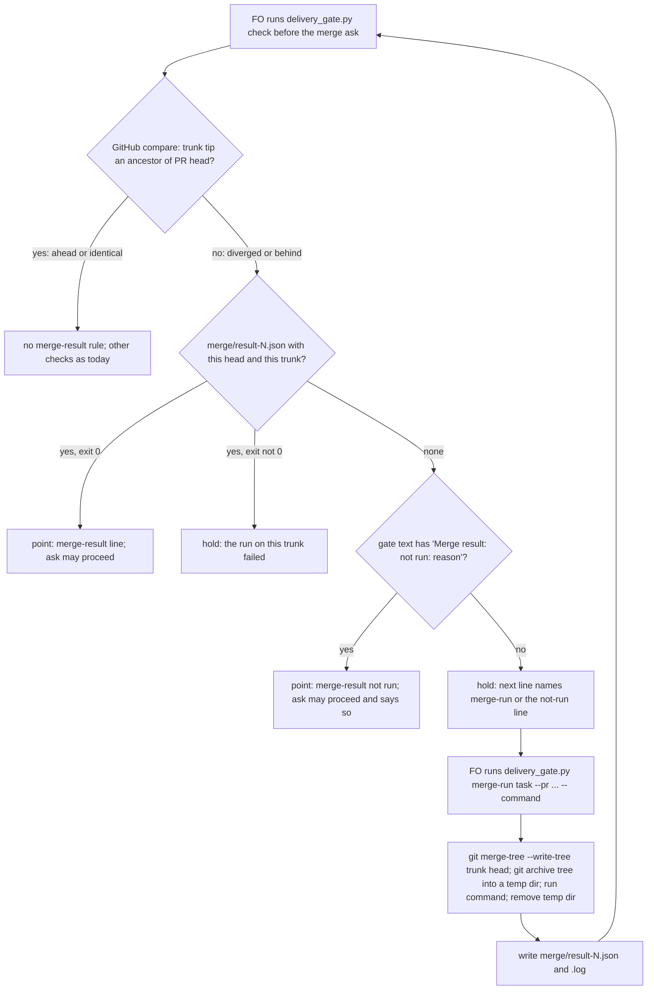

## Scope

- Source: FO's own miss, filed by FO with no Captain ruling yet; the backlog gate confirms it.
- Bite (FO read 2026-11-11, `gh run view 42991036147 --repo iamcxa/kc-claude-plugins --log-failed`): PRs #843 and #841 each passed their own checks and validation; after both merged, main failed one of 226 tests in `kc-dev-flow-2/scripts/test_design_surfaces.py`, Release PR #840 could not pass, and a fix task ran 80 minutes from filing to archive. The #841 merge ask said the acceptance was not rerun on the merged result; nothing held the ask.
- Outcome: when main has moved since the validated head was dispatched, FO's merge ask is held until a test run on the result of merging that head with current main is recorded, or the Captain is told in the question that none was run.
- Open for the design: which commands count as the run and who runs them; whether the existing delivery check can carry it or GitHub's own merge queue or required up-to-date branch setting already does; what it costs per PR in minutes.
- Non-goals: changing CI definitions; rerunning validation; any rule for PRs whose base did not move.

## Budget
1 cycle per stage, in one package PR.

## Stop condition
- A replay of PR #841's merge ask at its recorded state is held by the candidate and the same ask with a recorded merge-result run passes. Return to the Captain if the design needs a CI or repository-setting change.

## FO alignment

Alignment: not needed: one observed defect with one outcome; how it is checked is compared in the design and ruled at the ideation gate.
Surfaces: none
Visible change: none
Release review: not needed: workflow maintenance, on no journey map.

## Design

Proof of concept: local branch `poc/merge-ask-tests-the-merge-result`, commit
`e348d05b7` (parent origin/main `8ce0eb605`, kc-dev-flow-2 0.39.1), in the workflow
checkout's `.worktrees/poc-merge-ask-tests-the-merge-result`. Never pushed; no PR.
It changes `kc-dev-flow-2/scripts/delivery_gate.py` (+109) and
`kc-dev-flow-2/scripts/test_delivery_gate.py` (+3, the stub `gh` answers the new
compare call). Evidence is under `merge-ask-tests-the-merge-result/poc/`.

### What the proof of concept showed

- **The Bite reproduces exactly.** `git merge-tree --write-tree eeee0023 6da9a765`
  (trunk at the #841 ask, 2026-11-11T08:52:08Z, and the #841 head) gives tree
  `3ba40948`, the same tree as the squash commit that landed, `571a7bd8^{tree}`.
  `test_design_surfaces.py` on that tree fails 1 of 226; on the head alone it passes
  224 of 224 (`poc/runs/red-result.log`, `poc/runs/head-only-test_design_surfaces.log`,
  `poc/ac_tree_and_scratch.log`).
- **GitHub did test a merge result, against an old trunk.** The #841 PR run checked
  out `Merge 6da9a765 into 546a1363` at 07:24; #843 merged at 07:55, so CI never saw
  the pair. A later `pull_request` run on the same head, created at 08:03 after #843
  merged, still checked out that same 07:24 merge commit (run 42983997272). Branch
  protection has `strict: false` and the repository has no ruleset
  or merge queue (`poc/github-settings-and-pr-ci-base.txt`). Nothing in GitHub's
  current settings holds the ask.
- **The #841 acceptance script would not have caught it.** It runs six named tests in
  `test_dispatch_stage` and `test_role_triggers` and never runs `test_design_surfaces.py`
  (`poc/acceptance-script-scope.txt`). So "rerun acceptance on the merge result" is not
  enough; the run must be the package's own unit tests for the changed package.
- **The check holds the replayed ask and only for this reason.** Replaying the #841
  ask at its recorded state (task at state commit `b3e749c2`, the validation briefing's
  question and summary, PR facts saved in `poc/pr841-facts/`): origin/main's
  `delivery_gate.py check` exits 0; the candidate exits 1, and the diff of the two
  outputs is the one new problem line and its `next:` line
  (`poc/replay-control-base.log`, `poc/replay-candidate-no-run.log`).
- **A run recorded at the asked trunk lets the ask through; a run at any other trunk
  does not.** A green run of the same head on trunk `546a1363` (the trunk CI saw,
  exit 0, `poc/runs/green-result.json`) passes an ask at that trunk and is refused for
  the ask at `eeee0023`; the red run at `eeee0023` holds with its exit shown.
- **How often it fires.** Of the last 40 squash-merged feature PRs on main, 24 merged
  onto a trunk that was not an ancestor of their head (GitHub compare `diverged`),
  16 onto one that was (`poc/trunk-moved-at-merge-40prs.txt`, 2026-11-12; the 40
  merged between 2026-11-05 and 2026-11-11).
- **Cost of the run.** `test_design_surfaces.py` alone: about 15 s on the merge result.
  The full local unit-test list from `kc-dev-flow-2-tests.yml` (25 scripts, not the
  three that need the pinned Spacedock): 580 s on the #841 merge result, with only
  `test_design_surfaces.py` failing, so the `git archive` extract (not a git checkout)
  broke no other script (`poc/runs/full-suite-result.json`, `.log`; measured once, on a
  machine running four other workers). Local FO minutes only; no CI minutes. At 24 of 40
  PRs, that is roughly 6 minutes per PR on average if D1 names the full list.
- **Existing tests.** `test_delivery_gate.py` on the PoC: 208 run, 2 failures, both the
  subtests of `test_required_check_read_adds_one_gh_call`, which count `gh` calls and see
  one more (`poc/test_delivery_gate-poc.log`).

### PRFAQ

**Proposition.** When main has moved past the head the Captain is asked to merge,
the First Officer (FO) cannot ask until it has run the package's tests on the result
of merging that head into today's main, or until the question says plainly that no
such run was made. The run is FO's, on its own machine, and leaves a record beside
the task.

- *What counts as "main moved"?* Main's tip is not an ancestor of the PR head. Only
  then does the merged tree differ from the tree validation tested.
- *Which tests?* The commands the workflow names (decision D1). #841 shows why the
  acceptance script is not enough.
- *What if main moves again after the run?* The record names the trunk it ran on; a
  different trunk at ask time holds again.
- *What does the Captain see?* One `point: merge-result:` line with the command, exit
  and tree, or the question's own `Merge result: not run: <reason>` line.
- *Does CI change?* No. No repository setting changes either.

### Chain checked, and the existing-code check

- **Spacedock 0.27.3:** `mods/pr-merge.md` runs `git merge-tree --write-tree "$BASE_SHA" "$CANDIDATE_SHA"`
  at push time as a conflict signal only; `merge guard` takes the verdict in and runs
  nothing. No test on the merge result. The PoC reuses its `merge-tree` mechanism.
- **kc-dev-flow-2 0.39.1 (origin/main):** `delivery_gate.py check` holds on head,
  CI, draft, `mergeable`, base and file list; `mergeable` is a textual-conflict signal.
  No merge-result run anywhere (`git grep -i "merge result\|merge-tree" origin/main -- kc-dev-flow-2`: 0 hits).
- **Adopters (read only):** qnow and subspace-relay carry Spacedock's `pr-merge.md`
  `merge-tree` step; no test run. subspace-web: no hit.
- **GitHub (its own API):** required-checks `strict` or a merge queue could make GitHub
  do it, but both are repository-setting changes (Stop condition: Captain), and
  `strict` forces an update-branch that changes the head, which breaks the dispatched
  `Candidate:` match on 60% of PRs here. How a merge queue would interact with the
  `Candidate:` match was not checked.
- Conclusion: repair the existing seam, `delivery_gate.py check`, which FO already runs
  before every merge ask; add one subcommand that writes the record. No new script.

### Expansion plan (PoC to the Pilot bar and the Stop condition)

1. Fix the command source per D1: read `merge-test:` from the workflow README and
   require the record's command to equal it; refuse `merge-run` with no command.
2. Fold the merge-result point into the 12-point cap in `points_for` instead of
   prepending it, and save `merge_result` (record name or `not run`) in `ask-N.json`.
3. `question`: when the newest ask record says `not run`, require the
   `Merge result: not run:` line in the question file itself, not only the summary
   (Outcome: "told in the question").
4. `merge-run` fetch path: fetch `refs/pull/N/head` and the trunk only when an object
   is missing (PoC does); hold with exit 2 on a `merge-tree` conflict instead of a
   string exit in the record.
5. Tests in `test_delivery_gate.py`: the six replay cases as unit cases with the stub
   `gh` compare answer; update the two `gh`-call counts by one; a `merge-run` case on a
   two-commit fixture repository.
6. Docstring: one usage paragraph for `merge-run` and one hold sentence in `check`.
   No `references/sd/workflow.md` change: the hold's `next:` line carries the step at
   the moment it is due.
7. ADR, titled "A merge ask on a moved trunk carries a test run on the merge result"
   (number reserved by FO at dispatch), recording D1 and D2.
8. Adopters: one `merge-test:` line each at their next workflow sync; until then each
   moved-trunk ask in that adopter needs the not-run line.

### Worth questions

- **The hold at the merge ask.** Captain words: none yet; FO filed it from its own
  miss and the backlog gate approved the scope (「核准，照這個分組（建議）」). What breaks
  without it: a pair of PRs that each pass validation can still break main; #841 plus
  #843 broke 1 of 226 tests, blocked Release PR #840 and cost an 80-minute fix task.
  Premise that would make it unneeded: semantic collisions between concurrently merged
  PRs are rare enough to fix after the fact. Cheap test now: the 40-PR count shows the
  trunk moved under 24 of 40 merges; the collision itself was observed once in that
  window (this Bite), so the rule fires often and would have caught one break in one
  week (2026-11-05 to 2026-11-11). The Captain may judge that rate not worth a run per ask; that is D1/D2's cost.
- **The `merge-run` subcommand and its record.** Serves the same scope. Without it the
  hold has nothing to read and FO's run is a claim in prose. Premise that would make it
  unneeded: GitHub could be made to run CI on the new merge result without changing the
  head. Cheap test: run 42983997272, a `pull_request` run created at 08:03 after #843
  merged, still checked out the 07:24 merge commit into `546a1363`
  (`poc/github-settings-and-pr-ci-base.txt`); a run on the new merge result needs a new
  event or a setting change.
- **The not-run line.** Serves the Outcome's "or the Captain is told in the question".
  Without it every moved-trunk ask in an adopter without `merge-test:` is blocked.

### Words FO reads at each moment

Counted with `wc -w` over the check output lines (header lines of the replay log
excluded), base origin/main `8ce0eb605` against the PoC, on the #841 replay
(`poc/words.txt`):

| Moment | Base | Candidate |
| --- | --- | --- |
| Startup, idle on open PR, idle on merged PR, after archive | unchanged | unchanged: no README, mod or `pr_watch.py` change |
| Merge ask, trunk not moved | 187 | 187 (no new line) |
| Merge ask, trunk moved, FO runs `merge-run` first | 187 | 17 (`merge-run`) + 197 (`check`) = 214 |
| Merge ask, trunk moved, FO did not know (hold, run, re-check) | 187 | 117 + 17 + 197 = 331 |
| Merge ask with the not-run line | 187 | 195 |

`delivery_gate.py --help` stays 1227 words in the PoC; the expansion adds about 60.
FO's reading rises at the merge ask on a moved trunk; this task adds a step and does
not claim a reduction.

### Batch overlap

Files the design would change: `kc-dev-flow-2/scripts/delivery_gate.py` (`check`,
`points_for`, `write_record`, `question`, new `merge_run`, `main`, docstring),
`kc-dev-flow-2/scripts/test_delivery_gate.py`, a new ADR file in `docs/adr/` (one
number from the shared ADR index), and the workflow README `merge-test:` key of
`docs/dev2/README.md` (kc-dev-flow-2's adopted copy here; adopters at their sync).

| Task | Shared file or check | Order |
| --- | --- | --- |
| comment-check-reaches-delivery-gate (other session, ideation) | `delivery_gate.py` `check` (a new hold) and `write_record` (a new key); `test_delivery_gate.py` (`file_pages`, gh stub) | one after the other; either first, the second rebases |
| gate-question-facts-are-checked-before-the-captain-reads-them (batch) | its Scope names the delivery check's gate-text counting; if its design lands there, the same `check`/`question` text path | after this one if it touches `delivery_gate.py` |
| dispatch-close-out-archives-evidence-and-removes-scratch (batch) | its Scope asks how the delivery check tells a removed path from missing evidence; `merge-run` writes `merge/result-N.log` and removes its own temp dir | none shared yet; its rule should keep `merge/result-*` |
| held-and-closed-tasks-leave-the-design-queue (batch) | `pr_watch.py` only | none |
| each-task-records-stage-time-revises-and-interruptions (batch) | no file named yet | none known |
| adoption-asks-which-extensions (other session) | reads `delivery_gate.py` output for a word count only | none |
| adr-required-statement, adr-silent-undo-probe (other sessions) | the shared ADR number index | FO reserves numbers |
| journey-canvas-hosted-poc, journey-server-host-pilot, ops-inbox-r1-setup-and-isolation, pr-review-lite-value-pilot (other sessions) | none found (`grep delivery_gate\|workflow.md\|merge ask` over each task file: 0 hits) | none |

Recommended order: comment-check-reaches-delivery-gate and this task one at a time
(either first); then gate-question-facts if it edits `delivery_gate.py`.

### Decisions for the Captain

- **D1. Which commands count as the run.** Recommend a `merge-test:` line in the
  workflow README naming the command, which the check requires the record to match.
  Why: #841's acceptance script would not have caught its break, so letting FO pick
  per ask invites the narrow choice; your past rulings leaned the same way (an
  `Override:` chose refusing branch refs over the flexible option). What gets worse:
  each adopter adds one README line at its next sync, and until then every moved-trunk
  ask there needs the not-run line; and if the line names this package's full unit list,
  each moved-trunk ask here costs FO about 10 minutes (580 s measured once). Alternative: FO names the command per ask, shown in
  the point line; no README key, weaker.
- **D2. When the rule applies.** Recommend "main's tip is not an ancestor of the PR
  head". Why: that is exactly when the merged tree differs from the validated one, and
  it needs no new dispatch field. What gets worse: it fires on about 60% of PRs (24 of
  40), wider than the Non-goals' reading "base did not move since validation"; a PR
  whose base moved before validation was dispatched is included, because validation
  still tested only the head. Alternative: record main's tip in each validation dispatch
  and fire only when it moved after that; narrower, and misses the pre-dispatch case.
- **D3. The Stop condition's pass half.** The Stop condition asks that "the same ask
  with a recorded merge-result run passes". #841's honest run at its real ask trunk is
  red (1 of 226), so on #841 the recorded run holds the ask, as it should. Recommend
  accepting the pass half as shown on the same head at the trunk its CI saw
  (`546a1363`, a real green run, AC-2) rather than on the ask's own trunk. What gets
  worse: the pass case is proven on a trunk nobody asked at; a live green pass on a
  real ask waits for the first moved-trunk PR after release.
- Not recommended, no ruling needed unless you want it: turning on "require branches
  to be up to date" (a repository setting that changes the head) or a merge queue (a
  repository setting; its interaction with the `Candidate:` match was not checked).

### Limits

- Main can still move between the check and the merge; the record binds the trunk the
  check saw, not the trunk at merge time.
- Only the gate text file is read for the not-run line; the PR body is not
  (`count_disclosure` returns the gate text alone), so a line in the PR body does not
  count.
- Under D1 the `merge-test:` key's only homes are the hold's `next:` line and the
  `delivery_gate.py` docstring; no README or adoption text is added (about 15 more
  words in the `next:` line, counted at implementation).
- `poc/replay_841.py` hardcodes this machine's code-repository path; it is a replay
  for this task, not a repository test.
- The check trusts a record's `tree` and `exit` as written; it does not recompute the
  merge tree.

## Acceptance criteria

Paths are relative to the task folder `merge-ask-tests-the-merge-result/`. `CAND` is
the candidate's `kc-dev-flow-2/scripts/delivery_gate.py` (today: the PoC worktree's
copy at `e348d05b7`); `BASE` is origin/main `8ce0eb605`'s, extracted with
`git archive 8ce0eb605 kc-dev-flow-2/scripts | tar -x -C <dir>`. Each was run once on
the PoC on 2026-11-12; the implementation re-runs them on its candidate.

**AC-1** The #841 merge ask replayed at its recorded state is held for the merge result alone.
Evidence: `python3 -B poc/replay_841.py "$BASE" poc/replay-control-base.log` exits 0,
and `python3 -B poc/replay_841.py "$CAND" poc/replay-candidate-no-run.log` exits 1 with
`the trunk moved since this head (diverged, trunk eeee002303ac) and no merge-result run is recorded`;
the two outputs differ only by that line and its `next:` line.
Falsifier: remove the merge-result call from `check` and the candidate exits 0.
Ran: base exit 0, candidate exit 1; `poc/replay-control-base.log`, `poc/replay-candidate-no-run.log`.

**AC-2** The same ask with a passing run recorded at its head and the asked trunk passes and shows the run.
Evidence: `python3 -B poc/replay_841.py "$CAND" poc/replay-candidate-green-record-at-its-trunk.log --result poc/runs/green-result.json --trunk 546a136386c94c58e430c91a6f3457b38bd73880`
exits 0 and prints `point: merge-result: 'python3 -B kc-dev-flow-2/scripts/test_design_surfaces.py' exit 0 on 0cea91ffa2eb`.
The record is a real run (head `6da9a765` merged onto `546a1363`, the trunk #841's CI
used); #841's run at its real ask trunk is red, so the pass case cannot be shown on it.
Falsifier: change the record's `exit` to 1 and the replay exits 1.
Ran: exit 0; `poc/replay-candidate-green-record-at-its-trunk.log`.

**AC-3** A run recorded on another trunk does not satisfy the ask.
Evidence: `python3 -B poc/replay_841.py "$CAND" poc/replay-candidate-stale-green-record.log --result poc/runs/green-result.json`
(green run on `546a1363`, ask at `eeee0023`) exits 1 with the no-run line.
Falsifier: drop the `trunk` comparison in `merge_result_problem` and it exits 0.
Ran: exit 1; `poc/replay-candidate-stale-green-record.log`.

**AC-4** A failing run on the asked trunk holds the ask and names the exit.
Evidence: `python3 -B poc/replay_841.py "$CAND" poc/replay-candidate-red-record.log --result poc/runs/red-result.json`
exits 1 with `the merge-result run result-1.json on trunk eeee002303ac exited '1'`.
Falsifier: accept any matching record regardless of exit and it exits 0.
Ran: exit 1; `poc/replay-candidate-red-record.log`.

**AC-5** With no run, a `Merge result: not run: <reason>` line lets the ask through and shows it.
Evidence: `python3 -B poc/replay_841.py "$CAND" poc/replay-candidate-not-run-line.log --not-run`
exits 0 with `point: merge-result: not run (the ask says so)`.
Falsifier: without the line the same replay exits 1 (AC-1); the #841 text's own
sentence ("the acceptance script was not rerun on the merged result") is in every
replay and does not count as the line.
Ran: exit 0; `poc/replay-candidate-not-run-line.log`.

**AC-6** When main's tip is an ancestor of the head, nothing new is asked.
Evidence: `python3 -B poc/replay_841.py "$CAND" poc/replay-candidate-trunk-not-moved.log --status ahead --trunk e8664a72b0f904e5dda3c391d52ab3abaca876b4`
exits 0 with no `merge-result` line and 187 output words, equal to base (`poc/words.txt`).
Falsifier: treat `ahead` as moved and it exits 1.
Ran: exit 0; `poc/replay-candidate-trunk-not-moved.log`, `poc/words.txt`.

**AC-7** `merge-run` tests the tree that lands and reproduces the #841 break.
Evidence: `bash poc/ac_tree_and_scratch.sh "$CAND" <code repo> <workflow dir>` prints
equal trees `3ba409485baf…` for `merge-tree eeee0023 6da9a765` and `571a7bd8^{tree}`;
`python3 -B "$CAND" merge-run <task> --pr iamcxa/kc-claude-plugins#841 --head 6da9a765… --trunk eeee0023… -- python3 -B kc-dev-flow-2/scripts/test_design_surfaces.py`
exits 1 with 1 failure in 226, while the head alone passes 224.
Falsifier: run on `--trunk 546a1363` and it exits 0 (AC-2's record).
Ran: script exit 0; merge-run exit 1; `poc/ac_tree_and_scratch.log`, `poc/runs/red-result.json`, `poc/runs/red-result.log`, `poc/runs/head-only-test_design_surfaces.log`.

**AC-8** `merge-run` removes its temporary directory.
Evidence: the same script runs `merge-run ... -- true` with `TMPDIR` set to a fresh
empty directory and counts 0 entries left.
Falsifier: remove the `shutil.rmtree` in `merge_run`'s `finally` and the count is 1.
Ran: exit 0, 0 entries left; `poc/ac_tree_and_scratch.log`.

### Not provable now

- `test_delivery_gate.py` fully green on the candidate: the PoC fails the two
  `test_required_check_read_adds_one_gh_call` subtests (one more `gh` call); the
  expansion updates them (`poc/test_delivery_gate-poc.log`).
- The `merge-test:` README match (D1) and the `question` check that the not-run line
  sits in the question itself (expansion items 1 and 3): not built in the PoC.
- A live merge ask on an open PR in this workflow or an adopter after release: needs a
  real PR whose trunk moved; first possible after the package release.
- The three CI tests that need the pinned Spacedock were not run in the cost
  measurement; the local run does not equal CI.

## Number guards

ADR: 0078

## Stage Report: ideation

- DONE: The Captain's experiment for this task (his words are in the task's backlog gate record): ideation is a proof of concept plus an expansion plan. First build a working throwaway proof of concept of this task's outcome on a local branch poc/merge-ask-tests-the-merge-result in a worktree you create under the workflow checkout's .worktrees/ from origin/main, commit it locally, never push it and open no PR; run it against the real cases the task's Bite names and save what it showed in the task folder. Then write the design as what the proof of concept showed, the expansion plan (what it lacks to meet the Pilot bar and the task's Stop condition), and the acceptance criteria. Record the branch name and commit in the design so the implementation worker can start from it. For every acceptance criterion, run its evidence command or procedure once now and write beside the criterion the exact command, its exit and the path of its saved output in the task folder; a criterion whose proof cannot be run now is not written under Acceptance criteria but under a 'Not provable now' list with the reason, for the Captain to see at the design gate, run on the proof of concept
  Branch `poc/merge-ask-tests-the-merge-result` at `e348d05b7` (local, unpushed) in `.worktrees/poc-merge-ask-tests-the-merge-result`; #841 replayed at state `b3e749c2`, its merge result rebuilt as the landed tree `3ba40948`; evidence in `merge-ask-tests-the-merge-result/poc/`; `### Expansion plan` and `### Not provable now` in the task file.
- DONE: A `### Batch overlap` section naming each file the design would change and each other batch task (merge-ask-tests-the-merge-result, held-and-closed-tasks-leave-the-design-queue, each-task-records-stage-time-revises-and-interruptions, dispatch-close-out-archives-evidence-and-removes-scratch, gate-question-facts-are-checked-before-the-captain-reads-them) and live task of other sessions (adoption-asks-which-extensions, adr-required-statement, adr-silent-undo-probe, comment-check-reaches-delivery-gate, journey-canvas-hosted-poc, journey-server-host-pilot, ops-inbox-r1-setup-and-isolation, pr-review-lite-value-pilot (driven by other sessions; read only)) that changes the same file or check, so FO can order implementation
  Shared `delivery_gate.py check`/`write_record` and `test_delivery_gate.py` with comment-check-reaches-delivery-gate; possible with gate-question-facts; ADR index with the two ADR tasks; Recommended order line given.
- DONE: The words FO reads at each lifecycle moment, before and after, per root learning.md "Measure the words FO reads at each moment, not one file's size"
  Merge ask on the #841 replay: base 187; trunk not moved 187; moved with run first 214; hold-run-recheck 331; not-run line 195; other moments unchanged (`poc/words.txt`).
- DONE: Acceptance criteria with reproducible evidence clauses and falsifiers, and unresolved decisions for the Captain, each with a recommendation and what gets worse under it
  AC-1..AC-8 each with command, exit, path and falsifier; D1 command source, D2 trigger condition, D3 Stop-condition pass half.
- DONE: AC-1 #841 ask held for the merge result alone
  base exit 0 `poc/replay-control-base.log`; candidate exit 1 `poc/replay-candidate-no-run.log`; outputs differ only by the new line and its next line.
- DONE: AC-2 passing run at the asked trunk passes and shows the run
  exit 0 `poc/replay-candidate-green-record-at-its-trunk.log` (real green run on `546a1363`).
- DONE: AC-3 run on another trunk does not satisfy
  exit 1 `poc/replay-candidate-stale-green-record.log`.
- DONE: AC-4 failing run on the asked trunk holds and names the exit
  exit 1 `poc/replay-candidate-red-record.log`.
- DONE: AC-5 not-run line lets the ask through and shows it
  exit 0 `poc/replay-candidate-not-run-line.log`.
- DONE: AC-6 trunk an ancestor of the head adds nothing
  exit 0, 187 words = base, `poc/replay-candidate-trunk-not-moved.log`.
- DONE: AC-7 merge-run tests the landed tree and reproduces the break
  `poc/ac_tree_and_scratch.sh` exit 0 (trees equal); merge-run exit 1, 1 of 226 failed, head alone 224 passed (`poc/runs/red-result.*`, `poc/runs/head-only-test_design_surfaces.log`).
- DONE: AC-8 merge-run removes its temp directory
  0 entries left in a fresh TMPDIR, `poc/ac_tree_and_scratch.log`.
- DONE: design_surfaces.py check
  `python3 <package>/scripts/design_surfaces.py check merge-ask-tests-the-merge-result.md` exit 0, "design surfaces presentable" (`merge-ask-tests-the-merge-result/design-surfaces-check.log`).

### Summary

The PoC adds a hold to `delivery_gate.py check` when main's tip is not an ancestor of the PR head and no passing run on that head-and-trunk merge result is recorded, plus a `merge-run` subcommand that builds the merge with `git merge-tree --write-tree` (Spacedock's own mechanism) and runs a command on it. It reproduces the #841 break exactly (1 of 226 on the landed tree, 224 of 224 on the head) and holds the replayed ask where origin/main passes it. Findings that shape the design: the #841 acceptance script would not have caught the break, GitHub's PR CI tested a merge onto a pre-#843 main, and the trunk had moved under 24 of the last 40 merges; the full unit list costs about 10 minutes per run. Three decisions go to the Captain (D1 command source, D2 trigger, D3 how the Stop condition's pass half is shown); no CI or repository setting change is proposed.

## Stage Report: implementation

- DONE: Start from the approved proof of concept on the assigned branch, based on current origin/main; only the design's four files.
  Base 8ce0eb6050c889b21baccf50fec35231bc888d66; PoC cherry-pick edf6b548b; candidate d79053d0836c558a9269f9cf1ba222933935b820 on spacedock-ensign/merge-ask-tests-the-merge-result, locally committed; product tree clean.
- DONE: ADR 0078 records the ruling the design names, quoting the Captain's words from the task file and its gate records.
  docs/adr/0078-a-merge-ask-on-a-moved-trunk-carries-a-test-run-on-the-merge-result.md quotes the ideation approval and bound-question excerpts; D1-D3 retained, pointer checked by adr-lint.log.
- DONE: AC-1 and AC-2: hold the historical ask without a run; accept a real passing run at its asked earlier trunk.
  implementation/replay-control.log exit 0; replay-AC-1.log exit 1; replay-AC-2.log exit 0. Restoring the control removes the hold; mutation-AC-2-record-exit.log changes the green record's exit to 1 and holds with exit 1.
- DONE: AC-3 and AC-4: refuse a stale trunk and a failing run at the asked trunk.
  replay-AC-3.log and replay-AC-4.log exit 1; mutations.json shows dropping the trunk match and accepting failed exits each makes its behavioral test fail.
- DONE: AC-5 and AC-6: explicit not-run disclosure passes; an ancestor trunk adds no requirement.
  replay-AC-5.log exit 0, without the line replay-AC-1.log exits 1; replay-AC-6.log equals control at 187 words. Removing disclosure recognition or treating ahead as moved each fails its mutation test.
- DONE: AC-7 and AC-8: run on the landed tree and remove the temporary tree.
  tree-equality.log: 3ba409485baf equals landed tree; runtime-red has 226 run, 1 failure, 4 skipped; head-only and runtime-green each have 224 run, 220 passed, 4 skipped. scratch-cleanup.log has 0 TMPDIR entries; running the head tree or removing cleanup each fails its behavioral test.
- DONE: The implementable items under Not provable now: command match, question-only disclosure, full delivery-gate tests and all three pinned-Spacedock checks.
  full-unit-suite.log: 1345 run, 1334 passed, 11 skipped across 24 scripts; delivery gate 221 run, 220 passed, 1 skipped, including the two repaired gh-call-count subtests. Three integration scripts passed with Spacedock 0.27.2 and source 4d158a484ec73e184861067f8ed1e20087fdc26a; test-dispatch-stage.log has 46 passed. Question disclosure and command mismatch controls pass.
- DONE: Repository lint-skills.py, package adr_lint.py --since <base> --require 0078, number_guards.py check and comment_ratio.py.
  implementation/{lint-skills,adr-lint,number-guards,design-surfaces,comment-ratio}.log each exit 0; comment ratio 0.3%, maximum 5%. Number guards uses the dispatched split-root workflow, not the candidate README's absent state checkout.
- DONE: Affected documents from doc_impact.py, at the candidate.
  0044 unaffected: split summary reviewer checks unchanged; 0051 unaffected: external-round hold unchanged; 0062 unaffected: quoted grant unchanged; 0071 unaffected: newest-record head/clause binding retained; 0072 unaffected: count disclosure unchanged; 0078 updated: approved merge-result rule. Full paths in implementation/doc-impact.log.
- DONE: Commit evidence, remove owned scratch by exact path, retain prepared PR text for FO.
  Evidence commit df8e1040c; implementation/cleanup.log verifies /tmp/impl-merge-ask-tests-the-merge-result-sd-root removed, acceptance control removed, and /tmp/impl-merge-ask-tests-the-merge-result-pr.md retained. Private repositories inspected: 0.
- SKIPPED: One Draft PR, product push, RoboRev and hosted CI.
  Explicit dispatch hands product publication, Draft PR and RoboRev to FO; not run, not clean. PR title/body prepared at /tmp/impl-merge-ask-tests-the-merge-result-pr.md. CI cost not measured; CI definitions/settings unchanged; local unit wall time 607.97 seconds once.
- SKIPPED: A live merge ask on an open PR in this workflow or an adopter after release.
  No product publication grant; this remains the design's post-release check, not established by replay. Adopter workflows were not changed.

### Summary

Implemented the approved Pilot expansion without a new script or CI change. Of the PoC's 112 added lines, 84 remain unchanged and 28 were replaced/removed during expansion; both PoC files and mechanisms remain, with no whole component discarded (implementation/poc-retention.json).
Started approximately 17:25 Asia/Taipei on 2026-11-12; implementation/report prepared at 17:48. Local validation and evidence are complete; FO still owns independent validation, publication, review and hosted CI.

## Stage Report: validation

- DONE: Independent verdict on PR #853 head d79053d0 against every acceptance criterion in the task file, re-running each evidence command and at least one falsifier per criterion yourself, and judging each limit the implementation report states
  PASSED at d79053d0836c558a9269f9cf1ba222933935b820, base 8ce0eb6050c889b21baccf50fec35231bc888d66. Exact archive bytes and approved four-path diff: validation/artifact-hashes.json and candidate.diff; limits/dispositions: validation/scope-and-limits.md and findings.json.
- DONE: AC-1 and AC-2 historical hold and matching green run
  validation/replay-{control,AC-1,AC-2}.log exits 0,1,0; independently rebuilt green run is validation/green-result-1.json. Allowing diverged heads or changing the record exit defeats the expected behavior: validation/mutations.json and AC-2-falsifier-output.log. Literal output-diff caveat is F1 below.
- DONE: AC-3 and AC-4 stale-trunk and failed-run holds
  validation/replay-{AC-3,AC-4}.log both exit 1; dropping trunk equality or accepting a failed exit fails the behavioral checks in validation/mutation-{AC-3,AC-4}.log.
- DONE: AC-5 and AC-6 disclosure and unchanged ancestry behavior
  validation/replay-{AC-5,AC-6}.log both exit 0; ancestor output exactly equals base at 187 words (validation/replay-output-comparison.json). Removing disclosure or treating ahead as moved fails validation/mutation-{AC-5,AC-6}.log.
- DONE: AC-7 and AC-8 actual merge-tree execution and cleanup
  validation/tree-and-cleanup-real-git.log exits 0, landed tree equals 3ba409485bafe8619557e955a8b6393736988da6, 0 TMPDIR entries. Fresh red run: 226 run, 221 passed, 1 failed, 4 skipped; earlier trunk and head alone: 224 run, 220 passed, 4 skipped (validation/runtime-summary.json). Wrong tree or omitted cleanup fails validation/mutation-{AC-7,AC-8}.log. The initial sandbox/Xcode cache failures and unchanged-expectation retries are retained in validation/scope-and-limits.md.
- DONE: Judge each item the design lists under 'Not provable now' as proven now, still not provable, or wrong. Replay PR #841's merge ask at its recorded state yourself against the candidate and against origin/main. Measure what the rule costs FO per merge ask (seconds for the named command) and how often it would have fired on the last 40 merged PRs, or say not measured
  Now proven: delivery-gate suite 221 run, 220 passed, 1 skipped, README command match, question-only disclosure, and all three Spacedock 0.27.2 integration commands (validation/cost-suite-summary.json, acceptance.log, integration-commands.md). Still not provable: a live post-release ask. No listed item judged wrong. Named README command: 636.64 seconds once, 24 unit scripts plus lint; 1345 run, 1334 passed, 11 skipped (validation/cost.json and cost-suite-summary.json). Latest 40 merged PRs of all types: 17 trigger, unlike design's feature-only sample (validation/frequency-40.json, frequency-completeness.json, measurements.md). CI billing cost not measured; CI unchanged.
- DONE: A minimal acceptance script the Captain can run (three to six steps, exact commands, expected output), run by you exactly as written in a fresh bash shell, with its observed output; /Users/kent/.claude/plugins/cache/kc-claude-plugins/kc-dev-flow-2/0.39.1/scripts/adr_lint.py docs/adr --since <base> with its exit code; your verdict naming the head, with findings classified by the workflow's Review-finding disposition
  Run unchanged: bash --noprofile --norc /Users/kent/conductor/workspaces/kc-claude-plugins/colombo/.context/dev2-adoption/worktree/docs/dev2/.spacedock-state/merge-ask-tests-the-merge-result/validation/acceptance.sh. Four steps; exit 0, expected historical exits and 13 tests OK (validation/acceptance.log); it excludes the full suite and post-release use. ADR command: python3 /Users/kent/.claude/plugins/cache/kc-claude-plugins/kc-dev-flow-2/0.39.1/scripts/adr_lint.py docs/adr --since 8ce0eb6050c889b21baccf50fec35231bc888d66 --require 0078; exit 0 (validation/adr-lint.log).
- DONE: Required supporting checks and affected documents
  Fresh number guards, comment ratio, dispatch records and design surfaces each exit 0 (validation/number-guards-live.log and validation/checks.json). Six affected-document dispositions independently checked in validation/doc-judgment.json. All nine source mutations yielded assertion failures and zero test errors (validation/mutations.json); comments and retained changes map to the accepted outcome.
- DONE: Commit evidence and remove every owned temporary directory by exact path
  Evidence committed/pushed in 121adbf2c51178e2c9b1249a4ed6045decdd2eee before final removal. Removed /tmp/validate-853-20261112-1752; /tmp/merge-result-853-acceptance.fEAj7k was already removed by the acceptance EXIT trap. Both absent, nested test scratch covered, no /tmp evidence copies (validation/cleanup.json). Private repositories inspected: 0.
- SKIPPED: Live post-release merge ask, product publication, PR comments/review requests/ready, merge and release
  Outside this validator's grant; PR #853 remains Draft/open with the exact candidate and successful observed checks, plus skipped deploy (validation/pr-853.json). No product branch or shared Git configuration was changed. FO retains delivery authority.

### Summary

PASSED on d79053d0836c558a9269f9cf1ba222933935b820: the accepted hold/run/disclosure behavior is reproduced on the historical task and real merge trees, with fresh counterexamples; local full command and pinned integration checks pass. Started 2026-11-12 17:52:42 Asia/Taipei; the report and cleanup timestamps are retained in validation/identity.json and cleanup.json. Goal sufficiency and each retained change's necessity are judged in validation/scope-and-limits.md; a live adopter/released ask remains unverified.

- F1 Polish (kind: evidence or form): AC-1's literal claim that the two outputs differ only by two lines is not reproduced, because a held check also omits the successful point/record lines. Released user: FO replaying the ask; observable harm: no supported-workflow loss, only overstated evidence wording; protected claim: value-ac[AC-1], the missing merge-result run is the sole new hold reason and is satisfied; trigger: validation/replay-output-comparison.json. Do not repeat the two-line-only claim. No Material rejection finding.
