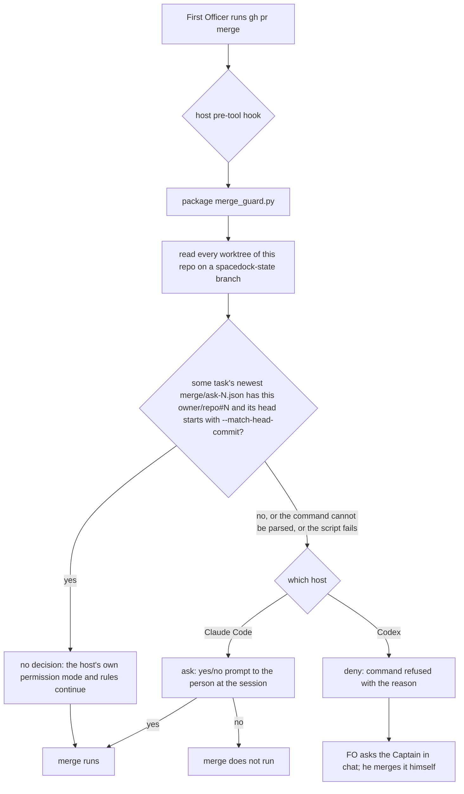

## Scope

- Source: the Captain's 「好」 to question 13 of the batch-4 sitting (2026-10-20), on FO's recommendation 「我建議開這張任務，範圍是兩邊都做，第一步先做 POC。」; recorded as Amendment 3 of fo-write-rules-checked (D7).
- Bite: Release PR iamcxa/kc-claude-plugins#672 merged 2026-10-20T03:07:06Z on a delivery question that did not name it (observer report of special-role-calls-fire-when-needed). No state records a Release PR merge, so no task-reading check reaches it.
- Facts read 2026-10-20: Claude Code user settings run `defaultMode` auto with no ask or deny rule and no allow rule naming `gh pr merge`; Codex CLI 0.162.1 lists `hooks` as stable (`codex features list`), and `~/.codex/rules/default.rules` holds `prefix_rule(pattern=["gh", "pr", "merge"], decision="allow")`.
- First step, a POC before any design: prove on each host that a pre-tool hook (Claude `PreToolUse`, Codex `pre_tool_use`) or a Codex prefix rule actually stops a `gh pr merge` for the Captain under the mode he runs (auto on Claude). If an `ask` does not prompt, the route is `deny`, a new question for him.
- Guard shape to test (from fo-write-rules-checked `### Deferred to the D7 guard task`): allow a merge only when a task's newest `merge/ask-N.json` carries that PR and its saved `head` equals the `--match-head-commit` value (kc-dev-flow-2 0.26.0 already saves both), otherwise ask. It must not defer to a permission prompt.
- Upstream first: ADR 0003 (an adopter-owned hook, not package-shipped); Spacedock merge guard; the deferred `Merges:` line design and both engineering-reviewer reads in fo-write-rules-checked/reviews/.
- Non-goals: changing the Captain's own Claude or Codex settings without his word; the `Merges:` line itself unless the POC shows the guard needs it.

- Added 2026-11-06: the facts above are from 2026-10-20; the worker re-reads both hosts' current hook and rule behavior before relying on them. The proof runs in isolated Claude and Codex state (a throwaway HOME), never in the Captain's own settings.
- Batch 15: the Captain 「可以」 (chat, 2026-11-06), answering 「第 15 批做這 2 張，可以嗎？其他 4 張要退休或擱置，我下一題再問你。」, which named this task.

## Budget
- Ideation carries the proof on both hosts; implementation is one package PR, or none if the proof shows the guard belongs outside the package (ADR 0003). The workflow word budget does not rise unless the design names a raise for the Captain.

## Stop condition
- On each host, in isolated state under the mode the Captain runs, a `gh pr merge` that no task's newest `merge/ask-N.json` carries (PR and `--match-head-commit` head) is stopped before it runs and a matching one proceeds; or the design names the host that cannot stop it and the route it needs from the Captain.

## FO alignment

Alignment: needed before ideation; the POC result decides between an ask route and a deny route, and a deny route is his call.
Result: aligned at backlog: Batch 15 backlog gate, the Captain 「核准（建議）」 (host question dialog, 2026-11-06), answering 「決定：「合併前擋下沒人問過的合併」這張用 Pilot，照任務寫下的範圍、預算與停止條件進入構想嗎？核准即接受：構想階段先在隔離的 Claude 和 Codex 環境證明兩邊都擋得住（不動你自己的設定），如果某一邊只能用 deny 擋，那條路線另外問你。」, approved the outcome and bounds in this file.
Surfaces: none
Visible change: none
Outside this repository's surfaces: the Captain's Claude Code and Codex user-level hook or rule files on each machine.
Release review: not needed: workflow maintenance, on no journey map.

## Design

### Chain check

Read 2026-11-06, kc-dev-flow-2 at origin/main (released 0.35.0):
- **Spacedock 0.27.3.** `spacedock merge guard` runs after a merge, to finalize and archive a task (`workflow.md` § Delivery authority: "Observe the actual repository-qualified PR merge before … running SD merge guard"). It never stops a `gh pr merge` and never sees a PR with no task, such as a Release PR.
- **kc-dev-flow-2.** `delivery_gate.py check` saves `<task>/merge/ask-N.json` (`write_record`) with `pr` as `owner/repo#N` (120 of 120 saved records) and the full 40-hex `head`. The `ASK` line ends "Every other PR, the Release PR included, is asked one at a time": text, enforced by nothing. No package script stops a merge. ADR 0003 ships no hook and `adoption.md` § Secret reads says "Codex has no equivalent hook". That sentence is now false (below), which meets ADR 0003's own reopen condition ("if Codex gains a pre-tool hook the package could target").
- **Siblings.** No merge guard exists. qnow's project `PreToolUse` hooks guard lock and env files only, relay and web have no project `PreToolUse` hook, and the user-level `block-secret-reads.py` guards secret reads.
- **Third-party mechanisms, read from the tools themselves.** `claude --help` (2.1.316) and `codex exec --help` (0.162.1) for the flags. The Codex binary's own strings hold "unsupported permissionDecision:ask" and "unsupported permissionDecision:allow" for `PreToolUse`, plus "Command blocked by PreToolUse hook". The facts from 2026-10-20 still hold: Claude `defaultMode` is `auto` with no ask/deny rule and no allow rule naming `gh pr merge`; Codex `hooks` is `stable`; `~/.codex/rules/default.rules` line 70 allows `gh pr merge`.

### Proof on each host (POC, isolated)

Every run used a fake `gh` that only logs, against `merge-guard-poc/does-not-exist` (GitHub returns 404 for that owner). The guard was `poc/merge_guard.py` and the records were fixtures: task-a's newest record carries #1 at head `1111…`, and its older record carries #1 at `2222…`. Claude isolation: `--setting-sources project --settings <hook JSON>` in a throwaway git folder, so none of the operator's settings, plugins or hooks load. Claude's login comes from the keychain, and a throwaway `CLAUDE_CONFIG_DIR` printed "Not logged in". Codex isolation: `--ignore-user-config --ephemeral`, with the hook given only as a `-c hooks.PreToolUse=…` session flag. Login stays in `CODEX_HOME` and nothing is copied. Re-run with `bash poc/run.sh`; output is in `poc/run-output.txt`, manual runs in `poc/manual-runs.md`.

| Host, mode | Merge | Guard returns | Result |
| --- | --- | --- | --- |
| Claude `-p`, `--permission-mode auto` | not carried (`2222…`, the older record) | `ask` | stopped: listed in `permission_denials`, fake gh never ran |
| Claude `-p`, auto | carried (`1111…`) | nothing | ran (auto mode allowed it) |
| Claude interactive TUI, auto | not carried | `ask` | **prompted**: "Hook PreToolUse:Bash requires confirmation … Do you want to proceed? 1. Yes 2. No", with the guard's reason (`poc/claude-tui-nomatch-prompt.txt`); answered No, nothing ran |
| Codex `exec`, rules ignored | not carried | `deny` | stopped before it ran ("Command blocked by PreToolUse hook") |
| Codex `exec`, operator rules loaded (allow `gh pr merge`), `approval_policy="on-request"` | not carried, plain `gh` resolving to the **real** `/opt/homebrew/bin/gh` | `deny` | stopped before it ran: the hook ran before the allow rule |
| Codex `exec` | carried | nothing | ran |
| Codex `exec` | not carried | `ask` | **ran**: Codex ignored `ask` and printed no warning on stderr or in the JSON events (`poc/codex-askroute-stderr.txt`) |
| Codex `exec`, hook in the folder's `.codex/hooks.json` | not carried | (hook never fired) | ran. Bounded: the folder was untrusted, and project trust lives in the ignored user config |

Findings:
- **Claude can ask.** Under auto mode a hook `ask` prompts a person, and headless with no host it becomes a denial.
- **Codex can only deny.** A hook `ask` or `allow` is ignored silently, so the merge runs.
- The Codex payload reported `permission_mode: bypassPermissions` even with `approval_policy="on-request"`, so that field does not show the approval policy. The deny held under both policies.
- Not exercised: a Paseo-hosted Claude session, where the prompt goes to Paseo's permission UI, and a peer agent can answer another agent's prompt (Paseo 0.12). A Codex interactive or app-server session, where the same hook engine runs. Codex hook registration from `~/.codex/hooks.json` (the file the operator's Paseo hooks already use, trust recorded under `[hooks.state]` in `config.toml`).

**Replay on real state** (`poc/replay.py`, output `poc/replay-output.txt`). The POC guard read the dev2 state checkout. Over #672 plus the 83 PRs merged in this repository since 2026-10-23, it stopped #672 (the bite) and 29 of the others, and passed 54. The 30 stops are 10 Release PRs, 9 workflow-sync PRs and 11 others: journey-map task PRs from another workflow's state, 2 learning PRs and one CI change. None of the other 6 state branches of this repository holds a record for those 11. Bound: `mergedBy` is `iamcxa` on every one, because FO uses his token, so the replay cannot separate hand merges from FO merges. On Claude that is about 2 prompts a day. On Codex, a Codex FO cannot run those merges at all.

### PRFAQ

**Proposition.** When First Officer runs `gh pr merge` on a PR that no task's newest saved merge record carries at that exact head, the merge does not run until the Captain decides. On Claude Code he gets a yes/no prompt. On Codex the command is refused, and he merges it himself. A merge that the delivery gate saved for that head goes through as before.

**FAQ.**
- *Why does a Release PR stop?* No task saves a record for it. That is the #672 shape: an unasked Release PR merge with no trace in state.
- *Why does Codex refuse instead of asking?* Codex 0.162.1 has no `ask` for a pre-tool hook. It ignores `ask` and runs the command, so `deny` is the only stop.
- *Does a passing merge mean the Captain approved it?* No. The guard checks that FO ran the delivery gate on that head. Whether the approved question names the merge stays with ADR 0023/0062 and the `ASK` line. The `Merges:` line design stays parked.
- *Where does it live?* The package ships the guard script and its tests, because it reads the package's own record format. Each machine registers the hook in its user-level settings, following ADR 0003. The package ships no `hooks.json`, because a plugin hook would fire in every project where the plugin is enabled.

**Acceptance evidence plan.** Unit tests of the script; a linked-worktree discovery test; the two-host runs above repeated against the package script; and a fail-closed run. See `## Acceptance criteria`.

### Mermaid

### What changes

One package PR:
- `kc-dev-flow-2/scripts/merge_guard.py` (new), `claude|codex` argument, hook JSON on stdin. Its rules:
  - It finds records by reading `git worktree list --porcelain` from the hook's `cwd` and taking every worktree on a `refs/heads/spacedock-state/*` branch, then globbing `*/merge/ask-*.json` and `_archive/*/merge/ask-*.json` on disk. On-disk reads see a record that `check` just wrote and nobody has committed yet. Verified here: the dev2 and dev2-poc state checkouts are listed worktrees.
  - It takes the newest record per task (highest N) and resolves the PR from the number, `--repo`/`-R`/`--repo=`, a PR URL, or the cwd's `origin` remote.
  - It stops when: there is no `--match-head-commit`, the head is shorter than 7 hex, there is more than one `gh pr merge`, the command cannot be parsed, or the script fails.
  - Claude gets `ask` on a stop, Codex `deny`. A carried merge gets no output.
  - The stop reason (Codex: "…; on this host only the Captain can run this merge") is the only new text FO reads.
- `kc-dev-flow-2/scripts/test_merge_guard.py` (new), plus one step in `.github/workflows/kc-dev-flow-2-tests.yml`, which runs each test file by name.
- `kc-dev-flow-2/references/sd/adoption.md`:
  - a new `## Merge guard` section giving one registration per host: Claude user `settings.json` `PreToolUse` `Bash` entry; Codex user hook entry with its trust step, deny-only;
  - the fail-closed wrapper `python3 <stable path>/merge_guard.py <host> || exit 2`;
  - the stop count to expect;
  - § Secret reads: "Codex has no equivalent hook, so there the `Secrets:` line is the only control" becomes "Codex's pre-tool hook can only deny".
- A new ADR (number reserved by FO at dispatch), short title `a-merge-no-task-record-carries-is-stopped-by-a-user-registered-hook`. Draft: **Decision:** the package ships the guard script and documents a user-level registration on each host, Claude routes `ask`, Codex routes `deny`, and the package ships no hook file. **Context:** #672; this POC table; ADR 0003's reopen condition met. **Consequences:** about 2 stops a day; Codex FOs cannot merge an uncarried PR; a command that only mentions `gh pr merge` in text is stopped too; a merge of another repository's PR from this cwd is stopped (its state is not a worktree here). **Words:** the Captain's ruling on D1 and D2.

Not changed: `delivery_gate.py` (its `ASK` lines stay), `references/sd/workflow.md`, `_mods/`. Installing the hook on the Captain's machines is his action after release (Non-goals).

### Words FO reads at each moment

Counted 2026-11-06 at origin/main with `str.split()`. Before and after are the same at every moment FO reads today, because nothing FO reads at startup, idle or the merge ask changes:

| Moment | Before | After |
| --- | --- | --- |
| startup / idle (`_mods/kc-dev-flow-2.md`, README) | unchanged | unchanged |
| merge ask (`check` output `ASK` 40 or `ASK_UNQUOTED` 39; § Delivery authority 485) | 525 / 524 | 525 / 524 |
| merge run, carried | 0 | 0 |
| merge run, not carried | 0 | 16 (Claude reason) or about 21 (Codex reason), on the prompt or refusal |
| adoption / refit (`adoption.md`, 2347; § Secret reads 157) | 2347 | about 2460 (new section about 110 words; Secret reads line about −6) |

`WORKFLOW_WORD_BUDGET` covers `workflow.md` only and does not move. The design asks for no raise.

### Non-goals

- Editing the Captain's Claude or Codex settings or rules. The implementation PR installs nothing; registration on each machine is his `sh run` step after release.
- The parked `Merges:` line, or reading the approved question. The guard does not need either: it checks the record, not the grant.
- An exemption for Release, sync or learning PRs. Each still stops, which is the bite; an exemption would need its own record and its own ruling.

### Needs decision

Past rulings read:
- ADR 0003 (no shipped hook; adopter enforces), 0023 and 0062 (what a delivery question grants).
- `git -C <state> grep -n 'Override:'`: no override on a merge, hook or guard question.
- fo-write-rules-checked D7, which the Captain answered 「好」: a guard that returns `ask`, and a `deny` route is a new question for him.

These two decisions are coupled: D2 settles where the D1 route is written.

- **D1. On Codex, stop an uncarried merge by refusing it (`deny`), so that the Captain merges it himself?** Recommend yes. It is the only stop Codex has: a Codex `ask` let the merge run silently, while `deny` held even against his `gh pr merge` allow rule. Worse under yes: a Codex FO cannot merge a Release, sync or learning PR at all, about 2 a day by the replay, and must hand each to him. Under no: Codex gets no guard, and the #672 shape stays open on Codex.
- **D2. Ship the guard as a package script that each machine registers in user-level settings (recommended), or ship it as a plugin hook?** Recommend the script with user registration. It follows ADR 0003: no hook fires in projects without dev2, and the Captain decides per machine. The script still gets package tests because it reads the package's record format. Worse: protection depends on each machine registering the hook, which happens once per machine and host by his hand, and an unregistered machine stays unguarded with nothing showing it. Under a plugin hook: it fires wherever the plugin is enabled and stops every merge in a repository with no state, and ADR 0003 would need superseding rather than extending.

### Batch overlap

| Task | Shared file or check | Overlap |
| --- | --- | --- |
| delivery-question-requires-worktree-clause (batch 15) | none: it changes `delivery_gate.py` `question`/`ASK_FORM` and its tests; this design leaves `delivery_gate.py` and `workflow.md` alone | none |
| comment-check-reaches-delivery-gate, fo-write-checks-parse-top-level | `delivery_gate.py`, `test_delivery_gate.py`, `kc-dev-flow-2-tests.yml` (each new test file adds a step) | CI workflow file only: an append conflict, no rule overlap |
| captain-ruling-sources-checked (held), adr-required-statement (validation), archive-waits-for-observer-report (implementation), adoption-asks-which-extensions | `references/sd/adoption.md` (different sections: Captain rulings ledger, learn capability, migration paragraph) | same file, different sections; any ADR-landing task shares the ADR number sequence |
| dispatch-carries-reserved-adr-number, seed-check-requires-alignment-result, adr-silent-undo-probe | the ADR number sequence (`docs/adr/NNNN-*`) | number reservation only |
| journey-canvas-hosted-poc, picky-reviewers-may-run-on-gemini, ops-inbox-r1-setup-and-isolation, pr-review-lite-value-pilot, journey-server-host-pilot | none found by name | none |

Recommended order: this task after adr-required-statement and archive-waits-for-observer-report land their `adoption.md` edits, rebasing on them; it is independent of delivery-question-requires-worktree-clause.

## Acceptance criteria

**AC-1** `python3 kc-dev-flow-2/scripts/test_merge_guard.py` passes, and covers:
- carried at the full head and at a 7-hex prefix → no output;
- only an older record of the task carries it → stop;
- another PR or another repository → stop;
- no `--match-head-commit`, or a head under 7 hex → stop;
- two merges in one command → stop;
- `-R`, `--repo=` and PR-URL forms, and the `origin` fallback, resolve;
- an archived task's newest record carries it → no output;
- a non-merge command → no output;
- for `codex` the only decision ever printed is `deny`.

Falsifiers: drop the newest-record filter and the older-record case passes; print `ask` for codex and the codex-decision test fails.

**AC-2** Discovery reads disk, not commits. In a temporary repository, a linked worktree on `spacedock-state/x` holding an uncommitted `t/merge/ask-1.json` carries; the same file in a worktree on another branch does not. Falsifier: reading `git show HEAD:` misses the uncommitted record.

**AC-3** Fail closed on both hosts. With the registration that `adoption.md` documents, a missing script path, an unreadable record or a Python exception stops the merge: on Claude the command is denied or prompted, on Codex refused, and the fake `gh` log stays empty. Falsifier: without `|| exit 2`, a Python exit 1 is a non-blocking hook error on Claude and the merge runs.

**AC-4** Claude host. The package script replaces `poc/merge_guard.py` in `poc/run.sh`:
- `claude -p --permission-mode auto`: an uncarried merge appears in `permission_denials` and the fake `gh` does not run; a carried merge runs;
- one interactive auto-mode run shows the "Do you want to proceed?" prompt with the guard's reason.

**AC-5** Codex host. With the package script, `codex exec` stops an uncarried merge before it runs, both with `--ignore-rules` and with the operator's rules loaded, and runs a carried one. Evidence: the hook log and the empty fake `gh` log.

**AC-6** Replay. `poc/replay.py`, pointed at the package script and the dev2 state checkout, stops #672 at its merged head and gives the same 54 pass / 30 stop split over `poc/merged-14d.json`, or explains each difference.

**AC-7** `adoption.md`:
- `## Merge guard` gives both hosts' registrations, says Codex is deny-only, and gives the expected stop count;
- § Secret reads no longer says Codex has no hook (`git grep -n "Codex has no equivalent hook" origin/<head> -- kc-dev-flow-2` finds nothing);
- `lint-skills.py` passes with `WORKFLOW_WORD_BUDGET` unchanged.

**AC-8** The ADR lands with the Captain's words for D1 and D2 and the number FO reserved. `git diff --stat` names neither `delivery_gate.py` nor `references/sd/workflow.md`.

## Stage Report: ideation

- DONE: Prove on each host, in isolated Claude and Codex state under the mode the Captain runs, whether a pre-tool hook or rule stops a gh pr merge that no task's newest merge/ask-N.json carries and lets a matching one through; then design the guard and where it lives (package or adopter-owned under ADR 0003), naming any host that can only deny
  Claude: `ask` prompts in the auto-mode TUI and is denied headless, and a carried merge runs. Codex: only `deny` stops, even against his allow rule, while `ask` silently ran the merge (`poc/run-output.txt`, `poc/manual-runs.md`). Design: a package script with user-level registration; Codex is the deny-only host (D1, D2). Not exercised: Paseo-hosted Claude (where FO runs, and where a peer agent can answer the prompt) and Codex interactive/app-server sessions.
- DONE: A `### Batch overlap` section naming each file the design would change and each other batch task (delivery-question-requires-worktree-clause) and live task of other sessions (adoption-asks-which-extensions, adr-silent-undo-probe, captain-ruling-sources-checked (held), comment-check-reaches-delivery-gate, dispatch-carries-reserved-adr-number, fo-write-checks-parse-top-level, journey-canvas-hosted-poc, picky-reviewers-may-run-on-gemini, seed-check-requires-alignment-result, archive-waits-for-observer-report, ops-inbox-r1-setup-and-isolation, pr-review-lite-value-pilot, adr-required-statement, journey-server-host-pilot (stalled, held or driven by other sessions; read only)) that changes the same file or check, so FO can order implementation
  `### Batch overlap`: `adoption.md` shared with 4 tasks in other sections; the CI test workflow and the ADR sequence are shared; no overlap with the batch sibling; order line given.
- DONE: The words FO reads at each lifecycle moment, before and after, per root learning.md "Measure the words FO reads at each moment, not one file's size"
  `### Words FO reads at each moment`: merge ask 525/524 unchanged; +16 to 21 words only on a stopped merge; adoption.md about +110; no budget raise.
- DONE: Acceptance criteria with reproducible evidence clauses and falsifiers, and unresolved decisions for the Captain, each with a recommendation and what gets worse under it
  AC-1 not yet verified; the 11 hand-made cases ran only against `poc/merge_guard.py`. AC-2 not yet verified. AC-3 not yet verified; nothing has tested the fail-closed wrapper. AC-4 not yet verified for the package script; for the POC script, `poc/run-output.txt` (claude-p) and `poc/claude-tui-nomatch-prompt.txt`. AC-5 not yet verified for the package script; for the POC script, `poc/run-output.txt` (codex) and `poc/manual-runs.md` item 2. AC-6 not yet verified for the package script; for the POC script, `poc/replay-output.txt` gives 54 pass / 30 stop. AC-7 not yet verified. AC-8 not yet verified. D1 (Codex deny) and D2 (placement) are coupled, each with what gets worse. `design_surfaces.py check`: "design surfaces presentable", exit 0. `status --ac-scan` reads AC-1 to AC-8.

### Summary

Isolated runs on both hosts with a fake `gh` showed that a Claude `PreToolUse` `ask` prompts under auto mode. They also showed that Codex 0.162.1 honours only `deny` and ignores `ask` without a warning, so Codex is the host that can only deny. A replay of 84 real merges stops #672 and 29 others, about 2 a day.

The design: a package `merge_guard.py` that each machine registers in user-level settings, plus an ADR and an `adoption.md` section. It also corrects the now-false "Codex has no equivalent hook" sentence. `delivery_gate.py` and `workflow.md` are unchanged.

Not exercised: Paseo-hosted sessions, where a peer agent can answer a permission prompt; Codex interactive and app-server sessions; and Codex registration via `~/.codex/hooks.json`. Two POC side effects: Claude recorded trust for `/tmp/merge-guard-poc/work` in the operator's global Claude state, and Claude Code's own background `gh` calls hit the fake `gh`.
