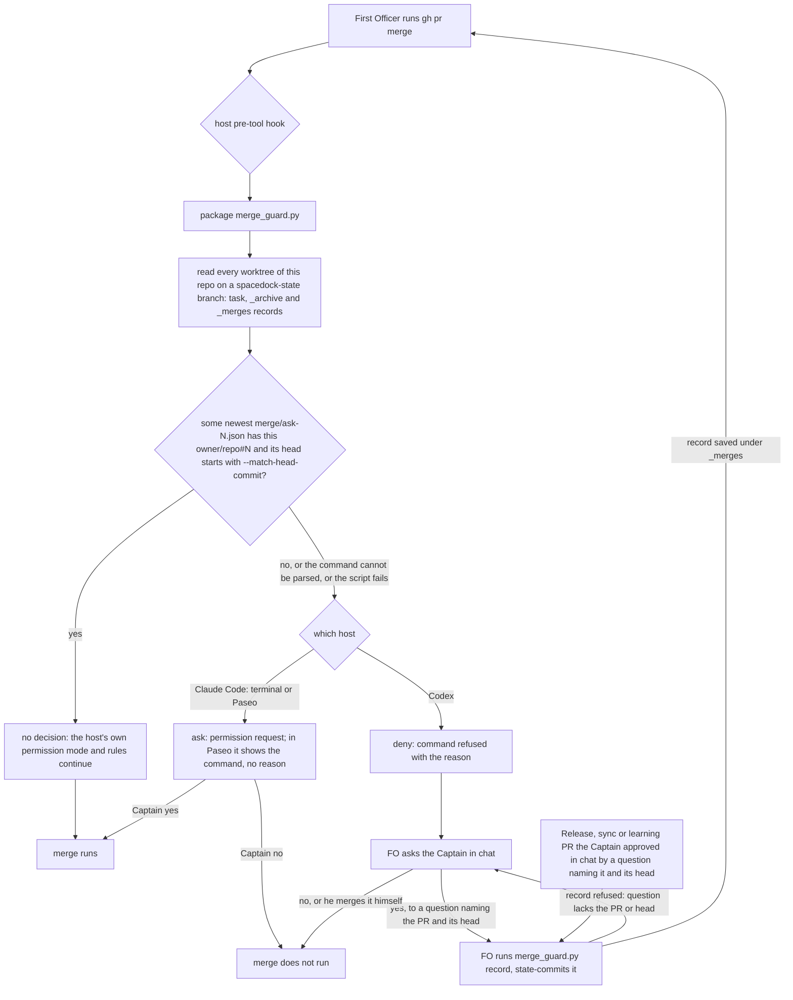

## Scope

- Source: the Captain's 「好」 to question 13 of the batch-4 sitting (2026-10-20), on FO's recommendation 「我建議開這張任務，範圍是兩邊都做，第一步先做 POC。」; recorded as Amendment 3 of fo-write-rules-checked (D7).
- Bite: Release PR iamcxa/kc-claude-plugins#672 merged 2026-10-20T03:07:06Z on a delivery question that did not name it (observer report of special-role-calls-fire-when-needed). No state records a Release PR merge, so no task-reading check reaches it.
- Facts read 2026-10-20: Claude Code user settings run `defaultMode` auto with no ask or deny rule and no allow rule naming `gh pr merge`; Codex CLI 0.162.1 lists `hooks` as stable (`codex features list`), and `~/.codex/rules/default.rules` holds `prefix_rule(pattern=["gh", "pr", "merge"], decision="allow")`.
- First step, a POC before any design: prove on each host that a pre-tool hook (Claude `PreToolUse`, Codex `pre_tool_use`) or a Codex prefix rule actually stops a `gh pr merge` for the Captain under the mode he runs (auto on Claude). If an `ask` does not prompt, the route is `deny`, a new question for him.
- Guard shape to test (from fo-write-rules-checked `### Deferred to the D7 guard task`): allow a merge only when a task's newest `merge/ask-N.json` carries that PR and its saved `head` equals the `--match-head-commit` value (kc-dev-flow-2 0.26.0 already saves both), otherwise ask. It must not defer to a permission prompt.
- Upstream first: ADR 0003 (an adopter-owned hook, not package-shipped); Spacedock merge guard; the deferred `Merges:` line design and both engineering-reviewer reads in fo-write-rules-checked/reviews/.
- Non-goals: changing the Captain's own Claude or Codex settings without his word; the `Merges:` line itself unless the POC shows the guard needs it.

- Added 2026-11-06: the facts above are from 2026-10-20; the worker re-reads both hosts' current hook and rule behavior before relying on them. The proof runs in isolated Claude and Codex state (a throwaway HOME), never in the Captain's own settings.
- Batch 15: the Captain 「可以」 (chat, 2026-11-06), answering 「第 15 批做這 2 張，可以嗎？其他 4 張要退休或擱置，我下一題再問你。」, which named this task.

## Budget
- Ideation carries the proof on both hosts; implementation is one package PR, or none if the proof shows the guard belongs outside the package (ADR 0003). The workflow word budget does not rise unless the design names a raise for the Captain.

## Stop condition
- On each host, in isolated state under the mode the Captain runs, a `gh pr merge` that no task's newest `merge/ask-N.json` carries (PR and `--match-head-commit` head) is stopped before it runs and a matching one proceeds; or the design names the host that cannot stop it and the route it needs from the Captain.

## FO alignment

Alignment: needed before ideation; the POC result decides between an ask route and a deny route, and a deny route is his call.
Result: aligned at backlog: Batch 15 backlog gate, the Captain 「核准（建議）」 (host question dialog, 2026-11-06), answering 「決定：「合併前擋下沒人問過的合併」這張用 Pilot，照任務寫下的範圍、預算與停止條件進入構想嗎？核准即接受：構想階段先在隔離的 Claude 和 Codex 環境證明兩邊都擋得住（不動你自己的設定），如果某一邊只能用 deny 擋，那條路線另外問你。」, approved the outcome and bounds in this file.
Surfaces: none
Visible change: none
Outside this repository's surfaces: the Captain's Claude Code and Codex user-level hook or rule files on each machine.
Release review: not needed: workflow maintenance, on no journey map.

## Design

### Chain check

Read 2026-11-06, kc-dev-flow-2 at origin/main (released 0.35.0):
- **Spacedock 0.27.3.** `spacedock merge guard` runs after a merge, to finalize and archive a task (`workflow.md` § Delivery authority: "Observe the actual repository-qualified PR merge before … running SD merge guard"). It never stops a `gh pr merge` and never sees a PR with no task, such as a Release PR.
- **kc-dev-flow-2.** `delivery_gate.py check` saves `<task>/merge/ask-N.json` (`write_record`) with `pr` as `owner/repo#N` (120 of 120 saved records) and the full 40-hex `head`. The `ASK` line ends "Every other PR, the Release PR included, is asked one at a time": text, enforced by nothing. No package script stops a merge. ADR 0003 ships no hook and `adoption.md` § Secret reads says "Codex has no equivalent hook". That sentence is now false (below), which meets ADR 0003's own reopen condition ("if Codex gains a pre-tool hook the package could target").
- **Siblings.** No merge guard exists. qnow's project `PreToolUse` hooks guard lock and env files only, relay and web have no project `PreToolUse` hook, and the user-level `block-secret-reads.py` guards secret reads.
- **Third-party mechanisms, read from the tools themselves.** `claude --help` (2.1.316) and `codex exec --help` (0.162.1) for the flags. The Codex binary's own strings hold "unsupported permissionDecision:ask" and "unsupported permissionDecision:allow" for `PreToolUse`, plus "Command blocked by PreToolUse hook". The facts from 2026-10-20 still hold: Claude `defaultMode` is `auto` with no ask/deny rule and no allow rule naming `gh pr merge`; Codex `hooks` is `stable`; `~/.codex/rules/default.rules` line 70 allows `gh pr merge`.
- **Paseo 0.15.1** (read 2026-11-06 from the running daemon's child processes, plus `paseo provider diagnostic claude`). Paseo launches each Claude agent as `<provider command> … --permission-prompt-tool stdio --setting-sources=user,project,local --permission-mode auto`. A hook registered in user settings therefore loads in a Paseo-hosted FO session, and a hook `ask` goes to Paseo's permission queue instead of a terminal prompt.
- **Existing record writer.** `delivery_gate.py check` cannot record a Release, workflow-sync or learning PR. It needs a task file, a dispatched `Candidate:` line and the task's validation gate. None of those PRs has these, so the record route is a new `merge_guard.py record` entry point. It writes the same record shape.

### Proof on each host (POC, isolated)

Every run used a fake `gh` that only logs, against `merge-guard-poc/does-not-exist` (GitHub returns 404 for that owner). The guard was `poc/merge_guard.py` and the records were fixtures: task-a's newest record carries #1 at head `1111…`, and its older record carries #1 at `2222…`. Claude isolation: `--setting-sources project --settings <hook JSON>` in a throwaway git folder, so none of the operator's settings, plugins or hooks load. Claude's login comes from the keychain, and a throwaway `CLAUDE_CONFIG_DIR` printed "Not logged in". Codex isolation: `--ignore-user-config --ephemeral`, with the hook given only as a `-c hooks.PreToolUse=…` session flag. Login stays in `CODEX_HOME` and nothing is copied. Re-run with `bash poc/run.sh`; output is in `poc/run-output.txt`, manual runs in `poc/manual-runs.md`.

| Host, mode | Merge | Guard returns | Result |
| --- | --- | --- | --- |
| Claude `-p`, `--permission-mode auto` | not carried (`2222…`, the older record) | `ask` | stopped: listed in `permission_denials`, fake gh never ran |
| Claude `-p`, auto | carried (`1111…`) | nothing | ran (auto mode allowed it) |
| Claude interactive TUI, auto | not carried | `ask` | **prompted**: "Hook PreToolUse:Bash requires confirmation … Do you want to proceed? 1. Yes 2. No", with the guard's reason (`poc/claude-tui-nomatch-prompt.txt`); answered No, nothing ran |
| Codex `exec`, rules ignored | not carried | `deny` | stopped before it ran ("Command blocked by PreToolUse hook") |
| Codex `exec`, operator rules loaded (allow `gh pr merge`), `approval_policy="on-request"` | not carried, plain `gh` resolving to the **real** `/opt/homebrew/bin/gh` | `deny` | stopped before it ran: the hook ran before the allow rule |
| Codex `exec` | carried | nothing | ran |
| Codex `exec` | not carried | `ask` | **ran**: Codex ignored `ask` and printed no warning on stderr or in the JSON events (`poc/codex-askroute-stderr.txt`) |
| Codex `exec`, hook in the folder's `.codex/hooks.json` | not carried | (hook never fired) | ran. Bounded: the folder was untrusted, and project trust lives in the ignored user config |
| Paseo-hosted Claude (`claude-fo` provider, auto, `--permission-prompt-tool stdio`), project settings only | not carried | `ask` | **held in Paseo's permission queue**: request `permission-c2a47796…` (Bash), fake gh not run, agent waiting. Whether it reaches the Captain's phone and can be answered there is his step, not yet observed (`poc/paseo-run.md`) |

Findings:
- **Claude can ask.** Under auto mode a hook `ask` prompts a person, and headless with no host it becomes a denial.
- **Codex can only deny.** A hook `ask` or `allow` is ignored silently, so the merge runs.
- The Codex payload reported `permission_mode: bypassPermissions` even with `approval_policy="on-request"`, so that field does not show the approval policy. The deny held under both policies.
- **Paseo holds the ask, but its request carries no reason.** The pending request shows the full `gh pr merge … --match-head-commit 2222…` command and no reason field. The guard's "no task's newest merge/ask-N.json carries …" text is not in the request or in the session transcript. On the phone the Captain sees the command alone, and a Paseo-hosted FO reads none of the 16 reason words.
- **Any Paseo agent can answer the ask.** `respond_to_permission` is in this session's Paseo tool list, and Paseo exposes it to agents (0.12 note). The ask stops a mistaken merge, but it does not stop an agent that chooses to approve. This run did not answer the request. This session is the test agent's parent and did not answer any notification either.
- Paseo setup: a wrapper reached through `paseo run --env PATH=…` dropped `--agent` and loaded only the throwaway folder's project settings (guard hook, auto mode). It edited no Paseo, Claude or Codex config. `--setting-sources` does not govern `~/.claude/CLAUDE.md` or memory, so those loaded: attempt 1's reply used its closing block. The first attempt ran in the caller's workspace, because an agent-scoped `paseo run` ignores `--cwd`, and the test agent there declined a merge that a peer asked for. Both attempts are in `poc/paseo-run.md`.
- Not exercised: a Codex interactive or app-server session, where the same hook engine runs. Codex hook registration from `~/.codex/hooks.json` (the file the operator's Paseo hooks already use, trust recorded under `[hooks.state]` in `config.toml`).

**Replay on real state** (`poc/replay.py`, output `poc/replay-output.txt`). The POC guard read the dev2 state checkout. Over #672 plus the 83 PRs merged in this repository since 2026-10-23, it stopped #672 (the bite) and 29 of the others, and passed 54. The 30 stops are 10 Release PRs, 9 workflow-sync PRs and 11 others: journey-map task PRs from another workflow's state, 2 learning PRs and one CI change. None of the other 6 state branches of this repository holds a record for those 11. Bound: `mergedBy` is `iamcxa` on every one, because FO uses his token, so the replay cannot separate hand merges from FO merges. On Claude that is about 2 prompts a day. On Codex, a Codex FO cannot run those merges at all.

**Recount with the record route** (`poc/recount.py`, output `poc/recount-output.txt`):
- What ran: for each of the 21 Release, workflow-sync and learning PRs among the 84, `merge_guard.py record` wrote into a throwaway overlay, then the replay ran against the state checkout plus that overlay.
- Result: 74 pass and 10 stop. #672 still stops: its only recorded question ("…hold Release PR #672 until this merges…") names #672 but not its head `6c972e7`, so `record` refused it. That is the bite surviving.
- Falsifier, run: without the head check `record` accepts #672 and the replay passes it.
- Assumption: the other 20 questions are synthetic text naming each PR's number and head. No state shows that such questions were put, which is the gap the record closes from now on.
- Residual: 9 stops stay. They are 5 kc-journey-map task PRs from another workflow's state, the journey slices doc, the docs site, the model roster change and the story-map PR. They stay stopped, as the Captain asked.
- A `_merges/` folder does not change `spacedock status` output: run on a copy of the workflow, before and after, the output was the same.

### PRFAQ

**Proposition.** When First Officer runs `gh pr merge` on a PR that no saved merge record carries at that exact head, the merge does not run until the Captain decides. On Claude Code, in a terminal or in Paseo, the session waits on a yes/no permission request. On Codex the command is refused, and FO asks him in chat. A PR no task owns (a Release, workflow-sync or learning PR) gets a record when he approves it in chat by a question naming its number and head. Its merge then goes through like a task merge that the delivery gate saved for that head.

**FAQ.**
- *Why does #672 still stop?* Its only recorded question asked to *hold* #672 and named no head, so `record` refuses it. A question that does name the PR and head is the Captain's approval of that merge, and the record keeps his words beside it.
- *Why does Codex refuse instead of asking?* Codex 0.162.1 has no `ask` for a pre-tool hook. It ignores `ask` and runs the command, so `deny` is the only stop. After a refusal FO asks him in chat. If he approves by a question naming the PR and head, FO records it and retries; otherwise he merges it himself.
- *What does he see on his phone?* Paseo shows a Bash request with the full `gh pr merge … --match-head-commit <head>` command. Paseo drops the guard's reason. Whether the request reaches his phone and can be answered there is the one step only he can take (`poc/paseo-run.md`).
- *Does a passing merge mean the Captain approved it?* No. A task record shows that FO ran the delivery gate on that head. A `_merges` record shows that FO saved a question naming the PR and head with his answer beside it. Neither proves he said it; that stays with ADR 0023/0062. The `Merges:` line design stays parked.
- *Where does it live?* The package ships the guard script and its tests, because it reads the package's own record format. Each machine registers the hook in its user-level settings, following ADR 0003; Paseo loads user settings, so the same registration covers a Paseo-hosted FO. The package ships no `hooks.json`, because a plugin hook would fire in every project where the plugin is enabled.

**Acceptance evidence plan.** Unit tests of the script, including the record command. A linked-worktree discovery test. The two-host runs repeated against the package script. A fail-closed run. The replay and recount. The Captain's phone observation. See `## Acceptance criteria`.

### Mermaid

### What changes

One package PR:
- `kc-dev-flow-2/scripts/merge_guard.py` (new). It takes a `claude|codex` argument and reads the hook JSON on stdin. Its rules:
  - It finds records by reading `git worktree list --porcelain` from the hook's `cwd` and taking every worktree on a `refs/heads/spacedock-state/*` branch. In each it globs `*/merge/ask-*.json`, `_archive/*/merge/ask-*.json` and `_merges/*/merge/ask-*.json` on disk. On-disk reads see a record that was just written and not yet committed. Verified here: the dev2 and dev2-poc state checkouts are listed worktrees.
  - It takes the newest record per folder (highest N) and resolves the PR from the number, `--repo`/`-R`/`--repo=`, a PR URL, or the cwd's `origin` remote.
  - It stops when there is no `--match-head-commit`, when the head is shorter than 7 hex, when there is more than one `gh pr merge`, when the command cannot be parsed, or when the script fails.
  - Claude gets `ask` on a stop and Codex gets `deny`. A carried merge gets no output.
  - The Codex reason reads: "…; if the Captain approved this merge by a question naming the PR and its head, run merge_guard.py record and retry; otherwise ask him; on this host only he can run this merge."
- `merge_guard.py record <state dir> --pr owner/repo#N --head <40 hex> --question-file <file> --answer <his words>` (new). It saves `<state dir>/_merges/<owner>-<repo>-<N>/merge/ask-K.json` with the PR, the head, the question (cut at 600 characters) and his answer (cut at 200). It refuses, exit 1, when the question names neither `#N` nor `/pull/N`, when it lacks the head's first 7 hex, when the answer is empty, or when the head is not 40 hex. FO state-commits the record and pushes it, as with other task records. The guard reads disk, so the push is for audit and peers. A Release PR's head moves on every push to main, so one approval covers one head. POC: `poc/merge_guard.py` `record`, run in `poc/recount.py`.
- `kc-dev-flow-2/scripts/delivery_gate.py` (D3): the closing sentence of `ASK` and `ASK_UNQUOTED`, "Every other PR, the Release PR included, is asked one at a time.", gains "; after his yes to a question naming its number and head, run `merge_guard.py record` before merging it." That is the moment FO asks for a Release PR, and on Claude FO reads no stop reason. `test_delivery_gate.py` quotes the sentence 5 times (`SENTENCE` and the `ASK` literals), and those tests follow it. `test_dispatch_records.py` quotes it in fixture text that `check` does not compare, so it stays.
- `kc-dev-flow-2/scripts/test_merge_guard.py` (new), plus one step in `.github/workflows/kc-dev-flow-2-tests.yml`, which runs each test file by name.
- `kc-dev-flow-2/references/sd/adoption.md`:
  - a new `## Merge guard` section with one registration per host. Claude: a user `settings.json` `PreToolUse` `Bash` entry, which Paseo-hosted sessions load too. Codex: a user hook entry with its trust step, deny-only. The section also covers the record route for Release, sync and learning PRs;
  - the fail-closed wrapper `python3 <stable path>/merge_guard.py <host> || exit 2`;
  - the stop count to expect: about 9 in 14 days with the record route, against 30 without it;
  - § Secret reads: "Codex has no equivalent hook, so there the `Secrets:` line is the only control" becomes "Codex's pre-tool hook can only deny".
- A new ADR (FO reserves the number at dispatch), short title `a-merge-no-record-carries-is-stopped-by-a-user-registered-hook`. Draft:
  - **Decision:** the package ships the guard script, its record command, and a user-level registration for each host. Claude routes `ask`, Codex routes `deny`. A PR no task owns is carried only by a record whose question names its number and head. The package ships no hook file.
  - **Context:** #672; the POC table; ADR 0003's reopen condition is met.
  - **Consequences:** about 9 stops in 14 days. A Paseo request shows the command without the reason, and any Paseo agent can answer it. A Codex FO merges an uncarried PR only after a record. A command that only mentions `gh pr merge` in text is stopped too. A merge of another repository's PR from this cwd is stopped, because its state is not a worktree here.
  - **Words:** the Captain's rulings on D1 to D4.

Not changed: `references/sd/workflow.md` and `_mods/`. Installing the hook on the Captain's machines is his action after release (Non-goals).

### Words FO reads at each moment

Counted 2026-11-06 at origin/main with `str.split()`:

| Moment | Before | After |
| --- | --- | --- |
| startup / idle (`_mods/kc-dev-flow-2.md`, README) | unchanged | unchanged |
| merge ask (`check` output `ASK` 40 or `ASK_UNQUOTED` 39; § Delivery authority 485) | 525 / 524 | 542 / 541 (the closing sentence grows from 13 to 30 words, D3) |
| Release, sync or learning PR approved in chat (`record` output) | 0 | 2 on success; about 7 per refusal line |
| merge run, carried | 0 | 0 |
| merge run, not carried, Claude terminal | 0 | 16 (reason, shown on the prompt) |
| merge run, not carried, Paseo-hosted Claude | 0 | 0: Paseo's request carries no reason (observed) |
| merge run, not carried, Codex | 0 | about 42 (reason, on the refusal) |
| adoption / refit (`adoption.md`, 2347; § Secret reads 157) | 2347 | about 2490 (new section about 140 words, including the record route; Secret reads line about −6) |

`WORKFLOW_WORD_BUDGET` covers `workflow.md` only and does not move. The design asks for no raise.

### Non-goals

- Editing the Captain's Claude, Codex or Paseo settings or rules. The implementation PR installs nothing; registration on each machine is his `sh run` step after release. The Paseo run edited no config.
- The parked `Merges:` line, or judging whether the approved question means "merge". `record` checks that the question names the PR and head; it does not read intent.
- Carrying the 9 residual PRs (kc-journey-map task PRs from another workflow's state, docs and CI changes). They have no task here and no chat record, so they keep stopping.
- Stopping a Paseo agent from answering another agent's permission request. That is a Paseo boundary; D4 names it.

### Needs decision

Past rulings read:
- ADR 0003 (no shipped hook; adopter enforces), 0023 and 0062 (what a delivery question grants).
- `git -C <state> grep -n 'Override:'`: no override on a merge, hook or guard question.
- fo-write-rules-checked D7, which the Captain answered 「好」: a guard that returns `ask`, and a `deny` route is a new question for him.
- The ideation revise of 2026-11-06, which kept D1 and D2 and asked for the Paseo run and the record route (gate record above).

D1 and D2 keep the direction the Captain accepted. D3 and D4 are new from the revise items.

- **D1. On Codex, stop an uncarried merge by refusing it (`deny`)?** Recommend yes; the revise kept it. It is the only stop Codex has: a Codex `ask` let the merge run silently, while `deny` held even against his `gh pr merge` allow rule. Worse under yes: a Codex FO cannot merge an uncarried PR until a record exists. About 9 PRs in 14 days stay with him by hand. Under no: Codex gets no guard, and the #672 shape stays open on Codex.
- **D2. Ship the guard as a package script that each machine registers in user-level settings, not as a plugin hook?** Recommend yes; the revise kept it. It follows ADR 0003, and Paseo loads user settings, so one registration covers Paseo-hosted FOs. Worse: each machine is unguarded until he registers it, and nothing shows that.
- **D3. Carry a Release, workflow-sync or learning PR by a record that `merge_guard.py record` saves only when his approving question names the PR's number and its head, and add one sentence to the `delivery_gate.py` merge-ask line so FO records before merging?** Recommend yes. It is the route the revise asked for. The head rule is what keeps #672 stopping: its question named #672 but no head (falsifier run). The sentence is needed because on Claude FO reads no stop reason: in Paseo the request carries none, and in a terminal the prompt goes to the person. Worse under yes:
  - A Release PR re-pushed after his yes needs a new question, because the head moved.
  - `delivery_gate.py` is shared with batch sibling delivery-question-requires-worktree-clause (Batch overlap).
  - The record shows FO saved his words; it does not prove he said them.
  Under no: every such PR stops, about 2 a day, and on Codex he merges each one by hand.
- **D4. On a Paseo-hosted Claude FO, keep `ask`, which any Paseo agent holding `respond_to_permission` can answer, rather than `deny` as on Codex?** Recommend `ask`, if his phone step shows the request reaches him and can be answered. The bite was an FO misreading a grant, and `ask` catches that. With the record route, `ask` costs him about 9 taps in 14 days. Worse under `ask`: an agent can approve the merge, and the request shows him the command without the guard's reason. Under `deny`: no agent can approve it, but he merges each uncarried PR by hand, and the guard would need a way to tell a Paseo host apart. If his phone step shows the request does not reach him, recommend `deny`.

### Batch overlap

| Task | Shared file or check | Overlap |
| --- | --- | --- |
| delivery-question-requires-worktree-clause (batch 15) | `delivery_gate.py` and `test_delivery_gate.py`: it changes `question`/`ASK_FORM`; D3 changes the closing sentence of `ASK` and `ASK_UNQUOTED` | same file, adjacent constants, and tests that quote the `ASK` text: textual conflict, no rule overlap |
| comment-check-reaches-delivery-gate, fo-write-checks-parse-top-level | `delivery_gate.py`, `test_delivery_gate.py`, `kc-dev-flow-2-tests.yml` (each new test file adds a step) | same files; rebase needed; no rule overlap |
| captain-ruling-sources-checked (held), adr-required-statement (validation), archive-waits-for-observer-report (implementation), adoption-asks-which-extensions | `references/sd/adoption.md` (different sections: Captain rulings ledger, learn capability, migration paragraph) | same file, different sections; any ADR-landing task shares the ADR number sequence |
| dispatch-carries-reserved-adr-number, seed-check-requires-alignment-result, adr-silent-undo-probe | the ADR number sequence (`docs/adr/NNNN-*`) | number reservation only |
| journey-canvas-hosted-poc, picky-reviewers-may-run-on-gemini, ops-inbox-r1-setup-and-isolation, pr-review-lite-value-pilot, journey-server-host-pilot | none found by name. The `_merges/` state folder is new and no other task writes it | none |

Recommended order: delivery-question-requires-worktree-clause first, then this task, rebased on its `delivery_gate.py` edit; this task after adr-required-statement and archive-waits-for-observer-report land their `adoption.md` edits.

## Acceptance criteria

**AC-1** `python3 kc-dev-flow-2/scripts/test_merge_guard.py` passes, and covers:
- carried at the full head and at a 7-hex prefix → no output;
- only an older record of the task carries it → stop;
- another PR or another repository → stop;
- no `--match-head-commit`, or a head under 7 hex → stop;
- two merges in one command → stop;
- `-R`, `--repo=` and PR-URL forms, and the `origin` fallback, resolve;
- an archived task's newest record carries it → no output;
- a `_merges/<owner>-<repo>-<N>` newest record carries it → no output; an older `_merges` record at another head → stop;
- a non-merge command → no output;
- for `codex` the only decision ever printed is `deny`, and its reason names `merge_guard.py record`.

Falsifiers: drop the newest-record filter and the older-record case passes; print `ask` for codex and the codex-decision test fails; drop the `_merges` glob and the `_merges` carried case stops.

**AC-2** Discovery reads disk, not commits. In a temporary repository, a linked worktree on `spacedock-state/x` holding an uncommitted `t/merge/ask-1.json` carries; the same file in a worktree on another branch does not. Falsifier: reading `git show HEAD:` misses the uncommitted record.

**AC-3** Fail closed on both hosts. With the registration that `adoption.md` documents, a missing script path, an unreadable record or a Python exception stops the merge: on Claude the command is denied or prompted, on Codex refused, and the fake `gh` log stays empty. Falsifier: without `|| exit 2`, a Python exit 1 is a non-blocking hook error on Claude and the merge runs.

**AC-4** Claude host. The package script replaces `poc/merge_guard.py` in `poc/run.sh`:
- `claude -p --permission-mode auto`: an uncarried merge appears in `permission_denials` and the fake `gh` does not run; a carried merge runs;
- one interactive auto-mode run shows the "Do you want to proceed?" prompt with the guard's reason.

**AC-5** Codex host. With the package script, `codex exec` stops an uncarried merge before it runs, both with `--ignore-rules` and with the operator's rules loaded, and runs a carried one. Evidence: the hook log and the empty fake `gh` log.

**AC-6** Replay and recount, pointed at the package script and the dev2 state checkout:
- `poc/replay.py` stops #672 at its merged head and gives 54 pass / 30 stop over `poc/merged-14d.json`, or explains each difference;
- `poc/recount.py` gives 74 pass / 10 stop, with #672 among the stops because `record` refused its question for lacking head `6c972e7`.

Falsifier: drop `record`'s head check and #672 passes (run on the POC script, 2026-11-06).

**AC-7** `adoption.md`:
- `## Merge guard` gives both hosts' registrations, says Codex is deny-only, says Paseo-hosted Claude sessions load the user registration, describes the record route, and gives the expected stop count;
- § Secret reads no longer says Codex has no hook (`git grep -n "Codex has no equivalent hook" origin/<head> -- kc-dev-flow-2` finds nothing);
- `lint-skills.py` passes with `WORKFLOW_WORD_BUDGET` unchanged.

**AC-8** The ADR lands with the Captain's words for D1 to D4 and the number FO reserved. `git diff --stat` does not name `references/sd/workflow.md` or `_mods/`. In `delivery_gate.py` the only change is the closing sentence of `ASK` and `ASK_UNQUOTED` (D3). `python3 kc-dev-flow-2/scripts/test_delivery_gate.py` passes with its quoted sentence updated.

**AC-9** Record command. `merge_guard.py record` writes `_merges/<owner>-<repo>-<N>/merge/ask-K.json`, with K one above the highest, for a question naming `#N` (or `/pull/N`) and the head's first 7 hex, with a non-empty answer. It exits 1 with one line per problem, and writes nothing, when:
- the PR number is missing from the question (`#6720` does not count as `#672`);
- the head prefix is missing;
- the answer is empty;
- the head is not 40 hex.

`spacedock status --workflow-dir <copy>` prints the same output with and without a `_merges/` folder (POC run: same, 2026-11-06). Falsifier: drop the digit boundary after the number and a question naming only `#6720` records #672 (run on the POC script, 2026-11-06).

**AC-10** Paseo phone view (Captain-only step). With `poc/paseo-run.sh` or the still-pending request `permission-c2a47796-c2d4-4665-993c-0f29ea886644`, the Captain reports from his phone:
- whether the request reached him;
- whether it shows the command and any reason;
- that his answer resolved it.

Evidence: `paseo inspect` shows no pending permission, and `/tmp/merge-guard-poc-paseo/ran.log` shows one `FAKE-GH-RAN pr merge` line after Yes, or none after No.

## Number guards

ADR: 0063

## Stage Report: ideation

- DONE: Prove on each host, in isolated Claude and Codex state under the mode the Captain runs, whether a pre-tool hook or rule stops a gh pr merge that no task's newest merge/ask-N.json carries and lets a matching one through; then design the guard and where it lives (package or adopter-owned under ADR 0003), naming any host that can only deny
  Claude: `ask` prompts in the auto-mode TUI and is denied headless, and a carried merge runs. Codex: only `deny` stops, even against his allow rule, while `ask` silently ran the merge (`poc/run-output.txt`, `poc/manual-runs.md`). Design: a package script with user-level registration; Codex is the deny-only host (D1, D2). Not exercised: Paseo-hosted Claude (where FO runs, and where a peer agent can answer the prompt) and Codex interactive/app-server sessions.
- DONE: A `### Batch overlap` section naming each file the design would change and each other batch task (delivery-question-requires-worktree-clause) and live task of other sessions (adoption-asks-which-extensions, adr-silent-undo-probe, captain-ruling-sources-checked (held), comment-check-reaches-delivery-gate, dispatch-carries-reserved-adr-number, fo-write-checks-parse-top-level, journey-canvas-hosted-poc, picky-reviewers-may-run-on-gemini, seed-check-requires-alignment-result, archive-waits-for-observer-report, ops-inbox-r1-setup-and-isolation, pr-review-lite-value-pilot, adr-required-statement, journey-server-host-pilot (stalled, held or driven by other sessions; read only)) that changes the same file or check, so FO can order implementation
  `### Batch overlap`: `adoption.md` shared with 4 tasks in other sections; the CI test workflow and the ADR sequence are shared; no overlap with the batch sibling; order line given.
- DONE: The words FO reads at each lifecycle moment, before and after, per root learning.md "Measure the words FO reads at each moment, not one file's size"
  `### Words FO reads at each moment`: merge ask 525/524 unchanged; +16 to 21 words only on a stopped merge; adoption.md about +110; no budget raise.
- DONE: Acceptance criteria with reproducible evidence clauses and falsifiers, and unresolved decisions for the Captain, each with a recommendation and what gets worse under it
  AC-1 not yet verified; the 11 hand-made cases ran only against `poc/merge_guard.py`. AC-2 not yet verified. AC-3 not yet verified; nothing has tested the fail-closed wrapper. AC-4 not yet verified for the package script; for the POC script, `poc/run-output.txt` (claude-p) and `poc/claude-tui-nomatch-prompt.txt`. AC-5 not yet verified for the package script; for the POC script, `poc/run-output.txt` (codex) and `poc/manual-runs.md` item 2. AC-6 not yet verified for the package script; for the POC script, `poc/replay-output.txt` gives 54 pass / 30 stop. AC-7 not yet verified. AC-8 not yet verified. D1 (Codex deny) and D2 (placement) are coupled, each with what gets worse. `design_surfaces.py check`: "design surfaces presentable", exit 0. `status --ac-scan` reads AC-1 to AC-8.

### Summary

Isolated runs on both hosts with a fake `gh` showed that a Claude `PreToolUse` `ask` prompts under auto mode. They also showed that Codex 0.162.1 honours only `deny` and ignores `ask` without a warning, so Codex is the host that can only deny. A replay of 84 real merges stops #672 and 29 others, about 2 a day.

The design: a package `merge_guard.py` that each machine registers in user-level settings, plus an ADR and an `adoption.md` section. It also corrects the now-false "Codex has no equivalent hook" sentence. `delivery_gate.py` and `workflow.md` are unchanged.

Not exercised: Paseo-hosted sessions, where a peer agent can answer a permission prompt; Codex interactive and app-server sessions; and Codex registration via `~/.codex/hooks.json`. Two POC side effects: Claude recorded trust for `/tmp/merge-guard-poc/work` in the operator's global Claude state, and Claude Code's own background `gh` calls hit the fake `gh`.

### AC-10 observation (FO, 2026-11-06)

The Captain 「看得到，也答了」 (host question dialog, 2026-11-06): the guard's ask reached his phone in Paseo and he answered it there; he allowed it, and the fake gh logged one FAKE-GH-RAN line at 2026-11-06T01:01:48Z (record: merge-guard-stops-unasked-merges/captain-steps/1.md).

## Stage Report: ideation (cycle 2)

- DONE: Under the Captain's revise of 2026-11-06 (read its reason in the ideation gate record), keep D1 and D2 and add: (1) a run in a Paseo-hosted Claude session, isolated from his own settings, showing whether the guard's ask reaches the Captain's Paseo phone view and can be answered there; set it up, then hand FO the one step only he can do (look and answer on his phone) instead of answering it yourself; (2) a record route so a Release, workflow-sync or learning PR the Captain approved in chat carries a merge record before FO merges it and is not stopped, with the replay recount; update the design, criteria and decisions
  (1) Paseo-hosted Claude, project settings only and no config edited: the guard's `ask` is held as request `permission-c2a47796-c2d4-4665-993c-0f29ea886644`, the fake gh has not run, and the request carries no reason (`poc/paseo-run.md`). Nobody answered it, and the Captain's look is AC-10. (2) `merge_guard.py record` writes `_merges/`; the recount gives 74 pass / 10 stop and #672 still stops (`poc/recount-output.txt`). D1 and D2 kept; D3 (record route plus the `ASK` sentence) and D4 (Paseo ask that agents can answer) added.
- DONE: A `### Batch overlap` section naming each file the design would change and each other batch task (delivery-question-requires-worktree-clause) and live task of other sessions (adoption-asks-which-extensions, adr-silent-undo-probe, captain-ruling-sources-checked (held), comment-check-reaches-delivery-gate, dispatch-carries-reserved-adr-number, fo-write-checks-parse-top-level, journey-canvas-hosted-poc, picky-reviewers-may-run-on-gemini, seed-check-requires-alignment-result, archive-waits-for-observer-report, ops-inbox-r1-setup-and-isolation, pr-review-lite-value-pilot, adr-required-statement, journey-server-host-pilot (stalled, held or driven by other sessions; read only)) that changes the same file or check, so FO can order implementation
  D3 now shares `delivery_gate.py` and its tests with the batch sibling (adjacent constants), so the order puts that sibling first. `adoption.md`, the CI test workflow and the ADR sequence are shared as before.
- DONE: The words FO reads at each lifecycle moment, before and after, per root learning.md "Measure the words FO reads at each moment, not one file's size"
  Merge ask 525 → 542 (D3 sentence 13 → 30 words). `record` output: 2 words. A stopped merge: 16 (terminal), 0 (Paseo, observed), about 42 (Codex). `adoption.md` about +140. No budget raise.
- DONE: Acceptance criteria with reproducible evidence clauses and falsifiers, and unresolved decisions for the Captain, each with a recommendation and what gets worse under it
  - AC-1 to AC-5, AC-7, AC-8: not yet verified against a package script. The POC evidence from cycle 1 stands (`poc/run-output.txt`, `poc/claude-tui-nomatch-prompt.txt`, `poc/manual-runs.md`).
  - AC-6: not yet verified for the package script. POC: 54/30 (`poc/replay-output.txt`) and 74/10 (`poc/recount-output.txt`); the head-check falsifier was run.
  - AC-9: not yet verified for the package script. POC: the number-boundary falsifier and the empty-answer refusal were run, and `spacedock status` output was the same with a `_merges/` folder.
  - AC-10: Captain-only, not yet observed.
  - D1 to D4 each carry a recommendation and what gets worse. `design_surfaces.py check`: "design surfaces presentable", exit 0.

### Summary

**Paseo run.** In a Paseo-hosted Claude session that loads only a throwaway folder's settings, the guard's `ask` became a pending Paseo permission request, and the merge waited. The request shows the full merge command and no reason. Any Paseo agent holding `respond_to_permission` could answer it. This session answered nothing.

**Captain's step (FO hands this to him).** Open Paseo on his phone. Find workspace "merge-guard phone test (throwaway)" (`wks_f9083c3591f69a32`), agent "merge-guard phone test (fake gh)" (`046b0b6a-25c1-4992-832e-16487f6aad52`). Say whether the request arrived and what it shows, then answer it. Nothing can merge: `gh` is a fake, and the repository does not exist.
- Yes: one `FAKE-GH-RAN pr merge` line in `/tmp/merge-guard-poc-paseo/ran.log`.
- No: the file stays empty.
- If the request is gone: `bash poc/paseo-run.sh` sets the test up again (not yet run end to end).
- After his answer: FO archives the agent and the workspace and removes `/tmp/merge-guard-poc-paseo`. Two side effects remain to clean up: Claude saved the session transcript under `~/.claude/projects/-private-tmp-merge-guard-poc-paseo-work`, and attempt 1's archived agent is still in Paseo.

**Record route.** `merge_guard.py record` carries a Release, workflow-sync or learning PR whose approving question names its number and head. The recount stops 10 of 84 merges instead of 30, and #672 is still among them. The remaining 9 belong to no task here. D3 also adds one sentence to the `delivery_gate.py` merge-ask line, so FO records before merging; on Claude, FO never sees the stop reason.

## Stage Report: implementation

- DONE: Implement the approved design and acceptance criteria in the assigned worktree, D1 to D4 as recommended in the second ideation gate; only the files the design names.
  Branch `spacedock-ensign/merge-guard-stops-unasked-merges`; base `b804d81d3abc94c9c321326dc75e7cac927c5252`; candidate `871c6b2f4ebccfc2c67df91d7d39ad038aa0710f`. Seven named files; clean code worktree. Without this candidate the base has no package merge guard or record command.
- SKIPPED: One Draft PR (Conventional Commit title scoped to the plugin) from a branch off origin/main.
  Publication is FO-owned by this dispatch: no product push or PR opened. Title/body prepared at `/tmp/impl-merge-guard-stops-unasked-merges-pr.md` and `implementation/prepared-pr.md`; FO creates the Draft PR.
- DONE: ADR 0063 records the ruling the design names, quoting the Captain's words from the task file and its gate records.
  `docs/adr/0063-a-merge-no-record-carries-is-stopped-by-a-user-registered-hook.md` quotes both ideation rulings and the full D1–D4 approval question; ADR lint exit 0 (`implementation/merge-guard-adr.log`). Existing ADRs read at exact base/current SHA and not edited.
- DONE: Every acceptance criterion green with the evidence each names; each falsifier shown failing by a mutation you run (python3 -B, caches cleared).
  AC-1/2/9: `python3 -B kc-dev-flow-2/scripts/test_merge_guard.py`, 16 passed, covers newest/full/prefix/archive/_merges/repo/flag/record refusals and uncommitted linked-state discovery; a non-state branch stops. `_merges` leaves real `spacedock status` output identical (`implementation/merge-guard-unit.log`, `merge-guard-status.json`).
- DONE: AC-3, fail closed on both hosts with the documented registration wrapper.
  Native missing scripts and injected Python exceptions return hook exit 2; unreadable newest records ask on Claude and deny on Codex; fake merges 0. Removing `|| exit 2` returns 1 on Claude and the fake merge runs once (`implementation/native/`, `merge-guard-native-results.json`).
- DONE: AC-4/5, exercise the package guard in both native hosts.
  Claude headless uncarried has `permission_denials` and 0 fake merges; carried runs once. Interactive auto mode shows “Do you want to proceed?” and the guard reason; canceled unanswered. Codex uncarried stops with ignored rules and with operator rules loaded, including plain `gh pr merge`; carried runs once. Hook JSON and fake logs saved for all cases.
- DONE: AC-6, replay and recount against the package script and dev2 state checkout.
  `python3 -B /tmp/merge-guard-replay.py`: 54 pass/30 stop, then 74 pass/10 stop; no differences from ideation. #672 refused for missing head `6c972e7`. Mutating away the record head check produces 75 pass/9 stop and #672 passes (`implementation/merge-guard-replay.log`, `merge-guard-head-mutant-replay.log`).
- DONE: AC-1/2/9 falsifiers reject weakened implementations.
  Fresh temporary modules and `python3 -B` avoid bytecode caches: oldest instead of newest, Codex ask, removed _merges glob, committed instead of disk reads, absent question-head check, and absent PR digit boundary each fail its named test (`implementation/merge-guard-mutations.py`, `merge-guard-mutations.json`, six mutant logs).
- DONE: AC-7/8, adoption instructions, bounded delivery wording and repository lint.
  `python3 -B kc-dev-flow-2/scripts/lint-skills.py` exit 0; WORKFLOW_WORD_BUDGET remains 5939. `delivery_gate.py` changes just ASK/ASK_UNQUOTED closing sentences; `python3 -B kc-dev-flow-2/scripts/test_delivery_gate.py`: 156 passed, 1 existing skip. No workflow.md, _mods, versions or user settings edits.
- DONE: AC-10 phone observation is recorded in the task (captain-steps/1.md).
  Existing FO/Captain evidence: 「看得到，也答了」; pending request resolved and fake gh ran once. This implementation did not rerun or claim a new phone observation.
- DONE: Required package checks: adr_lint.py docs/adr --since <base> --require 0063, number_guards.py check, and comment_ratio.py within its maximum; commit locally, no push; PR text written for FO.
  Exact candidate checks exit 0: 62 ADRs/0 legacy; no number findings, base `b804d81d3abc94c9c321326dc75e7cac927c5252`; 349 added code lines/3 comment lines = 0.9%, maximum 5% (`implementation/merge-guard-adr.log`, `merge-guard-numbers.log`, `merge-guard-comments.log`).
- DONE: Affected documents each have a disposition from doc_impact.py <base> <candidate>.
  ADR 0044 unaffected: summary/legacy checks unchanged; ADR 0051 unaffected: round-count check unchanged; ADR 0062 unaffected: quoted-question grant unchanged; ADR 0063 updated: this guard's ruling; kc-dev-flow-2/README.md unaffected: package still installs no hook automatically and already directs maintainers to CI-listed tests (`implementation/merge-guard-docs.json`).
- DONE: Report reading cost, native isolation and cleanup evidence.
  ASK 40→57, ASK_UNQUOTED 39→56 words; adoption 2347→2598; workflow 5939→5939. All successful native runs kept normal HOME/auth by FO instruction; Claude loaded project plus temporary hook settings, headless with no session persistence; Codex ignored user config and used ephemeral sessions, rules read-only. Initial throwaway-HOME and sandbox login attempts failed before inference; successful native runs were outside the sandbox. Interactive trust/session metadata is CLI-owned, accepted by FO; script PID 74131 terminated, `ps -p` confirmed absent. Evidence manifest binds source SHA256.
- SKIPPED: FO pushes, opens the Draft PR, runs RoboRev and reads CI; CI cost measured or stated as not measured.
  RoboRev, hosted CI, external review and publication not run. CI cost per PR not measured; existing package-path triggers preserved, one added unit-test step. Installation on the Captain's machines remains his post-release action.

### Summary

The Pilot implementation is committed locally at `871c6b2f4ebccfc2c67df91d7d39ad038aa0710f`, with all ten criteria supported at their stated evidence boundaries and the named mutations exercised. The package supplies the guard and record route; a record is not proof of who approved it, Paseo agents can answer another agent's ask, and operator registration is still required. FO owns publication, independent validation, RoboRev and hosted CI; the code worktree is clean.

## Stage Report: validation

- DONE: Independent verdict on PR #794 head 871c6b2f against every acceptance criterion in the task file, re-running each evidence command and at least one falsifier per criterion yourself, and judging each limit the implementation report states
  PASSED: 871c6b2f4ebccfc2c67df91d7d39ad038aa0710f against base b804d81d3abc94c9c321326dc75e7cac927c5252; exported candidate bytes verified; detailed commands, evidence boundaries and all ten criteria in validation/evidence.md.
- DONE: Judge D1 to D4 as approved and ADR 0063; re-run the host proofs only through isolated settings as the implementation report records (fake gh, nonexistent repo, never the Captain's own settings), and the replay; AC-10 is the Captain's phone observation recorded in captain-steps/1.md. #793 also edits /Users/kent/.claude/plugins/cache/kc-claude-plugins/kc-dev-flow-2/0.35.0/scripts/delivery_gate.py and merges first. Do not start agents you were not asked to
  Approved four-decision question and ADR agree; native proofs pass with temporary settings and fake gh. #793 still OPEN/draft at the observed 5b3e290a; its first-merge order and changed-head integration remain FO-owned. No review agents created.
- DONE: A minimal acceptance script the Captain can run (three to six steps, exact commands, expected output), run by you exactly as written in a fresh bash shell, with its observed output; /Users/kent/.claude/plugins/cache/kc-claude-plugins/kc-dev-flow-2/0.35.0/scripts/adr_lint.py docs/adr --since <base> with its exit code; your verdict naming the head, with findings classified by the workflow's Review-finding disposition
  validation/acceptance.sh has five steps; fresh /bin/bash --noprofile --norc run exits 0, observed output in validation/acceptance.log; ADR check with --since b804d81d3abc94c9c321326dc75e7cac927c5252 --require 0063 exits 0 (62 records/0 legacy).
- DONE: AC-1 and AC-2 identity, newest-record and on-disk discovery
  16 tests pass; newest-to-oldest, Codex ask, removed _merges glob and committed-only reads each fail their named test; other-branch fixture stops. validation/unit.log and merge-guard-mutations.json.
- DONE: AC-3 failure boundary on both native hosts
  Missing script and injected exception give hook exit 2; unreadable records ask/deny; zero fake merges. Without || exit 2, Claude hook exits 1 and the fake merge runs once; validation/native-results.json and native/ logs.
- DONE: AC-4 Claude native auto mode and interactive prompt
  Headless unmatched is permission_denials/zero fake merges; matched runs once. Interactive shows the command, guard reason and “Do you want to proceed?”; FO-authorized Esc cancels with zero fake merges. Session 89581 exited 0; no further keys sent after FO's closing instruction.
- DONE: AC-5 Codex native refusal with and without operator rules
  Unmatched deny stops both; rules-loaded payload is plain gh pr merge, login=false and fake gh PATH. Matching record runs once; Codex ask mutant fails host-output test. validation/native/ and native-results.json.
- DONE: AC-6 replay and recount
  54 pass/30 stop then 74 pass/10 stop, no differences from ideation; #672 refused for absent head 6c972e7. Head-check mutant gives 75 pass/9 stop and passes #672; synthetic ancillary approvals remain an explicit assumption.
- DONE: AC-7 adoption instructions and AC-8 bounded implementation/ADR
  Both wrappers/registrations and record route checked; lint exits 0 at unchanged 5939-word budget. Seven named files only; delivery suite 156 passed/1 pre-existing skip. Removing documented wrapper or reverting the reminder fails its counterexample; validation/extra-counterexamples.json and delivery-mutant.log.
- DONE: AC-9 record command and state-view compatibility
  Number/head/answer refusals write nothing; numbering/URL forms pass; digit-boundary mutant fails. Copy of adopted workflow gives byte-identical status before/after _merges, both exit 0; validation/status.json.
- DONE: AC-10 evidence at its Captain-only boundary
  Read captain-steps/1.md: 「看得到，也答了」, no pending permission and one fake merge after Yes. Removed-answer negative control fails evidence integrity; no new phone observation or package-on-phone claim.
- DONE: Required audits, affected-document dispositions, sufficiency and necessity
  Number/design/dispatch/doc checks and diff --check exit 0; comments 349 code/3 comment lines = 0.9% (max 5%). ADRs 0044/0051/0062 unaffected, 0063 updated, package README unaffected; reasons and without-change evidence in validation/evidence.md.
- DONE: Limits, reading cost, external state and cleanup
  ASK 40→57, ASK_UNQUOTED 39→56, adoption 2347→2598, workflow unchanged. CI cost per PR not measured; triggers unchanged. Native processes ended, fake interactive log empty; final PR read remains OPEN/draft at validated SHA; product worktree clean.

### Summary

PASSED for PR #794 at 871c6b2f4ebccfc2c67df91d7d39ad038aa0710f within the approved Pilot boundary; no new Material, Deferred risk, Polish or Needs decision finding was established. Records do not authenticate approval, Paseo agents may answer requests, registration remains manual and untested on Captain settings, and recount approvals are synthetic; each implementation limit is retained in validation/evidence.md. FO owns #793-first integration, later-head checks, review/gate/ready/merge and rollout; this report grants none of them. The prescribed spacedock state commit helper commits and pushes this task state automatically; no product push or separate push command was run.

## Stage Report: implementation

- DONE: Repair Codex round 1 P2 on #794 (review comment 4488244343); recognize gh global -R, --repo and --repo= before pr merge.
  Reproduced at 871c6b2f: each empty-record command passed before detection. Material: normal FO global-flag merge; unasked merge can execute; value-ac[AC-1] requires a stop; trigger is the red test run in `implementation/repair-1/merge-guard-repair-red.log`.
- DONE: List and close sibling forms; stop commands that cannot be parsed; say why any form is left open.
  Global/attached/interleaved repo flags, env/command wrappers, absolute paths, quoted/escaped gh, normalized/encoded REST PR-merge endpoints, GraphQL/opaque API input, unknown gh aliases/extension exec, ambiguous shell context and inherited GH_REPO/GH_HOST are covered; class list and reasons are in `implementation/repair-1/evidence.md`.
- DONE: Add a test and a falsifier for each closed form (python3 -B).
  Final guard suite 33 passed. Sixteen named new-form tests each reject the previous 871c6b2f source; six targeted mutants also fail, 22/22 rejected. Each mutant uses a fresh temporary module and python3 -B; original six invariant mutations also rejected (`merge-guard-repair-mutations.json`, `merge-guard-repair-original-mutants.log`).
- DONE: Rerun the suites and the replay.
  Final-head guard suite 33/33; delivery suite 156 passed/1 existing skip; lint exit 0. Supplementary discovery ran 982 tests, 975 passed/7 skipped before the final two environment tests, so it is not a claim of full final-head discovery; final affected suites were rerun (`merge-guard-repair-unit.log`, `merge-guard-repair-delivery.log`, `merge-guard-repair-package-suite.log`).
- DONE: AC-1/2/9 record identity, latest-record selection, on-disk discovery and record command.
  The 33-test suite retains the original full/prefix/latest/archive/_merges/linked-uncommitted/other-branch/record-refusal cases; original newest/Codex-ask/glob/disk/head/boundary mutants fail. Real Spacedock status output is byte-identical before/after _merges, both exit 0 (`merge-guard-repair-status.json`).
- DONE: AC-3 fail closed and AC-4/5 host behavior on the final source.
  Twenty headless cases plus one interactive case pass their expected outcomes: carried global-flag merges run once; uncarried, REST/GraphQL and inherited routing stops execute zero fake calls; Codex rules-loaded plain gh is denied. Missing/raising scripts block with exit 2; unreadable records ask/deny. Removing || exit 2 makes Claude run one fake call (`merge-guard-repair-final-native-results.json`, `native/`).
- DONE: Interactive Claude auto-mode observation and native isolation.
  Final script shows the global -R command, reason and yes/no prompt; no answer, zero fake calls. PID 12712 was captured and terminated, then ps confirmed absent. Normal HOME/auth is FO-authorized: project/temporary Claude settings, nonpersistent headless sessions; Codex ignores user config, uses ephemeral sessions and reads operator rules only in the rules case. No operator settings edited.
- DONE: AC-6 replay/recount and its head-check falsifier.
  Final script: 54 pass/30 stop, then 74 pass/10 stop, no differences from ideation; #672 lacks head 6c972e7 and stays stopped. Dropping record's head check gives 75 pass/9 stop and #672 passes (`merge-guard-repair-replay.log`, `merge-guard-repair-head-mutant.log`).
- DONE: AC-7/8 adoption, ADR 0063 and bounded delivery wording.
  Registration/record instructions retained and command limits documented; workflow stays 5939 words. ADR lint --since b804d81d3abc94c9c321326dc75e7cac927c5252 --require 0063 exits 0 (62 records/0 legacy). Repair changes three approved files; delivery_gate.py's only base-relative edits remain the D3 closing sentences; no workflow, mod or version edits.
- DONE: AC-10 phone observation is recorded in captain-steps/1.md.
  Retained Captain/FO evidence 「看得到，也答了」 and one fake merge after his answer; this repair claims no new device observation.
- DONE: Commit locally on the same branch with no push, and name the new head.
  Branch spacedock-ensign/merge-guard-stops-unasked-merges; base b804d81d3abc94c9c321326dc75e7cac927c5252; local repair commits 9c224ea54 and ebac86a561655d990d2fcd7ff3cd8dbb20e8eb65; clean code worktree. PR text updated at /tmp/impl-merge-guard-stops-unasked-merges-pr.md and `implementation/repair-1/prepared-pr.md`; no worker product push.
- DONE: Required audits and affected-document dispositions.
  Number/design/skill checks and diff --check exit 0; comment ratio 3/498 = 0.6%, max 5%. doc_impact: ADRs 0044/0051/0062 unaffected (summary/round/quoted-grant rules unchanged), ADR 0063 retained (same user-hook/host-decision ruling), package README unaffected (still no automatic hook installation; CI-listed test route unchanged). Logs and document JSON saved under repair-1.
- DONE: State open boundaries, reading cost and evidence scope.
  Named script bodies/generated executable names, direct curl/SDK calls, git branch writes and the non-PR REST /merges endpoint remain outside the saved PR-number/head contract; four non-executing examples and reasons in `merge-guard-repair-open-boundaries.json`. GraphQL reads and unknown aliases may be stopped conservatively. Adoption 2598→2672 words, ASK/ASK_UNQUOTED stay 57/56, workflow 5939; final manifest binds source SHA256.
- SKIPPED: FO publication, fresh independent validation, RoboRev, hosted CI, ready/merge and operator registration.
  Existing task PR #794 is FO-owned. CI cost per PR not measured; repair changes no CI triggers. Previous independent PASSED was at 871c6b2f, not this new head; FO must revalidate and review this candidate and retain the #793-first integration order.

### Summary

This complete report supersedes the earlier implementation report. The requested static gh bypass class is repaired at `ebac86a561655d990d2fcd7ff3cd8dbb20e8eb65` within the approved Pilot boundary, with fresh affected suites, replay, mutations and native evidence; the broader script/network boundary remains explicit. FO owns the next publication and independent-review steps; no product push or settings installation was performed.

## Stage Report: implementation

- DONE: Repair RoboRev job 1548's High finding on ebac86a56.
  A matching record allowed --auto; the red suite demonstrates it. Candidate b82f20de6c8e5b868695d03aa4bbcb97e77dd877 stops it because FO never enables auto-merge (`implementation/repair-2/merge-guard-deferred-red.log`).
- DONE: Stop explicit deferred and merge-queue forms; explain retained forms and limits.
  Bare/equals/wrapped --auto, REST merge-async (default/direct_merge/merge_queue, encoded paths) and GraphQL auto-merge/enqueue/opaque bodies stop; unknown merge flags stop. Matching synchronous merges, subject text and --disable-auto cancellation pass (`merge-guard-deferred-matrix.json`, 20 forms; no merge executed).
- DONE: Every new closed form has a test and executed falsifier using python3 -B.
  Final guard suite 45/45; 17 new assertion-based falsifiers rejected, including auto, encoded REST, GraphQL enable/enqueue, unknown flags, host output, false-positive and no-live-query controls. Prior 22 and original 6 falsifiers also rejected in fresh temporary modules (`merge-guard-deferred-mutations.json`, mutation logs).
- DONE: Rerun the affected suites and preserve AC-1/2/9 record/discovery behavior.
  Guard 45 passed; delivery 156 passed/1 existing skip; newest/full/prefix/archive/_merges/uncommitted linked-state/other-branch/record-refusal cases still pass. Removing newest/disk/glob/question-head/boundary checks fails their named tests (`merge-guard-deferred-unit.log`, `merge-guard-deferred-delivery.log`).
- DONE: AC-6 historical replay and head falsifier.
  Replay 54 pass/30 stop, synthetic ancillary recount 74/10, no differences from ideation; #672 lacks question head 6c972e7 and stops. Removing that question-head check produces 75/9 and #672 passes (`merge-guard-deferred-replay.log`, `merge-guard-deferred-head-mutant.log`).
- SKIPPED: New AC-3/4/5 native host runs for this unit-level repair.
  FO explicitly said none needed; prior 21 native cases belong to ebac86a56 in repair-1, not this head. New unit test exercises both host decisions/reasons; missing-script/exception/unreadable/rules/interactive proof remains earlier scoped evidence, with no new native claim.
- DONE: Retain AC-10 Captain phone observation and native isolation record.
  Existing captain-steps/1.md is unchanged. Earlier Claude runs used normal HOME/login, throwaway cwd and temporary project hook settings; Codex used existing auth with ignore-user-config/ephemeral, operator rules read-only where requested. This repair starts no native hosts or settings writes.
- DONE: AC-7/8 adoption, approved D1–D4 and ADR 0063 ruling.
  Added deferred policy and no-queue assumption to adoption.md and ADR draft; original Captain quotations retained. D3 closing sentences in delivery_gate.py remain the only changes there; ASK/ASK_UNQUOTED stay 57/56 words, adoption 2672→2760, workflow 5939 unchanged.
- DONE: Record FO's offline-hook ruling and GraphQL observation.
  FO message 77ad909e reports repository.mergeQueue(branch:) found no main queue in iamcxa/kc-claude-plugins, spacedock-dev/subspace-relay, spacedock-dev/subspace-web or iamcxa/qnow on 2026-11-06; not independently repeated by worker. No live query or automatic --admin; revisit before relying on the guard after enabling any queue (`fo-ruling-and-forms.md`).
- DONE: Repository skill/ADR/number/design/comment/document checks.
  All exit 0; 62 ADRs/0 legacy, no number findings, comments 3/581 = 0.5% (max 5%), diff --check clean. ADRs 0044/0051/0062 unaffected (summary/round/quoted-question unchanged), ADR 0063 updated, package README unaffected (registration/CI route unchanged); `document-dispositions.json` and raw logs.
- DONE: Local commit, branch/base/candidate and prepared Conventional Commit PR text; only design-listed files.
  Branch spacedock-ensign/merge-guard-stops-unasked-merges; base b804d81d3abc94c9c321326dc75e7cac927c5252; local repair b82f20de6c8e5b868695d03aa4bbcb97e77dd877; clean code worktree. PR text at /tmp/impl-merge-guard-stops-unasked-merges-pr.md and repair-2/prepared-pr.md; manifest binds exact committed bytes.
- SKIPPED: Product push, updating the Draft PR, independent validation, RoboRev and hosted CI.
  FO owns these; PR #794 is OPEN/draft at ebac86a56 on readback, so the candidate is local only. No product push, review request, PR comment, ready or merge by worker. CI cost per PR is not measured; CI triggers unchanged.
- DONE: State the remaining inspection boundary.
  Implicit queueing is the FO-accepted no-queue assumption; script bodies/generated executable names, direct curl/SDK calls and non-PR branch writes remain outside this gh command-text guard. GraphQL reads and unknown flags/aliases stop conservatively; records do not authenticate approval.

### Summary

This report supersedes the earlier implementation reports for local candidate b82f20de6c8e5b868695d03aa4bbcb97e77dd877. Explicit deferred routes now stop with the FO policy reason, and the no-queue assumption is visible in adoption and ADR 0063; the hook stays offline under FO's ruling. Publication and fresh independent validation/review remain FO work; prior native and phone evidence is retained at its original scope.

## Stage Report: validation

- DONE: Independent verdict on PR #794 head b82f20de against every acceptance criterion in the task file, re-running each evidence command and at least one falsifier per criterion yourself, and judging each limit the implementation report states
  PASSED at b82f20de6c8e5b868695d03aa4bbcb97e77dd877, pinned base b804d81d3abc94c9c321326dc75e7cac927c5252; all seven exported files equal candidate blobs. Commands, ten-criterion evidence, falsifiers and limit judgments: validation-2/evidence.md.
- DONE: Revalidation at the new head after two repairs: Codex round 1 P2 (gh global flags before pr merge, plus sibling forms: gh api merge endpoint, GraphQL, env/command wrappers, absolute path, GH_REPO/GH_HOST) and RoboRev job 1548 High (--auto and other explicit deferred merges). FO ruled no live merge-queue query; the stated limit is in adoption.md and the ADR draft (see the implementation report). Re-judge every criterion; the Captain allowed this task's remaining isolated fake-gh host tests (fake gh, nonexistent repo, temporary settings, same runner). Do not start agents you were not asked to
  Both repair classes pass 45 guard tests, 22 parser-repair and 17 deferred-form falsifiers plus six original invariant mutations. Twenty-one current-head native cases and one interactive run support host behavior; no new review agents. No live queue lookup; FO's no-queue observation remains attributed to FO.
- DONE: A minimal acceptance script the Captain can run (three to six steps, exact commands, expected output), run by you exactly as written in a fresh bash shell, with its observed output; /Users/kent/.claude/plugins/cache/kc-claude-plugins/kc-dev-flow-2/0.35.0/scripts/adr_lint.py docs/adr --since <base> with its exit code; your verdict naming the head, with findings classified by the workflow's Review-finding disposition
  validation-2/acceptance.sh has five steps; its exact fresh-bash invocation and expected observations are in evidence.md; acceptance.log records exit 0. Both resolved-package and dispatch-path ADR checks with --since b804d81d3abc94c9c321326dc75e7cac927c5252 --require 0063 exit 0: 62 records, zero legacy.
- DONE: AC-1 and AC-2 identity, newest records and uncommitted disk discovery
  45 guard tests pass; oldest-record, removed _merges, Codex-ask and committed-only-read mutations fail their named cases. Uncommitted linked-state records carry; other-branch records stop. validation-2/unit.log and mutation logs.
- DONE: AC-3 fail closed on both native hosts
  Missing scripts and exceptions exit 2; unreadable records ask/deny; all execute zero fake commands. Removing || exit 2 makes Claude execute once. validation-2/native-results.json and native/ contain invocation, hook and fake-call logs.
- DONE: AC-4 Claude auto-mode interception and interactive confirmation
  Uncarried headless command appears in permission_denials; carried executes once. Interactive prompt includes command/reason; FO-authorized Esc cancels, fake log stays empty, session 32659 exits 0. No keys after FO's later no-more-keys message; interactive.log and interactive-observation.json.
- DONE: AC-5 Codex interception with and without operator rules
  Uncarried command is denied with --ignore-rules and with rules loaded, zero fake commands; carried executes once. A native deny-to-ask mutation executes once, proving the selected refusal boundary. validation-2/native-results.json.
- DONE: AC-6 replay and recount with its original-bite falsifier
  54 pass/30 stop, then 74 pass/10 stop; no ideation differences. #672 lacks head 6c972e7 and stops. Removing the question-head check gives 75/9 and #672 passes; synthetic ancillary approvals remain an explicit limit.
- DONE: AC-7 adoption instructions and AC-8 bounded delivery wording/ADR
  Registration bodies and documented limits checked; stale no-hook claim absent; lint passes at unchanged 5939-word budget. Delivery suite: 156 pass/one existing skip. Removing wrapper documentation or reverting the record reminder fails its counterexample; only the seven designed files changed.
- DONE: AC-9 record creation/refusal and workflow compatibility
  Next numbering, URL/#number, head/answer requirements and no-write refusals pass; removing the digit boundary accepts #6720 and fails the test. Copied-workflow status output is identical before/after _merges, both exit 0 (validation-2/status.json).
- DONE: AC-10 retained Captain-only phone evidence
  captain-steps/1.md records 「看得到，也答了」, no pending permission and one fake call after Yes. Removed-answer control fails evidence integrity; no new phone or package-on-device claim.
- DONE: Required audits, documents, reading cost and necessity
  Number/design/dispatch/document/diff checks exit 0; 581 code/3 comment lines = 0.5%, maximum 5%. ADRs 0044/0051/0062 unaffected, 0063 updated, package README unaffected, with reasons in evidence.md. ASK 40→57, ASK_UNQUOTED 39→56, adoption 2347→2760, workflow unchanged; CI cost per PR not measured, triggers unchanged.
- DONE: Rejudge implementation limits and final external/cleanup state
  No new Material, Deferred risk, Polish or Needs decision finding. Queue premise, script/network boundary, conservative false stops, unauthenticated records, Paseo peer approval and manual registration remain explicit. Product clean at candidate; native processes exited. PR #794 OPEN/non-draft at candidate; #793 OPEN/non-draft, integration remains FO-owned.
- SKIPPED: Product publication, external reviews, merge decision and operator registration
  Worker made no product push, PR comment/review request, ready or merge action. Final provider metadata reports successful applicable CI and skipped deploy; RoboRev/external review and sibling-first integration stay with FO. The prescribed state helper handles only this task's report/evidence commit and synchronization.

### Summary

PASSED for PR #794 at b82f20de6c8e5b868695d03aa4bbcb97e77dd877 within the accepted Pilot boundary. This complete report supersedes the earlier validation report at 871c6b2f; both repair classes and current-head native failures/successes were independently exercised, including the interactive stop canceled by Esc. FO retains the delivery gate, #793-first integration, later-head checks, merge and rollout; this verdict grants none of them.

