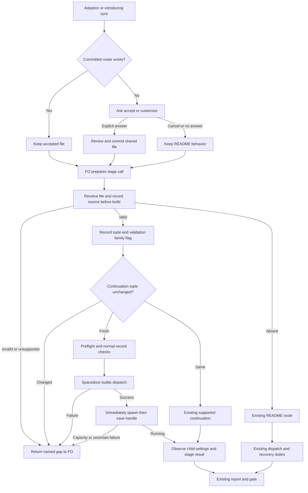

## Scope

- Source: the Captain (chat, 2026-10-29): 「我想延伸這個設計，最近我們用codex作為ensign worker好幾天了，我想可以在paseo ext，夥伴ext之間，例如都有啟用 paseo, gemini, codex時，構築一個可能是by repo可以指定什麼情況下用哪個模型，一來平衡用量，二來避免單模型盲點？例如dev2 會開始建議fo預設都是Claude，不同角色可以用ui問使用者哪個模型，推理等級也可以改，但就是預設以我建議的組合為主，等於最後會產生一個設定檔，派工時就以此為主，你覺得如何？」; then 「可以，就這樣做。平衡用量不用量，你想看看，Claude 做fo，codex做worker ，兩者使用量是否明顯比都只用單一模型更少？」, answering FO's proposal to combine the existing pieces below into one task.
- Outcome he named: a per-repository setting, from a default set dev2 recommends (FO on Claude by default), where each role's model and reasoning level can be chosen through a question UI and changed later; dispatch reads it. Two aims: spread usage across vendors, and avoid one model's blind spots. On spreading usage he said 「平衡用量不用量」 and asked whether Claude as FO plus Codex as worker clearly uses less of each than one model alone; FO's reading, to confirm at the sitting: no usage measurement is owed for that aim.
- Pattern to reuse (relay FO's answer, 2026-10-29, Spacedock tag v0.28.0-pre5 at 230c77e43): Spacedock Review's per-project review mode is owned by the spacedock binary (`internal/cli/review_mode.go`), stored outside the repository keyed by a hash of the repo root, set through `spacedock review-mode get|set|clear`, asked by the skill only when nothing is recorded, and records only an explicit answer. It is per user and machine; a team-shared choice does not fit it. FO's proposal, not ruled: the recommended set lives in the repository (team rules, changed by PR) and a personal override lives outside it like Review's mode (quota is personal).
- Absorbs, for the Captain to confirm at the backlog sitting: Draft PR iamcxa/kc-claude-plugins#674 (Codex model and effort policy per stage, parked since 2026-10-19 behind Spacedock transport spacedock#845), backlog tasks dispatch-sets-reasoning-effort, design-director-model-follows-task, and the multi-model part of gpt-partner-extension-proposal. FO retires none of them without his ruling.
- Evidence: batch 9 (2026-10-28) ran FO on Claude, ideation and validation workers on Codex gpt-6-astra high, implementation on gpt-6.1-sol high, special roles on Claude, all by hand under the Captain's interim directive 「接下來派工結束後新的派工盡量用 sol / astra，推理等級可以比 claude 高一級」; reviewer family differed from worker family by FO's choice, with no rule enforcing it; a sol worker stopped on "Selected model is at capacity" and FO switched it to astra by hand.
- Upstream first: the workflow README `defaults: model:` Spacedock reads at dispatch (`dispatch build` prints `effective_model ... (from defaults)`); kc-dev-flow-2 extensions paseo, peers and the partner proposals; Paseo's provider and model list; spacedock#845.

## Non-goals

- Measuring per-vendor usage; changing hosts or Spacedock itself; choosing models for adopters without an answer.
- First-slice ruling (ideation briefing 1, Captain 「准」, 2026-10-30): no personal overrides, capacity automation, law enforcement, special-role hosting changes or native roster routes. Special roles stay as they run today; the shared setting covers stage workers only.

## Budget

- One package PR for the first shared stage-worker slice: setting, adoption/sync question, resolver, dispatch tuple/flag and batch-9 replay. FO reconciles Draft #674 ownership before implementation; its native remainder and other deferred outcomes cannot be closed as delivered by this slice.

## Stop condition

- First-slice completion: the committed setting replays batch 9's stage tuples without FO choosing a model; stage dispatch records preserve the tuple and a same-family flag; an absent file keeps today's README behavior; actual Paseo child settings are verified. Capacity recovery remains manual. Stop and return to FO if this requires any deferred personal layer, automatic fallback, new law, special-role hosting or native adapter, or if the existing transport cannot carry the selected tuple unchanged. This replaces the earlier automatic-fallback/two-layer stop condition under the recorded ideation revise.

## FO alignment

Alignment: needed before ideation; the default set, where each layer is stored and which roles the UI asks about are the Captain's.
Result: aligned at backlog: the Captain 「對，全准且全確認」 (chat, 2026-10-30) to FO's batch-11 backlog sitting, which asked 「決定：六張全准進設計，並確認上面三件事？要改哪張直接說。」, approved the outcome and bounds in this file. He confirmed no per-vendor usage measurement is owed and that this task absorbs Draft #674, dispatch-sets-reasoning-effort, design-director-model-follows-task and the multi-model part of gpt-partner-extension-proposal. The default set, where each layer is stored and which roles the UI asks about stay his: ideation returns them as decisions at the ideation gate.
Surfaces: none
Visible change: none
Release review: not needed: workflow maintenance, on no journey map.
Reviewer: kc-dev-flow-2:chief-engineer opus 2026-10-30 — batch-11 review before the joint ideation sitting: approve, revise, split or hold each task, the Captain's decisions, overlap and order
Reviewer: kc-dev-flow-2:engineering-reviewer not run 2026-11-01: the chief-engineer batch review on opus ruled on these relaxations before the Captain answered; an engineering-reviewer on opus would repeat it

## Design

### PRFAQ

**What is approved now?** The Captain's 「准」 on 2026-10-30 accepted the first-slice revision in `model-roster-per-repo/review/ideation/briefing-1/index.json` (briefing digest `sha256:abee7d3947ffa4414a1d0855973d8222508a6ac119403d672d5b91de9f2b7b02`). Its question explicitly accepts a committed `.dev2/model-roster.json`, one accept-or-customize question at adoption or sync, `model_roster.py resolve`, **stage workers only**, the tuple in the dispatch record, a same-family flag and a batch-9 replay. An absent file uses today's README default. Personal settings, automated capacity recovery, law enforcement, special-role hosting and native roster routes are deferred. This Design and Acceptance criteria replace the earlier proposals; the original Stage Report remains historical evidence, not current scope. The recorded revise resolution permits FO to advance a compliant revision without another sitting.

**Who gets what?** A repository adopting the feature can accept the displayed Codex stage-worker recommendation or customize its three rows once, then review and commit the shared file through its normal change path. On subsequent stage dispatches FO reads the recorded choice rather than choosing a model by judgment. A missing file preserves current operation; it does not start an adoption question or hold a dispatch. This first slice spreads stage work to Codex while FO and special roles stay as they run today, including Claude reviewing Codex workers. It makes no claim about lower total tokens, lower cost or removal of blind spots; per-vendor usage measurement remains waived.

**What is the question?** At adoption, or a sync introducing the feature to a repository without the file, use the existing host question UI: “Stage workers: ideation Astra/high, implementation Sol/high, validation Astra/high, all Codex through Paseo. Save this shared repository choice or customize it?” Accept and Customize are the choices; cancellation, empty response or no reply writes nothing and leaves README behavior. Customize collects one stage's exact supported model/effort/host at a time and displays the resulting three-row file for the existing configuration review. A preselected answer is not submitted consent. With a committed file, an ordinary startup or sync neither re-asks nor overwrites it; explicit later changes use the same reviewed repository path. No personal file, extra service, browser form or settings dashboard is added.

**What remains unchanged?** FO identity, special-role model/effort floors and triggers, design-director rules, release-walk policy, permission mode, extension adoption, workspace placement, worker freshness, publication ownership and delivery gates. Selecting `host: paseo` does not enable an extension or grant a tool. Missing prerequisites or unsupported present settings return a named error to FO; absent settings remain the existing route. Capacity failure follows current manual recovery, with no automatic model substitution.

**What is proven in ideation?** The current source inspection, saved ruling, overlap inventory, proposed-passage measurement and rendered design. The resolver, question behavior, record integration and actual child settings are future implementation acceptance; no new worker was launched in this stage.

### Existing chain and bounded checks

1. **Spacedock first.** Read upstream's own `internal/dispatch/build.go`, `internal/dispatch/codex_v2_adapter.go` and `internal/cli/review_mode.go` at `v0.28.0-pre5`, peeled commit `230c77e43aa5dc56a4ec7a86baa0ec718aceda95`, from `/Users/kent/conductor/workspaces/spacedock-v1/chisinau`. Also ran the assigned `/Users/kent/.local/bin/spacedock dispatch build --help`. Claude resolves stage > defaults > null; Codex emits null, and its adapter passes task_name/message/fork_turns without model/effort. Installed help has no model/effort override flags. Review's outside-repository personal store is not reused: that layer was deferred. Do not invent flags, edit generated payload fields or treat an upstream proposal as released capability.
2. **Dev2 next.** `git fetch origin` succeeded; `origin/main` remains `a6612948936a4f075625147b21aabd3b10b19eee`, manifest **0.33.1**. Read source with `git show <SHA>:kc-dev-flow-2/<path>`. `references/sd/workflow.md` gives stage workers the README default and keeps special roles separate; `dispatch_records.py` requires a nonempty Model line and tolerates extra record lines. `extensions/paseo/EXTENSION.md` already owns Codex placement and FO publication. Extend this existing path with one resolver and recorded values; do not change dispatch_records/laws_check or invent a runtime controller.
3. **Paseo's own contract.** Read installed `/Users/kent/.agents/skills/paseo/SKILL.md`, especially Agents and provider discovery, and called read-only `list_models(provider="codex")`. Both `gpt-6.1-sol` and `gpt-6-astra` expose low/medium/high/xhigh/max/ultra on this run; the recommendation stays explicit **high**, matching batch 9. `create_agent` accepts provider/model plus `settings.thinkingOptionId` and explicit workspace placement. Discovery is available-choice evidence, not proof that a launched child used a setting. No agent or provider setting was created or changed.
4. **Sibling adopters last, read only.** Relay beirut-dev2 HEAD `8a4e15c1b968c126ebdd3c1f29550543a4dd6a58`, web dev2-fo HEAD `f2e1a4ccce8af1d9ab4ffb6591f8c84ff18d619a`, and `/Users/kent/conductor/repos/qnow-adopt-dev2` HEAD `278f79ca3eb03a8c1286817f542c4ec4b744bfed` have `model: sonnet` in their local workflow READMEs. Relay/web dev2 and dev2-poc plus qnow dev2-poc were read; none is auto-adopted. These local copies are not current remote or active-runtime proof. Absent-file compatibility protects these existing defaults rather than holding them for a new answer.
5. **Prior decisions and remote limit.** Read ADRs 0020 (word accounting), 0027 (existing writer checks), 0030 (task director), 0033 (release walk), 0035 (extension choices), 0042 (Paseo publication), and relevant state `Override:` results. The new recorded revision supersedes this task's earlier mandatory-adoption/two-layer design; it does not repeal those other duties. `gh pr view 674 --repo iamcxa/kc-claude-plugins --json state,headRefOid` and `gh issue view 845 --repo spacedock-dev/spacedock --json state,title` failed `error connecting to api.github.com`. Current hosted PR/issue state and branch ownership are unverified. No remote comment, retirement or message occurred; FO rechecks ownership before implementation, using local branch/source facts meanwhile.

### First-slice setting and resolver

The package recommendation lives in `kc-dev-flow-2/references/model-roster-defaults.json`; the accepted shared snapshot is `<code-root>/.dev2/model-roster.json`, schema 1. Its only configurable roles are `ideation`, `implementation`, `validation`; repair uses the implementation row. A POC workflow simply never calls the ideation row. Each row has `provider`, `model`, `effort`, `host`. Include the selected package version and the adoption decision reference; these are provenance recorded by the caller, not authenticated human consent. No family override, fallback list, private-layer key, FO row, special-role row or task-specific override engine is accepted in schema 1. The file is ordinary reviewed repository content, not an automatically installed default.

| Stage | Provider | Model | Effort | Host |
| --- | --- | --- | --- | --- |
| ideation | codex | gpt-6-astra | high | paseo |
| implementation, including repair | codex | gpt-6.1-sol | high | paseo |
| validation | codex | gpt-6-astra | high | paseo |

The first supported custom choices are the discovered Sol/Astra models and their explicit supported reasoning values on Paseo; a request for another provider or host returns to FO as expanded scope. Do not turn this slice into a provider catalog. Existing special roles remain outside this table and keep their existing Claude configuration. A stage-worker setting cannot revise director or independent advisory-role policy.

One read-only stdlib command is planned: `python3 <package>/scripts/model_roster.py resolve --code-root <absolute root> --stage <stage> [--author-record <existing dispatch record> ...]`. It reads the exact code checkout FO binds for this dispatch, not cwd or the split-root state checkout. The JSON result distinguishes `repository` from `readme-default`; carries the selected stage tuple, roster blob digest/source commit and a short family result; and never writes settings, dispatches or state. Exit 0 means resolved or explicitly absent/legacy; exit 1 names malformed/unsupported present data or an invalid role. An absent file yields `source=readme-default` with no fabricated Codex/effort tuple: SD and the existing host path retain their normal README behavior. Do not reimplement Spacedock's YAML/default parser.

Validate the entire present schema, duplicate keys, all three rows and known tuple values; malformed, unreadable, partially written or unsupported schema/data is not absence and must not silently fall back. At adoption/sync, prepare a complete file for ordinary reviewed commit, never use the resolver to save it. Dispatch reads a clean committed choice from the pinned checkout; an uncommitted change is returned to FO for the normal review path. New package recommendations do not rewrite an accepted snapshot. A later committed deletion restores README behavior as the ruling requires; no de-adoption registry is introduced.

For stage validation, `family` means **provider lineage** in this slice: Sol and Astra both flag `same-family: openai`. Compare the resolved validator with the actual authoring tuples from the candidate's existing implementation/repair dispatch records, not today's implementation default. Missing/unknown author evidence emits `family: unverified`; it cannot claim diversity. This is a visible warning, not a new refusal or approval gate. Record all contributing author tuples and the flag in the validation record and its existing report/gate summary. Existing special-role independence duties still apply separately. The resolver tests its own flag computation; no state-history enforcement is added.

### Stage dispatch and real evidence

For each new ideation, implementation/repair or validation dispatch, and each stage continuation, FO resolves the recorded choice **before** normal record checks and SD build. Keep the existing `Model:` line and add a compact `Roster:` line with source, role, provider/model/effort/host and source digest/commit; for validation also add the family result and author-record references. For absent settings record `Roster: absent; source README default` and preserve the existing Model recording. Use the normal `<task>/dispatch/<stage>-<cycle>.md` state path and commit procedure; no new log, law or mandatory historical schema. Existing `dispatch_records.py --names`, folder/coverage checks and L2 law checks continue unchanged and do **not** prove roster consumption.

Preflight the provider capability, extension eligibility, destination workspace and already-running worker identity before build. For the configured Codex/Paseo route, use the existing Codex host binding, then pass the resolved provider/model and `settings.thinkingOptionId` to Paseo beside the unchanged generated prompt and required generated identity/runtime fields. A non-null generated value conflicting with the requested tuple is a transport mismatch: return to FO; do not patch the envelope. Resolution and human questions precede build; successful build is followed immediately by spawn, then saving its handle. New capability checks, diagnostics or narration must not intervene. Keep ADR 0042's current worker-local commit / FO publication and review split.

A continuation re-reads the file and records its source. If the effective tuple is unchanged, reuse under the existing stage rules; if changed, return to FO for an authorized fresh-worker handoff. Do not mutate or duplicate a running worker. Capacity, network or unknown launch results return to current recovery; the resolver chooses no alternate model. A configured roster is not supported on native launch routes in this slice; return that requested use to FO. An absent file on any existing route still uses current behavior.

Actual-child acceptance requires the supported Paseo runtime/turn metadata to show the launched model, effort and assigned root, separately from requested values. A JSON echo, mock launch or worker assertion alone is not this evidence. If current transport cannot preserve the generated fields or expose decisive runtime evidence, return that gap to FO; do not redesign transport or silently broaden this package PR. Ideation creates no test agents; implementation/validation runs only FO-authorized bounded stage dispatches.



### Deferred backlog and return-to-FO boundary

This is a follow-up list, not newly created tasks or implementation authorization:

| Deferred outcome | Remains pending; first-slice boundary |
| --- | --- |
| Personal overrides | Outside-repository storage, identity keys, layering and concurrent save rules are not designed here. Shared repository choice is the only layer. |
| Capacity automation | Ordered fallback, retry state and substitution-aware recovery need a later bounded task. Capacity stays manual; the old automatic-fallback stop condition is replaced. |
| Law enforcement | Historical roster admission, required snapshot schemas, dispatch_records/laws_check changes and state migrations are deferred. Current records are instructed and exercised, not mechanically guaranteed. |
| Special-role hosting | FO, chief-engineer, engineering-reviewer, observer and director selection remain current policy; non-Claude director mapping is unresolved in its existing follow-up. No astra-to-Opus mapping is adopted. |
| Native routes | Explicit native model/effort support waits for released upstream capability and a separate real proof; no custom SD adapter in this slice. |
| Other partner capabilities | Gemini/other providers, parallel partners and release-walk model changes remain with the original partner proposal. |

Draft #674 (parked Codex model policy) may supply reusable ideas, but its ownership/current state must be checked by FO before choosing one implementation branch. Its native-transport remainder cannot be closed as delivered by a Paseo-only slice. `dispatch-sets-reasoning-effort` is covered only for the three Paseo stage rows; native/special-role remainder stays open. `design-director-model-follows-task` remains deferred, and `gpt-partner-extension-proposal` is covered only for this stage-selection part. “Absorbed” is not closure proof. FO maps any later closure to delivered evidence and retained remainder; this worker neither retires nor edits those records.

No fresh Captain decision is needed within the recorded revise asks. If meeting the criteria needs one of the deferred items, another provider, changed role policy, a new host, an extra enforcement layer, or a positive workflow-word-budget increase, stop and return **that one concrete scope decision** to FO. Recommendation: keep this first slice and separately scope the remainder; worse: capacity handling stays manual, validation remains within OpenAI, and personal/native users wait. Do not reopen the already-accepted default, absent-file or stage-only decisions merely because the prior design asked them.

### Durable decision

Unnumbered ADR draft: `docs/adr/<reserved>-repository-stage-model-rosters-keep-readme-defaults-when-absent.md`. Record the actual gate question and 「准」, three stage rows, committed shared choice, absent-file compatibility, informational family flag and the explicit deferred list. It introduces no new policy beyond this ruling. FO reserves the number at implementation dispatch; no ADR file or number is created by ideation.

### Words FO reads at each lifecycle moment

Re-measured against source `a6612948936a4f075625147b21aabd3b10b19eee` using `len(text.split())` independently on every named passage. These are complete **proposed passage/fixture counts**, not full observed session context. Unchanged upstream/host outputs remain an unmeasured additive `U(moment)` on both sides, not zero. Actual dynamic/customization/error output is still owed at implementation. This feature adds reading and claims no context reduction.

| Moment | Before + U(moment) | Proposed + U(moment) | Delta |
| --- | ---: | ---: | ---: |
| startup | 9710 | 9710 | +0 |
| idle on open PR | 1821 | 1821 | +0 |
| idle on merged PR | 328 | 328 | +0 |
| after archive | 328 | 328 | +0 |
| merge ask | 2258 | 2258 | +0 |
| configured Paseo stage dispatch | 2444 | 2683 | +239 |
| absent-file stage dispatch through Paseo | 2444 | 2634 | +190 |
| adoption or introducing sync | 2182 | 2427 | +245 |

Reproduction: read the pinned package with `git show <SHA>:kc-dev-flow-2/<path>`; sum each passage's `len(text.split())` without concatenating boundaries. Startup = README.md + skills/dev/SKILL.md + references/sd/workflow.md + references/sd/mods/kc-dev-flow-2.md. Idle/open = mod + workflow's `## FO steps: review findings` body + codex and copilot EXTENSION.md; idle/merged and after/archive = mod + learn EXTENSION.md; merge ask = workflow `## Delivery authority` body + review-findings body + codex/copilot. Dispatch = the entire workflow `## Stages` body including stage subsections + paseo EXTENSION.md. More precisely each section is the text after its named level-two heading through the next level-two heading. Adoption = entire references/sd/adoption.md. The same enabled-extension fixture is used on both sides; this is not a claim every adopter loads it.

The workflow replacement below replaces just the original eight-word first Stages sentence and is itself eight words: **workflow budget delta 0**. Other special-role text is byte-preserved. Startup reads that pointer but does not load the runtime reference until dispatch/adoption is due; quiet idle and special-role calls do not load it. Proposed dispatch adds the full Paseo insertion + full Runtime reference + the relevant output; configured dispatch also counts the entire settings fixture, not only its selected row. Adoption adds its insertion + full reference + recommendation fixture + question. Count repeated reads when they actually recur; these per-moment rows are not a deduplicated whole-session total.

Exact proposed texts used in the recount (labels are not loaded text):

**Workflow replacement — 8 words:**

```text
Stage workers follow `<package>/references/model-roster.md`; absence retains README defaults.
```

**Adoption insertion — 32 words:**

```text
At adoption or introducing sync, follow `<package>/references/model-roster.md` to ask once about stage workers. Save only an explicit shared choice through the normal reviewed change. Preserve existing settings; no answer leaves README defaults.
```

**Paseo insertion — 32 words:**

```text
For configured stage workers, resolve and record the repository tuple before build; supply its provider/model and thinkingOptionId through this existing route. Keep generated fields and immediate spawn order. Special roles stay unchanged.
```

**Runtime reference — 146 words:**

```text
Before each stage launch or continuation, run model_roster.py resolve with the bound absolute code root and stage. For validation, pass the candidate author records. Absent settings retain the existing README route without a question. Invalid present settings return the named error to FO. Record the source and tuple, plus any family warning, in the normal dispatch record. Check capability and placement before build; preserve the generated dispatch and immediately spawn, then save the handle. Changed continuation settings return to FO for fresh handoff. Capacity recovery stays manual. Special roles and native roster routes are outside this slice. At adoption or introducing sync, show the three-row recommendation and ask accept or customize. Save only the explicit answer through ordinary repository review. Cancel or silence changes nothing. Existing settings survive sync; explicit later changes use that same reviewed path. Keep requested settings separate from observed child runtime evidence.
```

**Recommendation/settings fixture — 44 words:**

```json
{
  "schema_version": 1,
  "selected_from": "0.33.1",
  "decision": "recorded-adoption-answer",
  "stages": {
    "ideation": {
      "provider": "codex",
      "model": "gpt-6-astra",
      "effort": "high",
      "host": "paseo"
    },
    "implementation": {
      "provider": "codex",
      "model": "gpt-6.1-sol",
      "effort": "high",
      "host": "paseo"
    },
    "validation": {
      "provider": "codex",
      "model": "gpt-6-astra",
      "effort": "high",
      "host": "paseo"
    }
  }
}
```

**Successful output fixture — 17 words:**

```text
Resolved validation: codex gpt-6-astra high via paseo; source repository; roster sha256:DIGEST commit SHA; authors implementation-1; same-family openai.
```

**Absent output fixture — 12 words:**

```text
Roster absent: use existing README defaults; no adoption question or model override.
```

**Question fixture — 23 words:**

```text
Stage workers: ideation Astra/high, implementation Sol/high, validation Astra/high, all Codex through Paseo. Save this shared repository choice or customize it? Accept / Customize.
```

The output fixtures are design examples, not a working resolver's output. If the shipped CLI emits longer JSON/diagnostics, count those actual bytes too. Acceptance must capture cancel/customize/invalid-file and hold paths rather than projecting these success numbers onto them. No lint budget change is proposed; if another batch edit changes the replaced sentence or full reference loading, remeasure on the actual implementation base and return any new budget increase to FO under ADR 0020. The old 9883/1290 proposal is superseded, not reused as measured behavior. This cycle counts the entire Stages section, including worker-stage subsections, at dispatch: its baseline is 2444 rather than the earlier 1133 pre-backlog-only figure. This conservative whole-section fixture makes that corpus difference explicit; it is not a measured runtime increase.


### Batch overlap

First package PR changes **eight files**: new `kc-dev-flow-2/references/model-roster.md` (one runtime/adoption reference), `kc-dev-flow-2/references/model-roster-defaults.json` (three-row recommendation), `kc-dev-flow-2/scripts/model_roster.py` (read-only resolve); edit `kc-dev-flow-2/references/sd/workflow.md` (word-neutral stage pointer, retaining special-role text), `kc-dev-flow-2/references/sd/adoption.md` (one question at adoption/sync), `kc-dev-flow-2/extensions/paseo/EXTENSION.md` (stage tuple transport/record), `kc-dev-flow-2/scripts/test_sd_dispatch.py` (resolver CLI and existing dispatch fixtures); one new root `docs/adr/<reserved>-repository-stage-model-rosters-keep-readme-defaults-when-absent.md`. Its number is FO-owned. Use the existing test_sd_dispatch CI step and package path triggers; no workflow YAML edit or paid model call in CI. Incremental CI cost per PR is **not measured** at ideation; implementation records the test-runtime delta, without inventing a billing number.

The adopted `.dev2/model-roster.json` and adopter workflow README sync are separately reviewed adopter changes after the published package, not writes to siblings in this PR. No edits to dispatch_records.py, laws_check.py, their tests, lint-skills.py, dev/role skills, agent declarations, peers extension, provider config or Spacedock. If the word-neutral pointer does not fit the rebased source, recount and return an actual increase to FO rather than expanding the budget silently.

| Batch/live task (routing name; purpose) | Same file/check and order |
| --- | --- |
| batch10-after-release-obligations — post-release repairs and proofs | No product-file overlap after narrowing; shares pre-build/immediate-spawn evidence seam. Its native proof remains separately owed; do not claim roster evidence from it. |
| names-check-says-what-it-skipped — dispatch diagnostic coverage | workflow.md and test_sd_dispatch.py; it owns dispatch_records/test_laws/lint changes. Land its wording first, then rebase and recount this neutral pointer. |
| peers-paseo-rule-matches-practice — peer send policy | paseo/EXTENSION.md, adoption.md and ADR reservation namespace. It owns peer-policy text; this task changes the worker subsection only. Serialize final full-file recounts. |
| peer-status-reaches-fresh — current peer facts | Its latest ideation question removes its paseo insertion and gives that text to the peer-policy task; peers-only work has no direct product overlap. Do not resurrect its old shared insertion. |
| model-roster-per-repo — this stage model setting | Sole owner of the three new roster files and stage-selection tests; no personal or law-engine work. |
| paseo-human-surfaces-visible-and-reachable — worker terminal/tab reach | paseo/EXTENSION.md and pre-build placement preparation. Keep visibility setup before build; share confirmed worktree identity without changing its network policy. |
| adoption-asks-which-extensions — event-time extension checks | Latest gate holds until a live record is affected; its narrowed checker/history files do not overlap this slice. No dependency on reopening it, despite its old adoption title. |
| adr-required-statement — old ADR ledger proposal | Body says closed 2026-10-20 despite validation frontmatter. No live product dependency; reserve a fresh ADR through FO, do not reopen or reuse its abandoned number. |
| adr-silent-undo-probe — ADR reversal experiment | Held copy moved to a POC task; no shared file/check. Do not alter its model controls. |
| comment-check-reaches-delivery-gate — old comment evidence proposal | Body says closed 2026-10-20. No shared file/check; do not revive abandoned delivery/validation edits. |
| journey-canvas-hosted-poc — hosted canvas trial | No product/check overlap; only possible shared future ADR allocation. No hosting used for this question. |
| journey-server-host-pilot — private journey server | No product/check overlap; shared ADR allocation only. Its validation remains its owner's. |
| ops-inbox-r1-setup-and-isolation — event intake and isolation | No product/check overlap; separate kc-ops-inbox package/CI and ADR allocation. Its hosted FO is not moved to the roster. |
| pr-review-lite-value-pilot — bounded PR review trial | No overlap: kc-pr-flow capability/tests and journey artifacts. Preserve its independent model/effort experiment controls. |

Recommended order: land the shared diagnostic workflow/test change, settle peer-policy and visible-surface Paseo sections, then implement this eight-file slice on refreshed main; serialize ADR reservation and recount whole loaded passages after rebasing. Sibling bodies and latest gate questions were read only; current remote PR ownership remains for FO to verify because gh failed. Do not wait for held/closed unrelated tasks.

## Acceptance criteria

**AC-2 — Resolver and absent-file compatibility.** Add real subprocess tests to the already-run `test_sd_dispatch.py`: use explicit absolute code roots with split-root state and linked code worktrees, run the shipped resolve CLI twice, and compare outputs/files. Present supported tuples resolve; absent file returns `readme-default` and leaves existing README dispatch behavior/model untouched without an adoption prompt. Malformed/duplicate/partial data, unknown schema/role, unreadable or uncommitted present file and unsupported provider/host return the precise field/error rather than absent. A committed change or deletion affects the next resolve; package updates never rewrite accepted bytes. Falsifier: use cwd/state as code root or return Codex recommendation on absence. Current: source seams inspected, executable acceptance unverified.

**AC-3 — Batch-9 stage replay.** Embed minimal de-identified tuple fixtures in test_sd_dispatch.py, citing SHA-256 digests of `_archive/paseo-codex-dispatch-practice/dispatch/{ideation-1,implementation-1,validation-1}.md`; run the real resolver in a fresh shell and assert Astra/high, Sol/high, Astra/high, each Codex/Paseo, including implementation for repair. No runtime lookup chooses an alternative. The recorded FO/Claude special-role facts remain context and are not resolved/rehosted by this feature. Falsifier: swap stage rows or omit explicit effort; the replay must fail. Current: historical inputs read, no resolver replay yet; capacity replay is deliberately outside this revised criterion. Source SHA-256: ideation-1 `18eeff12f0ad4f662ce5889bc6e78bf36223cf4b9282beed86506245bbd5d331`; implementation-1 `e65a8911f7d741ba78aa6b98bdae59de3d9753b7c72d95ec31ae42e73b04a833`; validation-1 `2f33b40eba6c9a881e9070199857843351c746e8408ba37195b630eb169d0bff`.

**AC-6 — Scope, reading and regressions.** On the exact candidate, run package lint, existing SD/POC derivation/dispatch tests and applicable existing checks; compare the eight-file allowlist and role declarations, assert no private store, fallback automation, native adapter or new law. Recount the exact text/output ledger below and capture exercised accept/customize/cancel/error outputs separately. Confirm absent-file routes and current special-role instructions are preserved. Measure the model-free suite runtime delta per PR; CI YAML and trigger stay unchanged. FO checks #674 ownership/remaining scope before delivery and does not close native/director/partner remainders as delivered. Falsifier: add an enforcement file, silently alter a role, change README-default behavior, or omit loaded helper output from the count. Current: proposed passage counts measured; candidate tests, native evidence, CI runtime and hosted closure are unverified.


**AC-7 — Explicit shared adoption.** Amended by Captain, amendment 1. In temporary code repositories, exercise the actual host question journey for accept, customize, cancel and unanswered. Accept/customize produce exactly the displayed three-row candidate and ordinary reviewed commit; cancellation/unanswered leave bytes and directory inventory unchanged. Evidence: question/answer receipts, file manifests and a fresh-shell resolve of the committed candidate. Falsifier: treating a preselection as an answer must fail. The existing FO-recorded journey remains evidence with its stated limits; the Captain's first real adoption answer follows delivery. Post-delivery observation, still owed from that first real adoption and subsequent sync: a committed file is preserved on startup/sync; later changes need an explicit request and normal review; overwriting a file on package sync must fail. Current: adoption-trial/question-receipts.jsonl, adoption-trial/fo-commands.jsonl and adoption-trial/README.md retain FO's accept/customize/cancel/dismissal record; the original scratch repositories are gone, so their manifests/commits cannot be re-inspected. Real committed-file sync preservation and its overwrite falsifier remain unrun, now post-delivery observations; this amendment supplies no new behavior evidence.

**AC-8 — Real stage dispatch and continuation.** Amended by Captain, amendment 1. FO authorizes bounded real stage calls on the exact candidate and saves ordered preflight → resolve/record/check → SD build → immediate spawn → handle → child metadata evidence. Before delivery, exercise Astra/high and a changed supported effort. Verify prompt/generated-field integrity, assigned root, preserved permissions and requested versus observed model/effort. Repository-bound dispatch and an unbroken build-to-spawn order remain owed after delivery from the first real adoption and dispatch: resolve the actual assigned code root, and insert no post-build check before spawn. A real stage already owed can supply evidence; do not create workload merely to force capacity. Falsifier: drop thinkingOptionId, change workspace or insert a post-build check; echo-only/mocked metadata cannot pass. Post-delivery observations, still owed from the first real adoption and dispatch: Sol/high, unchanged continuation, and a changed-tuple continuation returned for fresh handoff. Current: validation-1/evidence.md verifies Astra/high and Astra/xhigh metadata but rejects the scratch-source/assigned-root mismatch and retained post-build grep; compliant repository-bound dispatch and uninterrupted launch proof remain for FO. cold-fo/README.md records two resolver runs and one direct file read naming Astra/high without spawning, so it proves neither child settings nor build-to-spawn order; missing runtime fields still return to FO, not a new telemetry design.

**AC-9 — Visible family evidence and records.** Real resolver fixtures compare each validator with the actual candidate's author records: Sol/Astra and Sol/Sol produce an informational OpenAI same-family flag; missing/unknown authors produce unverified, never diverse. Preserve source references and flag in the dispatch record and existing validation/gate summary. Run existing names/folder checks on augmented and legacy records without changing their checker/law contracts; show that their green result alone does not establish roster use. Falsifier: compare only today's configured implementation row, suppress the flag, or turn it into a new hard refusal. Current: record parser inspected, behavior/record replay unverified. Amended by Captain, amendment 1.

## Number guards

ADR: 0047

## Captain amendments

### Amendment 1 — 2026-11-01, chat
Captain: 「可以」 (chat, 2026-11-01)
Asked: 「決定：四件事都照這個新建議嗎？要改哪件直接說。」, which FO had stated as: 「| 2 | #759 | 放寬條件，修好派工紀錄，再驗證一次後合併，然後你回答一次設定問題 |」, with the relaxation stated as 「Sol/high、工作者延續、同步不覆蓋改成上線後觀察」
Supersedes: AC-1, AC-4, AC-5

Superseded text:

**AC-1 — Explicit shared adoption.** In temporary code repositories, exercise the actual host question journey for accept, customize, cancel and unanswered. Accept/customize produce exactly the displayed three-row candidate and ordinary reviewed commit; cancellation/unanswered leave bytes and directory inventory unchanged. A committed file is preserved on startup/sync; later changes need an explicit request and normal review. Evidence: question/answer receipts, file manifests and a fresh-shell resolve of the committed candidate. Falsifier: treating a preselection as an answer or overwriting a file on package sync must fail. Current: planned, not exercised; no adopter setting was changed.

**AC-4 — Real stage dispatch and continuation.** FO authorizes bounded real stage calls on the exact candidate and saves ordered preflight → resolve/record/check → SD build → immediate spawn → handle → child metadata evidence. Exercise both recommended models with explicit high, a changed supported effort, unchanged continuation, and a changed-tuple continuation returned for fresh handoff. Verify prompt/generated-field integrity, assigned root, preserved permissions and requested versus observed model/effort. A real stage already owed can supply evidence; do not create workload merely to force capacity. Falsifier: drop thinkingOptionId, change workspace or insert a post-build check; echo-only/mocked metadata cannot pass. Current: own-tool discovery succeeds, actual-child proof unverified; missing runtime fields return to FO, not a new telemetry design.

**AC-5 — Visible family evidence and records.** Real resolver fixtures compare each validator with the actual candidate's author records: Sol/Astra and Sol/Sol produce an informational OpenAI same-family flag; missing/unknown authors produce unverified, never diverse. Preserve source references and flag in the dispatch record and existing validation/gate summary. Run existing names/folder checks on augmented and legacy records without changing their checker/law contracts; show that their green result alone does not establish roster use. Falsifier: compare only today's configured implementation row, suppress the flag, or turn it into a new hard refusal. Current: record parser inspected, behavior/record replay unverified.

## Stage Report: ideation

- DONE: A design for a per-repository model roster: a dev2-recommended default set (FO on Claude), each role's model, reasoning level and host, a question UI that asks only when nothing is recorded and records only an explicit answer, later changes, and every dispatch reading it; the recommended set in the repository and a personal override outside it, as proposed in Scope; a reviewer of a different family than its worker refused or flagged; a capacity stop falling back by rule; how Draft PR iamcxa/kc-claude-plugins#674 and the absorbed backlog tasks close; batch 9's hand-chosen roster replayed from the setting; the default set, where each layer lives and which roles the UI asks about returned as Captain decisions; split into smaller tasks if it exceeds one PR
  Design above covers both layers, explicit-answer UI, all role tuples, family flags/refusals, bounded recovery, historical batch-9 inputs, absorbed-work closure and the native-transport split; three recommendations await the Captain. Source baseline a6612948936a4f075625147b21aabd3b10b19eee (0.33.1).
- DONE: A `### Batch overlap` section naming each file the design would change and each other batch task (batch10-after-release-obligations, names-check-says-what-it-skipped, peers-paseo-rule-matches-practice, peer-status-reaches-fresh, model-roster-per-repo, paseo-human-surfaces-visible-and-reachable) and live task of other sessions (adoption-asks-which-extensions, adr-required-statement, adr-silent-undo-probe, comment-check-reaches-delivery-gate, journey-canvas-hosted-poc, journey-server-host-pilot, ops-inbox-r1-setup-and-isolation, pr-review-lite-value-pilot (driven by other sessions; read only)) that changes the same file or check, so FO can order implementation
  The final Design subsection names all 14 listed task identities, exact proposed files and shared dispatch/L2/placement checks; recommendations order historical fixes and Paseo edits first. All sibling tasks were read only.
- DONE: The words FO reads at each lifecycle moment, before and after, per root learning.md "Measure the words FO reads at each moment, not one file's size"
  The measured design passage table is 9710→9883 at startup and 1133→1290 per Paseo dispatch; other listed quiet lifecycle paths are unchanged. Full dynamic output totals remain unverified, explicitly additive rather than counted as zero.
- DONE: Acceptance criteria with reproducible evidence clauses and falsifiers, and unresolved decisions for the Captain, each with a recommendation and what gets worse under it
  AC-1 through AC-10 each state an executable evidence plan, a falsifying change and current status. design_surfaces.py check exited 0: model-roster-per-repo.md: design surfaces presentable. Mermaid CLI 11.17.0 rendered the diagram and its actors, cancellation, hold, immediate spawn and finite fallback branches were visually inspected.
- SKIPPED: AC-1 explicit choice and persistence implementation acceptance execution
  Not yet verified: no UI answer or settings write was exercised; accepting a preselection must fail the future negative control.
- SKIPPED: AC-2 layers and identity implementation acceptance execution
  Not yet verified: linked-worktree identity, atomic save and override conflict cases are planned; keying by worktree root must fail.
- SKIPPED: AC-3 batch-9 replay implementation acceptance execution
  Historical astra/sol/astra and Claude reviewer records were read; resolver replay is not implemented. Swapped stage tuples must fail.
- SKIPPED: AC-4 actual child settings implementation acceptance execution
  Live provider/model discovery succeeded; no child was spawned. Removing explicit effort or changing the assigned root must fail native proof.
- SKIPPED: AC-5 reviewer independence implementation acceptance execution
  Not yet verified; the family policy is proposed for Captain choice. Matching default policy while ignoring actual fallback authors must fail.
- SKIPPED: AC-6 capacity recovery implementation acceptance execution
  Not yet verified; finite attempt/cursor tests and live-event evidence are separately required. Timeout-as-capacity must fail.
- SKIPPED: AC-7 dispatch coverage and history implementation acceptance execution
  Existing record/L2 seams inspected; candidate checks are not implemented. A missing Roster marker after adoption must fail, without changing old records.
- SKIPPED: AC-8 director and absorbed closure implementation acceptance execution
  Prior director ruling and both open PR bodies read; no director call, backlog closure or PR change occurred. Current-default substitution must fail.
- SKIPPED: AC-9 reading and gates implementation acceptance execution
  Design counts and independent dispatch recount passed; full runtime outputs, candidate tests and CI cost are not measured. Dropping moved instructions/output from the count must fail.
- SKIPPED: AC-10 delivery boundary implementation acceptance execution
  No implementation or delivery attempted; unsupported native Codex is explicitly held. An open upstream PR cannot pass the route capability check.

### Summary

Designed the bounded repository roster and private override journey, preserving explicit answers, worker identity, independent review and capacity-recovery limits. The Captain still decides the default/director policy, storage layers and question/delivery boundary; unsupported native transport and unproven runtime behavior are not represented as completed delivery. This is a state-only design/report; gh API failure was recovered for read-only PR facts via the GitHub connector, and no other session was messaged.


## Stage Report: ideation (cycle 2)

- DONE: Revise the design under the Captain's ideation-gate revise of 2026-10-30 (「准」); the asks are in this task's newest ideation gate question (review/ideation, newest briefing); do exactly those asks, update criteria and the stop condition to match, and name anything that would go beyond them as a return to FO rather than designing it; the first slice only, with a follow-up backlog list for what is deferred
  Current Design follows briefing-1 and the recorded 2026-10-30 revise; Stop condition and six criteria cover the shared stage-worker slice, absent-file README behavior, informational family flag and batch-9 replay; six deferred outcomes return to FO rather than gaining design scope.
- DONE: A `### Batch overlap` section naming each file the design would change and each other batch task (batch10-after-release-obligations, names-check-says-what-it-skipped, peers-paseo-rule-matches-practice, peer-status-reaches-fresh, model-roster-per-repo, paseo-human-surfaces-visible-and-reachable) and live task of other sessions (adoption-asks-which-extensions, adr-required-statement, adr-silent-undo-probe, comment-check-reaches-delivery-gate, journey-canvas-hosted-poc, journey-server-host-pilot, ops-inbox-r1-setup-and-isolation, pr-review-lite-value-pilot (driven by other sessions; read only)) that changes the same file or check, so FO can order implementation
  Eight proposed package/ADR files are listed with all 14 task identities; latest peer-status and adoption gate questions plus closed bodies correct the earlier overlap inventory. No sibling was edited or messaged.
- DONE: The words FO reads at each lifecycle moment, before and after, per root learning.md "Measure the words FO reads at each moment, not one file's size"
  Independent recount agrees: startup 9710→9710, configured Paseo stage dispatch 2444→2683, absent dispatch 2444→2634, adoption/sync 2182→2427; quiet moments unchanged and workflow delta 0. Entire Stages corpus and dynamic-output limits are explicit.
- DONE: Acceptance criteria with reproducible evidence clauses and falsifiers, and unresolved decisions for the Captain, each with a recommendation and what gets worse under it
  Six individually mapped evidence plans include falsifiers. No new decision within the accepted revise; expanded scope returns to FO with recommendation/tradeoff. design_surfaces.py check exited 0: model-roster-per-repo.md: design surfaces presentable; Mermaid CLI 11.17.0 rendered and visual review matched actors, absence/cancel, failure and immediate-spawn branches.
- SKIPPED: AC-1 — Explicit shared adoption implementation acceptance execution
  Not yet verified: host accept/customize/cancel/unanswered and reviewed persistence await implementation; treating preselection as consent must fail.
- SKIPPED: AC-2 — Resolver and absent-file compatibility implementation acceptance execution
  Not yet verified: CLI does not exist yet; actual malformed/absent/committed-change fixtures must reject fabricated defaults and wrong code-root resolution.
- SKIPPED: AC-3 — Batch-9 stage replay implementation acceptance execution
  Historical Astra/high, Sol/high, Astra/high input records and hashes read; resolver replay unverified. Swapped stage rows must fail; automatic capacity replay is deferred.
- SKIPPED: AC-4 — Real stage dispatch and continuation implementation acceptance execution
  Read-only Paseo model discovery succeeded; no worker spawned. Actual child model/effort/root proof remains unverified; dropped thinkingOptionId cannot pass from a settings echo.
- SKIPPED: AC-5 — Visible family evidence and records implementation acceptance execution
  Existing Model-line parser inspected; resolver flags and augmented-record replay await implementation. Using current defaults instead of candidate authors must fail; no new law is claimed.
- SKIPPED: AC-6 — Scope, reading and regressions implementation acceptance execution
  Design passage recount passed and Scope/frontmatter/prior-report bytes were verified preserved; candidate regression/native proof and incremental CI cost remain unverified. Adding deferred enforcement or omitting loaded output must fail.

### Summary

Revised to the Captain-approved eight-file first slice: committed stage-worker settings, one adoption/sync question, read-only resolve, dispatch tuples, same-family warnings and batch-9 replay; missing settings preserve README defaults. The earlier report is preserved byte-for-byte, capacity stays manual, and personal/law/special-role/native work is explicitly deferred; this is design evidence only, not implemented acceptance. Current source is a6612948936a4f075625147b21aabd3b10b19eee (0.33.1); GitHub API reads failed, so FO must verify PR ownership/state before implementation, and no extra Captain sitting is requested within the recorded revise authority.


## Stage Report: implementation

- DONE: Finish the eight files and the model-free evidence; treat this branch as the only implementation owner of the stage-worker slice.
  Candidate 594e0232419579b18d546f8168767b57279c0ede on spacedock-ensign/model-roster-per-repo, based on 9f065b01f1c6d6561793a168f584075edb85bf1f (origin/spacedock-ensign/names-check-says-what-it-skipped / PR #758); /tmp/model-roster-scope.json verifies exactly the eight design files and clean product status. Follow-up dispatch implementation-1-message-1 governs the delegated acceptance.
- SKIPPED: One Draft PR (Conventional Commit title scoped to the plugin), stacked on PR #758; commit locally, no push; FO pushes, opens the Draft PR, runs RoboRev and reads CI.
  No PR opened: no push grant for this worker. Prepared title/body: /tmp/impl-model-roster-per-repo-pr.md; product branch was not pushed, no version/config changes or external review requests were made. FO's named branch is the sole owner; Draft #674 remains open and untouched with its native remainder, verified read-only at head 0ced054c1c927c5836c4e28a7f62d02f254c979f.
- DONE: ADR 0047 records the ruling the design names, quoting the Captain's words from the task file and its gate records.
  docs/adr/0047-repository-stage-model-rosters-keep-readme-defaults-when-absent.md records 「准」 and the exact joint ideation question, accepted stage rows, absence, informational family warning and deferred scope. ADRs 0020/0035/0037/0042 were read at a6612948936a4f075625147b21aabd3b10b19eee and verified byte-identical/Accepted at candidate (full commits/digests: /tmp/model-roster-adrs.json); existing policy and special-role bytes remain unchanged.
- SKIPPED: Every acceptance criterion green with the evidence each names; each falsifier shown failing by a mutation you run (python3 -B, caches cleared).
  Model-free criteria below pass; AC-1 and AC-4 are explicitly not run and FO-owned under implementation-1-message-1. No human-answer or child-runtime mock was run; this candidate is not represented as accepted end to end.
- SKIPPED: AC-1 — Explicit shared adoption: actual host question journey for accept, customize, cancel and unanswered.
  FO-owned, not run. The shipped reference defines explicit consent, full-file review, no-write cancellation/silence and preservation on sync; no adopter file changed. Preselection and overwrite UI falsifiers remain unexecuted, rather than claimed from instruction text.
- DONE: AC-2 — Resolver and absent-file compatibility: real subprocess tests on bound code roots, split-root state and linked worktrees.
  Exact-candidate python3 -B test_sd_dispatch.py exits 0; resolves twice without inventory changes, preserves README model on absence, rejects unknown role/schema, duplicate/partial/malformed/unsupported/unreadable/uncommitted present data, and observes committed change/deletion. Wrong-cwd, fabricated-absence and write-on-read mutations each fail assertions; /tmp/model-roster-mutations.json and retained commands.jsonl contain the outcomes.
- DONE: AC-3 — Batch-9 stage replay: Astra/high, Sol/high, Astra/high, Codex/Paseo, implementation for repair.
  test_sd_dispatch.py embeds the three historical dispatch paths/digests and exercises the shipped CLI; swapped-stage selection, literal swapped recommendation rows and dropped effort all fail. Mutation source/results: /tmp/model-roster-mutations.json and /tmp/model-roster-swapped-defaults.json; all used python3 -B and isolated empty bytecode-cache prefixes with writes disabled.
- SKIPPED: AC-4 — Real stage dispatch and continuation, with requested versus observed child settings and prompt/build/spawn integrity.
  FO-owned, not run by instruction; no test agents or mock runtime metadata were created. Actual recommended/changed-effort launches, unchanged/changed continuation, permissions/root/settings evidence and dropped-thinkingOptionId/wrong-workspace/post-build-step falsifiers remain for FO.
- DONE: AC-5 — Visible family evidence and record compatibility: resolver and existing record-check fixtures.
  Sol/Astra and Sol/Sol yield same-family: openai with actual author references/tuples despite today's changed implementation row; unknown/missing authors yield unverified. Legacy and augmented names/folder/coverage checks pass; a contradictory Roster header also passes --names but resolves unverified, demonstrating those checks do not establish consumption. Suppressed-warning/current-default/unknown-family/hard-refusal mutations each fail.
- SKIPPED: AC-5 — Preserve family source references and warning in a real dispatch record and existing validation/gate summary.
  The real stage calls are FO-owned under AC-4; fixture replay proves computation/compatibility only. No new law or historical record migration was introduced.
- DONE: AC-6 — Scope, reading and regressions; applicable existing SD/POC/dispatch checks.
  All 24 existing CI regression entries exit 0 (including lint, POC derivation, records, laws and delivery checks), plus observer recovery and the full real model-free SD 0.27.2 suite; /tmp/model-roster-regressions.json and /tmp/model-roster-check-*.log retain outputs. Exact candidate SD run: /tmp/model-roster-final-sd.log, 42.244s, fixtures /private/var/folders/tm/dk0m7pgx4h3gxqv_v2v8nds00000gp/T/dev-flow-2-sd-jf50thwh, activated SD plugin root 0.27.3. No hosted CI result is claimed.
- DONE: Recount the exact loaded text and actual resolver/error outputs; keep the workflow word budget unchanged.
  /tmp/model-roster-words.json: startup 9710, idle/open 1821, merged/archive 328 and merge ask 2258 unchanged; workflow 5781→5781. Full runtime reference is 611 words (4641 bytes), settings 44; dispatch 2444→3131 plus actual repository JSON (1–2 words, 292–801 bytes), absent 2444→3087 plus 1-word JSON; adoption 2182→2869 before actual question output (not run). Error outputs are 4–14 words/41–187 bytes; unchanged upstream/host U(moment) remains unmeasured. These exceed the short ideation fixtures and are counted rather than omitted.
- DONE: Measure model-free suite runtime delta per PR; CI cost measured or stated as not measured.
  Paired local dispatch-suite sample: baseline 29.345s, candidate 33.756s, +4.411s; final isolated-cache candidate 42.244s is separately recorded, not compared as an equivalent cache condition. Billed CI cost per PR was not measured; CI YAML/triggers and paid model calls are unchanged.
- DONE: Repository lint; package ADR lint --since base --require 0047; number_guards.py check; comment_ratio.py within its maximum; design surfaces check.
  All exit 0 at candidate: workflow 5781/5781, 45 ADR files checked/0 legacy, number guard no findings (migration guard skipped: no migrations-path), comments 3/306=1.0% versus 5%; design surfaces presentable. Number guard uses adopted trunk a6612948936a as configured; candidate delivery base remains 9f065b01f1c6d6561793a168f584075edb85bf1f.
- SKIPPED: RoboRev evidence= line; FO-owned exact-head review and hosted CI.
  Attempted prescribed gate after local commits: exit 3, `incomplete: the roborev daemon is not running`; no clean evidence or finding disposition is claimed. FO was notified; independent validation, publication and hosted CI remain FO's steps.
- DONE: Affected documents: run doc_impact.py base candidate and record each verdict.
  updated: docs/adr/0047-repository-stage-model-rosters-keep-readme-defaults-when-absent.md and kc-dev-flow-2/references/sd/adoption.md; unaffected: kc-dev-flow-2/README.md — existing generic suite/handoff claims remain true, new instructions enter through the existing workflow pointer; unaffected: learning.md — historical evaluation records are unchanged. Other changed retained passages are the stage pointer, Paseo worker insertion and new runtime reference; no diagram changed.

### Summary

Delivered the eight-file shared stage-worker candidate and reproducible model-free evidence on 594e0232419579b18d546f8168767b57279c0ede; only local product commits were made, and /tmp/impl-model-roster-per-repo-pr.md is ready for FO's stacked Draft PR. Actual host questions and child-runtime acceptance are not run per FO's recorded assignment, and RoboRev remains incomplete because its daemon is unavailable. This report establishes implementation evidence, not gate approval, end-to-end acceptance, publication or closure of deferred native/director/partner work.


## Stage Report: implementation

- DONE: Repair evidence=roborev:1346, high severity; ask the adoption question only when the workflow frontmatter lists paseo and the Codex provider is available; otherwise ask nothing, write nothing and keep README behavior.
  FO authorized this repair in dispatch/implementation-1-message-2.md. Reported trigger: an adopter without optional Paseo accepts the ungated recommendation, then stage dispatch hits the prerequisite hold; the Captain's enabled-tools case is the recorded scope boundary. Both references now gate the question without changing the resolver, defaults, extension selection or existing saved settings.
- DONE: Add a falsifier in the existing test file that fails when the gate is removed, record the finding and repair, and stay inside the eight files.
  /tmp/model-roster-repair-red.json captures the pre-fix assertion failure for both missing prerequisites; the repaired pins pass and removing either reference's gate reports exactly its own gap (/tmp/model-roster-repair-mutations.json). These are instruction-presence/mutation checks, not actual question behavior. This repair changes only three of the original eight files; resolver/default bytes and existing ADRs are unchanged.

- DONE: Finish the eight files and the model-free evidence; treat this branch as the only implementation owner of the stage-worker slice.
  Candidate a8536dc5239edc3db6c1b76cb3bb7e1ce0433088 on spacedock-ensign/model-roster-per-repo, based on 9f065b01f1c6d6561793a168f584075edb85bf1f (origin/spacedock-ensign/names-check-says-what-it-skipped / PR #758); /tmp/model-roster-repair-scope.json verifies exactly the eight design files and clean product status. Follow-ups implementation-1-message-1 and implementation-1-message-2 govern delegated acceptance and this repair.
- SKIPPED: One Draft PR (Conventional Commit title scoped to the plugin), stacked on PR #758; commit locally, no push; FO pushes, opens the Draft PR, runs RoboRev and reads CI.
  No PR opened: no push grant for this worker. Prepared title/body: /tmp/impl-model-roster-per-repo-pr.md; product branch was not pushed, no version/config changes or external review requests were made. FO's named branch is the sole owner; FO directs Draft #674 to remain untouched with its native remainder; no product-branch push or PR operation was performed by this worker.
- DONE: ADR 0047 records the ruling the design names, quoting the Captain's words from the task file and its gate records.
  docs/adr/0047-repository-stage-model-rosters-keep-readme-defaults-when-absent.md records 「准」 and the exact joint ideation question, accepted stage rows, absence, informational family warning and deferred scope. ADRs 0020/0035/0037/0042 were read at a6612948936a4f075625147b21aabd3b10b19eee and verified byte-identical/Accepted at candidate (full commits/digests: /tmp/model-roster-repair-adrs.json); existing policy and special-role bytes remain unchanged.
- SKIPPED: Every acceptance criterion green with the evidence each names; each falsifier shown failing by a mutation you run (python3 -B, caches cleared).
  Model-free criteria below pass; AC-1 and AC-4 are explicitly not run and FO-owned under implementation-1-message-1. No human-answer or child-runtime mock was run; this candidate is not represented as accepted end to end.
- SKIPPED: AC-1 — Explicit shared adoption: actual host question journey for accept, customize, cancel and unanswered.
  FO-owned, not run. The shipped reference now also requires listed Paseo plus available Codex before asking; it retains explicit consent, full-file review, no-write cancellation/silence and preservation on sync; no adopter file changed. Preselection and overwrite UI falsifiers remain unexecuted, rather than claimed from instruction text.
- DONE: AC-2 — Resolver and absent-file compatibility: real subprocess tests on bound code roots, split-root state and linked worktrees.
  Exact-candidate python3 -B test_sd_dispatch.py exits 0; resolves twice without inventory changes, preserves README model on absence, rejects unknown role/schema, duplicate/partial/malformed/unsupported/unreadable/uncommitted present data, and observes committed change/deletion. Wrong-cwd, fabricated-absence and write-on-read mutations each fail assertions; /tmp/model-roster-mutations.json and retained commands.jsonl contain the outcomes.
- DONE: AC-3 — Batch-9 stage replay: Astra/high, Sol/high, Astra/high, Codex/Paseo, implementation for repair.
  test_sd_dispatch.py embeds the three historical dispatch paths/digests and exercises the shipped CLI; swapped-stage selection, literal swapped recommendation rows and dropped effort all fail. Mutation source/results: /tmp/model-roster-mutations.json and /tmp/model-roster-swapped-defaults.json; all used python3 -B and isolated empty bytecode-cache prefixes with writes disabled.
- SKIPPED: AC-4 — Real stage dispatch and continuation, with requested versus observed child settings and prompt/build/spawn integrity.
  FO-owned, not run by instruction; no test agents or mock runtime metadata were created. Actual recommended/changed-effort launches, unchanged/changed continuation, permissions/root/settings evidence and dropped-thinkingOptionId/wrong-workspace/post-build-step falsifiers remain for FO.
- DONE: AC-5 — Visible family evidence and record compatibility: resolver and existing record-check fixtures.
  Sol/Astra and Sol/Sol yield same-family: openai with actual author references/tuples despite today's changed implementation row; unknown/missing authors yield unverified. Legacy and augmented names/folder/coverage checks pass; a contradictory Roster header also passes --names but resolves unverified, demonstrating those checks do not establish consumption. Suppressed-warning/current-default/unknown-family/hard-refusal mutations each fail.
- SKIPPED: AC-5 — Preserve family source references and warning in a real dispatch record and existing validation/gate summary.
  The real stage calls are FO-owned under AC-4; fixture replay proves computation/compatibility only. No new law or historical record migration was introduced.
- DONE: AC-6 — Scope, reading and regressions; applicable existing SD/POC/dispatch checks.
  All 26 model-free CI-command entries (24 prior regression entries plus SD dispatch and observer recovery) exit 0 on a8536dc5239edc3db6c1b76cb3bb7e1ce0433088, each with an isolated bytecode-cache prefix and python3 -B; /tmp/model-roster-repair-regressions.json and /tmp/model-roster-repair-*.log retain exact-head results. SD 0.27.2 suite 49.755s; fixtures /private/var/folders/tm/dk0m7pgx4h3gxqv_v2v8nds00000gp/T/dev-flow-2-sd-h9cayw_m, activated plugin root 0.27.3. No hosted CI result is claimed.
- DONE: Recount the exact loaded text and actual resolver/error outputs; keep the workflow word budget unchanged.
  /tmp/model-roster-repair-words.json: startup 9710, idle/open 1821, merged/archive 328 and merge ask 2258 unchanged; workflow remains 5781. Runtime reference 611→634 words (4805 bytes), adoption passage 2214→2236. Dispatch including reference/settings is 3154 plus actual configured JSON; absent dispatch 3110 plus absent JSON; adoption 2914 before actual question output (not run). The unchanged resolver output ledger remains at /tmp/model-roster-words.json; actual configured JSON 1–2 words/292–801 bytes, absent JSON [1] word, errors 4–14 words/41–187 bytes; unchanged upstream/host U(moment) remains unmeasured.
- DONE: Measure model-free suite runtime delta per PR; CI cost measured or stated as not measured.
  Initial pre-repair paired local sample remains historical: 29.345s baseline, 33.756s initial candidate (+4.411s); repaired-head SD suite 49.755s under isolated-cache parallel verification, not a comparable CI benchmark. Billed CI cost per PR was not measured; CI YAML/triggers and paid model calls are unchanged.
- DONE: Repository lint; package ADR lint --since base --require 0047; number_guards.py check; comment_ratio.py within its maximum; design surfaces check.
  All exit 0 at candidate: workflow 5781/5781, 45 ADR files checked/0 legacy, number guard no findings (migration guard skipped: no migrations-path), comments 3/318=0.9% versus 5%; design surfaces presentable. Number guard uses adopted trunk a6612948936a as configured; candidate delivery base remains 9f065b01f1c6d6561793a168f584075edb85bf1f.
- SKIPPED: RoboRev evidence= line; FO-owned exact-head review and hosted CI.
  FO supplied high finding evidence=roborev:1346 and explicitly owns the rerun on the repaired head (implementation-1-message-2). No new-head RoboRev verdict is claimed by this worker; the earlier daemon-unavailable attempt stays historical. Independent validation, actual host/child evidence, publication and hosted CI remain FO-owned.
- DONE: Affected documents: run doc_impact.py base candidate and record each verdict.
  updated: docs/adr/0047-repository-stage-model-rosters-keep-readme-defaults-when-absent.md and kc-dev-flow-2/references/sd/adoption.md; unaffected: kc-dev-flow-2/README.md — existing generic suite/handoff claims remain true, new instructions enter through the existing workflow pointer; unaffected: learning.md — historical evaluation records are unchanged. Other changed retained passages are the stage pointer, Paseo worker insertion and new runtime reference; no diagram changed.

### Summary

Supersedes the earlier implementation report for the repaired candidate a8536dc5239edc3db6c1b76cb3bb7e1ce0433088; the earlier report and its evidence remain historical. The adoption entry points now require listed Paseo and available Codex before offering the shared roster; instruction-mutation checks and model-free regressions are recorded above, while actual host question/child-runtime acceptance and fresh RoboRev remain FO-owned and not run by this worker. Product commits stay local, with updated PR text in /tmp/impl-model-roster-per-repo-pr.md; this is neither a gate approval nor end-to-end acceptance/publication.


## Stage Report: validation

- FAILED: Independent verdict on PR #759 head a8536dc5 against every acceptance criterion in the task file, re-running each evidence command and at least one falsifier per criterion yourself, and judging each limit the implementation report states
  **REJECTED** at a8536dc5239edc3db6c1b76cb3bb7e1ce0433088, stacked base 9f065b01f1c6d6561793a168f584075edb85bf1f; source checks pass, but AC-1/AC-4 live controls and AC-5 real-record evidence do not. Full evidence and dispositions: [validation-1/evidence.md](model-roster-per-repo/validation-1/evidence.md).
- DONE: Stacked on PR #758; judge AC-1 as FO's journey record and AC-4 as the real stage calls provided; classify omitted cases honestly; do not start agents yourself
  Live GitHub confirms exact Draft head/base and five successful checks; RoboRev roborev:1348 remains FO-supplied. Live Paseo metadata confirms only Astra/high and Astra/xhigh, assigned roots and auto-review; no agents were started.
- DONE: A minimal acceptance script the Captain can run (three to six steps, exact commands, expected output), run by you exactly as written in a fresh bash shell, with its observed output; package adr_lint.py docs/adr --since <base> with its exit code; verdict and Review-finding dispositions
  [Six-step script and observations](model-roster-per-repo/validation-1/evidence.md#captain-acceptance-script): fresh bash exit 0; ADR lint with and without --require 0047 exits 0, 45 records/0 legacy. Script verifies the package/CLI boundary, not the incomplete human/runtime journey.
- DONE: Read adoption-trial/question-receipts.jsonl and adoption-trial/fo-commands.jsonl with the last paragraphs of adoption-trial/README.md; they are FO's own record, and the scratch repositories no longer exist
  Read the retained timestamps, commands and seven question/answer pairs; independently replayed both saved roster files, without presenting that replay as human consent or the original deleted repositories.
- DONE: Judge as they stand: the record's missing author references and family, Sol/high and the two continuations were not run or kept, so classify those gaps yourself
  F1–F7 below preserve the distinction between a demonstrated record failure, invalid acceptance evidence and missing behavioral proof; no candidate repair, new law, PR mutation or product push.
- FAILED: AC-1 — Explicit shared adoption
  FO-record evidence covers accept/customize/cancel/dismissal; saved choices resolve correctly. Real committed-file sync and its overwrite falsifier were not run; prerequisite-removal pins are instruction checks only. F7; original manifests/commits cannot be re-inspected.
- DONE: AC-2 — Resolver and absent-file compatibility
  Real CLI subprocess checks pass on absolute/split/linked roots, repeated reads, full invalid-data controls and committed change/deletion; wrong-cwd, fabricated-absence and write-on-read mutations fail assertions (resolver-commands.jsonl, mutations.json).
- DONE: AC-3 — Batch-9 stage replay
  All three source SHA-256 values independently match; CLI returns Astra/high, Sol/high, Astra/high and implementation for repair. Swapped-stage and missing-effort mutations fail the historical assertion; no child-runtime claim.
- FAILED: AC-4 — Real stage dispatch and continuation
  Runtime settings for two Astra calls are verified, but scratch source roots and the retained post-build grep do not meet the bound-root/immediate-spawn contract; Sol/high and both continuation cases remain unrun. F2–F6; no live falsifier was manufactured.
- FAILED: AC-5 — Visible family evidence and records
  Passing all three actual author records yields same-family: openai with Sol/high tuples; missing/unknown authors stay unverified. Hiding the warning or refusing same-family fails. The real dispatch omits references/family while existing record checks pass: F1.
- DONE: AC-6 — Scope, reading and regressions
  Exact eight-file scope, preserved roles/CI/laws/native boundaries; 26 model-free command entries exit 0 with seven existing fixture-dependent test skips. Six initial Git-nested fixture failures pass unchanged with TMPDIR=/tmp; full logs and final-regressions.json retain both.
- DONE: Reading, measured runtime, document impact and applicable guards
  Counts independently reproduce startup 9710/workflow 5781 unchanged, dispatch 2444→3154 configured/3110 absent and adoption 2182→2914 plus actual outputs; FO question payloads 289 words, timed answers 246. Local SD sample 35.37→42.26 s (+6.89 s, background test load); billed CI cost per PR unmeasured.
- DONE: Decision, scope, comment and record checks
  ADR/number/comment/design/record checks exit 0; comments 3/318=0.9%≤5%. Document dispositions match implementation; ADRs 0020/0035/0037/0042 byte-preserved. PR #674 remains open Draft at 0ced054c; native/director/partner scope is not closed.

- F1 Material: FO's real validation loses candidate-author references and same-family visibility; value-ac[AC-5] requires both. Trigger: validation-1.md omits them, FO confirms its script dropped them, and independent replay returns same-family: openai; detail includes all four evidence fields.
- F2 Needs decision: AC-4 used /tmp/roster-real-* as source but launched in different code worktrees; resolving this actual exact-head root returns readme-default, so repository-bound dispatch remains unproven.
- F3 Needs decision: AC-4's retained spawnv sequence inserts grep after the build wrapper and before spawn, the explicit forbidden post-build-check counterexample; its ordered-launch proof fails.
- F4 Needs decision: AC-4's real Sol/high resolver launch was not run.
- F5 Needs decision: AC-4's unchanged-tuple continuation was not run.
- F6 Needs decision: AC-4's changed-tuple continuation/fresh-handoff boundary was not run.
- F7 Needs decision: AC-1's real sync preservation over an accepted committed file was not run.

### Summary

REJECTED for a8536dc5239edc3db6c1b76cb3bb7e1ce0433088: model-free package behavior passes, but the accepted Pilot journey is not established and its real dispatch record loses family evidence. The seven findings return to FO for disposition and owed evidence or a Captain amendment; none authorizes silent scope reduction or new runtime design. Product bytes remained unchanged; both validation detached checkouts and the acceptance-script checkout were removed, and only this task's validation report/evidence were committed to state.

## Stage Report: implementation

- DONE: Captain amendment 1: task-file edit only, product head stays a8536dc52; move superseded AC-1, AC-4 and AC-5 into its entry and write replacements under fresh ids.
  Product candidate remains a8536dc5239edc3db6c1b76cb3bb7e1ce0433088 on spacedock-ensign/model-roster-per-repo, stacked base 9f065b01f1c6d6561793a168f584075edb85bf1f (#758). Superseded blocks moved verbatim; AC-2/3/6, frontmatter, design, Captain/Asked/Supersedes wording and all prior reports remain unchanged. Fresh ids are AC-7/8/9, each marked “Amended by Captain, amendment 1”. No product commit, reset, version bump or additional repository file.
- DONE: Sol/high, both continuations and sync preservation become post-delivery observations, which the first real adoption and dispatch supply; repository-bound dispatch and an unbroken build-to-spawn order stay owed from real use.
  AC-7 retains the existing adoption journey evidence and limitations, moves real sync preservation/overwrite control to post-delivery observation and records the Captain's first real adoption after delivery. AC-8 moves Sol/high, unchanged continuation and changed-tuple/fresh handoff to post-delivery observations; Astra/high, changed effort, actual assigned-root resolution, immediate spawn and runtime/generated-field evidence remain pre-delivery obligations. None of these observations is marked passed or withdrawn.
- DONE: AC-5's replacement keeps its text unchanged, because its finding F1 is a real defect FO fixes in its own dispatch script; cite cold-fo/README.md.
  AC-9 matches the complete old AC-5 text except its fresh id and required amendment marker; /tmp/model-roster-amendment-1-checks.json verifies byte equality. [cold-fo/README.md](model-roster-per-repo/cold-fo/README.md) records two resolver runs and one direct file read naming Astra/high, no spawn and no origin/main control: limited reach evidence, not dispatch or actual-child proof. The missing author references/family warning remains F1, owned by FO's dispatch-script repair; this worker changed no script or real dispatch record.
- SKIPPED: Every acceptance criterion green with the evidence each names; each product falsifier shown failing by a mutation you run (python3 -B, caches cleared).
  This is the authorized task-file amendment, not a new product acceptance run. [validation-1/evidence.md](model-roster-per-repo/validation-1/evidence.md) retains model-free AC-2/3/6 results and real-use gaps; no new adoption, runtime, sync or continuation evidence was manufactured, and the earlier rejection is not cleared by this report. FO must supply the still-owed AC-8 launch proof and AC-9 real record/summary evidence before fresh validation.
- DONE: Check the amendment and exercise its failure boundary with unchanged product bytes.
  python3 -B design_surfaces.py check on the actual task exits 0, “design surfaces presentable”; scope-history check explicitly not run at implementation. In throwaway copies with the real amendment-naming dispatch, restoring a superseded active id, removing all replacement markers or omitting a moved id from Supersedes each exits 1 for its intended defect; the corrected copy exits 0. /tmp/model-roster-amendment-1-checks.json records commands/results; each subprocess used -B with a fresh empty cache prefix and produced no pyc. These prove amendment structure only.
- DONE: Repository lint; package ADR lint docs/adr --since base; number_guards.py check; comment_ratio.py within its maximum.
  Fresh unchanged-candidate runs all exit 0: repository lint 5781/5781 workflow words; ADR lint --since 9f065b01f1c6d6561793a168f584075edb85bf1f --require 0047 checks 45 files/0 legacy; number guard uses configured base 96b73073a1384951fab6de74ecfee94719127535, head a8536dc5239e and merge-base 9f065b01f1c6, no findings (migration guard skipped: no migrations-path); comments 3/318=0.9% versus maximum 5%. No ADR added or edited.
- DONE: Applicable document impact and eight-file product scope remain bounded.
  Fresh doc_impact.py at stacked base/candidate exits 0: updated docs/adr/0047-repository-stage-model-rosters-keep-readme-defaults-when-absent.md and kc-dev-flow-2/references/sd/adoption.md; unaffected kc-dev-flow-2/README.md (generic suite/handoff claims unchanged) and learning.md (historical evaluation unchanged). The diff still names exactly the original eight design files; only this task file changes in this dispatch.
- SKIPPED: Repeat the existing SD/POC derivation/dispatch suite and product mutations.
  Product HEAD and working-tree bytes are unchanged; the prior implementation and validation reports retain their exact-candidate runs. The current amendment checks above exercise the only changed artifact, and no historical product run is relabelled as newly executed.
- SKIPPED: One Draft PR from origin/main; new product commit, product push, PR operation, RoboRev evidence= line and hosted CI.
  Task-file-only dispatch explicitly preserves the existing stacked candidate and forbids a product commit; no fetch/rebase/reset of that candidate was performed. Task frontmatter already records iamcxa/kc-claude-plugins#759; prepared Conventional Commit title/body remains /tmp/impl-model-roster-per-repo-pr.md, not rewritten here. Publication, exact-head RoboRev and CI are delegated to FO under ADR 0042 and were not run; no new review verdict is claimed.
- DONE: CI cost measured or stated as not measured; preserve deferred scope and delivery ownership.
  Billed CI cost per PR was not measured; CI YAML/triggers and product bytes are unchanged. The prior local runtime samples remain historical, not current CI cost. Draft #674 ownership/remaining-scope check stays with FO; native/director/partner scope is not closed. This report and amendment are the sole state handoff, committed path-scoped and synchronized separately from the product branch.

### Summary

This complete report supersedes the earlier implementation reports for the current task-file amendment at unchanged product candidate a8536dc5239edc3db6c1b76cb3bb7e1ce0433088; their historical product evidence remains retained. Amendment 1 is applied without weakening AC-9's family-record requirement or treating the cold-FO reads as a launch. FO still owns its dispatch-script defect, compliant real dispatch evidence, fresh validation/review and delivery; post-delivery observations remain owed from the first real adoption and dispatch.


## Stage Report: implementation

- DONE: Task-file edit only, product head stays a8536dc5239edc3db6c1b76cb3bb7e1ce0433088.
  Follow-up [dispatch/implementation-2-message-1.md](model-roster-per-repo/dispatch/implementation-2-message-1.md) authorizes only the AC-8 timing correction and this appended report; no product file, branch, commit or other criterion changes.
- DONE: Correct repository-bound dispatch and an unbroken build-to-spawn order to owed after delivery from the first real adoption and dispatch.
  Replaced only “remain owed from real use before delivery” with “remain owed after delivery from the first real adoption and dispatch” in AC-8. The repository has no committed roster until the Captain's post-merge adoption answer; both observations remain owed, not waived or passed.
- DONE: Before delivery AC-8 keeps only what its text already names: Astra/high and a changed supported effort, prompt and field integrity, assigned root, permissions, requested versus observed settings. Add nothing else, and append a corrected report.
  All other task bytes are preserved before this report, including the rest of AC-8, AC-7/9, the moved superseded criteria, Captain amendment 1 and earlier reports. Exact comparison verifies the single replacement plus this append; design_surfaces.py check and git diff --check exit 0 (scope-history check not run at implementation).
- SKIPPED: Product tests, product commit, product push, PR operations and new acceptance evidence.
  The follow-up permits task-file edits only; product candidate and working tree remain unchanged. Existing historical evidence is neither rerun nor relabelled as current, and this correction does not clear validation or the FO-owned record defect.

### Summary

This corrected report supersedes the preceding implementation report: its claim that repository-bound dispatch and uninterrupted build-to-spawn proof were due before delivery was a transcription error. AC-8 now places those observations after delivery, supplied by the first real adoption and dispatch; its other pre-delivery requirements and the unchanged product candidate remain as recorded.

## Stage Report: validation

- DONE: Independent verdict on PR #759 head a8536dc5 against every acceptance criterion in the task file, re-running each evidence command and at least one falsifier per criterion yourself, and judging each limit the implementation report states
  **PASSED for amendment 1's pre-delivery scope**, head a8536dc5239edc3db6c1b76cb3bb7e1ce0433088; main base 96b73073a1384951fab6de74ecfee94719127535, merge-base 9f065b01f1c6d6561793a168f584075edb85bf1f. [Evidence and dispositions](model-roster-per-repo/validation-2/evidence.md); post-delivery observations are not passed or waived.
- DONE: The Captain's later ruling for this rerun is amendment 1 in the task file, and AC-7 to AC-9 are its replacements. The base is now main. Re-judge findings F1 to F7 of validation-1 against them. This record carries the author references and family that F1 found missing, and FO's validate script now spawns immediately after build; judge both. Repository-bound dispatch is owed after delivery: the real repository has no roster, so this record says absent. Do not start agents yourself
  F1 resolved in the current record/report; F2–F7 remain recorded post-delivery obligations under AC-7/8. Current absent-roster resolve matches the header. No agents started, product bytes changed, PR operations or product push.
- DONE: A minimal acceptance script the Captain can run (three to six steps, exact commands, expected output), run by you exactly as written in a fresh bash shell, with its observed output; /Users/kent/.claude/plugins/cache/kc-claude-plugins/kc-dev-flow-2/0.33.1/scripts/adr_lint.py docs/adr --since <base> with its exit code; your verdict naming the head, with findings classified by the workflow's Review-finding disposition
  [Six-step script and observed outputs](model-roster-per-repo/validation-2/evidence.md#captain-acceptance-script), fresh Bash exit 0; ADR lint with/without --require 0047 against pinned main exits 0, 45 records/0 legacy. Script establishes CLI/package behavior, not post-delivery real use.
- DONE: AC-2 — Resolver and absent-file compatibility
  100 subprocess commands/47 resolver outputs; explicit/split/linked roots, read-only repeatability, invalid data and committed edit/deletion pass. Wrong-cwd, fabricated-absence and write-on-read mutations fail existing assertions; resolver-commands.jsonl and mutations.json.
- DONE: AC-3 — Batch-9 stage replay
  Independently rehashed all three historical sources; real CLI yields Astra/high, Sol/high, Astra/high and implementation for repair. Swapped stage and dropped effort mutations fail; history-digests.json and mutations.json.
- DONE: AC-6 — Scope, reading and regressions
  Exact eight-file main merge-base diff; roles/laws/checkers/native/CI unchanged. All 26 model-free command entries pass with seven existing fixture-dependent skips. Extra-law scope control and removed eligibility pins are caught; final-regressions.json, scope-main.json and words.json.
- DONE: AC-7 — Explicit shared adoption at the amended FO-record boundary
  Read seven dialogs and retained manifest/commit commands; replayed accepted/customized snapshots for all stages. Receipt audit rejects preselection without the explicit answer before write; this is not a fresh host test. Original scratch repositories are gone; their manifests/commits cannot be re-inspected. Sync observation remains after delivery.
- DONE: AC-8 — Pre-delivery real stage settings, prompt, assigned root and permission evidence
  Live Paseo inspection corroborates the two recorded Astra/high and Astra/xhigh workers, assigned code roots and auto-review; current generated pointer equals the received prompt. Saved invocation controls reject missing effort, wrong workspace and post-build check; no live mutation/agent launch claimed.
- DONE: AC-9 — Visible family evidence and records
  Current dispatch names author cycles implementation-1.md and implementation-2.md and same-family: openai. Replayed those plus implementation-1-message-1.md, implementation-1-message-2.md and implementation-2-message-1.md: all Codex/gpt-6.1-sol/high/Paseo, the same worker per cycle. Sol/Astra and Sol/Sol flag OpenAI; missing/unknown stays unverified. Hiding/refusing the flag fails; names/folder checks alone still do not establish consumption.
- DONE: Read adoption-trial/validation-2-spawn-command.txt and adoption-trial/validate-script-at-dispatch.py: the build is inside that script and the spawn follows it through a shell && on its exit status, with nothing between
  Corrected receipt dated 2026-11-01T07:49:15.584Z forwards the builder's prompt through && directly to spawn, with no old post-build grep. This is FO-record evidence for the absent-roster rerun, not configured repository dispatch. The initially self-matching extraction was corrected before adjudication.
- DONE: They are FO's own record; judge them as that
  FO receipts, cold-FO reads, independent saved-data replay and live runtime inspections are distinguished in evidence.md; no cold read or metadata echo is represented as a new launch or full adoption proof.
- DONE: Applicable guards, document impact, reading and cost
  ADR/number/comment/design/record checks exit 0; comments 3/318=0.9%≤5%. ADR 0047/adoption updated; README generic claims and historical learning.md unaffected by this PR. Startup 9710/workflow 5781 unchanged versus merge-base; dispatch 2444→3154/3110, adoption 2182→2914 plus actual outputs. Main's separate counts retained. Local SD sample 33.41→43.95s (+10.54s, noisy); billed CI cost per PR not measured, triggers unchanged.
- DONE: Judge implementation limits and current delivery state
  Live GitHub: exact Draft head/main base, five successful checks; #674 remains open Draft with native remainder. RoboRev roborev:1348 is earlier FO-supplied evidence, not rerun. Original real-use delegation/skips remain historical; full post-delivery sufficiency, review/merge/adoption and native/director/partner closure stay with FO/Captain.
- SKIPPED: Post-delivery observations retained by AC-7/8
  First real adoption answer, repository-bound uninterrupted configured launch, Sol/high, unchanged continuation, changed-tuple fresh handoff, committed-file startup/sync preservation and overwrite falsifier remain owed; none is silently removed or counted passed.

### Summary

PASSED for the amended pre-delivery scope at a8536dc5239edc3db6c1b76cb3bb7e1ce0433088. F1's current record omission is resolved; historical F2–F7 remain as explicitly retained post-delivery observations, and no new Material or Needs decision finding was established. Validation is neither merge authority nor full real-adoption closure; the candidate author/validator family remains **same-family: openai** and must remain visible at the gate.

## Stage Report: implementation

- DONE: Repair the two Copilot findings reproduced by FO, each with a falsifier in the existing test file; one follow-up commit on the existing branch of PR #759; no other change.
  cf8e5848654f03fa5c509751298e2f75d7c151ba repairs author() fallback for the explicit absent header and resolve() author retention with no configured validator. Supported FO validation loses author evidence on these triggers; value-ac[AC-9] and contract[kc-dev-flow-2/references/model-roster.md#stage-launch-or-continuation] require its retention. No new decision/ADR or policy was introduced.
- DONE: Commit locally and report the branch, base, candidate SHA and prepared PR text; only the files the design names.
  Branch spacedock-ensign/model-roster-per-repo; candidate cf8e5848654f03fa5c509751298e2f75d7c151ba; dispatch-pinned main base 96b73073a1384951fab6de74ecfee94719127535, actual merge-base 9f065b01f1c6d6561793a168f584075edb85bf1f. Fetch succeeded (origin/main advanced to 9b32877f4b98); /tmp/model-roster-review-fix/scope.json proves one follow-up, exactly two changed files within the original eight-file PR allowlist, and clean product status. The existing branch was not rebased or replaced.
- DONE: AC-2 — Resolver and absent-file compatibility; AC-3 — Batch-9 stage replay.
  Exact-candidate test_sd_dispatch.py and shipped CLI subprocess fixtures pass: absolute/split/linked roots, repeated reads, README absence, full invalid-data controls, committed edits/deletion, Astra/high–Sol/high–Astra/high and repair mapping. Raw commands: /private/var/folders/tm/dk0m7pgx4h3gxqv_v2v8nds00000gp/T/dev-flow-2-sd-f0fn8cil/model-roster/commands.jsonl; wrong roots/defaults/rows/effort remain the asserted failure boundaries, not child-runtime proof.
- DONE: AC-9 — Visible family evidence and records, including both reported absent-roster failures.
  New CLI cases cover legacy/configured/explicit-absence authors, known/unknown/missing/contradictory evidence, and no configured validator with zero, known or unknown authors. Real assigned-root replay retains implementation-1.md and implementation-2.md Codex/Sol/high/Paseo tuples while family stays unverified; /tmp/model-roster-review-fix/actual-author-resolve.json. Configured Sol/Astra and Sol/Sol remain informational same-family: openai; existing names/folder checks still cannot prove consumption.
- DONE: Each repair falsifier shown failing by a mutation run with python3 -B and cleared caches.
  /tmp/model-roster-review-fix/mutations.json: fixed exit 0; independently reverting absent-header fallback, restoring early absent return, or removing the configured-validator requirement each exits 1 at its dedicated assertion. Each case starts with an empty cache prefix and produces no pyc; initial pre-fix reproduction also failed on the absent-header author tuple.
- DONE: AC-6 — Scope, reading and regressions; package lint and applicable existing SD/POC/dispatch checks.
  All 26 model-free CI command entries exit 0, with seven existing fixture-dependent skips; /tmp/model-roster-review-fix/final-regressions.json and per-command logs. The initial isolated-stdlib-cache dispatch-records run hit the runner’s 240s cap; same-candidate retry with ordinary cache location and bytecode writes disabled passes (96 tests, one skipped, 96.645s). Full SD 0.27.2 dispatch suite passes with activated plugin root 0.27.3; no model agents or hosted CI runs were started.
- DONE: kc-dev-flow-2/scripts/lint-skills.py; package adr_lint.py docs/adr --since base --require 0047; number_guards.py check; comment_ratio.py within maximum; design_surfaces.py check.
  All exit 0 on cf8e5848: workflow 5781/5781; 45 ADRs/0 legacy; number guard no findings (no migration path; its live-main base is 9b32877f4b98, merge-base 9f065b01f1c6); comments 3/333=0.9%≤5%; design presentable (implementation scope-history check not run). /tmp/model-roster-review-fix/guard-results.json records the outputs.
- DONE: Recount exact text/output ledger and measure model-free suite runtime delta per PR; CI cost measured or stated as not measured.
  /tmp/model-roster-review-fix/words.json: unchanged versus a8536dc5, startup 9710, idle/open 1821, merged/archive 328, merge ask 2258, configured/absent dispatch 3154/3110 and adoption 2914, plus actual outputs. Absent-validation JSON now 195–890 bytes/1 whitespace word; configured 292–801 bytes/1–2 words; errors 41–187 bytes/4–14 words. Paired local SD-suite sample 78.474→83.616s (+5.142s), noisy and not billed CI; /tmp/model-roster-review-fix/runtime.json. CI cost per PR not measured; CI YAML/triggers unchanged.
- DONE: Affected documents: run doc_impact.py base candidate and record each disposition.
  ADR 0047 and sd/adoption.md: updated by the existing PR, unaffected by this repair because it restores their promised behavior. README.md: unaffected, generic suite claims remain accurate; learning.md: unaffected, historical records remain unchanged. model-roster.md already requires the repaired behavior; all instruction/default/role bytes are unchanged from a8536dc5.
- SKIPPED: Every acceptance criterion green with all real-use evidence and each original falsifier freshly rerun.
  This dispatch authorizes only the two reproduced repairs. AC-2/3/6/9 model-free rechecks above ran; AC-7/8 host question, actual child settings and adoption/continuation/sync falsifiers were not rerun by this worker. Prior validation-2 is historical evidence, not a new-head pass; amendment 1's post-delivery observations remain owed, not waived or counted passed.
- SKIPPED: One Draft PR; product branch push, hosted CI, independent validation and native/director/partner closure.
  FO owns publication/review. /tmp/impl-model-roster-per-repo-pr.md contains the scoped Conventional Commit title/body and exact candidate/base. Read-only GitHub inspection found #759 OPEN, non-draft, main base and remote head a8536dc5239edc3db6c1b76cb3bb7e1ce0433088; this worker made no PR/state change or product push. No version bump, review request, PR comment, ready or merge operation occurred.
- SKIPPED: RoboRev evidence= line; fresh exact-head local review.
  Prescribed gate ran after commit against base 96b73073a1384951fab6de74ecfee94719127535: exit 3, `incomplete: the roborev daemon is not running`. FO was notified; no clean review claim or finding-repair loop is inferred from an unavailable daemon.

### Summary

This complete implementation report supersedes the earlier implementation report for the current two-finding repair at cf8e5848654f03fa5c509751298e2f75d7c151ba; the amendment history and prior validation evidence remain retained. The changes preserve absent-roster author evidence and keep unknown validator lineage unverified, with independent regression mutations and exact-candidate local checks. Product publication, fresh independent validation, hosted CI, incomplete RoboRev and retained post-delivery observations remain with FO/Captain.

## Stage Report: validation

- DONE: Independent verdict on PR #759 head cf8e5848 against every acceptance criterion in the task file, re-running each evidence command and at least one falsifier per criterion yourself, and judging each limit the implementation report states
  **PASSED for amendment 1's pre-delivery scope**, exact head cf8e5848654f03fa5c509751298e2f75d7c151ba; pinned main 9b32877f4b98583fa41ce090664f20b3ffcae122, merge-base 9f065b01f1c6d6561793a168f584075edb85bf1f. [Independent evidence and carried judgments](model-roster-per-repo/validation-3/evidence.md); the following narrower dispatch instruction governs reruns.
- DONE: Base is main. Re-judge only the repair of the two Copilot findings on a8536dc52 (author with a Roster absent marker plus a Model line; resolve with no roster dropping author records), both with falsifiers, and confirm nothing else in the candidate changed; carry forward validation-2's other judgements if their inputs are unchanged and say so. RoboRev clean on this head: clean on cf8e58486; evidence=roborev:1388
  One follow-up commit, exactly resolver/test changes; all other product bytes identical. Criteria/amendment and prior evidence inputs match validation-2 state b0a3ea5f. AC-2/3/6/7/8 unaffected judgments carry forward with their limits; AC-9 repairs freshly pass. RoboRev 1388 is FO-supplied, not rerun here.
- DONE: A minimal acceptance script the Captain can run (three to six steps, exact commands, expected output), run by you exactly as written in a fresh bash shell, with its observed output; /Users/kent/.claude/plugins/cache/kc-claude-plugins/kc-dev-flow-2/0.33.1/scripts/adr_lint.py docs/adr --since <base> with its exit code; your verdict naming the head, with findings classified by the workflow's Review-finding disposition
  [Six-step script and observed output](model-roster-per-repo/validation-3/evidence.md#captain-acceptance-script), fresh Bash exit 0; full SD check 47.70s. Skill-selected Codex package path takes precedence over dispatch's Claude-cache path; ADR lint with/without --require 0047 exits 0, 45 records/0 legacy.
- DONE: Explicit-absence author and absent-validator repairs, each with an independent falsifier
  Fixed fixture exits 0; reverting only author fallback or early absent return each exits 1 at the relevant assertion. Dropping the configured-validator condition also fails; old-head resolver fails new tests. [mutations.json](model-roster-per-repo/validation-3/mutations.json). Both former Material AC-9 findings resolved; no new finding established.
- DONE: Exact-head CLI/dispatch regressions, current guards and affected documents
  Package lint/full model-free SD pass; independent fixed replay 106 commands/52 outputs. ADR/number/comment/design/record checks exit 0; comments 3/333=0.9%≤5%; all 14 records complete. ADR/adoption remain updated and correct; README/learning unaffected by repair. Other unchanged suite judgments and seven existing fixture skips carried from validation-2, not newly rerun.
- DONE: Actual author references and family retained
  [Actual seven-record replay](model-roster-per-repo/validation-3/actual-author-resolve.json): implementation-1/2/3/4 and three follow-ups retain Codex/Sol/high/Paseo. Resolver correctly reports unverified with null configured validator. Current recorded Astra validator and Sol authors remain **same-family: openai**, not diversity; retain that warning at the gate.
- DONE: Judge implementation limits, reading, cost and provider state
  Static counts unchanged; actual output ledger retained separately. No CI trigger/YAML change; billed cost per PR unmeasured, prior timing remains noisy implementation evidence. Initial live #759 exact-head check: open, non-draft, four checks successful, unit tests running; final GitHub refresh failed, so all-green CI/#674 current state remain unverified.
- SKIPPED: Fresh human adoption/runtime/continuation/sync proof and unrelated suite reruns
  Narrow dispatch explicitly carries unchanged validation-2 judgments. AC-7/8 still owe first real adoption, repository-bound uninterrupted configured launch, Sol/high, both continuation cases, sync preservation and overwrite falsifier after delivery. Original scratch repositories remain unavailable; no limit is waived or relabelled as a fresh pass.

### Summary

PASSED for the amended pre-delivery scope at cf8e5848654f03fa5c509751298e2f75d7c151ba: both author-evidence defects are independently repaired and falsifiable, with no other product change. Unaffected validation-2 judgments are explicitly carried, post-delivery observations remain owed, and review/merge/adoption plus native/director/partner closure remain with FO/Captain. This report preserves the same-family OpenAI warning and does not claim current hosted CI completion.
