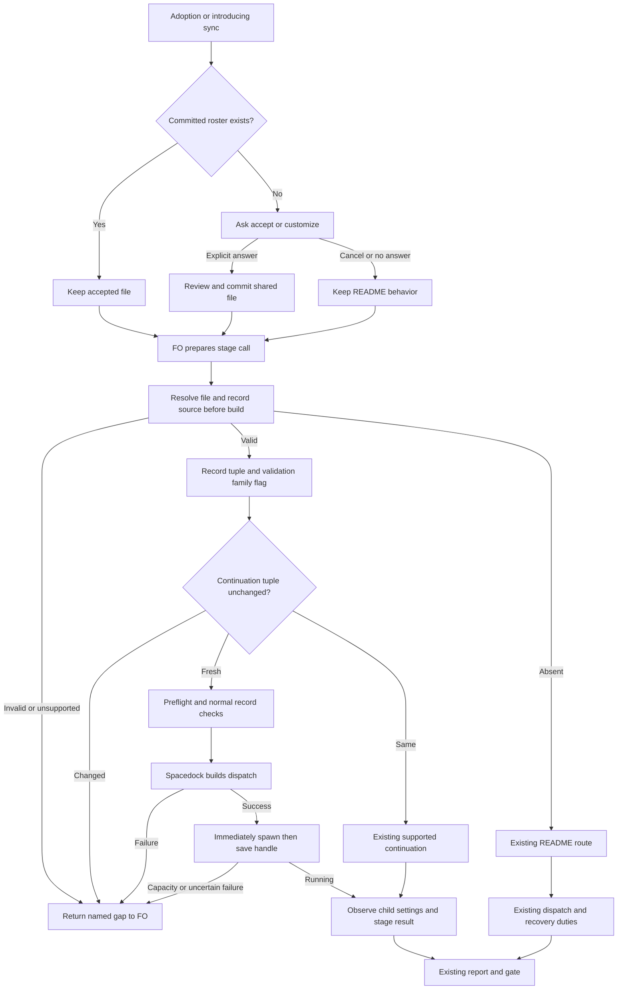

## Scope

- Source: the Captain (chat, 2026-10-29): 「我想延伸這個設計，最近我們用codex作為ensign worker好幾天了，我想可以在paseo ext，夥伴ext之間，例如都有啟用 paseo, gemini, codex時，構築一個可能是by repo可以指定什麼情況下用哪個模型，一來平衡用量，二來避免單模型盲點？例如dev2 會開始建議fo預設都是Claude，不同角色可以用ui問使用者哪個模型，推理等級也可以改，但就是預設以我建議的組合為主，等於最後會產生一個設定檔，派工時就以此為主，你覺得如何？」; then 「可以，就這樣做。平衡用量不用量，你想看看，Claude 做fo，codex做worker ，兩者使用量是否明顯比都只用單一模型更少？」, answering FO's proposal to combine the existing pieces below into one task.
- Outcome he named: a per-repository setting, from a default set dev2 recommends (FO on Claude by default), where each role's model and reasoning level can be chosen through a question UI and changed later; dispatch reads it. Two aims: spread usage across vendors, and avoid one model's blind spots. On spreading usage he said 「平衡用量不用量」 and asked whether Claude as FO plus Codex as worker clearly uses less of each than one model alone; FO's reading, to confirm at the sitting: no usage measurement is owed for that aim.
- Pattern to reuse (relay FO's answer, 2026-10-29, Spacedock tag v0.28.0-pre5 at 230c77e43): Spacedock Review's per-project review mode is owned by the spacedock binary (`internal/cli/review_mode.go`), stored outside the repository keyed by a hash of the repo root, set through `spacedock review-mode get|set|clear`, asked by the skill only when nothing is recorded, and records only an explicit answer. It is per user and machine; a team-shared choice does not fit it. FO's proposal, not ruled: the recommended set lives in the repository (team rules, changed by PR) and a personal override lives outside it like Review's mode (quota is personal).
- Absorbs, for the Captain to confirm at the backlog sitting: Draft PR iamcxa/kc-claude-plugins#674 (Codex model and effort policy per stage, parked since 2026-10-19 behind Spacedock transport spacedock#845), backlog tasks dispatch-sets-reasoning-effort, design-director-model-follows-task, and the multi-model part of gpt-partner-extension-proposal. FO retires none of them without his ruling.
- Evidence: batch 9 (2026-10-28) ran FO on Claude, ideation and validation workers on Codex gpt-6-astra high, implementation on gpt-6.1-sol high, special roles on Claude, all by hand under the Captain's interim directive 「接下來派工結束後新的派工盡量用 sol / astra，推理等級可以比 claude 高一級」; reviewer family differed from worker family by FO's choice, with no rule enforcing it; a sol worker stopped on "Selected model is at capacity" and FO switched it to astra by hand.
- Upstream first: the workflow README `defaults: model:` Spacedock reads at dispatch (`dispatch build` prints `effective_model ... (from defaults)`); kc-dev-flow-2 extensions paseo, peers and the partner proposals; Paseo's provider and model list; spacedock#845.

## Non-goals

- Measuring per-vendor usage; changing hosts or Spacedock itself; choosing models for adopters without an answer.
- First-slice ruling (ideation briefing 1, Captain 「准」, 2026-10-30): no personal overrides, capacity automation, law enforcement, special-role hosting changes or native roster routes. Special roles stay as they run today; the shared setting covers stage workers only.

## Budget

- One package PR for the first shared stage-worker slice: setting, adoption/sync question, resolver, dispatch tuple/flag and batch-9 replay. FO reconciles Draft #674 ownership before implementation; its native remainder and other deferred outcomes cannot be closed as delivered by this slice.

## Stop condition

- First-slice completion: the committed setting replays batch 9's stage tuples without FO choosing a model; stage dispatch records preserve the tuple and a same-family flag; an absent file keeps today's README behavior; actual Paseo child settings are verified. Capacity recovery remains manual. Stop and return to FO if this requires any deferred personal layer, automatic fallback, new law, special-role hosting or native adapter, or if the existing transport cannot carry the selected tuple unchanged. This replaces the earlier automatic-fallback/two-layer stop condition under the recorded ideation revise.

## FO alignment

Alignment: needed before ideation; the default set, where each layer is stored and which roles the UI asks about are the Captain's.
Result: aligned at backlog: the Captain 「對，全准且全確認」 (chat, 2026-10-30) to FO's batch-11 backlog sitting, which asked 「決定：六張全准進設計，並確認上面三件事？要改哪張直接說。」, approved the outcome and bounds in this file. He confirmed no per-vendor usage measurement is owed and that this task absorbs Draft #674, dispatch-sets-reasoning-effort, design-director-model-follows-task and the multi-model part of gpt-partner-extension-proposal. The default set, where each layer is stored and which roles the UI asks about stay his: ideation returns them as decisions at the ideation gate.
Surfaces: none
Visible change: none
Release review: not needed: workflow maintenance, on no journey map.
Reviewer: kc-dev-flow-2:chief-engineer opus 2026-10-30 — batch-11 review before the joint ideation sitting: approve, revise, split or hold each task, the Captain's decisions, overlap and order

## Design

### PRFAQ

**What is approved now?** The Captain's 「准」 on 2026-10-30 accepted the first-slice revision in `model-roster-per-repo/review/ideation/briefing-1/index.json` (briefing digest `sha256:abee7d3947ffa4414a1d0855973d8222508a6ac119403d672d5b91de9f2b7b02`). Its question explicitly accepts a committed `.dev2/model-roster.json`, one accept-or-customize question at adoption or sync, `model_roster.py resolve`, **stage workers only**, the tuple in the dispatch record, a same-family flag and a batch-9 replay. An absent file uses today's README default. Personal settings, automated capacity recovery, law enforcement, special-role hosting and native roster routes are deferred. This Design and Acceptance criteria replace the earlier proposals; the original Stage Report remains historical evidence, not current scope. The recorded revise resolution permits FO to advance a compliant revision without another sitting.

**Who gets what?** A repository adopting the feature can accept the displayed Codex stage-worker recommendation or customize its three rows once, then review and commit the shared file through its normal change path. On subsequent stage dispatches FO reads the recorded choice rather than choosing a model by judgment. A missing file preserves current operation; it does not start an adoption question or hold a dispatch. This first slice spreads stage work to Codex while FO and special roles stay as they run today, including Claude reviewing Codex workers. It makes no claim about lower total tokens, lower cost or removal of blind spots; per-vendor usage measurement remains waived.

**What is the question?** At adoption, or a sync introducing the feature to a repository without the file, use the existing host question UI: “Stage workers: ideation Astra/high, implementation Sol/high, validation Astra/high, all Codex through Paseo. Save this shared repository choice or customize it?” Accept and Customize are the choices; cancellation, empty response or no reply writes nothing and leaves README behavior. Customize collects one stage's exact supported model/effort/host at a time and displays the resulting three-row file for the existing configuration review. A preselected answer is not submitted consent. With a committed file, an ordinary startup or sync neither re-asks nor overwrites it; explicit later changes use the same reviewed repository path. No personal file, extra service, browser form or settings dashboard is added.

**What remains unchanged?** FO identity, special-role model/effort floors and triggers, design-director rules, release-walk policy, permission mode, extension adoption, workspace placement, worker freshness, publication ownership and delivery gates. Selecting `host: paseo` does not enable an extension or grant a tool. Missing prerequisites or unsupported present settings return a named error to FO; absent settings remain the existing route. Capacity failure follows current manual recovery, with no automatic model substitution.

**What is proven in ideation?** The current source inspection, saved ruling, overlap inventory, proposed-passage measurement and rendered design. The resolver, question behavior, record integration and actual child settings are future implementation acceptance; no new worker was launched in this stage.

### Existing chain and bounded checks

1. **Spacedock first.** Read upstream's own `internal/dispatch/build.go`, `internal/dispatch/codex_v2_adapter.go` and `internal/cli/review_mode.go` at `v0.28.0-pre5`, peeled commit `230c77e43aa5dc56a4ec7a86baa0ec718aceda95`, from `/Users/kent/conductor/workspaces/spacedock-v1/chisinau`. Also ran the assigned `/Users/kent/.local/bin/spacedock dispatch build --help`. Claude resolves stage > defaults > null; Codex emits null, and its adapter passes task_name/message/fork_turns without model/effort. Installed help has no model/effort override flags. Review's outside-repository personal store is not reused: that layer was deferred. Do not invent flags, edit generated payload fields or treat an upstream proposal as released capability.
2. **Dev2 next.** `git fetch origin` succeeded; `origin/main` remains `a6612948936a4f075625147b21aabd3b10b19eee`, manifest **0.33.1**. Read source with `git show <SHA>:kc-dev-flow-2/<path>`. `references/sd/workflow.md` gives stage workers the README default and keeps special roles separate; `dispatch_records.py` requires a nonempty Model line and tolerates extra record lines. `extensions/paseo/EXTENSION.md` already owns Codex placement and FO publication. Extend this existing path with one resolver and recorded values; do not change dispatch_records/laws_check or invent a runtime controller.
3. **Paseo's own contract.** Read installed `/Users/kent/.agents/skills/paseo/SKILL.md`, especially Agents and provider discovery, and called read-only `list_models(provider="codex")`. Both `gpt-6.1-sol` and `gpt-6-astra` expose low/medium/high/xhigh/max/ultra on this run; the recommendation stays explicit **high**, matching batch 9. `create_agent` accepts provider/model plus `settings.thinkingOptionId` and explicit workspace placement. Discovery is available-choice evidence, not proof that a launched child used a setting. No agent or provider setting was created or changed.
4. **Sibling adopters last, read only.** Relay beirut-dev2 HEAD `8a4e15c1b968c126ebdd3c1f29550543a4dd6a58`, web dev2-fo HEAD `f2e1a4ccce8af1d9ab4ffb6591f8c84ff18d619a`, and `/Users/kent/conductor/repos/qnow-adopt-dev2` HEAD `278f79ca3eb03a8c1286817f542c4ec4b744bfed` have `model: sonnet` in their local workflow READMEs. Relay/web dev2 and dev2-poc plus qnow dev2-poc were read; none is auto-adopted. These local copies are not current remote or active-runtime proof. Absent-file compatibility protects these existing defaults rather than holding them for a new answer.
5. **Prior decisions and remote limit.** Read ADRs 0020 (word accounting), 0027 (existing writer checks), 0030 (task director), 0033 (release walk), 0035 (extension choices), 0042 (Paseo publication), and relevant state `Override:` results. The new recorded revision supersedes this task's earlier mandatory-adoption/two-layer design; it does not repeal those other duties. `gh pr view 674 --repo iamcxa/kc-claude-plugins --json state,headRefOid` and `gh issue view 845 --repo spacedock-dev/spacedock --json state,title` failed `error connecting to api.github.com`. Current hosted PR/issue state and branch ownership are unverified. No remote comment, retirement or message occurred; FO rechecks ownership before implementation, using local branch/source facts meanwhile.

### First-slice setting and resolver

The package recommendation lives in `kc-dev-flow-2/references/model-roster-defaults.json`; the accepted shared snapshot is `<code-root>/.dev2/model-roster.json`, schema 1. Its only configurable roles are `ideation`, `implementation`, `validation`; repair uses the implementation row. A POC workflow simply never calls the ideation row. Each row has `provider`, `model`, `effort`, `host`. Include the selected package version and the adoption decision reference; these are provenance recorded by the caller, not authenticated human consent. No family override, fallback list, private-layer key, FO row, special-role row or task-specific override engine is accepted in schema 1. The file is ordinary reviewed repository content, not an automatically installed default.

| Stage | Provider | Model | Effort | Host |
| --- | --- | --- | --- | --- |
| ideation | codex | gpt-6-astra | high | paseo |
| implementation, including repair | codex | gpt-6.1-sol | high | paseo |
| validation | codex | gpt-6-astra | high | paseo |

The first supported custom choices are the discovered Sol/Astra models and their explicit supported reasoning values on Paseo; a request for another provider or host returns to FO as expanded scope. Do not turn this slice into a provider catalog. Existing special roles remain outside this table and keep their existing Claude configuration. A stage-worker setting cannot revise director or independent advisory-role policy.

One read-only stdlib command is planned: `python3 <package>/scripts/model_roster.py resolve --code-root <absolute root> --stage <stage> [--author-record <existing dispatch record> ...]`. It reads the exact code checkout FO binds for this dispatch, not cwd or the split-root state checkout. The JSON result distinguishes `repository` from `readme-default`; carries the selected stage tuple, roster blob digest/source commit and a short family result; and never writes settings, dispatches or state. Exit 0 means resolved or explicitly absent/legacy; exit 1 names malformed/unsupported present data or an invalid role. An absent file yields `source=readme-default` with no fabricated Codex/effort tuple: SD and the existing host path retain their normal README behavior. Do not reimplement Spacedock's YAML/default parser.

Validate the entire present schema, duplicate keys, all three rows and known tuple values; malformed, unreadable, partially written or unsupported schema/data is not absence and must not silently fall back. At adoption/sync, prepare a complete file for ordinary reviewed commit, never use the resolver to save it. Dispatch reads a clean committed choice from the pinned checkout; an uncommitted change is returned to FO for the normal review path. New package recommendations do not rewrite an accepted snapshot. A later committed deletion restores README behavior as the ruling requires; no de-adoption registry is introduced.

For stage validation, `family` means **provider lineage** in this slice: Sol and Astra both flag `same-family: openai`. Compare the resolved validator with the actual authoring tuples from the candidate's existing implementation/repair dispatch records, not today's implementation default. Missing/unknown author evidence emits `family: unverified`; it cannot claim diversity. This is a visible warning, not a new refusal or approval gate. Record all contributing author tuples and the flag in the validation record and its existing report/gate summary. Existing special-role independence duties still apply separately. The resolver tests its own flag computation; no state-history enforcement is added.

### Stage dispatch and real evidence

For each new ideation, implementation/repair or validation dispatch, and each stage continuation, FO resolves the recorded choice **before** normal record checks and SD build. Keep the existing `Model:` line and add a compact `Roster:` line with source, role, provider/model/effort/host and source digest/commit; for validation also add the family result and author-record references. For absent settings record `Roster: absent; source README default` and preserve the existing Model recording. Use the normal `<task>/dispatch/<stage>-<cycle>.md` state path and commit procedure; no new log, law or mandatory historical schema. Existing `dispatch_records.py --names`, folder/coverage checks and L2 law checks continue unchanged and do **not** prove roster consumption.

Preflight the provider capability, extension eligibility, destination workspace and already-running worker identity before build. For the configured Codex/Paseo route, use the existing Codex host binding, then pass the resolved provider/model and `settings.thinkingOptionId` to Paseo beside the unchanged generated prompt and required generated identity/runtime fields. A non-null generated value conflicting with the requested tuple is a transport mismatch: return to FO; do not patch the envelope. Resolution and human questions precede build; successful build is followed immediately by spawn, then saving its handle. New capability checks, diagnostics or narration must not intervene. Keep ADR 0042's current worker-local commit / FO publication and review split.

A continuation re-reads the file and records its source. If the effective tuple is unchanged, reuse under the existing stage rules; if changed, return to FO for an authorized fresh-worker handoff. Do not mutate or duplicate a running worker. Capacity, network or unknown launch results return to current recovery; the resolver chooses no alternate model. A configured roster is not supported on native launch routes in this slice; return that requested use to FO. An absent file on any existing route still uses current behavior.

Actual-child acceptance requires the supported Paseo runtime/turn metadata to show the launched model, effort and assigned root, separately from requested values. A JSON echo, mock launch or worker assertion alone is not this evidence. If current transport cannot preserve the generated fields or expose decisive runtime evidence, return that gap to FO; do not redesign transport or silently broaden this package PR. Ideation creates no test agents; implementation/validation runs only FO-authorized bounded stage dispatches.



### Deferred backlog and return-to-FO boundary

This is a follow-up list, not newly created tasks or implementation authorization:

| Deferred outcome | Remains pending; first-slice boundary |
| --- | --- |
| Personal overrides | Outside-repository storage, identity keys, layering and concurrent save rules are not designed here. Shared repository choice is the only layer. |
| Capacity automation | Ordered fallback, retry state and substitution-aware recovery need a later bounded task. Capacity stays manual; the old automatic-fallback stop condition is replaced. |
| Law enforcement | Historical roster admission, required snapshot schemas, dispatch_records/laws_check changes and state migrations are deferred. Current records are instructed and exercised, not mechanically guaranteed. |
| Special-role hosting | FO, chief-engineer, engineering-reviewer, observer and director selection remain current policy; non-Claude director mapping is unresolved in its existing follow-up. No astra-to-Opus mapping is adopted. |
| Native routes | Explicit native model/effort support waits for released upstream capability and a separate real proof; no custom SD adapter in this slice. |
| Other partner capabilities | Gemini/other providers, parallel partners and release-walk model changes remain with the original partner proposal. |

Draft #674 (parked Codex model policy) may supply reusable ideas, but its ownership/current state must be checked by FO before choosing one implementation branch. Its native-transport remainder cannot be closed as delivered by a Paseo-only slice. `dispatch-sets-reasoning-effort` is covered only for the three Paseo stage rows; native/special-role remainder stays open. `design-director-model-follows-task` remains deferred, and `gpt-partner-extension-proposal` is covered only for this stage-selection part. “Absorbed” is not closure proof. FO maps any later closure to delivered evidence and retained remainder; this worker neither retires nor edits those records.

No fresh Captain decision is needed within the recorded revise asks. If meeting the criteria needs one of the deferred items, another provider, changed role policy, a new host, an extra enforcement layer, or a positive workflow-word-budget increase, stop and return **that one concrete scope decision** to FO. Recommendation: keep this first slice and separately scope the remainder; worse: capacity handling stays manual, validation remains within OpenAI, and personal/native users wait. Do not reopen the already-accepted default, absent-file or stage-only decisions merely because the prior design asked them.

### Durable decision

Unnumbered ADR draft: `docs/adr/<reserved>-repository-stage-model-rosters-keep-readme-defaults-when-absent.md`. Record the actual gate question and 「准」, three stage rows, committed shared choice, absent-file compatibility, informational family flag and the explicit deferred list. It introduces no new policy beyond this ruling. FO reserves the number at implementation dispatch; no ADR file or number is created by ideation.

### Words FO reads at each lifecycle moment

Re-measured against source `a6612948936a4f075625147b21aabd3b10b19eee` using `len(text.split())` independently on every named passage. These are complete **proposed passage/fixture counts**, not full observed session context. Unchanged upstream/host outputs remain an unmeasured additive `U(moment)` on both sides, not zero. Actual dynamic/customization/error output is still owed at implementation. This feature adds reading and claims no context reduction.

| Moment | Before + U(moment) | Proposed + U(moment) | Delta |
| --- | ---: | ---: | ---: |
| startup | 9710 | 9710 | +0 |
| idle on open PR | 1821 | 1821 | +0 |
| idle on merged PR | 328 | 328 | +0 |
| after archive | 328 | 328 | +0 |
| merge ask | 2258 | 2258 | +0 |
| configured Paseo stage dispatch | 2444 | 2683 | +239 |
| absent-file stage dispatch through Paseo | 2444 | 2634 | +190 |
| adoption or introducing sync | 2182 | 2427 | +245 |

Reproduction: read the pinned package with `git show <SHA>:kc-dev-flow-2/<path>`; sum each passage's `len(text.split())` without concatenating boundaries. Startup = README.md + skills/dev/SKILL.md + references/sd/workflow.md + references/sd/mods/kc-dev-flow-2.md. Idle/open = mod + workflow's `## FO steps: review findings` body + codex and copilot EXTENSION.md; idle/merged and after/archive = mod + learn EXTENSION.md; merge ask = workflow `## Delivery authority` body + review-findings body + codex/copilot. Dispatch = the entire workflow `## Stages` body including stage subsections + paseo EXTENSION.md. More precisely each section is the text after its named level-two heading through the next level-two heading. Adoption = entire references/sd/adoption.md. The same enabled-extension fixture is used on both sides; this is not a claim every adopter loads it.

The workflow replacement below replaces just the original eight-word first Stages sentence and is itself eight words: **workflow budget delta 0**. Other special-role text is byte-preserved. Startup reads that pointer but does not load the runtime reference until dispatch/adoption is due; quiet idle and special-role calls do not load it. Proposed dispatch adds the full Paseo insertion + full Runtime reference + the relevant output; configured dispatch also counts the entire settings fixture, not only its selected row. Adoption adds its insertion + full reference + recommendation fixture + question. Count repeated reads when they actually recur; these per-moment rows are not a deduplicated whole-session total.

Exact proposed texts used in the recount (labels are not loaded text):

**Workflow replacement — 8 words:**

```text
Stage workers follow `<package>/references/model-roster.md`; absence retains README defaults.
```

**Adoption insertion — 32 words:**

```text
At adoption or introducing sync, follow `<package>/references/model-roster.md` to ask once about stage workers. Save only an explicit shared choice through the normal reviewed change. Preserve existing settings; no answer leaves README defaults.
```

**Paseo insertion — 32 words:**

```text
For configured stage workers, resolve and record the repository tuple before build; supply its provider/model and thinkingOptionId through this existing route. Keep generated fields and immediate spawn order. Special roles stay unchanged.
```

**Runtime reference — 146 words:**

```text
Before each stage launch or continuation, run model_roster.py resolve with the bound absolute code root and stage. For validation, pass the candidate author records. Absent settings retain the existing README route without a question. Invalid present settings return the named error to FO. Record the source and tuple, plus any family warning, in the normal dispatch record. Check capability and placement before build; preserve the generated dispatch and immediately spawn, then save the handle. Changed continuation settings return to FO for fresh handoff. Capacity recovery stays manual. Special roles and native roster routes are outside this slice. At adoption or introducing sync, show the three-row recommendation and ask accept or customize. Save only the explicit answer through ordinary repository review. Cancel or silence changes nothing. Existing settings survive sync; explicit later changes use that same reviewed path. Keep requested settings separate from observed child runtime evidence.
```

**Recommendation/settings fixture — 44 words:**

```json
{
  "schema_version": 1,
  "selected_from": "0.33.1",
  "decision": "recorded-adoption-answer",
  "stages": {
    "ideation": {
      "provider": "codex",
      "model": "gpt-6-astra",
      "effort": "high",
      "host": "paseo"
    },
    "implementation": {
      "provider": "codex",
      "model": "gpt-6.1-sol",
      "effort": "high",
      "host": "paseo"
    },
    "validation": {
      "provider": "codex",
      "model": "gpt-6-astra",
      "effort": "high",
      "host": "paseo"
    }
  }
}
```

**Successful output fixture — 17 words:**

```text
Resolved validation: codex gpt-6-astra high via paseo; source repository; roster sha256:DIGEST commit SHA; authors implementation-1; same-family openai.
```

**Absent output fixture — 12 words:**

```text
Roster absent: use existing README defaults; no adoption question or model override.
```

**Question fixture — 23 words:**

```text
Stage workers: ideation Astra/high, implementation Sol/high, validation Astra/high, all Codex through Paseo. Save this shared repository choice or customize it? Accept / Customize.
```

The output fixtures are design examples, not a working resolver's output. If the shipped CLI emits longer JSON/diagnostics, count those actual bytes too. Acceptance must capture cancel/customize/invalid-file and hold paths rather than projecting these success numbers onto them. No lint budget change is proposed; if another batch edit changes the replaced sentence or full reference loading, remeasure on the actual implementation base and return any new budget increase to FO under ADR 0020. The old 9883/1290 proposal is superseded, not reused as measured behavior. This cycle counts the entire Stages section, including worker-stage subsections, at dispatch: its baseline is 2444 rather than the earlier 1133 pre-backlog-only figure. This conservative whole-section fixture makes that corpus difference explicit; it is not a measured runtime increase.


### Batch overlap

First package PR changes **eight files**: new `kc-dev-flow-2/references/model-roster.md` (one runtime/adoption reference), `kc-dev-flow-2/references/model-roster-defaults.json` (three-row recommendation), `kc-dev-flow-2/scripts/model_roster.py` (read-only resolve); edit `kc-dev-flow-2/references/sd/workflow.md` (word-neutral stage pointer, retaining special-role text), `kc-dev-flow-2/references/sd/adoption.md` (one question at adoption/sync), `kc-dev-flow-2/extensions/paseo/EXTENSION.md` (stage tuple transport/record), `kc-dev-flow-2/scripts/test_sd_dispatch.py` (resolver CLI and existing dispatch fixtures); one new root `docs/adr/<reserved>-repository-stage-model-rosters-keep-readme-defaults-when-absent.md`. Its number is FO-owned. Use the existing test_sd_dispatch CI step and package path triggers; no workflow YAML edit or paid model call in CI. Incremental CI cost per PR is **not measured** at ideation; implementation records the test-runtime delta, without inventing a billing number.

The adopted `.dev2/model-roster.json` and adopter workflow README sync are separately reviewed adopter changes after the published package, not writes to siblings in this PR. No edits to dispatch_records.py, laws_check.py, their tests, lint-skills.py, dev/role skills, agent declarations, peers extension, provider config or Spacedock. If the word-neutral pointer does not fit the rebased source, recount and return an actual increase to FO rather than expanding the budget silently.

| Batch/live task (routing name; purpose) | Same file/check and order |
| --- | --- |
| batch10-after-release-obligations — post-release repairs and proofs | No product-file overlap after narrowing; shares pre-build/immediate-spawn evidence seam. Its native proof remains separately owed; do not claim roster evidence from it. |
| names-check-says-what-it-skipped — dispatch diagnostic coverage | workflow.md and test_sd_dispatch.py; it owns dispatch_records/test_laws/lint changes. Land its wording first, then rebase and recount this neutral pointer. |
| peers-paseo-rule-matches-practice — peer send policy | paseo/EXTENSION.md, adoption.md and ADR reservation namespace. It owns peer-policy text; this task changes the worker subsection only. Serialize final full-file recounts. |
| peer-status-reaches-fresh — current peer facts | Its latest ideation question removes its paseo insertion and gives that text to the peer-policy task; peers-only work has no direct product overlap. Do not resurrect its old shared insertion. |
| model-roster-per-repo — this stage model setting | Sole owner of the three new roster files and stage-selection tests; no personal or law-engine work. |
| paseo-human-surfaces-visible-and-reachable — worker terminal/tab reach | paseo/EXTENSION.md and pre-build placement preparation. Keep visibility setup before build; share confirmed worktree identity without changing its network policy. |
| adoption-asks-which-extensions — event-time extension checks | Latest gate holds until a live record is affected; its narrowed checker/history files do not overlap this slice. No dependency on reopening it, despite its old adoption title. |
| adr-required-statement — old ADR ledger proposal | Body says closed 2026-10-20 despite validation frontmatter. No live product dependency; reserve a fresh ADR through FO, do not reopen or reuse its abandoned number. |
| adr-silent-undo-probe — ADR reversal experiment | Held copy moved to a POC task; no shared file/check. Do not alter its model controls. |
| comment-check-reaches-delivery-gate — old comment evidence proposal | Body says closed 2026-10-20. No shared file/check; do not revive abandoned delivery/validation edits. |
| journey-canvas-hosted-poc — hosted canvas trial | No product/check overlap; only possible shared future ADR allocation. No hosting used for this question. |
| journey-server-host-pilot — private journey server | No product/check overlap; shared ADR allocation only. Its validation remains its owner's. |
| ops-inbox-r1-setup-and-isolation — event intake and isolation | No product/check overlap; separate kc-ops-inbox package/CI and ADR allocation. Its hosted FO is not moved to the roster. |
| pr-review-lite-value-pilot — bounded PR review trial | No overlap: kc-pr-flow capability/tests and journey artifacts. Preserve its independent model/effort experiment controls. |

Recommended order: land the shared diagnostic workflow/test change, settle peer-policy and visible-surface Paseo sections, then implement this eight-file slice on refreshed main; serialize ADR reservation and recount whole loaded passages after rebasing. Sibling bodies and latest gate questions were read only; current remote PR ownership remains for FO to verify because gh failed. Do not wait for held/closed unrelated tasks.

## Acceptance criteria

**AC-1 — Explicit shared adoption.** In temporary code repositories, exercise the actual host question journey for accept, customize, cancel and unanswered. Accept/customize produce exactly the displayed three-row candidate and ordinary reviewed commit; cancellation/unanswered leave bytes and directory inventory unchanged. A committed file is preserved on startup/sync; later changes need an explicit request and normal review. Evidence: question/answer receipts, file manifests and a fresh-shell resolve of the committed candidate. Falsifier: treating a preselection as an answer or overwriting a file on package sync must fail. Current: planned, not exercised; no adopter setting was changed.

**AC-2 — Resolver and absent-file compatibility.** Add real subprocess tests to the already-run `test_sd_dispatch.py`: use explicit absolute code roots with split-root state and linked code worktrees, run the shipped resolve CLI twice, and compare outputs/files. Present supported tuples resolve; absent file returns `readme-default` and leaves existing README dispatch behavior/model untouched without an adoption prompt. Malformed/duplicate/partial data, unknown schema/role, unreadable or uncommitted present file and unsupported provider/host return the precise field/error rather than absent. A committed change or deletion affects the next resolve; package updates never rewrite accepted bytes. Falsifier: use cwd/state as code root or return Codex recommendation on absence. Current: source seams inspected, executable acceptance unverified.

**AC-3 — Batch-9 stage replay.** Embed minimal de-identified tuple fixtures in test_sd_dispatch.py, citing SHA-256 digests of `_archive/paseo-codex-dispatch-practice/dispatch/{ideation-1,implementation-1,validation-1}.md`; run the real resolver in a fresh shell and assert Astra/high, Sol/high, Astra/high, each Codex/Paseo, including implementation for repair. No runtime lookup chooses an alternative. The recorded FO/Claude special-role facts remain context and are not resolved/rehosted by this feature. Falsifier: swap stage rows or omit explicit effort; the replay must fail. Current: historical inputs read, no resolver replay yet; capacity replay is deliberately outside this revised criterion. Source SHA-256: ideation-1 `18eeff12f0ad4f662ce5889bc6e78bf36223cf4b9282beed86506245bbd5d331`; implementation-1 `e65a8911f7d741ba78aa6b98bdae59de3d9753b7c72d95ec31ae42e73b04a833`; validation-1 `2f33b40eba6c9a881e9070199857843351c746e8408ba37195b630eb169d0bff`.

**AC-4 — Real stage dispatch and continuation.** FO authorizes bounded real stage calls on the exact candidate and saves ordered preflight → resolve/record/check → SD build → immediate spawn → handle → child metadata evidence. Exercise both recommended models with explicit high, a changed supported effort, unchanged continuation, and a changed-tuple continuation returned for fresh handoff. Verify prompt/generated-field integrity, assigned root, preserved permissions and requested versus observed model/effort. A real stage already owed can supply evidence; do not create workload merely to force capacity. Falsifier: drop thinkingOptionId, change workspace or insert a post-build check; echo-only/mocked metadata cannot pass. Current: own-tool discovery succeeds, actual-child proof unverified; missing runtime fields return to FO, not a new telemetry design.

**AC-5 — Visible family evidence and records.** Real resolver fixtures compare each validator with the actual candidate's author records: Sol/Astra and Sol/Sol produce an informational OpenAI same-family flag; missing/unknown authors produce unverified, never diverse. Preserve source references and flag in the dispatch record and existing validation/gate summary. Run existing names/folder checks on augmented and legacy records without changing their checker/law contracts; show that their green result alone does not establish roster use. Falsifier: compare only today's configured implementation row, suppress the flag, or turn it into a new hard refusal. Current: record parser inspected, behavior/record replay unverified.

**AC-6 — Scope, reading and regressions.** On the exact candidate, run package lint, existing SD/POC derivation/dispatch tests and applicable existing checks; compare the eight-file allowlist and role declarations, assert no private store, fallback automation, native adapter or new law. Recount the exact text/output ledger below and capture exercised accept/customize/cancel/error outputs separately. Confirm absent-file routes and current special-role instructions are preserved. Measure the model-free suite runtime delta per PR; CI YAML and trigger stay unchanged. FO checks #674 ownership/remaining scope before delivery and does not close native/director/partner remainders as delivered. Falsifier: add an enforcement file, silently alter a role, change README-default behavior, or omit loaded helper output from the count. Current: proposed passage counts measured; candidate tests, native evidence, CI runtime and hosted closure are unverified.

## Stage Report: ideation

- DONE: A design for a per-repository model roster: a dev2-recommended default set (FO on Claude), each role's model, reasoning level and host, a question UI that asks only when nothing is recorded and records only an explicit answer, later changes, and every dispatch reading it; the recommended set in the repository and a personal override outside it, as proposed in Scope; a reviewer of a different family than its worker refused or flagged; a capacity stop falling back by rule; how Draft PR iamcxa/kc-claude-plugins#674 and the absorbed backlog tasks close; batch 9's hand-chosen roster replayed from the setting; the default set, where each layer lives and which roles the UI asks about returned as Captain decisions; split into smaller tasks if it exceeds one PR
  Design above covers both layers, explicit-answer UI, all role tuples, family flags/refusals, bounded recovery, historical batch-9 inputs, absorbed-work closure and the native-transport split; three recommendations await the Captain. Source baseline a6612948936a4f075625147b21aabd3b10b19eee (0.33.1).
- DONE: A `### Batch overlap` section naming each file the design would change and each other batch task (batch10-after-release-obligations, names-check-says-what-it-skipped, peers-paseo-rule-matches-practice, peer-status-reaches-fresh, model-roster-per-repo, paseo-human-surfaces-visible-and-reachable) and live task of other sessions (adoption-asks-which-extensions, adr-required-statement, adr-silent-undo-probe, comment-check-reaches-delivery-gate, journey-canvas-hosted-poc, journey-server-host-pilot, ops-inbox-r1-setup-and-isolation, pr-review-lite-value-pilot (driven by other sessions; read only)) that changes the same file or check, so FO can order implementation
  The final Design subsection names all 14 listed task identities, exact proposed files and shared dispatch/L2/placement checks; recommendations order historical fixes and Paseo edits first. All sibling tasks were read only.
- DONE: The words FO reads at each lifecycle moment, before and after, per root learning.md "Measure the words FO reads at each moment, not one file's size"
  The measured design passage table is 9710→9883 at startup and 1133→1290 per Paseo dispatch; other listed quiet lifecycle paths are unchanged. Full dynamic output totals remain unverified, explicitly additive rather than counted as zero.
- DONE: Acceptance criteria with reproducible evidence clauses and falsifiers, and unresolved decisions for the Captain, each with a recommendation and what gets worse under it
  AC-1 through AC-10 each state an executable evidence plan, a falsifying change and current status. design_surfaces.py check exited 0: model-roster-per-repo.md: design surfaces presentable. Mermaid CLI 11.17.0 rendered the diagram and its actors, cancellation, hold, immediate spawn and finite fallback branches were visually inspected.
- SKIPPED: AC-1 explicit choice and persistence implementation acceptance execution
  Not yet verified: no UI answer or settings write was exercised; accepting a preselection must fail the future negative control.
- SKIPPED: AC-2 layers and identity implementation acceptance execution
  Not yet verified: linked-worktree identity, atomic save and override conflict cases are planned; keying by worktree root must fail.
- SKIPPED: AC-3 batch-9 replay implementation acceptance execution
  Historical astra/sol/astra and Claude reviewer records were read; resolver replay is not implemented. Swapped stage tuples must fail.
- SKIPPED: AC-4 actual child settings implementation acceptance execution
  Live provider/model discovery succeeded; no child was spawned. Removing explicit effort or changing the assigned root must fail native proof.
- SKIPPED: AC-5 reviewer independence implementation acceptance execution
  Not yet verified; the family policy is proposed for Captain choice. Matching default policy while ignoring actual fallback authors must fail.
- SKIPPED: AC-6 capacity recovery implementation acceptance execution
  Not yet verified; finite attempt/cursor tests and live-event evidence are separately required. Timeout-as-capacity must fail.
- SKIPPED: AC-7 dispatch coverage and history implementation acceptance execution
  Existing record/L2 seams inspected; candidate checks are not implemented. A missing Roster marker after adoption must fail, without changing old records.
- SKIPPED: AC-8 director and absorbed closure implementation acceptance execution
  Prior director ruling and both open PR bodies read; no director call, backlog closure or PR change occurred. Current-default substitution must fail.
- SKIPPED: AC-9 reading and gates implementation acceptance execution
  Design counts and independent dispatch recount passed; full runtime outputs, candidate tests and CI cost are not measured. Dropping moved instructions/output from the count must fail.
- SKIPPED: AC-10 delivery boundary implementation acceptance execution
  No implementation or delivery attempted; unsupported native Codex is explicitly held. An open upstream PR cannot pass the route capability check.

### Summary

Designed the bounded repository roster and private override journey, preserving explicit answers, worker identity, independent review and capacity-recovery limits. The Captain still decides the default/director policy, storage layers and question/delivery boundary; unsupported native transport and unproven runtime behavior are not represented as completed delivery. This is a state-only design/report; gh API failure was recovered for read-only PR facts via the GitHub connector, and no other session was messaged.


## Stage Report: ideation (cycle 2)

- DONE: Revise the design under the Captain's ideation-gate revise of 2026-10-30 (「准」); the asks are in this task's newest ideation gate question (review/ideation, newest briefing); do exactly those asks, update criteria and the stop condition to match, and name anything that would go beyond them as a return to FO rather than designing it; the first slice only, with a follow-up backlog list for what is deferred
  Current Design follows briefing-1 and the recorded 2026-10-30 revise; Stop condition and six criteria cover the shared stage-worker slice, absent-file README behavior, informational family flag and batch-9 replay; six deferred outcomes return to FO rather than gaining design scope.
- DONE: A `### Batch overlap` section naming each file the design would change and each other batch task (batch10-after-release-obligations, names-check-says-what-it-skipped, peers-paseo-rule-matches-practice, peer-status-reaches-fresh, model-roster-per-repo, paseo-human-surfaces-visible-and-reachable) and live task of other sessions (adoption-asks-which-extensions, adr-required-statement, adr-silent-undo-probe, comment-check-reaches-delivery-gate, journey-canvas-hosted-poc, journey-server-host-pilot, ops-inbox-r1-setup-and-isolation, pr-review-lite-value-pilot (driven by other sessions; read only)) that changes the same file or check, so FO can order implementation
  Eight proposed package/ADR files are listed with all 14 task identities; latest peer-status and adoption gate questions plus closed bodies correct the earlier overlap inventory. No sibling was edited or messaged.
- DONE: The words FO reads at each lifecycle moment, before and after, per root learning.md "Measure the words FO reads at each moment, not one file's size"
  Independent recount agrees: startup 9710→9710, configured Paseo stage dispatch 2444→2683, absent dispatch 2444→2634, adoption/sync 2182→2427; quiet moments unchanged and workflow delta 0. Entire Stages corpus and dynamic-output limits are explicit.
- DONE: Acceptance criteria with reproducible evidence clauses and falsifiers, and unresolved decisions for the Captain, each with a recommendation and what gets worse under it
  Six individually mapped evidence plans include falsifiers. No new decision within the accepted revise; expanded scope returns to FO with recommendation/tradeoff. design_surfaces.py check exited 0: model-roster-per-repo.md: design surfaces presentable; Mermaid CLI 11.17.0 rendered and visual review matched actors, absence/cancel, failure and immediate-spawn branches.
- SKIPPED: AC-1 — Explicit shared adoption implementation acceptance execution
  Not yet verified: host accept/customize/cancel/unanswered and reviewed persistence await implementation; treating preselection as consent must fail.
- SKIPPED: AC-2 — Resolver and absent-file compatibility implementation acceptance execution
  Not yet verified: CLI does not exist yet; actual malformed/absent/committed-change fixtures must reject fabricated defaults and wrong code-root resolution.
- SKIPPED: AC-3 — Batch-9 stage replay implementation acceptance execution
  Historical Astra/high, Sol/high, Astra/high input records and hashes read; resolver replay unverified. Swapped stage rows must fail; automatic capacity replay is deferred.
- SKIPPED: AC-4 — Real stage dispatch and continuation implementation acceptance execution
  Read-only Paseo model discovery succeeded; no worker spawned. Actual child model/effort/root proof remains unverified; dropped thinkingOptionId cannot pass from a settings echo.
- SKIPPED: AC-5 — Visible family evidence and records implementation acceptance execution
  Existing Model-line parser inspected; resolver flags and augmented-record replay await implementation. Using current defaults instead of candidate authors must fail; no new law is claimed.
- SKIPPED: AC-6 — Scope, reading and regressions implementation acceptance execution
  Design passage recount passed and Scope/frontmatter/prior-report bytes were verified preserved; candidate regression/native proof and incremental CI cost remain unverified. Adding deferred enforcement or omitting loaded output must fail.

### Summary

Revised to the Captain-approved eight-file first slice: committed stage-worker settings, one adoption/sync question, read-only resolve, dispatch tuples, same-family warnings and batch-9 replay; missing settings preserve README defaults. The earlier report is preserved byte-for-byte, capacity stays manual, and personal/law/special-role/native work is explicitly deferred; this is design evidence only, not implemented acceptance. Current source is a6612948936a4f075625147b21aabd3b10b19eee (0.33.1); GitHub API reads failed, so FO must verify PR ownership/state before implementation, and no extra Captain sitting is requested within the recorded revise authority.
