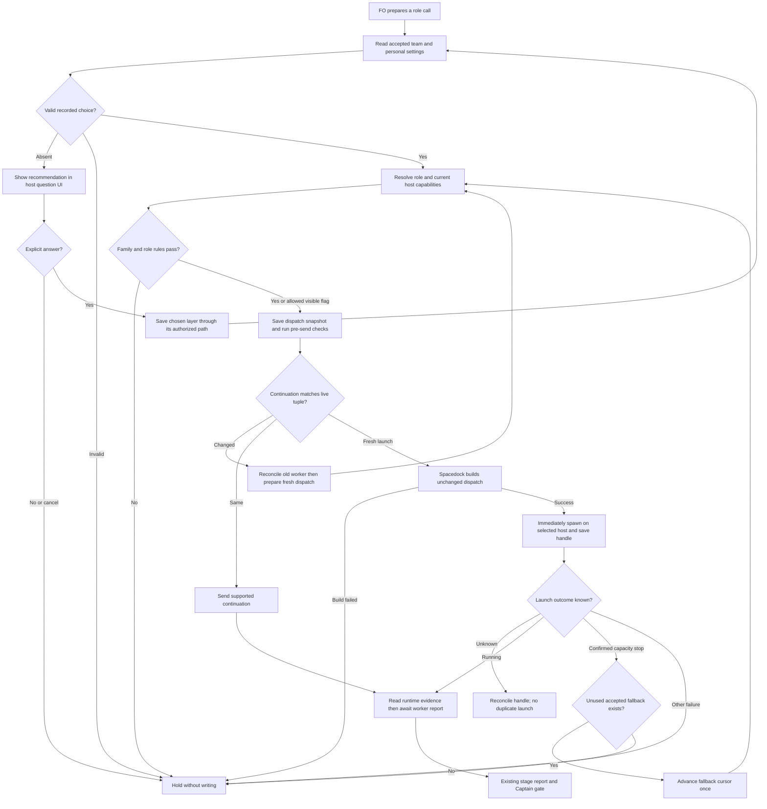

## Scope

- Source: the Captain (chat, 2026-10-29): 「我想延伸這個設計，最近我們用codex作為ensign worker好幾天了，我想可以在paseo ext，夥伴ext之間，例如都有啟用 paseo, gemini, codex時，構築一個可能是by repo可以指定什麼情況下用哪個模型，一來平衡用量，二來避免單模型盲點？例如dev2 會開始建議fo預設都是Claude，不同角色可以用ui問使用者哪個模型，推理等級也可以改，但就是預設以我建議的組合為主，等於最後會產生一個設定檔，派工時就以此為主，你覺得如何？」; then 「可以，就這樣做。平衡用量不用量，你想看看，Claude 做fo，codex做worker ，兩者使用量是否明顯比都只用單一模型更少？」, answering FO's proposal to combine the existing pieces below into one task.
- Outcome he named: a per-repository setting, from a default set dev2 recommends (FO on Claude by default), where each role's model and reasoning level can be chosen through a question UI and changed later; dispatch reads it. Two aims: spread usage across vendors, and avoid one model's blind spots. On spreading usage he said 「平衡用量不用量」 and asked whether Claude as FO plus Codex as worker clearly uses less of each than one model alone; FO's reading, to confirm at the sitting: no usage measurement is owed for that aim.
- Pattern to reuse (relay FO's answer, 2026-10-29, Spacedock tag v0.28.0-pre5 at 230c77e43): Spacedock Review's per-project review mode is owned by the spacedock binary (`internal/cli/review_mode.go`), stored outside the repository keyed by a hash of the repo root, set through `spacedock review-mode get|set|clear`, asked by the skill only when nothing is recorded, and records only an explicit answer. It is per user and machine; a team-shared choice does not fit it. FO's proposal, not ruled: the recommended set lives in the repository (team rules, changed by PR) and a personal override lives outside it like Review's mode (quota is personal).
- Absorbs, for the Captain to confirm at the backlog sitting: Draft PR iamcxa/kc-claude-plugins#674 (Codex model and effort policy per stage, parked since 2026-10-19 behind Spacedock transport spacedock#845), backlog tasks dispatch-sets-reasoning-effort, design-director-model-follows-task, and the multi-model part of gpt-partner-extension-proposal. FO retires none of them without his ruling.
- Evidence: batch 9 (2026-10-28) ran FO on Claude, ideation and validation workers on Codex gpt-6-astra high, implementation on gpt-6.1-sol high, special roles on Claude, all by hand under the Captain's interim directive 「接下來派工結束後新的派工盡量用 sol / astra，推理等級可以比 claude 高一級」; reviewer family differed from worker family by FO's choice, with no rule enforcing it; a sol worker stopped on "Selected model is at capacity" and FO switched it to astra by hand.
- Upstream first: the workflow README `defaults: model:` Spacedock reads at dispatch (`dispatch build` prints `effective_model ... (from defaults)`); kc-dev-flow-2 extensions paseo, peers and the partner proposals; Paseo's provider and model list; spacedock#845.

## Non-goals

- Measuring per-vendor usage (see the Captain's words above); changing hosts or Spacedock itself; choosing models for adopters without their answer.

## Budget

- One package PR for the setting, its question flow and the dispatch read; #674 is reopened or closed inside this task, not in parallel.

## Stop condition

- Batch 9's hand-chosen roster replays from the setting with no FO judgment, a reviewer on the same family as its worker is refused or flagged, and a capacity stop falls back by rule; return to the Captain if per-repo sharing versus per-user storage cannot both hold.

## FO alignment

Alignment: needed before ideation; the default set, where each layer is stored and which roles the UI asks about are the Captain's.
Result: aligned at backlog: the Captain 「對，全准且全確認」 (chat, 2026-10-30) to FO's batch-11 backlog sitting, which asked 「決定：六張全准進設計，並確認上面三件事？要改哪張直接說。」, approved the outcome and bounds in this file. He confirmed no per-vendor usage measurement is owed and that this task absorbs Draft #674, dispatch-sets-reasoning-effort, design-director-model-follows-task and the multi-model part of gpt-partner-extension-proposal. The default set, where each layer is stored and which roles the UI asks about stay his: ideation returns them as decisions at the ideation gate.
Surfaces: none
Visible change: none
Release review: not needed: workflow maintenance, on no journey map.

## Design

### PRFAQ

**Proposition.** A repository can record an explicitly accepted dev2 model roster, and FO resolves that setting before each launch or continuation. The roster names the provider, model, reasoning effort and execution host for each role, with an ordered capacity fallback. A shared recommendation is versioned with the repository; personal quota preferences remain outside it. Selecting a model does not grant tools, change permissions, enable an extension, migrate a running FO, or approve delivery.

**Why this slice?** Batch 9 already demonstrated the desired division by hand. The missing piece is a durable choice and a repeatable dispatch decision, not another agent service. This is a pilot for Claude/Codex through the existing Paseo route; native routes are admitted only when their installed transport can preserve the resolved settings. No claim of lower total tokens or lower cost is made: the Captain waived usage measurement, and dividing requests across providers does not itself prove fewer tokens.

**What happens on first use?** Show the recommended table in the host's question UI only when no accepted repository roster and no explicit personal selection exist. Ask one decision: use the recommended set, customize, or leave unset. A preselected option, timeout, closed UI, inferred profile or lack of response writes nothing and holds roster-dependent dispatch. A team file already present is an existing answer: read it without a new adoption question. A saved personal draft with no accepted team baseline prompts only for the missing team adoption, never silently promotes the draft. Explicit later “change models” and “clear my override” requests reopen configuration, not every startup.

**Who can change it?** A repository change follows its ordinary reviewed PR path. A personal answer writes only explicitly chosen role rows outside Git, with the repository-base digest and answer provenance. The UI states the destination before saving. Existing worker identity remains fixed: changed settings govern the next launch, and a continuation that resolves differently requires a fresh worker at an authorized handoff. A resumed FO is checked against the FO row and shown any mismatch; it is not silently replaced.

**What is proven now?** The source and capability inspection below, the lifecycle text counts and the design checks. No resolver, settings file, native launch, capacity retry, UI acceptance or model-quality comparison was implemented or exercised in this stage.

### Existing chain and bounded checks

1. **Spacedock owns dispatch and state.** Read its own `internal/dispatch/build.go`, `internal/dispatch/codex_v2_adapter.go`, `internal/cli/review_mode.go` at tag `v0.28.0-pre5` (tag object `593542855f3c14b69344646022755a8df3573e5c`; peeled commit `230c77e43aa5dc56a4ec7a86baa0ec718aceda95`), and the active installed binary's `dispatch build --help`. Claude model resolution is stage > defaults > null; Codex/Pi ignore that Claude enum and emit null. The current Codex adapter forwards task_name/message/fork_turns, not effort. The installed help has no model/effort override flags. Do not add invented flags or rewrite a generated envelope.
2. **The Review pattern is reusable only as a pattern.** Spacedock's `review_mode.go` stores a personal choice under `$XDG_STATE_HOME/subspace/review-mode/<root-hash>.json`, using `git rev-parse --show-toplevel` and the first eight SHA-256 bytes. It provides get/set/clear and read-error reporting. This is not a team setting, a roster schema, or a linked-worktree-wide key. Dev2 must not write its file or put unrelated settings in Subspace's namespace.
3. **Upstream dependency remains open.** The GitHub connector read `spacedock-dev/spacedock#845` and `iamcxa/kc-claude-plugins#674` as open on 2026-10-30. The former proposes Codex-only model/effort flags and explicitly reports no live run. The latter depends on that unreleased transport. `gh pr view` and `gh issue view` failed with `error connecting to api.github.com`; connector reads recovered the issue/PR bodies and open state, not a live transport proof. No PR comments or changes were made.
4. **Dev2 owns role policy.** After `git fetch origin`, source baseline is `a6612948936a4f075625147b21aabd3b10b19eee`, manifest version **0.33.1**. `references/sd/workflow.md` says workers use its default, special roles use agent declarations; `dispatch_records.py` checks a nonempty Model line but no structured effort/host/roster binding. `extensions/paseo/EXTENSION.md` owns worker placement and FO publication; `peers` owns session exchange, not worker model selection. Neither owns a roster. Draft #674's branch `origin/iamcxa/dev2-codex-model-policy` at `0ced054c1c927c5836c4e28a7f62d02f254c979f` contains the reusable stage/agent declaration checks, but its fixed mapping is not this two-layer choice.
5. **Paseo supplies launch capabilities, not repository policy.** Read its own `paseo` skill and live read-only `list_profiles`, `list_providers`, `list_models` on 2026-10-30. Human profiles include Codex worker (`gpt-6.1-sol`, high), Codex reviewer (`gpt-6-astra`, high), dev2 worker (Claude Sonnet 5.5, medium) and special role (Claude Opus 5.5, high). Those are launch suggestions; they cannot silently replace dev2's current special-role xhigh rule. Model lists expose medium/high/xhigh/max for both selected providers. Codex metadata and UI defaults differ, another reason to pass an explicit effort. `create_agent` takes provider/model and settings.thinkingOptionId with explicit workspace placement. No agent was created. Gemini is not a literal discovered provider ID: the available profile uses antigravity; do not invent `gemini/...` or inherit that profile's full-access mode.
6. **Sibling adopters were read only.** Relay beirut-dev2 HEAD `8a4e15c1b968c126ebdd3c1f29550543a4dd6a58`, web dev2-fo `f2e1a4ccce8af1d9ab4ffb6591f8c84ff18d619a`, and qnow-adopt-dev2 `278f79ca3eb03a8c1286817f542c4ec4b744bfed`: their local dev2 and dev2-poc READMEs declare default sonnet; none declares a roster. Web carries the different-family advisory rule. These local snapshots are not proof of the currently active FO's runtime or current remote trunk. No adopter settings or state were changed.
7. **Prior authority remains binding.** Read ADRs 0011 (human decisions), 0020 (word budget), 0027 (checks at existing writes), 0030 (design director), 0033 (release walk), 0035 (extension choice) and 0042 (Paseo publication), plus state `Override:` results. No applicable override was found that authorizes automatic selection. `design-director-model-follows-task` already records task director follows its ideation model; the meaning when ideation is Codex was not settled. Preserve the release walk's existing rule and return the cross-provider task mapping below. The dispatch checklist's “different family ... refused” conflicts with Scope's stop condition; this design follows Scope: same-family is refused or explicitly flagged, different-family is eligible.

### Settings and precedence

Proposed package recommendation: `kc-dev-flow-2/references/model-roster-defaults.json`, schema version 1. Proposed accepted team snapshot: `<code-root>/.dev2/model-roster.json`, committed with a `selected_from` package version/digest and decision reference. Ship no accepted adopter file by default. New package recommendations do not silently change a recorded repository answer.

Proposed personal store: `${XDG_STATE_HOME:-$HOME/.local/state}/kc-dev-flow-2/model-rosters/<repository-key>.json`. Key the canonical absolute `git rev-parse --path-format=absolute --git-common-dir` path, hashed with full SHA-256, so linked code worktrees share an override; an independent clone does not. Resolve from the explicitly supplied code root, never the split-root state checkout. A move or second machine has no override until explicitly set; do not identify repositories by remotes, which can differ or contain credentials. Files are private and written by atomic replace with a per-key lock and expected-old digest; interrupted/conflicting writes leave the previous valid answer and report the conflict.

Each accepted role row contains a full tuple: `provider`, exact `model`, `effort`, `host` (`paseo`, `claude-native`, `codex-native`), and ordered `capacity_fallbacks` of full tuples. Store family in the versioned package catalog, not as a user-editable claim. Also record a policy ID, reviewed role, `selected_from`, selection source/date and schema version. A model/effort tuple is validated against current host discovery; no global conversion of “highest” to xhigh: the UI displays the concrete levels available, and a requested highest resolves to a concrete supported value before saving. Unknown IDs or invalid JSON hold with the precise field; they are not treated as an unset answer.

Resolution order: explicit task-specific Captain ruling, then recorded personal row, then accepted repository row. The package's recommendation is an offer, never a silent fourth runtime fallback. A personal row replaces a whole role tuple, not a merge that accidentally retains another provider's effort or fallback. Repository safety rules (family checks, special-role floor, host eligibility) apply after resolution and cannot be weakened by a personal override. A stale personal base digest reports the changed team fields; an incompatible change holds only affected roles and asks for explicit re-confirmation. Valid unrelated roles continue. No configuration changes mutate existing dispatch snapshots.

One new stdlib helper, planned `scripts/model_roster.py`, owns read/validate/resolve/personal-set/personal-clear and produces machine-readable launch data plus a short result. No new controller, background service, provider quota sampler or launcher is introduced. `resolve` is read-only, needs an absolute code root, workflow, role and reviewed-worker evidence when relevant, and returns exit 0 resolved, 1 needs choice/policy hold, 2 unreadable/unsupported. Setting operations require an explicit answer reference and expected digest; those fields record the caller's answer, not authenticate the human. A team candidate is written only in an owned worktree under the normal change process.

### Recommended set and role questions

This table is a proposal for the ideation gate, not a selection. Exact IDs come from the inspected Paseo catalog and must be revalidated at implementation/adoption.

| Role | Provider / model / effort | Host | Rule |
| --- | --- | --- | --- |
| First Officer | Claude / claude-opus-5-5 / high | Paseo with Claude runtime | Check at start/resume; no in-place provider switch |
| Ideation | Codex / gpt-6-astra / high | Paseo | Stable batch-9 recommendation; no task-difficulty guess |
| Implementation and repair | Codex / gpt-6.1-sol / high | Paseo | Capacity next: gpt-6-astra / high, then hold |
| Validation | Codex / gpt-6-astra / high | Paseo | Separate fresh worker; same-vendor flag described below |
| Chief Engineer | Claude / claude-opus-5-5 / xhigh | Paseo | Keep current role floor and trigger |
| Engineering Reviewer | Claude / claude-opus-5-5 / xhigh | Paseo | Compare against every worker whose result is reviewed |
| Observer | Claude / claude-sonnet-5-5 / high | Paseo | Current role floor; read-only duty unchanged |
| Task design director | Derived from ideation record / high | Paseo | Claude ideation: same model; non-Claude mapping requires decision below |
| Release-walk reviewers/director | Existing release-acceptance policy | Existing supported host | Show as governed elsewhere; no new multi-provider walk in this PR |

Initial UI: one question to accept the whole displayed recommendation or customize. Customization then asks one selected role at a time: role, supported model/effort/host tuple, destination (team proposal or personal override), and explicit save. Show all eight direct roles; group implementation and repair as one row. Optional roles are configurable but not automatically invoked. Show derived director and governed release-walk rows without pretending a free choice can override their rule. Existing profiles may prefill a draft only when their notes fit; materialize their values, display policy conflicts and preserve mode/permissions from the approved environment. No saved model preference enables paseo, peers, codex-review, copilot or a Gemini extension.

### Family and capacity rules

Use two distinct comparisons, with both recorded: model series (`astra`, `sol`, `claude-opus`, `claude-sonnet`) and provider lineage (`openai`, `anthropic`). Two releases of sol remain the same series; spelling, effort and runtime host do not make another family. An unknown model family is unresolved, never “different.”

Recommend refusing the same model series for an independent validator/reviewer, and visibly flagging a different-series but same-provider pair. This permits the batch-9 Sol/Astra validation pair **with a same-provider blind-spot flag**, while Claude advisory reviewers differ from the Codex workers by provider. A flag is retained in the dispatch and gate summary; it is not evidence that a blind spot was removed. The Captain may instead require a different provider for validation; that changes the batch-9 default and is part of the default-set decision. Compare against the actual authoring models recorded for the reviewed candidate, including capacity substitutions, not merely today's configured worker default. A chief-engineer batch review compares against all involved workers. The task design director's deliberately same-model follow rule and the release walk's existing distinct-model rule remain explicitly typed exceptions, not “independent validation.”

Capacity handling is finite and explicit. Only a structured capacity rejection or the exact observed `Selected model is at capacity` error on a known launch qualifies; auth, approval, sandbox, quota/credit, network, timeout and unknown launch outcome hold separately. The package catalog need not poll capacity. After a confirmed stopped attempt, take the next supported, preaccepted tuple once, rerun family/role-floor/host checks and record attempted tuples and reason. Never loop back, retry indefinitely, lower reasoning implicitly, widen permissions or update the saved preference. An unresolved create result first requires reconciliation of the original handle; a missing response is not proof no worker exists. If the worker already performed work, stop/reconcile it and preserve its candidate before a fresh recovery dispatch under existing SD recovery; do not run two writers. If fallback exhausts or cannot preserve independence, hold for the Captain. Example: implementation sol→astra means validation astra can no longer start; a preaccepted Claude validation fallback can resolve it, otherwise hold.

### Dispatch seam and evidence boundary

Resolve before SD build, save the normal dispatch record and run its existing pre-send checks. Each snapshot adds Role, Provider, Model, Reasoning, Host, catalog/repository/personal digests, selection source, candidate/worker lineage, attempt number and family result. Record the actual chosen tuple, not “highest.” The existing Model line stays for legacy consumers. An accepted repository roster at the record's Dispatched commit makes `Roster:` and its structured snapshot mandatory, even if the marker is missing from the record. Read that historical blob rather than today's file; missing required history is cannot-judge. Personal overrides activate only over an accepted team baseline: a saved personal draft alone cannot start dispatch. Older records from before the team roster existed retain their historical contract. Removing an adopted team file today holds current dispatch until an explicit de-adoption ruling; it does not erase old requirements. `dispatch_records.py --names` and normal folder checks validate opted-in records; corresponding `laws_check.py` L2 diagnostics/tests must remain aligned. No state-history migration is introduced.

The checked launch data is passed to the existing host adapter. On Paseo, provider/model and thinkingOptionId are supplied alongside the **unchanged** generated prompt and explicit assigned workspace. The generated name, role, worktree and runtime fields remain authoritative; a non-null helper model that conflicts with the resolved tuple is a hold. A null model on the documented Codex/Paseo route is an unset upstream model, not permission to discard another non-null value. Resolution, capability lookup, record commit and all human questions occur before `dispatch build`; on build success the next host action is spawn, followed first by saving its handle. No read/check/narration is inserted between build and spawn. A capability mismatch discovered there is an explicit failed dispatch, not a rewritten envelope.

Every fresh stage, repair, special-role call and continuation reads the setting through its call-site instruction; worker-owned design-director calls also use the resolver and snapshot. A continuation re-resolves but cannot mutate a live worker's tuple. FO startup/resume checks its existing identity. This is a package call-site requirement with pre-send checks, not an unskippable Spacedock hook; an unrecorded off-protocol tool call is outside enforcement. Snapshot checks prove the requested values, not what the provider ran: native validation must read the new child's runtime metadata/turn context and distinguish requested, observed, and unavailable fields.

Native Codex stays unavailable for explicit model/effort dispatch until a released installed SD exposes #845's transport and a live test proves the values arrive. Native Claude is eligible only for tuples its current API can pass exactly (including effort and model enum); mismatch holds rather than edits the adopter's README on each dispatch. A stored host name never installs or changes a host. If the current Paseo route cannot preserve the SD field contract in a native trace, stop this implementation and return the seam to FO; do not ship a custom envelope rewriter or claim mock output as proof.



### Delivery size and absorbed work

Recommend **one package PR for the bounded Paseo roster journey**, reusing and retitling Draft #674 only after checking its current branch ownership with FO; no competing implementation branch. Remove its obsolete fixed mapping/unsupported-flag instructions once their useful input validation is incorporated. Do not close #674 now. A new PR instead must explicitly supersede and close #674 under FO authority after equivalent scope lands. The API read established open state, not current branch ownership.

If “every dispatch” means a guaranteed native Codex and native Claude route in the same release, the accepted one-PR budget cannot deliver that with upstream #845 still open. Return this as a scope decision: recommend two smaller tasks, (1) recorded roster + question flow + existing Paseo route with unsupported native calls held; (2) native adapters after released upstream support, reusing the same resolver/schema. Do not file or dispatch either in this ideation. Release-walk partners and review-extension renaming remain a separate existing proposal, not a third hidden slice in the first PR.

| Absorbed item | Closure evidence owed |
| --- | --- |
| Draft iamcxa/kc-claude-plugins#674 | One delivered roster path replaces its fixed mapping, exact-head tests and live model/effort proof; native-only remainder stays named and open if deferred |
| dispatch-sets-reasoning-effort | Actual host default vs explicit field runs; medium/high/highest resolve and observed values are recorded; unsupported hosts remain a named remainder |
| design-director-model-follows-task | Captain settles non-Claude ideation mapping; both ideation and validation task-director passes read the original ideation record and prove the selected runtime model |
| gpt-partner-extension-proposal, multi-model part | Covered only for stage/role selection and supported cross-provider calls; parallel partner operation, Gemini release walks, quality-equivalence claim and extension renames remain open in that proposal |

Closure is by FO's normal terminal path after these outcomes, not by writing “absorbed.” Batch-9 replay uses committed `_archive/paseo-codex-dispatch-practice/dispatch/{ideation-1,implementation-1,validation-1}.md`: astra/high, sol/high, astra/high. Its task records a Claude opus Engineering Reviewer on 2026-10-28. The FO model and original capacity event are Scope evidence, not independently observed runtime metadata; preserve that limit in the fixture. Replay normal rows deterministically, then inject the recorded capacity error and assert the fallback plus subsequent validator hold without FO choosing a model.

### Captain decisions

1. **Default set and independence.** Recommend the table above, same-series refusal plus same-provider flag, retaining Claude special-role floors. For non-Claude task ideation, propose an explicit mapping astra→Claude Opus and sol→Claude Sonnet for the task director, used at both task passes; Claude ideation still follows its exact model. This is a proposed clarification of the earlier follow-model ruling, not an existing authorization. Worse: Sol/Astra validation still shares a provider, and the director mapping is a policy approximation; strict cross-provider validation costs more Claude capacity. No benchmark of equal quality is claimed.
2. **Storage boundary.** Recommend accepted team JSON in `.dev2/`, versioned package recommendation, and private common-Git-directory-keyed overrides under dev2's XDG state. Worse: a clone/move needs a new personal answer; teammates cannot reproduce a private override from Git alone, so each dispatch must retain the effective tuple and digests without publishing private paths. Do not save arbitrary free text or account details in team records.
3. **Question scope and delivery boundary.** Recommend one whole-set question, customize only the chosen role, show all eight direct roles and derived/governed rows, then explicit save. Deliver the existing Paseo route first; hold unsupported native routes and leave their named remainder until the second task can prove it. These choices are coupled because a UI must not offer an executable native choice that this release cannot dispatch. Worse: users needing native-only operation cannot adopt the full feature yet; requiring all native paths now means wait for upstream and split the work. Gate approval accepts these recommendations only when FO's question explicitly says so.

### Words FO reads at each lifecycle moment

Measured with Python `len(text.split())`, using the exact source baseline above and the proposed text below. These are **design-time dev2 passage totals**, not measured live FO context or the full Spacedock prompt. Count whole relevant passages, including text moved to the roster card and its success output; do not infer savings from workflow.md alone. Unchanged Spacedock instructions and event-dependent provider/script outputs are an equal additive `U(moment)` in both columns, not zero; candidate validation must capture them on the same fixtures and report full totals. This feature adds reading, it is not a context-reduction claim.

| Moment | Before, plus U(moment) | Proposed, plus U(moment) | Delta |
| --- | ---: | ---: | ---: |
| startup | 9710 | 9883 | +173 |
| idle on open PR | 1821 | 1821 | +0 |
| idle on merged PR | 328 | 328 | +0 |
| after archive | 328 | 328 | +0 |
| merge ask | 2258 | 2258 | +0 |
| each Paseo dispatch | 1133 | 1290 | +157 |

Corpus per row: startup = package README + dev skill + workflow source + package mod; idle/open = package mod + workflow FO steps: review findings + codex/copilot extension texts; idle/merged and after/archive = package mod + learn extension; merge ask = Delivery authority + FO steps: review findings + codex/copilot extension texts; dispatch = Stages passage before backlog + paseo extension. Extension rows use the same enabled-extension fixture on both sides, not a claim every adopter loads them. A lifecycle that launches an observer or reviewer additionally pays its dispatch card/output once; quiet polling does not reread the card. A bare startup already pays it via dev, so do not count that same first read twice in a whole-session total. First-use questions and rejection diagnostics vary by answer and must be captured separately; there is no measured question-flow total today.

Exact proposed replacements/additions used above:

- Replace the first two Stages model-policy sentences (before “Record chief-engineer”) with: Before each dispatch or continuation, resolve its role with `<package>/references/model-roster.md`; hold missing choices or unsupported settings. Special-role floors and review independence still apply.
- Add to package README: Role models, efforts and hosts follow the explicitly selected [repository roster](references/model-roster.md).
- Add to dev entry: At start or resume, read `<package>/references/model-roster.md` to check the recorded FO choice; do not change the running session.

Proposed on-demand runtime card (one authoritative paragraph, not copied into every role skill):

> Read the accepted repository roster and personal override before every role call or continuation. If neither records a choice, show the recommended set through the host question UI. Save only an explicit answer to its named layer; cancellation holds dispatch. Resolve the role with model_roster.py and preserve the returned model, effort and host. Validate capability, special-role floors and reviewer independence. Record the tuple, source digests and family result before the usual pre-send checks. Then build through Spacedock and immediately spawn with the unchanged generated fields through the supported adapter. Record the handle before any other action. Read the child runtime settings; requested values alone are not execution proof. A changed continuation needs a fresh worker. A confirmed capacity stop uses the next accepted fallback after reconciliation and repeats all checks. Other errors, uncertain launches and exhausted fallbacks hold. Native routes without exact model and effort support hold.

Illustrative successful helper output, counted above (not output of an implemented helper):

```text
Resolved implementation: codex gpt-6.1-sol high via paseo; source repository; family check not applicable.
```

The full roster reference also contains first-choice/customization and troubleshooting sections, loaded when due rather than at quiet idle. Implementation must count those paths and each diagnostic from exercised resolver fixtures, include all added skill pointers and catalog summaries, and return any increase over this declared reading scope to the gate. The workflow delta above must update the exact lint budget; a positive final delta needs the Captain's actual quoted budget ruling under ADR 0020, not an invented quote. Other active changes require a fresh baseline count before implementation lands.

### ADR draft

Unnumbered `docs/adr/<reserved>-repository-model-rosters-and-explicit-personal-overrides.md`: “Role selection comes from an explicitly accepted repository roster and an explicit personal override, checked before each supported dispatch; role and independence constraints survive fallback.” Include the Captain's actual answer to the three decisions, the task-director clarification if accepted, unsupported-host boundary and the source of each effective tuple. FO reserves a number at implementation dispatch; no reservation or ADR file is created here.

### Batch overlap

Planned files for the first package PR (all under `kc-dev-flow-2/` unless stated): new `references/model-roster.md`, `references/model-roster-defaults.json`, `scripts/model_roster.py`, `scripts/test_model_roster.py`; edit `README.md`, `skills/dev/SKILL.md`, `references/sd/adoption.md`, `references/sd/workflow.md`, `extensions/paseo/EXTENSION.md`, `scripts/dispatch_records.py`, `scripts/test_dispatch_records.py`, `scripts/laws_check.py`, `scripts/test_laws_check.py`, `scripts/lint-skills.py`, `scripts/test_sd_dispatch.py`, `skills/chief-engineer/SKILL.md`, `skills/engineering-reviewer/SKILL.md`, `skills/observer/SKILL.md`, `skills/design-director/SKILL.md`, `skills/ideation/design-review.md`, `skills/validation/principles.md`, and the four corresponding `agents/{chief-engineer,engineering-reviewer,observer,design-director}.md` declarations if the approved roster changes their default authority. New unnumbered ADR above at repository `docs/adr/`; no ADR index exists in the inspected tree, but number reservation is shared. Reuse #674's existing CI test step by retargeting it to the roster suite in `.github/workflows/kc-dev-flow-2-tests.yml`; narrow paths stay unchanged and no provider calls run in CI. CI cost per PR is **not measured** at ideation; implementation must measure incremental runtime before adding this step. If tests can be added to an already-run suite, prefer that and leave CI unchanged.

After release, each adopter separately reviews `.dev2/model-roster.json` and workflow README sync (and derived POC README); those are not writes in this package PR. No `peers/EXTENSION.md`, release-walk schema/script, `delivery_gate.py`, credential/config file or Spacedock source is changed by the bounded slice.

| Other active task read as it stood | Shared files/checks and ordering |
| --- | --- |
| batch10-after-release-obligations | dispatch_records.py, test_dispatch_records.py, laws_check.py, test_laws_check.py; native immediate-spawn evidence. Land its inline-state/history fixes first, then rebase roster checks; don't count its native proof as roster proof |
| names-check-says-what-it-skipped | dispatch_records.py --names, test_dispatch_records.py, workflow.md pre-send wording, possibly L2 diagnostics. Agree on structured skipped/not-run output first; roster records must not pass from a detached /tmp copy |
| peers-paseo-rule-matches-practice | paseo/EXTENSION.md and adoption.md. It owns peer-send permission; this task owns worker model/host resolution. Peer policy first, then a separate worker subsection; do not turn roster selection into an extension opt-in |
| peer-status-reaches-fresh | paseo/EXTENSION.md; possible provider/worker identity wording only. Keep peer freshness separate from resolved worker identity; apply after peer policy before roster text |
| model-roster-per-repo | This task is the sole owner of the proposed roster files, tuple schema, family/capacity tests and #674 replacement |
| paseo-human-surfaces-visible-and-reachable | paseo/EXTENSION.md workspace/host wording and native placement checks. Settle its placement contract first; reuse its confirmed workspace path, add no browser/terminal policy here |
| adoption-asks-which-extensions | dispatch_records.py, test_dispatch_records.py, test_laws_check.py, historical README selection. Its adoption ask already shipped; current narrowed task owns event-time extension windows. Land that first and keep roster snapshots historical too |
| adr-required-statement | workflow.md Decision records/Number guards, adoption.md and POC derivation checks; later roster change recounts the word budget and preserves these sections |
| adr-silent-undo-probe | No code/check overlap: its fictional scenario harness and kc-adr result; roster ADR must not change that experiment's model assignment |
| comment-check-reaches-delivery-gate | Shared validation/principles.md (different paragraphs) and delivery smoke; delivery_gate.py and its tests stay with that task; do not add roster enforcement to its comment check |
| journey-canvas-hosted-poc | No direct file/check overlap: kc-journey-map hosting design; no hosting resources used for this question flow |
| journey-server-host-pilot | No direct file/check overlap: kc-journey-map server/adapters; only potential shared ADR number allocation |
| ops-inbox-r1-setup-and-isolation | No direct file/check overlap: inbox producer/setup/runner contract; its hosted FO is not silently migrated to this roster; shared ADR allocation only |
| pr-review-lite-value-pilot | No direct file/check overlap: kc-pr-flow review experiment; retain its measured model/effort controls unchanged |

Recommended order: land historical dispatch and skipped-check fixes; settle shared Paseo placement/peer sections; implement the bounded roster against that refreshed exact main; re-run names/L2/POC derivation and recount workflow words after resolving overlaps. Reserve the ADR once through FO; do not edit sibling task files or their reports. Later native integration waits for upstream and keeps this same schema rather than a second policy.

## Acceptance criteria

**AC-1 — Explicit choice and persistence.** In a temporary code repository and temporary XDG state directory, run the planned resolver with no team/personal files, then exercise the host question UI with accept, customize, cancel, empty reply and interrupted-save cases. Accept/customize save only the named layer after the explicit answer; other cases leave byte-identical files or absence and return a hold. A second invocation with a valid answer asks nothing. Read-only get/resolve creates no directory. Evidence: captured question/answer and before/after file manifests, plus a fresh-shell resolve. Falsifier: treat the preselected option or timeout as an answer. Current status: not implemented; UI interaction unverified.

**AC-2 — Layering, repository identity and changes.** Exercise two linked code worktrees, an independent clone and a separate split-root state checkout; the linked worktrees share the personal key, the clone does not, and the state checkout is never used as the code key. Re-resolve after an explicit override/change/clear, malformed JSON, catalog mismatch and stale team-base digest. Test atomic write interruption and expected-digest conflict; existing bytes survive and unsafe rows hold. Evidence: deterministic temporary Git fixtures with explicit HOME/XDG paths, code-root arguments and output digests; no real config or remote edits. Falsifier: key by the current worktree root, silently accept an invalid row, or deep-merge two providers' tuples. Current status: proposed checks only.

**AC-3 — Batch-9 replay without model judgment.** Keep a de-identified fixture with citations and hashes of the three named historical dispatch records, their captured astra/high → sol/high → astra/high tuples, and the Claude special-role call. Run the shipped resolver in a fresh shell, compare complete tuples and same-provider flags, and record that the FO/capacity inputs come from Scope where native metadata is absent. Evidence: one command in `test_model_roster.py` runs the fixed input through the real resolver, not an independent expected-value generator; no FO rewrites a result. Falsifier: swap ideation/implementation rows or omit the effort and require the comparison to fail. Current status: source records read; no new replay executed.

**AC-4 — Requested settings reach the actual child.** Under separately authorized validation dispatches, exercise one real Paseo Codex worker and one real Claude special role; capture ordered preflight → record/check → SD build → immediate spawn → handle → child's runtime model/effort/host evidence. Exercise medium, high and a concrete highest supported value, including the previous agent-frontmatter/default path as a control. Preserve permission mode, prompt bytes and assigned root; identify any metadata that is unavailable. A requested settings echo or worker self-report cannot pass observed runtime values. Native unsupported-route tests stop before build/spawn; add native success proof only after the upstream release. Falsifier: remove thinkingOptionId, substitute a model, change workspace, or insert a tool call between build and spawn. Current status: live discovery passed; all child-runtime proof unverified, no test agents launched.

**AC-5 — Reviewer independence survives substitutions.** Run actual resolver/refusal fixtures for identical models, different versions of sol, astra vs sol, Claude vs Codex, unknown models, multiple authoring workers and a capacity-substituted implementation. Same-series exits nonzero; same-provider/different-series emits and retains the approved flag; cross-provider qualifies under the accepted policy. Explicit task-director and release-walk rules cannot silently grant an independent validation exception. Evidence: structured output plus dispatch-check result and a gate-summary fixture showing the flag. Falsifier: compare today's default rather than the candidate's authoring history, or let a personal `family` field bypass the catalog. Current status: unverified; Captain must select flag versus cross-provider refusal.

**AC-6 — Bounded capacity recovery.** Feed the observed capacity error at a confirmed stopped launch into the planned attempt sequence and require sol→astra once, then exhaustion/hold; retry order is the saved list, not a model choice by FO. A validator for an astra-authored candidate either selects its preaccepted different-series fallback or holds. Test unknown create outcome, permissions/auth failure, a still-running worker and failure after writes: no second writer or automatic retry, original handle/candidate preserved. Evidence: transition tests against the actual resolver with fake host outcomes clearly labeled, plus one authorized native recovery trace when a real capacity event is available. A natural capacity event is not forced by load; until observed, report the live-recovery part unverified. Falsifier: classify a timeout as capacity, reset the cursor, reuse an exhausted tuple, or omit rechecking family. Current status: unverified.

**AC-7 — Coverage, continuation and historical records.** Enumerate every stage/repair/special-role/director call site and continuation; require resolution before dispatch, structured snapshot on opted-in records and a fresh worker for changed identity. Run existing `dispatch_records.py --names`, folder checks and L2 tests on old records and new ones, including inline-state and split-root fixtures. Missing tuple/digest is refused for new opted-in records; old records are not rejudged against current personal/team settings. Bind the next native trace to the exact candidate SHA. Falsifier: remove the roster marker only from a newly required record, omit the worker-owned director call, or let a detached record skip task facts and pass. Use the presence of the accepted roster at the recorded Dispatched commit to prevent the first evasion while preserving old records; missing required history holds. Current status: baseline scripts inspected; candidate coverage unverified.

**AC-8 — Task director and closure matrix.** After the Captain's decision, run ideation/validation director fixtures for Claude Opus, Claude Sonnet and non-Claude ideation, missing history and changed defaults. Resolve from the original recorded ideation tuple, preserve release-walk pass-3 behavior, and capture one task-director runtime observation. FO's closure table names each absorbed outcome, delivered evidence and remaining host/partner scope; no backlog/PR is closed by design alone. Evidence: corresponding tests, original source paths/SHAs and actual native record; provider PR state read when closing. Falsifier: consult current global defaults instead of the task's ideation record or close the whole partner proposal after only selecting workers. Current status: source authority inspected; implementation/closure unverified.

**AC-9 — Reading and existing gates.** Recount the exact source and candidate passages using `len(text.split())` for startup, idle/open, idle/merged, after/archive, merge ask and dispatch, including all script outputs in the same exercised fixtures. Separately capture first-use/cancel/customize and each hold output; do not substitute workflow.md's size or count suppressed output as zero. Report full counts, the delta from the table and any added call-site pointers. Run package lint, POC derivation, targeted dispatch/laws tests and the existing applicable package checks; preserve adopted placement/publication rules. If CI changes, measure incremental runtime and state cost per PR; retain the package path trigger and do not run paid model tests in CI. Falsifier: duplicate the runtime card in skills, reread it on every quiet idle, or omit the success/hold outputs from one column. Current status: design passage counts measured; full runtime-output totals and CI cost unverified.

**AC-10 — Deliverable and transport boundary.** On the exact reviewed head, prove the bounded configured journey end-to-end or return a hold; verify no unsupported SD flags, modified generated fields, secret/config changes, automatic provider installation or hidden native requirement. Gate decision and public docs state the supported host matrix. If the Captain requires all native hosts, split before implementation rather than claim first-PR closure. Evidence: native trace from AC-4, explicit decision, exact changed-file list, roster/settings replay and the absorbed-work table reviewed by FO. Falsifier: enable native Codex solely because the roster parser passes or because #845's PR is open. Current status: design complete; delivery not attempted.

## Stage Report: ideation

- DONE: A design for a per-repository model roster: a dev2-recommended default set (FO on Claude), each role's model, reasoning level and host, a question UI that asks only when nothing is recorded and records only an explicit answer, later changes, and every dispatch reading it; the recommended set in the repository and a personal override outside it, as proposed in Scope; a reviewer of a different family than its worker refused or flagged; a capacity stop falling back by rule; how Draft PR iamcxa/kc-claude-plugins#674 and the absorbed backlog tasks close; batch 9's hand-chosen roster replayed from the setting; the default set, where each layer lives and which roles the UI asks about returned as Captain decisions; split into smaller tasks if it exceeds one PR
  Design above covers both layers, explicit-answer UI, all role tuples, family flags/refusals, bounded recovery, historical batch-9 inputs, absorbed-work closure and the native-transport split; three recommendations await the Captain. Source baseline a6612948936a4f075625147b21aabd3b10b19eee (0.33.1).
- DONE: A `### Batch overlap` section naming each file the design would change and each other batch task (batch10-after-release-obligations, names-check-says-what-it-skipped, peers-paseo-rule-matches-practice, peer-status-reaches-fresh, model-roster-per-repo, paseo-human-surfaces-visible-and-reachable) and live task of other sessions (adoption-asks-which-extensions, adr-required-statement, adr-silent-undo-probe, comment-check-reaches-delivery-gate, journey-canvas-hosted-poc, journey-server-host-pilot, ops-inbox-r1-setup-and-isolation, pr-review-lite-value-pilot (driven by other sessions; read only)) that changes the same file or check, so FO can order implementation
  The final Design subsection names all 14 listed task identities, exact proposed files and shared dispatch/L2/placement checks; recommendations order historical fixes and Paseo edits first. All sibling tasks were read only.
- DONE: The words FO reads at each lifecycle moment, before and after, per root learning.md "Measure the words FO reads at each moment, not one file's size"
  The measured design passage table is 9710→9883 at startup and 1133→1290 per Paseo dispatch; other listed quiet lifecycle paths are unchanged. Full dynamic output totals remain unverified, explicitly additive rather than counted as zero.
- DONE: Acceptance criteria with reproducible evidence clauses and falsifiers, and unresolved decisions for the Captain, each with a recommendation and what gets worse under it
  AC-1 through AC-10 each state an executable evidence plan, a falsifying change and current status. design_surfaces.py check exited 0: model-roster-per-repo.md: design surfaces presentable. Mermaid CLI 11.17.0 rendered the diagram and its actors, cancellation, hold, immediate spawn and finite fallback branches were visually inspected.
- SKIPPED: AC-1 explicit choice and persistence implementation acceptance execution
  Not yet verified: no UI answer or settings write was exercised; accepting a preselection must fail the future negative control.
- SKIPPED: AC-2 layers and identity implementation acceptance execution
  Not yet verified: linked-worktree identity, atomic save and override conflict cases are planned; keying by worktree root must fail.
- SKIPPED: AC-3 batch-9 replay implementation acceptance execution
  Historical astra/sol/astra and Claude reviewer records were read; resolver replay is not implemented. Swapped stage tuples must fail.
- SKIPPED: AC-4 actual child settings implementation acceptance execution
  Live provider/model discovery succeeded; no child was spawned. Removing explicit effort or changing the assigned root must fail native proof.
- SKIPPED: AC-5 reviewer independence implementation acceptance execution
  Not yet verified; the family policy is proposed for Captain choice. Matching default policy while ignoring actual fallback authors must fail.
- SKIPPED: AC-6 capacity recovery implementation acceptance execution
  Not yet verified; finite attempt/cursor tests and live-event evidence are separately required. Timeout-as-capacity must fail.
- SKIPPED: AC-7 dispatch coverage and history implementation acceptance execution
  Existing record/L2 seams inspected; candidate checks are not implemented. A missing Roster marker after adoption must fail, without changing old records.
- SKIPPED: AC-8 director and absorbed closure implementation acceptance execution
  Prior director ruling and both open PR bodies read; no director call, backlog closure or PR change occurred. Current-default substitution must fail.
- SKIPPED: AC-9 reading and gates implementation acceptance execution
  Design counts and independent dispatch recount passed; full runtime outputs, candidate tests and CI cost are not measured. Dropping moved instructions/output from the count must fail.
- SKIPPED: AC-10 delivery boundary implementation acceptance execution
  No implementation or delivery attempted; unsupported native Codex is explicitly held. An open upstream PR cannot pass the route capability check.

### Summary

Designed the bounded repository roster and private override journey, preserving explicit answers, worker identity, independent review and capacity-recovery limits. The Captain still decides the default/director policy, storage layers and question/delivery boundary; unsupported native transport and unproven runtime behavior are not represented as completed delivery. This is a state-only design/report; gh API failure was recovered for read-only PR facts via the GitHub connector, and no other session was messaged.
