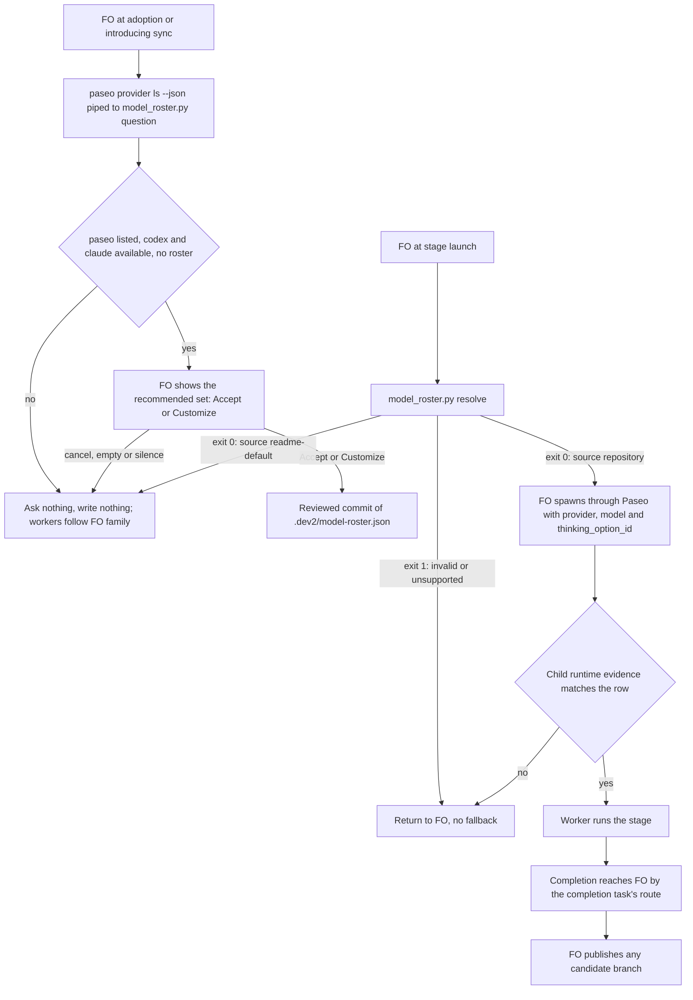

## Scope

- Source: the Captain, chat 2026-11-02: 「應該預設是用 claude 做 fo 時，就是都預設 claude 家族，codex 亦同，是只有使用者提出時才要寫入 .dev2/model-roster.json」, 「主動詢問不必拿掉，但是應該是條件式的，也就是必須要是有 paseo + codex +cladue 都存在時才可以用」, 「構思改用 opus high」 and 「開，可以」. Batch 12 backlog sitting: the Captain 「可以，但不用寫了就報錯，接受 `max` 和 `ultra`沒關係，等於就是不建議，但使用者真的想要也可以」 (chat, 2026-11-02), answering 「決定：五件事都照建議，第 5 項用這張表，並把 xhigh 上限寫進設定檔檢查，可以嗎？」.
- Bite: 0.34.0 asks with Codex alone and its roster rejects Opus, so the Captain's chosen ideation model cannot be recorded (`model_roster.py`, MODELS and the provider check, read 2026-11-02).
- Consumer: this repository's stage dispatches, through Draft PR iamcxa/kc-claude-plugins#762.
- The question's condition adds Claude available to the existing paseo listed and Codex available; otherwise nothing is asked or written and workers follow the FO's family.
- The recommended set becomes ideation Opus high, implementation Sol xhigh, validation Astra xhigh. FO verified on 2026-11-02 with Paseo list_models that claude-opus-5-5 offers high and that gpt-6.1-sol and gpt-6-astra offer xhigh.
- The roster accepts Claude and Opus. `max` and `ultra` stay accepted and are not recommended; the recommendation stops at xhigh.
- #762 is updated to that set after release, then asked for merge. The interim directive to dispatch on Sol and Astra ends for repositories with no roster.
- Upstream first: `references/model-roster.md`, `references/model-roster-defaults.json`, `scripts/model_roster.py`, `references/sd/adoption.md`; Paseo's list_models.

## Non-goals

- Native dispatch model passthrough (spacedock-dev/spacedock#845); capacity automation; usage measurement.

## Budget

- One package PR. Workflow word budget unchanged unless the design names a raise for the Captain.

## Stop condition

- A repository lacking any of the three asks nothing and writes nothing; one with all three is asked once; a roster naming Opus resolves and dispatches a real Claude ideation worker with the requested settings. If Paseo cannot apply them, stop and return to FO.

## FO alignment

Alignment: needed before ideation; the scope is the Captain's ruling.
Result: aligned at backlog: Batch 12 backlog sitting: the Captain 「可以，但不用寫了就報錯，接受 `max` 和 `ultra`沒關係，等於就是不建議，但使用者真的想要也可以」 (chat, 2026-11-02), answering 「決定：五件事都照建議，第 5 項用這張表，並把 xhigh 上限寫進設定檔檢查，可以嗎？」, approved the outcome and bounds in this file.
Surfaces: none
Visible change: none
Release review: not needed: workflow maintenance, on no journey map.

## Design

### PRFAQ

**Proposition.** After this release, kc-dev-flow-2 asks about stage worker models only in a repository whose workflow lists the Paseo extension and whose Paseo host has both Codex and Claude available. Everywhere else it asks nothing and writes nothing, and workers follow the family of the First Officer (FO, the session that dispatches workers). The offered set becomes ideation Opus/high on Claude, implementation Sol/xhigh and validation Astra/xhigh on Codex, and the committed roster file (`.dev2/model-roster.json`) can name it.

**FAQ**

- *Who is asked?* Whoever runs adoption or the introducing sync, once, with all three present and no roster yet. Existing rosters are preserved.
- *Why a script for the condition?* 0.34.0 holds the condition as prose only, so no test can exercise it. `model_roster.py question` reads the workflow frontmatter, the roster path and the output of `paseo provider ls --json`. A missing Paseo gives empty input, which means ask nothing.
- *Does `xhigh` become a cap?* No. The Captain's ruling: 「不用寫了就報錯，接受 `max` 和 `ultra`沒關係」. The recommendation stops at `xhigh`; `max` and `ultra` stay accepted.
- *What does `ultra` mean on Claude?* Paseo has no Claude `ultra`; it lists `ultracode`. The resolver emits the Paseo option id, so a Claude `ultra` row launches `ultracode`. The Captain ruled yes (D3).
- *Who publishes a Claude worker's branch, and how does FO hear it finished?* FO publishes, as for a Codex worker, and the completion route is the one in worker-completion-reaches-fo-on-paseo (D2). This task lands after it and adds neither rule.
- *Is a mixed roster more diverse?* No claim. The `family` flag stays informational. It now names both families, because at 0.34.0 it says `same-family: openai` whenever tuples are present, which would be false once Claude rows exist.

### Chain checked

- Spacedock 0.27.3: native dispatch maps `model` to `Agent()` only on Claude (`claude-fo-dispatch.md`), and Codex records a thread-inherited model when the helper emits null (`codex-first-officer-runtime.md`). No stage-model question exists there, so nothing to reuse. spacedock-dev/spacedock#845 stays a non-goal.
- kc-dev-flow-2 at origin/main 146727de (version 0.34.0): `model_roster.py`, `model-roster.md`, `model-roster-defaults.json`, `sd/adoption.md` and `extensions/paseo/EXTENSION.md` own this. The design extends them and replaces nothing.
- Adopters: `gh api repos/<repo>/contents/.dev2/model-roster.json` returns 404 for iamcxa/qnow (`main` and `next`), spacedock-dev/subspace-relay and spacedock-dev/subspace-web (2026-11-02), so no sibling has a roster to borrow or to migrate. No adopter practice was used as the contract.
- Paseo's own surface, read 2026-11-02 through `list_providers`, `list_models` and `paseo provider ls --help` (paseo 0.14.0). The MCP and CLI shapes differ (`id` and boolean `enabled` against `provider` and `"Enabled"`), so `question` takes the CLI JSON only.
- ADRs read: 0047 (this roster; it records the Codex-only set and defers other providers) and 0042 (Paseo Codex workers hand publication to FO). `git grep 'Override:'` in the state checkout shows no past ruling on rosters or models.

### Observations, 2026-11-02

Bite reproduced: a committed roster with ideation `claude`/`claude-opus-5-5`/`high`, resolved by the 0.34.0 script, exits 1 with `stages.ideation.provider: expected codex`.

A real Claude child takes Opus high through Paseo. Three no-tool children, created with `create_agent` in `plan` mode, then killed:

| Requested `thinkingOptionId` | Process argument | Transcript `model` | Transcript `perTurnEffort` |
|---|---|---|---|
| `high` | `--effort high --model claude-opus-5-5` | `claude-opus-5-5` | `high` |
| `low` (control) | `--effort low --model claude-opus-5-5` | `claude-opus-5-5` | `low` |
| `ultracode` | `--effort xhigh --model claude-opus-5-5` | `claude-opus-5-5` | `xhigh`, plus a transcript reminder that ultracode is on and token cost is not a constraint |

The control shows the evidence discriminates. Paseo's `effectiveThinkingOptionId` only echoes the request, so it does not count as evidence.

`auto` mode: this ideation worker is itself a Claude child FO spawned through Paseo; its process shows `--effort high --model claude-opus-5-5 --permission-mode auto`. It was not launched through the resolver; AC-6 owes that. A `bypassPermissions` spawn from this `auto` session was refused by the host's classifier as an unsafe agent, so the route names `auto`.

The build disagrees with a roster row on the template's model. `spacedock dispatch build` on a disposable copy of this workflow's README (0.27.3, 2026-11-02): `--host claude` emits `model: sonnet` and the bootstrap `Skill(skill="spacedock:ensign")`; `--host codex` emits `model: null` and `$spacedock:ensign`. No package text names `--host` (`git grep -- --host` in `references` and `extensions`, origin/main 146727de). See D5.

Not exercised: a child at Sol/xhigh or Astra/xhigh launched from the new set, and any completion reaching FO on the landed route (AC-6). A Claude child publishing is no longer asked of anyone (D2).

### What the design changes

1. `kc-dev-flow-2/scripts/model_roster.py`
   - `MODELS` becomes a provider-to-models table: `codex`: `gpt-6.1-sol`, `gpt-6-astra`; `claude`: `claude-opus-5-5`. `validate` refuses an unknown provider and a model on the wrong provider. The six efforts are unchanged on both.
   - `resolve` output gains `thinking_option_id`, null when absent, otherwise the row's effort, except Claude `ultra`, which becomes `ultracode`. The tuple keeps the written value.
   - `author` accepts a `Roster:` header on either provider. The legacy `Model:` pattern stays Codex-only, so a Claude author has evidence only through the `Roster:` header.
   - `family` becomes `same-family: <openai|anthropic>` when the validator and all authors share a provider, `different-family` otherwise, and stays `unverified` as today when a tuple is missing.
   - New subcommand `question --code-root --readme --providers -`: exit 0 prints `ask`; exit 3 prints `skip: <reason>` naming the first missing condition; exit 1 on a malformed request. It writes nothing. It reads frontmatter with the package's existing reader.
   - The comment citing ADR 0047 moves to the new ADR's path.
2. `kc-dev-flow-2/references/model-roster-defaults.json`: ideation `claude`/`claude-opus-5-5`/`high`, implementation `codex`/`gpt-6.1-sol`/`xhigh`, validation `codex`/`gpt-6-astra`/`xhigh`, each host `paseo`.
3. `kc-dev-flow-2/references/model-roster.md`: the condition sentence becomes the `question` command plus "Ask only on exit 0"; the quoted question shows the new set; the supported-tuple sentence gains Claude and "`max` and `ultra` are accepted, not recommended; Claude's `ultra` is Paseo's `ultracode`, a multi-agent mode"; absence says workers follow FO's family; "existing Codex route" becomes the row provider's route; the launch passes `thinking_option_id`; a new sentence, "A `claude` row spawns in `auto` mode."; Claude child evidence is named as the transcript's `model` and `perTurnEffort`; the family sentence covers both.
4. `kc-dev-flow-2/references/sd/adoption.md` § Before activation: the condition names Codex and Claude.
5. `kc-dev-flow-2/extensions/paseo/EXTENSION.md`: no change here. Under D2, worker-completion-reaches-fo-on-paseo owns the Claude handoff sentence and any widening of ADR 0042. The `auto` clause moved to item 3, because that task's Scope does not name a mode.
6. `kc-dev-flow-2/scripts/test_sd_dispatch.py`:
   - `roster-question-prerequisites` and `roster-adoption-prerequisites` pin the old sentence; both change, with their mutation swaps.
   - `("provider", "claude")` in the malformed list flips to a refused pairing (Claude with `gpt-6-astra`) and an unknown provider.
   - The history replay (`history = {`) asserts `data["stages"][stage] == expected` against the defaults file at Astra/high; it moves to an explicit batch-9 fixture so the new defaults do not rewrite history.
   - New cases for AC-1 to AC-5.
7. New ADR, short title "Stage roster question needs Codex and Claude and offers Opus", number reserved by FO at implementation dispatch. Words: the Captain's 「主動詢問不必拿掉，但是應該是條件式的，也就是必須要是有 paseo + codex +cladue 都存在時才可以用」, 「構思改用 opus high」 and 「可以，但不用寫了就報錯，接受 `max` 和 `ultra`沒關係，等於就是不建議，但使用者真的想要也可以」 (chat, 2026-11-02). It restates what stays from 0047 (explicit answer, reviewed commit, read-only resolve, absence keeps README behavior), leaves ADR 0042 to the completion task, and sets 0047's Status to `Superseded by NNNN`, the form `read-adr` follows. Protects: `model_roster.py`, the absent-file return.

Not changed: `references/sd/workflow.md`, so no `WORKFLOW_BUDGET_STEPS` step and no adopter README sync (D4's wording is special-roles-follow-the-model-table's edit there); `extensions/paseo/EXTENSION.md`; `scripts/dispatch_records.py`; `agents/*.md`; `scripts/role_triggers.py`.

Why a script is needed (existing-code check): the bite shows the resolver refuses the row, and the condition has no executable seam today. Without `question`, AC-1 could only pin a sentence, which proves wording rather than behaviour. Cost is one subcommand and about 25 more words at adoption.

### After the package PR

Package PR, then release, then FO updates Draft PR iamcxa/kc-claude-plugins#762: `.dev2/model-roster.json` to the new rows, `selected_from` to the version actually released, `decision` to the 2026-11-02 ruling, then asks the Captain to merge. #762 cannot go first: the released resolver refuses its Opus row until this ships. The interim directive 「接下來派工結束後新的派工盡量用 sol / astra」 lives only in chat and task records (no hit in `docs/dev2/README.md` or `_mods`, 2026-11-02), so ending it changes no file; FO stops applying it where no roster exists.

### Words FO reads at each moment

Whitespace split of the proposed text against origin/main 146727de. The first version's draft was deleted, so the revised rows add the counted new sentence to its counts: `wc -w` gives 7 for the `auto` sentence and 25 for D5's text.

| Moment | What FO reads | Before | After | Change |
|---|---|---|---|---|
| Startup, idle on an open or merged PR, archive, merge | `references/sd/workflow.md` | 5781 | 5781 | 0 |
| Adoption or introducing sync | `sd/adoption.md` | 2242 | 2245 | +3 |
| Adoption or introducing sync | `model-roster.md` § Adoption and introducing sync | 210 | 261 | +51 |
| Adoption or introducing sync | `question` output | 0 | 1 to about 10 | new, one line |
| Stage launch, any repository | `model-roster.md` § Stage launch or continuation | 421 | 451 | +30 |
| Stage launch, roster present | `resolve` JSON | one object | one more key | +1 key |
| Stage launch, `paseo` listed | `extensions/paseo/EXTENSION.md` | 713 | 713 from this task | 0; the completion task's edit is counted there |

FO reads the whole `model-roster.md` when it opens it, so a stage launch costs 634 to 715 words, +81, or 740, +106, under D5. No moment that runs without a roster question or a stage launch changes. No word budget covers these files, so no raise is requested. Other tasks' additions to `model-roster.md` (the `## Model table`) are counted in their files.

### Captain's rulings on this design

Gate of 2026-11-02, the Captain 「可以」, with the asks in the ideation resolution's reason.

- **D1.** Opus only. A Claude row naming another model exits 1. A repository wanting Sonnet/high returns to FO until one string is added.
- **D2.** Yes. A Claude worker hands publication to FO, as worker-completion-reaches-fo-on-paseo owns.
- **D3.** Yes. Claude `ultra` launches Paseo's `ultracode`. Its spend was not measured.
- **D4.** Chief-engineer and engineering-reviewer differ from the implementation workers, worded by special-roles-follow-the-model-table.

### Beyond the asks, for the Captain

One item goes beyond the asks. It is named here and is not adopted in the design or in AC-1 to AC-10.

- **D5. Does stage launch say to build with `--host` set to the row's provider?** Recommended: yes, adding to `model-roster.md` § Stage launch: "Build with `--host` set to the row's provider. A generated Claude alias naming the row's model family, such as `opus` for `claude-opus-5-5`, is no conflict." Without it the recommended set cannot launch by the written route. A generated `sonnet` from a Claude FO conflicts with all three rows, and § Stage launch returns a conflict to FO. A Codex FO would give the Claude row the Codex bootstrap, `$spacedock:ensign`. What gets worse: 25 more words at every stage launch; this task must land after special-roles-follow-the-model-table so the Opus row builds as `opus`; and a customized Claude implementation row still returns to FO while the template says `sonnet`. If the answer is no, AC-6 stops at launch and returns to FO under Stop condition, and AC-11 drops.

### Batch overlap

| Task | State | Same file or check | Effect |
|---|---|---|---|
| worker-completion-reaches-fo-on-paseo | ideation, no design | `extensions/paseo/EXTENSION.md`, which it owns and this task no longer edits; ADR index; possibly `model-roster.md` | this task lands after it; AC-6 needs its route |
| special-roles-follow-the-model-table | ideation, revise | `references/model-roster.md`, a new section; ADR index; its table values match the recommended set; its template `model: opus` feeds D5; it owns D4's sentence in `workflow.md` | rebase `model-roster.md`; order below |
| second-round-prompts-a-step-back | ideation | none: `role_triggers.py`, `pr_watch.py`, the mod | none |
| validation-gate-requires-the-question-check | ideation | ADR index only, per its own overlap section; this task leaves `workflow.md` alone | none beyond the reserved number |
| picky-reviewers-may-run-on-gemini | ideation, no design | none in Scope: the release-acceptance extension and `release_acceptance.py`; its choice stays out of the model roster | none |
| adoption-asks-which-extensions | ideation | `number_guards.py` `frontmatter` becomes a wrapper over `frontmatter_text`; `question` would call that reader. Its files name no `adoption.md` or roster edit. ADR index | signature kept, either order works; re-run tests after the second lands |
| adr-required-statement | validation | `sd/adoption.md`, § Captain rulings ledger, a different section; ADR index | no text conflict; the number comes from FO's reservation |
| adr-silent-undo-probe | ideation | none (`grep` for these files, no hit) | none |
| comment-check-reaches-delivery-gate | ideation | none: `delivery_gate.py`, its tests, validation principles | none |
| journey-canvas-hosted-poc | ideation | none (`grep`, no hit) | none |
| journey-server-host-pilot | validation | none (`grep -r` of its folder, no hit) | none |
| ops-inbox-r1-setup-and-isolation | implementation | ADR index, per validation-gate-requires-the-question-check's overlap section; no file hit | reserved number |
| pr-review-lite-value-pilot | implementation | none (`grep`, no hit for these files) | none |

Tasks with no design have no final file list yet, so those rows read Scope as of 2026-11-02.

Recommended order: worker-completion-reaches-fo-on-paseo, as the Captain ruled, then special-roles-follow-the-model-table if D5 is yes, because the Opus row needs the template's `opus`; then this task; then #762 after this task's release. If D5 is no, special-roles may land either side. This replaces this design's earlier order. If the completion task stops without a route, this task holds and returns to FO.

## Acceptance criteria

**AC-1** `question` decides ask or skip from the three conditions and writes nothing.
Verified by: `test_sd_dispatch.py` runs the subcommand as a subprocess across all eight combinations of `paseo` listed, `codex` available and `claude` available, using `paseo provider ls --json` shaped input, plus an existing roster, empty input and a provider with status `unavailable`. Only all three with no roster exits 0; a file manifest of the fixture is identical before and after. Falsifier: dropping the `claude` check makes the Codex-only case exit 0 and fails the test.

**AC-2** The roster accepts Claude with Opus, refuses wrong pairings and has no effort cap.
Verified by: subprocess `resolve` on committed fixtures. `claude`/`claude-opus-5-5` resolves at each of the six efforts, and `gpt-6.1-sol` and `gpt-6-astra` at `max` and `ultra`. Claude with a `gpt-` model and Codex with `claude-opus-5-5` exit 1 naming the field. Falsifier: a flat model list, or an `xhigh` cap, fails a case. At base the Opus row exits 1 (observed 2026-11-02).

**AC-3** The recommended set matches the Captain's ruling everywhere it is shown.
Verified by: a test reads `model-roster-defaults.json` and asserts the three rows in Scope, resolves them from a committed copy, and asserts the model and effort of each row appear in the quoted question in `model-roster.md`. No recommended effort is `max` or `ultra`. Falsifier: changing one value in either file fails it.

**AC-4** `resolve` emits the Paseo option id for each row.
Verified by: a test asserts `thinking_option_id` equals the effort on every row except Claude `ultra`, which is `ultracode`, is null on absence, and that the tuple keeps `ultra`. Each emitted id is in Paseo's `list_models` for that model at the run's date, recorded by the implementer. Falsifier: passing the effort through unmapped fails the Claude `ultra` case.

**AC-5** `family` tells the truth for both providers.
Verified by: `resolve --stage validation --author-record` with Codex validator and Codex author gives `same-family: openai`, Claude and Claude gives `same-family: anthropic`, Codex validator and Claude author gives `different-family`, and an unknown author stays `unverified`. A `Roster:` header with provider `claude` parses to a tuple and passes `dispatch_records.py --names`. Falsifier: keeping the fixed `same-family: openai` fails the mixed case.

**AC-6** A roster naming Opus resolves and dispatches a real Claude ideation worker with the requested settings.
Verified by: on the candidate package, a committed fixture roster with the recommended set is resolved, FO or the validator spawns a real Claude child through Paseo in `auto` mode with the emitted provider, model and `thinking_option_id`, and the record gives its process arguments and its transcript's `model` and `perTurnEffort`, next to a control child at `low`. The same run spawns a real child at Sol/xhigh and at Astra/xhigh and records that provider's runtime evidence. Paseo's echo and the worker's own statement do not count. Each of the three requested children also ends by the route worker-completion-reaches-fo-on-paseo landed: the spawning session, standing for FO, records the inbound message or finish notification naming the child's agent id and later than the child's last turn, and the child's transcript shows no refused send and no improvised second route. `git merge-base --is-ancestor` shows the candidate's base contains that task's merge commit. Falsifiers: a control reading the same as the requested child voids the run; a child that finishes with no inbound record at the spawner fails it, as the batch 12 route `paseo agent run --no-wait` did. If Paseo cannot apply a row, stop and return to FO, per Stop condition.

**AC-7** Absence keeps README behavior and the text says workers follow FO's family.
Verified by: the existing absent-roster cases still pass unchanged, `resolve` on a repository with no roster gives `source: readme-default` with `thinking_option_id` null and an identical file manifest, and the updated mutation specs for `model-roster.md` and `sd/adoption.md` fail when the condition or the follow sentence is removed.

**AC-8** The ruling lands as an ADR and 0047 points to it.
Verified by: the package's ADR lint exits 0 on `docs/adr`, 0047's Status is `Superseded by NNNN`, and the new record carries the Captain's words above and the rules kept from 0047. The comment in `model_roster.py` cites a file that exists. Falsifier: leaving 0047 `Accepted` means two records state different recommended sets, and a reader following `read-adr` lands on the old one.

**AC-9** Package gates stay green and the workflow text does not change.
Verified by: `git diff --stat origin/main -- kc-dev-flow-2/references/sd/workflow.md` is empty; `python3 kc-dev-flow-2/scripts/lint-skills.py`, `test_sd_dispatch.py` and the release parity check exit 0. Falsifier: any `workflow.md` edit shows in the diff and trips the budget lint.

**AC-10** After release, #762 carries the set from the released package. Owed by FO after delivery, not by the candidate's validation.
Verified by: after the release tag exists, the released `model_roster.py resolve` on #762's head returns the three rows with source `repository`, and `selected_from` equals the published version. FO then asks the Captain to merge. Falsifier: a predicted version, or running against an unreleased script, voids it.

**AC-11** Under D5, each recommended row builds on its provider's host with no conflict. Verified by: `spacedock dispatch build --host <row provider>` on a disposable copy of the candidate's template emits `opus` and the `Skill(` bootstrap for ideation, and `null` and the `$spacedock:ensign` bootstrap for implementation and validation. A case in `test_sd_dispatch.py` pins the two sentences through a mutation spec. Falsifier: leaving out `--host` on a Claude host emits `sonnet` for implementation, as observed 2026-11-02.

## Number guards

ADR: 0050

## Stage Report: ideation

- DONE: A design for this task's Scope: the condition, the recommended set and the accepted models; verify a real Claude child takes Opus high through Paseo before relying on it
  `## Design`. Real no-tool children 2026-11-02: `high` ran `--effort high` with transcript `perTurnEffort` high, the `low` control ran `--effort low`, both `claude-opus-5-5`.
- DONE: A `### Batch overlap` section naming each file the design would change and each other batch task (model-roster-question-needs-both-families, second-round-prompts-a-step-back, validation-gate-requires-the-question-check, special-roles-follow-the-model-table) and live task of other sessions (adoption-asks-which-extensions, adr-required-statement, adr-silent-undo-probe, comment-check-reaches-delivery-gate, journey-canvas-hosted-poc, journey-server-host-pilot, ops-inbox-r1-setup-and-isolation, pr-review-lite-value-pilot (driven by other sessions; read only)) that changes the same file or check, so FO can order implementation
  Files are listed under `### What the design changes`; the table ends in `Recommended order:`. Real contacts: special-roles (values, D4) and the `number_guards.py` reader.
- DONE: The words FO reads at each lifecycle moment, before and after, per root learning.md "Measure the words FO reads at each moment, not one file's size"
  `### Words FO reads at each moment`: `workflow.md` 5781 unchanged; `model-roster.md` 634 to 708; `adoption.md` +3; `EXTENSION.md` +13. Counted on drafted text in a scratch folder, since deleted.
- DONE: Acceptance criteria with reproducible evidence clauses and falsifiers, and unresolved decisions for the Captain, each with a recommendation and what gets worse under it
  Ten criteria and D1 to D4. `design_surfaces.py check`: "design surfaces presentable", exit 0.
- DONE: AC-1 evidence: not yet verified; future test. Base holds the condition as prose only.
  `question` subcommand does not exist yet.
- DONE: AC-2 evidence: base half observed; candidate half not yet verified.
  0.34.0 `resolve` on an Opus row exits 1, `stages.ideation.provider: expected codex`, 2026-11-02.
- DONE: AC-3 evidence: not yet verified; future test. FO's `list_models` read in Scope and mine agree the three models offer the efforts.
  `list_models` for `claude` and `codex` read 2026-11-02.
- DONE: AC-4 evidence: mapping observed by probe; emission not yet verified.
  `ultracode` is listed for `claude-opus-5-5`; the child ran `--effort xhigh` with the ultracode reminder.
- DONE: AC-5 evidence: not yet verified; future test.
  Base fixes `same-family: openai` in `resolve`, read at origin/main.
- DONE: AC-6 evidence: settings observed on probes in `plan` mode and on this worker in `auto` mode; the resolver-driven run is not yet verified.
  Table under `### Observations, 2026-11-02`.
- DONE: AC-7 evidence: not yet verified on the candidate; base absent-roster cases exist in `exercise_model_roster`.
  Read at origin/main.
- DONE: AC-8 evidence: not yet verified; ADR drafted as ruling and short title, no number.
  `### What the design changes`, item 7.
- DONE: AC-9 evidence: not yet verified; future gate run.
  No `workflow.md` edit is in the design.
- DONE: AC-10 evidence: not yet verified; owed by FO after release. #762 is open, Draft and mergeable at d5a56521, with the old set.
  `gh pr view 762`, 2026-11-02.

### Summary

The design adds a `question` subcommand so the Paseo, Codex and Claude condition can be exercised, makes the roster's models per provider, sets the new recommended set, and keeps `max` and `ultra` accepted. Real children confirmed Paseo applies Opus high, with a low control. Three things the Captain or FO should see: Claude `ultra` is `ultracode`, which is `xhigh` plus a multi-agent mode (D3); the recommended mix makes the "different family from all workers" reviewer rule unsatisfiable (D4); and no run shows a Claude child can publish (D2). This worker ran on Opus/high through Paseo, and its spawned probes used `plan` mode because the host refused `bypassPermissions`.

## Stage Report: ideation (cycle 2)

- DONE: Revise the design under the Captain gate revise of 2026-11-02: the asks are in the reason of the newest ideation resolution in this task file; do exactly those asks, and name anything that would go beyond them
  D1 to D4 recorded as rulings; item 5 and the ADR leave publication to the completion task; AC-6 proves completion; order follows the completion task. Beyond the asks: D5 and AC-11, named, not adopted.
- DONE: A `### Batch overlap` section naming each file the design would change and each other batch task (worker-completion-reaches-fo-on-paseo, model-roster-question-needs-both-families, special-roles-follow-the-model-table, second-round-prompts-a-step-back, validation-gate-requires-the-question-check, picky-reviewers-may-run-on-gemini) and live task of other sessions (adoption-asks-which-extensions, adr-required-statement, adr-silent-undo-probe, comment-check-reaches-delivery-gate, journey-canvas-hosted-poc, journey-server-host-pilot, ops-inbox-r1-setup-and-isolation, pr-review-lite-value-pilot (driven by other sessions; read only)) that changes the same file or check, so FO can order implementation
  Files are under `### What the design changes`; the table has 13 rows; `Recommended order:` puts the completion task first. Rows for tasks with no design read Scope only.
- DONE: The words FO reads at each lifecycle moment, before and after, per root learning.md "Measure the words FO reads at each moment, not one file's size"
  `model-roster.md` 634 to 715, or 740 under D5; `EXTENSION.md` unchanged by this task; `workflow.md` 5781 unchanged. Base count re-measured; new sentences counted with `wc -w`; the 74-word part is the first version's count, not re-measured.
- DONE: Acceptance criteria with reproducible evidence clauses and falsifiers, and unresolved decisions for the Captain, each with a recommendation and what gets worse under it
  AC-1 to AC-11, and one open decision, D5. `design_surfaces.py check`: "design surfaces presentable", exit 0.
- DONE: AC-1 evidence: not yet verified; future test.
- DONE: AC-2 evidence: base half observed in cycle 1; candidate half not yet verified.
- DONE: AC-3 evidence: not yet verified; future test.
- DONE: AC-4 evidence: mapping observed by the cycle 1 probe; emission not yet verified.
- DONE: AC-5 evidence: not yet verified; future test.
- DONE: AC-6 evidence: settings observed on cycle 1 probes; the resolver-driven run and the completion half are not yet verified, and the completion route has no design yet.
- DONE: AC-7 evidence: not yet verified on the candidate.
- DONE: AC-8 evidence: not yet verified; ADR drafted as ruling and short title, no number.
- DONE: AC-9 evidence: not yet verified; no `workflow.md` edit in the design.
- DONE: AC-10 evidence: not yet verified; owed by FO after release. #762 is open, Draft, at d5a56521 (`gh pr view 762`, 2026-11-02).
- DONE: AC-11 evidence: base half observed 2026-11-02 (`sonnet` on Claude, `null` on Codex, both bootstraps); the candidate's `opus` depends on special-roles and is not yet verified.

### Summary

The design now takes the Captain's four rulings: Opus only, publication and completion left to the completion task, `ultra` as `ultracode`, and the reviewer family worded by special-roles. AC-6 also proves completion reaches FO, and the order puts the completion task first. One thing goes beyond the asks and needs the Captain (D5): a disposable build shows the recommended set conflicts with the template's generated `sonnet` on a Claude FO, and nothing tells FO to pick `--host`, so the set cannot launch by the written route; answering yes also places special-roles before this task.

## Stage Report: implementation

- DONE: Implement the approved design and D1 to D5, only in its named files; commit locally without a version bump.
  Branch `spacedock-ensign/model-roster-question-needs-both-families`; assigned base `d14c5ae3b0c9f14eb89cd38a2fb500b2a57119fa`; candidate `e2eb2fb5a9629f52ab540fac1e274c287913cfac`; seven changed files, clean product tree. The existing `laws_check.readme_extensions` reader also covers block-list frontmatter.
- SKIPPED: One Draft PR stacked on PR #764; product push and PR creation belong to FO.
  No PR opened: no push grant. Hosted #764 is OPEN/DRAFT at the assigned base, #763 is OPEN/DRAFT at `c129cb215c2630d08853eeffae0fd5a2ee7e40c6`, and this branch has no open PR (2026-11-02). Title/body: `/tmp/impl-model-roster-question-needs-both-families-pr.md`; base branch `spacedock-ensign/special-roles-follow-the-model-table`.
- DONE: AC-8 — ADR 0050 records the Captain's words and retained rules, superseding 0047.
  Package `adr_lint.py docs/adr --since d14c5ae3b0c9f14eb89cd38a2fb500b2a57119fa --require 0050`: exit 0, 49 records; the resolver pointer targets the new record. Restoring 0047 Accepted fails the regression test.
- DONE: AC-1 — question asks only with all three prerequisites and no roster, and writes nothing.
  Final `test_sd_dispatch.py` subprocess replay covers all eight combinations, existing roster, empty input, disabled/unavailable providers, malformed input, inline/block lists and identical manifests; removing Claude eligibility fails the Codex-only case.
- DONE: AC-2 — provider/model pairing and all six efforts are exercised.
  Committed subprocess fixtures accept all six efforts on Opus, Sol and Astra; wrong providers/models and Sonnet refuse with field errors. Flattening model membership or imposing an xhigh cap fails the replay.
- DONE: AC-3 — the recommendation and quoted question match Opus/high, Sol/xhigh and Astra/xhigh.
  Explicit expected rows are asserted and resolved from committed fixtures; independent defaults and question-effort mutations fail. Historical batch-9 rows now use their own committed fixture.
- DONE: AC-4 — option IDs preserve each effort except Claude ultra to ultracode, with absence null.
  Replay checks every emitted value and retained tuple; live 2026-11-02 capabilities and committed recommended-row resolves: `/tmp/roster-live-capabilities.json`, `/var/folders/tm/dk0m7pgx4h3gxqv_v2v8nds00000gp/T/roster-native-handoff-sxlhhmg0/{resolved,capabilities}.json`. Unmapped ultra and fabricated absent effort each fail.
- DONE: AC-5 — both provider families, mixed authors and unknown authors are exercised.
  Subprocess replay proves openai/anthropic/different-family/unverified, including a Claude Roster header passing `dispatch_records.py --names` and legacy Claude evidence staying unknown; fixed-openai and mixed-family mutations each fail.
- SKIPPED: AC-6 — real Opus/high with low control, Sol/xhigh, Astra/xhigh and their completion callbacks; every criterion green.
  This criterion assigns spawning to FO or validator; no real child run is claimed here. The committed fixture above is ready. Base contains completion candidate c129cb215 (ancestry exit 0), but #763 has no merge commit and its task's validation report is REJECTED; merge ancestry, native runtime and completion falsifiers remain due. FO was notified before dependent work.
- DONE: AC-7 — absent-roster behavior and worker-family wording are retained.
  Existing absence/linked-root/author cases pass with identical manifests and null option ID; removing either adoption or launch follow-family sentence fails its mutation pin.
- SKIPPED: AC-9 — the literal origin/main workflow diff is empty.
  Assigned-base-to-candidate workflow diff is empty and its 5781-word budget is unchanged. Origin/main-to-candidate contains the inherited #764 workflow change (4 additions, 4 removals); this task made no workflow edit. The local package-gate portion passes below.
- SKIPPED: AC-10 — after release, FO updates #762 from the released package and asks the Captain to merge.
  No release exists for this candidate; no predicted version, unreleased-script proof, #762 edit or merge request is claimed.
- DONE: AC-11 — recommended rows build on their provider's host without a model conflict.
  Real disposable candidate-template builds emit ideation opus/Skill bootstrap and implementation/validation null/Codex bootstrap: `/tmp/roster-provider-host-builds.json`; omitted host under Claude emits implementation sonnet: `/tmp/roster-implicit-host-falsifier.json`. Removing either D5 sentence fails its mutation pin.
- DONE: Repository skill lint, dispatch tests, release parity, design surfaces, number guards and comment ratio run successfully.
  All exit 0 after the last product change (parity's inputs are unchanged); `/tmp/roster-sd-final.log` retains fixtures at `/private/var/folders/tm/dk0m7pgx4h3gxqv_v2v8nds00000gp/T/dev-flow-2-sd-3mygw6w6`; package number guards use the assigned base and reserved 0050; comments 1/165, 0.6% <= 5%.
- DONE: In-scope acceptance falsifiers were run with python3 -B and no copied caches.
  All 16 mutations fail: `/tmp/roster-mutations-final.log`, raw logs/results `/var/folders/tm/dk0m7pgx4h3gxqv_v2v8nds00000gp/T/roster-falsifiers-01fodkrh`; runner `/tmp/run_roster_mutations.py`. Exact-base resolver refuses the recommended Opus row with `stages.ideation.provider: expected codex` (`/tmp/roster-base-replay.log`). AC-6/AC-10 falsifiers remain with those deferred criteria.
- SKIPPED: A clean exact-head RoboRev result, hosted CI and independent validation.
  Required post-commit package gate was attempted at the final candidate, exit 3: `incomplete: the roborev daemon is not running` (`/tmp/roster-roborev-final.log`). FO owns review/publication/CI; none is reported clean.
- DONE: Affected documents and reading cost are accounted for; no CI trigger changed.
  `doc_impact.py` lists ADRs 0047/0050 and adoption.md updated; README.md unaffected: its test command and bounded evidence claims remain valid; learning.md unaffected: no practice changed. Against the assigned base, roster.md 760->873 words (adoption 201->259, launch 417->472); adoption.md 2241->2242; workflow 5781 unchanged. CI cost per PR and model spend were not measured.

### Summary

The approved local implementation is committed at e2eb2fb5a9629f52ab540fac1e274c287913cfac with behavior, mutation and package checks. Native runtime/completion proof, upstream merge ancestry, RoboRev, publication, hosted CI, independent validation and the after-release #762 update remain with FO; no product push or PR was made.
