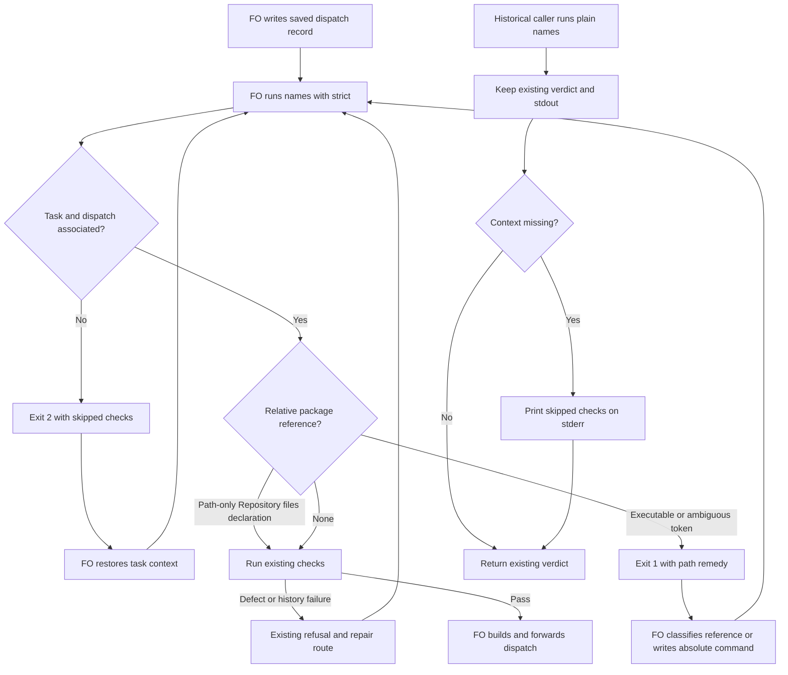

## Scope

- Source: batch-10 learn list presented to the Captain (chat, 2026-10-30) as package candidates, proposed by FO; no ruling yet.
- Bite: batch 9: FO's scripts ran `--names` on a record copy under /tmp, where task-fact checks skip and it exits 0, so three ideation dispatches went out with no Result: line (reproduced 2026-10-29: exit 0 on the copy, exit 1 in the task folder). Batch 10: FO's checklists named package scripts as kc-dev-flow-2/scripts/NAME.py, which `--names` passes though the README requires the absolute package path (captain-amendment-form-checked observer report).
- Upstream first: `scripts/dispatch_records.py` (`--names`, `check_task_facts`), README Stages (the script-path sentence). Open for ideation: how a checklist names a repository file the worker edits, as opposed to a script it runs.

## Non-goals

- Changing what the task-fact checks refuse.

## Budget

- One package PR inside `scripts/dispatch_records.py`; no new script.

## Stop condition

- A record outside a task folder no longer exits 0 silently, the relative form is refused or ruled allowed, and every current in-folder record keeps its verdict.

## FO alignment

Alignment: not needed before ideation: closes a silent pass in an existing check.
Surfaces: none
Visible change: none
Release review: not needed: workflow maintenance, on no journey map.

## Design

### PRFAQ

**Proposition.** FO can see when a dispatch-record check lacks task context, and new dispatches distinguish executable package paths from repository edit targets. Preserve the existing `--names` verdicts used for historical records; add `--names --strict` for the pre-dispatch check. This is a proposed compatibility choice, not an approved expansion of the one-file Budget. Pilot, `Surfaces: none`: PRFAQ and Mermaid are the artifacts; no UI, database, deployment or new recurring service.

**Why not simply reject every relative name?** The batch-10 records name files the worker edits, quoted commands the worker must put into documentation, and candidate-repository tests. They are not all instructions to run the installed package. A blanket path rejection changes old verdicts; a prose classifier would guess at intent. Use one explicit, path-only `Repository files:` line for references in strict records; a script token elsewhere is treated as executable for this bounded check. Do not interpret verbs such as “edit”, “run”, or “describe” as permission.

**What changes in the existing mode?** Keep `--names <records>` exit codes, stdout diagnostics, task-fact predicates and validation-history behavior. For each record lacking the supported context (`<task>/dispatch/<record>.md` and adjacent `<task>.md` or `<task>/index.md`), print a precise skipped-check notice to stderr. Outside `dispatch/`, identify Candidate eligibility, task facts and validation ruling history as not checked; with `dispatch/` but no task file, Candidate checking still runs and the notice names only task facts and ruling history. A file read failure is a diagnostic and exit 2. The notice is not a claim that names-only success clears a dispatch. Do not silently choose cwd's task or another task with the same slug.

**What does strict mean?** `--strict` is an additional option of `--names`, rejected as usage error in other modes. It runs the existing checks plus these structural pre-dispatch checks:

1. Require the supported task/dispatch association; missing association returns 2 with the same skipped-check notice. Keep both flat and index task layouts and archive layouts; resolve symlinks consistently with the existing checker. A correctly associated in-folder record under `/tmp` is valid: path location is not the criterion.
2. Scan the same Checklist and Scope notes regions (whole file only when neither exists) for the package's existing basename inventory, including extension scripts. A token with a directory is executable only when absolute; reject `kc-dev-flow-2/scripts/X.py`, `scripts/X.py`, `./X.py`, `../X.py`, `~/X.py`, `$ROOT/scripts/X.py` and `<package>/scripts/X.py`. Keep the current bare-name diagnostic. Quote/backtick wrapping and a fenced command must not hide a token. Non-package names remain outside this check. This does not verify filesystem existence, provenance of an absolute path or shell expansion.
3. In those scanned regions, accept a column-zero `Repository files:` line only when its entire value is a comma-separated list of repository-relative POSIX paths, optionally backtick-wrapped. Each path must contain a directory component; forbid whitespace, traversal, shell punctuation and command arguments. This is a declaration of files to inspect/edit, never an instruction to execute. A mixed line such as `Repository files: kc-dev-flow-2/scripts/X.py; python3 ...` is invalid. Bare known names remain errors. Repository commands to execute use an absolute candidate-worktree path; installed tools use the declared absolute package root. No exemption from an earlier line carries to another line.
4. Preserve all other predicates, precedence and 0/1/2 meanings: 0 no detected violation, 1 a record defect, 2 insufficient association/input or existing history failure. Strict does not claim a complete shell parser, automatic Spacedock enforcement, or additional validation-history coverage in non-git snapshots. The existing non-git history limitation remains documented and tested.

**What is the migration?** New dispatches follow the updated workflow's strict invocation; historical callers retain the legacy mode. Do not rewrite committed task or dispatch bytes, invent a grandfathering timestamp, or backfill adopter records. In strict mode, the historical batch-10 records intentionally need their repository references classified; their plain `--names` verdict stays unchanged. Adopters receive this instruction through their normal, separately authorized published-package README sync. Until that happens, the detached-copy notice improves visibility but does not make their old invocation fail closed.

**Who consumes the output?** `laws_check.py:l2_dispatch_record_complete` reconstructs the dispatch folder, sibling records and task at each event commit in a temporary directory, then calls plain `--names`. Preserve that mode's stdout grammar: new skip notices are stderr only. `run_check` ignores non-traceback stderr on exit 0/1 but treats 2 as Cannot; no production parser change is needed for this design. Add real consumer tests in `test_laws_check.py`; if implementation adds a new stdout diagnostic to legacy mode, stop and include its parser in the same change. `pr_watch.py tasks` invokes `--newest`, which calls `check_names` alone: do not widen it to strict or task-fact checks. Strict mode is owned by the pre-build workflow command, not by those consumers.

### Journey

Design approval remains Captain-owned before implementation. The diagram starts at an otherwise authorized dispatch; a checker pass grants no gate approval, merge authority or proof that a worker started. Rendered with Mermaid CLI 12.0.0 and visually inspected on 2026-10-30: `/tmp/names-check-ideation/journey.png`; actors, strict/legacy branches, refusal loops and build boundary match the prose. The first sandboxed render could not start Chromium; the approved local render outside the sandbox succeeded. Reproduce by extracting this block and running `mmdc -i journey.mmd -o journey.png` with version 12.0.0; no hosted resource is involved.

### Bounded existing-code check and current evidence

Read chain, 2026-10-30:

- Spacedock 0.27.3: its own `skills/first-officer/references/fo-dispatch-core.md`, “dispatch.build”, takes checklist/scope files and forwards its generated artifact unchanged; ensign shared core and Codex runtime own the report/return channel. It does not document automatically running this package's `--names`. Repair the package's existing instructed check; do not add a second builder or claim a native pre-write hook.
- Package: `git fetch origin` succeeded. `origin/main` is `a6612948936a4f075625147b21aabd3b10b19eee`, released manifest version 0.33.1. The dispatched Codex package's `dispatch_records.py`, its test, `laws_check.py` and workflow template are byte-identical to that revision. `check_task_facts` currently continues silently if association is absent; `SCRIPT_TOKEN` deliberately excludes names with a directory. Existing tests explicitly expect directory-bearing names and detached files to pass. This is an existing compatibility contract, not an accidental lack of test coverage.
- Callers found before choosing the change: package `laws_check.py` calls plain `--names` on reconstructed copies; `test_dispatch_records.py:names` deliberately creates detached record fixtures; `test_design_surfaces.py` builds in-folder snapshots; `pr_watch.py` calls `--newest`, not `--names`. The batch-9 FO copy is the observed operational caller. Search boundary: all tracked current-package references plus these four local adopter state snapshots; private scripts/chat-only commands elsewhere are unknown. No new script is proposed.
- Sibling adopters: read Relay `beirut-dev2/docs/dev2/README.md`, Web `dev2-fo/docs/dev2/README.md` and QNow `qnow-adopt-dev2/docs/dev2/README.md`. All prescribe absolute package roots and plain `--names`; none supplies a structural run/edit distinction. Read their local state commits only; no adopter fetch, write or repair.
- Prior authority: read ADR 0017 (judge each push's events), 0020 (word-budget accounting) and 0027 (check structured FO writes at the existing checker), and state's `Override:` results. ADR 0027's rejected phrase-based ruling check supports explicit syntax rather than guessing verbs. No relevant override authorizes changing historical verdicts. No ADR number or new durable ruling is silently reserved; if Captain chooses the compatibility contract, its executable/docs tests are the bounded contract proposed here.
- GitHub API: `gh pr list --repo iamcxa/kc-claude-plugins --state open ...` failed with `error connecting to api.github.com`. Current open-PR overlap is unverified; local task records supply the overlap table, not a claim of live GitHub status.

Historical replay used the installed absolute script, without modifying it. For each row, `git show <revision>:<slug>.md` and `git show <revision>:<slug>/dispatch/ideation-1.md` populate a fresh `<root>/<slug>.md` and `<root>/<slug>/dispatch/ideation-1.md`; copy those same record bytes to `<root>/copy.md`. Run `python3 -B <absolute package>/scripts/dispatch_records.py --names <record>` on both. All in-folder results print the existing missing-Result diagnostic; all copies print nothing.

| Batch-9 slug | State revision | Copy exit | In-folder exit |
| --- | --- | ---: | ---: |
| batch-reaches-each-gate-together | `566a50400518f4d9fe217803605611e7910e7de5` | 0 | 1 |
| captain-ruling-sources-checked | `39e071b2969c37958ca70dd5a72dac40ea257800` | 0 | 1 |
| reused-worker-dispatch-leaves-a-record | `0ccdbb305328e410fd4fb5fb53ca729837302688` | 0 | 1 |

Batch-10 replay at package-workflow state `8db6925f2d2c4579496103e736aa477de92ac608`: all four `_archive/captain-amendment-form-checked/dispatch/{ideation-1,ideation-2,implementation-1,validation-1}.md` return 0 with empty stdout. `ideation-2` names checker files to change; `implementation-1` also names `kc-dev-flow-2/scripts/lint-skills.py (the repository copy CI runs)`. The observer called the relative forms a rule violation. This design does not erase that observation: strict mode requires explicit classification; legacy replay remains diagnostic under its original mode.

Committed snapshot baseline: export each exact state SHA with `git archive` into separate scratch directories; enumerate all `dispatch/*.md`, preserve the full task layout, invoke the installed `main(['--names', record])`, capture exit/stdout and the record's SHA-256. This exercised 1,281 records, not only a text search. All 1,281 had an adjacent supported task; there were no input exceptions. These are non-git snapshot results: validation-ruling history is intentionally not proved by this corpus. Live git parity is an additional implementation criterion below.

| Local state checkout | Pinned state SHA | Records | Exit 0 / 1 / 2 |
| --- | --- | ---: | --- |
| Package workflow | `8db6925f2d2c4579496103e736aa477de92ac608` | 572 | 362 / 210 / 0 |
| Relay | `2019310178b25a3742ff8ec51bfda09aad634f2c` | 304 | 133 / 171 / 0 |
| Web | `e8c96bf22e455163d0beb062c3c503b626955258` | 146 | 91 / 55 / 0 |
| QNow | `8a4eb114943778cfc1bad3ac59820e4e80329e09` | 259 | 104 / 155 / 0 |

Scratch receipts: `/tmp/names-check-ideation/baseline.json` and `replay/results.json`. They are convenient local receipts, not a portable dependency; pins, extraction procedure and commands above reproduce the evidence. Candidate parity and strict behavior are not implemented or verified in ideation.

### Words FO reads at each lifecycle moment

Do not count only the file that shrank. Counting method is whitespace-separated words (`len(text.split())`), using exact current 0.33.1 bytes and the exact replacement below. The changed dispatch paragraph is 41 words before, 35 after; whole workflow template 5,781 before, 5,775 after. The entire common mod is 48 words in both; no new mod, read-on-demand document or extra success output is introduced. Package-generated paths count as one word. Dynamic unrelated tool outputs are held equal for the same fixture, denoted U below; they are not claimed to be zero or measured end-to-end live totals.

Proposed replacement, in place of the current paragraph from “A checklist or scope-notes line” through “rewrites each name it lists”:

> Before `dispatch build`, FO runs `python3 <package>/scripts/dispatch_records.py --names --strict <record>`; nonzero holds. Use absolute executable paths; put repository references on path-only `Repository files:` lines. Plain `--names` preserves historical verdicts; skipped-check notices are not dispatch clearance.

| Moment and every changed input | Before | Proposed after |
| --- | --- | --- |
| Startup/resume: full workflow + full common mod + identical idle output | 5,829 + U_start | 5,823 + U_start |
| Pre-dispatch: affected paragraph + clean checker output | 41 + 0 | 35 + 0 |
| Pre-dispatch: detached copy | 41 + 0 | 35 + skipped-context diagnostic; strict exit 2 |
| Pre-dispatch: relative executable | 41 + 0 | 35 + path diagnostic; strict exit 1 |
| Idle with open PR: unchanged idle hook, pr_watch and newest output | U_open | U_open |
| Idle with merged PR: unchanged watch output and post-merge instructions | U_merged | U_merged |
| After archive: unchanged extension learning/observer instructions and output | U_archive | U_archive |
| Merge ask: unchanged delivery command, rules and output | U_merge | U_merge |

Exact diagnostic proposals (implementation measures each emitted branch, including file/line prefixes):

- Outside folder, stderr: `<record>:1: context checks not run: Candidate eligibility, task facts, validation ruling history; record is outside task/dispatch; run on the saved record.`
- Missing task, stderr: `<record>:1: context checks not run: task facts, validation ruling history; no adjacent task file; restore it before dispatch.`
- Strict relative path, stdout: `<record>:1: relative package script path <path>; use an absolute execution path or a Repository files: line.`
- Strict malformed reference declaration, stdout: `<record>:1: invalid Repository files declaration; use comma-separated repository paths without commands.`

Failure branches deliberately add reading so a skipped check is visible; do not claim every lifecycle total decreases. Record diagnostic word counts with the actual candidate output in validation. Existing instruction bodies and other script outputs stay byte-for-byte equal under same inputs. `lint-skills.py` receives a -6 budget step, subject to recount on rebased main; no word-budget increase is proposed. New `Repository files:` declarations replace repeated relative references in new dispatches; measure the original and classified batch-10 checklist text in implementation, rather than claiming the marker is free.

### Captain decision

**One decision: approve the compatibility split and the necessary six-file scope, or keep this task warning-only?** Recommend the split above: legacy `--names` keeps all current in-folder verdicts, while the workflow uses strict mode for new dispatches and explicit repository references. The two choices are coupled: an automatic relative-path refusal cannot preserve historical mixed-purpose records without either a new invocation boundary or guessing their intent. Approval must explicitly allow `dispatch_records.py`, its tests, consumer regression tests, workflow wording, its routing tests and budget accounting; the current Budget remains unchanged until the Captain rules.

What gets worse: FO must use the strict invocation and classify repository references; callers still using plain `--names` can ignore the visible warning. The alternative within a literal one-production-file budget is to emit skip notices only and defer relative-path enforcement; that does not meet the intended title. Making existing `--names` uniformly strict would be simpler, but violates the requested unchanged historical verdicts and breaks detached fixtures/copy consumers; do not do it silently. No task-fact predicate is broadened under the recommended choice.

### Batch overlap

Proposed implementation files (six): `kc-dev-flow-2/scripts/dispatch_records.py`; `scripts/test_dispatch_records.py`; `scripts/test_laws_check.py`; `references/sd/workflow.md`; `scripts/test_sd_dispatch.py`; `scripts/lint-skills.py` (all remaining paths relative to `kc-dev-flow-2/`). No new script, CI workflow, ADR/index or adopter state edit. `laws_check.py` and `pr_watch.py` are unchanged consumers whose real behavior must be tested. If the approved final choice instead changes legacy stdout, include `laws_check.py` explicitly before implementation; this design does not authorize that silently.

Read-only live-task snapshot; slugs below are routing identifiers, followed by their purpose. No other session was contacted or edited.

| Task | Same file/check and ordering |
| --- | --- |
| batch10-after-release-obligations — post-release repairs/evidence | dispatch_records.py validation history and laws_check.py, with dispatch/laws tests; land its inline-state fix first, then verify this mode boundary does not bypass it. Native worker-start proof remains separately owed. |
| names-check-says-what-it-skipped — this dispatch diagnostic task | Owns the six files above and this state design only. |
| peers-paseo-rule-matches-practice — peer transport policy | No direct file overlap; peers/paseo/adoption text changes may share release timing. No parser or history change. |
| peer-status-reaches-fresh — fresh peer facts | No direct file overlap in the read scope; peers/paseo status guidance. Recheck its final design before implementation. |
| model-roster-per-repo — per-repository role models | Direct overlap: dispatch_records.py, dispatch/laws tests, workflow.md, test_sd_dispatch.py, lint-skills.py; it also proposes laws_check.py. Agree on legacy/strict boundaries before adding model-record diagnostics; land this first, roster rebases and repeats the corpus and word recount. |
| paseo-human-surfaces-visible-and-reachable — visible terminals/browser | No direct product file overlap: paseo extension only; shared pre-build scope-note seam. Names checking occurs before dispatch build, never between build and required immediate spawn. |
| adoption-asks-which-extensions — event-time extension checks | Direct overlap: dispatch_records.py, test_dispatch_records.py, test_laws_check.py; its number_guards/laws.md edits are separate. Preserve historical copied-folder and README behavior; land it before this change or rebase with one owner for integration. |
| adr-required-statement — durable-decision report evidence | No direct proposed file overlap from its current design; its live validation ownership stays untouched. Do not reinterpret ADR statements as executable directives. |
| adr-silent-undo-probe — ADR refactor experiment | None; archived fictional-scenario harness, no package checker edits. |
| comment-check-reaches-delivery-gate — comment evidence at delivery | None in its current design: delivery_gate.py/tests and validation principles; its earlier scope names laws/dispatch as investigated seams, not proposed edits. |
| journey-canvas-hosted-poc — hosted canvas experiment | None; journey hosting artifacts, not dispatch parsing. |
| journey-server-host-pilot — private journey server | None; kc-journey-map server/adapters and current validation. |
| ops-inbox-r1-setup-and-isolation — event intake/isolation | None; kc-ops-inbox and its own workflow. |
| pr-review-lite-value-pilot — bounded review trial | None; kc-pr-flow capability and trial evidence. |

Recommended order: resolve the single Captain choice; land historical extension/inline-state repairs, then this compatibility split, then model-roster changes. Serialize shared workflow/test/budget edits and recount on the actual rebased main. Other tasks can proceed independently; re-read their final file lists and live PR status before implementation because GitHub was unavailable here.

## Acceptance criteria

**AC-1 — Detached context is visible without altering historical verdicts.** Verified by running the three pinned batch-9 replays above against base and candidate: candidate plain mode keeps exits 0/1 and existing stdout but emits the exact outside-context notice on the copy; strict copy exits 2 and in-folder still returns the missing-Result exit 1. Exercise missing task, flat/index layouts, archive layouts, symlink resolution, missing input and multi-record aggregation. Falsifier: restore the silent `continue`, infer a task from cwd, or make plain mode return 2; the relevant assertion fails. Current evidence: base replay observed, candidate unimplemented.

**AC-2 — Executable paths and repository references are structurally distinct.** Verified by strict subprocess fixtures covering every listed relative form, bare names, absolute installed/candidate commands, non-package names, backticks/fences, path-only declarations and mixed declaration/command rejection. Replay the four exact batch-10 records in legacy mode unchanged; strict mode identifies their ambiguous relative references, and an explicitly classified copy passes the new path check while retaining other verdicts. Falsifier: accept any directory as sufficient, exempt an entire mixed line, or let a declaration authorize a later relative command. Current evidence: four base records exit 0; strict fixtures are future proof, not reported passes.

**AC-3 — Existing consumers and every current in-folder record keep their verdict.** Verified by rerunning base/candidate plain mode over every record of the four pinned snapshots (1,281 baseline), comparing normalized stdout and exit per file, then doing the same in independent local git clones at those SHAs to cover live validation-history behavior. Keep no-git and live-history results separate; do not waive new differences. Run real laws integration on event-time folder snapshots with missing/available adjacent tasks, exit-1 defects plus stderr notices, and ensure no `Cannot` or lost violation caused by the notice. Verify --newest/default/--coverage behavior is unchanged. Falsifier: make stderr part of the laws stdout grammar, route --newest through strict mode, or change an existing task predicate. Current evidence: snapshot baseline and caller inspection only; live-clone and candidate comparisons remain future checks.

**AC-4 — New dispatches use the strict check before builder handoff.** Verified by existing test_sd_dispatch transport fixtures: run the actual checker on saved files, refuse a bad path/context before invoking the real builder, then repair and capture the generated artifact. Check Pilot/Prod workflow and derived POC instructions use the same strict pre-build route; no new ideation requirement for POC. Falsifier: replace the workflow invocation with legacy `--names`, omit strict checks from the fixture, or build after a nonzero result. This proves instructions/CLI/transport, not that a model obeys every instruction or starts natively. Current evidence: upstream dispatch contract inspected; candidate transport unverified.

**AC-5 — Scope and reading cost stay explicit.** Verified by diff limited to the approved file list, existing dispatch/laws/SD/POC/lint suites, rendered Mermaid compared with prose, and before/after word receipts for every lifecycle row above using identical inputs. Preserve old reports, task frontmatter and adopter state. Falsifier: move extra instructions into a mod/output without counting them, remove the original absolute-path obligation without a replacement strict test, or introduce a legacy stdout line not consumed by laws. No CI trigger change; incremental CI cost per PR is not measured at ideation and must be stated/measured in implementation. Current evidence: exact prose counts and base snapshots; no candidate cost or behavior claim.

## Stage Report: ideation

- DONE: A design for kc-dev-flow-2/scripts/dispatch_records.py no longer passing silently on a record outside a task folder (refuse, or say what it did not check), and for a relative package script path, separating a script the worker runs from a repository file it edits; the batch-9 /tmp-copy case (exit 0 on the copy, exit 1 in the folder) and the batch-10 relative-path case replayed; every current in-folder record keeps its verdict; any caller that relies on the copy form found first
  `## Design`: base 0.33.1 at a6612948936a4f075625147b21aabd3b10b19eee; all three batch-9 copies exit 0 versus in-folder 1, all four batch-10 records exit 0; copy consumers identified before proposing legacy/strict separation. No candidate verdict claimed.
- DONE: A `### Batch overlap` section naming each file the design would change and each other batch task (batch10-after-release-obligations, names-check-says-what-it-skipped, peers-paseo-rule-matches-practice, peer-status-reaches-fresh, model-roster-per-repo, paseo-human-surfaces-visible-and-reachable) and live task of other sessions (adoption-asks-which-extensions, adr-required-statement, adr-silent-undo-probe, comment-check-reaches-delivery-gate, journey-canvas-hosted-poc, journey-server-host-pilot, ops-inbox-r1-setup-and-isolation, pr-review-lite-value-pilot (driven by other sessions; read only)) that changes the same file or check, so FO can order implementation
  `### Batch overlap`: six proposed files, all fourteen named tasks, consumer seams and recommended ordering; GitHub API failed, so open-PR status is unverified.
- DONE: The words FO reads at each lifecycle moment, before and after, per root learning.md "Measure the words FO reads at each moment, not one file's size"
  `### Words FO reads at each lifecycle moment`: exact replacement 41 to 35 words, workflow plus common mod 5,829 to 5,823; other lifecycle inputs held equal, failure output adds disclosed reading. Variable live totals and candidate diagnostic counts are not claimed measured.
- DONE: Acceptance criteria with reproducible evidence clauses and falsifiers, and unresolved decisions for the Captain, each with a recommendation and what gets worse under it
  `## Acceptance criteria`: AC-1 through AC-5 each name reproduction and a falsifying mutation; one coupled Captain choice on strict-mode compatibility and six-file scope, with the weaker warning-only alternative and costs.

### Summary

Authored the Pilot design and explicit compatibility choice after replaying both incidents and measuring 1,281 committed in-folder records across four local state snapshots. The existing `design_surfaces.py check` printed `names-check-says-what-it-skipped.md: design surfaces presentable` (exit 0); Mermaid CLI 12.0.0 rendered and visual inspection confirmed the branches and ownership. No product implementation, historical/adopter repair or frontmatter change was made; Captain scope approval, implementation, live-git parity and independent validation remain outstanding.

### Acceptance evidence at ideation

- AC-1: Three base copy/in-folder replays observed; candidate stderr notices and strict refusal are not implemented. Suppressing the proposed notice must fail the future assertion.
- AC-2: Four batch-10 base records replayed as exit 0; strict relative-path and mixed-line rejection remain unverified. Accepting any directory must fail the future negative fixture.
- AC-3: 1,281 base snapshot results captured with exact state pins; candidate and live-git comparisons unverified. Routing legacy/newest through strict mode must fail compatibility tests.
- AC-4: Native builder contract and package caller source read; candidate checker-to-builder exercise remains unverified. Restoring the legacy workflow invocation must fail the future routing test.
- AC-5: Design check exit 0, rendered Mermaid inspected, exact static word delta -6; implementation diff, package suites and CI cost unverified. An uncounted instruction move must fail the future per-moment ledger.
