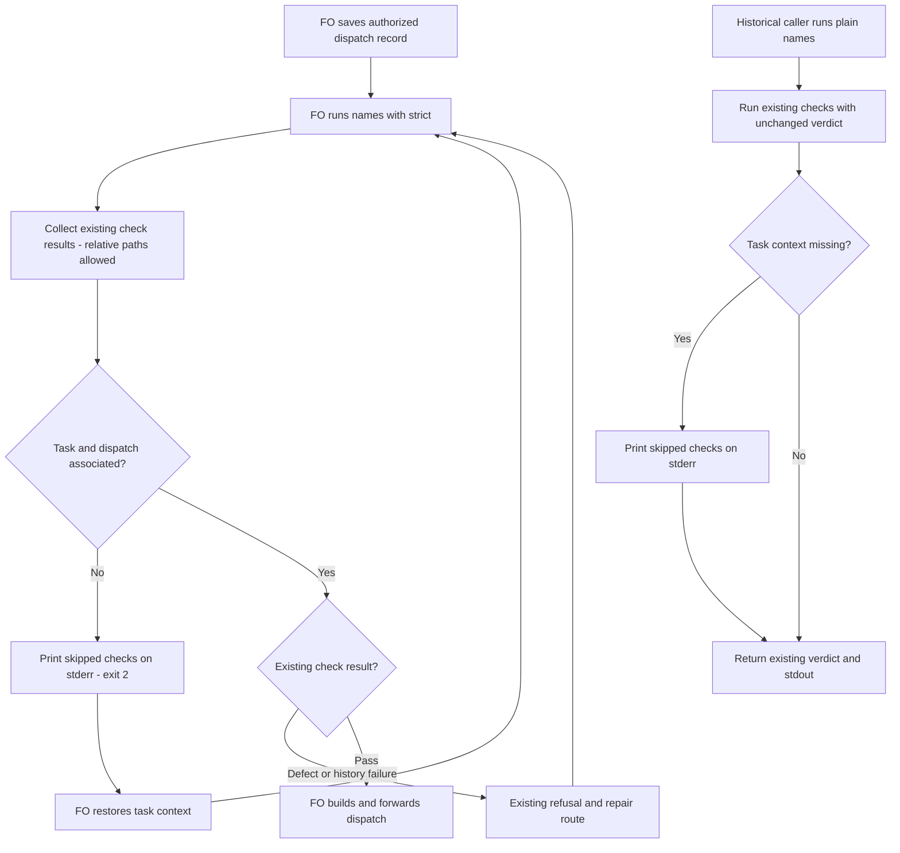

## Scope

- Source: batch-10 learn list presented to the Captain (chat, 2026-10-30) as package candidates, proposed by FO; no ruling yet.
- Bite: batch 9: FO's scripts ran `--names` on a record copy under /tmp, where task-fact checks skip and it exits 0, so three ideation dispatches went out with no Result: line (reproduced 2026-10-29: exit 0 on the copy, exit 1 in the task folder). Batch 10: FO's checklists named package scripts as kc-dev-flow-2/scripts/NAME.py, which `--names` passes though the README requires the absolute package path (captain-amendment-form-checked observer report).
- Upstream first: `scripts/dispatch_records.py` (`--names`, `check_task_facts`), README Stages (the script-path sentence). Open for ideation: how a checklist names a repository file the worker edits, as opposed to a script it runs.

## Non-goals

- Changing what the task-fact checks refuse.

## Budget

- Captain 2026-10-30 「准」, newest ideation question: one package PR changing `kc-dev-flow-2/scripts/dispatch_records.py`, its existing `scripts/test_dispatch_records.py`, and `references/sd/workflow.md` (last two paths relative to `kc-dev-flow-2/`). No new script; no other product file without return to FO.

## Stop condition

- Plain `--names` names skipped context checks on stderr while keeping existing verdict/stdout; `--names --strict` refuses missing task association with exit 2 before dispatch. Relative script paths stay allowed, no `Repository files:` syntax is added, and every associated record keeps its existing verdict in both modes. The three-file scope, word-neutral workflow and compatibility evidence must pass; any broader change returns to FO.

## FO alignment

Alignment: not needed before ideation: closes a silent pass in an existing check.
Surfaces: none
Visible change: none
Release review: not needed: workflow maintenance, on no journey map.
Reviewer: kc-dev-flow-2:chief-engineer opus 2026-10-30 — batch-11 review before the joint ideation sitting: approve, revise, split or hold each task, the Captain's decisions, overlap and order

## Design

### PRFAQ

**Proposition.** The First Officer (FO) sees which checks lacked task context; the pre-dispatch `--names --strict` command refuses that missing context. Relative script paths remain allowed. This Pilot design replaces the earlier strict-path proposal under the Captain's 2026-10-30 「准」 revision, recorded in `review/ideation/briefing-1/index.json` and the ideation gate resolution at 09:31:36Z. That question says to keep the outside-folder notice and strict refusal, drop relative-path rejection and `Repository files:`, and widen the Budget to the checker, its tests and workflow text. The old title is retained frontmatter, not the current acceptance contract. `Surfaces: none`: this PRFAQ and Mermaid are the owed artifacts.

**What does plain `--names` do?** Keep existing exit codes, stdout diagnostics, task-fact predicates and validation-history behavior for readable records. Add one stderr notice per record lacking the existing supported association: resolved `<task>/dispatch/<record>.md` with `<task>/index.md` or adjacent `<task>.md` (index takes the current precedence). Outside `dispatch/`, identify Candidate eligibility, task facts and validation ruling history as not checked. Under `dispatch/` without an adjacent task, identify task facts and validation ruling history; Candidate checking still runs when applicable. The notices name unavailable check categories, not violations or claims those checks apply to every record. No task discovery from cwd or matching slugs elsewhere.

**What does strict add?** Accept `--names --strict <record>...`; `--strict` without `--names`, or without a record, is usage error 2. Run the same existing checks and same context notices; aggregate the existing statuses with context status 2 when any record lacks that association. Every associated record retains its ordinary result in both modes. Multiple records must still expose existing defects and each missing-context notice; do not stop at the first absent task. Flat/index, live/archive and symlink handling follow the existing resolved-path semantics. A valid task layout under `/tmp` is associated; the directory's name is not a refusal rule. Existing non-Git validation-history skipping remains unchanged: strict confirms task association, not complete historical proof. No unrelated input-error redesign is included.

**What happens to relative paths?** No relative-path classifier, rejection, run/edit distinction, declaration syntax or migration is built. Directory-bearing tokens such as `kc-dev-flow-2/scripts/X.py`, `scripts/X.py` and `./X.py` keep the existing name-check behavior in both modes; bare known package script names keep the existing error. Preserve the script inventory, scanned regions and token matcher. Remove the old workflow paragraph's blanket absolute-path requirement, replacing it with the exact paragraph below. The absolute `Package root:` binding and skill-root instructions stay; permitting relative notation does not verify which file a worker actually executes. Accepted cost, named in the approved briefing: the form flagged in batch 10 stays legal and a worker can still run a repository copy. No new enforcement of provenance is claimed.

**Who consumes the result?** `laws_check.py:l2_dispatch_record_complete` reconstructs event-time folders/tasks and calls plain `--names`; `run_check` consumes stdout only for exits 0/1. New notices therefore go to stderr, with no legacy stdout or verdict change. `pr_watch.py tasks` uses `--newest`, which stays unchanged, as do default folder checking and `--coverage`. New regression fixtures belong in the existing `test_dispatch_records.py`; they can exercise the real laws consumer using temporary Git records without editing it. If consumer production code or another test file actually needs an edit, return the expanded file list to FO before implementation.

**How does the new route arrive?** FO runs strict on the saved associated record before `dispatch build`; nonzero holds. Spacedock's own build-to-spawn handoff stays uninterrupted. This is the package's instructed preflight, not a native Spacedock hook or proof that a model follows instructions. Historical callers retain plain mode. Adopters receive workflow text only through their separately authorized published-package sync; no old record rewrite or adopter change is part of this task.

### Journey



The diagram starts at an otherwise authorized dispatch. A pass grants no gate, merge or worker-start authority. Captain approval for this bounded revision is already recorded; FO owns transition to implementation. Rendering and visual comparison are recorded in the new stage report.

### Bounded existing-code check and current evidence

Read chain on 2026-10-30: Spacedock, then package, then adopters.

- Spacedock 0.27.3's own `skills/first-officer/references/fo-dispatch-core.md` places checklist/scope preparation before build and requires immediate forwarding after build. It does not run this package checker automatically. Its ensign core/runtime owns append-only reports and return; no upstream or alternate builder change is needed.
- `git fetch origin` succeeded; current `origin/main` is `a6612948936a4f075625147b21aabd3b10b19eee`, released package manifest 0.33.1. `git show origin/main:kc-dev-flow-2/<path>` matched the dispatched Codex install byte-for-byte for `dispatch_records.py`, its test, `laws_check.py` and workflow text. The checker silently skips missing associations today; existing relative-directory tokens already pass. Repair that context visibility, retain the approved path behavior.
- Two bounded source searches covered the checker/functions and all package callers, then the workflow/adopter entry instructions. Known copy consumers: laws' event-time snapshots, detached test fixtures, and the observed FO copy incident. `--newest` is a separate consumer route. Private/manual callers outside these sources remain unknown; do not claim a universal caller census.
- Read-only Relay `beirut-dev2/docs/dev2/README.md`, Web `dev2-fo/docs/dev2/README.md`, and QNow `qnow-adopt-dev2/docs/dev2/README.md` still prescribe plain `--names` and absolute package wording. This task changes none of them. Read accepted ADRs 0017 (event-time laws), 0020 (word-budget equality), 0027 (checks at structured writes), plus relevant `Override:` records. The current Captain decision supersedes the earlier path proposal; it does not authorize new heuristics or historical rewrites.
- `gh pr list --repo iamcxa/kc-claude-plugins --state open --limit 50 --json number,title,headRefName` failed: `error connecting to api.github.com`. Hosted PR ownership is unverified; local task bodies and latest gate questions supply the overlap table.

This revision re-exercised the installed baseline. Three historical replays again returned copy exit 0 with empty output versus associated exit 1 for missing `Result:`: `batch-reaches-each-gate-together` at `566a50400518f4d9fe217803605611e7910e7de5`, `captain-ruling-sources-checked` at `39e071b2969c37958ca70dd5a72dac40ea257800`, and `reused-worker-dispatch-leaves-a-record` at `0ccdbb305328e410fd4fb5fb53ca729837302688`. Reproduce by exporting each state's `<slug>.md` and `<slug>/dispatch/ideation-1.md` at that revision, copying the record beside the task folder, then running the installed absolute script with `--names` on both record paths. Four batch-10 `_archive/captain-amendment-form-checked/dispatch/{ideation-1,ideation-2,implementation-1,validation-1}.md` records at package-state pin below again returned 0. This revision preserves those relative-path results, including strict when task context is present.

Re-ran all 1,281 records from the previously exported, pinned snapshots after checking every record's SHA-256 against its prior receipt; zero exit/stdout differences. For independent reproduction, `git archive <state SHA>` into a fresh non-Git directory, enumerate `dispatch/*.md`, preserve task layout, invoke the installed `dispatch_records.main(['--names', record])`, and normalize only the exported root in stdout. These are baseline snapshot results, not candidate or live-history proof.

| Local state | Pinned SHA | Records | Exit 0 / 1 / 2 |
| --- | --- | ---: | --- |
| Package workflow | `8db6925f2d2c4579496103e736aa477de92ac608` | 572 | 362 / 210 / 0 |
| Relay | `2019310178b25a3742ff8ec51bfda09aad634f2c` | 304 | 133 / 171 / 0 |
| Web | `e8c96bf22e455163d0beb062c3c503b626955258` | 146 | 91 / 55 / 0 |
| QNow | `8a4eb114943778cfc1bad3ac59820e4e80329e09` | 259 | 104 / 155 / 0 |

The briefing's 287/573 regex observation is FO's cited reason for allowing relative paths, not this replay's denominator or a run/edit classifier. Local convenience receipts: `/tmp/names-check-ideation/baseline.json`, `/tmp/names-check-ideation-cycle2/baseline-recheck.json`; reproduction uses the pins and commands above, not these machine-local files. Candidate behavior remains unimplemented.

### Words FO reads at each lifecycle moment

Use whitespace splitting for both sides and the same fixture inputs. Replace exactly the existing 41-word paragraph from “A checklist or scope-notes line” through “rewrites each name it lists” with this 41-word paragraph:

> Before `dispatch build`, FO runs `python3 <package>/scripts/dispatch_records.py --names --strict <record>` on the saved record; nonzero holds dispatch. Relative script paths are allowed; bare package script names remain errors. Plain `--names` preserves existing historical verdicts and reports skipped context checks on stderr.

Measured against current package bytes: workflow remains 5,781 words; full common mod `references/sd/mods/kc-dev-flow-2.md` remains 48. No budget arithmetic or `lint-skills.py` edit is needed. No instructions move to a mod, new reference or success output. U below means the same unchanged input/output on both sides, not zero or a measured live total.

| Moment and complete changed-input accounting | Before | Designed after |
| --- | --- | --- |
| Startup/resume: full workflow + common mod + identical idle output | 5,829 + U_start | 5,829 + U_start |
| Before dispatch: paragraph + clean associated check | 41 + 0 | 41 + 0 |
| Before dispatch: detached copy + otherwise clean check | 41 + 0 | 41 + 21; strict exit 2 |
| Before dispatch: dispatch folder missing task + otherwise clean check | 41 + 0 | 41 + 18; strict exit 2 |
| Before dispatch: associated relative-path record | 41 + existing output | 41 + same output |
| Idle on open PR: common mod, idle/watch inputs and output | 48 + U_open | 48 + U_open |
| Idle on merged PR: common mod, watch/post-merge inputs and output | 48 + U_merged | 48 + U_merged |
| After archive: extension learning/observer inputs and output | U_archive | U_archive |
| Merge ask: delivery command, rules and output | U_merge | U_merge |

Exact designed stderr lines (counting a no-space record-path prefix as one word):

- `<record>:1: context checks not run: Candidate eligibility, task facts, validation ruling history; record is outside task/dispatch; run on the saved record.` — 21 words.
- `<record>:1: context checks not run: task facts, validation ruling history; no adjacent task file; restore it before dispatch.` — 18 words.

Count each emitted notice for multi-record calls, plus unchanged existing diagnostic output; paths containing spaces change whitespace counts and must use identical paths on both sides. The two increases are intentional visibility costs, not an overall reading reduction. Static prose/diagnostic counts are measured design text, not observed candidate output. Validation must capture actual stdout/stderr and recount the final rebased workflow. This design does not change CI triggers; incremental CI cost per PR is not measured at ideation.

### Captain decision and return boundary

No unresolved Captain choice remains inside this revision: the recorded 「准」 accepted context notices, strict association refusal, relative paths and the widened Budget, with implementation allowed after revision without another sitting. Recommendation: implement exactly that three-file slice. What gets worse is already accepted: relative notation still permits wrong-copy execution, and legacy callers can ignore stderr; stricter preflight reaches adopters only after their normal sync.

Return to FO before adding relative-path rejection, a `Repository files:` marker, executable provenance checks, non-Git history refusal, new scripts, an ADR, a changed legacy verdict/stdout grammar, or files outside the three named below. A required scope expansion or changed compatibility result is a stop, not an implementation detail to self-approve. Recommend retaining this narrow boundary; it leaves those adjacent guarantees unproved. If the neutral wording cannot fit rebased source, return the concrete word/budget delta rather than editing the budget or other documents here.

### Batch overlap

Implementation changes exactly `kc-dev-flow-2/scripts/dispatch_records.py`, `kc-dev-flow-2/scripts/test_dispatch_records.py`, and `kc-dev-flow-2/references/sd/workflow.md`. Existing laws, dispatch-transport, POC and lint suites are run unchanged; no production consumer, other test file, budget script, CI, ADR/index or adopter edit is proposed. This supersedes the first design's six-file list. State work is this entity only.

| Task routing name — purpose | Shared file/check and ordering |
| --- | --- |
| batch10-after-release-obligations — post-release repairs | Shares dispatch_records.py and test_dispatch_records.py; laws/history is the consumer seam. Land its inline-state repair first, then preserve that behavior in both modes. Its native-start and other delivery proofs remain separately owed. |
| names-check-says-what-it-skipped — this context notice task | Owns the three named files and this state revision. |
| peers-paseo-rule-matches-practice — peer transport policy | No direct file overlap; peers/paseo/adoption wording and separate real transport proof. |
| peer-status-reaches-fresh — current peer facts | No direct file overlap after its narrowed peers-only change; its latest question gives the Paseo insertion to the peer-policy task. |
| model-roster-per-repo — repository stage model choices | Current revised design shares workflow.md only; it explicitly drops dispatch/laws/test/lint edits. Land this wording first, then rebase and recount its neutral workflow pointer. Its older overlap references to this task's six files are superseded here. |
| paseo-human-surfaces-visible-and-reachable — worker terminal/browser reach | No file overlap; shared pre-build scope-note seam. Keep checks before build and do not reinterpret relative-path allowance as visibility evidence. |
| adoption-asks-which-extensions — historical extension context | Shares dispatch_records.py and test_dispatch_records.py if resumed; latest gate question holds until a live record is affected. Do not wait on or revive it. If FO resumes it, serialize changes and rerun consumer/history checks. |
| adr-required-statement — old ADR ledger proposal | Body closed 2026-10-20 despite validation frontmatter; no live dependency. Its abandoned workflow edit grants nothing here. |
| adr-silent-undo-probe — ADR reversal experiment | Held and moved to a separate POC workflow by recorded ruling; no shared file/check. |
| comment-check-reaches-delivery-gate — comment evidence proposal | Body closed 2026-10-20; no shared file/check and no dependency. |
| journey-canvas-hosted-poc — hosted canvas trial | No overlap; journey hosting artifacts. |
| journey-server-host-pilot — private journey server | Read folder-form index.md, validation owned elsewhere; no overlap with the three files. |
| ops-inbox-r1-setup-and-isolation — event intake/isolation | No overlap; separate kc-ops-inbox package/workflow. |
| pr-review-lite-value-pilot — bounded review trial | No overlap; separate kc-pr-flow experiment and journey artifacts. |

Recommended order: FO refreshes hosted ownership when possible; integrate the active inline-state repair, then this context-only change, then roster workflow wording with a combined recount. Held/closed tasks are not prerequisites. Re-read current sibling file lists before implementation; shared state is concurrent and no sibling file was edited or session contacted.

## Acceptance criteria

**AC-1** Outside-task context is visible and strict refuses it. Evidence: replay all three pinned batch-9 cases against base/candidate; candidate plain copies retain exit 0 and old stdout but emit the 21-word notice, strict copies exit 2, and associated originals retain missing-Result exit 1. Add missing-task (18-word notice, Candidate check still active), flat/index precedence, live/archive, symlink, valid `/tmp` layout, usage and multi-record fixtures. Falsifier: silent skip, cwd task inference, early exit hiding a later defect, or plain exit 2 fails the respective assertion. Current: base replays reconfirmed; candidate unimplemented.

**AC-2** Relative script paths stay allowed in both modes; no new reference syntax exists. Evidence: associated subprocess fixtures cover existing directory-bearing forms, bare known names, absolute paths, non-package names and current scanned-region behavior; both modes preserve base verdict/stdout. Replay the four pinned batch-10 records unchanged with tasks present; both modes return the base result without declarations. Falsifier: restore strict relative rejection or require `Repository files:` and these fixtures fail; removing the bare-name check fails the existing negative control. Current: all four base records re-ran at exit 0; candidate unimplemented.

**AC-3** Compatibility holds across every current associated record and real consumers. Evidence: base/candidate exit/stdout equality in plain and strict modes for each associated record of the 1,281 pinned snapshots and every associated record at implementation-time pins; repeat in independent local Git clones at those pins for live ruling-history behavior, reporting non-Git and Git results separately. Exercise actual laws event-time consumption with task present/missing and a real stdout defect plus stderr notice, requiring the same verdict/violation and no parser failure; run existing laws suite. Verify default, `--newest`, `--coverage` and inline-state repair behavior unchanged. Falsifier: move notices to stdout, route a historical consumer through strict, or change a task predicate; respective consumer/corpus assertions fail. Current: all 1,281 baseline results/hash checks repeated with zero drift; candidate/live-clone parity remains unverified.

**AC-4** The workflow instructs strict preflight before builder handoff without path classification. Evidence: the existing test file binds the exact replacement paragraph and invokes the actual checker on saved valid/invalid layouts; nonzero prevents a test's builder call, repaired context reaches the existing real dispatch builder fixture. Run existing `test_sd_dispatch.py` and derived POC checks with their declared dependencies; inspect generated Pilot/Prod/POC instruction routes. Falsifier: substitute plain `--names` in workflow, build on nonzero, or insert the removed declaration requirement; the corresponding assertion fails. This proves CLI/instruction/transport seams, not native worker start or model compliance. Current: source/route inspected; candidate behavior and builder integration unverified.

**AC-5** The approved boundary and per-moment reading accounting hold. Evidence: diff only the three approved product files; no new script, path policy, consumer parser or budget edit. Run the relevant existing dispatch/laws/transport/POC/lint suites, render/inspect Mermaid against the prose, and capture final before/after prose plus stdout/stderr for every lifecycle row with identical inputs. Workflow count remains equal to its rebased baseline; clean output unchanged; notice costs explicit. Falsifier: uncounted moved instructions, added relative refusal, a changed untouched lifecycle input, scope expansion or a nonzero word-budget delta fails the respective check and returns to FO. Current: 41-to-41 paragraph and 5,781-to-5,781 workflow measured; candidate checks and CI cost unverified.

## Stage Report: ideation

- DONE: A design for kc-dev-flow-2/scripts/dispatch_records.py no longer passing silently on a record outside a task folder (refuse, or say what it did not check), and for a relative package script path, separating a script the worker runs from a repository file it edits; the batch-9 /tmp-copy case (exit 0 on the copy, exit 1 in the folder) and the batch-10 relative-path case replayed; every current in-folder record keeps its verdict; any caller that relies on the copy form found first
  `## Design`: base 0.33.1 at a6612948936a4f075625147b21aabd3b10b19eee; all three batch-9 copies exit 0 versus in-folder 1, all four batch-10 records exit 0; copy consumers identified before proposing legacy/strict separation. No candidate verdict claimed.
- DONE: A `### Batch overlap` section naming each file the design would change and each other batch task (batch10-after-release-obligations, names-check-says-what-it-skipped, peers-paseo-rule-matches-practice, peer-status-reaches-fresh, model-roster-per-repo, paseo-human-surfaces-visible-and-reachable) and live task of other sessions (adoption-asks-which-extensions, adr-required-statement, adr-silent-undo-probe, comment-check-reaches-delivery-gate, journey-canvas-hosted-poc, journey-server-host-pilot, ops-inbox-r1-setup-and-isolation, pr-review-lite-value-pilot (driven by other sessions; read only)) that changes the same file or check, so FO can order implementation
  `### Batch overlap`: six proposed files, all fourteen named tasks, consumer seams and recommended ordering; GitHub API failed, so open-PR status is unverified.
- DONE: The words FO reads at each lifecycle moment, before and after, per root learning.md "Measure the words FO reads at each moment, not one file's size"
  `### Words FO reads at each lifecycle moment`: exact replacement 41 to 35 words, workflow plus common mod 5,829 to 5,823; other lifecycle inputs held equal, failure output adds disclosed reading. Variable live totals and candidate diagnostic counts are not claimed measured.
- DONE: Acceptance criteria with reproducible evidence clauses and falsifiers, and unresolved decisions for the Captain, each with a recommendation and what gets worse under it
  `## Acceptance criteria`: AC-1 through AC-5 each name reproduction and a falsifying mutation; one coupled Captain choice on strict-mode compatibility and six-file scope, with the weaker warning-only alternative and costs.

### Summary

Authored the Pilot design and explicit compatibility choice after replaying both incidents and measuring 1,281 committed in-folder records across four local state snapshots. The existing `design_surfaces.py check` printed `names-check-says-what-it-skipped.md: design surfaces presentable` (exit 0); Mermaid CLI 12.0.0 rendered and visual inspection confirmed the branches and ownership. No product implementation, historical/adopter repair or frontmatter change was made; Captain scope approval, implementation, live-git parity and independent validation remain outstanding.

### Acceptance evidence at ideation

- AC-1: Three base copy/in-folder replays observed; candidate stderr notices and strict refusal are not implemented. Suppressing the proposed notice must fail the future assertion.
- AC-2: Four batch-10 base records replayed as exit 0; strict relative-path and mixed-line rejection remain unverified. Accepting any directory must fail the future negative fixture.
- AC-3: 1,281 base snapshot results captured with exact state pins; candidate and live-git comparisons unverified. Routing legacy/newest through strict mode must fail compatibility tests.
- AC-4: Native builder contract and package caller source read; candidate checker-to-builder exercise remains unverified. Restoring the legacy workflow invocation must fail the future routing test.
- AC-5: Design check exit 0, rendered Mermaid inspected, exact static word delta -6; implementation diff, package suites and CI cost unverified. An uncounted instruction move must fail the future per-moment ledger.

## Stage Report: ideation (cycle 2)

- DONE: Revise the design under the Captain's ideation-gate revise of 2026-10-30 (「准」); the asks are in this task's newest ideation gate question (review/ideation, newest briefing); do exactly those asks, update criteria and the stop condition to match, and name anything that would go beyond them as a return to FO rather than designing it
  Updated Design, Budget, Stop condition and AC-1 through AC-5 to the recorded 2026-10-30 revise: context-only strict refusal; relative paths allowed; no declaration syntax; exactly three proposed files. Prior report and frontmatter remain byte-identical.
- DONE: A `### Batch overlap` section naming each file the design would change and each other batch task (batch10-after-release-obligations, names-check-says-what-it-skipped, peers-paseo-rule-matches-practice, peer-status-reaches-fresh, model-roster-per-repo, paseo-human-surfaces-visible-and-reachable) and live task of other sessions (adoption-asks-which-extensions, adr-required-statement, adr-silent-undo-probe, comment-check-reaches-delivery-gate, journey-canvas-hosted-poc, journey-server-host-pilot, ops-inbox-r1-setup-and-isolation, pr-review-lite-value-pilot (driven by other sessions; read only)) that changes the same file or check, so FO can order implementation
  Batch overlap rereads all fourteen named tasks and latest applicable questions; active inline-state repair first, this change next, roster wording after; held/closed work is not a prerequisite. gh failed connecting to api.github.com, so hosted ownership is unverified.
- DONE: The words FO reads at each lifecycle moment, before and after, per root learning.md "Measure the words FO reads at each moment, not one file's size"
  Whitespace recount against a6612948936a4f075625147b21aabd3b10b19eee: replacement 41 to 41, workflow 5,781 to 5,781, workflow plus common mod 5,829 to 5,829; designed notices add 21 or 18 words. Final runtime outputs remain future evidence.
- DONE: Acceptance criteria with reproducible evidence clauses and falsifiers, and unresolved decisions for the Captain, each with a recommendation and what gets worse under it
  AC-1, AC-2, AC-3, AC-4 and AC-5 each state reproducible evidence and a falsifier; no unresolved choice inside the grant. New path policy, consumer changes or extra files return to FO; candidate behavior is not claimed.

### Summary

Revised the Pilot design under the Captain's recorded 「准」: retain skipped-context notices and strict association refusal, allow relative script paths, and remove the old classifier/declaration design. The existing design-surfaces check returned `names-check-says-what-it-skipped.md: design surfaces presentable` (exit 0); Mermaid CLI 12.0.0 rendered the revised diagram and visual comparison confirmed actors, both modes, existing-result collection, refusal/repair loops and the build boundary. No product implementation, sibling/adopter edit, frontmatter change or stage transition occurred; FO can route the bounded revision under the existing grant, while implementation/validation remain outstanding.

### Acceptance evidence at ideation

- AC-1: Re-ran three pinned batch-9 cases: detached copies 0 with no notice, associated records 1 for missing Result; candidate notice/strict behavior unimplemented. Restoring silent skip must fail the future notice assertion.
- AC-2: Four pinned batch-10 associated records again exit 0; candidate two-mode path preservation unverified. Reintroducing relative rejection must fail unchanged-record fixtures.
- AC-3: Rechecked hashes and executed all 1,281 baseline snapshot records: zero exit/stdout drift. Candidate/strict/live-Git and real consumer comparisons remain future evidence; stdout notices or consumer strict routing must fail them.
- AC-4: Spacedock's own dispatch contract and package/adopter routes read; actual candidate checker-to-builder evidence unverified. A legacy workflow invocation or builder-on-nonzero must fail the proposed routing fixture.
- AC-5: Exact static word counts, successful design check and rendered/inspected Mermaid are current proof; candidate scope/suites, actual output costs and CI cost are unverified. An extra product file, word-budget delta or hidden moved instruction must fail validation.
- Render receipt: `/tmp/names-check-ideation-cycle2/journey.png`; reproduce from the task's Mermaid with Mermaid CLI 12.0.0 and local Chromium. Offline npx metadata lookup failed, then the installed CLI was used; sandboxed Chromium failed to start, and the permitted local render succeeded. These machine-local convenience paths are not product dependencies.

This complete cycle-2 report supersedes the prior report's design recommendation, not its historical evidence. The previous report is preserved verbatim; its strict relative-path proposal and unresolved six-file choice no longer govern this task.

## Stage Report: implementation

- DONE: Implement the approved three-file context-only design on the assigned branch and stacked base; commit locally and prepare the Conventional Commit PR title/body for FO.
  Worktree `/Users/kent/conductor/workspaces/kc-claude-plugins/colombo/.context/dev2-adoption/worktree/.worktrees/spacedock-ensign-names-check-says-what-it-skipped`, branch `spacedock-ensign/names-check-says-what-it-skipped`, base `origin/spacedock-ensign/batch10-after-release-obligations` at `0c55b9a574b8abd845e2ab969c200aa44b1588e4`, candidate `9f065b01f1c6d6561793a168f584075edb85bf1f`; PR text `/tmp/impl-names-check-says-what-it-skipped-pr.md` specifies that base and stacking on PR #755. Product diff contains only the three approved files, with no version/budget/consumer/ADR change; working tree clean after commit.
- DONE: Every acceptance criterion and its behavioral falsifiers, with fresh Python -B processes and cache-free mutation copies.
  AC-1 through AC-5 evidence below; 96 dispatch tests pass with no skips, including 12 context-boundary mutations, inherited ADR/history mutations and actual Spacedock builder transport. The base fails the new copy-notice and workflow-preflight controls. The budget falsifier appends one word to a disposable copy and repository lint exits 1 at 5782 versus 5781.
- DONE: Run the repository lint and required local checks; retain the earlier inline-state repair.
  `python3 -B kc-dev-flow-2/scripts/lint-skills.py` exits 0, workflow 5781/5781; installed `adr_lint.py docs/adr --since 0c55b9a574b8abd845e2ab969c200aa44b1588e4` exits 0 (44 ADRs, 0 legacy); installed `number_guards.py check --repo <worktree> --base <base> --workflow-dir <workflow> --task <entity>` exits 0; `comment_ratio.py <base> HEAD --repo <worktree> --workflow-dir <workflow>` exits 0: code lines 224, comment lines 0, 0.0%, maximum 5% met; committed diff check exits 0. The 63-test unchanged laws suite passes with one object-dependent skip, then that exact real-record test passes separately with its five documented source pins supplied; the 9-test unchanged POC derivation suite passes. The real builder suite runs unchanged inside the new preflight test, including split-root and both graph routes.
- DONE: Affected retained documents and the approved per-moment reading boundary.
  `doc_impact.py <base> HEAD` lists ADR 0045 and learning.md: both unaffected, for the reasons below. Exact workflow and runtime counts are below; Mermaid CLI 12.0.0 renders the current task diagram and visual inspection confirms actors, order, collection before refusal, repair loops and the build boundary. No CI trigger changes; CI cost per PR not measured.
- SKIPPED: Obtain an exact-head RoboRev verdict.
  Ran `python3 /Users/kent/.claude/plugins/cache/kc-claude-plugins/kc-dev-flow-2/0.33.1/extensions/roborev/roborev_gate.py --repo <worktree> --base 0c55b9a574b8abd845e2ab969c200aa44b1588e4` after commit: exit 3, `incomplete: the roborev daemon is not running`. No clean review is claimed. FO owns the exact-head gate before fresh validation under the dispatched Paseo exception.
- SKIPPED: Push the product branch, open the Draft PR, request reviews or read hosted CI.
  No PR opened: no worker push grant; dispatch and ADR 0042 assign publication and review to FO. FO receives the local candidate and prepared PR text; no product push, PR mutation, config write, ready action or merge was performed. Hosted ownership/CI remain unverified.

### Summary

Implemented skipped-context stderr notices and opt-in strict association refusal while preserving relative paths, legacy stdout/verdicts, historical consumers and the stacked inline-state repair. All local acceptance evidence passed at candidate `9f065b01f1c6d6561793a168f584075edb85bf1f`; RoboRev is incomplete because its daemon is not running, and product publication, hosted CI and independent validation remain with FO. This is a Pilot implementation handback, not a gate approval, native worker-start proof or delivery claim.

### Acceptance evidence

**AC-1 — association and notices.** Three pinned batch-9 incidents replay against the stacked base and candidate: `batch-reaches-each-gate-together` at `566a50400518f4d9fe217803605611e7910e7de5`, `captain-ruling-sources-checked` at `39e071b2969c37958ca70dd5a72dac40ea257800`, and `reused-worker-dispatch-leaves-a-record` at `0ccdbb305328e410fd4fb5fb53ca729837302688`. Each associated original is exit 1 with the same missing-Result stdout in base, candidate plain and candidate strict. Each detached byte-identical copy is base 0, candidate plain 0 plus its 21-word stderr notice, and candidate strict 2 with that notice. Existing task association is resolved-path-only; tests exercise valid temporary layouts, flat/index precedence, live/archive paths, symlinks pointing in/out, no cwd inference, missing-task clean plain 0/strict 2, Candidate checks without a task, usage errors and multi-record diagnostics. Silent-notice, plain-refusal, early-context-return, lost-Candidate and lost-task-fact mutations each fail their respective assertions.

**AC-2 — unchanged path behavior.** Subprocess controls in both modes exercise directory-bearing relative paths, absolute paths, bare known names, non-package names, quote/backtick/fenced commands, mixed declaration-like text and the existing scanned regions. Relative paths and text containing `Repository files:` get no new special treatment; bare `adr_lint.py` still fails. All four unchanged `_archive/captain-amendment-form-checked/dispatch/{ideation-1,ideation-2,implementation-1,validation-1}.md` records at package state `8db6925f2d2c4579496103e736aa477de92ac608` return 0 with empty streams in base and both candidate modes. Relative-refusal, lost-bare-name and declaration mutations fail their controls; no classifier or declaration syntax exists in product code.

**AC-3 — complete corpus and real consumers.** Compared base plain, candidate plain and candidate strict exit/stdout/stderr for every associated record, once in fresh `git archive` exports and separately in independent `git clone --no-hardlinks --no-checkout` full-history copies checked out at each pin below. All 1281 pinned record hashes match the ideation receipts; every record at these pins is associated. Total comparisons cover 1281 pinned and 1300 implementation-time records per storage kind, with zero base/candidate drift in either mode. Only exported-root prefixes in diagnostics are normalized; modes retain exact diagnostic order and content.

| State corpus | Ideation pin / records | Implementation-time pin / records |
| --- | --- | --- |
| Package | `8db6925f2d2c4579496103e736aa477de92ac608` / 572 | `dc030bf82d74cf01acc29db4e143580e12a6174e` / 585 |
| Relay | `2019310178b25a3742ff8ec51bfda09aad634f2c` / 304 | same pin / 304 |
| Web | `e8c96bf22e455163d0beb062c3c503b626955258` / 146 | `04cb95f24288665c013e85a30e7cc558c91c90ee` / 150 |
| QNow | `8a4eb114943778cfc1bad3ac59820e4e80329e09` / 259 | `20c5a1871e543752fd1968bf9c5bbdaef6b72a09` / 261 |

Non-Git pinned exit distributions 0/1/2: package 362/210/0, Relay 133/171/0, Web 91/55/0, QNow 104/155/0. Current exports: 375/210/0, 133/171/0, 94/56/0, 106/155/0. Git results equal their corresponding exports except Web: pinned 89/55/2 and current 92/56/2; `_archive/review-page-reads-as-an-app/dispatch/validation-{1,2}.md` retain the base's existing `rewritten-report` history hold in all modes. No claim is made that a non-Git pass proves history.

The new regression test invokes the actual laws CLI over temporary committed task-present and task-missing events, including a real bare-name stdout defect accompanied by a context notice on stderr. It returns the expected L2 violations and no parser failure. Moving notices to stdout or routing the historical consumer through strict makes this control fail. The unchanged laws suite and the existing default, newest, coverage, validation-history and eight inline/split-state layout controls pass. No production consumer parser edit is needed because `run_check` consumes stdout, not stderr.

**AC-4 — preflight to builder.** The existing test file binds the exact approved paragraph, extracts and executes its actual strict command on a saved record, verifies a missing task prevents the fixture's builder call, then restores context and invokes the unchanged real `test_sd_dispatch.exercise` fixture with declared `SPACEDOCK_BIN` and `SD_PLUGIN_ROOT`. It exercises ten fresh/reused route-stage-host handoffs, both graph routes, Pilot/Prod/POC selection, generated stage text, Team/context transport, negative controls, split-root reuse and synthetic gates. Plain-preflight, declaration and build-on-nonzero mutations fail assertions. This proves package instructions, CLI and builder transport; it does not prove native worker startup, skill/model compliance or human approval.

**AC-5 — scope, reading and render.** Product diff is exactly `kc-dev-flow-2/scripts/dispatch_records.py`, `kc-dev-flow-2/scripts/test_dispatch_records.py`, and `kc-dev-flow-2/references/sd/workflow.md`; test changes include adapting the inherited call-site mutation to the new local `files` variable. No new product script, budget, version, CI, ADR, consumer or adopter change. The paragraph remains 41 words, workflow 5781, common mod 48, combined full load 5829. Same-input fixture captures retain stdout/stderr separately for every row below; these are bounded fixture measurements, not live organization-wide reading totals.

| Lifecycle moment | Base | Candidate |
| --- | --- | --- |
| Startup/resume: workflow + mod + same idle fixture output | 5829 + 29 | 5829 + 29 |
| Pre-dispatch clean associated record: paragraph + check output | 41 + 0 | 41 + 0 |
| Pre-dispatch detached copy: paragraph + output | 41 + 0, exit 0 | 41 + 21 stderr words, strict exit 2 |
| Pre-dispatch missing adjacent task: paragraph + output | 41 + 0, exit 0 | 41 + 18 stderr words, strict exit 2 |
| Pre-dispatch associated relative-path fixture | 41 + 0 | 41 + 0 |
| Idle/open PR: mod + same output | 48 + 29 | 48 + 29 |
| Idle/merged PR: mod + same output | 48 + 20 | 48 + 20 |
| After archive: same unchanged extension inputs + fixture output | U_archive + 0 | U_archive + 0 |
| Merge ask: same delivery instructions + valid question output | U_merge + 3 | U_merge + 3 |

Only known changed prose is recounted; unchanged extension/rule inputs remain U on both sides, as in the approved design, not a hidden zero. Lifecycle output fixtures use the existing PR-watch test provider, real local watcher/observer/question paths and temporary state; no hosted PR action occurs. Notices are emitted once per unsupported record; paths here have no spaces. One extra workflow word makes the actual repository lint fail (5782/5781). The current Mermaid is freshly rendered and visually checked: existing checks precede strict context refusal, associated defects follow the existing repair route, and only an associated pass reaches FO's build step.

### Reproduction and receipts

Run from the exact candidate checkout with Python 3 and Git:

```sh
SD_PLUGIN_ROOT=<Spacedock-0.27.3-package-containing-mods/pr-merge.md> SPACEDOCK_BIN=<absolute-spacedock-executable> python3 -B -m unittest discover -s kc-dev-flow-2/scripts -p test_dispatch_records.py
python3 -B -m unittest discover -s kc-dev-flow-2/scripts -p test_laws_check.py
python3 -B -m unittest discover -s kc-dev-flow-2/scripts -p test_poc_readme.py
python3 -B kc-dev-flow-2/scripts/lint-skills.py
```

For the laws object-dependent test, supply `DEV2_OBLIGATION_SOURCES` using the five `{state, rev, path}` records already documented in `kc-dev-flow-2/VALIDATION.md`; the separate run here passes all five source hash assertions and ten unrelated-edit replays. Full-history clones must have the pinned source objects. For each corpus/pin, export or clone the state without changing its task layout; enumerate `**/dispatch/*.md`; load checker source from base `git show <base>:kc-dev-flow-2/scripts/dispatch_records.py` and the candidate with the same package dependencies; invoke `main(['--names', record])` on both plus candidate `main(['--names', '--strict', record])`; capture streams separately and compare associated records. Do not replace Git clones with exported snapshots when evaluating history.

Local convenience receipts under `/tmp/names-check-implementation/`: `*-parity.json` (per-record results), `incidents-reading.json` (three incidents, four records, prose/notice streams), `lifecycle-streams.json`, `real-records.json`, and `journey.{mmd,png}`. Temporary replay helpers there are verification scaffolding, not product dependencies; remove after FO/validation retain or reproduce the evidence. Suite logs: `/tmp/names-check-verified-tests.log`, `/tmp/names-check-laws.log`, `/tmp/names-check-real-laws.log`, `/tmp/names-check-poc.log`; mutations `/tmp/names-check-mutations-2.log` and `/tmp/names-check-budget-falsifier.log`. Initial harness failures were corrected before the passing final suite; no failed result is reported as green.

### Retained documents and boundaries

- `docs/adr/0045-validation-reruns-require-a-later-recorded-captain-ruling.md` — unaffected: the live ruling predicate, event order, non-Git skip and newest exclusion remain as accepted. Strict association is an additional opt-in preflight, not a change to that ruling. Read at base `0c55b9a574b8abd845e2ab969c200aa44b1588e4`, SHA-256 `124d19068d071b0d8414a8aac0a87b0b3a8c06b3e0ef345af60357cd9df2e336`; status Accepted.
- `learning.md` — unaffected: its parser-learning applicability concerns parsed output. The actual L2 consumer is exercised with stderr notices plus stdout defects and remains unchanged. Its per-moment reading and full-corpus practices are applied above; no learning entry is edited.
- `references/sd/workflow.md` — updated: replaces the former blanket absolute-path paragraph with the exact approved 41-word strict preflight paragraph; no instructions move elsewhere.
- The bounded existing-code audit in the approved design remains applicable: Spacedock prepares context before build and forwards immediately afterwards; this package adds no native hook. Re-read sibling task scopes before implementation; inherited inline-state repair is first in the stack, roster shares workflow wording after this task, and held adoption work is not revived. No peer/sibling edits or contacts occurred.
- Local required checks run from the assigned code worktree; product branch remains local. RoboRev exit 3 is missing evidence. FO must push/open the Draft PR against the specified parent, run the exact-head gate and inspect hosted CI before routing fresh validation. No CI cost saving or native transport/startup success is inferred from these tests.
