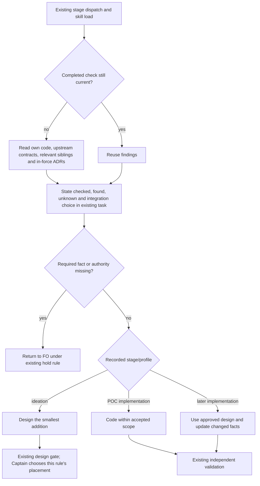

## Scope

- Source: the Captain 「照上面這個理解，開「先查上游」這張任務」 (chat, 2026-10-23), after his correction 「這裡的問題是，做新需求時應該要先查上游，不管幹嘛都要先確認已有的東西才去評估怎樣加入新的東西。說明一下你的理解是怎樣」 and FO's restatement: before building anything new, find what already exists, say where it looked and what it found, then judge how the new part joins it; the places to look are what this project actually depends on and sits beside (its own repository, the packages or frameworks it uses, sibling projects, the third-party tools it will use, read from their own docs or source, not from a neighbour's usage); what was found decides whether the new part extends, changes or replaces it.
- Port: his global instructions "Upstream first" (check the chain, say what you checked and found) and "A sibling's usage is not a tool's contract", stated for any adopter's own chain rather than his fleet's.
- What exists: kc-dev-flow-2 implementation principles "Existing-code capability check" (this repository only, and only when existing code adds, replaces or removes a capability); FO's own dispatch text has carried a chain-check line, which adopters' FOs do not get. A grep of the kc-dev-flow-2 0.28.0 markdown and of kc-dev-flow on origin/main for an upstream-first clause found none (2026-10-23).
- Bite: none recorded in dev2, because FO's dispatch line supplied it; his global instructions record the class costing two days in his fleet.
- Rulings are existing state: the Captain 「都准」 (chat, 2026-10-23, kc-adr FO's Paseo session) to the kc-adr FO's 「准不准我在 dev2 那張任務的範圍裡加上「ADR 也算既有狀態」這一句」, whose proposed sentence was 「生效中的 ADR 也算既有狀態，worker 必須列出管到這次要動的檔案或行為的 ADR，沒有就寫「無」。」, after his 「讓 agent 務必先查既有狀態的機制，ADR也是一種既有狀態」. Related: dev2 task `adr-protected-path-guard` adds an optional ADR field listing the files it protects, which this check can read. (Bullet written by the kc-adr FO, Paseo agent 1bcf070c; the quotes are relayed from its session, not a ruling in this one; FO confirms them at this task's backlog gate.)
- Non-goals: naming any particular project's upstream in the package.
- Trial (2026-11-13): admitted by the Captain's 「五張都准，授權代記設計關卡（建議）」 (host question dialog, 2026-11-13) as one of five tasks run by hand under the trial route rules: one worker builds a working probe during ideation and continues into implementation, a different worker validates, at most 3 build rounds counted by hand; stop for the Captain on an overturned premise, spent budget, two rounds without progress or a second validation rejection, a change of scope or criterion, or a component boundary or Prod trigger.

## Budget
1 implementation and 2 validation cycles, in one package PR.

## Stop condition
- Return to the Captain after the first round with where the check sits; the alignment line makes that his to accept. Done when a worker dispatched with the candidate text states what it checked and found before designing, shown on one replayed dispatch.

## FO alignment

Alignment: needed at ideation; where the check sits (ideation principles, the seed, the gate content) is his to accept.
Result: the Captain admitted this task into the route trial with 「五張都准，授權代記設計關卡（建議）」 (host question dialog, 2026-11-13); he has not yet ruled where the check sits, so FO does not record this task's ideation gate under the grant: the probe's result and the options go to him at that gate.
Surfaces: none
Visible change: none
Release review: not needed: workflow maintenance, on no journey map.

## Design

### Before building

**Does it need doing; what breaks without it?** Yes, as an instruction gap, not a demonstrated saving. The Captain's Scope asks for the actual dependency chain before any new work, including greenfield work and named broken seams. The released package has a narrower capability audit that expressly skips those cases; its Team fact checks collaboration/history, not third-party contracts. Base source-loading probe exits 1 (`ideation/base-routing.json`). No new dev2 incident or two-day saving is claimed: the local FO already supplies a custom chain-check line.

**What already has it; checked and found?** In order: Spacedock's own ensign core and workflow/stage docs own dispatch/state and let a workflow define its working standards; they do not supply this package-specific chain check (`ideation/upstream-read.json`). At `origin/main` 8125e6d516d32abbf79c6772de10cde2c20900a8, kc-dev-flow-2 release 0.39.1 has the existing-code capability audit, the ideation link to that audit, read-adr and the Team fact. A second bounded search also covered kc-dev-flow stage skills (`ideation/package-chain.log`); no equivalent general upstream-first rule was found in that search. Three sibling workflow READMEs and their committed state branches were read read-only: counts only in `ideation/adopter-counts.json`; none of the three READMEs carries an explicit upstream-first clause. A first filesystem pass found one empty local state directory, so the committed branch census supersedes that pass. Presence counts neither demonstrate compliance nor define a tool contract.

**RFC or public standard?** No directly applicable one identified in the bounded primary-source search in `ideation/research.json`. Spacedock's [stage lifecycle](https://spacedock.md/docs/concepts/stage-lifecycle/) and [workflows/entities](https://spacedock.md/docs/concepts/workflows-and-entities/) document where working rules and reports belong. Internet-protocol reuse guidance is not a standard for this worker practice. This is not an exhaustive claim that no standard exists.

**Smaller or cheaper?** The present FO-only scope note is cheaper locally but does not reach ordinary adopter dispatches. Two existing stage-principle edits reuse the existing loader and report, with no new parser, seed field, receipt, gate, runtime or adopter-specific upstream list. No reduction in engineering time or model cost was measured.

**Component boundary?** No new one in the recommended option: both stages already read these principles and ideation already links to implementation's bounded audit. Spacedock continues to own dispatch/state/gates, read-adr owns ruling interpretation, and the adopter supplies its own relevant chain. A new loader, Spacedock enforcement or public/private evidence transport would be a different scope: write that boundary contract and stop, rather than include it here.

**Where do the new facts go?** Checked sources, findings, inaccessible sources and the integration choice go in the existing task design/report. This trial's public evidence stays in this task's `ideation/` folder; private adopter material is counts only. If the Captain accepts an enduring placement, implementation writes the unnumbered ADR draft below at an FO-reserved path; it does not create another facts registry or edit an existing ruling.

### PRFAQ

**Proposition.** A worker first explains what exists in the task's own chain, then proposes the smallest addition to it. A worker who already completed the check reuses it and updates only changed scope or facts.

**Who and when?** Ideation workers before design; POC workers before coding in implementation, with no ideation stage added. Pilot and Production implementation reuse the design's completed check. This changes an instruction read through existing skills, not mechanically enforced behavior.

**What does a useful answer contain?** The relevant own-repository sources, upstream packages/frameworks, sibling projects and third-party tools; what each check found; applicable in-force ADRs by name, or `none`; unknown/inaccessible sources; and whether the new work uses, extends, changes or replaces what exists. A tool's own docs/source define its contract. The task's actual dependencies determine the search, not the maintainer's fleet names. Research is proportional to the decision; the existing stage rules govern a missing required input or authority conflict.

**Does the existing capability audit disappear?** No. Its entire section is byte-identical in the probe. The broad chain check precedes it; the deeper two-search capability/consumer audit retains its narrower applicability and exclusions. Existing repair, removal, authority and profile boundaries remain.

**How would it ship?** After a placement decision, keep only the two principle changes in an implementation candidate based on then-current main, plus a newly reserved ADR for the accepted enduring instruction. The disposable `probe/` harness stays on the retained local POC branch; it is excluded from the package PR. Normal package publication and adopter update are separate, not proven by this trial. No CI trigger changes; CI cost per PR was not measured.

Actors/order/stops were checked against the prose. This is a package instruction flow, not a new gate. A local Mermaid renderer has not been established; syntax/picture rendering is unverified and no renderer is downloaded for this trial.

### What the probe showed

- Base: `8125e6d516d32abbf79c6772de10cde2c20900a8`; local branch: `poc/new-work-checks-what-exists-first`; retained worktree: `/Users/kent/conductor/workspaces/kc-claude-plugins/colombo/.context/dev2-adoption/worktree/.worktrees/poc-new-work-checks-what-exists-first`.
- Product-text commit: `43fcbb679e983650bea174ba2355c499851c5822`; first probe/harness commit used by the neutral dispatch: `9149739dff1985acc7a28b25659c889d71855aad`; final count-census harness commit: `dd35c47ff2e7b00b167715f2b1816d34b8cc84fb`. The product text is identical across the latter two. The source probe and harness are committed locally, never pushed; no package PR opened.
- Reused the released `scripts/replay_dispatch.py` and real Spacedock 0.27.2 CLI. The installed Spacedock skill/docs are 0.28.0: this is the observed local pairing, not a cross-version support claim. Initial creation of a scratch state worktree was denied at the common Git admin path (`ideation/dispatch-build.log`). A disposable independent clone under the single scratch root succeeded; no shared Git config was changed (`ideation/isolated-clone.log`).
- The first replay's checklist explicitly requested a chain check, so it is excluded as behavioral evidence. The neutral replay instead uses the real public directory-crash task and an ordinary ideation checklist with no extra upstream-first reminder (`ideation/neutral-replayed-dispatch.md`, build exit 0 in `ideation/neutral-dispatch-build.log`). It changes no sibling task or product code.
- This same worker read the generated dispatch, selected Pilot references and the new linked rule, then recorded checked/found sources before its integration proposal (`ideation/neutral-observation-commands.json`, `ideation/self-replay-before-design.md`, then `ideation/self-replay-proposal.md`). It reproduced the existing checker's same-name-directory exception and observed that the explicit `.md` entry reaches normal design diagnostics, choosing an addition to that checker rather than a replacement. These commands' exit 1 results are the unrelated task's existing defect/missing-design observations, not a fix claim.
- Limits: same worker, unblinded, already aware of the issue and trial goal; not a fresh worker, independent validation or a baseline-vs-candidate model comparison. The source probe proves loading/applicability, not compliance. Application tests, servers, databases and browsers were not run. Broader effectiveness and cross-host behavior remain unproven.

### Worth questions

- **General check before new work.** Serves Scope's Captain correction 「不管幹嘛都要先確認已有的東西才去評估怎樣加入新的東西」. Without it, greenfield and named-seam work can bypass the existing narrower audit. Premise that makes it unnecessary: the standard loaded rules already cover the entire relevant chain for all new work. Cheap check now: base routing/source search, exit 1 for the general rule (`ideation/base-routing.json`, `ideation/package-chain.log`); this diagnoses text, not model behavior.
- **Own tool contract plus sibling findings.** Serves 「A sibling's usage is not a tool's contract」. Without it a copied workaround can be mistaken for upstream capability. Premise that makes this addition unnecessary: an existing loaded rule already requires the tool's own docs/source. Cheap check: inspected upstream core, package principles and three sibling README presence counts; no equivalent broad instruction in those bounded sources.
- **In-force ADRs and one report home.** Serves the accepted Scope line 「ADR也是一種既有狀態」 and 「沒有就寫『無』」. Without it an implementation can treat an earlier ruling as absent. Premise that makes a new rule unnecessary: the existing broad check already names the governing ruling or `none` as an output. Cheap check: base principles lack that requirement; read-adr already supplies interpretation, so reuse it rather than add a new parser.
- No proposed part serves only an assistant preference. The throwaway harness serves current evidence only and is excluded from delivery.

### Pilot gap and the Stop condition

The working slice uses the real skill/dispatch path and a real task shape. It lacks independent validation on an approved implementation candidate, a cold-context behavior replay, and evidence that adopters follow it more reliably than the base. The current Stop condition explicitly returns **where the check sits** to the Captain after round 1; this task does not advance under the FO's general trial grant. A same-worker observed response is recorded, not promoted to an independent acceptance verdict.

### Files and retained documents

Implementation would change only:
- `kc-dev-flow-2/skills/ideation/principles.md`: replace the existing capability-audit-only pointer with a pointer to the broad check, retaining the deeper audit when applicable.
- `kc-dev-flow-2/skills/implementation/principles.md`: add the single `Before new work` home before the existing capability audit.
- `docs/adr/<FO-reserved>-workers-check-the-existing-chain-before-new-work.md`: new decision record only after acceptance and number reservation. No existing ADR or shared index is edited.

No README/template, frontmatter, context selector, profile graph, tool, hook or runtime changes are proposed. Current framework authority/loading claims remain accurate. No permanent helper or new schema is proposed. The `probe/new_work_check.py` removal condition is exclusion from the implementation PR; retain its frozen local commit for reproducing this trial.

### Words FO reads at each moment

`python3 -B probe/new_work_check.py cost --repo "$WT" --ref dd35c47ff2e7b00b167715f2b1816d34b8cc84fb` uses whitespace splitting and enumerates the named passages below, on the same base and candidate (`ideation/reading-cost.json`, exit 0). These are the scoped instruction passages, not universal session totals. Script-output volume depends on input: workflow/mod/pr_watch/delivery_gate/observer_check bytes are unchanged, so the same inputs add no changed instructions; no synthetic constant total is assigned to their outputs.

| Moment | Counted passages | Base words | Probe words | Delta |
| --- | --- | ---: | ---: | ---: |
| startup/resume | full workflow, full mod | 6081 | 6081 | 0 |
| idle/open PR | full mod, Delivery authority, Review-finding disposition | 795 | 795 | 0 |
| idle/merged PR | full mod, Delivery authority | 536 | 536 | 0 |
| after archive | full mod, Extensions | 272 | 272 | 0 |
| merge ask | Delivery authority, Captain steps, Review-finding disposition | 913 | 913 | 0 |
| stage dispatch | Stages, Dispatch facts | 2160 | 2160 | 0 |

The workflow itself stays at its exact 6033-word budget; no budget step is requested. Direct ideation-principles words change 687→681, plus the newly followed 106-word section (net +100 when this section is read); implementation-principles words change 707→813 (+106). A completed check is reused, not duplicated at implementation. If FO voluntarily reads worker principles it pays the same stated increase. A future ADR is a conditional decision read; it is not silently included in the unchanged steady lifecycle totals. No reading-cost reduction is claimed.

### Unresolved decision for the Captain

**One decision: where the check lives. Recommendation: stage principles, with one home linked from ideation.**

| Placement | Why consider it | What gets worse |
| --- | --- | --- |
| Stage principles (recommended, probed) | Reaches design and POC coding through existing loaders; findings in existing report | Adds 106 words to implementation principles and a linked read to ideation; instructions can still be skipped |
| Seed | Captures a record earlier during task admission | FO must answer before the worker investigates; can go stale; adds admission fields/check ownership and does not by itself make the worker do the check |
| Gate content | Makes the result visible at review | Discovery happens after design; POC has no design gate; would need another instruction location to meet the before-design goal |

ADR 0037 explicitly kept this broader rule as a separate follow-up, not part of its Team rule. ADR 0020 requires quoted approval before any workflow-word raise; the recommended option needs none. No contrary placement ruling was found in this task's gates or the named batch/live tasks' Override lines. A broader historical search is not claimed. The Captain's decision may change this recommendation; the current proposed placement is not a ruling.

**Unnumbered ADR draft:** “Workers check the existing chain before new work.” Status: Proposed. Words: use the Captain's original Scope quotes and the eventual bound placement answer, not this worker's paraphrase. Options: principles / seed / gate as above. Recommended: principles. Decision proposal: one broad check home before design/code, own third-party contracts, in-force rulings or `none`, findings/integration choice in existing design/report, reuse completed checks, POC keeps its existing route. Consequences: explicit worker reading increase, no mechanical enforcement and no claim of measured savings. FO reserves the number after the placement is accepted; this draft grants no authority.

### Batch overlap

Files this design changes are the two principles and the newly reserved ADR above; the probe harness is trial-only. All tasks share execution of the routing/lint/design checks, not ownership of the two principle files. Read-only task-state comparison at this run, with limits where no current design exists:

- `design-surfaces-task-dir-crash`: checker/test; no common deliverable file. The neutral replay used a frozen copy and made no repair.
- `new-work-checks-what-exists-first`: this task; sole owner of these trial principle edits and this evidence folder.
- `delivery-gate-s4-skips-removed-scratch`: delivery_gate.py/tests; no common deliverable file; both use the design gate check.
- `observer-check-learn-only-when-listed`: observer_check.py/tests and extension interpretation; no common deliverable file.
- `pr-watch-tasks-foreign-worktree`: pr_watch.py/tests; no common deliverable file.
- `dispatch-close-out-archives-evidence-and-removes-scratch` (open PR #854): dispatch_stage.py/pr_watch.py/scratch.py and tests, ADR 0079; no common deliverable file. Its scratch/evidence lifecycle check is related but this trial uses its explicit assignment's cleanup rule, not its unreleased feature.
- `held-and-closed-tasks-leave-the-design-queue` (open PR #856): pr_watch.py/tests, ADR 0081; no common deliverable file. Both PR file lists were read live; a later attempt to save a refreshed list failed network access, retained as `.log`, not silently treated as a refreshed result.
- `adoption-asks-which-extensions`: current recorded design concerns dispatch-record/laws interpretation; it explicitly leaves the workflow/observer text unchanged; no common deliverable file. Its Scope alone is not a current file list.
- `adr-required-statement`: ADR lint/adoption/workflow Decision records and related tests; no common principle file. It can govern the new ADR reservation/check before implementation, so FO re-establishes the accepted rule then.
- `adr-silent-undo-probe`: no complete current design/file list; known ADR audit topic, no established shared principle edit. Unknown future overlap remains an FO check, not a claim of none.
- `comment-check-reaches-delivery-gate`: delivery_gate.py/tests and **validation** principles, explicitly not implementation principles; no common file, shared principle/lint checks.
- `journey-canvas-hosted-poc`: kc-journey-map canvas/host work; no established common file.
- `journey-server-host-pilot`: top-level task file absent; companion records folder exists. No current design was inferred from its absence; overlap is unverified, no edit made.
- `ops-inbox-r1-setup-and-isolation`: kc-ops-inbox setup/contract and reserved-record work; no established common file.
- `pr-review-lite-value-pilot`: kc-pr-flow delivery work in another session; no established common principle file. Its long repair history is not permission to alter that work.

Recommended order: no product-file dependency on the four other trial tasks or PRs #854/#856; stop here for the placement decision, then rebase implementation on the then-current main and refresh overlap. FO reserves any new ADR number before implementation and follows the named batch's single sitting. Unknown/held task scope is rechecked if resumed; never coordinate by editing its state.

## Acceptance criteria

Evidence paths below are relative to this task folder. `$WT` is the retained absolute POC worktree above; `$P` is its `kc-dev-flow-2`; `$E` is this task's `ideation/`; `$B` is 8125e6d516d32abbf79c6772de10cde2c20900a8; `$C` is dd35c47ff2e7b00b167715f2b1816d34b8cc84fb. `ideation/commands.json` preserves exact argv/cwd/exit/time. Do not interpret a source check as model behavior.

**AC-1** Before-design/code loading reaches the general rule on all active ideation/implementation profile routes, with POC ideation still skipped and the narrower audit intact.
Verified by: `python3 -B "$WT/probe/new_work_check.py" routing --repo "$WT" --ref "$C" --base "$B"` exit 0 (`ideation/candidate-routing.json`); the same command with `--ref "$B"` exits 1 (`ideation/base-routing.json`). Falsifier: unlink ideation's broad check or omit the implementation home; the source probe exits 1. Limit: loading/applicability only, not compliance.

**AC-2** One replayed dispatch with candidate text produces checked/found sources before its proposal, with own-tool-contract, relevant siblings and governing ADRs named or `none`, using existing code rather than inventing a replacement.
Current evidence: `python3 -B <loaded-package>/scripts/replay_dispatch.py build ... --task design-surfaces-task-dir-crash --checklist <scratch>/neutral-checklist.txt --scope <scratch>/neutral-scope.txt` exit 0; the full exact command is the `neutral-dispatch-build.log` entry of `ideation/commands.json`. `ideation/neutral-observation-commands.json` preserves the follow-on read/check commands and exits; the actual worker findings and later proposal are `ideation/self-replay-before-design.md` then `ideation/self-replay-proposal.md`. Falsifier: a proposal precedes the checked/found output, relies on a sibling workaround as the tool contract, or silently omits an inaccessible required source. Limit: one unblinded same-worker observation; independent/cold replay is not yet proved.

**AC-3** Real sibling checks remain read-only and the public evidence contains counts, not private repository task names/titles/rulings/logs.
Verified by: `python3 -B "$WT/probe/new_work_check.py" siblings --repo "$WT" --adopter <root-1> --adopter <root-2> --adopter <root-3>` exit 0 (`ideation/adopter-counts.json`); the observed inputs are the three read-only adopter roots from the dispatch, deliberately redacted in the public manifest. It reads the workflow README and committed state branch and emits only ordinal/count fields. Falsifier: an input is mutated, a raw private record is emitted, or absence of a local state directory is mistaken for zero committed tasks. Limit: another public reader cannot recreate private counts without authorized access; no private data is published to solve that.

**AC-4** The product change uses the two existing principle files, with no workflow, state schema, runtime, extra POC gate or permanent probe helper; FO reading change is disclosed at each named lifecycle moment.
Verified by: `python3 -B "$WT/probe/new_work_check.py" scope --repo "$WT" --ref "$C" --base "$B"` exit 0 (`ideation/product-scope.json`); `python3 -B "$WT/probe/new_work_check.py" cost --repo "$WT" --ref "$C" --base "$B"` exit 0 (`ideation/reading-cost.json`). Falsifier: a changed package file outside the two principles, altered FO instruction source, or hidden extra worker text. The future accepted ADR is outside the package-path comparison and requires a named reservation; no ADR is represented as already landed.

**AC-5** Existing package link/route lint and design acceptance parsing still pass; no claimed pass uses the wrong runner.
Verified by: `python3 -B "$P/scripts/lint-skills.py"` exit 0 (`ideation/lint-skills.log`); `python3 -B <loaded-package>/scripts/design_surfaces.py check <absolute-task.md>` is run on this completed definition and saved in `ideation/design-surfaces.log`; its current exact exit is recorded in the Stage Report. The real standalone dispatch integration command and actual result are `ideation/sd-dispatch-integration.log` and `ideation/commands.json`; an earlier unittest command discovered zero tests and is explicitly excluded (`ideation/sd-dispatch-unittest-zero-tests.log`). Falsifier: a broken link/profile route, an unusable AC declaration, a changed POC graph or a required existing check that fails. Full suite and hosted CI are not claimed.

## Not provable now

- Captain acceptance of the placement and any numbered/accepted ADR: the current Stop condition requires his first-round decision; no gate authority is exercised here.
- Fresh-worker causal improvement over the old rules, cross-host compliance and independent validation: this ideation probe uses this worker's context. The different-worker validation stage remains owed after an approved implementation; one self-replay cannot stand in for it.
- Private adopter census by an unauthorised public reader: only aggregate counts may be published. The procedure is repeatable with authorised roots; the source records remain private.
- Mermaid picture rendering: no local renderer verified; the diagram's actors/order/branches were inspected, rendering is not claimed.
- Release, adopter sync, sustained use, measured time/cost benefit and full test/hosted CI coverage: outside this local trial; no production obligation is accepted.

## Number guards

ADR: 0083

## Stage Report: ideation

- DONE: Before building: need, existing chain, standard, smaller route, component boundary and facts home
  `## Design / Before building`; own-source absence is established, effectiveness/savings are not; one broad check home uses existing loaders/report.
- DONE: Build and commit a working throwaway probe on the local POC branch; no push or PR
  `poc/new-work-checks-what-exists-first` at dd35c47ff2e7b00b167715f2b1816d34b8cc84fb; base 8125e6d516d32abbf79c6772de10cde2c20900a8; product-text commit 43fcbb679e983650bea174ba2355c499851c5822; neutral generated dispatch and actual same-worker observation saved, not independent validation.
- DONE: AC-1 evidence command and falsifier
  Final-ref routing command exit 0, base control exit 1 (`ideation/candidate-routing.json`, `base-routing.json`); unlinking the general rule breaks it; the narrower audit stays byte-identical.
- DONE: AC-2 evidence command and falsifier
  Neutral `replay_dispatch.py build` exit 0; reads/reproduction then findings then proposal in `neutral-observation-commands.json` and `self-replay-*.md`; proposing first or using a sibling as tool contract falsifies it; same-worker/unblinded limit retained.
- DONE: AC-3 evidence command and falsifier
  Committed-branch census exit 0 (`ideation/adopter-counts.json`), three read-only sources, counts only; emitting raw private records or mutating an input fails the boundary. Source-root-string scan found zero matches (`public-boundary-check.json`), not a semantic privacy verdict.
- DONE: AC-4 evidence commands and falsifiers
  Scope/cost commands exit 0 (`product-scope.json`, `reading-cost.json`); other package-path changes or altered FO instruction sources fail; future ADR remains unnumbered/unlanded.
- DONE: AC-5 evidence commands and falsifiers
  `lint-skills.py` exit 0 (6033/6033 workflow words); real standalone `test_sd_dispatch.py --sd-plugin-root <installed SD>` exit 0 (`sd-dispatch-integration.log`), including 10 route/stage/host handoffs and loss controls; wrong-runner zero tests excluded. `design_surfaces.py check <absolute task.md>` exit 0 (`design-surfaces.log`); broken links/routes/AC grammar falsify the respective checks.
- DONE: Batch overlap and recommended order
  All five trial tasks and ten named live/held tasks addressed in `### Batch overlap`; no established common principle file, incomplete/absent designs remain unknown; PR #854/#856 file lists read, later refresh network failure retained; FO reserves a future ADR number and refreshes before implementation.
- DONE: The words FO reads at each lifecycle moment, before and after
  Named startup, open/merged-PR idle, archive, merge-ask and stage-dispatch passages counted on both refs in `reading-cost.json`; deltas zero there, worker direct/linked increase disclosed; unchanged script output is not assigned a universal total.
- DONE: Unresolved placement decision with recommendation and trade-off
  Recommend one stage-principles home linked from ideation; seed and gate alternatives plus consequences in the design; the task's explicit first-round Stop condition fires, so no gate approval or implementation transition is made.
- DONE: Loaded package workflow sha256
  Host Codex copy `/Users/kent/.codex/plugins/cache/kc-claude-plugins/kc-dev-flow-2/0.39.1/references/sd/workflow.md`: 075005be5d2ba9e8ac2a30400faba8324754aef47077e5f7301462c3e19623eb; dispatch-supplied Claude copy: a884a1079841eeff80a0b3a27fecc21379562077ce8e783b70ccbce0cd5b6ca1 (`loaded-workflow.json`); same version, different bytes, host adds the timeline clause. Design base is fetched origin/main, not an assumed cache match.
- SKIPPED: Independent/cold-worker validation, cross-host behavior and measured savings
  Not produced by this same-worker trial; different-worker validation follows an approved implementation. No application suite, server, database, browser, hosted CI, release or adopter sync claimed.
- SKIPPED: Mermaid picture rendering
  Actors/order/branches/stops inspected; no verified local renderer, no download; rendering remains explicitly unverified.

### Summary

The local probe adds one broad existing-chain check in implementation principles and links ideation to it while preserving the deeper capability audit. The working source/dispatch path and one unblinded same-worker response are recorded, with private adopter evidence reduced to counts; the Captain must now decide the placement before implementation.

### Trial round 1

Premise tested: ordinary stage loading lacks a general pre-design/code chain check; base source-control exit 1 and candidate exit 0 (`ideation/base-routing.json`, `candidate-routing.json`). Goal check: the neutral real-task dispatch built (exit 0) and this worker wrote checked/found sources before the integration proposal (`neutral-dispatch-build.log`, `neutral-observation-commands.json`, `self-replay-before-design.md`, `self-replay-proposal.md`); causal improvement and independent acceptance remain unproved.
Worker start: 2026-11-13 01:05:01 Asia/Taipei; evidence/report seal: 2026-11-13 01:21:03 Asia/Taipei. Source: `clock__curr_time` UTC readings 2026-11-12 17:05:01 and 17:21:03, converted UTC+08:00; no billing-minute claim.
Base: 8125e6d516d32abbf79c6772de10cde2c20900a8. Product: 43fcbb679e983650bea174ba2355c499851c5822. Dispatch package/probe: 9149739dff1985acc7a28b25659c889d71855aad. Final retained probe: dd35c47ff2e7b00b167715f2b1816d34b8cc84fb; product text unchanged between probe refs. Exact argv/cwd/exits/time: `ideation/commands.json`.
Blocked/limits: first scratch worktree admin write denied, resolved with independent local clones; later GitHub refresh failed network access, no external mutation attempted; picture rendering and independent/cold behavior not proved. Evidence is committed before cleanup; exact own scratch manifest is `ideation/scratch-manifest.json`, and the post-commit removal result will be appended below.
Stop triggers: **Captain-only placement decision fired**. Premise overturned: none established. Component boundary without a contract: none. Production-data/credentials, broad exposure, migration, recurring operation, support duty or release/rollback ownership: none. Change outside the named file/budget scope: none; `probe/` is local disposable evidence only. Round remains 1 of at most 3; no new round or downstream action self-authorized.

Post-commit cleanup after evidence commit 350521808 (already pushed): removed exactly `/tmp/spacedock-dispatch/spacedock-ensign-design-surfaces-task-dir-crash-ideation.md`, `/tmp/spacedock-dispatch/spacedock-ensign-new-work-checks-what-exists-first-ideation.md`, `/private/tmp/dev2-new-work-checks-what-exists-first-20261113`. All are absent; the POC worktree/branch/head remain (`ideation/scratch-cleanup.json`). Original UUID dispatch pointer and sibling files were not touched.

## Stage Report: implementation

- DONE: Implement the approved design with the Captain's placement, only the named files, on the assigned branch off origin/main
  Branch `spacedock-ensign/new-work-checks-what-exists-first`; base 8125e6d516d32abbf79c6772de10cde2c20900a8; candidate 1fc2f05f88b18a62d4eda598158ffa385df9fae8. Two principles match product probe 43fcbb679e983650bea174ba2355c499851c5822 byte-for-byte; only ADR 0083 is added; trial harness excluded (`implementation/source-identity.json`, `product.patch`).
- DONE: ADR 0083 records the ruling, quoting the original Scope and placement words verbatim
  `docs/adr/0083-workers-check-the-existing-chain-before-new-work.md`; `adr-quote-source-check.json` validates the original words and 「放階段原則（建議）」 against the task. A pre-commit extra-character miss was caught and corrected (`adr-quote-invalid-control.json`); relayed ADR wording is labelled as relayed.
- DONE: AC-1 candidate loading and base control, with falsifiers
  Frozen trial source probe rerun on exact candidate: routing exit 0, base exit 1 (`candidate-routing.json`, `base-routing.json`); deleting the broad home, unlinking ideation or changing the retained deeper audit each exits 1 (`mutation-results.json`). No POC ideation added.
- DONE: AC-2 one candidate dispatch replay states checked/found before its proposal
  Real `replay_dispatch.py build` exit 0 (`neutral-dispatch-build.log`); candidate package selected Pilot and the linked rule. `replay-before-proposal.md`, `replay-result.json`, then `replay-proposal.md` record this same worker's observed output. The completed sibling check from round 1 is reused; the supplementary census refresh ran after the proposal and is not claimed earlier. Proposal-first, sibling-contract and undisclosed-source record mutations are rejected. These evidence-record controls are not independent model behavior.
- DONE: AC-3 read-only real sibling checks, public counts only, and falsifiers
  Census exit 0 on the three authorised workflow/state sources (`adopter-counts.json`); no private task names/titles/rulings/logs copied. Public-schema and synthetic input-fingerprint controls reject raw private fields, changed inputs and an empty-local-directory absence claim (`mutation-results.json`, `public-boundary-check.json`); they do not certify arbitrary semantic privacy.
- DONE: AC-4 bounded product scope and reading disclosure, with falsifiers
  Scope and lifecycle-cost commands exit 0 (`product-scope.json`, `reading-cost.json`); extra package file, changed FO instruction source and undisclosed worker words fail controlled scope/cost guards. Same named FO passages have zero delta; implementation gains 106 words and ideation's direct text loses six plus its linked 106-word read. ADR 0083 is a conditional ruling read; no universal script-output total or cost reduction claimed.
- DONE: AC-5 repository lint, design grammar, POC graph and required record checks, with falsifiers
  Candidate `lint-skills.py` exit 0, 6033/6033 workflow words; `design_surfaces.py check <absolute task.md>` exit 0; native standalone `test_sd_dispatch.py` exit 0 (`lint-skills.log`, `design-surfaces.log`, `sd-dispatch-integration.log`). Broken route/AC grammar/POC graph/required ADR are rejected. Generic lint misses a principles-link mutation (original exit 0 retained); the actual new-link loading probe rejects it (exit 1), so no general lint-link coverage is claimed (`mutation-instrument-limit.json`, `mutation-results-initial.json`).
- DONE: Every acceptance criterion rerun and each stated falsifier exercised with python3 -B and cleared caches
  Corrected full driver rerun exit 0: 27 controls, 17 reject mutations, no failed control (`mutation-driver-final.log`, `mutation-results.json`, `mutation-tests.json`); initial generic-lint miss retained. All mutations use an independent disposable clone or synthetic evidence, never product/private inputs. Helpers saved here for reproduction, excluded from product.
- DONE: Repository lint, ADR lint --since base --require 0083, number guards and comment ratio
  All exit 0 (`lint-skills.log`, `adr-lint.log`, `number-guards.log`, `comment-ratio.log`); refreshed number check has no stale-ref warning. Initial sandbox warning retained separately. Comment ratio: zero code/comment additions, maximum not enforced below 20 code lines; no migration present or changed. Exact argv/cwd/candidate in `commands.json`.
- DONE: Affected documents and retained-document boundary
  `doc_impact.py base candidate` exit 0, zero documents listed (`doc-impact.log`); the two principles are updated and their deeper audit preserved; ADR 0083 added. Workflow/README/loading/profile/runtime claims remain byte-identical; no extra retained-document edit needed.
- DONE: Commit locally, preserve the candidate, prepare Conventional Commit PR title/body for FO, and record CI cost
  Candidate committed locally with exactly three named paths; no version bump. Prepared `/tmp/impl-new-work-checks-what-exists-first-pr.md`, title first then body. CI cost per PR not measured; this candidate changes no CI trigger.
- SKIPPED: Product push, opening the one Draft PR, RoboRev and hosted CI
  Explicitly delegated to FO, not run or reported clean by this worker; no review requested, PR comment, ready action or merge. Split-root state evidence commits/sync remain separately authorised.
- SKIPPED: Independent validation, cold-worker comparison, cross-host model compliance and savings
  Owed downstream or unproved as in the approved design; source/transport/control passes and this same-worker replay establish none of them. No application/server/database/browser tests or production obligation added.

### Summary

The exact candidate delivers the accepted stage-principles placement and ADR 0083, reusing the probed product text without the disposable harness. Required local checks and the scoped source/evidence falsifiers pass; publication, RoboRev, hosted CI and independent validation remain with the authorised next stages.

### Trial round 2

Premise and goal check: the base lacks the general rule (routing exit 1), candidate loading passes (exit 0), and a neutral real-task dispatch built with this exact candidate (exit 0) produced the same-worker checked/found record before a proposal. This remains unblinded, with reused completed source checks and explicitly later supplementary counts; it is not causal or independent model proof.
Start: 2026-11-13 01:38:01 Asia/Taipei. Evidence/report seal: 2026-11-13 01:51:06 Asia/Taipei. Time source: `clock__curr_time` UTC 2026-11-12 17:38:01 and 17:51:06, converted UTC+08:00; no billed-agent-minute claim.
Base: 8125e6d516d32abbf79c6772de10cde2c20900a8; candidate: 1fc2f05f88b18a62d4eda598158ffa385df9fae8; branch: spacedock-ensign/new-work-checks-what-exists-first. `python3 -B <saved probe> routing --repo <assigned worktree> --ref <candidate> --base <base>` exit 0; full argv and saved outputs in `implementation/commands.json`; corrected mutation driver exit 0 (`mutation-driver-final.log`).
Moved since round 1: the Captain selected principles at the ideation gate, ADR 0083 was reserved and landed locally, and the product now has an implementation candidate with rerun evidence. Blocked/limits: shared Git metadata needed approved access for fetch/commit/ref refresh; resolved. Generic lint's principles-link blind spot was observed and the actual loading probe used; no out-of-scope linter repair. Independent/cold behavior, hosted CI and RoboRev remain unrun.
Stop triggers: none newly fired. Placement stop is resolved by the recorded Captain answer; premise not overturned, no new component boundary/Prod trigger, no scope/criterion/budget expansion, and no file outside the three designed product paths needed. Build round is 2 of at most 3; budget shows implementation 1, validation 0. Evidence is committed before exact scratch cleanup; keep both worktrees/branches and the requested PR text, with post-commit cleanup recorded below.
