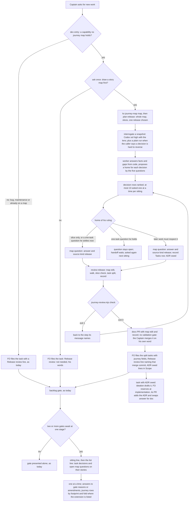
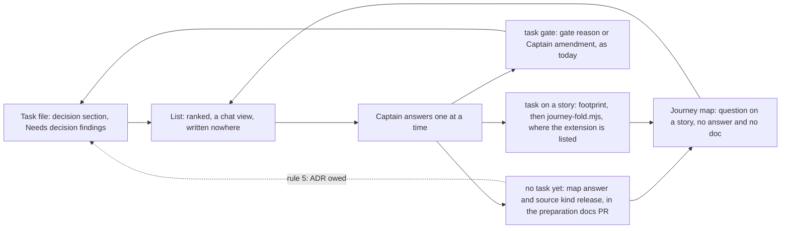

## Scope

- Source: the Captain, 2026-10-20, relayed by the Paseo-migration session and confirmed here: 「應該先繪製故事地圖與切片地圖，其實這件事應該納入 dev2 的建議清單內，當要做新的事情時，要主動提醒人是否先繪製故事地圖，再開始切片，然後繪製切片地圖，拿切片進來討論。」 Then, here: 「故事地圖提醒要開成 dev2 待辦，這裡應該稍退一步再次全局思考怎樣搭配更好，分開可用，一起用加成的角度，例如，可能不只是在 /dev 中加入」, and 「可以」 to FO's proposal that the slice map's question-and-answer is the batch's decision list.
- Bite: a new Paseo plugin was built straight to POC without a map; its UI came out unintuitive and its team-rollout scope was never sliced. The Captain is about to adopt dev2 in a new repository (iamcxa/kc-paseo-plugins) and wants the map first.
- Principle: each tool usable alone (kc-journey-map without dev2; dev2 without a map, asked once and the answer recorded), and together additive.
- Candidate touchpoints, to be designed and measured at ideation, not chosen: (1) the `dev` entry's new-work step asks whether to map first; (2) adopting dev2 in a repository asks the same; (3) a release's slices become backlog candidates carrying `journey` and `journey-story`; (4) the backlog gate notices a new capability with no story on any map; (5) the slice's open questions (kc-journey-map `interrogate`, `journey-map-question` schema) are the batch sitting's list, asked one at a time, and dev2 rulings fold back through `journey-fold.mjs` (exists) as a reference, never a copied answer.
- Upstream first: kc-journey-map modes `map`, `plan-release`, `interrogate`, `review-release`, `add-story` and `lib/journey-handoff.mjs`; dev2's Release review and the journey-map extension; live tasks journey-map-progress-and-provenance, release-acceptance, fo-batch-sittings and kc-decision-log-p1 (decision records). No third decision ledger.
- Ideation runs on Opus: a cross-plugin interface design.
- Non-goals: to be set at ideation.

## Captain amendments

### Amendment 1 — 2026-10-20, chat
Captain: 「好，那就下一版，跟故事地圖一起，我越來越覺得兩者結合很重要」 (chat, 2026-10-20, batch-4 sitting, question 15)
Asked: 「第 15 題：「先列清單、再一題一題問」這個做法，要不要另外開一張任務，安排在兩個版本之後再上？」
Supersedes: none
Design: this task's scope gains fo-batch-sittings' Cut 2 (before asking, list every open decision of the tasks at a stage once, each with its home, one plain sentence, FO's recommendation and what gets worse, then ask them one at a time), designed together with the story map, targeted at the next release. fo-batch-sittings Amendment 2 and its `## Design` Cut 2 and AC-8 seam are the source.

### Amendment 2 — 2026-10-22, chat
Captain: 「可以」 (chat, 2026-10-22)
Asked: 「AC-2(d) 改成這條看日期的規則，可以嗎？」, where FO had stated the rule: a ruling dated before this interrogation may name an earlier release of the same journey as its source; a ruling made at this interrogation must still name the current release.
Supersedes: AC-2
Design: `journey-review.mjs check` accepts a `source.kind: release` ref naming another release of the same journey when the ruling's `date` is before the record's `Interrogation:` date; a ruling dated on or after it must name `<journey>/<release-id>`; a ref to another journey still fails.
Superseded text:

**AC-2** `node lib/journey-review.mjs check <record> <journey.yaml>` exits 0 on a complete r1 record and map, and exits 1 with its own message when: (a) the heading names another journey or a release the map lacks; (b) the `Interrogation:` line is missing, lacks one of its counts, or names no codex model, effort and lens or plain; (c) any story on the release has an open question as `openQuestions()` reads it (the order check); (d) a question on a release story with `source.kind: release` has a `ref` other than `<journey>/<release-id>`, an empty `words` or `date`, both `answer:` and `doc:`, or neither; (e) a `## Tasks` row names a `journey-story` not on the release, or a `Carries` id that is not a `kind: release` question on that row's story.
Source: intake recommendation 1 and method gaps 2 and 4; D1; kc-adr "one home".
Verified by: the same test file, one mutation of the complete fixture per case, each asserting exit 1 and its message. Falsifier: removing the open-question check passes (c); a question with both fields passes (d).

## FO alignment

Reviewer: kc-dev-flow-2:chief-engineer opus 2026-10-22 — Codex rounds 1 to 3 on #704 each found new input-validation gaps in journey-review.mjs check (round 3: an impossible Interrogation date, a release ruling without status answered, duplicate question ids); what is the smallest next step to a merge ask?

Captain rulings on D1 to D4 (batch-5 sitting, 2026-10-22, chat, each given to FO's question one at a time; to be bound at the ideation gate):
- D1 「可以，照 kc-adr 那套 5 問規則」: kc-adr five-question routing (PR #691); a slice-only answer lives in the map question's answer and source fields (needs a journey-map-question schema change); a ruling later work must respect becomes an ADR and the map question links it. Override: recommended the review record; Captain chose the map fields under the five-question rule; area: slice ruling home.
- D2 「就不做」: no Release review seed hold; the dev entry asks whether to map first. Override: recommended the seed hold; Captain chose none; area: Release review line.
- D3 「可以」: the adoption-time ask belongs to adoption-asks-which-extensions.
- D4 「那就保留 sol，因為 astra 比較貴」: Codex gpt-6.1-sol high with the engineering-reviewer lens by default, plain Codex added where a decision is hard to reverse, no Claude arm, a rank-and-cap step (dev2-poc interrogation-astra-vs-sol-poc: astra 6, sol lens 6, sol plain 5 of 13). Override: recommended Codex plus a Claude sonnet run; Captain chose sol lens only; area: interrogators.

Note (FO, 2026-10-22): the Captain's 「但是這四題有細節要讓我知道的嗎」 was answered in chat the same turn with one detail per point (the list is composed in chat so a mid-sitting crash loses unrecorded answers; two sources, map questions and task Needs-decision sections; a small fix may ship first and push this task to 0.29.0; the intake's quotes are relayed and the build touches kc-journey-map as well as kc-dev-flow-2). Result point 4 adds scope (Cut 1 items 1 to 4 and a kc-journey-map PR); the ideation gate question will name it as added scope.

Reviewer: kc-dev-flow-2:engineering-reviewer opus 2026-10-22 — do these amendments withdraw what the Captain approved, and what changes in the build? Owed by role_triggers.py for the task's Captain amendments.

Alignment: needed before ideation: the design and fo-batch-sittings are read together so the batch list exists once.
Result: aligned 2026-10-21 with the Captain's 「照建議，但是這四題有細節要讓我知道的嗎」, answering FO's four points: (1) the archived fo-batch-sittings design (its Cut 2, List once section and AC-8) is the authoritative input; (2) this task owns the batch decision list, composed from the tasks' own sections and the map's questions:, with no second stored list; (3) the target is the next kc-dev-flow-2 release (0.28.0) and what cannot ship in it is cut into later tasks; (4) the release-preparation intake (intake/release-preparation-from-kc-paseo-plugins.md) joins this design, with interrogate-then-review order and a durable review record first and canvas redraw and a new question class later; the release-acceptance task of another session keeps its own scope and the boundary is drawn in the design.
Release review: not needed: workflow maintenance, on no journey map.
Surfaces: none
Visible change: none
Outside this repository's surfaces: when the Captain starts new work, dev2 asks whether to draw a story map first, and a release's open questions become the list FO asks one at a time.

## Needs decision

The Captain ruled D1 to D4 on 2026-10-22 (recorded under FO alignment); the design below follows each and they are not reopened here. One decision remains. Approving the ideation gate accepts D5 as recommended; say which you want otherwise.

Ruled: **D1** a pre-task ruling is routed by kc-adr's five questions: a slice-only answer lives in the map question's `answer:` and `source:` (third source kind `release`, schema 1.0.0 to 1.1.0), and a ruling later work must respect becomes an ADR the question links. **D2** no seed hold; the `dev` entry asks whether to map first. **D3** the adoption-time ask belongs to adoption-asks-which-extensions. **D4** Codex gpt-6.1-sol, high effort, engineering-reviewer lens by default, a plain Codex run added where a decision is hard to reverse, no Claude run, a rank-and-cap step.

**D5. Before a release is split, where does a ruling that later work must respect get its ADR number?** Under D1 it becomes an ADR the map question links. kc-adr's `read-adr` (`writing.md`, steps 2 and 5) writes an ADR only under a number the coordinator reserved in a task's `## Number guards`, and before the split no task exists. Recommendation: (a) the first task filed on that question's story lands it. At preparation the question gets a one-line `answer:` and `source: {kind: release, ...}`, so handoff passes; the record's `## Tasks` row carries `ADR owed: <question id>`; FO copies that line into the filed task's Scope; that task's ideation drafts the ADR from `source.words`; FO reserves the number at the implementation dispatch build as today; the implementation PR adds the ADR and replaces the question's `answer:` with `doc:` linking it. This follows ADR 0028 D3 ("Number reservation stays at each task's own implementation dispatch build"; reserving before a batch's first dispatch was not chosen). What gets worse: until that task merges, the ruling's only home is the map (rule 3's home, not rule 5's), so an ADR-title reader (agent-reads-governing-adr) does not list it; no script checks the later `answer:` to `doc:` swap (Limits). Alternative (b): the review record carries its own `## Number guards` and FO reserves against it. `number_guards.py` runs unchanged on such a file (probe 2026-10-22 in a disposable repository, package 0.27.0: `reserve --kind adr --task <record>` printed `ADR: 0003`; `check --task <record>` passed with the ADR added and failed R4 once the record's line was changed), so the ADR lands in the preparation docs PR at once. What gets worse under (b): a sibling task cannot see the record's reservation until that PR merges (same probe: a new task's `reserve` printed the same `0003`, and R5 refused that task's PR after the docs PR merged); FO gains a step no text tells it to run (`check` on the docs PR head); and it is close to the pre-batch reservation ADR 0028 D3 did not choose.

Past rulings in this area: fo-batch-sittings Amendment 2 `Override:` (Cut 2 placed in this task for the next release), followed; ADR 0028 (a sitting is one message with one record per task), whose sitting line Cut 2 extends without changing the record form, and its D3, followed by D5's recommendation; ADR 0012 (adding a kind to a versioned record is a MINOR, recorded in the CHANGELOG with no ADR), followed by the schema step; ADR 0020 (a README word raise needs a recorded Captain ruling), not engaged because no README word is added; this task's own D1, D2 and D4 `Override:` lines under FO alignment, followed. `git -C <state> grep -n 'Override:'` finds no other ruling on maps, slices or release preparation.

## Design

Pilot. Read 2026-10-22 against origin/main `e66c9b32` (`git diff --stat c27e7659 origin/main -- kc-dev-flow-2 kc-journey-map docs/adr` is empty, so kc-dev-flow-2 0.27.0 and kc-journey-map 1.7.0 are unchanged since cycle 2; kc-adr 0.1.0 is new), the Spacedock 0.27.2 binary with 0.27.3 skills, the intake `intake/release-preparation-from-kc-paseo-plugins.md`, the two interrogation POCs in the dev2-poc archive (interrogation-replay-on-batch-3-poc, interrogation-astra-vs-sol-poc), the archived fo-batch-sittings (Cut 2, List once, AC-8), `reviews/engineering-reviewer-1.md`, and open PR #691 (kc-adr boundary contract v2). Target: the next kc-dev-flow-2 release (0.28.0 per FO alignment) and the kc-journey-map release cut in the same release-please run; two PRs, one per plugin.

**Added scope since the backlog gate (FO alignment Result point 4).** The Captain approved one kc-dev-flow-2 change at backlog. Cut 1 now also changes kc-journey-map (items 1 to 5: preparation order, record, checker, interrogation arms and routing, a `journey-map-question` MINOR) in a second PR. The engineering reviewer found nothing approved withdrawn; the gate question names this growth.

**Departure from fo-batch-sittings AC-8, stated (half of it).** Kept: slice questions stay in the map's `questions:` and no second list is stored anywhere (the record now holds no rulings at all). Not kept: a ruling made before any task exists does not travel by footprint and `journey-fold.mjs`, because there is no task to carry a footprint and `journey-handoff.mjs` refuses before the split while a question is open; the preparation worker writes the answer and its `source` straight into the map in the docs PR. Rulings at a task's gate still travel by footprint and fold, unchanged.

### PRFAQ

**Press release (future).** When the Captain starts new work, dev2 asks once whether to draw a story map first. If he says yes, kc-journey-map draws it, slices it, and prepares the chosen release in one fixed order: one Codex stranger interrogates the release's stories against the code, the worker ranks what only he can decide and asks it one at a time, then walks the release, checks the slice, splits the tasks and leaves a dated review record beside the map. Each answer lands where kc-adr's five questions send it: an answer about this slice sits on the map question with his words and date; a ruling later work must respect becomes an ADR that the map question links. Later, when two or more tasks from that split wait at one gate stage, FO lists every open decision once (the tasks' own and the map's still-open questions on their stories) and asks them one at a time. If he says no to the map, the answer is recorded on the task and nobody asks again for that work. Without dev2 the map side runs the same in a plain kc-journey-map session; without a map, dev2 asks once and moves on.

**FAQ**
- *What exists and what is new?* Exists: `map`, `plan-release`, `interrogate`, `review-release`, the handoff check, footprint and fold, the sitting line (ADR 0028), kc-adr's routing questions. New: the order (interrogate before the walk), a single default interrogator with rank-and-cap, the third source kind, the review record and its checker, the list line, the `dev` ask.
- *Is anything a second list of questions?* No. Questions and their answers stay in the map's `questions:`; the record holds the walk, holes, slice verdict, task split and the interrogation counts, and no ruling. The sitting list is composed in chat and written nowhere.
- *Why must interrogation come first?* In kc-paseo-plugins r1.5 review-release ran first, and its task split rested on answers to which the interrogation then added nine open questions (intake, "Order mattered").
- *What if the answer matters only to one future task?* Rule 2's home is the task file, which does not exist yet, and a placeholder answer would make `journey-fold.mjs` report `conflict` when that task's gate later rules on the question (it refuses a question that already holds a `ref` or a different `answer`). So such a row goes to the Captain as "settle it now, or hold the release": settled, it is a slice answer like any other; held, the question stays open and the handoff waits. A class that lets the task's ideation settle it is a later cut (L2, intake gap 3).
- *Why only Codex?* The Captain's ruling (D4) on cost. The two POCs found no difference beyond one item between sol with the lens, astra with the lens (6 of 13 each) and sol plain (5 of 13); the lens and plain runs hit different items on three of five tasks, which is why a plain run is added where a decision is hard to reverse.
- *Does the `Release review:` line change?* No. Its grammar stays as the README and release-acceptance define it, and no script checks it (D2). FO names the commit that adds the record, so `git show <commit>:<journey file>` and `git show <commit>:<record>` reproduce the map and the review together.
- *What does this not prove?* That the list or the sitting saves the Captain answers: nothing measures it yet. The record's `Interrogation:` line carries the counts so the first use can be counted.

### Chain check (Spacedock, then kc-dev-flow-2, then kc-adr and kc-journey-map, then siblings; 2026-10-22)

- **Spacedock** 0.27.2, skills 0.27.3: no story map, slice or decision list; gates are one per task; `survey` reports open decisions read-only with no store. Nothing to reuse beyond `status --next --json`, which the sitting line already reads.
- **kc-dev-flow-2** 0.27.0: the `dev` entry's new-work paragraph asks only for a profile (`git grep -c -i -E "story map|journey|kc-journey-map" origin/main -- kc-dev-flow-2/skills/dev` exits 1). The README's Release review bullet (425 words) runs `review-release` at signal 4 and says "no script checks that line"; D2 keeps that true. `pr_watch.py` `sittings()` prints the sitting line (PR #689). `number_guards.py reserve` needs `--task` and counts the base tip plus every task file in the state directory. The journey-map extension folds gate rulings and states its no-task limit. `git grep -c -i interrogat` over the package exits 1.
- **kc-adr** 0.1.0 (PR #695, merged): `skills/read-adr/SKILL.md` § "Where new information goes" is the shipped five-question rule (1 unconfirmed: memory or open items; 2 this task only: the task file; 3 a deferred user-visible feature: the story map; 4 an instruction to agents: `CLAUDE.md` or `AGENTS.md`; 5 otherwise the person's ruling: an ADR), with "one home" and "other places hold a pointer only". `writing.md` writes an ADR only under a reserved number in a task's `## Number guards` (D5). PR #691 (open) is the boundary contract that adopts the same table and says kc-journey-map does not hold rulings in the sense of rule 5.
- **kc-journey-map** 1.7.0: `interrogation.md` runs "after a release is cut and before `lib/journey-handoff.mjs` produces its brief", runs a Claude sonnet worker and a Codex worker with no model pin, and sends every decision to "the project's decision record, then `answer:` plus `doc:`" with no number route; `release-review.md` never mentions interrogation and its output lives only in chat. `journey-handoff.mjs` refuses on `openQuestions()`, where `isQuestionAnswered(q) = Boolean(q.answer) || Boolean(q.doc)` ignores `status` (intake gap 1). `lib/schemas.mjs` binds `journey-map-question` 1.0.0 to its field table's hash; its `source` row reads `{kind: gate or amendment, ref: "<task slug>/<footprint source>", words, date}; optional, written only by journey-fold.mjs`. Consumers of `source`: `journey-reconcile.mjs` counts `unsourced` as answered with no `source` (presence only), `journey-fold.mjs` writes it and refuses a question that already holds a `ref`, and `model.mjs` passes it through; none branches on `kind`, so a third kind needs no consumer change. ADR 0012: adding a kind is a MINOR, recorded in the CHANGELOG with no ADR.
- **Siblings** (read only): qnow lists `journey-map` and keeps a map; relay lists `journey-map` and keeps one; web keeps no map. kc-claude-plugins keeps the kc-decision-log map but does not list the extension (later cut L6). kc-paseo-plugins ran review-release, then interrogation (intake). kc-decision-log-p1 is archived as superseded by the P1 re-cut (`533051fb`, #681); its map's `doc:` links into a deleted branch are being repointed by open PR #692. Read: links into a working branch die, so `doc:` links in this design are trunk URLs.

### Existing-code check (bounded)

- **Prepare a release before tasks.** Working parts exist (`plan-release`, `interrogate`, `review-release`, handoff); incomplete for this need: no order across the modes (observed reversed in kc-paseo-plugins) and no durable output. Decision: repair in place (step 0 and a record in `release-review.md`, one checker), no new mode.
- **Route a ruling.** `interrogation.md`'s Decision class already writes every decision as `answer:` plus `doc:` to a decision record, which in a dev2 repository has no number route and puts slice-only answers in ADRs. Decision: repair the class table in place to the five questions; the third source kind is the only schema change.
- **Ask for a map at new work.** None. Decision: one sentence in the `dev` entry.
- **List, then ask one at a time.** The sitting line exists (ADR 0028); Cut 2 was designed and not built. Decision: one line under the sitting line, and the rank-and-cap list step in `interrogation.md`.
- **Slices become backlog candidates.** Exists: `review-release` step 4 lists tasks with journey fields and the README's `status --set` writes them. No change.

### Flow



### Cut 1 (this task, next release)

kc-journey-map:
1. `references/release-review.md` gains a step 0 and the record. Order: interrogate, then the ranked decision list, then map first, walk, slice check, task split, record. Step 0: unless the last record's `Interrogation:` date postdates the last change to this release's stories in the journey file, run `interrogation.md` first; the walk then re-checks only answers changed since that interrogation (intake recommendation 1). The record lives at `<journey file directory>/reviews/<journey>/<release-id>.md` (the path `node lib/journey-review.mjs path <journey.yaml> <release-id>` prints), one file per release, rewritten by each review, so git history holds every review. The worker writes it and proposes it in the same docs PR as the map edit; no validation gate covers that PR, and the Captain merges it on his own word. The handoff's pre-cut copy is the map with the answers applied and membership not yet changed: `journey-handoff.mjs` compares question fields as requirements (`withoutCuts` strips only `release` fields, `releases` and `slice_limit`), so a copy taken before the answers refuses with `requirements changed or deleted`. Shape:

    ```
    # Release review: <journey>/<release-id>
    Reviewed: <YYYY-MM-DD>; map at <commit read>; code at <repository>@<commit>
    Interrogation: <YYYY-MM-DD>; questions <n>; dropped <n>; decision rows <n>; asked <n>; open after <n>; codex <model> <effort> lens[; codex <model> <effort> plain: <why hard to reverse>]
    ## Map edit
    ## Walk
    ## Holes
    ## Slice
    ## Tasks
    | Task | journey-story | Required tasks | Carries |
    ```

   `Carries` holds `ADR owed: <question id>` entries, or `-`.
2. `references/interrogation.md`:
   (a) *Arms (D4).* One stranger by default: `codex exec --sandbox read-only --skip-git-repo-check --cd <snapshot> --json -m gpt-6.1-sol -c model_reasoning_effort='"high"' -o <answer> - < prompt.md` with the lens block in the prompt. A second, plain run (same command, prompt without the lens) when the caller says the release holds a decision that is hard to reverse (an event model, an architecture, a security boundary, a data migration), the same trigger the dev2 README gives FO for a stronger ideation model. The `claude -p` run and the "Keep both workers" paragraph go; the paragraph is replaced by the two POCs' counts and the Captain's cost ruling, keeping the line that interrogation does not replace validation. The lens block is kc-journey-map's own copy of the engineering-reviewer "Assess" discipline the POCs used (about 120 words), so the mode runs without kc-dev-flow-2 installed; a missing `codex` stops the interrogation with `interrogation not run: <reason>`, and the checker then refuses the record.
   (b) *Classes by the five questions.* The class table becomes: fact (the code or a record answers it: `answer:`, no `source`); gap (`answer:` stating the gap); already tracked (named in the triage, not recorded); unconfirmed or duplicate (dropped, counted in `dropped`); decision (only the human settles it), whose proposed home is rule 3 (this slice only), rule 2 (one future task only: asked as "settle now, or hold the release", since no task file exists and a placeholder answer would conflict with that task's later fold) or rule 5 (later work must respect it); an instruction to agents (rule 4) is reported to the caller and not written to the map.
   (c) *Rank and cap.* Decision rows are ranked, hard to reverse first, then by the number of release stories whose handoff each blocks, each with a recommendation and what gets worse, listed once, then asked one at a time; a sitting asks at most 10 and the rest wait for the next sitting with the question open (the handoff waits too). The cap of 10 holds the one observed release (nine open after interrogating four stories, intake) in one sitting; the POCs' rate (about 18 questions per story, 1 in 13 to 16 a key item) is why a cap exists; its value is not measured.
   (d) *Writing a ruling.* Every ruling on a release question: `answer:` one line, `status: answered`, `source: {kind: release, ref: "<journey>/<release-id>", words: <his words>, date: <YYYY-MM-DD>}`. A rule-2 question settled now is written like a rule-3 answer; one he holds stays open. A rule-5 ruling's id goes in `Carries` as `ADR owed` (D5 a). A later `doc:` is a trunk URL, because the canvas rejects relative `doc:` (intake gap 5) and links into a working branch die. A new gap that belongs to no release is added with `journey-add-story.mjs`, which writes no `release` (intake gap 4).
3. `SKILL.md`: the `interrogate` and `review-release` rows of the mode table name the order, the single Codex arm and the record (about 20 words).
4. `lib/schemas.mjs` `journey-map-question` `source` row: `{kind: gate, amendment or release, ref: "<task slug>/<footprint source>" for gate and amendment, "<journey>/<release-id>" for release, words, date}; optional; gate and amendment written by journey-fold.mjs, release by a release preparation before any task exists` (15 words to 34). `contract-versions.json` `current` 1.1.0 with the new hash; `schemas.test.mjs`'s `1\.0\.0` expectations move to 1.1.0; `journey-reconcile.test.mjs` gains a row: a `kind: release` answer is not `unsourced`. README "Rulings from kc-dev-flow-2": one sentence for the pre-task path. Commit type `feat(kc-journey-map)`, so release-please writes the CHANGELOG line ADR 0012 relies on.
5. `lib/journey-review.mjs` (`path`, `check <record> <journey.yaml>`) and `lib/journey-review.test.mjs`, which also holds the pre-task leg of AC-4 (node only; `journey-dev2-loop-smoke.sh` is not changed).

kc-dev-flow-2:
6. `skills/dev/SKILL.md`, at the end of the new-work paragraph (56 words): "For new work that adds a capability no journey map holds, ask once, before recommending a profile, whether to draw a story map first with kc-journey-map (`map`, `plan-release`, then `review-release`, which interrogates the release before splitting it). Record his answer on each resulting task as its `Release review:` line, or `Release review: not needed: <his words>`."
7. `scripts/pr_watch.py` `sittings(rows)` (the shape PR #694 gives it): directly after each sitting line, one line (52 words): `next: before asking, list each open decision of these tasks once, from their decision sections and the map's open questions on their journey-story, with its home, a plain sentence, your recommendation and what gets worse; then ask one at a time; a decision that blocks no worker waits for the next sitting.` `test_pr_watch.py` gains rows.
8. One ADR, number reserved at the implementation dispatch build: "A release is interrogated before it is reviewed, and a ruling made before its tasks exist is routed by the five questions" (words: D1 「可以，照 kc-adr 那套 5 問規則」, D4 「那就保留 sol，因為 astra 比較貴」). Without it, the routing D1 sets is a Captain ruling later work must respect with no rule-5 home.

Not changed: `references/sd/workflow.md`, the mod, `lint-skills.py`'s budget, `design_surfaces.py` (D2 dropped: no seed check), `number_guards.py`, `extensions/journey-map/`, `journey-fold.mjs`, `journey-handoff.mjs`, `model.mjs`, `journey-dev2-loop-smoke.sh` and its workflow, and `release-review.md`'s walk and hole rules. The `journey-map-question` schema changes by one MINOR (item 4) and nothing else.

Engineering-reviewer must-changes, closed: 1 by items 2(d) and 4 and AC-2, AC-3, AC-9; 2 by "Departure from fo-batch-sittings AC-8"; 3 by "Added scope since the backlog gate"; 4 by FO's note under FO alignment (the four details answered in chat the same turn); 5 and 6 dissolve with D2 (no check is added, and the README's "no script checks that line" stays true); 7 by Flow node P and item 1.

### Boundary with release-acceptance (live, another session)

| | This task | release-acceptance |
| --- | --- | --- |
| When | before a release's tasks are split, and at signal 4 when the release changed | after the last story task is done (the walk); at the first implementation dispatch (`release_review.py`) |
| kc-journey-map | interrogate-then-review order, the record, `journey-review.mjs`, the `release` source kind | `accept-release` mode, `journey-walk.mjs`, `journey-accept.mjs` |
| kc-dev-flow-2 | `dev` sentence, list line | `release_review.py` (line form, time, freshness against `Release changed:` marks), the acceptance task, the README Release review bullet edit, the implementation-skill backstop |
| `Release review:` line | grammar unchanged, unchecked here; FO names the record's commit | adds `on <time>`; parses it |
| Intake item 5 (progress reads acceptance) | not here | its Captain decision 2 area (L3) |

Shared files: the kc-journey-map `SKILL.md` mode table (they add a row, this edits two) and the ADR index. Its AC-12 asserts `git diff --stat origin/main -- .../release-review.md` is empty on its own branch, which this task's merge does not make non-empty. Either may land first.

### Later cuts (named, not in this release; FO files each when the Captain asks)

- **L1** kc-journey-map canvas: release preparation redraws that release's journey-board page; relative `doc:` accepted; a rule for the status card's `as_of` (intake recommendation 3, gap 5).
- **L2** a question class "settled at the task's ideation" that does not block handoff and holds that task's ideation gate (intake recommendation 4, gap 3), replacing item 2(b)'s "settle now, or hold", together with journey-fold-answers-open-placeholders (backlog) and `isQuestionAnswered` ignoring `status` (gap 1).
- **L3** progress reads release acceptance (intake recommendation 5, gap 6): release-acceptance's area.
- **L4** durable per-row answers before a gate closes, and a web discussion room: Spacedock review continuity (fo-batch-sittings Cut 3).
- **L5** one task serving several stories: journey-map-progress-and-provenance (backlog).
- **L6** kc-claude-plugins lists the journey-map extension so the fold path is dogfooded here: adopter configuration (adoption-asks-which-extensions, D3).
- **L7** a check that an `ADR owed` question gained its `doc:` once its task merged (D5 a's unchecked swap), if the first uses show it missed.

### List once (the seam with fo-batch-sittings AC-8)



A row's home is `task#decision id`, a finding in a stage report, or `journey file / release / story / question id`. Before the split the list is kc-journey-map's (item 2 c); after it, it is the sitting's (item 7). Both read the same homes, so the list exists once, and nothing stores a ruling outside the map, a task file or an ADR.

### Words FO reads at each moment

Counted with `len(text.split())` on origin/main `e66c9b32` and on the drafted text above; implementation re-counts the shipped text (AC-7, AC-8).

| Moment | What FO reads | Base | Cut 1 |
| --- | --- | --- | --- |
| `dev` entry (new or existing work) | `skills/dev/SKILL.md`, read whole | 707 | 763 (+56) |
| Backlog, seed check | its output | 4 | 4 (D2 dropped: unchanged) |
| Startup or idle, two or more gates await at one stage | `pr_watch.py tasks` | 26 for three slugs, +1 per slug, +11 at `validation` | +52 per such stage |
| Startup or idle, no sitting | same | 0 | 0 |
| Release preparation returns (new work said yes, or signal 4) | the worker's report | `review-release` output in chat, not counted | the same report plus the record path and the checker's pass line (one line); the ranked list, at most 10 rows per sitting, words per row not measured |
| Filing the split tasks | the record's `## Tasks` table | a chat split | one row per task, plus `Carries` entries |
| Signal-4 checkpoint | README Release review bullet | 425 | 425 |
| Implementation dispatch of a task with `ADR owed` | `## Number guards`, `reserve` output | as today | as today |
| Fold, only when a question carries an unknown field | `node lib/schemas.mjs journey-map-question` | 121 | about 140 |
| Gate presentation, record, merge ask, archive and fold | Spacedock skills, `delivery_gate.py`, the extension | unchanged | unchanged |
| README total | `references/sd/workflow.md` | 5374 of budget 5374 | 5374 |

Worker-read, not FO: `release-review.md` 688, `interrogation.md` 812 and kc-journey-map `SKILL.md` 2578 grow (estimates 850, 1000 and 2600). Two FO moments rise (`dev` entry +56, sitting +52) and none falls; D2's +30-per-task seed message from cycle 2 is gone. The learning's "each moment below its base" is not met: this task adds an ask and a list, not a cut.

### Limits and non-goals

- The `dev` ask fires only where FO reads the `dev` entry; new work asked of a running FO in chat is not asked (D2 dropped the only other point).
- `journey-review.mjs check` proves the record's shape, the order and the ruling fields, not that the walk was done well or that the Captain was asked; `source.words` is the worker's transcription.
- No measurement of Captain answers saved; the record's `Interrogation:` counts are the first data. The cap of 10 is not measured.
- Under D5 (a) no script checks that a task with `ADR owed` swapped `answer:` for `doc:` (L7); the next preparation's interrogation re-reads that question.
- Release preparation needs `codex` (D4); a session without it stops and reports.
- A question only one future task can settle has no home before the split: held, it blocks the handoff until he settles it or L2 ships.
- The `Interrogation:` line is the worker's report of what ran; the event-stream isolation audit stays as `interrogation.md` already requires.
- A pinned model name goes stale and is edited by hand.
- Non-goals: a new mode, a `batch:` or `slices:` field, a stored decision list, a README or mod change, a seed-check change, any change to footprint, fold or handoff, a second schema change beyond the `release` kind, choosing an adopter's extensions, rule-4 instruction-file writes.

### Batch overlap

Read from the task files at state `75da9cac` (2026-10-22) and the open PRs' file lists (`gh pr view <n> --json files`).

| File or check | This task | Other task or PR on the same file or check | Order |
| --- | --- | --- | --- |
| `kc-dev-flow-2/scripts/pr_watch.py`, `test_pr_watch.py` | list line in `sittings(rows)` | idle-names-failing-seeds (batch 5, validation, PR #694) splits `sittings()` into `ready_rows()` and `sittings(rows)` and adds `seeds()`; codex-reader-reads-receipt-marker (batch 5, validation, PR #693) changes `reader()` and the wait stop; merge-ask-holds-missing-clauses does not edit it (its AC-3); agent-reads-governing-adr and fo-write-checks-parse-top-level only read its output; pr-watch-tasks-foreign-worktree and names-check-newest-followups (backlog) change other `tasks()` lines | after #694 and #693; the line goes in `sittings(rows)` |
| `kc-dev-flow-2/skills/dev/SKILL.md` | one sentence in the new-work paragraph | Draft PR #674 (Codex model policy) appends a paragraph at the end | separate hunks; second rebases; AC-7 counts the delta, so either order holds |
| `docs/adr/` and the ADR index | one new ADR | agent-reads-governing-adr (PR #698 lists ADR titles; this ADR's title joins the list); merge-ask-holds-missing-clauses amends 0023 and 0026; release-acceptance drafts one; codex-reader-reads-receipt-marker and idle-names-failing-seeds lint ADRs | numbers reserved at each implementation dispatch build |
| kc-journey-map `SKILL.md` mode table | two rows edited | release-acceptance (ideation) adds the `accept-release` row | adjacent rows; second rebases |
| kc-journey-map `references/release-review.md` | step 0, record | release-acceptance changes none (its AC-12 asserts its own diff is empty) | none |
| kc-journey-map `lib/schemas.mjs`, `contract-versions.json`, `schemas.test.mjs`, `journey-reconcile.test.mjs`, README "Rulings" section | the `release` kind, 1.1.0 | none found in any live task (grep for `schemas.mjs`, `contract-versions`, `journey-map-question` over the state's task files) | none |
| kc-journey-map `references/interrogation.md`, `lib/journey-review.mjs` (new) | yes | none | none |
| `kc-dev-flow-2/scripts/number_guards.py`, `adr_lint.py`, kc-adr `read-adr` | read, not changed (D5 a uses the existing per-task reservation) | kc-adr-tools-with-dev2-copy (backlog) moves the ADR template, lint and reservation into kc-adr; journey-server-host-pilot (another session, validation) runs `number_guards.py` | none under D5 (a); under D5 (b) that task must keep `reserve --task` accepting a non-task file |
| `design_surfaces.py`, `references/sd/workflow.md`, the mod, `lint-skills.py` | no (D2 dropped) | fo-write-checks-parse-top-level (batch 5, ideation) edits `design_surfaces.py`; release-acceptance edits the README Release review bullet | none |
| `references/sd/adoption.md` | no (D3) | adoption-asks-which-extensions (backlog) | none |
| codex-reader-reads-receipt-marker | `pr_watch.py` only (row above); otherwise `extensions/codex/` | | as above |
| merge-ask-holds-missing-clauses | none (`delivery_gate.py`, ADR amendments) | | none |
| agent-reads-governing-adr | ADR index only (row above) | | none |
| fo-write-checks-parse-top-level | none now (cycle 2's seed-check overlap left with D2) | | none |
| idle-names-failing-seeds | `pr_watch.py` (row above) | | this task after it |
| kc-decision-log-p1 (archived), kc-decision-log-cli (validation, PR #695 merged), kc-decision-log-handoff-trial (backlog) | no file; this design reads kc-adr's rule that kc-decision-log-cli shipped | | none |
| pr-review-lite-value-pilot, journey-canvas-hosted-poc, journey-server-host-pilot | none (kc-pr-flow scripts; canvas and host code, `kc-journey-map/docs/private-host.md`) | | none |

Recommended order: idle-names-failing-seeds (#694) and codex-reader-reads-receipt-marker (#693) before this task's kc-dev-flow-2 PR; the kc-journey-map PR in any order, including before or after release-acceptance's.

## Acceptance criteria

**AC-1** `node lib/journey-review.mjs path <journey.yaml> <release-id>` prints `<journey file directory>/reviews/<journey>/<release-id>.md`.
Source: intake recommendation 2 ("a durable release-review record ... beside the journey"); FO alignment Result point 4.
Verified by: `node --test kc-journey-map/lib/journey-review.test.mjs` on temp copies of the book-pickup example: a journey in its own directory, and two journeys with the same release id `r1` in one flat directory, which get two different paths. Falsifier: dropping the `<journey>` segment gives the two flat journeys one path.

**AC-3** The schema step is one MINOR and nothing else: `node kc-journey-map/lib/schemas.mjs journey-map-question` exits 0 and prints `journey-map-question 1.1.0` with the `source` row of Cut 1 item 4; `contract-versions.json` keeps the 1.0.0 hash and records the 1.1.0 hash; `git diff <merge-base>..HEAD -- kc-journey-map/lib/schemas.mjs` changes that one row; a `kind: release` answer is not counted `unsourced` by `journey-reconcile.mjs`.
Source: D1 (third source kind, version step); ADR 0012 (a new kind is a MINOR).
Verified by: `node --test kc-journey-map/lib/schemas.test.mjs kc-journey-map/lib/journey-reconcile.test.mjs` in `kc-journey-map-tests`. Falsifier: the row changed with `current` left at 1.0.0 exits 1 (the existing hash test); a reconcile row counting the release answer as `unsourced`.

**AC-4** The pre-task path runs end to end without a model: on a temp copy of the example map with two open questions on r1, `journey-handoff.mjs --digest` refuses naming `open questions on <story>`; after both questions get `answer:` and `source: {kind: release, ...}` (one a slice answer, one with its id as `ADR owed` in the record's `Carries`) and the record is written, `journey-review.mjs check` exits 0, and with the pre-cut copy taken after the answers, r1's membership applied and the fixture assessment, `journey-handoff.mjs --digest` exits 0.
Source: D1; D5 (a).
Verified by: a test in `kc-journey-map/lib/journey-review.test.mjs` (CI `kc-journey-map-tests`). Falsifier: a pre-cut copy taken before the answers makes the handoff refuse with `requirements changed or deleted`; dropping one `source.words` makes `check` exit 1 (AC-2 d).

**AC-5** A dispatched preparation worker follows the order and the D4 arms and leaves the record: on the book-pickup example in a disposable repository with one open question on r1, a fresh worker given kc-journey-map's `review-release` runs one `codex exec` with `-m gpt-6.1-sol` and `model_reasoning_effort` high and the lens text before the walk, runs no `claude -p`, returns the ranked decision rows as one list, and after an answer supplied by the rehearsal writes the map fields and a record that `journey-review.mjs check` accepts.
Source: intake ("Order mattered"); D4; Captain's 「切片地圖」 ask in Scope.
Verified by: one live rehearsal recorded in the implementation Stage Report with its event-stream order, the Codex rollout's `model` and `effort`, and token counts. Limit: one run on one host; it shows the text can be followed, not that every run does. Falsifier: a walk table before any interrogation command, a Claude run, or `check` exit 1.

**AC-6** The `dev` entry asks once on new capability work and records the answer: in a disposable workflow with kc-journey-map installed, `/kc-dev-flow-2:dev` given a new-capability request asks whether to draw a story map before it recommends a profile; given "no", the filed task's `## FO alignment` carries `Release review: not needed:` quoting the answer; given a bug request, it asks no map question.
Source: Captain, Scope, both quotes; principle "dev2 without a map, asked once and the answer recorded"; D2.
Verified by: one live rehearsal per case recorded in the implementation Stage Report. Limit: one run per case on one host. Falsifier: a profile recommendation before the question, or a map question on the bug request.

**AC-7** The `dev` sentence is 56 words or fewer and adds at most 56 words to `skills/dev/SKILL.md` against its merge-base. Verified by: `len(text.split())` on the shipped sentence and on the file at the merge-base and the head, recorded in the implementation Stage Report. Falsifier: a longer shipped text.

**AC-8** `pr_watch.py tasks` prints the list line directly after each sitting line and nowhere else. Evidence: rows in `test_pr_watch.py` with the stub `status --next --json` of fo-batch-sittings AC-1: (a) three awaiting at `ideation`: the sitting line, then the list line; (b) one awaiting: neither; (c) two awaiting at `ideation` and two at `validation`: two pairs, the validation sitting line keeping its merge-order sentence; (d) the list line is 52 words; (e) the workflow and state directory listings are equal before and after the run. Falsifier: printing the list line unconditionally fails (b); printing it once per pass fails (c).

**AC-9** No second stored list and no path outside the D1 routing: open slice questions stay in the map's `questions:`; a pre-task ruling is the question's `answer:` and `source` (AC-2 d); a task ruling reaches the map by footprint and fold unchanged. Evidence: `git diff <merge-base>..HEAD --stat -- kc-dev-flow-2/extensions/journey-map kc-dev-flow-2/scripts/design_surfaces.py kc-dev-flow-2/scripts/number_guards.py kc-journey-map/lib/journey-fold.mjs kc-journey-map/lib/journey-handoff.mjs kc-journey-map/lib/model.mjs kc-journey-map/scripts/journey-dev2-loop-smoke.sh` prints nothing on both PRs (`number_guards.py` is read, not changed, under either D5 option); the record fixture has no rulings section; AC-8 (e). Falsifier: any file in either diff that stores a question or a ruling outside the journey file, a task file or `docs/adr/`.

**AC-10** The README, the mod and the word budget do not change: `git diff <merge-base>..HEAD --stat -- kc-dev-flow-2/references/sd/workflow.md kc-dev-flow-2/references/sd/mods/kc-dev-flow-2.md docs/dev2/README.md kc-dev-flow-2/scripts/lint-skills.py` prints nothing, and `python3 kc-dev-flow-2/scripts/lint-skills.py` exits 0 printing 5374 of 5374. Falsifier: one added README word makes the lint exit 1.

**AC-11** The ADR, the tests and the publication rules hold: `python3 kc-dev-flow-2/scripts/adr_lint.py docs/adr --since <base> --require <reserved number>` exits 0; no version file is edited; `kc-plugin-forge:kc-plugin-forge-sanitize-check` is clean for kc-dev-flow-2 and kc-journey-map (no adopter name or data in fixtures or docs); `kc-dev-flow-2-tests`, `kc-journey-map-tests` and `journey-dev2-loop-smoke` are green on each PR head. Falsifier: any of these exits non-zero.

**AC-13** (Amended by Captain, amendment 2; replaces AC-2) `node lib/journey-review.mjs check <record> <journey.yaml>` exits 0 on a complete r1 record and map, and exits 1 with its own message when: (a) the heading names another journey or a release the map lacks; (b) the `Interrogation:` line is missing, lacks one of its counts, or names no `codex <model> <effort> lens` arm (a plain arm alone does not count); (c) any story on the release has an open question as `openQuestions()` reads it (the order check); (d) a question on a release story has a `source.kind` other than gate, amendment or release, or a `kind: release` source whose `ref` is other than `<journey>/<release-id>` unless its `date` is before the record's `Interrogation:` date and the ref is `<journey>/<another release of the map>` (a ruling dated on or after the Interrogation date, or a ref to another journey, still fails), or whose `words` or `date` is empty, or that holds both `answer:` and `doc:`, or neither; (e) a `## Tasks` row names a `journey-story` not on the release, or a `Carries` id that is not a `kind: release` question on that row's story; (f) the record lacks the `Reviewed:` line or any of `## Map edit`, `## Walk`, `## Holes`, `## Slice`, `## Tasks`, or holds them out of order.
Source: Captain Amendment 2 for the date rule in (d); Feedback Cycles cycle 1 (FO fix authorization after Codex review:5610899867) for the lens arm in (b), the source kinds in (d) and (f); the rest as the superseded AC-2. AC-4 and AC-9 cite "AC-2 d"; read them as AC-13 (d).
Verified by: `node --test kc-journey-map/lib/journey-review.test.mjs`, one mutation of the complete fixture per case, each asserting exit 1 and its message; for the date rule a ruling dated before the Interrogation date naming another release of the journey exits 0. Falsifier: removing the open-question check passes (c); a question with both fields passes (d); a ruling dated the Interrogation day naming another release passes (d); dropping the section check passes (f).

## Number guards

ADR: 0029

### Feedback Cycles

- Cycle 1 (FO, 2026-10-22): Codex review on #704 e2f3cb0f (review:5610899867; and #705 02dc9e01 review:5610893517) left two P1 and four P2 across both PRs, to fix (rounds 1 and 2 fix every finding; a P1 blocks in every round); investigation first, then FO fix authorization, then a fresh validation recheck.
  - #704 P1 comment:4345830345: a story moved between releases keeps its earlier ruling source.ref, but check requires every ruling to name the current release. #704 P2 comment:4345830357: check accepts a record missing the Reviewed line and the Map edit, Walk, Holes and Slice sections. #704 P2 comment:4345830365: a source kind other than gate, amendment or release skips every check. #704 P2 comment:4345830376: a plain-only Interrogation arm passes though the lens arm is required. #705 P1 comment:4345825352 and P1 comment:4345825366 read kc-journey-map on main, not #704: judge whether #704 already resolves them (review-release step 0 interrogates; interrogation.md routes by the five questions) and say so with the file lines. #705 P2 comment:4345825358: the dev sentence records the answer verbatim as Release review:, while the workflow requires the journey/release at commit form for the positive case. Also validation Polish F4 and F5 on ADR 0029 (the order is said to be kept by check, which only proves an Interrogation line exists; the intake it cites lives only on the state branch).
- Cycle 2 (FO, 2026-10-22): Codex review on #704 b5448997 (review:5612546695) left three P2, to fix (rounds 1 and 2 fix every finding; a P1 blocks in every round); the validation recheck reproduced all three, so FO authorizes the fix directly, then a fresh validation recheck.
  - P2 comment:4347057307: a malformed source.date (nope, 7) or a numeric source.words passes check. P2 comment:4347057317: a Tasks table with no separator row has its first data row skipped. P2 comment:4347057331: ADR owed is accepted for a question that already holds doc:.

## Stage Report: ideation

- SKIPPED: Holistic design of new work starting from a story map and its slices (Scope touchpoints, Amendment 1 Cut 2, interrogation POC and kc-decision-log P1 inputs, decisions listed first) — held: `## FO alignment` records `Alignment: needed before ideation` with no `Result:` line, and ideation principles (`skills/ideation/principles.md`, opening paragraph) require stopping and reporting instead of starting the design
- SKIPPED: `### Batch overlap` section — held for the same missing `Result:` line
- SKIPPED: Words FO reads at each lifecycle moment, before and after — held for the same missing `Result:` line
- SKIPPED: Acceptance criteria with evidence clauses and falsifiers, and Captain decisions with recommendations — held for the same missing `Result:` line

### Hold: what FO must record before re-dispatch

The alignment this task names ("the design and fo-batch-sittings are read together so the batch list exists once") has no recorded outcome. FO records a `Result:` line under `## FO alignment` that answers:

1. Is the archived `fo-batch-sittings` task (status `done`, `pr: pr-merge:689`) authoritative input for this design, specifically its `## Design` sections "Cut 2" and "List once (the seam with new-work-starts-from-a-story-map)", and its **AC-8** (slice questions stay in the map's `questions:`, answers return through the footprint and `journey-fold.mjs`, no second stored list)?
2. Which task owns the single batch decision list: this task alone (per its Amendment 2 ruling 「好，那就下一版，跟故事地圖一起」), or is any part still owed by another live task?
3. Is the "next release" target from Amendment 1 a constraint on this design's scope, and which release is that?

The worker read only the headings and the Cut 2 / AC-8 lines of the archived task to make these questions precise; no design was started.

### Package version note

`Skill(kc-dev-flow-2:ideation)` loaded from the 0.26.0 cache (it carries `.orphaned_at`), while the dispatch names 0.27.0, which equals origin/main. The ideation `SKILL.md`, pilot profile and pilot stage reference are byte-identical across 0.26.0, 0.27.0 and origin/main; `skills/ideation/principles.md` and `scripts/design_surfaces.py` differ between 0.26.0 and 0.27.0. The dispatch facts say to use the skill's root when they differ, which would select the orphaned 0.26.0 checker. FO should settle which root runs `design_surfaces.py` before re-dispatch. This hold rests on 0.27.0 `principles.md`; the same rule is present in 0.26.0.

### Summary

Held before design: `## FO alignment` records alignment as needed with no `Result:` line. No design, criteria or batch overlap were written. FO records the alignment result (three questions above) and re-dispatches.

## Stage Report: ideation (cycle 2)

- DONE: A holistic design of new work starting from a story map and its slices, each tool usable alone and additive together, not only inside /dev, within the Result line under FO alignment (four aligned points): fo-batch-sittings Cut 2 and AC-8 as input, the batch decision list owned here, 0.28.0 as the target with later cuts named, and the release-preparation intake (intake/release-preparation-from-kc-paseo-plugins.md) folded in with interrogate-then-review order and a durable review record first; draw the boundary with the release-acceptance task; use the interrogation POC result (dev2-poc archive interrogation-replay-on-batch-3-poc report.md and extension.md) and kc-decision-log P1's journey declarations as inputs; decisions for the Captain listed first
  `## Needs decision` (D1 to D4) sits first after FO alignment; `## Design` holds PRFAQ, chain check, existing-code check, two Mermaid diagrams (both rendered with mermaid-cli, exit 0), Cut 1 items 1 to 8, the release-acceptance boundary table, later cuts L1 to L6 and the List once seam.
- DONE: A `### Batch overlap` section naming each file the design would change and each other batch task (new-work-starts-from-a-story-map, codex-reader-reads-receipt-marker, merge-ask-holds-missing-clauses, fo-write-checks-parse-top-level, idle-names-failing-seeds, agent-reads-governing-adr) and live task of other sessions (kc-decision-log-p1, kc-decision-log-cli, kc-decision-log-handoff-trial, pr-review-lite-value-pilot, release-acceptance, journey-canvas-hosted-poc, journey-server-host-pilot (driven by other sessions; read only)) that changes the same file or check, so FO can order implementation
  Table names every file and task, plus open PR #674 and backlog tasks on the same files; Recommended order: idle-names-failing-seeds and fo-write-checks-parse-top-level before this task's kc-dev-flow-2 PR.
- DONE: The words FO reads at each lifecycle moment, before and after, per root learning.md "Measure the words FO reads at each moment, not one file's size"
  `### Words FO reads at each moment`: `dev` entry 707 to 766, sitting +52 per stage, failing seed +30 per task, README 5374 unchanged; three moments rise, none falls, stated.
- DONE: Acceptance criteria with reproducible evidence clauses and falsifiers, and unresolved decisions for the Captain, each with a recommendation and what gets worse under it
  AC-1 to AC-12 each carry Verified by and a falsifier; D1 to D4 each carry a recommendation, what gets worse and alternatives. Current evidence per criterion:
  AC-1: not yet verified; nothing is built.
  AC-2: not yet verified; the order predicate it reuses is `openQuestions()` in `model.mjs` at c27e7659, read.
  AC-3: not yet verified; read in `journey-handoff.mjs` `check()`: it refuses on open questions, and `withoutCuts` compares question fields, so the pre-cut copy must follow the answers (now stated in Cut 1 item 1).
  AC-4: not yet verified; needs one live rehearsal at implementation.
  AC-5: not yet verified; base seed branch reads only Surfaces and Visible change (`check_task`, read).
  AC-6: partly: the expected names come from a grep for `Release review:` in task files holding `## FO alignment` at the four pinned heads; the built check is not run.
  AC-7: not yet verified; needs live rehearsals.
  AC-8: drafted sentence measures 59 words, dev SKILL base 707 (`len(text.split())`); shipped text not yet written.
  AC-9: not yet verified; drafted line measures 52 words; the base sitting line is 26 for three slugs.
  AC-10: not yet verified; nothing is changed.
  AC-11: not yet verified; base README 5374 equals the budget.
  AC-12: not yet verified.
- DONE: `python3 <package>/scripts/design_surfaces.py check <task>`
  `new-work-starts-from-a-story-map.md: design surfaces presentable`, exit 0; `--seed` exit 0; `spacedock status --read --ac-scan` lists AC-1 to AC-12.

### Summary

New work starts at the `dev` entry with one map question; on yes, kc-journey-map prepares the release in a fixed order (interrogate, list the decision rows once, ask one at a time, record rulings, walk, slice, split) and leaves a review record beside the map, checked by a new `journey-review.mjs`; FO files tasks whose `Release review:` line names the record's commit, and the seed check requires that line on every five-stage task. After the split, the sitting gains one 52-word list line that adds the map's open questions to the tasks' own decisions; no list is stored anywhere and no README, mod, footprint, fold or handoff text changes. The Captain decides where pre-task rulings live (D1, record recommended), whether the seed check applies to every task (D2), who carries the adoption ask (D3) and the interrogator mix (D4); canvas redraw, a new question class and the other intake items are named later cuts with homes.

## Stage Report: ideation (cycle 3)

- DONE: Redesign per the Captain rulings recorded under FO alignment (2026-10-22) and reviews/engineering-reviewer-1.md must-changes 1 to 7: D1 under the kc-adr five-question routing rule (PR #691): slice-only answers in the map question answer and source fields with a named third source kind, a defined ref for a pre-task ruling and a journey-map-question version step (update AC-10, the Not-changed list and non-goals), rulings later work must respect become ADRs linked from the question; state the AC-8 departure; D2 dropped (no seed hold; remove its criteria and the README clause question); D3 to adoption-asks-which-extensions; D4 sol lens default plus plain on hard-to-reverse, no Claude arm, a rank-and-cap step; name Result point 4 scope growth; reword Flow node P (the pre-task docs PR merges on the Captain own word); recount the words FO reads
  D1: third kind `release`, ref `"<journey>/<release-id>"`, `journey-map-question` 1.0.0 to 1.1.0 (Cut 1 item 4, AC-3); the five questions routed in item 2(b) and 2(d), rule 4 reported to the caller and rule 2 asked as "settle now, or hold" (a placeholder answer would make the fold report `conflict` at that task's gate); the routing source is kc-adr 0.1.0 `read-adr` (merged #695), with #691 the open contract. The Not-changed list, non-goals and the old AC-10 (now AC-9) are updated. ADR timing opened as D5: pre-task rule-5 rulings have no number route (`writing.md` needs a task reservation); recommended (a), the first task on the story lands the ADR, following ADR 0028 D3; alternative (b) probed in a disposable repository. AC-8 departure stated as half kept, half not. D2: Cut 1 item 6 and AC-5/AC-6 removed, README clause untouched, `design_surfaces.py` in Not-changed. D3: no adoption text. D4: item 2(a) single sol lens run, plain run on the README's hard-to-reverse trigger, `claude -p` removed, rank and cap at 10 per sitting in item 2(c). Result point 4 named under "Added scope since the backlog gate". Flow node P reworded. Must-changes mapped one by one at the end of Cut 1.
- DONE: A `### Batch overlap` section naming each file the design would change and each other batch task (new-work-starts-from-a-story-map, codex-reader-reads-receipt-marker, merge-ask-holds-missing-clauses, fo-write-checks-parse-top-level, idle-names-failing-seeds, agent-reads-governing-adr) and live task of other sessions (kc-decision-log-p1, kc-decision-log-cli, kc-decision-log-handoff-trial, pr-review-lite-value-pilot, release-acceptance, journey-canvas-hosted-poc, journey-server-host-pilot (driven by other sessions; read only)) that changes the same file or check, so FO can order implementation
  Re-read at state `75da9cac` and the open PR file lists: `pr_watch.py` is shared with #694 and #693 (this task after both); `skills/dev/SKILL.md` with Draft #674 (separate hunks); the ADR index with #698 and others; the mode table with release-acceptance; `number_guards.py` with kc-adr-tools-with-dev2-copy only under D5 (b). fo-write-checks-parse-top-level no longer overlaps (D2 dropped). kc-decision-log-p1 is archived.
- DONE: The words FO reads at each lifecycle moment, before and after, per root learning.md "Measure the words FO reads at each moment, not one file's size"
  `dev` entry 707 to 763 (+56, drafted sentence counted); sitting +52 per stage; seed check unchanged at 4 (cycle 2's +30 per task gone); README 5374 unchanged; schema output 121 to about 140, read only at a fold that meets an unknown field. Two moments rise, none falls, stated.
- DONE: Acceptance criteria with reproducible evidence clauses and falsifiers, and unresolved decisions for the Captain, each with a recommendation and what gets worse under it
  AC-1 to AC-11 each carry Verified by or Evidence and a falsifier; D5 carries a recommendation, what gets worse under it and the alternative's cost; D1 to D4 are recorded as ruled. Current evidence per criterion:
  AC-1: not yet verified; nothing is built.
  AC-2: not yet verified; the order predicate it reuses is `openQuestions()` in `model.mjs` at e66c9b32, read.
  AC-3: not yet verified; base read: `node kc-journey-map/lib/schemas.mjs journey-map-question` on a `git archive` of origin/main prints `journey-map-question 1.0.0` and 121 words; `journey-reconcile.mjs` `stateOf` and the `unsourced` filter test `source` presence only (read).
  AC-4: not yet verified; read in `journey-handoff.mjs` `check()`: it refuses on open questions, and `withoutCuts` compares question fields, so the pre-cut copy must follow the answers.
  AC-5: not yet verified; needs one live rehearsal at implementation.
  AC-6: not yet verified; needs live rehearsals.
  AC-7: drafted sentence measures 56 words, dev SKILL base 707 (`len(text.split())`); shipped text not yet written.
  AC-8: not yet verified; drafted line measures 52 words; the base sitting line is 26 for three slugs.
  AC-9: not yet verified; nothing is changed.
  AC-10: not yet verified; base README 5374 equals the budget.
  AC-11: not yet verified.
- DONE: `python3 <package>/scripts/design_surfaces.py check <task>` and diagram rendering
  `new-work-starts-from-a-story-map.md: design surfaces presentable`, exit 0 (package root 0.27.0); `--seed` exit 0; `spacedock status --read --ac-scan` lists AC-1 to AC-11, none unevidenced; both Mermaid diagrams rendered with `npx @mermaid-js/mermaid-cli`, exit 0.

### Summary

Redesigned under the Captain's four rulings. A pre-task ruling now lands where kc-adr's five questions send it: on the map question as `answer:` plus `source: {kind: release}` (a `journey-map-question` MINOR, 1.1.0), and, for a ruling later work must respect, as an ADR the question links. The review record keeps the walk, holes, slice, split and interrogation counts and holds no ruling, so the "third ledger" departure is gone and the AC-8 departure is half (the footprint path is bypassed only before tasks exist). The seed check is dropped. Interrogation is one Codex sol lens run, plus a plain run where a decision is hard to reverse, then ranked and capped at 10 asked per sitting. One decision is open: D5, where a pre-task ADR gets its number. The recommendation is the first task on that story (follows ADR 0028 D3); the alternative, a reservation held by the record, works unchanged in a probe but is invisible to sibling reservations until merge.

## Stage Report: implementation

- DONE: Two Draft PRs from branches off origin/main (cebd0ab93c7f9b681d55434cfc99c19b2d9dd8ba, which holds #693 and #694): one in kc-journey-map for Cut 1 items 1 to 5, and one in kc-dev-flow-2 for items 6 to 8; only the files Cut 1 names
  iamcxa/kc-claude-plugins#704 `feat(kc-journey-map): ...` head e2f3cb0f (10 files; b454a457 feat, e2f3cb0f docs) and #705 `feat(kc-dev-flow-2): ...` head 02dc9e01 (4 files; c67ca3ea feat, 02dc9e01 docs), both OPEN and Draft per `gh pr view`. My push was refused by the permission check; FO pushed both branches (no -u, no force) and opened the PRs. Only Cut 1's files; no version file edited.
- DONE: Every acceptance criterion AC-1 to AC-11 green with the evidence each names, each falsifier shown failing by a mutation, AC-5 and AC-6 live rehearsals, words measured (AC-11 holds except CI on PR heads, see the next item)
  AC-1: `journey-review.test.mjs` path test; mutation dropping the `<journey>` segment fails it. AC-2: 15 mutation cases, each asserting exit 1 and message; 11 source mutations (heading journey, release, Interrogation line, arm, open question, both fields, ref, words, story not on release, Carries) each fail the test file, 0 survive (`python3 -B` mutation loop). AC-3: `schemas.test.mjs` + `journey-reconcile.test.mjs` pass; `current` left at 1.0.0 exits 1 with the hash message; reconcile mutation counting a release answer as `unsourced` fails the new row; schema diff is the one `source` row, hash 61395de1.
  AC-4: one test runs the pre-task path (open questions refuse `open questions on reserve-copy`; answers + record pass `check`; pre-cut copy after answers hands off, exit 0; copy before answers refuses `requirements changed or deleted`; empty `words` fails `check`).
  AC-5 (one live run, one host): fresh sonnet worker given `review-release` from the branch on a disposable book-pickup repo. Order from its transcript: reads, one `codex exec -m gpt-6.1-sol -c model_reasoning_effort=high` with the lens, then ranked list (11 rows), stop; after the stand-in answers it wrote map fields and the record; `journey-review.mjs check` exit 0 (I re-ran it). No `claude -p` command in the transcript. Codex rollout: model gpt-6.1-sol, effort high, 1 user message carrying the lens text, 158,863 in (134,656 cached) / 3,842 out (1,653 reasoning); 6 commands, all inside the snapshot. The worker (self-report) flagged unclear points: `questions` and `asked` counts (defined in the record section in e2f3cb0f), folding two questions into one row, holes needing Captain acceptance cannot loop in one run, `check` does not read Walk or Holes.
  AC-6 (one run per case, one host, headless `claude -p` with this branch's plugin dir, sonnet): new-capability request asked "draw a story map first" before any profile recommendation; after "no" and "Pilot", the filed task's FO alignment carries `Release review: not needed: "we do not need one for this"`; the bug request asked no map question (0 mentions); with the origin/main skill the same new-capability request recommends Pilot first and asks no map question.
  AC-7: sentence 56 words, `skills/dev/SKILL.md` 707 to 763 (+56). AC-8: `test_pr_watch.py` 101 tests pass; list line 52 words after each sitting line, none for one awaiting gate, two pairs for two stages, tree unchanged; mutations (unconditional line, once per pass, 51 words) each fail. AC-9: the listed paths diff to nothing on both branches; no ruling section in the record. AC-10: workflow.md, mod, README, `lint-skills.py` diff empty; repo `lint-skills.py` PASS 5374 of 5374. AC-11: `adr_lint.py --since origin/main --require 0029` exit 0; sanitize patterns (rules file BLOCK/REJECT/WARN greps) clean on both diffs after removing an adopter name from the ADR (02dc9e01); the kc-dev-flow-2 CI suites run locally pass (24 of 25 steps; `test_sd_dispatch.py` needs CI's `--sd-plugin-root`, not run).
  Words FO reads: `dev` entry 707 to 763; sitting +52 per stage; README 5374; schema output 121 to 140. Worker-read: release-review.md 688 to 1017, interrogation.md 812 to 1223 (above the 850 and 1000 estimates), SKILL.md 2578 to 2587.
- DONE: lint-skills.py and adr_lint.py docs/adr --since <base> exit 0; comment_ratio.py within its maximum; roborev evidence= line per PR
  `adr_lint.py` exit 0; repo `lint-skills.py` exit 0 (the package-cache copy cannot find the repo's `skill-frontmatter-lint.sh`, exit 1, an install limit); `comment_ratio.py`: kc-journey-map 3 of 266 lines 1.1%, kc-dev-flow-2 0 of 25, maximum 5% met; `number_guards.py check` PASS (base cebd0ab93c7f); `doc_impact.py` lists 0 documents for each branch.
  kc-dev-flow-2: `clean on c67ca3eac; evidence=roborev:1012` (02dc9e01 is a one-line ADR wording change after it). kc-journey-map: `findings on e2f3cb0fc; evidence=roborev:1013`: High, `journey-review.mjs` accepts a Tasks table that omits release stories; not fixed, for FO: AC-2 (e) lists no completeness check, a story already built needs no task, and the walk's "story with no task" hole is a judgment, so adding it would change an accepted criterion (Needs decision, not Material: no value-AC names it).
- DONE: push without force and without -u; CI green on both PR heads; CI cost measured or stated as not measured
  Push was FO's (no -u, no force). `gh pr checks` read by me on 2026-10-22: #704 at e2f3cb0f all pass: model tests + boot smoke node 22.13.0 40s, node 24 37s, multi-profile route gate 8s, version parity 57s, GitGuardian 1s. #705 at 02dc9e01 all pass: unit tests (python3) 1m35s, multi-profile route gate 5s, version parity 55s, GitGuardian 1s. Durations are each job's wall time as listed, summed 3m 3s on #704 and 2m 36s on #705 (a sum of job times, not billed minutes; billing not measured). `journey-dev2-loop-smoke` did not run on either PR (path-filtered to files this change does not edit).

### Summary

All Cut 1 items are built and committed on two branches off origin/main cebd0ab9, delivered as Draft PRs #704 (kc-journey-map, head e2f3cb0f) and #705 (kc-dev-flow-2, head 02dc9e01), both with every listed check passing. FO pushed the branches and opened the PRs because my own push was refused. One decision is left for FO: the roborev High finding on #704 (`journey-review.mjs check` accepts a Tasks table that omits release stories), not fixed because AC-2 (e) lists no completeness check.

## Stage Report: validation

- DONE: Independent verdict on PR #705 head 02dc9e01 against every acceptance criterion in the task file, re-running each evidence command and at least one falsifier per criterion yourself, and judging each limit the implementation report states
  PASSED for #705 head 02dc9e01affe22784690312760d64f866257d2b1 (base cebd0ab9). Re-run on a detached throwaway worktree: AC-7 dev SKILL 707 to 763 words, sentence +56; AC-8 `test_pr_watch.py` 101 tests OK, and three mutations each fail it (list line printed for a single awaiting gate, 51-word line, list line once per pass); AC-9 and AC-10 diffs over the listed paths empty, `lint-skills.py` 5374 of 5374; AC-11 `comment_ratio.py` 0 of 25 lines, `number_guards.py check` PASS, `doc_impact.py` 0 documents, `dispatch_records.py` 5 records complete, `design_surfaces.py check` exit 0, sanitize classes (BLOCK, REJECT, WARN regexes) over the 59 added lines clean, no version file in the 4 changed files, `gh pr checks` all pass at this head. AC-6 re-run on this head with `claude -p --plugin-dir` sonnet in a copy of the rehearsal repo: new-capability request asks "draw a story map first" before any profile recommendation, after "no" the filed task carries `Release review: not needed: 「No, we do not need a map for this one.」`, bug request asks no map question (0 mentions). Limits judged: dev ask fires only at the `dev` entry (design Limits, accepted); AC-6 is one run per case on one host (a first re-run was void: the copied fixture held a task the earlier run had filed, so I removed it and re-ran).
- DONE: This task has two PRs: also validate iamcxa/kc-claude-plugins PR #704 (kc-journey-map) head e2f3cb0fc5ae5b3205778ea8d8056ac5c3005ac9 against the criteria it carries (Cut 1 items 1 to 5), in its own throwaway worktree; judge the roborev High finding on #704 (journey-review.mjs check accepts a Tasks table that omits release stories) against AC-2 as approved, and the worker-read word growth (release-review.md 688 to 1017, interrogation.md 812 to 1223) against the design's estimates
  PASSED for #704 head e2f3cb0f. `node --test lib/*.test.mjs` 236 of 236 (CI's own command; node 24.18); AC-1 to AC-4 files 34 of 34. 13 source mutations of `journey-review.mjs` (heading journey, heading release, Interrogation line missing, count missing, no codex arm, open question, both answer and doc, neither, ref, empty words, task story off release, Carries id, path journey segment) are each killed by `journey-review.test.mjs`, 0 survive. AC-3 falsifiers: `current` left at 1.0.0 exits 1 with the hash message; a reconcile change counting a `kind: release` answer as `unsourced` fails the new row; the schema diff is the one `source` row, hash 61395de1. AC-9 diff over kc-dev-flow-2, fold, handoff, model and the loop smoke script empty; `adr_lint`, `number_guards`, `comment_ratio` (3 of 266 lines), `skill-frontmatter-lint.sh` pass; `journey-dev2-loop-smoke.sh` did not run in CI (path filter), I ran it locally at this head: all steps passed. AC-5 evidence read, not re-run (see Unverified): the Codex rollout of 12:12 on 2026-10-22 shows gpt-6.1-sol, effort high, 158,863 in and 3,842 out, commands inside the snapshot, and the rehearsal's record at `/tmp/ensign-rehearsal/ac5/docs/journey/reviews/book-pickup/r1.md` passes `check` (exit 0) when I run it. Roborev High: F1. Word growth: F3.
- DONE: A minimal acceptance script the Captain can run (three to six steps, exact commands, expected output), run by you exactly as written in a fresh bash shell, with its observed output; /Users/kent/.claude/plugins/cache/kc-claude-plugins/kc-dev-flow-2/0.27.0/scripts/adr_lint.py docs/adr --since <base> with its exit code; your verdict naming the head, with findings classified by the workflow's Review-finding disposition
  Script below, run as `env -i HOME=$HOME PATH=$PATH bash --noprofile --norc acceptance.sh`, 86 s, every step as expected. `adr_lint.py docs/adr --since cebd0ab93c7f --require 0029` at #705 head: "29 ADR file(s) checked, 0 legacy", exit 0; at #704 head (no ADR) exit 0. Verdict PASSED for 02dc9e01 and for e2f3cb0f; no Material finding.

### Findings

- F1 Deferred risk: #704 `journey-review.mjs check` exits 0 on a record whose `## Tasks` table lists one of the three r1 stories (step 4 below). AC-2 (a) to (e) as approved holds no completeness check and the design's Limits say the check proves shape, order and ruling fields only; the walk's "story with no task" hole is the control, and a story with status `exists` legitimately has no task, so a completeness rule needs a design call. Material when a prepared release's split is found missing a non-`exists` story; adding it is a Captain change to AC-2, not a repair.
- F2 Deferred risk: the same checker cannot see a rule-5 ruling whose question never reached `Carries` as `ADR owed` (it cannot tell rule 3 from rule 5), so that ruling would have no ADR route. ADR 0029 Consequences name the later `answer:` to `doc:` swap as unchecked, not this omission. Material when a prepared release has a ruling later work must respect that is in neither an ADR nor `Carries`.
- F3 Polish: worker-read words grew more than estimated: release-review.md 688 to 1017 (+329 net, estimate 850), interrogation.md 812 to 1223 (+411 net, 648 added and 237 removed, estimate 1000), SKILL.md 2578 to 2587 (estimate 2600). No AC bounds them; every FO-read figure matches the design (dev 763, sitting +52, README 5374). The additions map to Cut 1 items 1 and 2 (order, record, lens, classes, rank and cap, ruling form). Material only if a preparation worker is shown to miss a rule for its length.
- F4 Polish: ADR 0029 says the order "is kept by `journey-review.mjs check`"; the checker proves an `Interrogation:` line exists and no question is open, not that interrogation preceded the walk (step 4 shows a record with no walk passing). A bounded claim per the repository CLAUDE.md rule on absolutes.
- F5 Polish: ADR 0029 Context cites "the task's release-preparation intake, 2026-10-21", a file that exists only on the state branch, not on trunk (`git grep release-preparation-from` on #705 finds none).
- F6 Deferred risk: the `dev` sentence in #705 says `review-release` interrogates before splitting, which is true only once #704's kc-journey-map release ships. Material if a kc-dev-flow-2 release goes out without the kc-journey-map release from the same release-please run.

### Unverified obligations

- AC-5 live rehearsal (worker order, no `claude -p`, one `codex exec`) was read from the implementer's artifacts and the Codex rollout metadata, not re-run (about 163k Codex tokens); order inside the sonnet worker's transcript was not re-read.
- AC-6 "no" and bug cases were re-run once on one host; the origin/main baseline arm was not re-run (the diff shows the sentence absent at base).
- Sanitize-check applied as its three rule classes by grep over the added lines, not by invoking the skill.
- Not shown anywhere: that the Captain's answers per sitting fall (design Limits), the cap of 10, a first real preparation on a released install.

### Acceptance script

Needs git, node 22.13 or newer, npm, python3 and network access to GitHub; touches only a temp directory.

```
D=$(mktemp -d)
echo "== Step 1: fetch the kc-journey-map PR head and install its dependencies"
git clone -q --depth 1 --no-checkout https://github.com/iamcxa/kc-claude-plugins.git "$D/r" && cd "$D/r" \
  && git fetch -q --depth 1 origin pull/704/head && git checkout -q FETCH_HEAD && git rev-parse HEAD \
  && cd kc-journey-map && npm ci --ignore-scripts --silent >/dev/null 2>&1; echo "npm ci exit=$?"
echo "== Step 2: the review-record, schema and reconcile tests"
node --test lib/journey-review.test.mjs lib/schemas.test.mjs lib/journey-reconcile.test.mjs 2>&1 | grep -E '^ℹ (tests|pass|fail) '
echo "== Step 3: schema version and record path"
node lib/schemas.mjs journey-map-question | head -1
node lib/journey-review.mjs path skills/kc-journey-map/references/journey.example.yaml r1
echo "== Step 4: the checker refuses a record with no Interrogation line, and accepts a record that lists one story of three (known limit)"
J=skills/kc-journey-map/references/journey.example.yaml
printf '# Release review: book-pickup/r1\n## Tasks\n| Task | journey-story | Required tasks | Carries |\n|---|---|---|---|\n| Reserve | reserve-copy | reserve-copy | - |\n' > "$D/bad.md"
node lib/journey-review.mjs check "$D/bad.md" $J; echo "exit=$?"
printf '# Release review: book-pickup/r1\nInterrogation: 2026-10-22; questions 1; dropped 0; decision rows 0; asked 0; open after 0; codex gpt-6.1-sol high lens\n## Tasks\n| Task | journey-story | Required tasks | Carries |\n|---|---|---|---|\n| Reserve | reserve-copy | reserve-copy | - |\n' > "$D/omit.md"
node lib/journey-review.mjs check "$D/omit.md" $J; echo "exit=$?"
echo "== Step 5: the kc-dev-flow-2 PR head, the dev sentence size and the sitting list line"
cd "$D/r" && git fetch -q --depth 1 origin pull/705/head && git checkout -q FETCH_HEAD && git rev-parse HEAD
wc -w < kc-dev-flow-2/skills/dev/SKILL.md
python3 kc-dev-flow-2/scripts/lint-skills.py | grep '5374 of'
python3 -B -m unittest kc-dev-flow-2/scripts/test_pr_watch.py 2>&1 | tail -3
```

Expected and observed (2026-10-22, 86 s):

```
== Step 1 ...
e2f3cb0fc5ae5b3205778ea8d8056ac5c3005ac9
npm ci exit=0
== Step 2 ...
ℹ tests 34
ℹ pass 34
ℹ fail 0
== Step 3 ...
journey-map-question 1.1.0
skills/kc-journey-map/references/reviews/book-pickup/r1.md
== Step 4 ...
REVIEW REFUSED: the Interrogation: line is missing; a release is interrogated before it is reviewed
exit=1
review record ok: <temp dir>/omit.md
exit=0
== Step 5 ...
02dc9e01affe22784690312760d64f866257d2b1
     763
references/sd/workflow.md: 5374 of 5374 words; no unlisted passage repeats it
Ran 101 tests in 56.023s
OK
```

Does not cover: live model behaviour (the dev ask, the Codex interrogation, a worker's walk), CI, the ADR lint (needs the package scripts), or any real release preparation.

### Summary

Both candidates pass: #705 head 02dc9e01 and #704 head e2f3cb0f meet AC-1 to AC-11 on the evidence I re-ran, each falsifier I tried fails the way the criterion says, and no Material finding exists. The roborev High on #704 is a Deferred risk under AC-2 as approved (F1, shown by step 4 of the script), the worker-read growth is Polish (F3); FO decides whether the Captain wants a completeness check added to AC-2 or the F4 and F5 wording fixed before merge. Validation worktrees and refs were removed; nothing was pushed, commented or marked ready.

## Stage Report: implementation (cycle 2)

- DONE: Move AC-2 under `Superseded text:` in Captain Amendment 2 and write its replacement criterion marked (Amended by Captain, amendment 2; replaces AC-2), carrying the date rule Amendment 2 states, per ADR 0005
  AC-2 block moved verbatim under `Superseded text:` in Amendment 2; replacement is **AC-13** (fresh id, AC-12 was an earlier draft's), with (d) carrying the date rule plus the lens arm (b), source kinds (d) and sections (f) the FO authorization added; `design_surfaces.py check` exit 0; `--ac-scan` lists AC-13 and no AC-2.
- DONE: On feat/story-map-kc-journey-map (#704): apply the phase-1 fix in kc-journey-map/lib/journey-review.mjs with its tests (date rule, Reviewed line and five headings in order, source.kind outside gate/amendment/release, at least one lens arm, existing test whose message changed)
  b5448997 (2 files, +44 -4). Before the fix 9 of 28 new/changed tests failed (9 refusal/date cases, output kept in /tmp/ens-704/before.txt); after, `journey-review.test.mjs` 28 of 28. Each test asserts exit and message: e.g. dropping the Walk heading must exit 1 `lacks the "## Walk" section`; a same-day ruling naming r2 must still exit 1; `kind: releaes` must exit 1 with `source.kind "releaes" is not gate, amendment or release`. The one changed test (`naming no codex arm`) now matches `/names no lens arm/`. The AC-5 rehearsal record still passes `check`.
- DONE: On feat/story-map-kc-dev-flow-2 (#705): dev sentence, ADR 0029 order claim and intake parenthetical
  954ad170: "Record the result on each task as the workflow's `Release review:` line"; `skills/dev/SKILL.md` stays 763 words, +56 against cebd0ab9 (AC-7 holds); ADR 0029 now says `journey-review.mjs check` refuses a record with no `Interrogation:` line or with a question still open, and the parenthetical is deleted.
- DONE: State in the stage report that #705's two Codex P1s (comment:4345825352, comment:4345825366) read kc-journey-map on main and are resolved by #704, with the file lines; the full kc-journey-map lib/*.test.mjs suite, kc-dev-flow-2/scripts/test_pr_watch.py and kc-dev-flow-2/scripts/lint-skills.py (repository copy) pass
  comment:4345825352: on #704 `kc-journey-map/skills/kc-journey-map/SKILL.md` lines 37-38 (`interrogate` mode; `review-release` "interrogate first, then...") and `references/release-review.md` line 10 (order) and line 12 (`## 0. Interrogate and ask first`); main has no step 0. comment:4345825366: #704 `references/interrogation.md` lines 110-130 route by the five questions; main's lines 92 and 95 still say "the project's decision record". Both hold only if #705 ships without #704 (validation F6; merge order is FO's). Suites: kc-journey-map `lib/*.test.mjs` 245 of 245; `test_pr_watch.py` 101 OK; repo `lint-skills.py` 5374 of 5374; `adr_lint.py docs/adr --since cebd0ab9 --require 0029` exit 0.
- DONE: All package test files pass; push with an explicit remote and branch, no -u; CI green on the new head; commit the stage report
  Pushed `origin feat/story-map-kc-journey-map` e2f3cb0f..b5448997 and `origin feat/story-map-kc-dev-flow-2` 02dc9e01..954ad170, no -u, no force. CI per `gh pr view`: #704 at b5448997 all four checks and GitGuardian SUCCESS; #705 at 954ad170 unit tests (python3), route gate, version parity, adr-path-check, GitGuardian SUCCESS. The `unit tests (python3)` job is the package's full suite; my own full `unittest discover` of kc-dev-flow-2/scripts was stopped after about 10 minutes, so the full local run is not shown (CI's is). Roborev gate base cebd0ab9: #704 `clean on b5448997b; evidence=roborev:1043`; #705 `findings on 954ad1704; evidence=roborev:1044`.

### Findings for FO

- roborev:1044 High on #705, `skills/dev/SKILL.md` line 48: says `review-release` interrogates, but its documented procedure does not run interrogation. This is the Codex P1 above read against the worktree's kc-journey-map without #704; #704 (b5448997) resolves it, so it is not repairable inside #705. Not re-run (the second gate run would read the same tree).
- Phase 1 also found #705 P2 (`Release review:` form) does not reproduce: one live run (sonnet, one host, facts supplied) wrote `Release review: book-pickup/r1 at 1a2b3c4`; the wording fix is a clarification only.
- AC-4 and AC-9 still say "AC-2 d"; AC-13 notes to read them as AC-13 (d). Validation F1 (a Tasks table omitting release stories) is still a deferred risk.

### Summary

Both branches carry the Cycle 1 repairs and are pushed with CI green; the Amendment 2 date rule is in AC-13. One roborev finding on #705 remains and is the cross-PR dependency on #704, for FO to settle by merge order.

## Stage Report: validation (cycle 2)

- DONE: Independent verdict on PR #705 head 954ad170 against every acceptance criterion in the task file, re-running each evidence command and at least one falsifier per criterion yourself, and judging each limit the implementation report states
  PASSED for #705 head 954ad1704adb83622e068579b3a84576a27709d6 (base cebd0ab9). Cycle 1 changed only the dev sentence and ADR 0029 wording (`git diff 02dc9e01 954ad170`: 2 files), so the AC-8 mutations from cycle 1 stand. Re-run on a detached throwaway worktree: AC-7 `skills/dev/SKILL.md` 707 to 763 words (+56); AC-8 `test_pr_watch.py` 101 OK; AC-9 and AC-10 diffs over the listed paths empty and `lint-skills.py` 5374 of 5374; AC-11 `adr_lint.py docs/adr --since cebd0ab9 --require 0029` exit 0 (29 files) and `--require 0030` exit 1 "required ADR 0030 does not exist"; `comment_ratio.py` 0 of 25 lines; `number_guards.py check` PASS; `doc_impact.py` 0 documents; `dispatch_records.py` 8 records complete; `design_surfaces.py check` exit 0; `skill-frontmatter-lint.sh` exit 0; no adopter or home-path string in the added lines; `gh pr checks` all pass. AC-6 re-run on this head (`claude -p --plugin-dir`, sonnet, fresh copy of the rehearsal repo with its filed task removed): the new-capability request asked "do you want to draw a story map ... first?" before any profile recommendation; after "no" and "Pilot" the filed task carries `Release review: not needed: 「No, we do not need a map for this one.」`; the bug request asked no map question (0 assistant mentions of map or journey). Limits judged: one run per case on one host (accepted); the yes path (`Release review: <journey>/<release-id> at <commit>`) was not re-run, only its wording is read (F4).
- DONE: Fresh recheck after the Cycle 1 repair of both PRs: also validate iamcxa/kc-claude-plugins PR #704 (kc-journey-map) head b5448997bed198f2c8a5ade83f7e52ed55190c3d in its own throwaway worktree; judge each Codex finding of review:5610899867 and review:5610893517 against the repair, the replacement of AC-2 under Captain Amendment 2 (the date rule for moved stories), and the roborev High on #705 that the implementation report names as the cross-PR dependency on #704
  PASSED for #704 head b5448997. `node --test lib/*.test.mjs` 245 of 245 (node 24.18); the three AC-13/AC-3 files 43 of 43; `journey-dev2-loop-smoke.sh` all steps passed (CI path-filters it out); `comment_ratio.py` 3 of 303 lines; AC-9 paths empty; the AC-5 rehearsal record still passes `check`. AC-13 falsifiers, each a one-line source mutation killed by `journey-review.test.mjs` (0 survive of 8): date rule removed, `<` to `<=` (same-day ruling would pass), any ref accepted before the date, Reviewed check removed, section presence removed, order check removed, source-kind check removed, any arm instead of lens arm. Amendment 2 is applied as ADR 0005 asks: AC-2 sits verbatim under `Superseded text:`, the replacement is AC-13 with a fresh id, and `--ac-scan` lists no AC-2. Codex review:5610899867: P1 4345830345 (moved story) fixed, a ruling dated before the Interrogation date naming another release of the map exits 0, same day or another journey exits 1 (script step 4); P2 4345830357 (Reviewed and five sections) fixed, step 4; P2 4345830365 (unknown source kind) fixed, test `releaes`; P2 4345830376 (plain-only arm) fixed, step 4. Codex review:5610893517 on #705: P1 4345825352 (interrogation never runs) is resolved by #704, not by #705: `release-review.md` line 10 order and line 12 `## 0. Interrogate and ask first`, kc-journey-map `SKILL.md` lines 37-38, where `origin/main` `release-review.md` has no word of interrogation; P1 4345825366 (routing) is resolved by #704 `interrogation.md` lines 110-117 (five questions, `ADR owed`), where base line 92 still says "the project's decision record"; P2 4345825358 (`Release review:` form) is answered by the sentence now naming "the workflow's `Release review:` line", whose form `workflow.md` lines 156-157 defines, and F4 and F5 of cycle 1 are fixed (ADR 0029 says what the checker proves, intake parenthetical gone). roborev:1044 High on #705 is the same dependency: true only with #704 merged and released first (F1). A new Codex review of b5448997 (review:5612546695, 10:09Z) holds three P2s that I reproduced; they are F5 to F7.
- DONE: A minimal acceptance script the Captain can run (three to six steps, exact commands, expected output), run by you exactly as written in a fresh bash shell, with its observed output; /Users/kent/.claude/plugins/cache/kc-claude-plugins/kc-dev-flow-2/0.28.0/scripts/adr_lint.py docs/adr --since <base> with its exit code; your verdict naming the head, with findings classified by the workflow's Review-finding disposition
  Script and output below, run as `env -i HOME=$HOME PATH=$PATH bash --noprofile --norc acceptance.sh`, 106 s, every step as expected. `python3 .../0.28.0/scripts/adr_lint.py docs/adr --since cebd0ab9 --require 0029` at #705 head: "29 ADR file(s) checked, 0 legacy", exit 0 (the 0.27.0 root gives the same); at #704 head (no ADR) exit 0. Verdict: PASSED for 954ad1704adb83622e068579b3a84576a27709d6 (#705) and for b5448997bed198f2c8a5ade83f7e52ed55190c3d (#704); no Material finding. If FO applies cycle 1's "fix every finding" rule to round 2, F5 to F7 are three small repairs in `journey-review.mjs` and send #704 back.

### Findings

- F1 Deferred risk: #705 ships a sentence ("which interrogates the release before splitting it") true only once #704 is in kc-journey-map; roborev:1044 High and Codex P1 4345825352 rest on this. Material if a kc-dev-flow-2 release goes out while kc-journey-map has no release containing #704 (value-ac[AC-6]); merge and release #704 first.
- F2 Deferred risk (carried from cycle 1 F1, unchanged, confirmed again): `journey-review.mjs check` exits 0 on a Tasks table that lists one of three r1 stories. AC-13 (e) holds no completeness rule; a completeness rule is a Captain change to AC-13.
- F3 Deferred risk (carried from cycle 1 F2, not re-run): the checker cannot see a rule-5 ruling that never reached `Carries`; ADR 0029 Consequences name the later swap, not this omission.
- F4 Polish: the dev sentence no longer states the positive-case form; the yes path was read, not re-run this cycle (the implementer's one run wrote `book-pickup/r1 at 1a2b3c4` with facts supplied).
- F5 Deferred risk (Codex 4347057307, reproduced): `source.date: nope`, `7` and a numeric `source.words: 5` on a current-release ruling pass `check` (exit 0). AC-13 (d) as approved tests emptiness only. A date starting with a digit below 2 (for example `1`) compares as earlier and would let an other-release ref through; that needs a wrong date written by the worker, which the Limits already call a transcription. Material when a record is certified with a malformed date that matters to the date rule.
- F6 Deferred risk (Codex 4347057317, reproduced): a Tasks table with no separator row has its first data row skipped, so an off-release story there passes (`elsewhere` row, exit 0). AC-13 (e) literally covers a row naming a story not on the release; the trigger is a hand-written malformed table, unobserved because the template in `release-review.md` carries the separator.
- F7 Deferred risk (Codex 4347057331, reproduced): `ADR owed: q` is accepted for a `kind: release` question that already holds `doc:` instead of `answer:`, so a fulfilled ADR can be carried as owed. AC-13 (e) says kind: release only; the answer-to-doc swap is ADR 0029's named unchecked step (L7).
- F8 Polish: neither `release-review.md` nor `interrogation.md` tells a worker that a moved story's earlier ruling keeps its original `ref` (grep for moved, another release and earlier finds nothing); the checker accepts it, the worker text is silent.
- F9 Polish: carried, unchanged: worker-read growth (`release-review.md` 688 to 1017, `interrogation.md` 812 to 1223); no AC bounds it.

### Unverified obligations

- AC-5 live rehearsal (Codex run, worker order) read from artifacts, not re-run (about 163k Codex tokens): the rehearsal record still passes the cycle-1 checker, nothing more.
- AC-6 yes path not re-run; the baseline arm not re-run (the diff shows the sentence absent at base).
- Sanitize-check applied as grep over the added lines, not by invoking the skill. `--ac-scan` showed AC-13 as unevidenced before this report; this report cites it.
- Not shown anywhere: that the Captain's answers per sitting fall, the cap of 10, a first real preparation on a released install. Codex has not reviewed #705 after its repair.

### Acceptance script

Needs git, node 22.13 or newer, npm, python3 and network access to GitHub; touches only a temp directory.

```
D=$(mktemp -d)
echo "== Step 1: fetch the kc-journey-map PR head and install its dependencies"
git clone -q --depth 1 --no-checkout https://github.com/iamcxa/kc-claude-plugins.git "$D/r" && cd "$D/r" \
  && git fetch -q --depth 1 origin pull/704/head && git checkout -q FETCH_HEAD && git rev-parse HEAD \
  && cd kc-journey-map && npm ci --ignore-scripts --silent >/dev/null 2>&1; echo "npm ci exit=$?"
echo "== Step 2: the review-record, schema and reconcile tests"
node --test lib/journey-review.test.mjs lib/schemas.test.mjs lib/journey-reconcile.test.mjs 2>&1 | grep -E '^ℹ (tests|pass|fail) '
echo "== Step 3: schema version and record path"
node lib/schemas.mjs journey-map-question | head -1
node lib/journey-review.mjs path skills/kc-journey-map/references/journey.example.yaml r1
echo "== Step 4: the checker on a story moved from r2 to r1 whose ruling names r2"
E=skills/kc-journey-map/references/journey.example.yaml
Q='questions: [{id: hold-rule, ask: "May a reader hold two copies?", status: answered, answer: "One only.", source: {kind: release, ref: "book-pickup/r2", words: "One copy only.", date: 2026-10-01}}]'
sed "14s|status: unverified}|status: unverified, $Q}|" $E > "$D/moved.yaml"
sed 's|date: 2026-10-01|date: 2026-10-22|' "$D/moved.yaml" > "$D/sameday.yaml"
cat > "$D/ok.md" <<'EOF'
# Release review: book-pickup/r1
Reviewed: 2026-10-22; map at abc1234; code at example@abc1234
Interrogation: 2026-10-22; questions 12; dropped 3; decision rows 2; asked 2; open after 0; codex gpt-6.1-sol high lens
## Map edit
none
## Walk
none
## Holes
none
## Slice
3 of 4 limit
## Tasks
| Task | journey-story | Required tasks | Carries |
|---|---|---|---|
| Reserve a copy | reserve-copy | reserve-copy | - |
EOF
node lib/journey-review.mjs check "$D/ok.md" "$D/moved.yaml"; echo "earlier ruling naming r2: exit=$?"
node lib/journey-review.mjs check "$D/ok.md" "$D/sameday.yaml"; echo "same-day ruling naming r2: exit=$?"
grep -v -e '^Reviewed:' -e '^## Walk' "$D/ok.md" > "$D/thin.md"
node lib/journey-review.mjs check "$D/thin.md" "$D/moved.yaml"; echo "record missing Reviewed and Walk: exit=$?"
sed 's| lens$| plain: hard to reverse|' "$D/ok.md" > "$D/plain.md"
node lib/journey-review.mjs check "$D/plain.md" "$D/moved.yaml"; echo "plain arm only: exit=$?"
echo "== Step 5: the kc-dev-flow-2 PR head, the dev sentence size and the sitting list line"
cd "$D/r" && git fetch -q --depth 1 origin pull/705/head && git checkout -q FETCH_HEAD && git rev-parse HEAD
wc -w < kc-dev-flow-2/skills/dev/SKILL.md
python3 kc-dev-flow-2/scripts/lint-skills.py | grep '5374 of'
python3 -B -m unittest kc-dev-flow-2/scripts/test_pr_watch.py 2>&1 | tail -3
```

Observed (2026-10-22, 106 s):

```
== Step 1: fetch the kc-journey-map PR head and install its dependencies
b5448997bed198f2c8a5ade83f7e52ed55190c3d
npm ci exit=0
== Step 2: the review-record, schema and reconcile tests
ℹ tests 43
ℹ pass 43
ℹ fail 0
== Step 3: schema version and record path
journey-map-question 1.1.0
skills/kc-journey-map/references/reviews/book-pickup/r1.md
== Step 4: the checker on a story moved from r2 to r1 whose ruling names r2
review record ok: <temp dir>/ok.md
earlier ruling naming r2: exit=0
REVIEW REFUSED: reserve-copy/hold-rule: source.ref is "book-pickup/r2", expected "book-pickup/r1"
same-day ruling naming r2: exit=1
REVIEW REFUSED: the record lacks the "Reviewed:" line
the record lacks the "## Walk" section
record missing Reviewed and Walk: exit=1
REVIEW REFUSED: the Interrogation: line names no lens arm; "codex <model> <effort> lens" is required, "codex <model> <effort> plain: <why hard to reverse>" is extra
plain arm only: exit=1
== Step 5: the kc-dev-flow-2 PR head, the dev sentence size and the sitting list line
954ad1704adb83622e068579b3a84576a27709d6
     763
references/sd/workflow.md: 5374 of 5374 words; no unlisted passage repeats it
Ran 101 tests in 84.993s

OK
env -i HOME=$HOME PATH=$PATH bash --noprofile --norc   21.29s user 22.14s system 41% cpu 1:45.59 total
```

Does not cover: live model behaviour (the dev ask, the Codex interrogation, a worker's walk), CI, the ADR lint (needs the package scripts), release-please output, or any real release preparation.

### Summary

Both repaired candidates pass: #705 head 954ad170 and #704 head b5448997 meet every criterion on the evidence I re-ran, the Amendment 2 date rule works and fails the way AC-13 says, and the cycle 1 Codex findings are fixed or, for #705's two P1s, resolved by #704. No Material finding; the cross-PR dependency (F1) needs #704 merged and released first. Codex's later review of b5448997 left three reproduced P2s (F5 to F7) for FO to dispose. Validation worktrees, refs and the rehearsal copy were removed; nothing was pushed, commented or marked ready.

## Stage Report: implementation (cycle 3)

- DONE: On feat/story-map-kc-journey-map (#704) in kc-journey-map/lib/journey-review.mjs: refuse a source.date that is not an ISO YYYY-MM-DD date and a source.words that is not a non-empty string; read a Tasks table whose separator row is missing without skipping its first data row (or refuse the table with a reason); refuse an ADR owed entry whose question already holds doc: instead of answer:; one failing-then-passing test per fix in kc-journey-map/lib/journey-review.test.mjs
  f0d3f442 (2 files, +34 -7). 7 tests added; before the fix all 7 exited 0 (expected 1). The Tasks table without its separator is refused with a reason and its rows are still read from the first data row. Messages: `source.date is empty or not a YYYY-MM-DD date` (number 7, `nope`, `2026-13-45`), `source.words is empty or not a string` (number 7), `the Tasks table lacks its separator row after the header` (plus `journey-story elsewhere is not a story on release r1` for an off-release first row), `ADR owed hold-rule already holds doc:`. The AC-5 rehearsal record still passes `check`.
- DONE: Run the full kc-journey-map lib/*.test.mjs suite and show each new test failing on the matching mutant; leave #705 unchanged
  Suite 252 of 252 (`node --test lib/*.test.mjs`). One mutant per fix, each reverted after: date check back to non-empty fails the 3 date tests; words check back to truthiness fails the words test; separator forced true fails both table tests; the `asked.doc` refusal deleted fails the ADR owed test; fixed file restored byte-identical. #705 untouched (954ad170).
- DONE: All package test files pass; push with an explicit remote and branch, no -u; CI green on the new head; commit the stage report
  Pushed `origin feat/story-map-kc-journey-map` b5448997..f0d3f442, no -u, no force. CI at f0d3f442 per `gh pr view`: model tests node 22.13.0 and 24, route gate, version parity, GitGuardian all SUCCESS. Roborev gate base cebd0ab9: `clean on f0d3f442d; evidence=roborev:1048`.

### Summary

The three Cycle 2 P2s are fixed on #704 with one test each, each shown failing on its mutant, and the new head has CI green and a clean roborev gate. #705 is unchanged.

## Stage Report: validation (cycle 3)

- DONE: Independent verdict on PR #705 head 954ad170 against every acceptance criterion in the task file, re-running each evidence command and at least one falsifier per criterion yourself, and judging each limit the implementation report states
  PASSED for #705 head 954ad1704adb83622e068579b3a84576a27709d6 (base cebd0ab9; merges cleanly with origin/main 126efaf0 by `git merge-tree`). Re-run on a detached throwaway worktree: AC-7 `skills/dev/SKILL.md` 707 to 763 words, sentence 56; AC-8 `test_pr_watch.py` 101 OK, and three mutations each fail it (list line for a single awaiting gate, a 51-word line, the line once per pass); AC-9 and AC-10 diffs over the listed paths empty, `lint-skills.py` 5374 of 5374; AC-11 `adr_lint.py docs/adr --since cebd0ab9 --require 0029` exit 0 (29 files, package 0.28.0) and `--require 0030` exit 1; `comment_ratio.py` 0 of 25 lines; `number_guards.py check` PASS; `doc_impact.py` 0 documents; `dispatch_records.py` 10 records complete; `design_surfaces.py check` exit 0; no `/Users/` or adopter string in the added lines; `gh pr checks` all five SUCCESS. AC-6 not re-run this cycle: #705 is byte-unchanged since cycle 2's live re-run at this head (new-capability asks before a profile, "no" is recorded as `Release review: not needed:` with his words, a bug asks nothing); one run per case on one host stays the limit. Limits judged: dev ask fires only at the `dev` entry (accepted in Limits).
- DONE: Fresh recheck after the Cycle 2 repair: #705 is unchanged since your last recheck at this head; validate iamcxa/kc-claude-plugins PR #704 (kc-journey-map) head f0d3f442 in its own throwaway worktree, judging the three Codex P2 of review:5612546695 against the repair and the seven new tests, and whether AC-13 still holds
  PASSED for #704 head f0d3f442d5e62e4876f457f01a48b63a9c15506f (merges cleanly with origin/main). `node --test lib/*.test.mjs` 252 of 252 (node 24.18); the AC-13/AC-3 files 50 of 50; `journey-dev2-loop-smoke.sh` all steps passed (CI path-filters it out); AC-9 paths empty; no version file touched; schema diff is the one `source` row, 1.1.0; `comment_ratio.py` 3 of 329 lines (0.9%); `adr_lint.py docs/adr --since cebd0ab9` exit 0. Review 5612546695 holds exactly three comments (read by review id): 4347057307 (malformed date, numeric words) fixed, probes refuse `nope`, `7`, `2026-02-30`, `2026-10-01T00:00:00Z` and `words: 5` and accept `2026-10-01`; 4347057317 (separator) fixed, a table with no separator is refused with a reason and its first row is still read (`elsewhere` named); 4347057331 (ADR owed with doc:) fixed, refused with "already holds doc:". AC-13 (a) to (f) still hold: 21 one-line mutations of `journey-review.mjs` run against `journey-review.test.mjs`, 20 killed (date rule, `<` to `<=`, date format, words type, separator, ADR-owed doc, source kind, open question, both, neither, Reviewed, section presence, order, lens arm, off-release row, heading journey and release, Interrogation line, counts, ref); one survives (F4). Codex has not reviewed f0d3f442.
- DONE: A minimal acceptance script the Captain can run (three to six steps, exact commands, expected output), run by you exactly as written in a fresh bash shell, with its observed output; /Users/kent/.claude/plugins/cache/kc-claude-plugins/kc-dev-flow-2/0.28.0/scripts/adr_lint.py docs/adr --since <base> with its exit code; your verdict naming the head, with findings classified by the workflow's Review-finding disposition
  Script below, run as `env -i HOME=$HOME PATH=$PATH bash --noprofile --norc acceptance.sh`, 66 s, every step as expected. `python3 .../0.28.0/scripts/adr_lint.py docs/adr --since cebd0ab9 --require 0029` at #705 head: "29 ADR file(s) checked, 0 legacy", exit 0; at #704 head without `--require` (it adds no ADR; ADR 0029 is on #705): "28 ADR file(s) checked", exit 0. Verdict: PASSED for 954ad1704adb83622e068579b3a84576a27709d6 (#705) and for f0d3f442d5e62e4876f457f01a48b63a9c15506f (#704); no Material finding. `gh pr view` shows both PRs not Draft (`isDraft: false`); I did not change that.

### Findings

- F1 Deferred risk (carried): #705's `dev` sentence ("which interrogates the release before splitting it") is true only once #704 is in a kc-journey-map release; roborev:1044 High and Codex P1 4345825352 rest on it. Material if a kc-dev-flow-2 release goes out while kc-journey-map has no release containing #704 (value-ac[AC-6]); merge and release #704 first.
- F2 Deferred risk (carried, unchanged): `journey-review.mjs check` exits 0 on a Tasks table that lists one of three r1 stories. AC-13 (e) holds no completeness rule; adding one is a Captain change to AC-13.
- F3 Deferred risk (carried, not re-run): the checker cannot see a rule-5 ruling that never reached `Carries`; ADR 0029 Consequences name the later swap, not this omission.
- F4 Polish: `Carries` accepts only a `kind: release` question in code (a `kind: gate` question carried as `ADR owed` is refused, probed), but no test pins that half of AC-13 (e): replacing `q.source?.kind === 'release'` with `q.source` in the Carries lookup survives all 28 tests of `journey-review.test.mjs`. The test for a non-release id uses an id that matches no question.
- F5 Polish (carried): the yes path of the `dev` sentence was read, not re-run this cycle; neither `release-review.md` nor `interrogation.md` tells a worker that a moved story's earlier ruling keeps its original `ref`; worker-read growth (`release-review.md` 688 to 1017, `interrogation.md` 812 to 1223) has no AC bounding it.
- Cycle 2 F5, F6 and F7 are resolved by f0d3f442 (see the second item).

### Unverified obligations

- AC-5 Codex rehearsal not re-run (about 163k Codex tokens); AC-6 yes path and the baseline arm not re-run; sanitize-check applied as grep over the added lines, not by invoking the skill.
- Codex has not reviewed #704 f0d3f442 or #705 954ad170; `adr-path-check` and the multi-profile gate are CI results read from `gh pr view`, not re-run.
- Not shown anywhere: that the Captain's answers per sitting fall, the cap of 10, a first real preparation on a released install.

### Acceptance script

Needs git, node 22.13 or newer, npm, python3 and network access to GitHub; touches only a temp directory.

```
D=$(mktemp -d)
echo "== Step 1: fetch the kc-journey-map PR head and install its dependencies"
git clone -q --depth 1 --no-checkout https://github.com/iamcxa/kc-claude-plugins.git "$D/r" && cd "$D/r" \
  && git fetch -q --depth 1 origin pull/704/head && git checkout -q FETCH_HEAD && git rev-parse HEAD \
  && cd kc-journey-map && npm ci --ignore-scripts --silent >/dev/null 2>&1; echo "npm ci exit=$?"
echo "== Step 2: the review-record, schema and reconcile tests"
node --test lib/journey-review.test.mjs lib/schemas.test.mjs lib/journey-reconcile.test.mjs 2>&1 | grep -E '^ℹ (tests|pass|fail) '
echo "== Step 3: schema version and record path"
node lib/schemas.mjs journey-map-question | head -1
node lib/journey-review.mjs path skills/kc-journey-map/references/journey.example.yaml r1
echo "== Step 4: the checker on the three repaired cases (a good record, then three bad ones)"
E=skills/kc-journey-map/references/journey.example.yaml
mk() { sed "14s|status: unverified}|status: unverified, questions: [{id: hold-rule, ask: \"May a reader hold two copies?\", status: answered, $1, source: {kind: release, ref: \"book-pickup/r1\", words: $2, date: $3}}]}|" $E > "$D/$4.yaml"; }
mk 'answer: "One only."' '"One copy only."' 2026-10-22 good
mk 'answer: "One only."' '"One copy only."' nope baddate
mk 'answer: "One only."' 5 2026-10-22 badwords
mk 'doc: "https://example.test/adr/0001"' '"One copy only."' 2026-10-22 hasdoc
head='# Release review: book-pickup/r1
Reviewed: 2026-10-22; map at abc1234; code at example@abc1234
Interrogation: 2026-10-22; questions 12; dropped 3; decision rows 2; asked 2; open after 0; codex gpt-6.1-sol high lens
## Map edit
none
## Walk
none
## Holes
none
## Slice
3 of 4 limit
## Tasks
| Task | journey-story | Required tasks | Carries |'
printf '%s\n|---|---|---|---|\n| Reserve a copy | reserve-copy | reserve-copy | - |\n' "$head" > "$D/ok.md"
printf '%s\n| Elsewhere | elsewhere | - | - |\n| Reserve a copy | reserve-copy | reserve-copy | - |\n' "$head" > "$D/nosep.md"
printf '%s\n|---|---|---|---|\n| Reserve a copy | reserve-copy | reserve-copy | ADR owed: hold-rule |\n' "$head" > "$D/owed.md"
node lib/journey-review.mjs check "$D/ok.md" "$D/good.yaml"; echo "good record: exit=$?"
node lib/journey-review.mjs check "$D/ok.md" "$D/baddate.yaml"; echo "source.date nope: exit=$?"
node lib/journey-review.mjs check "$D/ok.md" "$D/badwords.yaml"; echo "source.words a number: exit=$?"
node lib/journey-review.mjs check "$D/nosep.md" "$D/good.yaml"; echo "Tasks table without separator row: exit=$?"
node lib/journey-review.mjs check "$D/owed.md" "$D/hasdoc.yaml"; echo "ADR owed on a question that holds doc: exit=$?"
echo "== Step 5: the kc-dev-flow-2 PR head, the dev sentence size and the sitting list line"
cd "$D/r" && git fetch -q --depth 1 origin pull/705/head && git checkout -q FETCH_HEAD && git rev-parse HEAD
wc -w < kc-dev-flow-2/skills/dev/SKILL.md
python3 kc-dev-flow-2/scripts/lint-skills.py | grep '5374 of'
python3 -B -m unittest kc-dev-flow-2/scripts/test_pr_watch.py 2>&1 | tail -3
```

Observed (2026-10-22, 66 s):

```
== Step 1: fetch the kc-journey-map PR head and install its dependencies
f0d3f442d5e62e4876f457f01a48b63a9c15506f
npm ci exit=0
== Step 2: the review-record, schema and reconcile tests
ℹ tests 50
ℹ pass 50
ℹ fail 0
== Step 3: schema version and record path
journey-map-question 1.1.0
skills/kc-journey-map/references/reviews/book-pickup/r1.md
== Step 4: the checker on the three repaired cases (a good record, then three bad ones)
review record ok: <temp dir>/ok.md
good record: exit=0
REVIEW REFUSED: reserve-copy/hold-rule: source.date is empty or not a YYYY-MM-DD date
source.date nope: exit=1
REVIEW REFUSED: reserve-copy/hold-rule: source.words is empty or not a string
source.words a number: exit=1
REVIEW REFUSED: the Tasks table lacks its separator row after the header
task Elsewhere: journey-story elsewhere is not a story on release r1
Tasks table without separator row: exit=1
REVIEW REFUSED: task Reserve a copy: ADR owed hold-rule already holds doc:, so its ADR exists and is not owed
ADR owed on a question that holds doc: exit=1
== Step 5: the kc-dev-flow-2 PR head, the dev sentence size and the sitting list line
954ad1704adb83622e068579b3a84576a27709d6
     763
references/sd/workflow.md: 5374 of 5374 words; no unlisted passage repeats it
Ran 101 tests in 39.049s

OK
```

Does not cover: live model behaviour (the dev ask, the Codex interrogation, a worker's walk), CI, the ADR lint (needs the package scripts), release-please output, or any real release preparation.

### Summary

Both repaired candidates pass: #705 head 954ad170 and #704 head f0d3f442 meet every criterion on the evidence I re-ran, the three Cycle 2 Codex P2 are fixed with a failing-then-passing test each, and AC-13 still holds (20 of 21 mutations killed; the survivor is a test gap, Polish F4). No Material finding; the cross-PR dependency (F1) needs #704 merged and released before #705. Throwaway worktrees and refs were removed; nothing was pushed, commented or marked ready.
