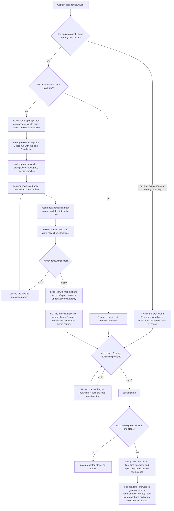
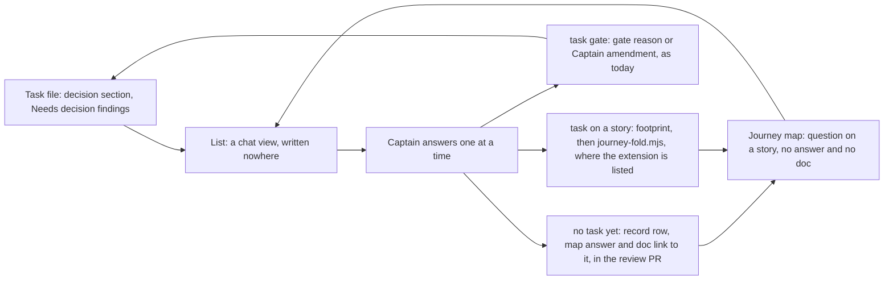

## Scope

- Source: the Captain, 2026-10-20, relayed by the Paseo-migration session and confirmed here: 「應該先繪製故事地圖與切片地圖，其實這件事應該納入 dev2 的建議清單內，當要做新的事情時，要主動提醒人是否先繪製故事地圖，再開始切片，然後繪製切片地圖，拿切片進來討論。」 Then, here: 「故事地圖提醒要開成 dev2 待辦，這裡應該稍退一步再次全局思考怎樣搭配更好，分開可用，一起用加成的角度，例如，可能不只是在 /dev 中加入」, and 「可以」 to FO's proposal that the slice map's question-and-answer is the batch's decision list.
- Bite: a new Paseo plugin was built straight to POC without a map; its UI came out unintuitive and its team-rollout scope was never sliced. The Captain is about to adopt dev2 in a new repository (iamcxa/kc-paseo-plugins) and wants the map first.
- Principle: each tool usable alone (kc-journey-map without dev2; dev2 without a map, asked once and the answer recorded), and together additive.
- Candidate touchpoints, to be designed and measured at ideation, not chosen: (1) the `dev` entry's new-work step asks whether to map first; (2) adopting dev2 in a repository asks the same; (3) a release's slices become backlog candidates carrying `journey` and `journey-story`; (4) the backlog gate notices a new capability with no story on any map; (5) the slice's open questions (kc-journey-map `interrogate`, `journey-map-question` schema) are the batch sitting's list, asked one at a time, and dev2 rulings fold back through `journey-fold.mjs` (exists) as a reference, never a copied answer.
- Upstream first: kc-journey-map modes `map`, `plan-release`, `interrogate`, `review-release`, `add-story` and `lib/journey-handoff.mjs`; dev2's Release review and the journey-map extension; live tasks journey-map-progress-and-provenance, release-acceptance, fo-batch-sittings and kc-decision-log-p1 (decision records). No third decision ledger.
- Ideation runs on Opus: a cross-plugin interface design.
- Non-goals: to be set at ideation.

## Captain amendments

### Amendment 1 — 2026-10-20, chat
Captain: 「好，那就下一版，跟故事地圖一起，我越來越覺得兩者結合很重要」 (chat, 2026-10-20, batch-4 sitting, question 15)
Asked: 「第 15 題：「先列清單、再一題一題問」這個做法，要不要另外開一張任務，安排在兩個版本之後再上？」
Supersedes: none
Design: this task's scope gains fo-batch-sittings' Cut 2 (before asking, list every open decision of the tasks at a stage once, each with its home, one plain sentence, FO's recommendation and what gets worse, then ask them one at a time), designed together with the story map, targeted at the next release. fo-batch-sittings Amendment 2 and its `## Design` Cut 2 and AC-8 seam are the source.

## FO alignment

Alignment: needed before ideation: the design and fo-batch-sittings are read together so the batch list exists once.
Result: aligned 2026-10-21 with the Captain's 「照建議，但是這四題有細節要讓我知道的嗎」, answering FO's four points: (1) the archived fo-batch-sittings design (its Cut 2, List once section and AC-8) is the authoritative input; (2) this task owns the batch decision list, composed from the tasks' own sections and the map's questions:, with no second stored list; (3) the target is the next kc-dev-flow-2 release (0.28.0) and what cannot ship in it is cut into later tasks; (4) the release-preparation intake (intake/release-preparation-from-kc-paseo-plugins.md) joins this design, with interrogate-then-review order and a durable review record first and canvas redraw and a new question class later; the release-acceptance task of another session keeps its own scope and the boundary is drawn in the design.
Release review: not needed: workflow maintenance, on no journey map.
Surfaces: none
Visible change: none
Outside this repository's surfaces: when the Captain starts new work, dev2 asks whether to draw a story map first, and a release's open questions become the list FO asks one at a time.

## Needs decision

Approving the ideation gate accepts D1 to D4 as recommended; say which you want otherwise.

**D1. Where does a ruling on a slice question live while no task exists yet?** The question stays in the map's `questions:`. A ruling at a task's gate already reaches the map through a footprint and `journey-fold.mjs`, but before the release is split there is no task, so the footprint has no home (journey-map extension, Limits: "a ruling made in chat with no task ... outside `check` and `audit`"), and `journey-handoff.mjs` refuses while any release question has no `answer` and no `doc`. Recommendation: the release review record (Design, Cut 1 item 1) holds one row per ruling (question id, his words, date); the map's question gets a one-line `answer:` and a `doc:` link to that row. This is how the Captain framed the record in the intake: 「這就像是 ADR 一樣會成為開發歷程的紀錄，讓下一個 agent 有所本」 (relayed, kc-paseo-plugins). What gets worse: these rulings sit beside the map, not in `docs/adr/`, so an ADR-title reader (agent-reads-governing-adr) does not list them and `decision_ledger.py` does not count them; a later task that relies on one cites the record. Alternatives: (a) one ADR per ruling now: an ADR number is reserved only when a task's implementation dispatch is built (ADR 0028, its D3), so a pre-task ADR needs that rule changed; (b) a release-level task carrying `journey` and `journey-release` to hold gates: `findOrphans` lists it and `journey-progress.mjs` exits 1, and the extension's `check` and `audit` skip it; (c) kc-decision-log, not built (its P1 is at backlog).

**D2. Does the seed check require a `Release review:` line on every five-stage task?** Recommendation: yes. `design_surfaces.py check --seed` exits 1 when `## FO alignment` holds no non-empty `Release review:` line, and its message carries the map question. It is the one enforcement point for "asked once and the answer recorded". The README already tells FO to record "either `Release review: <journey>/<release-id> at <journey-file commit>` or `Release review: not needed: <reason>`"; the check reads presence only, and form and freshness stay with release-acceptance's `release_review.py`. Measured 2026-10-21 (tasks holding `## FO alignment` and no `Release review:` text; pins in AC-6): past backlog without it, kc 2 (agent-reads-governing-adr, pr-review-lite-value-pilot) and qnow 2 (production-go-live, shop-edits-booking, in a repository that keeps a map); backlog tasks the check would hold, kc 3, qnow 7, relay 10, web 0. What gets worse: every task in every adopter carries one more line, often `not needed: workflow maintenance`; once idle-names-failing-seeds lands, its idle line names those backlog tasks until FO writes the line (relay's line grows by about 10 words). Alternative: require it only where the workflow lists the journey-map extension; kc does not list it although it keeps the kc-decision-log map and a journey task (kc-decision-log-cli), so kc would be missed.

**D3. Who carries the adoption touchpoint (adopting dev2 asks whether to keep a story map)?** Recommendation: adoption-asks-which-extensions (backlog; Scope "adoption asks which extensions to enable"), whose journey-map question is this question; this task changes no adoption text. What gets worse: until that task ships, adopting dev2 (the kc-paseo-plugins bite) does not ask; the first new work there still meets the `dev` entry's ask (Cut 1, item 5).

**D4. Which interrogators does a release preparation run?** Recommendation: a Codex run at an explicit model and `model_reasoning_effort="high"` (gpt-6.1-sol, as measured), with the kc-dev-flow-2 engineering-reviewer lens when that package is installed and the plain prompt otherwise, plus today's Claude sonnet run as the cheap second view; the record names model, effort and lens. Evidence (POC interrogation-replay-on-batch-3-poc, six tasks): the falsifier did not fire; tier-1 strict hits, lens 9 or 10 of 24, plain 7; 0 ungrounded questions; the lens used 14% more input tokens over five tasks; USD not measured. What gets worse: the lens is not shown better beyond run-to-run spread (its validation F1); a named model goes stale and must be edited; interrogation reached none of the items that only review found, so validation and review stay (F3).

Past rulings in this area: fo-batch-sittings Amendment 2 `Override:` (Cut 2 placed in this task for the next release, against FO's two-releases-out recommendation), followed; ADR 0028 (a sitting is one message with one record per task), whose sitting line Cut 2 extends without changing the record form; ADR 0020 (a README word raise needs a recorded Captain ruling), not engaged because no README word is added. `git -C <state> grep -n 'Override:'` finds no other ruling on maps, slices or release preparation.

## Design

Pilot. Read 2026-10-21 against origin/main `c27e7659` (kc-dev-flow-2 0.27.0, kc-journey-map 1.7.0), the Spacedock 0.27.2 binary with 0.27.3 skills, the intake `intake/release-preparation-from-kc-paseo-plugins.md`, the POC archive (`report.md`, `extension.md`, the task's two validation reports), the archived fo-batch-sittings (Cut 2, List once, AC-8) and kc-decision-log's map and P1 task. Target: the next kc-dev-flow-2 release (0.28.0 per FO alignment) and the kc-journey-map release cut in the same release-please run; two PRs, one per plugin.

### PRFAQ

**Press release (future).** When the Captain starts new work, dev2 asks once whether to draw a story map first. If he says yes, kc-journey-map draws it, slices it, and prepares the chosen release in one fixed order: strangers interrogate the release's stories against the code, the decision-shaped questions come to him as one list asked one at a time, then a worker walks the release, checks the slice, splits the tasks, and leaves a dated review record beside the map for the next agent. Each task FO files from that split names the commit that holds the record. Later, when two or more of those tasks wait at one gate stage, FO lists every open decision once (the tasks' own decisions and the map's still-open questions on their stories) and asks them one at a time. If he says no, the answer is recorded on the task and nobody asks again for that work. Without dev2 the map side runs the same in a plain kc-journey-map session; without a map, dev2 asks once and moves on.

**FAQ**
- *What exists and what is new?* Exists: `map`, `plan-release`, `interrogate`, `review-release`, the handoff check, footprint and fold, the sitting line (ADR 0028). New: the order (interrogate before the walk), the review record and its checker, the list line, the `dev` ask, and the seed check's line requirement.
- *Is the record a second list of questions?* No. Questions stay in the map's `questions:`. The record holds one row per ruling, and the map's answer links to that row with `doc:`. An open question is stored nowhere else, and the sitting list is composed in chat and written nowhere (fo-batch-sittings AC-8).
- *Why must interrogation come first?* In kc-paseo-plugins r1.5 review-release ran first, and its task split rested on answers to which the interrogation then added nine open questions (intake, "Order mattered").
- *What if he wants a question settled at a task's ideation?* That is a ruling: his words become the row, the answer says the task's ideation settles it, and handoff passes. A question class for it is a later cut (L2).
- *Does the `Release review:` line change?* No. Its grammar stays as the README and release-acceptance define it. FO names the commit that adds the record, so `git show <commit>:<journey file>` and `git show <commit>:<record>` reproduce the map and the review together.
- *What does this not prove?* That the list or the sitting saves the Captain answers: nothing measures it yet (POC, "What this does not prove"). The record's `Interrogation:` line carries the counts so the first use can be counted (Limits).

### Chain check (Spacedock, then kc-dev-flow-2, then siblings; 2026-10-21)

- **Spacedock** 0.27.2, skills 0.27.3: no story map, slice or decision list; `rtk proxy grep -rn -i -E "story.?map|journey|slice map"` over the skills cache hits only roadmap debriefs about journey metrics. Gates are one per task; `commission` asks its questions one at a time; `survey` reports open decisions from session history read-only, with no store. Nothing to reuse beyond `status --next --json`, which the sitting line already reads.
- **kc-dev-flow-2** 0.27.0: `git grep -c -i -E "story map|journey|kc-journey-map" origin/main -- kc-dev-flow-2/skills/dev kc-dev-flow-2/skills/maintain-flow` exits 1 (no hit): the `dev` entry's new-work paragraph (58 words) asks only for a profile. The README's Release review bullet (425 words) runs `review-release` at signal 4 and says "no script checks that line". The seed check (`check_task(seed=True)`) reads only `Surfaces:` and `Visible change:`. `pr_watch.py` `sittings()` prints the shipped sitting line (PR #689). The journey-map extension folds gate rulings into the map and states its no-task limit. `git grep -c -i interrogat` over the package exits 1.
- **kc-journey-map** 1.7.0: `interrogation.md` runs "after a release is cut and before `lib/journey-handoff.mjs` produces its brief"; `release-review.md` never mentions interrogation (same grep exits 1) and its output lives only in chat. `journey-handoff.mjs` refuses on `openQuestions()`, where `isQuestionAnswered(q) = Boolean(q.answer) || Boolean(q.doc)` ignores `status` (intake gap 1). `journey-map-question` 1.0.0 has `open | answered | deferred`. `journey-fold.mjs` writes `answer`, `status: answered` and `source {kind, ref: "<task>/<gate-attempt id>", words, date}`, a reference to the gate record beside a one-line answer. `scripts/journey-dev2-loop-smoke.sh` already runs the ruling-to-map loop in CI.
- **Siblings** (read only): qnow lists `journey-map` and keeps `docs/journey/qnow.yaml`; its `_mods/journey-slicing.md` (kc-dev-flow 3.0.0) is an implementation multi-slice guard, not a story map, and is not reused. relay lists `journey-map` and keeps `spacedock-review.yaml`. web keeps no map. kc-claude-plugins keeps the kc-decision-log map but does not list the extension (`extensions: [roborev, codex, copilot, learn, peers]`), so the fold path cannot be dogfooded here (later cut L6). kc-paseo-plugins ran review-release, then interrogation (intake).
- **kc-decision-log P1's journey declarations.** The P1 task's Scope pins `b75e10c1` (P1 = S01, S02, S04, S10, S11, three clients including dot, from `slices-proposal.yaml`, a second slice list beside the map), while trunk `533051fb` (#681) re-cut P1 to S01, S10, S11, S19 to S22, moved dot to P4a and deleted `slices-proposal.yaml`. The task carries no `journey*` fields and writes `Release review: P1 changed, signal 1 (...)`, a mark, not a review. kc-decision-log-cli carries `journey-release: P1`, `journey-story: S10` and no `Release review:` line, and its ideation consume "waits for the signal-4 release review". The map has 0 open questions (every one is answered as a fact, gap or pointer), and 83 of its 83 `doc:` links point at `blob/docs/kc-decision-log-cli-map/`, a branch `git ls-remote origin 'refs/heads/docs/*'` no longer lists. Read: a task holding its own copy of slice membership drifted within a day, and links into a working branch died with it; both shape this design (records on the trunk path, membership read from the map).

### Existing-code check (bounded)

- **Prepare a release before tasks.** Working parts exist (`plan-release`, `interrogate`, `review-release`, handoff); incomplete for this need: no order across the modes (observed reversed in kc-paseo-plugins) and no durable output. Decision: repair in place (step 0 and a record in `release-review.md`, one checker), no new mode.
- **Ask for a map at new work.** None (searches above). Decision: one sentence in the `dev` entry.
- **Record the answer.** The `Release review:` line exists and is unchecked; 4 tasks past backlog lack it (D2). Decision: a presence check in the existing seed check.
- **List, then ask one at a time.** The sitting line exists (ADR 0028); Cut 2 was designed and not built; `interrogation.md` says "Ask the human one decision at a time" with no list. Decision: one line under the sitting line, and the list step in `interrogation.md`.
- **Slices become backlog candidates.** Exists and works: `review-release` step 4 lists tasks with journey fields and the README's `status --set` writes them. The multi-story task (kc-decision-log P1) is the "one `journey-story` per task" limit, owned by journey-map-progress-and-provenance (L5). No change.

### Flow



### Cut 1 (this task, next release)

kc-journey-map:
1. `references/release-review.md` gains a step 0 and the record. Order: interrogate, then the decision list, then map first, walk, slice check, task split, record. Step 0: unless the last record's `Interrogation:` line postdates the last change to this release's stories in the journey file, run `interrogation.md` first; the walk then re-checks only answers changed since that interrogation (intake recommendation 1). The record lives at `<journey file directory>/reviews/<journey>/<release-id>.md` (the path `node lib/journey-review.mjs path <journey.yaml> <release-id>` prints), one file per release, rewritten by each review, so git history holds every review. The worker writes it and proposes it in the same docs PR as the map edit. Shape:

    ```
    # Release review: <journey>/<release-id>
    Reviewed: <YYYY-MM-DD>; map at <commit read>; code at <repository>@<commit>
    Interrogation: <YYYY-MM-DD>; asked <n>; decision rows <n>; open after <n>; <model> <effort> <lens or plain>[; <second model>]
    ## Rulings
    | Question | Story | Asked | Words | Date |
    ## Map edit
    ## Walk
    ## Holes
    ## Slice
    ## Tasks
    | Task | journey-story | Required tasks |
    ```
2. `references/interrogation.md`: (a) the interrogators of D4, each run recording model, effort and lens; (b) the worker proposes a class for every question, and only the decision class goes to the human, listed once most consequential first with a recommendation and what gets worse, then asked one at a time (a dispatched run has no human sorter: intake gap 2); (c) each ruling becomes a record row, and the question gets `answer:` plus `doc:` set to `<trunk URL of the record>#<question id>`, a URL because the canvas rejects relative `doc:` (intake gap 5) and on the trunk path because a working branch's links die (83 of 83 in the kc-decision-log map); (d) a new gap that belongs to no release is added with `journey-add-story.mjs`, which writes no `release` (intake gap 4).
3. `SKILL.md`: the `interrogate` and `review-release` rows of the mode table name the order and the record (about 20 words).
4. `lib/journey-review.mjs` (`path`, `check <record> <journey.yaml>`) and `lib/journey-review.test.mjs`; `scripts/journey-dev2-loop-smoke.sh` gains a pre-task leg, and its CI workflow's `paths` gains the new file.

kc-dev-flow-2:
5. `skills/dev/SKILL.md`, at the end of the new-work paragraph (59 words): "For new work that adds a capability no journey map holds, before recommending a profile ask once whether to draw a story map first with kc-journey-map (`map`, `plan-release`, then `review-release`, which interrogates the release before splitting it into tasks). Record his answer on each resulting task as its `Release review:` line, or as `Release review: not needed: <his words>`."
6. `scripts/design_surfaces.py`, seed branch of `check_task` (D2): outside fences, inside `## FO alignment`, a `Release review:` line with a non-empty value; else `<task>: '## FO alignment' needs a 'Release review:' line: '<journey>/<release-id> at <commit>' or 'not needed: <reason>'; for new capability work, first ask the Captain whether to draw a story map` (30 words). `test_design_surfaces.py` gains rows, and its seed fixtures gain the line.
7. `scripts/pr_watch.py` `sittings()`: directly after each sitting line, one line (52 words): `next: before asking, list each open decision of these tasks once, from their decision sections and the map's open questions on their journey-story, with its home, a plain sentence, your recommendation and what gets worse; then ask one at a time; a decision that blocks no worker waits for the next sitting.` `test_pr_watch.py` gains rows.
8. One ADR, number reserved at the implementation dispatch build: "A release is interrogated before it is reviewed, and a ruling made before any task lives in the release review record the map links to".

Not changed: `references/sd/workflow.md`, the mod, `lint-skills.py`'s budget, `extensions/journey-map/`, `journey-fold.mjs`, `journey-handoff.mjs`, `model.mjs`, the `journey-map-question` schema, and `release-review.md`'s walk and hole rules.

### Boundary with release-acceptance (live, another session)

| | This task | release-acceptance |
| --- | --- | --- |
| When | before a release's tasks are split, and at signal 4 when the release changed | after the last story task is done (the walk); at the first implementation dispatch (`release_review.py`) |
| kc-journey-map | interrogate-then-review order, the record, `journey-review.mjs` | `accept-release` mode, `journey-walk.mjs`, `journey-accept.mjs` |
| kc-dev-flow-2 | `dev` sentence, seed presence check, list line | `release_review.py` (line form, time, freshness against `Release changed:` marks), the acceptance task, the README Release review bullet edit, the implementation-skill backstop |
| `Release review:` line | grammar unchanged; FO names the record's commit | adds `on <time>`; parses it |
| Intake item 5 (progress reads acceptance) | not here | its Captain decision 2 area (L3) |

Shared files: the kc-journey-map `SKILL.md` mode table (they add a row, this edits two) and the ADR index. Its AC-12 diffs `release-review.md` on its own branch, which this task's merge does not make non-empty. Either may land first.

### Later cuts (named, not in this release; FO files each when the Captain asks)

- **L1** kc-journey-map canvas: release preparation redraws that release's journey-board page; relative `doc:` accepted; a rule for the status card's `as_of` (intake recommendation 3, gap 5).
- **L2** a question class "settled at the task's ideation" that does not block handoff and holds that task's ideation gate (intake recommendation 4, gap 3): a `journey-map-question` version step with fold support, together with journey-fold-answers-open-placeholders (backlog, same root as gap 7) and `isQuestionAnswered` ignoring `status` (gap 1).
- **L3** progress reads release acceptance (intake recommendation 5, gap 6): release-acceptance's area.
- **L4** durable per-row answers before a gate closes, and a web discussion room: Spacedock review continuity (fo-batch-sittings Cut 3).
- **L5** one task serving several stories (the kc-decision-log P1 shape): journey-map-progress-and-provenance (backlog).
- **L6** kc-claude-plugins lists the journey-map extension so the fold path is dogfooded here: adopter configuration, the Captain's call (adoption-asks-which-extensions).

### List once (the seam with fo-batch-sittings AC-8)



A row's home is `task#decision id`, a finding in a stage report, or `journey file / release / story / question id`. Before the split the list is kc-journey-map's (interrogation step b); after it, it is the sitting's (item 7). Both read the same homes, so the list exists once. The record stores rulings, never open questions, and AC-2 refuses a record row with no map question linking to it.

### Words FO reads at each moment

Counted with `len(text.split())` on origin/main `c27e7659` and on the drafted text above; implementation re-counts the shipped text (AC-8, AC-9).

| Moment | What FO reads | Base | Cut 1 |
| --- | --- | --- | --- |
| `dev` entry (new or existing work) | `skills/dev/SKILL.md`, read whole | 707 | 766 |
| Backlog, seed check passes | its output | 4 | 4 |
| Backlog, seed check fails for the missing line | its output | 0 | 30 per task |
| Startup or idle, two or more gates await at one stage | `pr_watch.py tasks` | 26 for three slugs, +1 per slug, +11 at `validation` | +52 per such stage |
| Startup or idle, no sitting | same | 0 | 0 |
| Startup or idle, after idle-names-failing-seeds lands | its seed line | 27 + 1 per slug | +1 per task this requirement fails (measured kc 3, qnow 7, relay 10, web 0) |
| Signal-4 checkpoint | README Release review bullet | 425 | 425 |
| Gate presentation, record, merge ask, archive and fold | Spacedock skills, `delivery_gate.py`, the extension | unchanged | unchanged |
| README total | `references/sd/workflow.md` | 5374 of budget 5374 | 5374 |

Worker-read, not FO: `release-review.md` 688, `interrogation.md` 812 and kc-journey-map `SKILL.md` 2578 grow (estimate 900, 950 and 2600); `journey-review.mjs check` prints one line on a pass. Three FO moments rise and none falls, so the learning's "each moment below its base" is not met: this task adds an ask and a list, not a cut.

### Limits and non-goals

- The `dev` ask fires only where FO reads the `dev` entry; new work asked of a running FO in chat meets the seed message instead (D2).
- `journey-review.mjs check` proves the record's shape, links and the zero-open order, not that the walk was done well.
- No measurement of Captain answers saved: the first release prepared this way gives `asked`, `decision rows` and his answers per sitting; nothing earlier counts them.
- The `Interrogation:` line is the worker's report of what ran; the event-stream isolation audit stays as `interrogation.md` already requires.
- Non-goals: a new mode, a `batch:` or `slices:` field, a stored decision list, a README or mod change, any change to footprint, fold or handoff, choosing an adopter's extensions.

### Batch overlap

Read from the task files on 2026-10-21 (state `1740a1dd`) and their own Batch overlap sections.

| File or check | This task | Other task on the same file or check | Order |
| --- | --- | --- | --- |
| `kc-dev-flow-2/scripts/pr_watch.py`, `test_pr_watch.py` | `sittings()` gains the list line | idle-names-failing-seeds (batch 5) splits `sittings()` into `ready_rows()` and `sittings(rows)` and adds `seeds()`; pr-watch-tasks-foreign-worktree and names-check-newest-followups (backlog) change other `tasks()` lines | idle-names-failing-seeds first, as its design asks; the line goes in `sittings(rows)` |
| `kc-dev-flow-2/scripts/design_surfaces.py`, `test_design_surfaces.py` | seed branch of `check_task` and seed fixtures | fo-write-checks-parse-top-level (batch 5): `scope_lines`, docstring; idle-names-failing-seeds runs `check --seed`, so its replayed names grow by this requirement's failures; design-surfaces-task-dir-crash, override-reaches-gate-and-criteria-wait, amendment-form-check-round3-followups, chat-only-evidence-observer-blind-followups (backlog): other functions | after fo-write-checks-parse-top-level; idle-names-failing-seeds re-measures after this lands |
| `kc-dev-flow-2/skills/dev/SKILL.md` | one sentence | open Draft PR #674 (Codex model and effort policy) edits this file | second to land rebases |
| `docs/adr/` | one new ADR | agent-reads-governing-adr (one new ADR); release-acceptance (draft ADR); merge-ask-holds-missing-clauses amends 0023 and 0026 | numbers reserved at each implementation dispatch build |
| kc-journey-map `SKILL.md` mode table | two rows edited | release-acceptance adds the `accept-release` row | adjacent rows; second rebases |
| kc-journey-map `references/release-review.md` | step 0, record, output | release-acceptance changes none (its AC-12) | none |
| kc-journey-map `references/interrogation.md`, `lib/journey-review.mjs` (new) | yes | none | none |
| `kc-journey-map/scripts/journey-dev2-loop-smoke.sh` and its workflow | pre-task leg, `paths` | journey-map-contract-round3-followups (backlog) may add footprint and fold legs | additive |
| `references/sd/workflow.md`, the mod, `lint-skills.py` | no | release-acceptance (Release review bullet) | none |
| `references/sd/adoption.md` | no (D3) | adoption-asks-which-extensions (backlog) | none |
| codex-reader-reads-receipt-marker | none (`extensions/codex/codex_review.py`) | | none |
| merge-ask-holds-missing-clauses | none (`delivery_gate.py`, ADR amendments) | | none |
| agent-reads-governing-adr | ADR index only; its hook would list this task's ADR title | | none |
| kc-decision-log-p1, kc-decision-log-cli, kc-decision-log-handoff-trial | no file; P1's signal-4 review, on which kc-decision-log-cli's ideation consume waits, runs the new order if this lands first | | none |
| pr-review-lite-value-pilot, journey-canvas-hosted-poc, journey-server-host-pilot | none (kc-pr-flow scripts; canvas and host server) | | none |

Recommended order: idle-names-failing-seeds and fo-write-checks-parse-top-level before this task's kc-dev-flow-2 PR; the kc-journey-map PR in any order, including before or after release-acceptance's.

## Acceptance criteria

**AC-1** `node lib/journey-review.mjs path <journey.yaml> <release-id>` prints `<journey file directory>/reviews/<journey>/<release-id>.md`.
Source: intake recommendation 2 ("a durable release-review record ... beside the journey"); FO alignment Result point 4.
Verified by: `node --test kc-journey-map/lib/journey-review.test.mjs` on temp copies of the book-pickup example: a journey in its own directory, and two journeys with the same release id `r1` in one flat directory, which get two different paths. Falsifier: dropping the `<journey>` segment gives the two flat journeys one path.

**AC-2** `node lib/journey-review.mjs check <record> <journey.yaml>` exits 0 on a complete r1 record, and exits 1 with its own message when: (a) the heading names another journey or a release the map lacks; (b) the `Interrogation:` line is missing or lacks its counts; (c) any story on the release has an open question as `openQuestions()` reads it (the order check); (d) a `## Rulings` row names a question no release story holds, or that question's `doc:` does not end with `#<question id>` and the record's path; (e) a release question whose `doc:` links into this record has no row; (f) a `## Tasks` row names a `journey-story` not on the release.
Source: intake recommendation 1 and method gaps 2 and 4; D1; fo-batch-sittings AC-8.
Verified by: the same test file, one mutation of the complete fixture per case, each asserting exit 1 and its message. Falsifier: removing the open-question check passes (c); removing (e) lets the map link a ruling the record does not hold.

**AC-3** The pre-task path runs end to end without a model: in a disposable git repository holding the example map with one open question on r1, `journey-handoff.mjs --digest` names `open questions on <story>`; after one commit adds the record row and the question's `answer:` and `doc:`, `journey-review.mjs check` at that commit exits 0, `git show <commit>:<record path>` reproduces the record, and the handoff output no longer names open questions.
Source: D1; FAQ on the `Release review:` line.
Verified by: `bash kc-journey-map/scripts/journey-dev2-loop-smoke.sh` (CI job `journey-dev2-loop-smoke`, path-filtered; its added time is not measured). Falsifier: a commit with the map answer and no record row makes `check` exit 1 (AC-2 e).

**AC-4** A dispatched review worker follows the order and leaves the record: on the book-pickup example in a disposable repository with one open question on r1, a fresh worker given kc-journey-map's `review-release` runs the interrogation before the walk, returns the decision row as one list, and after an answer supplied by the rehearsal writes a record that `journey-review.mjs check` accepts, with the `Interrogation:` line naming the models, effort and lens that ran (D4).
Source: intake ("Order mattered"); POC recommendation; Captain's 「切片地圖」 ask in Scope.
Verified by: one live rehearsal recorded in the implementation Stage Report with its event-stream order and token counts. Limit: one run per host; it shows the text can be followed, not that every run does. Falsifier: a walk table before any interrogation command, or `check` exit 1.

**AC-5** The seed check requires a `Release review:` line: `design_surfaces.py check --seed <task>` exits 1 with the message of Cut 1 item 6 when `## FO alignment` holds no `Release review:` line or one with an empty value, and exits 0 for `Release review: not needed: workflow maintenance` and for `Release review: kc-decision-log-design/P1 at 533051fb`; a `Release review:` line only inside a fenced block, or only under `## Scope`, does not count.
Source: D2; Captain, Scope 「當要做新的事情時，要主動提醒人是否先繪製故事地圖」.
Verified by: rows in `test_design_surfaces.py`; existing seed fixtures gain the line and still pass. Falsifier: searching the whole file passes the `## Scope` row; reading fenced lines passes the fenced row.

**AC-6** Replay on pinned states names the tasks measured here: the built seed check run on every backlog task holding `## FO alignment` newly fails exactly kc `1740a1dd` {fo-asks-to-raise-concurrency, journey-map-contract-round3-followups, merge-guard-stops-unasked-merges}, qnow `7dff82ca8` {booking-multi-service, office-staff-management-next, production-on-qnow-tw-clerk-live, rls-census-covers-bypasses, technician-progress-report, vehicle-catalog-upkeep, vehicle-service-history}, relay `094f53b6` {author-handle, capacity-raise-and-respond, capacity-triage-prompt, close-race-slot-log, inbox-home, owner-link-spec-hosted, relay-first-officer, spacedock-pi-parity, staging-pin-read-retry, workos-signout} and web `4a51160` {}, with tasks that fail only for earlier reasons listed apart.
Source: D2 measurement (grep for `Release review:` anywhere in the file, 2026-10-21).
Verified by: validation runs the check on `git archive` exports of those commits and prints any difference with its cause. Limit: these states are private to this machine, so this is a validation step, not CI. Falsifier: an unexplained difference.

**AC-7** The `dev` entry asks once on new capability work and records the answer: in a disposable workflow with kc-journey-map installed, `/kc-dev-flow-2:dev` given a new-capability request asks whether to draw a story map before it recommends a profile; given "no", the filed task's `## FO alignment` carries `Release review: not needed:` quoting the answer and `check --seed` exits 0; given a bug request, it asks no map question.
Source: Captain, Scope, both quotes; principle "dev2 without a map, asked once and the answer recorded".
Verified by: one live rehearsal per case recorded in the implementation Stage Report. Limit: one run per case on one host. Falsifier: a profile recommendation before the question, or a map question on the bug request.

**AC-8** The `dev` sentence is 59 words or fewer, and the dev SKILL is 766 words or fewer. Verified by: `len(text.split())` on the shipped file and sentence, recorded in the implementation Stage Report. Falsifier: a longer shipped text.

**AC-9** `pr_watch.py tasks` prints the list line directly after each sitting line and nowhere else. Evidence: rows in `test_pr_watch.py` with the stub `status --next --json` of fo-batch-sittings AC-1: (a) three awaiting at `ideation`: the sitting line, then the list line; (b) one awaiting: neither; (c) two awaiting at `ideation` and two at `validation`: two pairs, the validation sitting line keeping its merge-order sentence; (d) the list line is 52 words; (e) the workflow and state directory listings are equal before and after the run. Falsifier: printing the list line unconditionally fails (b); printing it once per pass fails (c).

**AC-10** No second stored list (the seam with fo-batch-sittings AC-8): slice questions stay in the map's `questions:`; a pre-task ruling is a record row the question's `doc:` links to (AC-2 d and e); a task ruling reaches the map by footprint and fold unchanged. Evidence: `git diff <merge-base>..HEAD --stat -- kc-dev-flow-2/extensions/journey-map kc-journey-map/lib/journey-fold.mjs kc-journey-map/lib/journey-handoff.mjs kc-journey-map/lib/model.mjs kc-journey-map/lib/schemas.mjs` prints nothing on both PRs; AC-9 (e). Falsifier: any file in either diff that stores an open question outside the journey file.

**AC-11** The README, the mod and the word budget do not change: `git diff <merge-base>..HEAD --stat -- kc-dev-flow-2/references/sd/workflow.md kc-dev-flow-2/references/sd/mods/kc-dev-flow-2.md docs/dev2/README.md kc-dev-flow-2/scripts/lint-skills.py` prints nothing, and `python3 kc-dev-flow-2/scripts/lint-skills.py` exits 0 printing 5374 of 5374. Falsifier: one added README word makes the lint exit 1.

**AC-12** The ADR, the tests and the publication rules hold: `python3 kc-dev-flow-2/scripts/adr_lint.py docs/adr --since <base> --require <reserved number>` exits 0; no version file is edited; `kc-plugin-forge:kc-plugin-forge-sanitize-check` is clean for kc-dev-flow-2 and kc-journey-map (no adopter name or data in fixtures or docs); `kc-dev-flow-2-tests`, `kc-journey-map-tests` and `journey-dev2-loop-smoke` are green on each PR head. Falsifier: any of these exits non-zero.

## Stage Report: ideation

- SKIPPED: Holistic design of new work starting from a story map and its slices (Scope touchpoints, Amendment 1 Cut 2, interrogation POC and kc-decision-log P1 inputs, decisions listed first) — held: `## FO alignment` records `Alignment: needed before ideation` with no `Result:` line, and ideation principles (`skills/ideation/principles.md`, opening paragraph) require stopping and reporting instead of starting the design
- SKIPPED: `### Batch overlap` section — held for the same missing `Result:` line
- SKIPPED: Words FO reads at each lifecycle moment, before and after — held for the same missing `Result:` line
- SKIPPED: Acceptance criteria with evidence clauses and falsifiers, and Captain decisions with recommendations — held for the same missing `Result:` line

### Hold: what FO must record before re-dispatch

The alignment this task names ("the design and fo-batch-sittings are read together so the batch list exists once") has no recorded outcome. FO records a `Result:` line under `## FO alignment` that answers:

1. Is the archived `fo-batch-sittings` task (status `done`, `pr: pr-merge:689`) authoritative input for this design, specifically its `## Design` sections "Cut 2" and "List once (the seam with new-work-starts-from-a-story-map)", and its **AC-8** (slice questions stay in the map's `questions:`, answers return through the footprint and `journey-fold.mjs`, no second stored list)?
2. Which task owns the single batch decision list: this task alone (per its Amendment 2 ruling 「好，那就下一版，跟故事地圖一起」), or is any part still owed by another live task?
3. Is the "next release" target from Amendment 1 a constraint on this design's scope, and which release is that?

The worker read only the headings and the Cut 2 / AC-8 lines of the archived task to make these questions precise; no design was started.

### Package version note

`Skill(kc-dev-flow-2:ideation)` loaded from the 0.26.0 cache (it carries `.orphaned_at`), while the dispatch names 0.27.0, which equals origin/main. The ideation `SKILL.md`, pilot profile and pilot stage reference are byte-identical across 0.26.0, 0.27.0 and origin/main; `skills/ideation/principles.md` and `scripts/design_surfaces.py` differ between 0.26.0 and 0.27.0. The dispatch facts say to use the skill's root when they differ, which would select the orphaned 0.26.0 checker. FO should settle which root runs `design_surfaces.py` before re-dispatch. This hold rests on 0.27.0 `principles.md`; the same rule is present in 0.26.0.

### Summary

Held before design: `## FO alignment` records alignment as needed with no `Result:` line. No design, criteria or batch overlap were written. FO records the alignment result (three questions above) and re-dispatches.

## Stage Report: ideation (cycle 2)

- DONE: A holistic design of new work starting from a story map and its slices, each tool usable alone and additive together, not only inside /dev, within the Result line under FO alignment (four aligned points): fo-batch-sittings Cut 2 and AC-8 as input, the batch decision list owned here, 0.28.0 as the target with later cuts named, and the release-preparation intake (intake/release-preparation-from-kc-paseo-plugins.md) folded in with interrogate-then-review order and a durable review record first; draw the boundary with the release-acceptance task; use the interrogation POC result (dev2-poc archive interrogation-replay-on-batch-3-poc report.md and extension.md) and kc-decision-log P1's journey declarations as inputs; decisions for the Captain listed first
  `## Needs decision` (D1 to D4) sits first after FO alignment; `## Design` holds PRFAQ, chain check, existing-code check, two Mermaid diagrams (both rendered with mermaid-cli, exit 0), Cut 1 items 1 to 8, the release-acceptance boundary table, later cuts L1 to L6 and the List once seam.
- DONE: A `### Batch overlap` section naming each file the design would change and each other batch task (new-work-starts-from-a-story-map, codex-reader-reads-receipt-marker, merge-ask-holds-missing-clauses, fo-write-checks-parse-top-level, idle-names-failing-seeds, agent-reads-governing-adr) and live task of other sessions (kc-decision-log-p1, kc-decision-log-cli, kc-decision-log-handoff-trial, pr-review-lite-value-pilot, release-acceptance, journey-canvas-hosted-poc, journey-server-host-pilot (driven by other sessions; read only)) that changes the same file or check, so FO can order implementation
  Table names every file and task, plus open PR #674 and backlog tasks on the same files; Recommended order: idle-names-failing-seeds and fo-write-checks-parse-top-level before this task's kc-dev-flow-2 PR.
- DONE: The words FO reads at each lifecycle moment, before and after, per root learning.md "Measure the words FO reads at each moment, not one file's size"
  `### Words FO reads at each moment`: `dev` entry 707 to 766, sitting +52 per stage, failing seed +30 per task, README 5374 unchanged; three moments rise, none falls, stated.
- DONE: Acceptance criteria with reproducible evidence clauses and falsifiers, and unresolved decisions for the Captain, each with a recommendation and what gets worse under it
  AC-1 to AC-12 each carry Verified by and a falsifier; D1 to D4 each carry a recommendation, what gets worse and alternatives. Current evidence per criterion:
  AC-1: not yet verified; nothing is built.
  AC-2: not yet verified; the order predicate it reuses is `openQuestions()` in `model.mjs` at c27e7659, read.
  AC-3: not yet verified; `journey-handoff.mjs` refuses on open questions today (its `check()`, read).
  AC-4: not yet verified; needs one live rehearsal at implementation.
  AC-5: not yet verified; base seed branch reads only Surfaces and Visible change (`check_task`, read).
  AC-6: partly: the expected names come from a grep for `Release review:` in task files holding `## FO alignment` at the four pinned heads; the built check is not run.
  AC-7: not yet verified; needs live rehearsals.
  AC-8: drafted sentence measures 59 words, dev SKILL base 707 (`len(text.split())`); shipped text not yet written.
  AC-9: not yet verified; drafted line measures 52 words; the base sitting line is 26 for three slugs.
  AC-10: not yet verified; nothing is changed.
  AC-11: not yet verified; base README 5374 equals the budget.
  AC-12: not yet verified.
- DONE: `python3 <package>/scripts/design_surfaces.py check <task>`
  `new-work-starts-from-a-story-map.md: design surfaces presentable`, exit 0; `--seed` exit 0; `spacedock status --read --ac-scan` lists AC-1 to AC-12.

### Summary

New work starts at the `dev` entry with one map question; on yes, kc-journey-map prepares the release in a fixed order (interrogate, list the decision rows once, ask one at a time, record rulings, walk, slice, split) and leaves a review record beside the map, checked by a new `journey-review.mjs`; FO files tasks whose `Release review:` line names the record's commit, and the seed check requires that line on every five-stage task. After the split, the sitting gains one 52-word list line that adds the map's open questions to the tasks' own decisions; no list is stored anywhere and no README, mod, footprint, fold or handoff text changes. The Captain decides where pre-task rulings live (D1, record recommended), whether the seed check applies to every task (D2), who carries the adoption ask (D3) and the interrogator mix (D4); canvas redraw, a new question class and the other intake items are named later cuts with homes.
