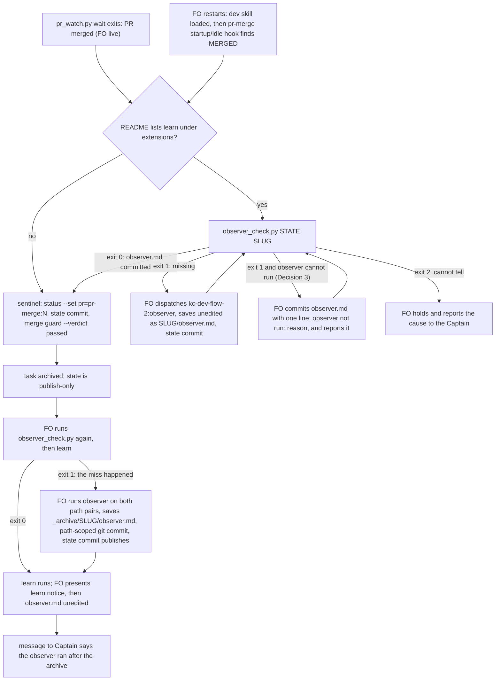

The learn extension's FO step requires dispatching `kc-dev-flow-2:observer` and committing `<task>/observer.md` before `merge guard`, because an archived task's state is publish-only. On 2026-10-13 FO ran `merge guard --verdict passed` on `journey-map-dev2-contract` without it; the observer ran afterwards and its report could not be saved into the task. The learn evaluation (job 92da235b) recorded this as a rule that exists and was not followed; nothing blocks `merge guard` when `observer.md` is absent.

## Captain's words

Captain 2026-10-13, in chat, after the learn result listed this as package-issue candidate 1: 「1-3 回報，且立即排修」

## Scope

- Make a missing `observer.md` stop the archive path, or make it impossible to reach `merge guard` without the observer step, with the remedy named.
- Non-goals: changing Spacedock or the unmodified `_mods/pr-merge.md`; a harness hook shipped in the package (ADR 0003); running the observer or learn from code instead of FO; judging the observer's findings; unarchiving a task; the other two tasks' fixes.

## Acceptance criteria

All paths are relative to `kc-dev-flow-2/` in `iamcxa/kc-claude-plugins`. `<package>` is the package root, `<state>` a state checkout, and `<dev2-state>` is `docs/dev2/.spacedock-state` of the dev2 adoption worktree, whose branch `spacedock-state/dev2` carries the 2026-10-13 commits (`git branch -r --contains 9157341d` printed `origin/spacedock-state/dev2`, 2026-10-13). The checker is `scripts/observer_check.py <state> <slug> [--rev REV]`: exit 0 when a non-empty `<slug>/observer.md` or `_archive/<slug>/observer.md` is in the committed tree at `REV` (default `HEAD`); exit 1 when it is not, printing the observer dispatch and save command; exit 2 when it cannot tell, printing the cause.

**AC-1** The 2026-10-13 miss fails the check: `merge guard` was reached on `journey-map-dev2-contract` with no `observer.md`.
Evidence: `python3 <package>/scripts/observer_check.py <dev2-state> journey-map-dev2-contract --rev 9157341d; echo $?` prints `1`, and so does the same command with `--rev 6b435c6a`. `9157341d` is the sentinel's state commit, four seconds before the archive commit `6b435c6a` (`git log --format='%h %ad' --date=iso`, 14:59:24 and 14:59:28). Both trees hold no `observer.md`: `git ls-tree -r --name-only 9157341d | grep -c observer.md` and the same on `6b435c6a` printed `0`, measured 2026-10-13. Stdout contains `kc-dev-flow-2:observer` and `journey-map-dev2-contract/observer.md`. The unit test builds the same shape (a task folder of 20 dispatch files, a `pr: pr-merge:N` sentinel, no `observer.md`) in a temporary repository, because CI cannot read the dev2 state branch.
Falsifier: make the script exit 0 unconditionally; this run prints `0` and the fixture test goes red.

**AC-2** A committed `observer.md` passes, before and after the archive.
Evidence: fixture A commits `<slug>/observer.md` and the script exits `0` with `--rev HEAD`; fixture B archives the task and commits `_archive/<slug>/observer.md` and exits `0`; the same fixture at the commit before the file was added exits `1`.
Falsifier: check only the `<slug>/` path; fixture B exits 1 and goes red.

**AC-3** The committed tree decides, not the disk.
Evidence: fixture with `<slug>/observer.md` present on disk and untracked: exit `1`. `git add` and commit it: exit `0`.
Falsifier: read the file with `Path.exists()` instead of `git ls-tree`; the untracked case exits 0 and goes red.

**AC-4** An empty or whitespace-only `observer.md` fails.
Evidence: fixture with a committed zero-byte file, and one with `\n  \n`: exit `1` each.
Falsifier: test existence only; both exit 0 and go red.

**AC-5** (applies if the Captain approves Decision 3; otherwise this criterion is removed and the same fixture must exit `1`) A committed `observer.md` whose first line starts `observer not run:` passes and prints that line.
Evidence: fixture with that one line: exit `0`, stdout contains the line verbatim.
Falsifier: print nothing for this case; the stdout assertion goes red.

**AC-6** What cannot be read is exit 2 with a stated cause, never a pass.
Evidence: one test per case, each asserting exit `2` and a phrase naming the cause: `<state>` not a git work tree; `--rev` names no commit; a slug with no task file or folder at `REV` (so a typo cannot read as clean); missing arguments.
Falsifier: catch the `git` failure and fall through to exit 0; the not-a-work-tree case goes red.

**AC-7** Every text an FO reads on the three paths names the check before the sentinel, and the names cannot be deleted silently.
Evidence: `test_observer_check.py` asserts that `extensions/learn/EXTENSION.md`, `references/sd/workflow.md` (the Delivery-authority paragraph that names the landed sentinel, and the `### done` paragraph) and `skills/dev/SKILL.md` each contain `scripts/observer_check.py`, in the pattern of `test_the_package_template_carries_the_line_and_matches_its_manifest` in `test_package_version.py`. `python3 kc-dev-flow-2/scripts/lint-skills.py` and the test exit `0` in the CI run on the delivery PR, where `kc-dev-flow-2-tests.yml` runs the new test file. `skills/dev/SKILL.md` is the restart path: it is loaded at FO start, before the pr-merge startup hook that writes the sentinel and runs `merge guard`.
Falsifier: delete the sentence from any one of the three files; the test goes red for that file.

**AC-8** A miss after the archive is detected and repairable, on the pinned Spacedock.
Evidence: `scripts/test_observer_recovery.py`, run in CI after the `Install pinned Spacedock` step with `SPACEDOCK_BIN` set (v0.27.2), builds a scratch split-root workflow and: (1) archives a task with `merge guard --verdict passed` and no `observer.md`; `observer_check.py` exits `1`; (2) writes `_archive/<slug>/observer.md`; `spacedock state commit <slug>` exits `1` with `archived scope is publish-only` (measured 2026-10-13 with `spacedock 0.27.2`); (3) `git -C <state> add _archive/<slug>/observer.md && git -C <state> commit -m ... -- _archive/<slug>/observer.md`, then `spacedock state commit <slug>` exits `0` and, with a bare `origin`, prints `Published existing archived state` and the remote head equals the local head; (4) `spacedock status --validate` prints `VALID`, `observer_check.py` exits `0`, and `git status --porcelain -- _archive/<slug>.md` is empty.
Not yet verified: that `kc-dev-flow-2:learn` accepts the extra committed file beside the archived task (its closure check names "later unaccounted edits" for the task bytes, which this test reads only as the unchanged `_archive/<slug>.md`); the learn run on the repaired fixture belongs to validation.
Falsifier: replace step (3) with `state commit` alone; step (3) then exits 1 and the test goes red.

**AC-9** A late observer run reads the whole task, not an empty window.
Evidence: today the default `FROM` after the archive is the archive commit: `git log --diff-filter=A --no-renames --format=%h -- _archive/journey-map-dev2-contract.md` prints `6b435c6a`, while the same command on `journey-map-dev2-contract.md` prints `7864e923`, and `git log --format=%h` over the old path pair lists 47 commits against 1 over the archive pair (measured 2026-10-13). After the change `skills/observer/SKILL.md` Read step 1 names both path pairs for an archived task, asserted as text by `test_observer_check.py`. The behaviour is checked in validation: dispatch the observer on the repaired AC-8 fixture and on `journey-map-dev2-contract` and compare the commit count in its `Coverage:` line with `git log --format=%h` over both path pairs.
Not yet verified: that a model following the edited step reads all 47 commits; the text assertion proves the sentence exists, not that it is followed.
Falsifier: revert the `skills/observer/SKILL.md` sentence; the text assertion goes red. The validation comparison is red when the `Coverage:` count is 1.

## Design

### Chain check

- Spacedock 0.27.2 (the installed `spacedock`): `merge guard` takes no precondition and no hook. Measured in a scratch split-root workflow, 2026-10-13: (a) a mod with `## Hook: merge` is registered and `merge guard` arms `mod-block=merge:<first mod alphabetically>` (`learn-observer` ahead of `pr-merge`), but that hook runs at PR creation, long before review rounds and the merge, so an observer run there reads a task still being written; (b) once `pr=pr-merge:N` is set, `merge guard` finalizes and clears a foreign `mod-block=merge:learn-observer` without holding (probe `p6`); (c) a task with an untracked `<slug>/observer.md` on disk was archived and the file moved to `_archive/<slug>/` (probe `p8`), so the 2026-10-13 miss was an absent step, not a failed commit. No Spacedock mechanism holds the archive on a kc-dev-flow-2 artifact.
- Spacedock `_mods/pr-merge.md` (unmodified): its startup and idle hooks record the sentinel, run `state commit`, then `merge guard`, in one motion on MERGED. Nothing in that path mentions the learn extension. The extension's text sits in `extensions/learn/EXTENSION.md` and says "before `merge guard`", one step later than the real point of no return, the sentinel.
- kc-dev-flow-2 at origin/main `9e68eb87`: `extensions/learn/EXTENSION.md` owns the step; `skills/observer/SKILL.md` and `skills/maintain-flow/SKILL.md` read `<task>/observer.md`; the package README states "no installed hook". `scripts/package_version.py` and the sibling task's `workflow_checkout.py` are the existing pattern for a small script FO runs and holds on. Nothing checks that `observer.md` exists.
- ADR 0003 (`docs/adr/0003-secret-reads-are-enforced-by-the-adopter.md`, Accepted 2026-09-30): the package ships no `PreToolUse` hook (it fires wherever the plugin is enabled, and Codex has no equivalent); enforcement belongs to the adopter or the user. This design follows it and ships no hook. `Override:` lines in the state checkout: none from a gate record bears on this (`git grep -n 'Override:'`, 2026-10-13).
- Sibling adopters: `kc-dev-flow` (v1) `references/pr-merge-extension.md` appends a marked block to `pr-merge.md` with a fail-closed decision table before the sentinel. That edits the mod; this task's brief keeps `pr-merge.md` unmodified, so it is not reused. No other adopter checked has an observer step.

### PRFAQ

**Plain account.** After a task's pull request merges, FO writes a small marker (the sentinel) and Spacedock archives the task at once. From then on the task folder is closed. The step that asks an independent reader to check FO's own records has to happen before that marker, and on 2026-10-13 it did not: the reader ran afterwards and had nowhere to save its report. After this change, FO runs one small command that answers "is the reader's report committed yet?" before it writes the marker, in every place FO reads when a PR merges, including after a restart. If FO misses it anyway, the same command says so right after the archive, and FO saves the late report by a route that works on a closed task. Nothing in this package can make Spacedock itself refuse; the check is something FO runs, and Decision 1 asks whether that is strong enough.

**Press release (future).** kc-dev-flow-2 now ties the learn extension's observer to the sentinel instead of to `merge guard`. `observer_check.py` reads the committed state tree and exits 0 when the task's `observer.md` is there, 1 with the dispatch and save commands when it is not, and 2 when it cannot tell. The learn extension, the workflow's delivery paragraph and the `dev` skill each name it ahead of the sentinel, so a restarted FO that meets a merged PR on its first hook reads the instruction before it writes the marker. After an archive the same command detects a miss, and the extension says how to save the late report: a path-scoped commit into `_archive/<slug>/`, then `spacedock state commit` to publish.

**FAQ.**
- *Why before the sentinel and not before `merge guard`?* The pr-merge hooks do both in one motion, and a restarted FO runs them on its first hook. After the sentinel there is no step of FO's own left to put a check in front of (probe `p6`).
- *Why not a second mod with a merge hook?* It runs at PR creation (chain check a), too early for the observer to read the review rounds, and it does not hold the finalize (b).
- *Why a new script?* A model told "look in the folder" missed on 2026-10-13. The script is one `git ls-tree`, gives the other texts a command to name, and lets the learn step and a user-level guard (Decision 1) test the same thing. Without it the three texts say "commit observer.md first" with nothing to run.
- *Why read the committed tree?* The extension requires the commit, and `git ls-tree` cannot be fooled by a file the archive rename would leave behind or by a stale checkout of the folder (AC-3).
- *Why does the observer skill change?* After the rename the default `FROM` is the archive commit, so a late run reads an empty window (AC-9).
- *Does this stop the archive?* Not mechanically. See Limits and Decision 1.

### Flow

Order in prose: FO observes the PR merged (live, or by the pr-merge hook after a restart). If `learn` is listed, FO runs the check before it writes the sentinel; on exit 1 it dispatches the observer with only the state checkout, the slug and the README path, saves the report unedited, commits it with `spacedock state commit`, and reruns the check. Exit 0 lets the sentinel, `state commit` and `merge guard` run as today. After the archive FO runs the check once more before `learn`: exit 0 is the normal case; exit 1 means the step was missed, and FO runs the recovery (observer, save, commit, publish, then learn), and the Captain's message says so. Exit 2 holds both times.

### Files, and what is shared with the other two tasks

New (this task only): `scripts/observer_check.py`, `scripts/test_observer_check.py`, `scripts/test_observer_recovery.py`. Edited here only: `extensions/learn/EXTENSION.md` (Joins, FO step, Cannot run, the recovery), `skills/observer/SKILL.md` (archived paths in Read step 1), package `README.md` (the learn row of the extensions table). Shared, each edit in a different place:
- `references/sd/workflow.md`: the `### done` paragraph (~line 236) and the delivery paragraph that begins "Use SD's pending terminal approval" (~lines 513-520) are this task's; `workflow-checkout-must-match-trunk-readme` edits the `package_version.py` block near line 90 and `worker-completion-goes-to-main` that block plus `## Dispatch facts`. No line overlap with this task.
- `skills/dev/SKILL.md`: this task adds one sentence to the learning-notices paragraph; the first task adds one near the context-resolution paragraph. Word them differently (the lint refuses a 12-word run repeated between `workflow.md` and a skill).
- `scripts/lint-skills.py`: `WORKFLOW_WORD_BUDGET` is 5331 and `workflow.md` is exactly 5331 words (`wc -w` on origin/main, 2026-10-13). Each of the three tasks must raise it for its own words and say why in the same change; this task needs roughly 40 more words (an estimate, not measured).
- `.github/workflows/kc-dev-flow-2-tests.yml`: two steps from this task: `test_observer_check.py` beside the other unit tests; `test_observer_recovery.py` after `Install pinned Spacedock`, with `SPACEDOCK_BIN` set. Cost: two extra Python steps in the existing job, no new job or trigger (duration not measured).
- The adopter copy `docs/dev2/README.md` is changed by a sync PR after release, by none of the three.

Delivery order: the first task lands first; this one rebases onto it for `skills/dev/SKILL.md`, `lint-skills.py` and the workflow file.

### Limits

- Prose-enforced: nothing in kc-dev-flow-2 forces FO to run the check; Spacedock offers no hook for it (chain check a, b). The 2026-10-13 sequence (sentinel's state commit 14:59:24, archive 14:59:28) is consistent with the pr-merge hook's three steps and with FO running them by hand; state does not record which, nor whether that FO had read the learn extension's text before the sentinel. The design claims the instruction now sits on both paths, not that the FO would have followed it.
- The check proves a non-empty file is committed, not that it is the observer's report. A hand-written file passes; the Captain sees the report in the same message as learn's notice.
- `learn` is not changed. Whether it accepts the extra committed file in an archived task folder is not verified (AC-8).
- A rejected verdict (`--verdict rejected`) archives without learn; the check is run only where `learn` runs, so it is not required there.
- Recovery relies on `git commit` into a folder `spacedock state commit` calls publish-only. It works on 0.27.2 (AC-8) and the pinned CI test is what notices a later Spacedock that stops allowing it.
- Not built: a Spacedock precondition on `merge guard` (needs an issue against spacedock-dev, which is the Captain's to file); a user-level guard (Decision 1).

### ADR

No ADR. The ruling "the observer precedes the sentinel" is a workflow rule that lives in `workflow.md` and `EXTENSION.md`; it reverses no ADR. ADR 0003 is followed, not reopened.

## Unresolved decisions for the Captain

1. **Is a checker FO runs, in the three texts FO reads, a strong enough "stop"?** Recommend yes for this task, plus a separate step he owns: a user-level `PreToolUse` guard on his machine that refuses `status --set <slug> pr=pr-merge:<N>` and `merge guard ... --verdict passed` for a `learn` workflow while `observer_check.py` exits 1, built after the checker lands (ADR 0003's route; it must parse the command's arguments, because ADR 0003 records a text-matching guard refusing a command that only mentioned the tool). The reason: the rule already existed word for word in `EXTENSION.md` and was not followed, so more prose is the same class of control; only a refusal changes that. Gets worse: the guard is Claude Code only (a Codex FO is uncovered), lives outside any repository's review, and can block a legitimate command if its parsing is wrong; without it this task makes a miss loud and repairable but does not prevent it. Third option, not recommended now: ask spacedock-dev for a `merge guard` precondition (outward-facing).
2. **Save a late observer report into `_archive/<slug>/` with a path-scoped `git commit`, then `spacedock state commit` to publish?** Recommend yes. It is the only route that keeps the report next to the task where `maintain-flow` and `learn` read it, and it worked on 0.27.2 with and without an origin (AC-8). Gets worse: it goes around Spacedock's statement that archived scope is "publish-only"; a later Spacedock may refuse it (the pinned test then goes red at the version bump); and learn accepting the extra file is unverified. Alternative: keep the late report only in the message to the Captain (nothing committed, so a later maintainer cannot find it).
3. **When the observer cannot be dispatched, may FO commit a one-line `observer not run: <reason>` as `observer.md` and proceed?** Recommend yes, and report the line to the Captain in the same message as learn's notice. The extension already says an undispatchable observer is "reported as `observer not run: <reason>`" and the sentinel must not deadlock behind a broken dispatch. Gets worse: the check can then be passed with one line (visible in the report, and by `maintain-flow`), so a lazy FO can pass it; if declined, the Captain must rule per case and AC-5 is removed.

## FO alignment

Alignment: not needed before ideation; the Captain ruled to report and fix now.
Release review: not needed: workflow maintenance, on no journey map.
Surfaces: none
Visible change: none

## Stage Report: ideation

- DONE: A design (PRFAQ and Mermaid) for how the learn extension's observer step is made to happen before merge guard archives a task, or the archive is held, within what kc-dev-flow-2 controls (the pr-merge mod is unmodified Spacedock), including what FO does when the step was missed after archive
  `## Design`: chain check (Spacedock probes p4/p6/p7/p8 on 0.27.2, kc-dev-flow-2 at 9e68eb87, ADR 0003, kc-dev-flow v1), PRFAQ, flowchart with live, restart and post-archive branches, files shared with the other two tasks, Limits. Rule moved from "before merge guard" to "before the sentinel". No Spacedock hold exists, so the design is prose plus a checker; Decision 1 asks if that is enough.
- DONE: Acceptance criteria with reproducible evidence clauses and falsifiers, including one that reproduces the 2026-10-13 miss on journey-map-dev2-contract (merge guard reached with no observer.md) and must fail
  `design_surfaces.py check` printed "observer-before-merge-guard.md: design surfaces presentable" (exit 0). Per criterion, current evidence:
  AC-1 miss replay: measured only as the input (0 observer.md in trees 9157341d and 6b435c6a); the script does not exist yet, so the exit-1 run is not yet verified.
  AC-2 committed file passes: not yet verified (script not written).
  AC-3 committed tree not disk: probe p8 shows an untracked file is swept in by the archive; the script's behaviour is not yet verified.
  AC-4 empty file fails: not yet verified.
  AC-5 `observer not run:` line passes (conditional on Decision 3): not yet verified.
  AC-6 exit 2 on unreadable input: not yet verified.
  AC-7 three texts name the script: not yet verified; the paragraphs and line numbers were read on origin/main 9e68eb87.
  AC-8 post-archive repair: its steps 2 and 3 were run by hand on spacedock 0.27.2 (state commit refused with "archived scope is publish-only"; path-scoped git commit then state commit published to a bare origin, status --validate VALID); the CI test and the learn acceptance are not yet verified.
  AC-9 whole-task window: the 6b435c6a vs 7864e923 and 47-vs-1 commit counts were measured; the edited skill step and observer behaviour are not yet verified.
- DONE: Unresolved decisions for the Captain, each with a recommendation and what gets worse under it
  Three under `## Unresolved decisions for the Captain`: (1) checker versus a refusal (user-level guard per ADR 0003), (2) late-report route into `_archive/<slug>/`, (3) a one-line `observer not run:` file as the waiver.

### Summary

The archive cannot be held from inside Spacedock with the pr-merge mod unmodified: a foreign mod-block does not stop `merge guard` once the sentinel exists (probe p6), and a second merge-hook mod fires at PR creation. The design therefore moves the observer ahead of the sentinel, adds `observer_check.py` as the command every FO-read text names (including `skills/dev/SKILL.md`, which a restarted FO loads before the pr-merge hook writes the sentinel), detects a miss right after the archive, and repairs it with a path-scoped commit into `_archive/<slug>/`. Findings the Captain did not ask for: the observer's default window is empty after the rename (1 commit against 47), and the extension's "would be refused" is true only of `state commit`. Scratch probes lived in `/tmp/obs-probe` and `/tmp/obs-probe-remote.git`; no repository file, branch or commit was made.

## Stage Report: implementation

- DONE: One Draft PR (fix(kc-dev-flow-2): ...) stacked on #631 (branch off spacedock-ensign/workflow-checkout-must-match-trunk-readme at 085e28aa) adding scripts/observer_check.py, test_observer_check.py and test_observer_recovery.py and the text edits the design names (learn EXTENSION.md, workflow.md delivery and done paragraphs, skills/dev/SKILL.md, skills/observer/SKILL.md Read step 1, package README learn row, tests-workflow steps); AC-1 to AC-9 green with each falsifier shown failing by a mutation run, AC-5 included (Decision 3 accepted)
  PR https://github.com/iamcxa/kc-claude-plugins/pull/632 (Draft, base = #631's branch), one commit 2ec59fc8 on 085e28aa, 10 files, all inside the design's list. Unit and text claims: 13 tests in test_observer_check.py, each falsifier run as a mutation on a copy and red: exit 0 always (AC-1 miss, AC-2, AC-3 tests), live path only (AC-2 archived and late-report tests), disk read instead of git show (AC-3 committed-tree and staged-only tests), existence only (AC-4 blank tests), no waiver print (AC-5 stdout), no work-tree / bad-rev / mistyped-slug refusal (AC-6, one case each), `scripts/observer_check.py` removed from each of EXTENSION.md, workflow.md, dev SKILL.md (AC-7, red per file), "both path pairs" removed from the observer skill (AC-9 text). AC-8: test_observer_recovery.py passes on spacedock 0.27.2; with the path-scoped commit removed `state commit` exits 1 ("archived entity ... is dirty; archived scope is publish-only") and the test fails. AC-9's behavioural half (Coverage count) and learn accepting the extra archived file are validation's, not verified here.
- DONE: AC-8 run against the pinned Spacedock in CI (after Install pinned Spacedock, SPACEDOCK_BIN set), and AC-1 also run once by you against the real dev2 state branch at 9157341d and 6b435c6a
  CI run 38366509824 on 2ec59fc8: step test_observer_recovery.py ran after Install pinned Spacedock with SPACEDOCK_BIN set and printed its PASS line (log, success). AC-1 real run: observer_check.py <dev2-state> journey-map-dev2-contract --rev 9157341d and --rev 6b435c6a each exit 1, stdout names kc-dev-flow-2:observer and journey-map-dev2-contract/observer.md; the same two with exit forced to 0 (mutation copy) print 0, both measured 2026-10-13.
- DONE: roborev_gate.py evidence= line, CI green on the PR head, lint-skills.py green (raise WORKFLOW_WORD_BUDGET from #631's 5369 only by the words this task adds, saying why), and the CI cost per PR measured or stated as not measured
  roborev_gate.py --base 085e28aa exit 1: `findings on 2ec59fc87; evidence=roborev:609`, run once, no repair (see FO finding). CI: all five checks on 2ec59fc8 pass (unit job 46 s). lint-skills.py green: WORKFLOW_WORD_BUDGET 5369 to 5411 = the +42 words `wc -w` counts in workflow.md, reason in the lint comment. CI cost: the two new steps took 1.1 s and 0.5 s by log timestamps in run 38366509824; no new job or trigger. comment_ratio.py: `code lines 322, comment lines 5, 1.6%`, maximum 5% met. design_surfaces.py check: "design surfaces presentable" (exit 0).

### Affected documents
- kc-dev-flow-2/README.md: updated (learn row names the check).
- kc-dev-flow-2/skills/maintain-flow/SKILL.md: unaffected: it names lint-skills.py as a command and `observer.md` by filename; the budget mechanism and the filename did not change.

### FO finding
- roborev:609 High, `scripts/observer_check.py` `kind`/`check`: claims `REV:./path` resolves from the repository root, so a state path that is a subdirectory fails. Not reproduced: `./` makes git resolve the path from the `-C` directory, and test_a_state_checkout_that_is_a_subdirectory_of_the_repository_is_read_from_there (state at `docs/.state` inside a repository; slug present exits 0, absent slug exits 2) passes locally and in CI. No code change made; FO to disposition as a false positive.

### Summary

Added `observer_check.py`, which reads the committed tree and tells FO whether `observer.md` exists before the sentinel (live) or after the archive (late report saved by a path-scoped commit, published by `state commit`), and made the learn extension, workflow.md, the dev skill and the observer skill name it; AC-1 to AC-9 hold as stated, with the two validation-owned items above. The rule stays prose-enforced as the design records (no Spacedock hook, no user-level guard built). PR is a Draft stacked on #631; after #631 squash-merges FO retargets it to main and merges main back in.
