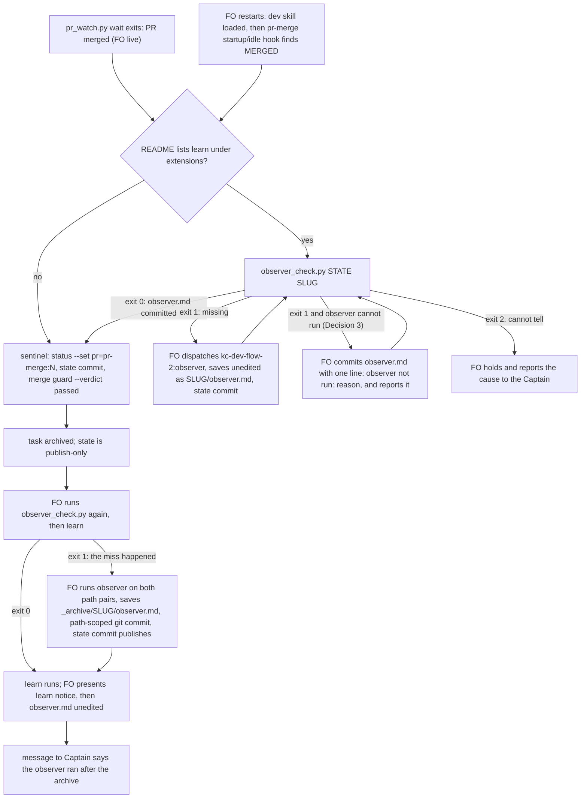

The learn extension's FO step requires dispatching `kc-dev-flow-2:observer` and committing `<task>/observer.md` before `merge guard`, because an archived task's state is publish-only. On 2026-10-13 FO ran `merge guard --verdict passed` on `journey-map-dev2-contract` without it; the observer ran afterwards and its report could not be saved into the task. The learn evaluation (job 92da235b) recorded this as a rule that exists and was not followed; nothing blocks `merge guard` when `observer.md` is absent.

## Captain's words

Captain 2026-10-13, in chat, after the learn result listed this as package-issue candidate 1: 「1-3 回報，且立即排修」

## Scope

- Make a missing `observer.md` stop the archive path, or make it impossible to reach `merge guard` without the observer step, with the remedy named.
- Non-goals: changing Spacedock or the unmodified `_mods/pr-merge.md`; a harness hook shipped in the package (ADR 0003); running the observer or learn from code instead of FO; judging the observer's findings; unarchiving a task; the other two tasks' fixes.

## Acceptance criteria

All paths are relative to `kc-dev-flow-2/` in `iamcxa/kc-claude-plugins`. `<package>` is the package root, `<state>` a state checkout, and `<dev2-state>` is `docs/dev2/.spacedock-state` of the dev2 adoption worktree, whose branch `spacedock-state/dev2` carries the 2026-10-13 commits (`git branch -r --contains 9157341d` printed `origin/spacedock-state/dev2`, 2026-10-13). The checker is `scripts/observer_check.py <state> <slug> [--rev REV]`: exit 0 when a non-empty `<slug>/observer.md` or `_archive/<slug>/observer.md` is in the committed tree at `REV` (default `HEAD`); exit 1 when it is not, printing the observer dispatch and save command; exit 2 when it cannot tell, printing the cause.

**AC-1** The 2026-10-13 miss fails the check: `merge guard` was reached on `journey-map-dev2-contract` with no `observer.md`.
Evidence: `python3 <package>/scripts/observer_check.py <dev2-state> journey-map-dev2-contract --rev 9157341d; echo $?` prints `1`, and so does the same command with `--rev 6b435c6a`. `9157341d` is the sentinel's state commit, four seconds before the archive commit `6b435c6a` (`git log --format='%h %ad' --date=iso`, 14:59:24 and 14:59:28). Both trees hold no `observer.md`: `git ls-tree -r --name-only 9157341d | grep -c observer.md` and the same on `6b435c6a` printed `0`, measured 2026-10-13. Stdout contains `kc-dev-flow-2:observer` and `journey-map-dev2-contract/observer.md`. The unit test builds the same shape (a task folder of 20 dispatch files, a `pr: pr-merge:N` sentinel, no `observer.md`) in a temporary repository, because CI cannot read the dev2 state branch.
Falsifier: make the script exit 0 unconditionally; this run prints `0` and the fixture test goes red.

**AC-2** A committed `observer.md` passes, before and after the archive.
Evidence: fixture A commits `<slug>/observer.md` and the script exits `0` with `--rev HEAD`; fixture B archives the task and commits `_archive/<slug>/observer.md` and exits `0`; the same fixture at the commit before the file was added exits `1`.
Falsifier: check only the `<slug>/` path; fixture B exits 1 and goes red.

**AC-3** The committed tree decides, not the disk.
Evidence: fixture with `<slug>/observer.md` present on disk and untracked: exit `1`. `git add` and commit it: exit `0`.
Falsifier: read the file with `Path.exists()` instead of `git ls-tree`; the untracked case exits 0 and goes red.

**AC-4** An empty or whitespace-only `observer.md` fails.
Evidence: fixture with a committed zero-byte file, and one with `\n  \n`: exit `1` each.
Falsifier: test existence only; both exit 0 and go red.

**AC-5** (applies if the Captain approves Decision 3; otherwise this criterion is removed and the same fixture must exit `1`) A committed `observer.md` whose first line starts `observer not run:` passes and prints that line.
Evidence: fixture with that one line: exit `0`, stdout contains the line verbatim.
Falsifier: print nothing for this case; the stdout assertion goes red.

**AC-6** What cannot be read is exit 2 with a stated cause, never a pass.
Evidence: one test per case, each asserting exit `2` and a phrase naming the cause: `<state>` not a git work tree; `--rev` names no commit; a slug with no task file or folder at `REV` (so a typo cannot read as clean); missing arguments.
Falsifier: catch the `git` failure and fall through to exit 0; the not-a-work-tree case goes red.

**AC-7** Every text an FO reads on the three paths names the check before the sentinel, and the names cannot be deleted silently.
Evidence: `test_observer_check.py` asserts that `extensions/learn/EXTENSION.md`, `references/sd/workflow.md` (the Delivery-authority paragraph that names the landed sentinel, and the `### done` paragraph) and `skills/dev/SKILL.md` each contain `scripts/observer_check.py`, in the pattern of `test_the_package_template_carries_the_line_and_matches_its_manifest` in `test_package_version.py`. `python3 kc-dev-flow-2/scripts/lint-skills.py` and the test exit `0` in the CI run on the delivery PR, where `kc-dev-flow-2-tests.yml` runs the new test file. `skills/dev/SKILL.md` is the restart path: it is loaded at FO start, before the pr-merge startup hook that writes the sentinel and runs `merge guard`.
Falsifier: delete the sentence from any one of the three files; the test goes red for that file.

**AC-8** A miss after the archive is detected and repairable, on the pinned Spacedock.
Evidence: `scripts/test_observer_recovery.py`, run in CI after the `Install pinned Spacedock` step with `SPACEDOCK_BIN` set (v0.27.2), builds a scratch split-root workflow and: (1) archives a task with `merge guard --verdict passed` and no `observer.md`; `observer_check.py` exits `1`; (2) writes `_archive/<slug>/observer.md`; `spacedock state commit <slug>` exits `1` with `archived scope is publish-only` (measured 2026-10-13 with `spacedock 0.27.2`); (3) `git -C <state> add _archive/<slug>/observer.md && git -C <state> commit -m ... -- _archive/<slug>/observer.md`, then `spacedock state commit <slug>` exits `0` and, with a bare `origin`, prints `Published existing archived state` and the remote head equals the local head; (4) `spacedock status --validate` prints `VALID`, `observer_check.py` exits `0`, and `git status --porcelain -- _archive/<slug>.md` is empty.
Not yet verified: that `kc-dev-flow-2:learn` accepts the extra committed file beside the archived task (its closure check names "later unaccounted edits" for the task bytes, which this test reads only as the unchanged `_archive/<slug>.md`); the learn run on the repaired fixture belongs to validation.
Falsifier: replace step (3) with `state commit` alone; step (3) then exits 1 and the test goes red.

**AC-9** A late observer run reads the whole task, not an empty window.
Evidence: today the default `FROM` after the archive is the archive commit: `git log --diff-filter=A --no-renames --format=%h -- _archive/journey-map-dev2-contract.md` prints `6b435c6a`, while the same command on `journey-map-dev2-contract.md` prints `7864e923`, and `git log --format=%h` over the old path pair lists 47 commits against 1 over the archive pair (measured 2026-10-13). After the change `skills/observer/SKILL.md` Read step 1 names both path pairs for an archived task, asserted as text by `test_observer_check.py`. The behaviour is checked in validation: dispatch the observer on the repaired AC-8 fixture and on `journey-map-dev2-contract` and compare the commit count in its `Coverage:` line with `git log --format=%h` over both path pairs.
Not yet verified: that a model following the edited step reads all 47 commits; the text assertion proves the sentence exists, not that it is followed.
Falsifier: revert the `skills/observer/SKILL.md` sentence; the text assertion goes red. The validation comparison is red when the `Coverage:` count is 1.

## Design

### Chain check

- Spacedock 0.27.2 (the installed `spacedock`): `merge guard` takes no precondition and no hook. Measured in a scratch split-root workflow, 2026-10-13: (a) a mod with `## Hook: merge` is registered and `merge guard` arms `mod-block=merge:<first mod alphabetically>` (`learn-observer` ahead of `pr-merge`), but that hook runs at PR creation, long before review rounds and the merge, so an observer run there reads a task still being written; (b) once `pr=pr-merge:N` is set, `merge guard` finalizes and clears a foreign `mod-block=merge:learn-observer` without holding (probe `p6`); (c) a task with an untracked `<slug>/observer.md` on disk was archived and the file moved to `_archive/<slug>/` (probe `p8`), so the 2026-10-13 miss was an absent step, not a failed commit. No Spacedock mechanism holds the archive on a kc-dev-flow-2 artifact.
- Spacedock `_mods/pr-merge.md` (unmodified): its startup and idle hooks record the sentinel, run `state commit`, then `merge guard`, in one motion on MERGED. Nothing in that path mentions the learn extension. The extension's text sits in `extensions/learn/EXTENSION.md` and says "before `merge guard`", one step later than the real point of no return, the sentinel.
- kc-dev-flow-2 at origin/main `9e68eb87`: `extensions/learn/EXTENSION.md` owns the step; `skills/observer/SKILL.md` and `skills/maintain-flow/SKILL.md` read `<task>/observer.md`; the package README states "no installed hook". `scripts/package_version.py` and the sibling task's `workflow_checkout.py` are the existing pattern for a small script FO runs and holds on. Nothing checks that `observer.md` exists.
- ADR 0003 (`docs/adr/0003-secret-reads-are-enforced-by-the-adopter.md`, Accepted 2026-09-30): the package ships no `PreToolUse` hook (it fires wherever the plugin is enabled, and Codex has no equivalent); enforcement belongs to the adopter or the user. This design follows it and ships no hook. `Override:` lines in the state checkout: none from a gate record bears on this (`git grep -n 'Override:'`, 2026-10-13).
- Sibling adopters: `kc-dev-flow` (v1) `references/pr-merge-extension.md` appends a marked block to `pr-merge.md` with a fail-closed decision table before the sentinel. That edits the mod; this task's brief keeps `pr-merge.md` unmodified, so it is not reused. No other adopter checked has an observer step.

### PRFAQ

**Plain account.** After a task's pull request merges, FO writes a small marker (the sentinel) and Spacedock archives the task at once. From then on the task folder is closed. The step that asks an independent reader to check FO's own records has to happen before that marker, and on 2026-10-13 it did not: the reader ran afterwards and had nowhere to save its report. After this change, FO runs one small command that answers "is the reader's report committed yet?" before it writes the marker, in every place FO reads when a PR merges, including after a restart. If FO misses it anyway, the same command says so right after the archive, and FO saves the late report by a route that works on a closed task. Nothing in this package can make Spacedock itself refuse; the check is something FO runs, and Decision 1 asks whether that is strong enough.

**Press release (future).** kc-dev-flow-2 now ties the learn extension's observer to the sentinel instead of to `merge guard`. `observer_check.py` reads the committed state tree and exits 0 when the task's `observer.md` is there, 1 with the dispatch and save commands when it is not, and 2 when it cannot tell. The learn extension, the workflow's delivery paragraph and the `dev` skill each name it ahead of the sentinel, so a restarted FO that meets a merged PR on its first hook reads the instruction before it writes the marker. After an archive the same command detects a miss, and the extension says how to save the late report: a path-scoped commit into `_archive/<slug>/`, then `spacedock state commit` to publish.

**FAQ.**
- *Why before the sentinel and not before `merge guard`?* The pr-merge hooks do both in one motion, and a restarted FO runs them on its first hook. After the sentinel there is no step of FO's own left to put a check in front of (probe `p6`).
- *Why not a second mod with a merge hook?* It runs at PR creation (chain check a), too early for the observer to read the review rounds, and it does not hold the finalize (b).
- *Why a new script?* A model told "look in the folder" missed on 2026-10-13. The script is one `git ls-tree`, gives the other texts a command to name, and lets the learn step and a user-level guard (Decision 1) test the same thing. Without it the three texts say "commit observer.md first" with nothing to run.
- *Why read the committed tree?* The extension requires the commit, and `git ls-tree` cannot be fooled by a file the archive rename would leave behind or by a stale checkout of the folder (AC-3).
- *Why does the observer skill change?* After the rename the default `FROM` is the archive commit, so a late run reads an empty window (AC-9).
- *Does this stop the archive?* Not mechanically. See Limits and Decision 1.

### Flow

Order in prose: FO observes the PR merged (live, or by the pr-merge hook after a restart). If `learn` is listed, FO runs the check before it writes the sentinel; on exit 1 it dispatches the observer with only the state checkout, the slug and the README path, saves the report unedited, commits it with `spacedock state commit`, and reruns the check. Exit 0 lets the sentinel, `state commit` and `merge guard` run as today. After the archive FO runs the check once more before `learn`: exit 0 is the normal case; exit 1 means the step was missed, and FO runs the recovery (observer, save, commit, publish, then learn), and the Captain's message says so. Exit 2 holds both times.

### Files, and what is shared with the other two tasks

New (this task only): `scripts/observer_check.py`, `scripts/test_observer_check.py`, `scripts/test_observer_recovery.py`. Edited here only: `extensions/learn/EXTENSION.md` (Joins, FO step, Cannot run, the recovery), `skills/observer/SKILL.md` (archived paths in Read step 1), package `README.md` (the learn row of the extensions table). Shared, each edit in a different place:
- `references/sd/workflow.md`: the `### done` paragraph (~line 236) and the delivery paragraph that begins "Use SD's pending terminal approval" (~lines 513-520) are this task's; `workflow-checkout-must-match-trunk-readme` edits the `package_version.py` block near line 90 and `worker-completion-goes-to-main` that block plus `## Dispatch facts`. No line overlap with this task.
- `skills/dev/SKILL.md`: this task adds one sentence to the learning-notices paragraph; the first task adds one near the context-resolution paragraph. Word them differently (the lint refuses a 12-word run repeated between `workflow.md` and a skill).
- `scripts/lint-skills.py`: `WORKFLOW_WORD_BUDGET` is 5331 and `workflow.md` is exactly 5331 words (`wc -w` on origin/main, 2026-10-13). Each of the three tasks must raise it for its own words and say why in the same change; this task needs roughly 40 more words (an estimate, not measured).
- `.github/workflows/kc-dev-flow-2-tests.yml`: two steps from this task: `test_observer_check.py` beside the other unit tests; `test_observer_recovery.py` after `Install pinned Spacedock`, with `SPACEDOCK_BIN` set. Cost: two extra Python steps in the existing job, no new job or trigger (duration not measured).
- The adopter copy `docs/dev2/README.md` is changed by a sync PR after release, by none of the three.

Delivery order: the first task lands first; this one rebases onto it for `skills/dev/SKILL.md`, `lint-skills.py` and the workflow file.

### Limits

- Prose-enforced: nothing in kc-dev-flow-2 forces FO to run the check; Spacedock offers no hook for it (chain check a, b). The 2026-10-13 sequence (sentinel's state commit 14:59:24, archive 14:59:28) is consistent with the pr-merge hook's three steps and with FO running them by hand; state does not record which, nor whether that FO had read the learn extension's text before the sentinel. The design claims the instruction now sits on both paths, not that the FO would have followed it.
- The check proves a non-empty file is committed, not that it is the observer's report. A hand-written file passes; the Captain sees the report in the same message as learn's notice.
- `learn` is not changed. Whether it accepts the extra committed file in an archived task folder is not verified (AC-8).
- A rejected verdict (`--verdict rejected`) archives without learn; the check is run only where `learn` runs, so it is not required there.
- Recovery relies on `git commit` into a folder `spacedock state commit` calls publish-only. It works on 0.27.2 (AC-8) and the pinned CI test is what notices a later Spacedock that stops allowing it.
- Not built: a Spacedock precondition on `merge guard` (needs an issue against spacedock-dev, which is the Captain's to file); a user-level guard (Decision 1).

### ADR

No ADR. The ruling "the observer precedes the sentinel" is a workflow rule that lives in `workflow.md` and `EXTENSION.md`; it reverses no ADR. ADR 0003 is followed, not reopened.

## Unresolved decisions for the Captain

1. **Is a checker FO runs, in the three texts FO reads, a strong enough "stop"?** Recommend yes for this task, plus a separate step he owns: a user-level `PreToolUse` guard on his machine that refuses `status --set <slug> pr=pr-merge:<N>` and `merge guard ... --verdict passed` for a `learn` workflow while `observer_check.py` exits 1, built after the checker lands (ADR 0003's route; it must parse the command's arguments, because ADR 0003 records a text-matching guard refusing a command that only mentioned the tool). The reason: the rule already existed word for word in `EXTENSION.md` and was not followed, so more prose is the same class of control; only a refusal changes that. Gets worse: the guard is Claude Code only (a Codex FO is uncovered), lives outside any repository's review, and can block a legitimate command if its parsing is wrong; without it this task makes a miss loud and repairable but does not prevent it. Third option, not recommended now: ask spacedock-dev for a `merge guard` precondition (outward-facing).
2. **Save a late observer report into `_archive/<slug>/` with a path-scoped `git commit`, then `spacedock state commit` to publish?** Recommend yes. It is the only route that keeps the report next to the task where `maintain-flow` and `learn` read it, and it worked on 0.27.2 with and without an origin (AC-8). Gets worse: it goes around Spacedock's statement that archived scope is "publish-only"; a later Spacedock may refuse it (the pinned test then goes red at the version bump); and learn accepting the extra file is unverified. Alternative: keep the late report only in the message to the Captain (nothing committed, so a later maintainer cannot find it).
3. **When the observer cannot be dispatched, may FO commit a one-line `observer not run: <reason>` as `observer.md` and proceed?** Recommend yes, and report the line to the Captain in the same message as learn's notice. The extension already says an undispatchable observer is "reported as `observer not run: <reason>`" and the sentinel must not deadlock behind a broken dispatch. Gets worse: the check can then be passed with one line (visible in the report, and by `maintain-flow`), so a lazy FO can pass it; if declined, the Captain must rule per case and AC-5 is removed.

## FO alignment

Alignment: not needed before ideation; the Captain ruled to report and fix now.
Release review: not needed: workflow maintenance, on no journey map.
Surfaces: none
Visible change: none

## Stage Report: ideation

- DONE: A design (PRFAQ and Mermaid) for how the learn extension's observer step is made to happen before merge guard archives a task, or the archive is held, within what kc-dev-flow-2 controls (the pr-merge mod is unmodified Spacedock), including what FO does when the step was missed after archive
  `## Design`: chain check (Spacedock probes p4/p6/p7/p8 on 0.27.2, kc-dev-flow-2 at 9e68eb87, ADR 0003, kc-dev-flow v1), PRFAQ, flowchart with live, restart and post-archive branches, files shared with the other two tasks, Limits. Rule moved from "before merge guard" to "before the sentinel". No Spacedock hold exists, so the design is prose plus a checker; Decision 1 asks if that is enough.
- DONE: Acceptance criteria with reproducible evidence clauses and falsifiers, including one that reproduces the 2026-10-13 miss on journey-map-dev2-contract (merge guard reached with no observer.md) and must fail
  `design_surfaces.py check` printed "observer-before-merge-guard.md: design surfaces presentable" (exit 0). Per criterion, current evidence:
  AC-1 miss replay: measured only as the input (0 observer.md in trees 9157341d and 6b435c6a); the script does not exist yet, so the exit-1 run is not yet verified.
  AC-2 committed file passes: not yet verified (script not written).
  AC-3 committed tree not disk: probe p8 shows an untracked file is swept in by the archive; the script's behaviour is not yet verified.
  AC-4 empty file fails: not yet verified.
  AC-5 `observer not run:` line passes (conditional on Decision 3): not yet verified.
  AC-6 exit 2 on unreadable input: not yet verified.
  AC-7 three texts name the script: not yet verified; the paragraphs and line numbers were read on origin/main 9e68eb87.
  AC-8 post-archive repair: its steps 2 and 3 were run by hand on spacedock 0.27.2 (state commit refused with "archived scope is publish-only"; path-scoped git commit then state commit published to a bare origin, status --validate VALID); the CI test and the learn acceptance are not yet verified.
  AC-9 whole-task window: the 6b435c6a vs 7864e923 and 47-vs-1 commit counts were measured; the edited skill step and observer behaviour are not yet verified.
- DONE: Unresolved decisions for the Captain, each with a recommendation and what gets worse under it
  Three under `## Unresolved decisions for the Captain`: (1) checker versus a refusal (user-level guard per ADR 0003), (2) late-report route into `_archive/<slug>/`, (3) a one-line `observer not run:` file as the waiver.

### Summary

The archive cannot be held from inside Spacedock with the pr-merge mod unmodified: a foreign mod-block does not stop `merge guard` once the sentinel exists (probe p6), and a second merge-hook mod fires at PR creation. The design therefore moves the observer ahead of the sentinel, adds `observer_check.py` as the command every FO-read text names (including `skills/dev/SKILL.md`, which a restarted FO loads before the pr-merge hook writes the sentinel), detects a miss right after the archive, and repairs it with a path-scoped commit into `_archive/<slug>/`. Findings the Captain did not ask for: the observer's default window is empty after the rename (1 commit against 47), and the extension's "would be refused" is true only of `state commit`. Scratch probes lived in `/tmp/obs-probe` and `/tmp/obs-probe-remote.git`; no repository file, branch or commit was made.

## Stage Report: implementation

- DONE: One Draft PR (fix(kc-dev-flow-2): ...) stacked on #631 (branch off spacedock-ensign/workflow-checkout-must-match-trunk-readme at 085e28aa) adding scripts/observer_check.py, test_observer_check.py and test_observer_recovery.py and the text edits the design names (learn EXTENSION.md, workflow.md delivery and done paragraphs, skills/dev/SKILL.md, skills/observer/SKILL.md Read step 1, package README learn row, tests-workflow steps); AC-1 to AC-9 green with each falsifier shown failing by a mutation run, AC-5 included (Decision 3 accepted)
  PR https://github.com/iamcxa/kc-claude-plugins/pull/632 (Draft, base = #631's branch), one commit 2ec59fc8 on 085e28aa, 10 files, all inside the design's list. Unit and text claims: 13 tests in test_observer_check.py, each falsifier run as a mutation on a copy and red: exit 0 always (AC-1 miss, AC-2, AC-3 tests), live path only (AC-2 archived and late-report tests), disk read instead of git show (AC-3 committed-tree and staged-only tests), existence only (AC-4 blank tests), no waiver print (AC-5 stdout), no work-tree / bad-rev / mistyped-slug refusal (AC-6, one case each), `scripts/observer_check.py` removed from each of EXTENSION.md, workflow.md, dev SKILL.md (AC-7, red per file), "both path pairs" removed from the observer skill (AC-9 text). AC-8: test_observer_recovery.py passes on spacedock 0.27.2; with the path-scoped commit removed `state commit` exits 1 ("archived entity ... is dirty; archived scope is publish-only") and the test fails. AC-9's behavioural half (Coverage count) and learn accepting the extra archived file are validation's, not verified here.
- DONE: AC-8 run against the pinned Spacedock in CI (after Install pinned Spacedock, SPACEDOCK_BIN set), and AC-1 also run once by you against the real dev2 state branch at 9157341d and 6b435c6a
  CI run 38366509824 on 2ec59fc8: step test_observer_recovery.py ran after Install pinned Spacedock with SPACEDOCK_BIN set and printed its PASS line (log, success). AC-1 real run: observer_check.py <dev2-state> journey-map-dev2-contract --rev 9157341d and --rev 6b435c6a each exit 1, stdout names kc-dev-flow-2:observer and journey-map-dev2-contract/observer.md; the same two with exit forced to 0 (mutation copy) print 0, both measured 2026-10-13.
- DONE: roborev_gate.py evidence= line, CI green on the PR head, lint-skills.py green (raise WORKFLOW_WORD_BUDGET from #631's 5369 only by the words this task adds, saying why), and the CI cost per PR measured or stated as not measured
  roborev_gate.py --base 085e28aa exit 1: `findings on 2ec59fc87; evidence=roborev:609`, run once, no repair (see FO finding). CI: all five checks on 2ec59fc8 pass (unit job 46 s). lint-skills.py green: WORKFLOW_WORD_BUDGET 5369 to 5411 = the +42 words `wc -w` counts in workflow.md, reason in the lint comment. CI cost: the two new steps took 1.1 s and 0.5 s by log timestamps in run 38366509824; no new job or trigger. comment_ratio.py: `code lines 322, comment lines 5, 1.6%`, maximum 5% met. design_surfaces.py check: "design surfaces presentable" (exit 0).

### Affected documents
- kc-dev-flow-2/README.md: updated (learn row names the check).
- kc-dev-flow-2/skills/maintain-flow/SKILL.md: unaffected: it names lint-skills.py as a command and `observer.md` by filename; the budget mechanism and the filename did not change.

### FO finding
- roborev:609 High, `scripts/observer_check.py` `kind`/`check`: claims `REV:./path` resolves from the repository root, so a state path that is a subdirectory fails. Not reproduced: `./` makes git resolve the path from the `-C` directory, and test_a_state_checkout_that_is_a_subdirectory_of_the_repository_is_read_from_there (state at `docs/.state` inside a repository; slug present exits 0, absent slug exits 2) passes locally and in CI. No code change made; FO to disposition as a false positive.

### Summary

Added `observer_check.py`, which reads the committed tree and tells FO whether `observer.md` exists before the sentinel (live) or after the archive (late report saved by a path-scoped commit, published by `state commit`), and made the learn extension, workflow.md, the dev skill and the observer skill name it; AC-1 to AC-9 hold as stated, with the two validation-owned items above. The rule stays prose-enforced as the design records (no Spacedock hook, no user-level guard built). PR is a Draft stacked on #631; after #631 squash-merges FO retargets it to main and merges main back in.

## Stage Report: validation

- DONE: Independent verdict on #632 head 0830a3be against AC-1 to AC-9, re-running each evidence command and at least one falsifier per criterion yourself rather than citing the implementation report, including AC-1 against the real dev2 state branch, AC-8's learn acceptance of the extra archived file, and AC-9's behavioural half (an observer dispatched on the AC-8 fixture reports a Coverage window over both path pairs)
  Verdict PASSED, candidate 0830a3be checked out detached in a throwaway worktree (removed), nothing in the candidate or the real state edited. Re-run by me: `test_observer_check.py` 13 tests OK; `test_observer_recovery.py` PASS on spacedock 0.27.2; `lint-skills.py` exit 0; PR checks on 0830a3be all pass, and CI run 38366748870 ran both new steps (recovery PASS line in its log).
  AC-1 real: `observer_check.py <dev2-state> journey-map-dev2-contract --rev 9157341d` and `--rev 6b435c6a` each exit 1, stdout names `kc-dev-flow-2:observer` and the `observer.md` path; real state HEAD holds no `journey-map-dev2-contract/observer.md` today (`git ls-tree`, count 0).
  Falsifiers, each applied to a copy and the suite run (red means detected): exit 0 always -> 7 tests red (AC-1/2/3/4); live path only -> AC-2 archived and late-report tests red; disk read instead of `git show` -> AC-3 committed-tree and staged-only tests red; existence only -> both blank-file cases red (AC-4); no waiver print -> AC-5 stdout test red; no work-tree / bad-rev / typo-slug refusal -> AC-6 test red for each (typo also red in the subdirectory test); name removed from EXTENSION.md or dev SKILL.md -> AC-7 red; "both path pairs" removed from the observer skill -> AC-9 text test red; recovery test without the path-scoped commit -> `state commit` exit 1 "archived entity ... is dirty; archived scope is publish-only", test fails (AC-8).
  AC-8 learn acceptance (closure half): on the retained AC-8 fixture, `status --resolve archive:slug:`/`--read` give scope archived, status done, `completed` set, `mod-block` empty; the closure commit (`git log -1 --diff-filter=A --no-renames -- _archive/<slug>.md`) shows the task bytes equal to the current file, no later commit touches them, working tree clean. Same git checks on a throwaway clone of the real state with a committed `_archive/journey-map-dev2-contract/observer.md`: task bytes match the closure snapshot, 0 later commits, `observer_check.py` exit 0. `learning.py` never reads the archive folder (grep: no `observer` reference). Not run: a full `learn` job, which needs a GitHub-merged PR and writes a local learning store.
  AC-9 behaviour: a general-purpose agent (sonnet) followed the candidate's `skills/observer/SKILL.md`. On the AC-8 fixture its Coverage line ran `git log 3502384..HEAD` over both path pairs and listed 4 commits (independent count: 4). On a throwaway clone of the real state with the AC-8 shape added, it ran `7864e923..dd506b5e` over both pairs and listed 47 commits (independent count: 47; archive pair alone: 1). Neither wrote anything into the real state.
- DONE: A minimal acceptance script the Captain can run (three to six steps, exact commands, expected output), run by you exactly as written in a fresh shell from a named checkout, with its observed output
  Below, `### Minimal acceptance script`. Steps 1 to 5 run by me, each in `env -i HOME PATH zsh -fc`, on 2026-10-13; step 6 run after; output recorded per step.
- DONE: adr_lint.py docs/adr --since <base> run with its exit code; an independent check of the implementation's unreproduced roborev:609 High finding (a state checkout that is a subdirectory of its repository); verdict PASSED or REJECTED with findings classified by the workflow's Review-finding disposition
  `adr_lint.py docs/adr --since 085e28aa` exit 0 ("13 ADR file(s) checked, 0 legacy"); also exit 0 with `--since 70da29c7` and `--since 9e68eb87` (the candidate adds no ADR; the design says none). Other scripts at the candidate: `comment_ratio.py 70da29c7 0830a3be` exit 0 (322 code lines, 5 comment lines, 1.6%); `doc_impact.py` lists README (reported updated) and `skills/maintain-flow/SKILL.md` (reported unaffected, reason valid: only the budget number changed); `dispatch_records.py` 3 records complete, exit 0; `design_surfaces.py check` exit 0; `number_guards.py check --base 085e28aa --head 0830a3be` PASS, exit 0.
  roborev:609 is a false positive, independently confirmed. Probe: a repository with the state at `docs/.state` (subdirectory, tracked) and a decoy `t2/observer.md` at the repository root. `observer_check.py <repo>/docs/.state t1` exit 0 (report found through `REV:./path`); `t2` exit 1 (the root decoy is not read); a mistyped slug exit 2; relative `docs/.state` from the repository root exit 0; non-directory cwd exit 2. FO's disposition as a false positive stands.
  Findings by disposition. Deferred risk: the AC-7 text test accepts `scripts/observer_check.py` once anywhere in `references/sd/workflow.md`, which names it twice (the `### done` and the delivery paragraph); replacing only the first occurrence leaves the suite green. It becomes Material if a later edit drops one paragraph's name and the remaining three texts also stop naming it before the sentinel; today the other two files and the second paragraph still name it. Not a repair finding; AC-7 as written ("contain") is met. Needs decision: none. Material: none. Polish: none recorded.
  Stack note for FO: `number_guards.py check` against `origin/main` exits 1 `FAIL R4` for `docs/adr/0014-...`, which belongs to #631 (the stack base), not this candidate; it exits 0 against the stack base. Rerun after #631 merges and this PR is retargeted.
  Unverified obligations: (1) a full `learn` run on a repaired archive (closure half only, above); (2) that an FO follows the prose before the sentinel (Limits in the design; no hook exists, Decision 1); (3) the observer cannot be told apart from a hand-written file by the check (design Limits). The observer run on the real task also returned findings about FO's records of that earlier task; they are that task's, not this candidate's, and were not acted on.

### Minimal acceptance script

Needs: this machine's checkout `/Users/kent/conductor/workspaces/kc-claude-plugins/colombo` (holds commit 0830a3be), `spacedock` 0.27.2 at `~/.local/bin/spacedock`, `python3`, `zsh`. Five minutes or less. Each step is one command for a fresh shell.

1. `git -C /Users/kent/conductor/workspaces/kc-claude-plugins/colombo worktree add --detach /tmp/obs-before-guard-accept 0830a3be && git -C /tmp/obs-before-guard-accept rev-parse --short=8 HEAD`
   Expect last line `0830a3be`. Observed: `HEAD is now at 0830a3be Merge branch ...` then `0830a3be`.
2. `python3 -B /tmp/obs-before-guard-accept/kc-dev-flow-2/scripts/observer_check.py /Users/kent/conductor/workspaces/kc-claude-plugins/colombo/.context/dev2-adoption/worktree/docs/dev2/.spacedock-state journey-map-dev2-contract --rev 6b435c6a; echo "exit=$?"`
   Expect exit=1 and a line starting `observer report not committed: _archive/journey-map-dev2-contract/observer.md at 6b435c6a. Remedy:` that names `kc-dev-flow-2:observer`. This replays the 2026-10-13 miss. Observed: that line, then `exit=1`.
3. `python3 -B /tmp/obs-before-guard-accept/kc-dev-flow-2/scripts/test_observer_check.py 2>&1 | tail -3`
   Expect `Ran 13 tests` and `OK`. Observed: `Ran 13 tests in 5.576s`, `OK`.
4. `SPACEDOCK_BIN=$HOME/.local/bin/spacedock python3 -B /tmp/obs-before-guard-accept/kc-dev-flow-2/scripts/test_observer_recovery.py 2>&1 | tail -2`
   Expect a line starting `PASS: archive without observer.md detected`. Observed: that PASS line (a scratch workflow is archived with no report, repaired, published, validated).
5. `python3 -B /tmp/obs-before-guard-accept/kc-dev-flow-2/scripts/lint-skills.py 2>&1 | tail -2; echo "exit=${pipestatus[1]}"` (zsh)
   Expect `references/sd/workflow.md: 5411 of 5411 words; no unlisted passage repeats it` and `exit=0`. Observed as expected.
6. `git -C /Users/kent/conductor/workspaces/kc-claude-plugins/colombo worktree remove --force /tmp/obs-before-guard-accept; echo "exit=$?"`
   Expect `exit=0`. Observed `exit=0`, directory gone.

Does not cover: an FO actually running the check before the sentinel (prose-enforced, no hook), a full `learn` job on a repaired archive, a Codex FO, the user-level guard of Decision 1.

### Summary

PASSED: AC-1 to AC-9 hold at 0830a3be, with a mutation or counterexample shown red for every criterion and the real-state, learn-closure and observer-window checks run. One Deferred risk (the workflow.md name check accepts either of two mentions), no Material finding, roborev:609 confirmed a false positive.

### Feedback Cycles

- Cycle 1 (FO, 2026-10-13): validation recommended PASSED on #632 0830a3be (roborev:609 confirmed a false positive by the validator; FO declines it). Codex review round 1 (review:5500580111) left one P1, to fix; investigation first, then FO fix authorization, then a fresh validation recheck.
  - P1 #632 `extensions/learn/EXTENSION.md` (around line 22): the documented late-report repair commits `_archive/<slug>/observer.md` with a pathspec-only `git commit`, which cannot add an untracked file; `test_observer_recovery.py` passes only because it runs `git add` first. Put the staging step in the documented repair.
- Cycle 2 (FO, 2026-10-13): validation cycle 2 recommended PASSED on #632 d127ec71. Codex review round 2 (review:5500805789) left one P1 and one P2, both to fix (rounds 1 and 2 fix every finding); investigation first, then FO fix authorization, then a fresh validation recheck. Same defect class as #631's round-2 P1: close it within this PR.
  - P1 #632 `extensions/learn/EXTENSION.md` (around line 13): the documented `observer_check.py` invocation is bare while the file is mode 100644, so it exits 126 "Permission denied"; the same bare form is repeated in `references/sd/workflow.md` and `skills/dev/SKILL.md`; the tests launch it through `sys.executable` and hide this. Prefix every documented invocation with `python3`, or make it executable.
  - P2 #632 `scripts/observer_check.py` (around line 72): the exit-1 recovery command does not shell-quote the state path, so a path with whitespace or metacharacters cannot run as printed. Quote it with `shlex.quote`, tested with a whitespace-containing base.

## Stage Report: implementation (cycle 2, repair of Codex round 1 P1)

- DONE: Investigation first, with no candidate change: reproduce the Codex round-1 P1 on #632 head 0830a3be
  Throwaway clone /tmp/obs-scratch: test_observer_recovery.py minus its private `git add` exits 1 at the documented commit, "pathspec '_archive/recovery-fixture/observer.md' did not match any file(s) known to git"; FO authorized the fix after the phase-1 message.
- DONE: Fix so the documented steps work as written, with a check that fails without the fix; push to #632's branch; CI green on the new head
  New head d8f329ee. EXTENSION.md gives `git -C <state> add -- _archive/<slug>/observer.md && git -C <state> commit -m <message> -- ...`; test_observer_recovery.py drops its own add, runs the backticked `git -C <state>` span read from EXTENSION.md, and asserts observer_check.py's remedy carries `add <path> && ... commit`. `gh pr checks 632`: unit tests, version parity, route gate, static contracts, GitGuardian all pass.
- DONE: Stage report: new head, the roborev_gate.py evidence= line, test and mutation results, and anything left for FO
  roborev_gate.py --base 0830a3be: `clean on d8f329ee4; evidence=roborev:614`, exit 0, first run.

Tests and mutations (python3 -B):
- test_observer_recovery.py passes on the fixed text; asserts the late report commits and publishes via the documented steps. Fails if the text omits `add` (mutation 1: delete the add from EXTENSION.md; exit 1, same pathspec error).
- Same test fails if observer_check.py's remedy drops the add (mutation 2: assertion "the check's remedy omits the staging step").
- test_observer_check.py, test_workflow_checkout.py, lint-skills.py unchanged and passing. Both mutations were reverted; the worktree was clean after each.

Left for FO: the worktree was behind origin (2ec59fc8); I ran the approved `merge --ff-only` to 0830a3be before editing. #631's skills/dev/SKILL.md repair is not in this branch; merge its new head afterwards. #633 untouched. Leftover fixture dirs under /tmp from the failed mutation runs were deleted.

### Summary

The late-report repair now stages the untracked file before the pathspec commit, and the recovery test runs the commands EXTENSION.md prints instead of its own. Two mutations prove it fails when either the text or the check's remedy loses the add step.

## Stage Report: validation (cycle 2, recheck of the Codex round-1 P1 repair)

- DONE: Independent recheck of the cycle-1 repair on #632 head d127ec71: the Codex round-1 P1 (the documented late-report repair could not commit an untracked observer.md) reproduced fixed against 0830a3be by following EXTENSION.md's text literally on a scratch fixture, the new test shown failing under a mutation you run yourself, and AC-1 to AC-9 re-run at the new head with any change from validation cycle 1 named
  Verdict PASSED at d127ec71 (checked out detached in a throwaway worktree, removed; candidate and real state untouched). Literal replay: I extracted the backticked late-report span from EXTENSION.md at each revision and ran it with `<state>` set to a scratch git repo holding a committed `_archive/t.md` and an untracked `_archive/t/observer.md`. At 0830a3be the span is `git -C <state> commit -m <message> -- _archive/<slug>/observer.md`: exit 1, `pathspec '_archive/t/observer.md' did not match any file(s) known to git`, `observer_check.py` exit 1 (the P1 reproduced). At d127ec71 the span is `git -C <state> add -- ... && git -C <state> commit -m <message> -- ...`: both steps exit 0, `observer_check.py` exit 0.
  Mutations I ran on copies (red means detected): (a) delete `git -C <state> add -- ... && ` from EXTENSION.md -> `test_observer_recovery.py` exits 1 with the same pathspec error; (b) drop `add` from the remedy in `observer_check.py` -> exits 1 with "the check's remedy omits the staging step"; unmutated copy PASS. The suite itself, run unmutated at d127ec71: `test_observer_check.py` 13 OK, `test_observer_recovery.py` PASS on spacedock 0.27.2, `test_workflow_checkout.py` 13 OK, `lint-skills.py` exit 0.
  AC re-run: the diff 0830a3be..d127ec71 changes only EXTENSION.md (the add step), `test_observer_recovery.py` (runs the documented span, asserts the remedy), and the stacked #631 repair (`skills/dev/SKILL.md` `python3` prefix, `test_workflow_checkout.py`); `observer_check.py`, `test_observer_check.py`, `skills/observer/SKILL.md`, `workflow.md` and the README are byte-identical to 0830a3be. AC-1 real: `observer_check.py <dev2-state> journey-map-dev2-contract --rev 9157341d` and `--rev 6b435c6a` each exit 1 naming `kc-dev-flow-2:observer` and the `observer.md` path; `ls-tree` count 0 in both trees. AC-2 to AC-7 and AC-9 text: falsifiers re-run as mutations on a copy of the unit test file's target (exit 0 always; live path only; disk instead of `git show`; existence only; no waiver print; no work-tree, bad-rev and typo-slug refusals; the name removed from each of the three AC-7 files; "both path pairs" removed from the observer skill): each goes red in the test that names its criterion. AC-8: recovery PASS above, and CI run 38369127518 on d127ec71 ran the step and succeeded. AC-9 counts re-measured on the real state: 47 commits over both path pairs, 1 over the archive pair. Change from cycle 1: none in any verdict; AC-8's step 3 now runs the documented span instead of the test's own `git add`. Not repeated: the AC-9 model dispatch and the learn-closure checks (observer skill and archive bytes unchanged since cycle 1, whose results stand).
- DONE: The minimal acceptance script updated to the new head, run by you exactly as written in a fresh shell from a named checkout, with its observed output
  See `### Minimal acceptance script (cycle 2)`; steps 1 to 5 each run in `env -i HOME PATH zsh -fc` on 2026-10-13 from the named checkout, step 6 after.
- DONE: adr_lint.py docs/adr --since <base> run at the new head with its exit code; verdict PASSED or REJECTED with findings classified by the workflow's Review-finding disposition
  `adr_lint.py docs/adr --since 70da29c7` exit 0 ("13 ADR file(s) checked, 0 legacy"); also exit 0 with `--since 085e28aa`. Verdict PASSED. Material: none. Deferred risk: unchanged from cycle 1 (the AC-7 check accepts either of the two `workflow.md` mentions). Needs decision: none. Polish: none. Declined and settled: roborev:609 (FO decline; cycle 1 confirmed false positive). Other scripts at d127ec71: `comment_ratio.py 70da29c7 d127ec71` exit 0 (343 code lines, 5 comment lines, 1.5%); `doc_impact.py 70da29c7 d127ec71` lists README and `skills/maintain-flow/SKILL.md`, both already carry dispositions from the implementation report; `dispatch_records.py` 6 records complete, exit 0; `design_surfaces.py check` exit 0; `number_guards.py check --base 70da29c7 --head d127ec71` PASS exit 0 (against origin/main it exits 1 `FAIL R4` for ADR 0014, which belongs to #631, the stack base; rerun after #631 merges and this PR retargets). PR #632 checks on d127ec71 all pass (unit tests, version parity, route gate, static contracts, GitGuardian).

### Minimal acceptance script (cycle 2)

Needs: the checkout `/Users/kent/conductor/workspaces/kc-claude-plugins/colombo` (holds commit d127ec71), `spacedock` 0.27.2 at `~/.local/bin/spacedock`, `python3`, `zsh`. Five minutes or less.

1. `git -C /Users/kent/conductor/workspaces/kc-claude-plugins/colombo worktree add --detach /tmp/obs-before-guard-accept d127ec71 && git -C /tmp/obs-before-guard-accept rev-parse --short=8 HEAD`
   Expect last line `d127ec71`. Observed: `HEAD is now at d127ec71 Merge branch ...` then `d127ec71`.
2. `python3 -B /tmp/obs-before-guard-accept/kc-dev-flow-2/scripts/observer_check.py /Users/kent/conductor/workspaces/kc-claude-plugins/colombo/.context/dev2-adoption/worktree/docs/dev2/.spacedock-state journey-map-dev2-contract --rev 6b435c6a; echo "exit=$?"`
   Expect exit=1 and a line starting `observer report not committed: _archive/journey-map-dev2-contract/observer.md at 6b435c6a. Remedy:` naming `kc-dev-flow-2:observer`. Observed: that line, then `exit=1`.
3. `python3 -B /tmp/obs-before-guard-accept/kc-dev-flow-2/scripts/test_observer_check.py 2>&1 | tail -3`
   Expect `Ran 13 tests` and `OK`. Observed: `Ran 13 tests in 4.967s`, `OK`.
4. `SPACEDOCK_BIN=$HOME/.local/bin/spacedock python3 -B /tmp/obs-before-guard-accept/kc-dev-flow-2/scripts/test_observer_recovery.py 2>&1 | tail -2`
   Expect a line starting `PASS: archive without observer.md detected`. It archives a scratch task with no report, then runs the late-report commands exactly as `extensions/learn/EXTENSION.md` prints them (add, then commit, then publish) and validates. Observed: that PASS line.
5. `python3 -B /tmp/obs-before-guard-accept/kc-dev-flow-2/scripts/lint-skills.py 2>&1 | tail -2; echo "exit=${pipestatus[1]}"` (zsh)
   Expect `references/sd/workflow.md: 5411 of 5411 words; no unlisted passage repeats it` and `exit=0`. Observed as expected.
6. `git -C /Users/kent/conductor/workspaces/kc-claude-plugins/colombo worktree remove --force /tmp/obs-before-guard-accept; echo "exit=$?"`
   Expect `exit=0`. Observed `exit=0`.

Does not cover: an FO actually running the check before the sentinel (prose-enforced, no hook), a full `learn` job on a repaired archive, a Codex FO, the user-level guard of Decision 1.

### Summary

PASSED at d127ec71: the P1 reproduces at 0830a3be by following the documented text literally and is fixed at d127ec71; the new test goes red when either the text or the check's remedy loses the staging step; AC-1 to AC-9 hold with no verdict changed since cycle 1. No Material finding; adr_lint exit 0.

## Stage Report: implementation (cycle 3, repair of Codex round 2 P1 and P2)

- DONE: Investigation first: reproduce both Codex round-2 findings at d127ec71 and sweep the changed files, then wait for FO authorization
  Bare `observer_check.py` exits 126 (mode 100644; so do learning, decision_ledger, design_surfaces, adr_lint, doc_impact, number_guards, package_version, workflow_checkout; only pr_watch is 755). A state path "my state dir" printed unquoted into the late-report `git -C` fails `cannot change to '/tmp/obs'`. Result and proposal sent to `main`; fix authorized ("a", README untouched).
- DONE: Fix both with tests that fail without the fix, including the documented invocation run as text
  `python3` added at EXTENSION.md observer_check, dev SKILL learning.py and observer_check, workflow.md adr_lint, observer_check (x2) and number_guards; `shlex.quote` on state and report paths in observer_check.py. `scripts/test_observer_check.py`: (1) `test_every_instruction_runs_a_script_through_python3_unless_it_is_executable` fails if a non-executable package script is named without python3 in the learn extension, dev, observer, workflow texts; (2) `test_the_documented_observer_check_command_runs_as_written` runs each documented command via shlex without sys.executable and fails (OSError/exit 126) on the bare form; (3) `test_the_printed_late_report_commands_run_when_the_state_path_has_whitespace` runs the printed add+commit under "my state dir" and fails when the quote is gone.
  Mutations (each restored after): python3 dropped at EXTENSION.md -> (1)+(2) fail; at workflow.md observer_check -> (1)+(2) fail; at dev SKILL learning.py -> (1) fails; shlex.quote removed (both paths, or state only) -> (3) fails. Restored: test_observer_check 16 OK, test_workflow_checkout, test_lint_skills, lint-skills, test_observer_recovery all pass.
- DONE: Push to #632's branch; CI green on the new head
  Head 40c714a6 (commits c959b5bd fix, 8fdb2ab8 and 40c714a6 test_sd_dispatch.py fixture). `gh pr checks 632`: all five checks pass, including kc-dev-flow-2 tests. Pushes were not forced; first two heads were red on test_sd_dispatch.py.
- DONE: roborev gate
  `clean on 40c714a64; evidence=roborev:617` (base d127ec71; earlier heads c959b5bd7 evidence=roborev:615, 8fdb2ab81 evidence=roborev:616).
- DONE: Extra file outside the PR's list, authorized by FO ("a")
  `scripts/test_sd_dispatch.py` line 176 (`need`) pinned the exact adr_lint phrase without python3; line 178 (the `swaps` regex of the same `adr-lint-output` entry) had the same phrase and CI failed on it after line 176 was fixed (`count == 1, ('adr-lint-output', ... , 0)`). FO's authorization named line 176; I edited 178 too, the same string in the same dict entry, nothing else. #633 edits that file elsewhere; a textual conflict at lines 176-178 is possible.
- DONE: lint-skills word budget
  `WORKFLOW_WORD_BUDGET` 5411 -> 5415 with the reason in the comment: four python3 words in workflow.md (adr_lint, observer_check x2, number_guards).

### Summary

All CI green at 40c714a6. Left for FO: out-of-scope bare mentions (references/sd/adoption.md, skills/learn/SKILL.md:202, skills/implementation/principles.md:41 `adr_lint.py --require`); README descriptive mentions untouched per ruling; the lint-skills budget bump and the test_sd_dispatch.py line 176-178 overlap with #633.

## Stage Report: validation (cycle 3, recheck of the Codex round-2 P1 and P2 repair)

- DONE: Independent recheck of the cycle-2 repair on #632 head 40c714a6: both Codex round-2 findings (bare observer_check.py invocation on a mode-100644 file; unquoted state path in the printed recovery) reproduced fixed against d127ec71 by following the documented commands literally, the new class, run-as-text and whitespace tests shown failing under mutations you run yourself, the two test_sd_dispatch.py string edits confirmed to be the only change in that file, and AC-1 to AC-9 re-run at the new head with any change from validation cycle 2 named
  Verdict PASSED at 40c714a6 (detached throwaway worktree, removed; candidate and real state untouched; PR #632 Draft, base = #631 tip 20c9ec53, an ancestor of the head; all five checks pass).
  P1 literal replay: I extracted the backticked FO-step command from `extensions/learn/EXTENSION.md` at each revision and ran it in `zsh -fc`. d127ec71 prints `<package>/scripts/observer_check.py <state> <slug>`: `permission denied`, exit 126. 40c714a6 prints `python3 <package>/scripts/observer_check.py ...`: exit 1 with the "not committed" line. A sweep of all `<package>/scripts/*.py` mentions in the four instruction files finds 7 bare non-executable mentions at d127ec71 (observer_check x4, adr_lint, number_guards, learning) and 0 at 40c714a6.
  P2 literal replay: a state directory named `my state dir`, `a&b;c d` and `it's`, then the printed `git -C ... add ... && git -C ... commit ...` run in zsh as printed. d127ec71: exit 128 / 127 ("cannot change to .../my", "command not found: b"), `observer_check.py` still exit 1. 40c714a6: the path prints single-quoted, both steps exit 0, `observer_check.py` exit 0, for all three names.
  Mutations I ran on copies of 40c714a6, python3 -B (red = detected; unmutated 16 OK): python3 dropped at EXTENSION.md observer_check -> `test_every_instruction_runs_a_script_through_python3_unless_it_is_executable` FAIL and `test_the_documented_observer_check_command_runs_as_written` ERROR (the run-as-text test); the same in workflow.md's second observer_check mention; dev SKILL.md learning.py or workflow.md number_guards dropped -> the class test FAIL; `shlex.quote(str(state))` replaced by `str(state)` -> `test_the_printed_late_report_commands_run_when_the_state_path_has_whitespace` FAIL. One mutation survived: unquoting only `path` (`_archive/<slug>/observer.md`) stays green, because a spacedock slug is kebab-case and `shlex.quote` returns it unchanged (equivalent for every slug the workflow mints); Polish, no repair.
  test_sd_dispatch.py: `git diff --numstat d127ec71 40c714a6` shows 2/2 lines, and only the `need` string and the `swaps` regex of the `adr-lint-output` entry gained `python3 `. With the pinned Spacedock plugin root (4d158a48, the CI pin) the file passes at 40c714a6; with those two strings restored to the old form and the candidate's texts it fails (`fix_gaps` assertion), so both edits are required.
  AC re-run: only `observer_check.py` (the `shlex.quote` lines), `test_observer_check.py`, three instruction texts, `lint-skills.py` and `test_sd_dispatch.py` changed since d127ec71; `skills/observer/SKILL.md`, the README and `test_observer_recovery.py` are byte-identical. AC-1 real: `observer_check.py <dev2-state> journey-map-dev2-contract --rev 9157341d` and `--rev 6b435c6a` exit 1 naming `kc-dev-flow-2:observer` and the `observer.md` path; `ls-tree` count 0 in both and at state HEAD. AC-2 to AC-7 and AC-9 text: each falsifier re-applied (exit 0 always; live path only; disk read; existence only; no waiver print; no work-tree, bad-rev, typo-slug refusals; the name removed from dev SKILL.md and EXTENSION.md; "both path pairs" removed from the observer skill) and each goes red in its own test. AC-8: `test_observer_recovery.py` PASS on spacedock 0.27.2; CI step passes in PR run 38371694043. AC-9 counts re-measured on the real state: 47 commits over both path pairs, 1 over the archive pair. Change from cycle 2: none in any verdict. Not repeated: the AC-9 model dispatch and learn-closure checks (observer skill and archive bytes unchanged since cycle 1).
- DONE: The minimal acceptance script updated to the new head, run by you exactly as written in a fresh shell from a named checkout, with its observed output, including a documented observer_check.py command run as written
  See `### Minimal acceptance script (cycle 3)`; steps 1 to 5 each run as `env -i HOME PATH zsh -fc '<step>'` on 2026-10-13 from the named checkout, step 6 after. Step 2 is the `python3 <package>/scripts/observer_check.py <state> <slug>` form EXTENSION.md prints, with the placeholders filled and nothing else added.
- DONE: adr_lint.py docs/adr --since <base> run at the new head with its exit code; verdict PASSED or REJECTED with findings classified by the workflow's Review-finding disposition
  `adr_lint.py docs/adr --since 20c9ec53` (base = #631 tip) exit 0, "13 ADR file(s) checked, 0 legacy"; also exit 0 with `--since 70da29c7` and `--since 085e28aa`. Verdict PASSED. Material: none. Needs decision: none. Deferred risk: (1) unchanged from cycle 1, the AC-7 check accepts either of the two `workflow.md` mentions; (2) bare `<package>/scripts/*.py` mentions remain outside the candidate's lines in `references/sd/adoption.md` (poc_readme.py, comment_ratio.py, design_surfaces.py), `skills/learn/SKILL.md` (learning.py), `skills/implementation/principles.md` (adr_lint.py --require) and the pr_watch.py mentions (pr_watch.py is mode 755 and runs bare); they are descriptive, pre-existing and name no observer step, and become Material only if an FO is told to run one as a command from them. Polish: the survived `path`-quote mutation above; the `lint-skills.py` budget comment (`# 5415: +4 ...`) is the one comment added, it carries a fact the number cannot state, and `comment_ratio.py 20c9ec53 40c714a6` exit 0 (1 comment line of 77 in observer_check.py, 1 of 121 in test_observer_recovery.py; maximum 5% met). Other scripts at the head: `dispatch_records.py` 10 records complete exit 0; `design_surfaces.py check` exit 0; `number_guards.py check --base 20c9ec53 --head 40c714a6` PASS exit 0; `doc_impact.py` lists the README (reported updated), `references/sd/adoption.md` and `skills/maintain-flow/SKILL.md` (the cycle-3 implementation report records no disposition for these two; my read is unaffected, since the cycle changed only a test fixture string and a budget number, but the report line is FO's to add).

### Minimal acceptance script (cycle 3)

Needs: the checkout `/Users/kent/conductor/workspaces/kc-claude-plugins/colombo` (holds commit 40c714a6), `spacedock` 0.27.2 at `~/.local/bin/spacedock`, `python3`, `git`, `zsh`. Five minutes or less. Each step is one command for a fresh shell.

1. `git -C /Users/kent/conductor/workspaces/kc-claude-plugins/colombo worktree add --detach /tmp/obs-before-guard-accept 40c714a6 && git -C /tmp/obs-before-guard-accept rev-parse --short=8 HEAD`
   Expect last line `40c714a6`. Observed: `HEAD is now at 40c714a6 fix(kc-dev-flow-2): the dispatch fixture's swap pattern ...` then `40c714a6`.
2. `python3 -B /tmp/obs-before-guard-accept/kc-dev-flow-2/scripts/observer_check.py /Users/kent/conductor/workspaces/kc-claude-plugins/colombo/.context/dev2-adoption/worktree/docs/dev2/.spacedock-state journey-map-dev2-contract --rev 6b435c6a; echo "exit=$?"`
   Expect a line starting `observer report not committed: _archive/journey-map-dev2-contract/observer.md at 6b435c6a. Remedy:` naming `kc-dev-flow-2:observer`, then `exit=1`. This is the documented `python3 <package>/scripts/observer_check.py <state> <slug>` form replaying the 2026-10-13 miss. Observed: that line, then `exit=1`.
3. `S="/tmp/obs accept state"; rm -rf "$S"; mkdir -p "$S/_archive"; git init -q -b main "$S"; printf -- '---\ntitle: t\n---\n' > "$S/_archive/t.md"; git -C "$S" add -A; git -C "$S" -c user.name=a -c user.email=a@b commit -qm t; python3 -B /tmp/obs-before-guard-accept/kc-dev-flow-2/scripts/observer_check.py "$S" t | grep -o 'git -C .* and'`
   Expect the printed recovery with the path quoted: `git -C '/tmp/obs accept state' add _archive/t/observer.md && git -C '/tmp/obs accept state' commit -m "<message>" -- _archive/t/observer.md` followed by `` ` and ``. Observed exactly that.
4. `python3 -B /tmp/obs-before-guard-accept/kc-dev-flow-2/scripts/test_observer_check.py 2>&1 | tail -3; python3 -B /tmp/obs-before-guard-accept/kc-dev-flow-2/scripts/lint-skills.py 2>&1 | tail -2`
   Expect `Ran 16 tests` and `OK`, then `references/sd/workflow.md: 5415 of 5415 words; no unlisted passage repeats it`. Observed as expected (`Ran 16 tests in 6.576s`).
5. `SPACEDOCK_BIN=$HOME/.local/bin/spacedock python3 -B /tmp/obs-before-guard-accept/kc-dev-flow-2/scripts/test_observer_recovery.py 2>&1 | tail -2`
   Expect a line starting `PASS: archive without observer.md detected`. It archives a scratch task with no report, then runs the late-report commands exactly as EXTENSION.md prints them (add, commit, publish) and validates. Observed: that PASS line.
6. `git -C /Users/kent/conductor/workspaces/kc-claude-plugins/colombo worktree remove --force /tmp/obs-before-guard-accept; echo "exit=$?"; rm -rf "/tmp/obs accept state"`
   Expect `exit=0`. Observed `exit=0`; both directories gone.

Does not cover: an FO actually running the check before the sentinel (prose-enforced, no hook), a full `learn` job on a repaired archive, a Codex FO, the user-level guard of Decision 1, and the bare script mentions outside the candidate's lines (Deferred risk 2).

### Summary

PASSED at 40c714a6: both round-2 findings reproduce at d127ec71 by following the documented text literally (exit 126; a split or broken `git -C` path) and are fixed at 40c714a6; the class, run-as-text and whitespace tests each go red under the mutation that reintroduces their defect; the two test_sd_dispatch.py edits are the file's only change and both are needed. AC-1 to AC-9 hold with no verdict changed; no Material finding; adr_lint exit 0.

### Dispatch Retries

- Retry 1: implementation — agent-error (session rate limit, HTTP 429) after a local merge commit 7679ab7a, not pushed; nudged

## Stage Report: implementation (cycle 4, same-stage conflict handoff: merge origin/main a8fe8d39 into #632)

- DONE: Merge (never rebase) origin/main at a8fe8d39 (#631 squash-merged) into #632's branch, resolving conflicts so main's #631 text and this PR's edits both survive; this PR's own hunks over origin/main equal its validated hunks over 20c9ec53
  Merge commit 7679ab7a (parents 40c714a6 and a8fe8d39); worktree was already at origin's head 40c714a6, no rebase, no force.
  Conflicts, two files, two hunks, both resolved by keeping this PR's side because main's side was the unchanged pre-PR line:
  1. `.github/workflows/kc-dev-flow-2-tests.yml` after the test_workflow_checkout.py step: kept this PR's `test_observer_check.py` step; main had nothing there.
  2. `kc-dev-flow-2/scripts/lint-skills.py` WORKFLOW_WORD_BUDGET: kept the PR's `5415` and its two rationale comments (+42 observer_check.py step, +4 python3 prefixes); main still read `5369`, identical to 20c9ec53's value.
  `workflow.md`, `skills/dev/SKILL.md` auto-merged; main's #631 lines (workflow_checkout.py hold, python3 in dev skill) remain.
  Hunk comparison: `git diff 20c9ec53 40c714a6` vs `git diff origin/main HEAD` (after merge), index and @@ lines excluded: `diff` reports zero differences; same 11 files, 522 insertions, 24 deletions. No forced difference.
- DONE: All test suites and lint-skills.py green on the merged head
  lint-skills.py PASS, `workflow.md: 5415 of 5415 words` (budget exactly met, so a stale 5369 would have failed it). All 19 test files named in kc-dev-flow-2-tests.yml exit 0 locally, run with `python3 -B`; test_observer_recovery.py ran against the installed spacedock 0.27.2 and printed its PASS line; test_sd_dispatch.py ran with the 0.27.0 cached plugin root (CI pins v0.27.2 by commit; it printed PASS for spacedock 0.27.2 binary, the plugin root differs) and passed.
- DONE: push (never force)
  First `git push` was rejected by the remote with a bare "failed" (no reason given); the identical command repeated succeeded, 40c714a6..7679ab7a. Remote head verified by `git ls-remote` = 7679ab7a.
- DONE: roborev_gate.py with --base a8fe8d39
  `clean on 7679ab7a1; evidence=roborev:619` (exit 0, no findings, no repair rounds used).
- DONE: CI green on #632's new head
  7679ab7a: 5 of 5 checks pass (unit tests python3 39s, version parity 58s, review CI routing 17s, multi-profile route gate 5s, GitGuardian); PR reports MERGEABLE.

### Summary

Merged a8fe8d39 into #632 with two trivial conflicts, both resolved to this PR's side; the PR's own diff over main is line-for-line the validated diff over #631's head. #633 was not touched. No behaviour change.
