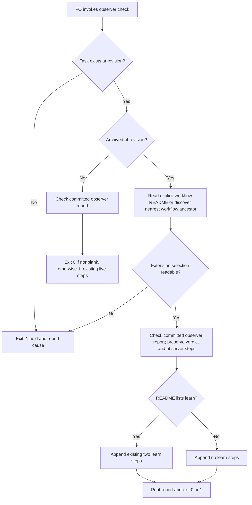

## Scope

- Source: intake from the subspace-web/v0 dev2 FO (Paseo agent 295b873d, 2026-10-21), relaying the Captain's 「開給 dev2 ，可以先送給這個 fo  2e87a82e-a8a9-4e41-973a-7483aa46e39d」 (relayed, not a ruling in this session).
- Bite: subspace-v0's dev2 README has no `extensions:` and never mentions learn; `learning.py notices --all` there is empty. After archiving task first-publish-reads-right, `observer_check.py` still told FO to run learn and to send learn's notice.
- Verified 2026-10-21 in kc-dev-flow-2 0.27.0 `scripts/observer_check.py`: the `learn` step list ("next: run kc-dev-flow-2:learn for {slug}.", "next: send learn's notice, then the observer report unedited…") is appended whenever the task is archived, with no read of the README's `extensions:`; `extensions/learn/EXTENSION.md` says a repository uses learn "by listing `learn` under `extensions:`".
- Shape proposed by the relaying FO (its wording, not the Captain's): when the README does not list `learn`, print no learn steps, or say learn is not enabled here.
- Related: adoption-asks-which-extensions (adoption never asks which extensions to enable).
- Upstream first: `observer_check.py` and its tests; how other scripts already read `extensions:` (dispatch_records.py).
- Non-goals: to be set at ideation.
- Trial (2026-11-13): admitted by the Captain's 「五張都准，授權代記設計關卡（建議）」 (host question dialog, 2026-11-13) as one of five tasks run by hand under the trial route rules: one worker builds a working probe during ideation and continues into implementation, a different worker validates, at most 3 build rounds counted by hand; stop for the Captain on an overturned premise, spent budget, two rounds without progress or a second validation rejection, a change of scope or criterion, or a component boundary or Prod trigger.

## Budget
1 implementation and 2 validation cycles, in one package PR.

## Stop condition
- On a workflow README that does not list learn under `extensions:`, the script prints no learn step for an archived task; on one that lists it, the steps print as today.

## FO alignment

Alignment: not needed before ideation.
Surfaces: none
Visible change: none
Release review: not needed: workflow maintenance, on no journey map.


## Design

### Before building

- **Need / failure without it.** The Captain's admitted trial and Stop condition require learning instructions to follow the workflow's selection. Current origin/main still appends two learn lines to both successful and missing-report archived checks without reading any README. A readable README with no learn entry is the cheap falsifier; the unmodified checker fails that falsifier in the probe.
- **Existing chain, checked before choosing the repair.** Spacedock 0.28.0's own `docs/schema/workflow-readme.mdschema.yml` and `docs/site/workflow/standards.md` describe workflow/stage schema and standards, not this package's learn follow-up. In kc-dev-flow-2, `extensions/learn/EXTENSION.md` defines listing-based activation; `workflow_extensions.py:readme_extensions` already handles inline/block lists, quoted names and comments, and `dispatch_records.py` already discovers the nearest workflow README. `pr_watch.py` already guards its merged-PR branch with the learn selection, but invokes the unconditional checker; `laws_check.py` consumes the first verdict line. Reuse the parser and repair these existing callers. Read-only sibling checks found three current workflows with learn selected and no replacement mechanism in the checked path; their actual checker comparisons are counts below. No global no-consumer/no-mechanism claim is made.
- **RFC / standard.** No applicable RFC was identified in those tool/package sources. This behavior is the package's own extension contract; preserve the supported syntax of its existing parser instead of adding another YAML library or runtime extension loader. This is not an exhaustive public-standards survey.
- **Smaller / cheaper route.** Suppressing learn unconditionally would remove valid instructions from enabled adopters. Relying solely on `pr_watch.py` misses direct invocations. The bounded repair reuses the existing parser, adds an optional README argument and normal-layout discovery, and passes the already-known README from the two existing callers; no new service, storage, dependency or background operation.
- **Component boundary.** None added: all changed production files belong to kc-dev-flow-2. Existing contracts remain git-read-only committed report inspection and a local README selection. No Spacedock writer, archive operation, learning job or external API is changed. The optional CLI argument supplies an existing input; return 0/1 retains the report verdict for readable configurations, and unknown archived selection returns 2. There is no new cross-component contract to invent.
- **Home of new facts.** The executable behavior and regression fixtures live in the six source files listed below; trial results and this definition live in this task and its `ideation/` evidence folder. No new ADR or agent-memory rule is proposed; no private adopter content is retained, only counts.

### Worth questions

The bounded repair serves the admitted outcome, specifically the Stop condition's two cases: omitted learn prints no learn step; listed learn retains today's steps. Without it, a direct post-archive run can order an unselected extension. The premise that would make this work unnecessary is that current origin/main already respects the selection; `probe.py fixtures` disproved it before the fix. No extra feature is proposed.

### PRFAQ

**Proposition.** After this repair, an FO can run the existing observer checker after an archive and follow its instructions using that workflow's declared extensions. A workflow with no learn entry keeps its observer verdict/remedy and receives no learn command or learn-notice instruction; one listing learn retains the two existing lines verbatim.

**Which README?** `--readme FILE` selects it explicitly. Without that option, the checker searches the state directory's resolved ancestors for the nearest README with an `entity-type:` frontmatter key, matching the existing dispatch-check discovery convention. The two package callers pass their known README, including the command `pr_watch.py` prints for execution after archive, so a detached state checkout works without relying on the caller's current directory. An archived invocation with missing/unreadable/malformed configuration holds with exit 2 and a cause; it does not infer extension selection. Live checks do not need this new selection read. `--rev` continues to select the committed task/report; the extension selection is the current supplied/discovered README, not a reconstruction at that historical revision.

**What stays inside the slice?** Non-goals: changing learning eligibility, starting or acknowledging a job, waiving the observer requirement, deciding archive/merge authority, changing defaults or historical-dispatch policy, editing adopter files, modifying Spacedock, or changing CI triggers. There is no CI change; cost per PR was not measured. The probe is not implementation approval, independent validation, publication or delivery.

**What did the probe show?** Base `8125e6d516d32abbf79c6772de10cde2c20900a8`, released source version 0.39.1, fetched from origin/main. Local branch `poc/observer-check-learn-only-when-listed`, local commit `5be1ed9695497d50d64f03f0a1d51b0157c25fe8`, worktree `.worktrees/observer-check-learn-only-when-listed` under the workflow code checkout. The 24 synthetic archived cases cover three unselected and three selected list forms, each with missing/blank/nonblank/waived reports. All matched the intended output and exit; an unconditional-learn mutation is detected. The three real enabled corpora contain 82, 86 and 69 archived tasks: all 237 verdict/output pairs are identical. A real historical README with no extensions key, applied to the first current corpus, produces the intended two-line deletion on 82/82 archived tasks, with unchanged exit codes and no unexpected difference. This cross-snapshot comparison does not reconstruct the original incident.

**What lacks the Pilot bar?** The original reported task is absent from the readable current state tree and its available path history, so that exact old archive cannot be rerun. A design gate, an implementation stage on the integration base FO selects after overlap resolution, fresh independent validation, and normal authorized PR/release/adopter delivery remain future work. The probe itself meets the observable Stop condition; those future stages are not claimed complete. No unresolved scope, criterion or authority decision is proposed to the Captain.



The same graph is rendered in `observer-check-learn-only-when-listed/ideation/flow.png`. It was inspected for matching actors, branches, verdicts and the unknown-input stop; no gate approval or learning operation occurs in the checker. The initial sandboxed renderer failed to launch; the existing local headless browser rendered it with an approved narrow sandbox escalation, without a download.

### Evidence commands

All commands below ran from the pinned probe worktree. Expand these literal paths before rerunning; no shell current-directory assumption is required:

```sh
WT=/Users/kent/conductor/workspaces/kc-claude-plugins/colombo/.context/dev2-adoption/worktree/.worktrees/observer-check-learn-only-when-listed
STATE=/Users/kent/conductor/workspaces/kc-claude-plugins/colombo/.context/dev2-adoption/worktree/docs/dev2/.spacedock-state
E="$STATE/observer-check-learn-only-when-listed/ideation"
PKG=/Users/kent/.claude/plugins/cache/kc-claude-plugins/kc-dev-flow-2/0.39.1
```

The probe script reads real adopter data without writing there and emits counts rather than names, titles, rulings, hashes or raw output. Its scratch runs remove their temporary directories on exit. Only source-repository public PR metadata is saved separately.

### Words FO reads at each moment

Count whitespace-separated words with a fixed example slug and single-word paths; command: `python3 "$E/words.py" "$WT" > "$E/words.json"`, exit 0. The governing workflow, lifecycle mod and learn extension text are byte-identical to base, so retain their unchanged contribution as a common term rather than claiming the checker output is the entire workload. Startup, idle on an open PR and the merge ask add 0 changed words. Idle on a merged PR with a committed report adds 2 words (the explicit README option and path) to its three printed lines, 20 to 22. After archive, without learn, the checker output drops 22 words: committed report 28 to 6; missing report 85 to 63. With learn selected those outputs stay 28 and 85. Paths with whitespace affect the literal count; unrelated dynamic provider output is not measured. There is no claim that every lifecycle moment shrinks.

### Governing rulings and package identity

ADRs were read at base `8125e6d516d32abbf79c6772de10cde2c20900a8`: ADR 0035 is Accepted (sha256 `6d9b63ed7650183877ba0c5b8092565dfd0ddb36a58a1a37cd5ac6c47e6ed8a4`); a new template default does not grant this checker permission to ignore an adopter's actual list. ADR 0048 is Accepted (sha256 `97f14773e680927e218eb3f866bd733f232d607134f37ecda344de9244187953`); this probe stays local and completion is this worker's final reply. ADR 0027's existing-writer rule is preserved; no new FO write is introduced. The checked state `Override:` lines yielded no applicable ruling against the proposed list-based repair. This task needs no new ADR.

Host-loaded Codex package `references/sd/workflow.md` read and sha256: `075005be5d2ba9e8ac2a30400faba8324754aef47077e5f7301462c3e19623eb`, path `/Users/kent/.codex/plugins/cache/kc-claude-plugins/kc-dev-flow-2/0.39.1/references/sd/workflow.md`. The dispatch-selected Claude package copy hashes `a884a1079841eeff80a0b3a27fecc21379562077ce8e783b70ccbce0cd5b6ca1`; these installed copies differ. The dispatch's stage fetch and selected Pilot references were followed; the behavioral probe targets the separately pinned origin/main source, not an assertion that the installs have identical bytes.

### Batch overlap

Files the design would change, all under `kc-dev-flow-2/scripts/`: `observer_check.py`, `test_observer_check.py`, `pr_watch.py`, `test_pr_watch.py`, `laws_check.py`, `test_laws_check.py`. No ADR list, numbered record, workflow template, extension contract or CI file changes.

- `design-surfaces-task-dir-crash`: no source overlap; shared gate check is `design_surfaces.py`.
- `new-work-checks-what-exists-first`: no proposed source overlap in its current Scope; shared Pilot/lint process, not this checker.
- `delivery-gate-s4-skips-removed-scratch`: no source overlap; owns delivery-gate inspection.
- `observer-check-learn-only-when-listed`: this task owns the six-file repair above.
- `pr-watch-tasks-foreign-worktree`: overlaps `pr_watch.py` and `test_pr_watch.py`; its ownership/action classification is separate from the README argument handoff here.
- `dispatch-close-out-archives-evidence-and-removes-scratch`: overlaps `pr_watch.py` and `test_pr_watch.py`; public PR #854 is OPEN, checked head `d4fe39e54dc7069b099d61c4b0e3fa2e5aecd8c6` (`ideation/pr854.json`).
- `held-and-closed-tasks-leave-the-design-queue`: overlaps the same two files; public PR #856 is OPEN, checked head `455846c6d30d4ab650c1c4503bc591722231586d` (`ideation/pr856.json`).
- `adoption-asks-which-extensions`: proposed overlap in `test_laws_check.py`; it owns historical dispatch selection, while this task reads the current README for post-archive instructions. Shared regression runner: laws tests.
- `adr-required-statement`: no source overlap; shared package lint/checks only.
- `adr-silent-undo-probe`: no source overlap in its current fictional-harness Scope.
- `comment-check-reaches-delivery-gate`: no source overlap; shared package lint/checks only.
- `journey-canvas-hosted-poc`: no source or checker overlap.
- `journey-server-host-pilot`: no source overlap; it consumes the existing design check, unchanged here.
- `ops-inbox-r1-setup-and-isolation`: no source or checker overlap.
- `pr-review-lite-value-pilot`: no source or checker overlap.

Recommended order: FO settles the already-open #854/#856 order first, rebases this repair onto their selected integration base, then orders this task and `pr-watch-tasks-foreign-worktree` serially for their two shared files. Coordinate `adoption-asks-which-extensions`' test-fixture hunk in `test_laws_check.py`; rerun both shared suites on the actual combined candidate. These are implementation-order recommendations, not authority to merge another task.

## Acceptance criteria

**AC-1** An archived task with an absent `extensions:` key, `extensions: []`, or a list without learn prints neither a learn command nor its notice instruction. Preserve the observer result, missing/blank verdict and observer recovery lines. Verified by `python3 "$E/probe.py" fixtures --code "$WT" --scratch /tmp/observer-learn-probe-8fcbee7d > "$E/fixtures.json"` (exit 0, 12 unselected cases within 24 total). Falsifier: restoring unconditional learn output makes the same fixture comparison fail; `python3 "$E/probe.py" mutation --code "$WT" --scratch /tmp/observer-learn-probe-8fcbee7d > "$E/mutation.json"` exited 0 with detection true.

**AC-2** With learn selected by inline, quoted/commented or block list, archived checker stdout and exit match the base byte-for-byte for missing, blank, committed and waived reports. Live committed-tree and `--rev` behavior remains covered by the existing regression cases. Verified by the same fixtures command (exit 0, 12 enabled cases) and `cd "$WT" && python3 kc-dev-flow-2/scripts/test_observer_check.py > "$E/focused.log" 2>&1` (exit 0, 23 tests). Falsifier: deleting/reordering a learn line, reading a report from disk, or printing learn on a live task fails those checks.

**AC-3** README selection is explicit or nearest-workflow discovery, works from a detached state directory, and missing/unreadable/malformed archived selection yields exit 2 with a cause and no `next:` action. Current selection is deliberately separate from the report's historical revision. Verified by the focused command above (exit 0) and `cd "$WT" && python3 kc-dev-flow-2/scripts/test_pr_watch.py > "$E/pr-watch-final.log" 2>&1` (exit 0, 136 tests), including executing the generated post-archive command with detached state and both learn settings. Falsifier: dropping `--readme` from that generated command produces exit 2 after archive in that fixture.

**AC-4** Real current enabled adopter corpora have no changed checker output/verdict; a real historical unlisted configuration suppresses precisely the two learn lines with no changed report verdict. Commands: `python3 "$E/probe.py" real --code "$WT" --scratch /tmp/observer-learn-probe-8fcbee7d --workflow /Users/kent/conductor/workspaces/subspace-web/dev2-fo/docs/dev2 --workflow /Users/kent/conductor/workspaces/subspace-relay/beirut-dev2/docs/dev2 --workflow /Users/kent/conductor/repos/qnow-adopt-dev2/docs/dev2 > "$E/real-counts.json"` (exit 0; 237/237 identical); `python3 "$E/probe.py" historical --code "$WT" --scratch /tmp/observer-learn-probe-8fcbee7d --workflow /Users/kent/conductor/workspaces/subspace-web/dev2-fo/docs/dev2 --readme-before 2026-10-10T00:00:00+08:00 > "$E/historical-counts.json"` (exit 0; 82 intended changes, 0 unexpected). Saved public outputs are counts only. Falsifier: any output/exit drift beyond that deletion makes the probe exit 1. Limits: this does not prove that old README and those current tasks coexisted.

**AC-5** Existing native archive recovery and package callers still work; callers supply their known README, and the laws runner still distinguishes violations from unjudgeable reads. Verified by `cd "$WT" && python3 kc-dev-flow-2/scripts/test_laws_check.py > "$E/laws-final.log" 2>&1` (exit 0, 84 tests: 83 passed, 1 optional external-source replay skipped), the 136-test PR-watch command above, and `cd "$WT" && SPACEDOCK_BIN=/Users/kent/.local/bin/spacedock python3 kc-dev-flow-2/scripts/test_observer_recovery.py > "$E/recovery.log" 2>&1` (exit 0: real installed Spacedock archived, detected, repaired/published the synthetic report and validated it). Falsifiers: omit the shared parser from the sandbox fixture and the L1 violation check fails; omit the README handoff and detached post-archive execution fails. Initial fixture failures are retained in `focused-before-fixture.log` and `laws-before-fixture.log`; both were repaired before this local commit.

**AC-6** Scope remains those six files, no new runtime dependency/config write/adopter edit or CI trigger; package lint passes and the unlisted output reduction plus merged-path reading cost are measured per moment. Verified by `cd "$WT" && python3 kc-dev-flow-2/scripts/lint-skills.py > "$E/lint.log" 2>&1` (exit 0), `python3 "$E/words.py" "$WT" > "$E/words.json"` (exit 0), `git -C "$WT" diff --check 8125e6d516d32abbf79c6772de10cde2c20900a8 HEAD` (exit 0), and the committed six-file diff. Falsifier: a governing-document edit fails the identity assertions in `words.py`; restoring unconditional learn fails AC-1's mutation check. This is a focused probe gate, not a claim that the full package suite or hosted CI ran.

### Not provable now

- The exact originally reported archived task and its October 21 state/README pair are unavailable in the checked clone/path history. The current task-presence count is 0. Keep the Stop condition behavioral; do not invent a recovered incident or publish another private task's details.
- Fresh independent validation, combined-head testing after overlapping PRs, hosted CI, release and adopter execution are later stages; this ideation dispatch has no PR/push authority for the code branch. The normal optional external-source replay in laws tests is not configured here.


## Stage Report: ideation

- DONE: Before designing, answer under '### Before building' whether this needs doing, what exists upstream and beside it, standards, the cheaper route, component boundaries, and where facts belong.
  Six answers are in Design; the existing parser is reused, no new component boundary or enduring ruling is introduced.
- DONE: Build and locally commit a working throwaway probe, run real cases, and write the design, Pilot gaps, Stop condition and acceptance criteria from what it showed.
  Local-only `poc/observer-check-learn-only-when-listed` at `5be1ed9695497d50d64f03f0a1d51b0157c25fe8`; 24 synthetic cases, 237 enabled corpus comparisons and 82 historical-config comparisons passed; no code push or PR.
- DONE: Run each acceptance criterion's proof now and record exact command, exit and saved output; list proofs that cannot run now separately.
  Six individually mapped criteria below Design; original incident and future delivery limits are under Not provable now.
- DONE: AC-1 unlisted archived workflows print no learn steps while preserving the observer verdict.
  `ideation/fixtures.json` and `mutation.json`, exit 0; restoring unconditional learn is detected.
- DONE: AC-2 listed archived workflows retain their output and live/historical report checks keep working.
  `ideation/fixtures.json` and `focused.log`, exit 0; changes to line order or committed-tree semantics fail the comparisons/tests (23 tests).
- DONE: AC-3 explicit/discovered README and detached-state behavior are exercised; unknown selection holds.
  `ideation/pr-watch-final.log`, exit 0 (136 tests), and `focused.log`; the generated command is executed after a real fixture archive and both extension settings are checked.
- DONE: AC-4 run the probe read-only against real adopter cases and save counts only.
  `ideation/real-counts.json`: 237 identical; `historical-counts.json`: 82 intended, 0 unexpected; both exit 0; exact old task unavailable rather than substituted as an identical incident.
- DONE: AC-5 exercise package consumers and native recovery.
  `ideation/laws-final.log`: 83 passed, 1 optional source replay skipped (84 total); `pr-watch-final.log`: 136 passed; `recovery.log`: native archive/remedy/publish/validate passed; exits 0.
- DONE: AC-6 bounded six-file change, lint, per-moment reading count and falsifiers.
  `ideation/lint.log`, `diff-check.log` and `words.json`, exits 0; unselected archived output -22 words, merged-PR explicit README +2 words, other changed-path moments 0; no full-suite/hosted-CI claim.
- DONE: A '### Batch overlap' section naming each changed file and each named batch/live task.
  Six files; shared PR-watch implementation/tests with this batch's foreign-worktree task and open public #854/#856; laws test fixture overlaps the historical-dispatch task; ordering recommendation is in Design.
- DONE: The words FO reads at each lifecycle moment, before and after, per root learning.md.
  `ideation/words.py` reproduces `words.json`; unchanged governing passages are a common term, not a misleading whole-workload estimate.
- DONE: Acceptance criteria with reproducible evidence clauses and falsifiers, and unresolved decisions for the Captain, each with a recommendation and what gets worse under it.
  AC-1 through AC-6 each name evidence and a falsifier; no unresolved material Captain choice. Explicit README handoff costs two printed words and covers detached state.
- DONE: Run the selected ideation design-surface check and render/inspect the required Mermaid.
  Dispatch package `scripts/design_surfaces.py check <absolute task>` exit 0, `ideation/design-check.log`; `flow.png` rendered and inspected, exit 0 in `mermaid-render.log`.
- DONE: Record the host-loaded workflow source sha256 and keep private adopter evidence counts-only.
  Codex-host `references/sd/workflow.md`: `075005be5d2ba9e8ac2a30400faba8324754aef47077e5f7301462c3e19623eb`; dispatch-selected copy's different digest and the pinned source are distinguished in Design.

### Summary

The probe reproduces and repairs unconditional post-archive learn instructions using the existing extension parser, with explicit README handoff at both callers. Its definition and evidence are ready for FO's design gate, with shared-file ordering and the unavailable original incident disclosed; this is not implementation approval, independent validation or delivery. The local probe worktree and branch remain for the same worker's next authorized stage.

### Trial round 1

Premise tested: current checker adds learn steps even when the workflow does not select learn; the base failed the no-learn comparison, and the probe meets both branches of the Stop condition. Evidence interval: start 2026-11-13 01:05:05, end 2026-11-13 01:24:02 Asia/Taipei (UTC+08:00), source `clock.curr_time` UTC readings converted by +8 hours. Base `8125e6d516d32abbf79c6772de10cde2c20900a8`; probe `5be1ed9695497d50d64f03f0a1d51b0157c25fe8`. Goal check: `python3 "$E/probe.py" fixtures --code "$WT" --scratch /tmp/observer-learn-probe-8fcbee7d > "$E/fixtures.json"`, exit 0, 24/24; real checks/commands and saved count outputs are AC-4. Blocked: no current build blocker; exact original archive and optional source replay remain unproved. Fired: none of premise overturned; Captain-only scope/criterion/trade-off; component boundary without contract; production data/credentials, broad exposure, migration, recurring operation, support or release/rollback ownership; change outside this task's named repair/budget. Build round 1 of at most 3; this ideation probe has not consumed an implementation or validation dispatch. Scratch cleanup follows the evidence commit and is recorded as counts/paths in `ideation/cleanup.json`.

Cleanup verified after evidence commit `b0a5e7295`: removed exact paths `/tmp/observer-learn-focused.log`, `/tmp/observer-learn-probe-8fcbee7d` (empty run root), `/tmp/observer-learn-puppeteer-8fcbee7d.json`; `ideation/cleanup.json` records each. Probe worktree and branch retained; no live probe subprocess remains.
