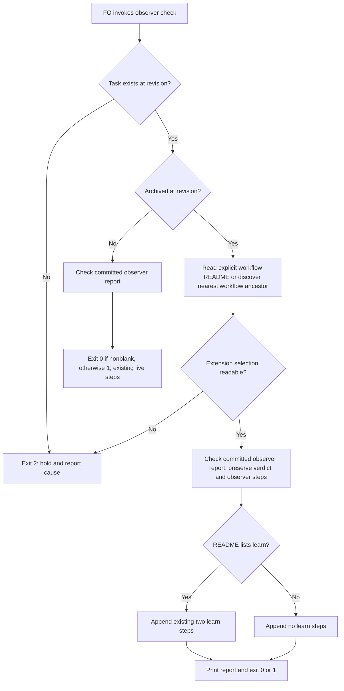

## Scope

- Source: intake from the subspace-web/v0 dev2 FO (Paseo agent 295b873d, 2026-10-21), relaying the Captain's 「開給 dev2 ，可以先送給這個 fo  2e87a82e-a8a9-4e41-973a-7483aa46e39d」 (relayed, not a ruling in this session).
- Bite: subspace-v0's dev2 README has no `extensions:` and never mentions learn; `learning.py notices --all` there is empty. After archiving task first-publish-reads-right, `observer_check.py` still told FO to run learn and to send learn's notice.
- Verified 2026-10-21 in kc-dev-flow-2 0.27.0 `scripts/observer_check.py`: the `learn` step list ("next: run kc-dev-flow-2:learn for {slug}.", "next: send learn's notice, then the observer report unedited…") is appended whenever the task is archived, with no read of the README's `extensions:`; `extensions/learn/EXTENSION.md` says a repository uses learn "by listing `learn` under `extensions:`".
- Shape proposed by the relaying FO (its wording, not the Captain's): when the README does not list `learn`, print no learn steps, or say learn is not enabled here.
- Related: adoption-asks-which-extensions (adoption never asks which extensions to enable).
- Upstream first: `observer_check.py` and its tests; how other scripts already read `extensions:` (dispatch_records.py).
- Non-goals: to be set at ideation.
- Trial (2026-11-13): admitted by the Captain's 「五張都准，授權代記設計關卡（建議）」 (host question dialog, 2026-11-13) as one of five tasks run by hand under the trial route rules: one worker builds a working probe during ideation and continues into implementation, a different worker validates, at most 3 build rounds counted by hand; stop for the Captain on an overturned premise, spent budget, two rounds without progress or a second validation rejection, a change of scope or criterion, or a component boundary or Prod trigger.

## Budget
1 implementation and 2 validation cycles, in one package PR.

## Stop condition
- On a workflow README that does not list learn under `extensions:`, the script prints no learn step for an archived task; on one that lists it, the steps print as today.

## FO alignment

Alignment: not needed before ideation.
Surfaces: none
Visible change: none
Release review: not needed: workflow maintenance, on no journey map.


## Design

### Before building

- **Need / failure without it.** The Captain's admitted trial and Stop condition require learning instructions to follow the workflow's selection. Current origin/main still appends two learn lines to both successful and missing-report archived checks without reading any README. A readable README with no learn entry is the cheap falsifier; the unmodified checker fails that falsifier in the probe.
- **Existing chain, checked before choosing the repair.** Spacedock 0.28.0's own `docs/schema/workflow-readme.mdschema.yml` and `docs/site/workflow/standards.md` describe workflow/stage schema and standards, not this package's learn follow-up. In kc-dev-flow-2, `extensions/learn/EXTENSION.md` defines listing-based activation; `workflow_extensions.py:readme_extensions` already handles inline/block lists, quoted names and comments, and `dispatch_records.py` already discovers the nearest workflow README. `pr_watch.py` already guards its merged-PR branch with the learn selection, but invokes the unconditional checker; `laws_check.py` consumes the first verdict line. Reuse the parser and repair these existing callers. Read-only sibling checks found three current workflows with learn selected and no replacement mechanism in the checked path; their actual checker comparisons are counts below. No global no-consumer/no-mechanism claim is made.
- **RFC / standard.** No applicable RFC was identified in those tool/package sources. This behavior is the package's own extension contract; preserve the supported syntax of its existing parser instead of adding another YAML library or runtime extension loader. This is not an exhaustive public-standards survey.
- **Smaller / cheaper route.** Suppressing learn unconditionally would remove valid instructions from enabled adopters. Relying solely on `pr_watch.py` misses direct invocations. The bounded repair reuses the existing parser, adds an optional README argument and normal-layout discovery, and passes the already-known README from the two existing callers; no new service, storage, dependency or background operation.
- **Component boundary.** None added: all changed production files belong to kc-dev-flow-2. Existing contracts remain git-read-only committed report inspection and a local README selection. No Spacedock writer, archive operation, learning job or external API is changed. The optional CLI argument supplies an existing input; return 0/1 retains the report verdict for readable configurations, and unknown archived selection returns 2. There is no new cross-component contract to invent.
- **Home of new facts.** The executable behavior and regression fixtures live in the six source files listed below; trial results and this definition live in this task and its `ideation/` evidence folder. No new ADR or agent-memory rule is proposed; no private adopter content is retained, only counts.

### Worth questions

The bounded repair serves the admitted outcome, specifically the Stop condition's two cases: omitted learn prints no learn step; listed learn retains today's steps. Without it, a direct post-archive run can order an unselected extension. The premise that would make this work unnecessary is that current origin/main already respects the selection; `probe.py fixtures` disproved it before the fix. No extra feature is proposed.

### PRFAQ

**Proposition.** After this repair, an FO can run the existing observer checker after an archive and follow its instructions using that workflow's declared extensions. A workflow with no learn entry keeps its observer verdict/remedy and receives no learn command or learn-notice instruction; one listing learn retains the two existing lines verbatim.

**Which README?** `--readme FILE` selects it explicitly. Without that option, the checker searches the state directory's resolved ancestors for the nearest README with an `entity-type:` frontmatter key, matching the existing dispatch-check discovery convention. The two package callers pass their known README, including the command `pr_watch.py` prints for execution after archive, so a detached state checkout works without relying on the caller's current directory. An archived invocation with missing/unreadable/malformed configuration holds with exit 2 and a cause; it does not infer extension selection. Live checks do not need this new selection read. `--rev` continues to select the committed task/report; the extension selection is the current supplied/discovered README, not a reconstruction at that historical revision.

**What stays inside the slice?** Non-goals: changing learning eligibility, starting or acknowledging a job, waiving the observer requirement, deciding archive/merge authority, changing defaults or historical-dispatch policy, editing adopter files, modifying Spacedock, or changing CI triggers. There is no CI change; cost per PR was not measured. The probe is not implementation approval, independent validation, publication or delivery.

**What did the probe show?** Base `8125e6d516d32abbf79c6772de10cde2c20900a8`, released source version 0.39.1, fetched from origin/main. Local branch `poc/observer-check-learn-only-when-listed`, local commit `5be1ed9695497d50d64f03f0a1d51b0157c25fe8`, worktree `.worktrees/observer-check-learn-only-when-listed` under the workflow code checkout. The 24 synthetic archived cases cover three unselected and three selected list forms, each with missing/blank/nonblank/waived reports. All matched the intended output and exit; an unconditional-learn mutation is detected. The three real enabled corpora contain 82, 86 and 69 archived tasks: all 237 verdict/output pairs are identical. A real historical README with no extensions key, applied to the first current corpus, produces the intended two-line deletion on 82/82 archived tasks, with unchanged exit codes and no unexpected difference. This cross-snapshot comparison does not reconstruct the original incident.

**What lacks the Pilot bar?** The original reported task is absent from the readable current state tree and its available path history, so that exact old archive cannot be rerun. A design gate, an implementation stage on the integration base FO selects after overlap resolution, fresh independent validation, and normal authorized PR/release/adopter delivery remain future work. The probe itself meets the observable Stop condition; those future stages are not claimed complete. No unresolved scope, criterion or authority decision is proposed to the Captain.



The same graph is rendered in `observer-check-learn-only-when-listed/ideation/flow.png`. It was inspected for matching actors, branches, verdicts and the unknown-input stop; no gate approval or learning operation occurs in the checker. The initial sandboxed renderer failed to launch; the existing local headless browser rendered it with an approved narrow sandbox escalation, without a download.

### Evidence commands

All commands below ran from the pinned probe worktree. Expand these literal paths before rerunning; no shell current-directory assumption is required:

```sh
WT=/Users/kent/conductor/workspaces/kc-claude-plugins/colombo/.context/dev2-adoption/worktree/.worktrees/observer-check-learn-only-when-listed
STATE=/Users/kent/conductor/workspaces/kc-claude-plugins/colombo/.context/dev2-adoption/worktree/docs/dev2/.spacedock-state
E="$STATE/observer-check-learn-only-when-listed/ideation"
PKG=/Users/kent/.claude/plugins/cache/kc-claude-plugins/kc-dev-flow-2/0.39.1
```

The probe script reads real adopter data without writing there and emits counts rather than names, titles, rulings, hashes or raw output. Its scratch runs remove their temporary directories on exit. Only source-repository public PR metadata is saved separately.

### Words FO reads at each moment

Count whitespace-separated words with a fixed example slug and single-word paths; command: `python3 "$E/words.py" "$WT" > "$E/words.json"`, exit 0. The governing workflow, lifecycle mod and learn extension text are byte-identical to base, so retain their unchanged contribution as a common term rather than claiming the checker output is the entire workload. Startup, idle on an open PR and the merge ask add 0 changed words. Idle on a merged PR with a committed report adds 2 words (the explicit README option and path) to its three printed lines, 20 to 22. After archive, without learn, the checker output drops 22 words: committed report 28 to 6; missing report 85 to 63. With learn selected those outputs stay 28 and 85. Paths with whitespace affect the literal count; unrelated dynamic provider output is not measured. There is no claim that every lifecycle moment shrinks.

### Governing rulings and package identity

ADRs were read at base `8125e6d516d32abbf79c6772de10cde2c20900a8`: ADR 0035 is Accepted (sha256 `6d9b63ed7650183877ba0c5b8092565dfd0ddb36a58a1a37cd5ac6c47e6ed8a4`); a new template default does not grant this checker permission to ignore an adopter's actual list. ADR 0048 is Accepted (sha256 `97f14773e680927e218eb3f866bd733f232d607134f37ecda344de9244187953`); this probe stays local and completion is this worker's final reply. ADR 0027's existing-writer rule is preserved; no new FO write is introduced. The checked state `Override:` lines yielded no applicable ruling against the proposed list-based repair. This task needs no new ADR.

Host-loaded Codex package `references/sd/workflow.md` read and sha256: `075005be5d2ba9e8ac2a30400faba8324754aef47077e5f7301462c3e19623eb`, path `/Users/kent/.codex/plugins/cache/kc-claude-plugins/kc-dev-flow-2/0.39.1/references/sd/workflow.md`. The dispatch-selected Claude package copy hashes `a884a1079841eeff80a0b3a27fecc21379562077ce8e783b70ccbce0cd5b6ca1`; these installed copies differ. The dispatch's stage fetch and selected Pilot references were followed; the behavioral probe targets the separately pinned origin/main source, not an assertion that the installs have identical bytes.

### Batch overlap

Files the design would change, all under `kc-dev-flow-2/scripts/`: `observer_check.py`, `test_observer_check.py`, `pr_watch.py`, `test_pr_watch.py`, `laws_check.py`, `test_laws_check.py`. No ADR list, numbered record, workflow template, extension contract or CI file changes.

- `design-surfaces-task-dir-crash`: no source overlap; shared gate check is `design_surfaces.py`.
- `new-work-checks-what-exists-first`: no proposed source overlap in its current Scope; shared Pilot/lint process, not this checker.
- `delivery-gate-s4-skips-removed-scratch`: no source overlap; owns delivery-gate inspection.
- `observer-check-learn-only-when-listed`: this task owns the six-file repair above.
- `pr-watch-tasks-foreign-worktree`: overlaps `pr_watch.py` and `test_pr_watch.py`; its ownership/action classification is separate from the README argument handoff here.
- `dispatch-close-out-archives-evidence-and-removes-scratch`: overlaps `pr_watch.py` and `test_pr_watch.py`; public PR #854 is OPEN, checked head `d4fe39e54dc7069b099d61c4b0e3fa2e5aecd8c6` (`ideation/pr854.json`).
- `held-and-closed-tasks-leave-the-design-queue`: overlaps the same two files; public PR #856 is OPEN, checked head `455846c6d30d4ab650c1c4503bc591722231586d` (`ideation/pr856.json`).
- `adoption-asks-which-extensions`: proposed overlap in `test_laws_check.py`; it owns historical dispatch selection, while this task reads the current README for post-archive instructions. Shared regression runner: laws tests.
- `adr-required-statement`: no source overlap; shared package lint/checks only.
- `adr-silent-undo-probe`: no source overlap in its current fictional-harness Scope.
- `comment-check-reaches-delivery-gate`: no source overlap; shared package lint/checks only.
- `journey-canvas-hosted-poc`: no source or checker overlap.
- `journey-server-host-pilot`: no source overlap; it consumes the existing design check, unchanged here.
- `ops-inbox-r1-setup-and-isolation`: no source or checker overlap.
- `pr-review-lite-value-pilot`: no source or checker overlap.

Recommended order: FO settles the already-open #854/#856 order first, rebases this repair onto their selected integration base, then orders this task and `pr-watch-tasks-foreign-worktree` serially for their two shared files. Coordinate `adoption-asks-which-extensions`' test-fixture hunk in `test_laws_check.py`; rerun both shared suites on the actual combined candidate. These are implementation-order recommendations, not authority to merge another task.

## Acceptance criteria

**AC-1** An archived task with an absent `extensions:` key, `extensions: []`, or a list without learn prints neither a learn command nor its notice instruction. Preserve the observer result, missing/blank verdict and observer recovery lines. Verified by `python3 "$E/probe.py" fixtures --code "$WT" --scratch /tmp/observer-learn-probe-8fcbee7d > "$E/fixtures.json"` (exit 0, 12 unselected cases within 24 total). Falsifier: restoring unconditional learn output makes the same fixture comparison fail; `python3 "$E/probe.py" mutation --code "$WT" --scratch /tmp/observer-learn-probe-8fcbee7d > "$E/mutation.json"` exited 0 with detection true.

**AC-2** With learn selected by inline, quoted/commented or block list, archived checker stdout and exit match the base byte-for-byte for missing, blank, committed and waived reports. Live committed-tree and `--rev` behavior remains covered by the existing regression cases. Verified by the same fixtures command (exit 0, 12 enabled cases) and `cd "$WT" && python3 kc-dev-flow-2/scripts/test_observer_check.py > "$E/focused.log" 2>&1` (exit 0, 23 tests). Falsifier: deleting/reordering a learn line, reading a report from disk, or printing learn on a live task fails those checks.

**AC-3** README selection is explicit or nearest-workflow discovery, works from a detached state directory, and missing/unreadable/malformed archived selection yields exit 2 with a cause and no `next:` action. Current selection is deliberately separate from the report's historical revision. Verified by the focused command above (exit 0) and `cd "$WT" && python3 kc-dev-flow-2/scripts/test_pr_watch.py > "$E/pr-watch-final.log" 2>&1` (exit 0, 136 tests), including executing the generated post-archive command with detached state and both learn settings. Falsifier: dropping `--readme` from that generated command produces exit 2 after archive in that fixture.

**AC-4** Real current enabled adopter corpora have no changed checker output/verdict; a real historical unlisted configuration suppresses precisely the two learn lines with no changed report verdict. Commands: `python3 "$E/probe.py" real --code "$WT" --scratch /tmp/observer-learn-probe-8fcbee7d --workflow /Users/kent/conductor/workspaces/subspace-web/dev2-fo/docs/dev2 --workflow /Users/kent/conductor/workspaces/subspace-relay/beirut-dev2/docs/dev2 --workflow /Users/kent/conductor/repos/qnow-adopt-dev2/docs/dev2 > "$E/real-counts.json"` (exit 0; 237/237 identical); `python3 "$E/probe.py" historical --code "$WT" --scratch /tmp/observer-learn-probe-8fcbee7d --workflow /Users/kent/conductor/workspaces/subspace-web/dev2-fo/docs/dev2 --readme-before 2026-10-10T00:00:00+08:00 > "$E/historical-counts.json"` (exit 0; 82 intended changes, 0 unexpected). Saved public outputs are counts only. Falsifier: any output/exit drift beyond that deletion makes the probe exit 1. Limits: this does not prove that old README and those current tasks coexisted.

**AC-5** Existing native archive recovery and package callers still work; callers supply their known README, and the laws runner still distinguishes violations from unjudgeable reads. Verified by `cd "$WT" && python3 kc-dev-flow-2/scripts/test_laws_check.py > "$E/laws-final.log" 2>&1` (exit 0, 84 tests: 83 passed, 1 optional external-source replay skipped), the 136-test PR-watch command above, and `cd "$WT" && SPACEDOCK_BIN=/Users/kent/.local/bin/spacedock python3 kc-dev-flow-2/scripts/test_observer_recovery.py > "$E/recovery.log" 2>&1` (exit 0: real installed Spacedock archived, detected, repaired/published the synthetic report and validated it). Falsifiers: omit the shared parser from the sandbox fixture and the L1 violation check fails; omit the README handoff and detached post-archive execution fails. Initial fixture failures are retained in `focused-before-fixture.log` and `laws-before-fixture.log`; both were repaired before this local commit.

**AC-6** Scope remains those six files, no new runtime dependency/config write/adopter edit or CI trigger; package lint passes and the unlisted output reduction plus merged-path reading cost are measured per moment. Verified by `cd "$WT" && python3 kc-dev-flow-2/scripts/lint-skills.py > "$E/lint.log" 2>&1` (exit 0), `python3 "$E/words.py" "$WT" > "$E/words.json"` (exit 0), `git -C "$WT" diff --check 8125e6d516d32abbf79c6772de10cde2c20900a8 HEAD` (exit 0), and the committed six-file diff. Falsifier: a governing-document edit fails the identity assertions in `words.py`; restoring unconditional learn fails AC-1's mutation check. This is a focused probe gate, not a claim that the full package suite or hosted CI ran.

### Not provable now

- The exact originally reported archived task and its October 21 state/README pair are unavailable in the checked clone/path history. The current task-presence count is 0. Keep the Stop condition behavioral; do not invent a recovered incident or publish another private task's details.
- Fresh independent validation, combined-head testing after overlapping PRs, hosted CI, release and adopter execution are later stages; this ideation dispatch has no PR/push authority for the code branch. The normal optional external-source replay in laws tests is not configured here.


## Stage Report: ideation

- DONE: Before designing, answer under '### Before building' whether this needs doing, what exists upstream and beside it, standards, the cheaper route, component boundaries, and where facts belong.
  Six answers are in Design; the existing parser is reused, no new component boundary or enduring ruling is introduced.
- DONE: Build and locally commit a working throwaway probe, run real cases, and write the design, Pilot gaps, Stop condition and acceptance criteria from what it showed.
  Local-only `poc/observer-check-learn-only-when-listed` at `5be1ed9695497d50d64f03f0a1d51b0157c25fe8`; 24 synthetic cases, 237 enabled corpus comparisons and 82 historical-config comparisons passed; no code push or PR.
- DONE: Run each acceptance criterion's proof now and record exact command, exit and saved output; list proofs that cannot run now separately.
  Six individually mapped criteria below Design; original incident and future delivery limits are under Not provable now.
- DONE: AC-1 unlisted archived workflows print no learn steps while preserving the observer verdict.
  `ideation/fixtures.json` and `mutation.json`, exit 0; restoring unconditional learn is detected.
- DONE: AC-2 listed archived workflows retain their output and live/historical report checks keep working.
  `ideation/fixtures.json` and `focused.log`, exit 0; changes to line order or committed-tree semantics fail the comparisons/tests (23 tests).
- DONE: AC-3 explicit/discovered README and detached-state behavior are exercised; unknown selection holds.
  `ideation/pr-watch-final.log`, exit 0 (136 tests), and `focused.log`; the generated command is executed after a real fixture archive and both extension settings are checked.
- DONE: AC-4 run the probe read-only against real adopter cases and save counts only.
  `ideation/real-counts.json`: 237 identical; `historical-counts.json`: 82 intended, 0 unexpected; both exit 0; exact old task unavailable rather than substituted as an identical incident.
- DONE: AC-5 exercise package consumers and native recovery.
  `ideation/laws-final.log`: 83 passed, 1 optional source replay skipped (84 total); `pr-watch-final.log`: 136 passed; `recovery.log`: native archive/remedy/publish/validate passed; exits 0.
- DONE: AC-6 bounded six-file change, lint, per-moment reading count and falsifiers.
  `ideation/lint.log`, `diff-check.log` and `words.json`, exits 0; unselected archived output -22 words, merged-PR explicit README +2 words, other changed-path moments 0; no full-suite/hosted-CI claim.
- DONE: A '### Batch overlap' section naming each changed file and each named batch/live task.
  Six files; shared PR-watch implementation/tests with this batch's foreign-worktree task and open public #854/#856; laws test fixture overlaps the historical-dispatch task; ordering recommendation is in Design.
- DONE: The words FO reads at each lifecycle moment, before and after, per root learning.md.
  `ideation/words.py` reproduces `words.json`; unchanged governing passages are a common term, not a misleading whole-workload estimate.
- DONE: Acceptance criteria with reproducible evidence clauses and falsifiers, and unresolved decisions for the Captain, each with a recommendation and what gets worse under it.
  AC-1 through AC-6 each name evidence and a falsifier; no unresolved material Captain choice. Explicit README handoff costs two printed words and covers detached state.
- DONE: Run the selected ideation design-surface check and render/inspect the required Mermaid.
  Dispatch package `scripts/design_surfaces.py check <absolute task>` exit 0, `ideation/design-check.log`; `flow.png` rendered and inspected, exit 0 in `mermaid-render.log`.
- DONE: Record the host-loaded workflow source sha256 and keep private adopter evidence counts-only.
  Codex-host `references/sd/workflow.md`: `075005be5d2ba9e8ac2a30400faba8324754aef47077e5f7301462c3e19623eb`; dispatch-selected copy's different digest and the pinned source are distinguished in Design.

### Summary

The probe reproduces and repairs unconditional post-archive learn instructions using the existing extension parser, with explicit README handoff at both callers. Its definition and evidence are ready for FO's design gate, with shared-file ordering and the unavailable original incident disclosed; this is not implementation approval, independent validation or delivery. The local probe worktree and branch remain for the same worker's next authorized stage.

### Trial round 1

Premise tested: current checker adds learn steps even when the workflow does not select learn; the base failed the no-learn comparison, and the probe meets both branches of the Stop condition. Evidence interval: start 2026-11-13 01:05:05, end 2026-11-13 01:24:02 Asia/Taipei (UTC+08:00), source `clock.curr_time` UTC readings converted by +8 hours. Base `8125e6d516d32abbf79c6772de10cde2c20900a8`; probe `5be1ed9695497d50d64f03f0a1d51b0157c25fe8`. Goal check: `python3 "$E/probe.py" fixtures --code "$WT" --scratch /tmp/observer-learn-probe-8fcbee7d > "$E/fixtures.json"`, exit 0, 24/24; real checks/commands and saved count outputs are AC-4. Blocked: no current build blocker; exact original archive and optional source replay remain unproved. Fired: none of premise overturned; Captain-only scope/criterion/trade-off; component boundary without contract; production data/credentials, broad exposure, migration, recurring operation, support or release/rollback ownership; change outside this task's named repair/budget. Build round 1 of at most 3; this ideation probe has not consumed an implementation or validation dispatch. Scratch cleanup follows the evidence commit and is recorded as counts/paths in `ideation/cleanup.json`.

Cleanup verified after evidence commit `b0a5e7295`: removed exact paths `/tmp/observer-learn-focused.log`, `/tmp/observer-learn-probe-8fcbee7d` (empty run root), `/tmp/observer-learn-puppeteer-8fcbee7d.json`; `ideation/cleanup.json` records each. Probe worktree and branch retained; no live probe subprocess remains.


## Stage Report: implementation

- DONE: Build the approved design in the six named scripts/tests from current origin/main and reconcile the watcher files with PR 858.
  Branch `spacedock-ensign/observer-check-learn-only-when-listed`; base `c8d6dd40cf12ff6d9047e42e4d1041afa3bcf694`; candidate `17eccdda05fde54e6dff66f4989787864219ef43`; `implementation/scope.json` proves the six-file scope and retained absent-worktree fact behavior.
- SKIPPED: One Draft PR from the implementation branch.
  Explicit dispatch delegation: no product push or PR opened by this worker; FO owns both. PR title/body is `/tmp/impl-observer-check-learn-only-when-listed-pr.md`, with a saved copy and SHA256 in `implementation/`.
- DONE: AC-1 unlisted archived workflows print no learn steps and preserve the observer verdict/remedy.
  `implementation/fixtures.json`, exit 0 (12 unselected cases among 24); `mutation.json` detects unconditional learn; named negative matrix exits 1 with 12/24 passing.
- DONE: AC-2 enabled archived stdout/exit matches the base; live and committed historical report semantics remain covered.
  `implementation/fixtures.json`, exit 0 (12 enabled cases); `focused.log`, exit 0 (23 tests); deleting/reordering learn lines, reading disk and printing learn live each fail the intended oracle in `mutations.json`.
- DONE: AC-3 explicit/discovered README, detached-state command execution and unreadable-selection hold.
  `implementation/pr-watch.log`, exit 0 (136 tests), and `focused.log`; omitted printed README reaches the actual archive boundary and returns 2, making its mutation test exit 1 (`AC3-omit-printed-readme.log`).
- DONE: AC-4 read-only real corpus comparison and historical unlisted configuration.
  `implementation/real-counts.json`: 237 identical output/verdict pairs; `historical-counts.json`: 82 intended changes, zero unexpected; both exit 0. Unexpected output mutation causes 12 differences and exits 1. Public artifacts contain counts only for private adopters.
- DONE: AC-5 callers, isolated parser dependency and native archive recovery.
  `implementation/laws.log`: 84 total, 83 passed and 1 optional source replay skipped; `pr-watch.log`: 136 passed; `recovery.log`: native archive/remedy/publish/validate passed; exits 0. Parser-omission fixture fails the expected L1 assertion, exit 1.
- DONE: AC-6 bounded source/dependency/CI scope, lint and per-moment reading comparison.
  `implementation/scope.json`, `lint.log`, `words.json` and both `diff-check*.log` pass; no version, runtime dependency or CI trigger changes. Unlisted archive output -22 words, merged command +2 words; other changed-path moments 0. Copied governing-document edit fails the identity check.
- DONE: Every acceptance criterion green with its evidence rerun, and every named falsifier failing under a mutation (python3 -B, caches cleared).
  Exact commands and limits are `implementation/README.md`; 9/9 mutations detected in `mutations.json`, all negative children exit 1 for the intended reason. Initial harness PYTHONPATH escape (8/9) is retained and corrected; candidate bytes stayed unchanged.
- DONE: Repository lint-skills.py, package adr_lint.py, number_guards.py check and comment_ratio.py pass.
  `implementation/lint.log`, `adr-lint.log`, `number-guards-fresh.log`, `comment-ratio.log`: exits 0; 74 ADRs checked; no findings; no migrations-path means migration guard skipped, with no migration/ADR changes here; added comments 0.0%, maximum 5%.
- DONE: Commit locally, no product push, and prepare Conventional Commit PR text for FO; state CI cost measured or not measured.
  Local candidate above; `implementation/pr-text.md` matches the retained required /tmp file. CI unchanged; cost per PR not measured. State evidence commits are the separately authorized synchronization route.
- DONE: Record the affected-document disposition and existing-chain findings.
  `implementation/doc-impact.log`, exit 0: `learning.md` unaffected because its laws/shared-parser practice remains true. Approved chain audit reused under Accepted ADR 0083; current origin/main, PR 858 behavior and governing ADR 0035 rechecked; no new ADR needed.
- SKIPPED: RoboRev, hosted CI and independent validation.
  Delegated to FO under the dispatch; not run and not reported clean. The full package suite was not run; reported test totals are the three named focused suites.
- DONE: Commit the evidence, remove owned scratch by exact path, retain the required PR text and preserve the probe/product branches.
  Evidence committed at `c05ca66c7`; removed only `.context/observer-learn-proof-scratch` in the assigned implementation worktree, verified absent in `implementation/cleanup.json`; no /tmp scratch created beyond the required retained PR file.
- DONE: Record the host-loaded workflow source hash and preserve stage authority.
  Codex-host `references/sd/workflow.md` sha256 remains `075005be5d2ba9e8ac2a30400faba8324754aef47077e5f7301462c3e19623eb`; selected operational package 0.39.1. No task frontmatter, Captain criterion, gate decision or stage transition was edited.

### Summary

The approved repair is locally committed on the required current base, with PR 858's watcher behavior preserved, 242 focused tests passed and one optional replay skipped, 24 fixtures passed, and nine falsifiers detected. FO receives prepared PR text and committed count-only evidence for publication, RoboRev, hosted CI and independent validation; the unavailable exact historical incident and the original design's limits remain explicit.

### Trial round 2

Premise and goal: the unchanged current integration base still emits learning steps without selection (goal matrix exit 1, 12/24 pass in `implementation/baseline-goal.json`), while candidate `17eccdda05fde54e6dff66f4989787864219ef43` meets both Stop-condition branches (24/24, exit 0). Start 2026-11-13 08:43:28, evidence end 2026-11-13 08:55:27 Asia/Taipei (UTC+08:00), source `clock.curr_time` UTC readings converted by +8 hours. Base `c8d6dd40cf12ff6d9047e42e4d1041afa3bcf694`; check `python3 -B "$E/probe.py" fixtures --code "$WT" --scratch "$WT/.context/observer-learn-proof-scratch" > "$E/fixtures.json"`, saved as `implementation/fixtures.json`, exit 0. Since round 1, PRs 858/860/859 landed; the assigned clean branch was fast-forwarded to current origin/main, the six-file patch reapplied, and 858's two watcher-file changes retained; the proof baseline was updated accordingly. Initial sandbox fetch limits and one mutation-harness import escape were resolved, with primary evidence retained. Blocked: no build blocker; publication/review/validation are delegated, and the accepted exact-old-incident/source-replay limits remain. Fired: none — no overturned premise, Captain-only scope/criterion/trade-off, new component boundary without contract, Production trigger, or change outside the named files/Budget. This is build round 2 of at most 3 and the first implementation dispatch; task state remains implementation for FO handoff.


## Stage Report: implementation

- DONE: Verify RoboRev job 1809's High finding before changing production code, make both checks use the same extension reader, and add a failing-before regression.
  Confirmed on `17eccdda0`: quoted/commented block learn enables observer steps but L1 exits 0 and skips; `repair-3/before-reproducer.json`, red laws/watcher logs. After repair, L1 exits 1 with a violation; the new two tests pass and each legacy-parser reversal fails.
- DONE: List every other extension-list reader in the design's six files and repair inconsistent consumers inside that scope.
  `repair-3/scope-and-readers.json`: observer already shared; laws now delegates with Cannot/dependency guards; watcher tasks now shares the reader; generic frontmatter copies no longer select extensions; three test files contain fixtures/assertions, not competing activation parsers.
- DONE: Build the approved six-file outcome on the required integration base and reconcile the watcher files with PR 858.
  Integration base `c8d6dd40cf12ff6d9047e42e4d1041afa3bcf694`; repair parent `17eccdda05fde54e6dff66f4989787864219ef43`; candidate `97fe3d6ff9f9afe220b463c71ac428e380fc4dc5`, branch `spacedock-ensign/observer-check-learn-only-when-listed`. Four repair files, six combined; PR 858 fact behavior retained.
- DONE: AC-1 unlisted archived workflows omit learn steps and preserve the observer verdict/remedy.
  `repair-3/fixtures.json` and `mutation.json`, exits 0; 12 unselected cases pass among 24; unconditional-learn reversal fails its matrix oracle with exit 1.
- DONE: AC-2 selected archived stdout/exit and live/committed historical report behavior remain correct.
  `repair-3/fixtures.json`: 12 enabled cases match base; `focused.log`: 23 tests pass, exits 0. Deletion/reordering, disk-read and live-learn mutations each fail their intended assertion.
- DONE: AC-3 explicit/discovered README, detached-state commands and unreadable selection diagnostics.
  `repair-3/pr-watch.log`: 137 tests pass; `unreadable.json`: real permission denial produces checker exit 2, a cause and zero next actions; positive helpers exit 0. Omitted printed README causes real post-archive exit 2 and a failing mutation test.
- DONE: AC-4 rerun the read-only real-corpus and historical-configuration comparison.
  `repair-3/real-counts.json`: 237 identical output/verdict pairs; `historical-counts.json`: 82 intended deletions, zero unexpected; exits 0. Unexpected output mutation is detected; private adopter artifacts are counts only.
- DONE: AC-5 package callers, parser dependency and native archive recovery.
  `repair-3/laws.log`: 85 total, 84 passed and one optional source replay skipped; watcher 137 passed; `recovery.log`: native archive/remedy/publish/validate passes; exits 0. Dependency omission and both legacy-parser reversals fail their named oracles.
- DONE: AC-6 source/dependency/CI scope, repository lint and per-moment reading footprint.
  `repair-3/scope-and-readers.json`, `lint.log`, `words.json` and `diff-check-probe-base.log` pass. No version, new dependency, workflow or CI file change; canonical unlisted archive output -22 words, merged command +2, other changed-path moments 0; copied governing-document edit fails identity.
- DONE: Every acceptance criterion's evidence command rerun on the new candidate, with each falsifier demonstrated (python3 -B, caches cleared).
  Exact commands in `repair-3/README.md`; `mutations.json`: 11/11 detected, each negative child exit 1 for its intended failure. Two new regression methods failed before the repair and pass after it. Helper preparation and dependent-read errors were corrected without changing candidate bytes; initial errors are retained.
- DONE: Run the repository-declared full local unit command and account for every script and test result.
  `repair-3/full-suite-command.txt`, `full-suite.log`, `full-suite-exit.json`, `full-suite-summary.json`: exit 0, 25 scripts with no duplicates, 1377 tests total, 1366 passed, 11 skipped. This command excludes three pinned-Spacedock integration scripts; native observer recovery also ran separately.
- DONE: Repository lint, ADR lint, number guards, comment ratio and design check pass; record affected-document disposition.
  `repair-3/lint.log`, `adr-lint.log`, `number-guards.log`, `comment-ratio.log`, `design-check.log`: exits 0; 74 ADRs, no findings, comments 0.0% versus 5% maximum. No migration path is declared and no migration/ADR changes; `doc-impact.log`: learning.md unaffected because its shared-parser/laws practice remains correct.
- DONE: Commit locally, no product push, and prepare Conventional Commit PR text; state CI cost measured or not measured.
  Candidate `97fe3d6ff9f9afe220b463c71ac428e380fc4dc5` locally committed; required `/tmp/impl-observer-check-learn-only-when-listed-pr.md` updated and byte-pinned by `repair-3/pr-text-sha256.txt`. CI unchanged; cost per PR not measured.
- SKIPPED: Product publication, fresh RoboRev, hosted CI and independent validation.
  FO owns pushing the repair to PR #861 and rerunning RoboRev/validation. The reported High was reproduced and repaired; no fresh clean review or hosted result is claimed by this worker.
- DONE: Commit evidence, remove owned scratch by exact path, retain required PR text and preserve both product/probe worktrees and branches.
  Evidence commit `5fa337558`; removed only the assigned worktree's `.context/observer-learn-repair3-scratch`, verified absent in `repair-3/cleanup.json`; no /tmp scratch created, required PR text retained.
- DONE: Preserve approved scope, criteria, gate authority and package identity.
  No frontmatter, prior reports, accepted criterion, gate or stage transition edited. Codex-host workflow sha256 `075005be5d2ba9e8ac2a30400faba8324754aef47077e5f7301462c3e19623eb`; dispatch package 0.39.1; accepted chain audit and ADRs reused, no new ruling needed.

### Summary

This report supersedes the preceding implementation report for candidate `17eccdda0`; the confirmed parser mismatch is repaired at `97fe3d6ff9f9afe220b463c71ac428e380fc4dc5` within the approved six files. All six acceptance criteria, the 25-script local unit command and 11 falsifiers pass their stated evidence boundaries; FO still owns publication, fresh review and independent validation, and the accepted historical-incident/source-probe limits remain.

### Trial round 3

Premise and goal: RoboRev's quoted-block-list mismatch is real—before the repair L1 skipped an enabled learn workflow (native laws exit 0, observer exit 1 with learn), while the repaired native fixture reports the missing-observer violation (laws exit 1 with L1, observer still enables learn). Start 2026-11-13 09:02:22, verification end 2026-11-13 09:20:50 Asia/Taipei (UTC+08:00), source `clock.curr_time` UTC readings converted by +8 hours. Integration base `c8d6dd40cf12ff6d9047e42e4d1041afa3bcf694`, repair parent `17eccdda05fde54e6dff66f4989787864219ef43`, candidate `97fe3d6ff9f9afe220b463c71ac428e380fc4dc5`. Goal command `PYTHONDONTWRITEBYTECODE=1 python3 -B "$E/reproduce.py" --code "$WT" > "$E/after-reproducer.json"`, helper exit 0; the two focused regression commands in `repair-3/README.md` failed before and pass after repair; full merge-test command exit 0 is saved in `full-suite-exit.json`. Since round 2, FO published PR #861 and reported job 1809's High; this round confirms it, removes both inconsistent parsers and adds the two regressions. Blocked: no build blocker; FO-owned review/validation remain and no fresh clean review is claimed. Fired: none of scope/criterion change, overturned premise, new component boundary without contract, Production trigger or outside-file/Budget work. This is the last permitted build round (3 of 3); any further build repair returns to the Captain rather than starting another round. Task state remains implementation for FO handoff.


## Stage Report: validation

- DONE: Independent verdict on PR #861 head 97fe3d6f against every acceptance criterion in the task file, re-running each evidence command and at least one falsifier per criterion myself, and judging each limit the implementation report states.
  PASSED at 97fe3d6ff9f9afe220b463c71ac428e380fc4dc5, base c8d6dd40cf12ff6d9047e42e4d1041afa3bcf694; validation/README.md maps all six criteria to rerun outputs and accepted limits; no new Material, Polish or Needs decision finding.
- DONE: A minimal acceptance script the Captain can run (three to six steps, exact commands, expected output), run by me exactly as written in a fresh bash shell, with its observed output; adr_lint.py docs/adr --since <base> with its exit code; verdict naming the head, with findings classified by the workflow's Review-finding disposition.
  validation/acceptance.sh has four steps; validation/acceptance.log exit 0, 204.262 seconds (acceptance-summary.json), public fixed-SHA download with no product-worktree dependency; explicit dispatched adr_lint.py command in validation/README.md exited 0 (74 records).
- DONE: AC-1 unlisted archived workflows omit learning steps and preserve observer results/recovery.
  validation/fixtures.json passes 12 unselected cases; baseline-goal.json passes only 12/24 overall, exit 1; AC1-unconditional-learn.json detects the reversal.
- DONE: AC-2 selected output remains byte-identical; live and historical committed-report behavior remains correct.
  validation/fixtures.json passes all 12 selected cases; acceptance.log passes 23 observer tests; deletion, reordering, disk-read and live-learn mutations each fail their intended assertion.
- DONE: AC-3 explicit/discovered README and detached commands work; unreadable/invalid selection holds without actions.
  validation/acceptance.log covers the generated detached command; unreadable.json records actual permission denial, exit 2 and zero next actions; AC3-omit-printed-readme.log fails at real post-archive execution.
- DONE: AC-4 real current and historical-configuration comparisons remain count-only.
  validation/real-counts.json has 237/237 identical pairs; historical-counts.json has 82 intended deletions and zero unexpected changes; AC4-unexpected-verdict-output.json detects output drift.
- DONE: AC-5 native recovery and package callers retain their boundaries; all in-scope extension readers agree.
  validation/recovery.log passes with installed Spacedock 0.27.2; cross-reader-candidate.json passes 8/8 versus prior 1/8 (cross-reader-prior.json), including comment decoys and spaced block lists; legacy laws/watcher and parser-omission mutations fail.
- DONE: AC-6 six-file scope, dependency/config/CI boundaries and reading-cost evidence are satisfied.
  validation/scope.json confirms six files; words.json records -22 words after unselected archive, +2 for merged command and zero other changed-path moments; governing-document mutation fails. CI unchanged; cost per PR not measured.
- DONE: Rerun the full local unit command and account for all scripts/tests without duplicates.
  validation/full-suite-command.txt and full-suite.log exit 0; full-suite-summary.json records 25 scripts, 1377 total, 1366 passed, 11 skipped; mutations.json records 11/11 detected falsifiers.
- DONE: Repository lint, required guards, dispatch records and affected-document disposition.
  validation/guards.json records exits 0; lint in full-suite.log passes; comment-ratio.log is 0.0% against 5%; doc-impact.log names learning.md, unaffected because its parser/caller practices remain correct; no reserved or changed ADR/migration.
- DONE: Preserve independent ownership, exact product bytes, privacy and delivery authority.
  validation/identity.json and code-files.sha256 bind the archive; product worktree remains clean at the candidate; privacy-scan.json found zero private-task-name matches in added evidence; no product/config/worktree-metadata mutation or external message.
- SKIPPED: Reconstruct the missing original incident, configure optional source replays, and claim delivery or clean FO-owned review.
  Historical README/current tasks do not prove coexistence; 11 optional skips and three excluded pinned integrations are disclosed (native recovery separately passed); PR remains a draft in validation/pr.json, and FO owns review, gate and delivery.
- DONE: Record owned temporary paths for cleanup after the evidence commit.
  validation/cleanup.json records exact-path removal after evidence commit f747e695bc4c82a41a1e70cd2a238bbbcab6a4bb; all four owned temporary paths are verified absent, and both existing product/probe worktrees are preserved.

### Summary

Independent validation recommends PASSED for 97fe3d6ff9f9afe220b463c71ac428e380fc4dc5: the accepted goal works and the without-change/mutation checks justify each retained production change. The reported parser mismatch is repaired in all three in-scope readers, and no new supported-workflow harm was reproduced; the original historical-incident limit and optional integration/replay gaps remain explicit. Start 2026-11-13 09:26:34, evidence end 2026-11-13 09:42:58 Asia/Taipei, from clock.curr_time UTC plus eight hours; gate approval, merge, release and adopter delivery remain FO/Captain-owned.
