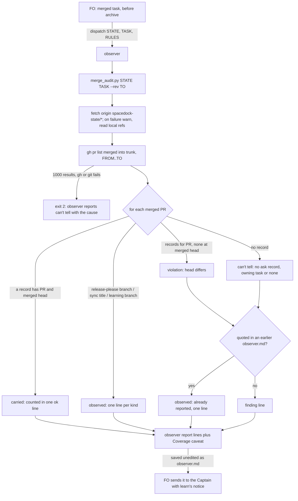

At archive, the observer reports every PR merged in its window whose number and merged head match no saved `merge/ask-N.json` in any state checkout it can read, so an unasked merge is found after the fact without a pre-tool hook.

## Scope

- Source: the Captain 「可以」 (chat, 2026-11-06), answering FO's 「要照這樣做嗎？」, which proposed keeping merge-guard-stops-unasked-merges held and doing first the cheaper after-the-fact check and a look at whether #785 and #727 were asked.
- Bite: fo-feedback round 005 (2026-11-06): journey-map PR #785 merged 2026-11-05 while its task still reads `status: backlog` with no gate decision (FO read of that state file); ops-inbox PR #727 merged 2026-10-27 with the Captain's 「准」 recorded (FO read of its archived gate, 2026-11-06) but with Codex's code review only on an earlier commit. The held merge-guard replay counts (54/30, then 74/10) stay in its task file.
- Added 2026-11-06 (journey-map FO reply, Paseo 7b9a9beb, operator statement): #785 was asked; the Captain answered 「Ａ可以，我覺得配對流程不是很順，應該參考 relay 的做法，但可以先合併再重構」 to a question ending 「要合 #785 就說合併」 in the journey-map FO's session on 2026-11-05, and the FO then ran `gh stack merge 785 --squash`. The wording is in that session's transcript only, not in task state. So neither #785 nor #727 was an unasked merge; both are record gaps (no gate record; no code review on the merged head). An audit that flags "no ask record" would list #785 although the Captain approved it, so the design must say how a chat-only approval is told apart from an unasked merge, or the task's value is in surfacing record gaps.
- Upstream first: the merge-guard task's record discovery (state worktrees on `spacedock-state/*`, `*/merge/ask-*.json`); the observer skill; delivery_gate.py's saved ask records.
- Non-goals: blocking any merge; Release, workflow-sync and learning PRs, which carry no task ask (the observer names them as such instead of as violations).

## Budget
- One package PR; the workflow word budget does not rise unless the design names a raise for the Captain.

## Stop condition
- A replay over the window that holds #785 lists #785 as merged with no ask record, lists a task PR with a matching record as carried, and names Release and sync PRs separately.

## FO alignment

Alignment: needed at ideation; which state checkouts the observer reads and how a Release PR is named are his to accept.
Result: aligned at backlog: Batch 17 backlog sitting, the Captain 「核准（建議）」 (host question dialog, 2026-11-07), answering 「決定：第 17 批這五張（Paseo 瀏覽器當工人驗收的預設、決策紀錄檢查分清驗證取代與指向依據、派工時自動寫派工紀錄、沒給範圍時設計檢查說沒跑、觀察者列出沒有合併提問紀錄的合併）都用 Pilot，照各自寫下的範圍、預算與停止條件進入構想嗎？建議核准。要改哪張直接說。」, approved the outcome and bounds in this file; the design choice the Alignment line names stays his at the ideation gate.
Surfaces: none
Visible change: none
Release review: not needed: workflow maintenance, on no journey map.

## Design

### Chain check

Read 2026-11-07, kc-dev-flow-2 at origin/main (released 0.35.0):
- **Spacedock 0.27.3.** `spacedock merge guard` runs after a merge, for a task that owns the PR. It never sees a PR with no task, and it never compares the merged head with an ask.
- **kc-dev-flow-2.** `delivery_gate.py check` saves `<task>/merge/ask-N.json` (`write_record`) with `pr` as `owner/repo#N`, the full 40-hex `head` and `time`; 126 records sit on `spacedock-state/dev2`, none on the other six `spacedock-state/*` branches. The observer skill already reads a task's own ask records (the "FO runs `delivery_gate.py check` before the merge ask" paragraph), but only for its own PR. `number_guards.py` already reads every `origin/spacedock-state/*` branch after `git fetch origin +refs/heads/spacedock-state/*:refs/remotes/origin/spacedock-state/*`, falling back to local refs with a warning. `pr_watch.py` already calls `gh pr list`. No script lists merged PRs against ask records. ADR 0023 Consequences name the gap: "Nothing checks that a merged PR's approved question named the merge".
- **Held sibling.** merge-guard-stops-unasked-merges (validation, held by the Captain) designs `merge_guard.py record`, which saves a chat approval of a Release, sync or learning PR as `_merges/<owner>-<repo>-<N>/merge/ask-K.json`. It reads worktrees on disk, before a merge; this design reads committed refs, after.
- **Third-party names, read at their source.** release-please 17.11.1 `build/src/util/branch-name.js` builds `release-please--branches--<target>` (with `--components--` or `--groups--` suffixes). `learning.py` requires `branch == "learning/" + key` (64 hex). Sync PRs follow no enforced name: 19 of 19 merged sync PRs are titled `chore(dev2): sync workflow to kc-dev-flow-2 v<version>`, but their branches drift (`iamcxa/dev2-sync-0.22.1` #641, `chore/dev2-sync-kc-dev-flow-2-0.23.0` #648).
- **Siblings.** No adopter lists merges against records.

**Existing-code check.** Reuse the patterns and leave the scripts alone. `observer_check.py`'s exit codes drive the package mod's archive step, so a merge finding there would block archives. `number_guards.py` reserves numbers, a different job. A new read-only script reuses `number_guards.py`'s fetch-and-read pattern and `delivery_gate.py`'s record shape. The observation that shows the change is needed: `poc/replay-output.txt` (below).

### What state can and cannot tell

State cannot tell a chat-only approval from an unasked merge. #785 shows it: the Captain approved it in the journey-map FO's chat (operator statement, Scope), and no record anywhere this repository holds says so. Its task file is on no `spacedock-state/*` ref of this repository and was not found on this machine's disk, so the replay prints "no task in readable state" for it and for the 9 other journey-map PRs. Round 005 read `status: backlog, pr: pr-merge:785` in a state file outside these refs.

So the audit reports what state can show, in the observer's existing verdict words:
- **carried** (`ok`): a saved `merge/ask-N.json` anywhere in readable state has this `owner/repo#N` and a `head` the merged head starts with (at least 7 hex). This includes `_merges/` records once merge-guard lands.
- **head differs** (`violation`): records exist for the PR, but none at the merged head. Quoted rule: workflow.md § Delivery authority, "merging the full head `<package>/scripts/delivery_gate.py check` passes, with `--match-head-commit` set to it".
- **no ask record** (`can't tell`): no record for the PR. The evidence outside state is the Captain's chat, or a state checkout this run cannot read. The line names the task that owns the PR (`pr:` frontmatter) or says "no task in readable state".
- **release**, **sync**, **learning** (`observed`, one line per kind listing the numbers): PRs that carry no task ask, named as such and not as findings (Scope non-goals). These are checked after carried, so a recorded Release PR reads carried.

Until a chat approval can be recorded (merge-guard's `record` route), the value of this task is surfacing record gaps, the Scope's stated fallback. This is not ADR 0024's case: that ADR lists rules whose only witness is chat. Here state is the witness for 60 of 92 merges in the replay, and `can't tell` is the gap that remains.

### Window, inputs, repeats

Only the observer's declared inputs (STATE, TASK, FROM, TO) are used:
- **Repository and base.** `git -C STATE remote get-url origin` (state branches live in the code repository), and `trunk:` from the workflow README above STATE.
- **Window.** PRs merged into the base whose `mergedAt` lies after FROM's committer time and at or before TO's: `gh pr list --state merged --base <trunk> --search "merged:<from date>..<to date>" --limit 1000`, filtered exactly in the script. A result of 1000 holds, as exit 2.
- **Records.** After the `number_guards.py` refspec fetch, the script reads every `merge/ask-<N>.json` at any depth on each `refs/remotes/origin/spacedock-state/*` and `refs/heads/spacedock-state/*` tip. The tip is used, not TO, because other tasks commit their records later. The `read:` line names each ref and its commit time, so a stale ref shows.
- **Repeats.** A finding line already quoted in another committed `observer.md` in STATE (`git grep -F "no ask record: #<N> head <12 hex>"`) collapses into one `observed | already in an earlier observer report` line. If an earlier report paraphrased the line, it repeats; nothing is lost.

### PRFAQ

**Press release.** At a task's archive, the observer report now lists each PR merged during the task's life that no saved merge ask carries. A Release, sync or learning PR is named as that kind, a merge whose ask record has another head is a violation, and a merge with no record says plainly that its approval, if any, is outside state.

- *Does it stop a merge?* No. It reports after the fact; merge-guard-stops-unasked-merges is the before-the-fact task, and it stays held.
- *Will #785 read as a violation?* No. It reads `can't tell`, naming the chat, because the Captain approved it there.
- *Why not read the chat?* No record of it exists in a place the observer can read; that is what merge-guard's `record` route would add.
- *What does it not prove?* That a carried merge's question named the merge (the observer's own `answering 「…」` row checks the task's question). It also cannot see records in a state checkout outside this repository's refs, or a merge approved in words.

### Mermaid

### What changes

One package PR:
- `kc-dev-flow-2/scripts/merge_audit.py` (new, read-only apart from the state-ref fetch): `merge_audit.py <state checkout> <task slug> [--from FROM] [--rev TO]`, FROM and TO as the observer skill defines them. It prints `window:`, `read:`, one `carried: <n> of <m>` line, one line each for `release:`, `sync:` and `learning:`, and one line per `head differs:` / `no ask record:` PR in the fixed form `<kind>: #<N> head <12 hex> merged <time> (<owner or note>)`, then `already reported:`. Exit 0 when every merge is carried or named, 1 when any finding line prints, 2 when it cannot tell (usage, no origin, gh or git failure, 1000 results).
- `kc-dev-flow-2/scripts/test_merge_audit.py` (new), plus one step in `.github/workflows/kc-dev-flow-2-tests.yml`, which runs each test file by name. It covers fixture state refs and a stubbed `gh` (each verdict, the head prefix, release before no-record, repeats, exit 2).
- `kc-dev-flow-2/skills/observer/SKILL.md`: one paragraph after the ask-record paragraph. It says to run the script and map its lines to `ok` / `observed` / `violation` / `can't tell` as above, quoting the Delivery authority sentence, with the caveat once under `Coverage:`. It also says to quote each finding line's `<kind>: #<N> head <12 hex>` verbatim, which is what lets the next report collapse a repeat.

Not changed: `references/sd/workflow.md`, `_mods/`, `observer_check.py`, `delivery_gate.py`, `agents/observer.md`, `extensions/learn/EXTENSION.md`. No ADR: this fills the check ADR 0023 says is missing and decides nothing new about authority.

### Words FO reads at each moment

Counted 2026-11-07 with `str.split()` (`poc/render.py`, over the 54 dev2 archives since 2026-10-24 and merges since 2026-10-23):

| Moment | Before | After |
| --- | --- | --- |
| startup / idle (`_mods/kc-dev-flow-2.md`, README) | unchanged | unchanged |
| idle on a merged PR (`observer_check.py` exit 1 `next:` lines) | unchanged | unchanged |
| merge ask (`delivery_gate.py check` output, § Delivery authority) | unchanged | unchanged |
| after the archive (the observer report FO relays; today 442 to 1087 words in the last 8 reports) | 0 merge lines | median +60, max +320 (override-recorded-when-captain-departs: 77 merges, 5 new findings, 2 collapsed); +422 at that max without collapse |

The observer agent, not FO, reads the new SKILL.md paragraph (about 110 words on 1105). `WORKFLOW_WORD_BUDGET` covers `workflow.md` only and does not move; the design asks for no raise.

### Non-goals

Blocking or delaying any merge; recording a chat approval (merge-guard's `record`); reading state outside this repository's `spacedock-state/*` refs; judging whether a carried question named the merge.

### Needs decision

- **D1: which state checkouts the observer reads.** Recommended: every `origin/spacedock-state/*` and local `spacedock-state/*` ref of the code repository, after the `number_guards.py` refspec fetch, at each tip. Worse under it: a workflow whose state is not in this repository (journey-map's private tasks today) shows each of its merges as `can't tell … no task in readable state`, 10 of the 12 gaps in the replay, until that state is pushed here. The other option was local worktrees on disk only (merge-guard's discovery); it was not chosen because it misses a peer machine's pushed records and reads uncommitted files the observer cannot quote.
- **D2: how Release, sync and learning PRs are named.** Recommended: Release by release-please's branch prefix `release-please--branches--`, learning by `learning/<64 hex>` (both enforced by their producers), and sync by the title form `chore(<scope>): sync workflow to kc-dev-flow-2 v`, which nothing enforces. Worse under it: a sync PR titled differently falls into `can't tell`, as the renamed-branch falsifier shows for a Release PR, and an adopter whose sync titles differ sees its sync PRs as gaps.

Past rulings: `git -C <state> grep -n 'Override:'` finds none on merge listing or observer inputs; ADR 0023 and ADR 0024 are followed as described above.

### Batch overlap

| Task | Shared file or check | Overlap |
| --- | --- | --- |
| worker-browser-checks-use-paseo-browser (batch 17) | the paseo extension and worker browser text | none |
| adr-lint-tells-supersession-assertion-from-pointer (batch 17) | `adr_lint.py`, `test_adr_doc_checks.py`, `test_sd_dispatch.py` | none |
| dispatch-build-writes-the-dispatch-record (batch 17) | `spacedock dispatch build`, `dispatch_records.py` | none |
| design-check-says-not-run-without-a-scope (batch 17) | `design_surfaces.py check` output, which the observer skill's design-check replay paragraph maps by exit code | same file (`skills/observer/SKILL.md`), different paragraph, and only if that task edits the replay mapping; no rule overlap |
| merge-guard-stops-unasked-merges (held, read only) | `.github/workflows/kc-dev-flow-2-tests.yml` (each adds a step); its `_merges/*/merge/ask-K.json` records, which this audit reads as carried | adjacent lines in one file; producer and reader of one record shape. This design does not depend on it landing |
| gate-summary-names-each-decline (held, read only) | `delivery_gate.py`, `workflow.md`, `lint-skills.py` | none |
| archive-waits-for-observer-report (implementation) | `observer_check.py`, the package mod, learn `EXTENSION.md`; it moves the observer run before the archive | no shared file; the window uses TO, never the archive commit, so either order works |
| adoption-asks-which-extensions, step-back-answer-has-a-record-line (ideation) | both state they leave `skills/observer/SKILL.md` unchanged | none |
| journey-map tasks (journey-map FO, read only): journey-canvas-hosted-poc, journey-map-progress-and-provenance, journey-server-host-pilot | `kc-journey-map/**` | none; their merged PRs are among the audited merges |

Recommended order: independent of every batch-17 task. If merge-guard-stops-unasked-merges is released from hold, land this first, then rebase its `kc-dev-flow-2-tests.yml` step on this one.

## Acceptance criteria

**AC-1** — Replay over the window that holds #785. Evidence: at the candidate, `python3 -B kc-dev-flow-2/scripts/merge_audit.py <dev2 state> merge-check-reads-two-pr-tasks --rev 8ffd6dfa3e021c1967aeaeabd7cf0cb61db48aae` (its archive commit; FROM defaults to 70b0f2f66, the commit that added the task file, 2026-10-23T10:17:22+08:00) prints `carried: 54 of 82`, which counts #727 (record `_archive/ops-metric-event-protocol/merge/ask-1.json`, head 5dee91fb7fbf); `no ask record:` lines for #704 #762 #774 #776 #778 #784 #785 #789, #785 as `no ask record: #785 head 0c38dd60b562`; `release:` #707 #717 #723 #731 #739 #746 #752 #760 #768; `sync:` #715 #718 #725 #733 #741 #747 #753 #761 #781; and `learning:` #726 #782. It exits 1. These sets match `poc/replay-output.txt` restricted to that window. Falsifier: removing the release check makes #707 print `no ask record`.
**AC-2** — Head differs is a violation line. Evidence: `test_merge_audit.py` with a fixture record for `o/r#7` at head A and a merged #7 at head B prints `head differs: #7 head <B12>` and exits 1, as `poc/falsifier-output.txt` shows for #727 with its head zeroed. Falsifier: matching on PR number alone makes the test pass a carried line and fail.
**AC-3** — Named kinds come from their producers. Evidence: tests feed a `release-please--branches--main--components--x` branch (release), a `learning/<64 hex>` branch (learning), the sync title form (sync), and a branch `chore/release-main` with no record (`no ask record`, per `poc/falsifier-output.txt` #707). A recorded Release PR reads carried. Falsifier: checking kinds before records turns the recorded Release PR into `release`.
**AC-4** — Inputs and holds. Evidence: tests show that a failed fetch prints a warning and reads local refs; that `gh` failing, 1000 results or no origin exit 2 with the cause; that `read:` names each ref with its commit time; and that records are read at ref tips, so a record committed after TO is carried. Falsifier: reading at TO makes the last case print `no ask record`.
**AC-5** — Repeats collapse. Evidence: a test with a committed `_archive/x/observer.md` quoting `no ask record: #9 head <12 hex>` prints `already reported: #9` and no #9 finding line. Falsifier: deleting that file brings the finding line back.
**AC-6** — The observer reports it. Evidence: `skills/observer/SKILL.md` holds the new paragraph, and one observer run over an archived dev2 task on the candidate package produces the `ok` / `observed` / `can't tell` lines in the form of `poc/rendered-lines.txt`, with the caveat once under Coverage. Falsifier: an observer dispatched on base 0.35.0 prints no merge lines.
**AC-7** — Words and scope. Evidence: `git diff --name-only origin/main...HEAD` lists only `merge_audit.py`, `test_merge_audit.py`, `skills/observer/SKILL.md` and `kc-dev-flow-2-tests.yml`; `python3 kc-dev-flow-2/scripts/lint-skills.py` passes with `WORKFLOW_WORD_BUDGET` unchanged; the after-archive count is recounted on the landed line forms with an independent copy of `poc/render.py` (per learning.md) and stays at or below a median of +60 and a max of +320 words over the same 54 windows.

## Stage Report: ideation

- DONE: Design how the observer lists each PR merged in its window that no saved merge/ask-N.json carries, with a replay over the window holding #785, telling a chat-only approval from an unasked merge and naming Release and sync PRs separately
  `## Design`: new read-only `merge_audit.py` plus one observer SKILL.md paragraph. `poc/replay-output.txt` covers 92 merges (2026-10-23..11-07): 60 carried (#727, #788 included), 12 no ask record (#785 included), 9 release, 9 sync, 2 learning. Chat-only and unasked read the same in state, so a missing record is `can't tell`, not `violation`.
- DONE: A `### Batch overlap` section naming each file the design would change and each other batch task (worker-browser-checks-use-paseo-browser, adr-lint-tells-supersession-assertion-from-pointer, dispatch-build-writes-the-dispatch-record, design-check-says-not-run-without-a-scope) and live task of other sessions (merge-guard-stops-unasked-merges and gate-summary-names-each-decline (held by the Captain; read only), and journey-map tasks driven by the journey-map FO (read only)) that changes the same file or check, so FO can order implementation
  Every named task is a table row; shared surfaces: observer SKILL.md (design-check-says-not-run, other paragraph) and kc-dev-flow-2-tests.yml plus `_merges/` records (merge-guard). Ends with a `Recommended order:` line.
- DONE: The words FO reads at each moment, before and after, per root learning.md "Measure the words FO reads at each moment, not one file's size"
  `### Words FO reads at each moment`: only after-the-archive moves, median +60, max +320 words over 54 archives (`poc/render.py`, `poc/rendered-lines.txt`); without collapse the max is +422.
- DONE: Acceptance criteria with reproducible evidence clauses and falsifiers, and unresolved decisions for the Captain, each with a recommendation and what gets worse under it
  AC-1..AC-7, each with a command and a falsifier; D1 (which state refs) and D2 (how release, sync and learning are named) under `### Needs decision`.
- DONE: AC-1 replay over the window holding #785: shown by the ideation replay (`poc/replay-output.txt`, the sets restricted to merge-check-reads-two-pr-tasks' window); not yet verified on the candidate script.
- DONE: AC-2 head differs: shown by the ideation falsifier (`poc/falsifier-output.txt`, #727 with zeroed head prints `head differs`); the candidate test is not yet verified.
- DONE: AC-3 named kinds: the renamed-branch falsifier (#707 to `no ask record`) is shown; component and group branches and the recorded-Release case are not yet verified.
- DONE: AC-4 inputs and holds: committed-refs reading gives the same counts as the on-disk reading at ideation; fetch fallback, exit 2 and tip-not-TO are not yet verified.
- DONE: AC-5 repeats collapse: simulated in `poc/window-simulation.txt` (finding lines over 54 archives fall from 57 to 12, assuming verbatim quotes); not yet verified on a script.
- DONE: AC-6 observer reports it: line forms rendered in `poc/rendered-lines.txt`; an observer run is not yet verified.
- DONE: AC-7 words and scope: the base counts are measured; the diff file list and recount are not yet verified.

### Summary

The observer gets a merge listing from a new read-only `merge_audit.py`. It fetches every `spacedock-state/*` ref (the `number_guards.py` pattern), lists PRs merged into trunk between FROM and TO, and sorts each one: carried (`ok`), head differs (`violation`), no ask record (`can't tell`, approval may be in chat), or release/sync/learning (`observed`). Repeats already quoted in earlier reports collapse to one line. Replayed on real data, #785 lists as no ask record (its journey-map state is not in this repository's refs), #727 lists as carried, and Release and sync PRs are named separately. `design_surfaces.py check` printed "design surfaces presentable", exit 0. D1 and D2 are the Captain's; no ADR and no word-budget raise.
