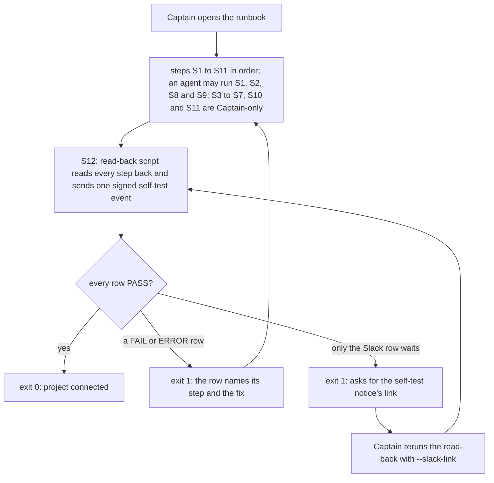

inbox-r1 of the `kc-ops-inbox` package. Two POCs closed PASSED: `hermes-ops-fo-exe-dev-poc` (2026-10-21: a GitHub App token under no-bypass rulesets reaches only ops/* branches and Draft PRs; a headless Claude Code First Officer on a hosted runner files one ops task; the Captain's own GitHub review is the recorded decision) and `inbox-exactly-once-delivery-poc` (2026-10-23: three sends of one signed CloudEvents event gave one workflow run; a tampered send started nothing; the inbox credential could not push; the inbox core imports only node:crypto). Both proved the inbox code is small; the cost is the per-project setup the Captain did by hand (two Apps, rulesets, secrets, Slack webhook) and permission isolation.

Captain's words:
- Outcome (2026-10-19, design brief): 「拉出一個ops inbox抽象，確保必要資訊可以一次到位到inbox 變成一個聚合事件，然後後面可以投影到slack，或是投影給agent … 目的是人要知道，然後agent要同步進行解決方案呈現，要有一個repo內的ops workflow，來按照sd流程進行排查」
- Authority (2026-10-19): 「被叫起來的agent有source存取權限，可以跑 ops flow推entity task到separate branch，但是沒有權限做危險動作例如推main且沒有權限合併pr」
- Contract (2026-10-21): 「應該要先定義好 inbox 合約，由不同管道收取，且 platform 本身也要提供 hook 可以接，不能直接依賴第三方平台」
- Platform (2026-10-21): 「你要注意一件事，平台是剛好是 netlify，不是平台一定是 netlify。」
- Focus (2026-10-23): 「好」 to: r1 Pilot 的範圍改成以兩件事為主：設定流程（一步就能把專案接上 inbox，替你處理這次那六件手動設定）與權限隔離（inbox 只能叫起它自己的那個 workflow）；合約 v1 仍是 r1 的第一件事。

## Scope

- Contract v1: CloudEvents 1.0 attributes and Standard Webhooks signing, an allowlisted data field set, the dedupe key, and a version; published in the package with a validator and fixtures for relay's ceiling event and a Sentry-shaped event. Relay's own hook is written by relay against this contract in a relay task, not here.
- Setup: one command connects a project to its inbox: it creates or updates what an agent may create, lists each step only the Captain may do (App creation, keys, Slack webhook, secrets, ruleset changes) with the exact command, and reads every step back.
- Isolation: the inbox's credential can start only the project's ops workflow (POC2 finding F2: Actions write is repository-wide).
- Event to person and agent: a signed event yields one Slack notice whose arrival is observed, and an FO on a GitHub-hosted runner files one ops task with one recommendation on an ops/* branch and a Draft PR; the Captain's GitHub review is recorded without pushing to the PR branch, so the approval is not dismissed (POC1 finding).
- Platform-neutral core: the same core runs under the Netlify adapter and under a second adapter or plain Node harness.
- Non-goals: relay's live producer, raise-from-link, Slack Q&A, qnow live, the in-service FO, Spacedock gate-actor authentication (upstream), guaranteed delivery and reconciliation (POC2 chose at-most-once; ideation states the delivery semantics for the Captain).
- Budget: at most 3 days (FO proposal; the Captain sets it).
- Stop conditions: isolation needs a credential that can push or start other workflows; the setup cannot read back a step it claims; the estimate exceeds the budget. Each returns a planning delta to the Captain.

## Acceptance criteria

**AC-1**: Contract v1 validates the relay-shaped and Sentry-shaped fixtures and rejects a fixture with a missing attribute, a bad signature or a field outside the allowlist.
Verified by: the validator's output on each fixture, with exit codes.

**AC-6**: The axis ADR lands in kc-claude-plugins `docs/adr/` in the kc-adr template under the number FO reserves, and its `**Words:**` lines quote the Captain's two answers of 2026-10-23 verbatim. Amended by Captain, amendment 1.
Verified by: `python3 kc-adr/scripts/adr_lint.py docs/adr --require <NNNN>` exit 0 at the candidate, and each `**Words:**` quote equal character for character to the answer in `asked-day2-axis-2026-10-23.md` and to the `Captain:` line of amendment 1.

**AC-7**: The written setup runbook gives every step its owner and exact command, and the read-back script reports each step PASS, FAIL, ERROR or WAIT from the live resources and exits 0 only when every row passes. Amended by Captain, amendment 1.
Verified by: the read-back output on relay with every row PASS and each row's raw read-back, and one run with one step not done reporting that row not PASS and exit 1.

**AC-8**: The inbox's credential starts the ops workflow in the project's trigger repository, which holds no other workflow, and is refused when it tries to start or re-run a workflow in the project repository, which holds a second workflow with secrets. Amended by Captain, amendment 1; proposed to supersede AC-3.
Verified by: the read-back self-test's calls (dispatch of the trigger workflow answered 200 with a run id; dispatch of a project workflow refused; re-run of a project run refused; token mint for the project refused), `gh api repos/<trigger>/actions/workflows --jq .total_count` printing `1`, and the project's run list unchanged.

**AC-9**: Two signed events with one source and subject and different ids give one ops task holding both events, one Draft PR, one agent run, and one Slack notice each (New incident, then Joins incident); an event with another subject gives a second task; a resent copy of an accepted event gives no notice, task or run. Amended by Captain, amendment 1.
Verified by: the inbox log line per event id, the task and event files on `spacedock-state/ops`, the open `ops/*` pull requests, the trigger runs and which of them ran the First Officer, and the Slack messages.

**AC-10**: The ops record's options cite the project's ADRs by reference block (repository, path, full commit, sha256 digest, status), read by kc-adr's read-adr rules; the citation check passes every block of the record and refuses a block with a wrong digest, a missing path, a missing commit or an ADR not Accepted. Amended by Captain, amendment 1.
Verified by: the record on the live incident's Draft PR holding at least one block, the check's output on it (exit 0), and its output on four copies each carrying one of the four faults (exit 1 with the matching reason).

**AC-11**: A signed event produces one Slack message seen in the channel and one ops task on the state branch whose recommendation is the record file on an ops/* branch with a Draft PR; after the Captain's review, the gate is recorded with his words, the time from the event's arrival to the Draft PR and whether his review approved the recommendation, and his approval still stands on the PR. Amended by Captain, amendment 1; proposed to supersede AC-4.
Verified by: the Slack message link with its time, the task and the Draft PR (`draft: true`, author the agent App), the gate commit on `spacedock-state/ops` with `by: person:captain`, the review id and the two measures, and `gh api repos/<project>/pulls/<n>/reviews` showing his review `APPROVED` on an unchanged head.

**AC-12**: One event emitted by relay's own code on a relay deploy, not by a fixture or a send script, travels the path of AC-9 to AC-11 to a recorded gate. Amended by Captain, amendment 1.
Verified by: relay's function log line for the event id, the inbox log line for the same id, and AC-11's evidence for that id.

**AC-13**: The inbox core imports only node:crypto and its tests pass under the Netlify adapter. Amended by Captain, amendment 2.
Verified by: `grep -h '^import' kc-ops-inbox/core/*.mjs` printing only `node:crypto`, and the core's test run under the Netlify adapter with zero failures.

## FO alignment

Direction alignment before ideation: not needed; the Captain set the focus on 2026-10-23 and the contract direction on 2026-10-21. Ideation runs on opus (contract and authority boundary are hard to reverse).
Surfaces: ui
Visible change: Each relay ceiling event shows up as one Slack notice; a new incident brings a Draft PR whose ops record cites relay's ADRs and is decided by the Captain's GitHub review, and later events of the same incident join it.
Release review: not needed: the kc-ops-inbox journey map (inbox-r1) is only on branch iamcxa/kc-ops-inbox at 0a1d59ce and not on the trunk; set journey fields when it lands.
Captain standing ask, 2026-10-21: 「請持續針對套件的意義做觀察與回饋」. FO reports a package-value observation at each gate.
Captain ruling, 2026-10-23 (chat): 「可以沿用」 to reusing the two POC GitHub Apps (ops-inbox-probe-iamcxa as the agent App, ops-inbox-dispatch-iamcxa as the dispatch App) after deleting the scratch repository, rotating both private keys and transferring both Apps to spacedock-dev; and 「准」 to keeping both Apps' keys in relay's own 1Password vault (named relay-dev or agent-relay-dev; the Captain uses the one his 1Password shows), one Secure Note per App. Open for implementation: `netlify env:set` takes the value on argv, against the stdin-only rule kc-paseo-plugins' project-env follows (PR #21); replace it or record it as a limit.
FO outward actions, 2026-10-23, on the Captain's 「同意」: pushed branch spacedock-ensign/ops-inbox-r1-setup-and-isolation at 1e65b046 to origin (no PR); created private repo spacedock-dev/subspace-relay-ops-trigger with only .github/workflows/ops-event.yml pinned to kc-claude-plugins 1e65b046 (commit 34f1ff5b); created Netlify site subspace-relay-ops-inbox (project a1e2e99d-a93f-4ac4-b20f-2503e8f1062f) on the Spacedock team, linked to the worktree's kc-ops-inbox/, with OPS_TRIGGER_REPO and OPS_WORKFLOW set; not deployed yet (S8 needs the App IDs).
Captain direction, 2026-10-25 (chat): 「可以，先用 docker 做 poc，如果可行再測試 exe.dev，然後拉回 doceker 繼續整合」, answering whether to pause r1's live setup and first run a POC of Paseo Hub plus a deployed daemon as intake and First Officer runner. r1's live setup (App key rotation, transfer and install, Netlify deploy, relay task) is paused until that POC closes; the trigger repository spacedock-dev/subspace-relay-ops-trigger and the Netlify site subspace-relay-ops-inbox stay as created.

## Number guards

ADR: 0031
FO note: this task holds one ADR number, for the axis ADR (AC-6). The trigger-repository and state-branch ruling (D2, D3) needs a second ADR; per Number guards a second ADR returns to FO, so FO files it as a follow-up task instead of reserving a second number here.

## Captain amendments

### Amendment 1 — 2026-10-23, chat
Captain: 「同意」 (chat, 2026-10-23), after 「對，這樣可以」 to the day-2 axis and the ten-item priority.
Asked: 「照這樣做嗎？具體是：把現在 r1 的 ideation 退回；第一件事寫這份主軸 ADR；再照優先順序重擬 r1：聚合、帶脈絡的診斷、真的接上 relay 放前面，設定自動化延後。」
Supersedes: AC-2
Design: the ideation design of attempt 1 (## Design) is redone around the confirmed axis.
Superseded text:

**AC-2**: On a scratch project, the setup command completes the agent-doable steps, prints each Captain-only step with its exact command, and reports every step as verified by read-back.
Verified by: one full setup run log on a scratch project, and the read-back of each created resource.

### Amendment 2 — 2026-10-23, ideation gate
Captain: 「准」 (chat, 2026-10-23, ideation gate attempt 2)
Asked: the committed ideation gate question at briefing `briefing:ops-inbox-r1-setup-and-isolation:ideation:attempt-2:revision-1`, which stated that approving accepts the cycle-2 re-cut as written, including AC-8 superseding AC-3, AC-11 superseding AC-4, and a 3.5-day budget with AC-5's second adapter deferred.
Supersedes: AC-3, AC-4, AC-5
Superseded text:

**AC-3**: The inbox's credential starts the project's ops workflow and is refused when it tries to start any other workflow in that repository.
Verified by: one accepted dispatch and one refused dispatch with the same credential, against a repository holding a second workflow with secrets.

**AC-4**: A signed event produces one Slack message seen in the channel and one ops task with one recommendation on an ops/* branch with a Draft PR; after the Captain's review, the gate is recorded with his words and his approval still stands on the PR.
Verified by: the Slack message with its time, the task and Draft PR, the gate record, and the PR's review state after recording.

**AC-5**: The inbox core passes the same tests under the Netlify adapter and under a second adapter or plain Node harness.
Verified by: both test runs and the core's import list.

## Design

Cycle 2 (2026-10-23), after amendment 1. Kept from attempt 1, as the Captain asked: contract v1, the trigger-repository isolation, the state-branch gate record. Redone: everything else, ordered by the confirmed axis (`asked-day2-axis-2026-10-23.md`). `## Scope`, the title and `Visible change:` are not edited here; the re-cut below is the proposal for the next ideation gate.

### Re-cut proposal (for the next ideation gate)

**Proposed title:** A relay event becomes one decision an agent has prepared: the Captain hears at once, later events of the same incident join its ops task, the options cite relay's ADRs, and the inbox can start only the project's ops workflow

**Proposed Scope**, each line tagged with the Captain's priority number from the axis:
- First deliverable: the axis ADR in kc-claude-plugins `docs/adr/`, kc-adr format, his words (AC-6).
- Contract v1 (2): CloudEvents 1.0 and Standard Webhooks signing, an allowlisted field set, the dedupe key `source` + `id`, the incident key `source` + `subject`, a version; validator and fixtures (AC-1).
- Isolation (0): the inbox's credential starts workflows only in the project's trigger repository, which holds one workflow (AC-8).
- Aggregation (2): the first event of an incident opens one ops task and starts the agent; a later event of the same incident joins that task and starts no agent (AC-9).
- ADR-aware diagnosis (1, 5): the First Officer reads the project's ADRs by kc-adr's read-adr rules and cites them by reference block in its options; a citation check verifies every block (AC-10).
- Person and agent, record and gate (1, 3, 4): one Slack notice per event; one ops task on `spacedock-state/ops`, one record file and Draft PR on `ops/<incident>`; the gate recorded from the Captain's GitHub review with his words and the axis's two measures (AC-11).
- Setup (8, deferred): a written runbook plus a read-back script, no setup automation (AC-7).
- Dogfood: one event emitted by relay's own code, end to end (AC-12). Relay writes its emitter in a relay task against contract v1.
- Platform-neutral core: imports only `node:crypto`; the second adapter is the first cut (D10, AC-5).
- Non-goals (r2 or later): live conversation with the agent, a UI, dot and other response adapters (6, 7); re-running the agent for a joined event (D8); raise-from-link; acting on the decision and archiving; Sentry or qnow live; relay production (D9); setup automation; guaranteed delivery; Spacedock gate-actor authentication (upstream).
- Budget: 3 days as approved; this design estimates 3.5 with the D10 cut (see Estimate), which is the stop condition "the estimate exceeds the budget".
- Stop conditions: kept from `## Scope`, plus: relay's emitter is not on a relay deploy when AC-12 is due.

**Criteria:** amendment 1 supersedes AC-2. AC-6 to AC-12 are the replacements and additions. AC-8 restates AC-3 and AC-11 restates AC-4 with the coupled wording D2 and D3 carried in attempt 1; amendment 1's `Supersedes:` line names only AC-2, so AC-3 and AC-4 stay declared until the Captain's ruling names them.

**What r1 needs from relay, and when** (relay's task, written by relay against contract v1; this task edits nothing in relay):
- Emit `relay.capacity.ceiling` at 80% and at full, per tier (signed-in and anonymous): `id` `<tier>-<day>-<80|100>`, so a repeat of one crossing is a duplicate; `subject` `ceiling/<tier>/<day>`; `data` only `v, event, at, day, count, limit, limitSource` (POC1's field set, which holds no account identifier, as relay ADR 0049 requires; the removed notice's account concentration is not asked for). Sign with Standard Webhooks; POST to the inbox URL; a failed send is logged and never blocks a publish.
- Carry the setup PR's two files (`ops-gate.yml`, `docs/ops/README.md`) from the package, so what lands in relay goes through relay's own review.
- When: relay can start once contract v1 lands (day 1); the emitter must be on a relay deploy by day 3 for AC-12. Relay ADR 0060 says it reopens "when `kc-ops-inbox` asks for the notice"; this list is that ask, and relay's ruling on it is relay's.

### PRFAQ

**kc-ops-inbox r1: when relay's capacity ceiling fills, the Captain hears at once, and the Draft PR he opens already holds an agent's recommendation that cites relay's own rulings; later events of the same day join that one task.**

A relay deploy sends one signed CloudEvent when a ceiling reaches 80% and another when it is full. The inbox checks the signature and the contract, drops a resent event, and asks whether the event's incident (its source and subject) is new. A new incident starts the project's ops workflow through the trigger repository and posts "New incident" on Slack; a later event of the same incident posts "Joins incident", starts no agent, and is recorded on the incident's task and as a comment on its Draft PR. For a new incident, a First Officer on a GitHub-hosted runner reads relay's ADRs at the commit it checked out, writes a diagnosis, two or three options and one recommendation, and cites each ruling it relied on by repository, path, commit and digest; a check verifies every citation before the Draft PR opens. The Captain decides by his GitHub review; a job records his words, how long the recommendation took and whether he approved it, on the state branch, so his approval stands for the merge. Each decision recorded this way is the precedent the next one can lean on, which is the axis the Captain confirmed on 2026-10-23.

FAQ
- **Why is the setup a runbook now?** The Captain deferred setup automation (amendment 1). The runbook lists twelve steps with owner and command; a read-back script proves each one and exits 0 only when all pass. Seven steps stay Captain-only (Apps, keys, secrets, Slack webhook, rulesets, merging the setup PR).
- **What makes two events one incident?** The same `source` and `subject`. The producer sets `subject` because it knows the thing the event is about (relay: the tier and UTC day; Sentry: the issue). Probe P3 compared four keys on one day of events; only this one grouped them the way the remedies group (see Aggregation).
- **Does the agent rethink when the full event follows the near one?** Not in r1. The joined event is recorded and shown on the PR with "the recommendation above was written before this event" (D8).
- **Can the agent invent an ADR?** It can write one into its record, but the citation check refuses any block whose path, commit, digest or status does not hold (probe P5: four faults, four refusals). The check cannot tell whether the agent applied a real ruling correctly; the Captain's review does.
- **Is relay production connected?** No. The live event comes from a relay deploy preview with a lowered ceiling (D9); production adds an always-on service and a production secret, which returns to profile selection.
- **What does an event cost?** Not measured for r1. POC1: about 2 runner minutes and an imputed 0.74 USD per First Officer run; a joined event runs no model.

### How an event travels

```mermaid
sequenceDiagram
    autonumber
    participant P as Relay deploy (producer)
    participant I as Inbox (core and host adapter)
    participant S as Slack channel
    participant T as Trigger repository (ops-event run)
    participant R as Project repository (relay)
    participant C as Captain
    participant G as ops-gate job (project repository)
    P->>I: POST signed CloudEvent with source, id, subject, type and data
    alt signature missing, wrong or older than 300 s
        I-->>P: 401, nothing claimed or started (stop)
    else not contract v1: missing attribute or a field outside the allowlist
        I-->>P: 400, nothing claimed or started (stop)
    else source and id already claimed
        I-->>P: 200 duplicate, no notice, no run (stop)
    else new event
        I->>I: claim source and id, then claim the incident (source and subject) if it is new
        I->>T: workflow_dispatch ops-event.yml, mode open for a new incident or join for an existing one
        alt GitHub refused
            I->>I: release the claims this event made
            I->>S: notice: agent NOT started
            I-->>P: 502, the sender's retry may start it
        else no answer within 10 s
            I->>S: notice: start UNCERTAIN, the inbox will not resend
            I-->>P: 504, claims kept (at-most-once)
        else run created in mode join
            I->>S: notice: Joins incident, no new agent run
            I-->>P: 202
            T->>T: wait for the incident's opening run to finish
            alt the incident's Draft PR is open
                T->>R: event file on spacedock-state/ops and a comment on the Draft PR (stop)
            else the opening run failed, or the PR is merged or closed
                T->>R: open a new incident the same way as mode open below
            end
        else run created in mode open
            I->>I: record the run id on the incident
            I->>S: notice: New incident, agent started, with the run link
            I-->>P: 202
            T->>R: create ops/<incident>, the task and its first event file on spacedock-state/ops
            alt ref ops/<incident> already exists
                T->>R: treat the event as joined: event file and PR comment (stop)
            else ref created
                T->>R: First Officer triage: read docs/adr at the checked-out commit, diagnosis, options citing ADRs, one recommendation
                T->>T: citation check on every reference block
                T->>R: record file with each block's check result on ops/<incident>, Draft PR
                C->>R: GitHub review of the Draft PR
                R->>G: pull_request_review event
                alt reviewer is not the Captain, or the review is not on the PR head
                    G->>G: no-op, the gate stays open (stop)
                else the Captain's review on the PR head
                    G->>R: gate record with his words, time to recommendation, approved or not; committed to spacedock-state/ops only
                    Note over R: the PR head does not move, so his approval stands and satisfies the merge rule
                end
            end
        end
    end
```

### How setup runs



### Axis ADR draft (AC-6)

Lands in kc-claude-plugins `docs/adr/` as the first implementation commit; FO reserves the number; file short title `every-ops-event-becomes-a-prepared-decision`. Draft, in the kc-adr template:

> # NNNN. Every ops event becomes a decision an agent has prepared, and each decision makes the next easier to hand to an agent
>
> Date: 2026-10-23
>
> ## Status
>
> Accepted
>
> ## Context
>
> kc-ops-inbox began from the Captain's outcome of 2026-10-19: 「拉出一個ops inbox抽象，確保必要資訊可以一次到位到inbox 變成一個聚合事件，然後後面可以投影到slack，或是投影給agent … 目的是人要知道，然後agent要同步進行解決方案呈現，要有一個repo內的ops workflow，來按照sd流程進行排查」. Two POCs closed PASSED (`hermes-ops-fo-exe-dev-poc`, 2026-10-21; `inbox-exactly-once-delivery-poc`, 2026-10-23). The first r1 design centred on a one-step setup command and permission isolation. Before its gate the First Officer proposed a day-2 axis and a ten-item priority: Netlify and Sentry already notify, so the value is not a faster alert. The Captain confirmed it, and r1 was sent back and re-cut around it (task `ops-inbox-r1-setup-and-isolation`, amendment 1).
>
> ## Decision
>
> **Words:** 「對，這樣可以，這可以使用 kc-adr 紀錄嗎？還是用 dev2 adr 紀錄？」 — Captain, 2026-10-23, in chat, to the First Officer's axis and priority (verbatim question in the task folder, `asked-day2-axis-2026-10-23.md`)
> **Words:** 「同意」 — Captain, 2026-10-23, in chat, to 「照這樣做嗎？具體是：把現在 r1 的 ideation 退回；第一件事寫這份主軸 ADR；再照優先順序重擬 r1：聚合、帶脈絡的診斷、真的接上 relay 放前面，設定自動化延後。」
>
> **Options considered:**
> - each ops event reaches the person as a decision an agent has already prepared, and each decision makes the next easier to hand to an agent (chosen)
> - a faster alert: Netlify and Sentry already notify
> - setup automation and permission isolation first (the attempt-1 r1 focus, 2026-10-23)
>
> **Recommended:** the axis and the priority order, as the First Officer proposed them.
>
> kc-ops-inbox work is ordered by this priority, highest first: 0 (precondition) the platform limits the agent's authority, so it cannot push the default branch or merge; 1 the agent investigates at the same time and presents a solution; 2 the necessary information arrives complete and the events of one matter aggregate into one; 3 the person knows at once; 4 every step is recorded in the repository's ops workflow, with the Captain's words; 5 decisions connect to kc-decision-log or the project's ADRs; 6 more response adapters (dot, a Netlify agent and others); 7 live streaming, live conversation with the agent, the simplest UI; 8 independent deployment per project and a generic flow with per-project configuration; 9 versioned evolution such as ops and ops2. A release does not take a lower item at the cost of a higher one. Progress is measured by two numbers: the time from an event to a recommendation the person can decide on directly, and the share of the person's decisions that follow the agent's recommendation.
>
> ## Consequences
>
> Easier: deciding what a release takes, and turning each recorded decision into precedent. Harder: setup stays a written runbook with Captain-only steps until item 8 is taken. Not built: kc-decision-log; any decision the agent takes alone, which needs its own ruling (kc-claude-plugins ADR 0011 governs delegation to the First Officer). Reopen when the Captain reorders the items, or when the second measure is high enough that he asks for delegation.

The two `**Words:**` lines quote his answers verbatim; the priority list is rendered in English from the First Officer's table, which the task folder holds verbatim in Chinese. His question 「這可以使用 kc-adr 紀錄嗎？還是用 dev2 adr 紀錄？」 was answered by his asks in the gate reason: kc-adr format in kc-claude-plugins `docs/adr`.

### Contract v1 (AC-1)

One module, `kc-ops-inbox/contract/`, used by the validator CLI, the inbox core and the trigger run, so there is one implementation of the rules. Kept from attempt 1, with `subject` now required:

| Part | Rule | Source |
| --- | --- | --- |
| Transport | `webhook-id`, `webhook-timestamp`, `webhook-signature` headers; HMAC-SHA256 over `id.timestamp.body`, `v1,<base64>`; `whsec_` secret; timestamp within 300 s; body at most 16 KiB | Standard Webhooks spec; POC2 core |
| Envelope | CloudEvents 1.0 structured JSON. Required: `specversion` "1.0", `id` (`^[A-Za-z0-9._-]{1,64}$`), `source` (at most 200 characters), `type` (allowlisted), `subject` (`^[A-Za-z0-9._/-]{1,100}$`, the incident within the source), `time`, `dataschema`. Allowed besides: `datacontenttype`, `data`. Any other attribute is refused. | CloudEvents 1.0.2 (`subject`: the subject of the event in the context of the producer) |
| Version | `dataschema` is `.../kc-ops-inbox/contract/v1/<type>.json`; an incompatible change gets v2; each schema's digest is pinned in `contract-versions.json` with a test | kc-journey-map `contract-versions.json` pattern |
| Allowlist and subject rule | `relay.capacity.ceiling`: `v, event, at, day, count, limit, limitSource`; subject `ceiling/<tier>/<day>`. `sentry.issue.alert`: `issue_id, event_id, title, level, culprit, project, web_url, triggered_rule, datetime, release`; subject `issue/<issue_id>`. A field outside the list is refused, not dropped. | POC1 fixture; Sentry issue-alert docs; relay ADR 0049 |
| Keys | dedupe `sha256(source + "\n" + id)`; incident `sha256(source + "\n" + subject)` | CloudEvents; probe P3 |
| Slack text | Event strings are escaped (`&`, `<`, `>`) before Slack | Slack message formatting |

Validator: `node kc-ops-inbox/contract/validate.mjs <fixture.json>`; exit 0 prints `valid <type> <dedupe key> <incident key>`; exit 1 prints one reason (`missing-attribute: <name>`, `signature-mismatch`, `timestamp-out-of-tolerance`, `field-not-allowed: <path>`, `unknown-type: <type>`); exit 2 is a usage error. Fixtures: `relay-ceiling-near.json`, `relay-ceiling-full.json`, `sentry-issue.json`, `missing-source.json`, `missing-subject.json`, `bad-signature.json`, `extra-field.json`.

### Aggregation (AC-9)

- The inbox keeps two create-only claims: the event (`source`, `id`) and the incident (`source`, `subject`). A new incident claim means mode `open`; an existing one means mode `join`, and the stored record names the opening run.
- Mode `open` runs as attempt 1 did, on branch `ops/<incident>`, where `<incident>` is the subject made branch-safe plus the first 8 hex of the incident key. If the ref already exists (two first events raced past the inbox's claim, POC2 finding F4), the run treats its event as joined, so the ref create is the backstop.
- Mode `join` waits for the opening run to finish, then writes `events/<id>.json` beside the task on `spacedock-state/ops` and comments on the incident's open Draft PR. When the opening run failed or the PR is merged or closed, it opens a new incident `ops/<incident>-<event id>` instead; later joins go to the newest open PR of that incident.
- One file per event, not an append to the task file: probe P4 showed two concurrent appends to one task file conflict on `pull --rebase`, and two new files rebase cleanly.
- What a joined event does beyond the record is D8.

### ADR-aware diagnosis (AC-10)

- The triage stage of the ops workflow follows kc-adr read-adr step 1 on the project clone: pin the checked-out commit, list `docs/adr/` titles, open those that bear on the event, check each one's Status at that commit. The runner installs kc-adr at the published tag `kc-adr-v0.1.1` (ls-remote, 2026-10-23), the same way it installs Spacedock, rather than copying its rules.
- Each option that relies on a ruling marks it `[ADR NNNN]`; `## Rulings cited` holds one reference block per ruling (repository, path, full commit, `sha256:` digest, status).
- `kc-ops-inbox/bin/check-citations.mjs <record> --repo <clone>` re-reads every block with git and shasum and refuses `commit-missing`, `path-missing`, `digest-mismatch` or `not-in-force(<status>)`; the run writes each block's result into the record and the PR body's first line counts them, so a refused citation is visible, not removed.
- Which ADRs bear on the event stays the model's judgement; the check proves the blocks are real, not that they were applied correctly.

### Isolation (AC-8; AC-3 until superseded)

Kept from attempt 1. The dispatch App has Actions write only and is installed only on the trigger repository, which holds one workflow file and one branch under a default-branch ruleset that needs the Captain's approval. The trigger run mints the agent App's token for the project repository inside the run (`actions/create-github-app-token` with `owner` and `repositories`); the agent App's key lives in the trigger repository's secrets. Rejected, from probe P1: Actions write on the project repository (any workflow, re-run, disable, OIDC subject template); `repository_dispatch` (needs Contents write); issue-triggered workflows; a scheduled pull. The agent App's branch scope in the project repository is D6.

### Person and agent, the gate and the two measures (AC-11; AC-4 until superseded)

- Kept from attempt 1: the task and its gate on `spacedock-state/ops`; the record file `docs/ops/<incident>.md` on the Draft PR; `ops-gate.yml` records the gate only from the review of `OPS_CAPTAIN_LOGIN` on the PR head and pushes only the state branch, so the approval is not dismissed (rulesets docs: dismissal follows pushes "that affect the diff"); POC1's fixes (ops-gate on the default branch first, a failed review read exits 1, Spacedock's installer pinned and checksummed).
- New: the gate record carries `received` (inbox arrival), `recommended` (Draft PR created) and `followed: yes` when the review state is `APPROVED`, otherwise `no` with his words. These are the axis's two measures per task; nothing in r1 sums them across tasks.
- The ops workflow's stages in r1: `triage`, then `decision` (gate).

### Setup runbook and read-back (AC-7)

`kc-ops-inbox/setup/RUNBOOK.md` holds steps S1 to S12 as the preview prints them: owner (Captain only, agent may run, anyone), what, the exact command, and the read-back rows that prove it; S10 has one command per ruleset, so a failed row names one line to rerun. `kc-ops-inbox/bin/readback.mjs --project --trigger --inbox [--slack-link]` reads 20 rows with the Captain's `gh` and `netlify` logins and one signed self-test event (secret through the Captain's secrets wrapper, never printed). It keeps attempt 1's read-back design: what the Captain's login cannot read (probe P2: App installations) is read through the self-test run; Slack visibility needs his message link. Deleting the downloaded key files (S5) is on his own disk and is not read back. Attempt 1's `plan` and `apply` are withdrawn. The preview's commands were checked against `netlify env:set --help`, `netlify link --help`, `netlify deploy --help` and `gh secret set --help` (2026-10-23): `env:set` takes the value as an argument and does not prompt, which corrects attempt 1's "paste the URL when asked"; `gh secret set` reads the value from standard input.

### Live relay event (AC-12)

The relay task's emitter, deployed on a relay deploy preview with the signing secret set only in the deploy-preview context. The ceiling is lowered for the run with relay's own operator script (`scripts/bound-ceiling --prefix pr-N/ --limit 5`, relay ADR 0060), and four then five signed-in publishes cross 80% and full: one new incident and one joined event from relay's real code. Relay ADR 0002 already keeps a test that spends a device's daily allowance off relay production, proving it in CI and on staging; the dogfood follows the same line. Production is D9.

### Platform-neutral core (AC-5)

Kept from attempt 1: `core/` takes a Web `Request`, a store (`create-if-new`, `get`, `delete`), `fetch`, an env map and a clock, and imports only `node:crypto`; adapters for Netlify (`@netlify/blobs`, strong consistency) and plain Node. D10 proposes deferring the second adapter and keeping the import-list check. A path-filtered CI job runs the tests on pull requests that touch `kc-ops-inbox/**` (cost not measured).

### Acceptance evidence plan

- **AC-1**: the validator on the seven fixtures: `valid` with both keys and exit 0 for the three valid ones; exit 1 with `missing-attribute: source`, `missing-attribute: subject`, `signature-mismatch` and `field-not-allowed: data.user`; plus the contract-digest test.
- **AC-3 / AC-8**: the read-back self-test's JSON (trigger dispatch 200 with a run id; project workflow dispatch refused; project re-run refused; mint for the project refused 422), the trigger workflow count `1`, the project run list unchanged.
- **AC-4 / AC-11**: on the AC-12 incident: Slack link and time (Captain), the run id, `ops/<incident>` and the Draft PR (`draft: true`, agent App author), the task on `spacedock-state/ops`, the `ops-gate` run log and gate commit with `by: person:captain`, review id, `received`, `recommended` and `followed`, then `gh api repos/<project>/pulls/<n>/reviews` showing `APPROVED` on the unchanged head.
- **AC-5**: `npm test` per adapter with equal pass counts and zero failures, and `grep -h '^import' kc-ops-inbox/core/*.mjs` printing only `node:crypto`; under D10, the import list and the Netlify run only.
- **AC-6**: the linter's exit 0 with `--require`, and a byte comparison of each quote with its source.
- **AC-7**: the read-back on relay, every row PASS with raw output; and one run before S10 is applied, reporting its ruleset rows FAIL and exit 1.
- **AC-9**: the AC-12 run (near, then full: one task, two event files, one Draft PR, one First Officer run, notices New then Joins), one anonymous-tier event (a second task), and the first event resent with the package's send script (inbox log `duplicate`, no notice, no run).
- **AC-10**: `check-citations.mjs` on the live record (exit 0, at least one block) and on four copies, each with one fault (exit 1, the four reasons), as probe P5 ran.
- **AC-12**: relay's function log line and the inbox log line for the same event id, joined to AC-11's evidence.

### Probes run before the gate

Cycle 2, 2026-10-23, local or read-only, no model run; scripts kept in `ops-inbox-r1-setup-and-isolation/probes/` (run with node 20 and bash; P5 takes a relay clone and a ref as arguments):
- **P3, what makes two events one incident (local):** `node p3-incident-key.mjs` on one day of relay ceiling events (near and full signed-in, a producer retry, anonymous full, next day near) and three Sentry events of two issues, each labelled with the remedy it needs (relay ADRs 0043 and 0060 give the tiers different remedies). After dedupe dropped the retry: `source+id` 7 groups (2 wrong pairs), `source+type` 2 (7 wrong), `source+type+data.day` 3 (4 wrong), `source+subject` 5 (0 wrong), expected 5. Limit: the labels are this design's, so the probe shows only that `subject` can carry the grouping with no type-specific code in the inbox; whether relay sets it right is AC-12's.
- **P4, concurrent joins (local bare git repository):** two writers joining one incident on `spacedock-state/ops` at once: appending to the task file gave `CONFLICT (content)` on `pull --rebase`; one file per event rebased and pushed. Hence per-event files.
- **P5, citing the project's ADRs (read-only git on relay's clone, no fetch):** read-adr step 1 at relay origin/main `485306242b806b0bbeea8fc1ff0abfe6568de959`: 63 ADRs; a title grep for the event's terms found 9, of which 0001, 0043, 0049, 0054 and 0060 bear on a ceiling event and 4 do not; all 9 `Accepted`, digests computed (0060: `sha256:bd63ef2d…c33d5a3`). The citation check passed the true 0060 block and refused a wrong digest, a missing path, a missing commit, and the superseded ADR 0003 (`not-in-force(Superseded by 0021)`). Limit: the title grep stands in for the model's choice, which needs a First Officer run (not run; FO's leave needed).
- **P6, the axis ADR draft against kc-adr's linter (local):** the draft below, unquoted into a scratch `docs/adr/0099-every-ops-event-becomes-a-prepared-decision.md` with `adr_lint.py` from origin/main `a476b5ff`: `--require 0099` exit 0; with the `**Words:**` lines removed, exit 1 "Decision needs a '**Words:**' line"; `--require 0100`, exit 1. 0099 is a placeholder, not a reservation.
- Cycle 1's P1 (GitHub's permission map: no per-workflow permission; Actions write re-runs any run) and P2 (`gh api /user/installations` 403 with the Captain's login) stand; their detail is in the attempt-1 design at state commit `790b5542`.
- Not touched: relay (read only, no checkout or fetch), qnow, any scratch repository or site, any secret, App, ruleset, deployment or push.

### Sources read (2026-10-23)

- kc-adr at kc-claude-plugins origin/main `a476b5ff`: `references/adr-template.md`, `skills/read-adr/SKILL.md`, `writing.md`, `prefix.md`; tags `kc-adr-v0.1.0`, `kc-adr-v0.1.1` (`git ls-remote`).
- Relay at origin/main `48530624`, read only: ADRs 0001, 0043, 0049, 0060 in full; titles of all 63; `RELAY_BOUND_SITE_DAILY_BRIEFING_LIMIT` and `RELAY_ANON_SITE_DAILY_BRIEFING_LIMIT` in `netlify/` and `docs/architecture.md`.
- POC branches: POC1 `slice/fixture-event.json`, `slice/fo-prompt.md`, `slice/run_fo.sh`, `ops-workflow/README.md`; POC2 `inbox-core.mjs`, `netlify/functions/inbox.mjs`, `workflow/ops-event.yml`.
- Attempt 1's external sources (GitHub, Slack, CloudEvents, Standard Webhooks, Sentry) are unchanged; list at state commit `790b5542`.

### Existing-code check

Upstream first: Spacedock has no inbox or aggregation; kc-dev-flow and kc-dev-flow-2 have none; kc-adr (published `kc-adr-v0.1.1`) already owns the ADR template, the linter and the read-at-commit rules, so r1 installs it and writes only the citation check, which applies read-adr step 2 by machine; kc-decision-log is planned, not built (`docs/journey/kc-decision-log/`). Reused as reference: POC2's core and adapter (`cd079cb8`), POC1's `ops-gate.yml`, `record_gate_from_review.sh` and `run_fo.sh` (`aae7041b`), kc-journey-map's `contract-versions.json` pin. Sentry already groups events into issues; the contract takes its `issue_id` as the subject rather than grouping again.

### UI surface

UI proposal: A person sees three things. (1) The setup runbook, plain text: steps S1 to S12, each headed by its owner in capitals (CAPTAIN ONLY, AGENT MAY RUN, ANYONE) and one short action, an explanation line where needed, its exact commands and the read-back rows that prove it; and the read-back script's output, one row per read-back with step, verdict (PASS, FAIL, ERROR, WAIT), what is read, how, and what was observed, a `>` marker and a `next:` line on each row that did not pass, a count, a legend only when a row did not pass, and an exit code; the first run always waits on the Slack row until the Captain gives the self-test notice's link, and says so. (2) One Slack notice per accepted event: a bold heading (producer and event), one line from the allowlisted fields cut at 200 characters, one agent line (New incident with its subject and the run link; Joins incident with its subject and event number, no new agent run; Needs action with a red bar when NOT started, after which the sender's retry posts its own notice; Needs a look with an orange bar when UNCERTAIN), and a context line (event id, source, contract version); the read-back self-test is a fifth kind with its own glyph, posted only by the setup read-back; a resent copy of an accepted event posts nothing; event text is escaped, never a mention. (3) The ops record in the Draft PR, rendered by GitHub: title, incident line, an Events table, Diagnosis (known, not known), two or three numbered Options with cost, each ruling marked `[ADR NNNN]` (`[ADR NNNN REFUSED]` when its citation failed the check), one Recommendation with a "How to decide" line (approve to accept; name another option in a Request changes or Comment review; a review naming no single option is recorded and leaves the option open; nothing runs after the decision in r1), Rulings cited (the commit once, then one block per ADR with its check result), and Measures (received, recommended, the Captain's decision); when a later event joins, the PR description's first line says the recommendation predates it and the event arrives as a comment; a refused citation is named in the PR description's first line.
Preview: ops-inbox-r1-setup-and-isolation/preview/

### Unresolved decisions for the Captain

Each has one recommendation and what gets worse. D2, D3 and D5 of attempt 1 are closed by amendment 1 (D2 and D3 kept as AC-8 and AC-11; D5 replaced by the runbook).

- **D1, delivery semantics.** Recommend at-most-once, as POC2 chose: claim, then dispatch; a refusal releases the claims, an unanswered dispatch keeps them, and Slack says which. Worse: a dispatch GitHub lost starts nothing until someone resends; for a joined event, only that event's record is lost.
- **D4, the inbox host.** Recommend Netlify, one site per project, as POC2 ran it. Worse: per-project sites and secrets; Blobs' atomicity under parallel first events stays unproven (POC2 F4), now bounded for incidents by the `ops/<incident>` ref create.
- **D6, the agent App's branch scope in the project repository.** Recommend not applying the `agent-creations` ruleset on relay in r1, and adding one Captain check to the runbook instead: no workflow in the project uses a secret on a push to a non-default branch or on a pull request from any author. Relay passes it today: of its five workflows, `ci.yml` and `release.yml` run on push to `main` only, and `ci.yml`'s two secret-bearing jobs run only for pull requests authored by `relay-release-officer[bot]` (read-only, relay origin/main `48530624`, 2026-10-23). So the agent App's stray branch or Draft PR reaches no relay secret, while the ruleset would need a bypass for that release bot or block relay's releases. Worse: the agent can still create any branch name in relay, and a later workflow change in relay that drops those guards reopens the exposure with no ruleset behind it. The ruleset (preview S10 line 4 and row R18, drawn as if adopted) becomes the remedy for a project that fails the check. This reverses attempt 1's proposal, which assumed relay's push workflows held secrets.
- **D7, the incident key.** Recommend the producer's CloudEvents `subject`, required in v1, with a per-type rule in the contract (`ceiling/<tier>/<day>`, `issue/<issue_id>`). Worse: relay must set it right, and a producer that sets it too wide merges unrelated events. Alternative: the inbox derives the key from type-specific data fields, which puts code for every new producer in the inbox.
- **D8, what a joined event does.** Recommend record only: event file on the task, PR comment, Slack "Joins incident", no new agent run. Worse: a recommendation written at 80% can be read after the full event; the comment says so. Alternative: re-run triage while the gate is open, about 0.25 day more and one model run per joined event; a review given before it would not be dismissed, because the re-run would push only while no review is recorded.
- **D9, where the live relay event comes from.** Recommend a relay deploy preview with a lowered ceiling. Worse: r1 never sees production traffic; the first real incident waits for the production connection. Alternative: relay production in r1, which adds an always-on inbox and a production secret, and so returns to profile selection before implementation.
- **D10, the budget.** Recommend 3.5 days, with AC-5's second adapter deferred to item 8 (the import-list check keeps the core neutral; ADR 0018's two-adapter ruling is for the journey server, not this core). Worse: neutrality is shown by imports, not by a second host. Without the extra half day, the next cut is the live relay event (AC-12), which the Captain asked for.

No past ruling goes against these: `git -C <state> grep -n 'Override:'` (2026-10-23) hits only `agent-reads-governing-adr` (ADR title hook, ADR path check), neither in this area. Relay ADR 0002 (no allowance-spending test against production) agrees with D9; relay ADRs 0049 and 0060 agree with the relay field set and the near and full events.

ADR drafts landed by implementation (FO reserves the numbers): the axis ADR above (AC-6); and, from attempt 1, "An ops inbox starts workflows only in its project's trigger repository, and the ops gate is recorded on the state branch", ruling D2 and D3 as kept by amendment 1.

### Estimate against the 3-day budget

| Work | Priority | Days |
| --- | --- | --- |
| Axis ADR (AC-6) | ask | 0.25 |
| Contract v1 with subject, validator, fixtures (AC-1) | 2 | 0.5 |
| Inbox core: claims, modes, notices, Netlify adapter | 0, 2, 3 | 0.5 |
| Second adapter and shared tests (AC-5) | 8 | 0.25 |
| Trigger run: open and join, event files, PR comment (AC-9) | 2 | 0.5 |
| Ops workflow: triage with ADR reading, record, citation check (AC-10) | 1, 5 | 0.5 |
| ops-gate with the two measures (AC-11) | 4 | 0.25 |
| Runbook and read-back script (AC-7) | 8 | 0.5 |
| Dogfood on relay: Captain's steps, one live run, evidence (AC-12) | dogfood | 0.5 |
| Total | | 3.75; 3.5 with D10 |

Over the 3-day budget either way: the stop condition "the estimate exceeds the budget" holds, and D10 is the planning delta. Not counted: relay's own task (emitter and the setup PR files), and waiting on it.

### Risks and profile

- AC-12 depends on a relay task outside this budget; contract v1 is the first code deliverable so relay can start on day 1.
- The setup touches relay itself: two Apps installed on relay, five rulesets, a state branch, the setup PR. All are Captain steps or go through relay's review, but they are relay changes this task's implementation will ask for.
- The trigger repository holds the Captain's model token, as POC1 did.
- The citation check proves a block is real, not that the ruling was read right; a wrong reading reaches the Captain as a plausible option.
- Profile: Pilot holds while the live event comes from a relay deploy preview (D9). Connecting relay production adds a production secret in relay and an always-on inbox, which returns to profile selection.

### Package-value observation

Measured against the confirmed axis: kc-adr's read-at-commit rules turned priority 5, "decisions connect to the project's ADRs", from a hope about model quality into a check a script can run: probe P5 refused all four forged citations and passed the true one, so AC-10 can fail. The cost showed in the order of work: the backlog gate approved a scope before the axis was asked, and one full ideation cycle, including two design reviews (17 and 15 findings) on a setup command, went to what the axis now ranks item 8; the axis question cost one chat turn. Neither the package nor r1 yet sums the axis's two measures across tasks; r1 only records them per task.

### Batch overlap

- `adr-required-statement` (validation), `kc-adr-format-source` (archived): the shared ADR index `docs/adr/`; this task lands two ADRs whose numbers FO reserves at dispatch.
- `design-director-runs-ui-design-review` (validation): changes who runs this kind of design review; this cycle ran the package 0.27.0 rule (a sonnet general-purpose reviewer).
- `journey-canvas-hosted-poc`, `journey-server-host-pilot`, `release-acceptance`, `pr-review-lite-value-pilot`, `comment-check-reaches-delivery-gate`, `fo-write-checks-parse-top-level`, `release-review-staleness-held-at-dispatch`: no shared file; this task writes `kc-ops-inbox/**`, two `docs/adr/` files and one `.github/workflows/kc-ops-inbox-tests.yml`.
Recommended order: none required.

### Design review

Design review: design/ideation-4.yaml
Round 1 (`design/ideation-3.yaml`, 4 MAJOR and 12 MINOR) was redrawn: S10 has one command per ruleset and the FAIL row names one line; every step's commands are written out, with placeholders defined in the runbook header and values from earlier steps named (and `netlify env:set` corrected after reading its `--help`); the record says how to decide; a joined event edits the PR description's first line; plus a WAIT-only read-back, a refused citation, the 200-character cut, every agent-line kind in dark and at phone width, distinct NOT started and UNCERTAIN bars, a 🔗 join glyph, the shared commit printed once, shorter step headings. Round 2 is the last allowed run; the fixes marked "after round 2" below were not reviewed again.
Design finding 1: fixed: after round 2, the NOT started notice says the sender's retry posts its own notice, and preview-slack.png shows "agent started on the sender's retry" right after it
Design finding 2: fixed: after round 2, a WAIT-only read-back ends "Waiting for the Slack link only: rerun with --slack-link <link>. Exit 1.", and S12 says the first run always waits on R14, in preview-setup.png
Design finding 3: fixed: after round 2, R14 is S12's row; S7 reads back R13 and says R14 is proven in S12, in preview-setup.png
Design finding 4: fixed: after round 2, each step heading carries its owner in capitals right after the step id, in preview-setup.png
Design finding 5: fixed: after round 2, S3 and S4 use the owner CAPTAIN ONLY and say "(in the browser)" in the action, in preview-setup.png
Design finding 6: declined: the downloaded key files are on the Captain's own disk, which the read-back does not read; the runbook design now says deletion is not read back
Design finding 7: declined: the read-back's "read by" column names how a row is read, by role, and its banner line names the resolved project, trigger and inbox; `<S3 App ID>` values are printed by the step the placeholder names
Design finding 8: fixed: after round 2, the legend is printed only when a row did not pass, in preview-setup.png; the `>` marker and the verdict word stay as drawn
Design finding 9: declined: the header block defines every placeholder the steps use, which round 1 finding 15 asked for, and the two lines under it say who runs which step
Design finding 10: declined: a not-logged-in run has the drawn ERROR row's form, and a wrong link the drawn FAIL row's; the real runbook is Markdown whose code blocks scroll, as the caption says, and the read-back runs in a terminal
Design finding 11: declined: the runbook and the read-back are plain text in a terminal or a Markdown code block; theme and width are the reader's
Design finding 12: declined: the record follows the ops workflow's triage order (Events, Diagnosis, Options, Recommendation) that POC1's workflow set, and the Recommendation gives its reason, not only the option
Design finding 13: declined: the Measures line describes the gate's fields, not the joined event; the Events table is what the recommendation saw, and the PR description's first line says a later event joined
Design finding 14: fixed: after round 2, a refused citation is marked `ADR 0001 REFUSED` inline in Options, in preview-record.png
Design finding 15: fixed: after round 2, "How to decide" says a review naming no single option is recorded with his words and leaves the option open, in preview-record.png
Design finding 16: declined: dark and phone show the longest state (after a join); the first and refused views differ only by the first line and one block; GitHub lays out tables on a phone, which r1 cannot change
Design finding 17: declined: an incident holds at most two relay events per tier and day (stated on record.html); the decision is recorded on the ops task on the state branch, not in this file, which the Measures line now says
Design finding 18: declined: dark and phone change colour and wrapping only; the long-text and escaped notices have the same three lines as the drawn dark and phone notices
Design finding 19: fixed: after round 2, the UNCERTAIN link reads "open the trigger repository's runs", in preview-slack.png
Design finding 20: fixed: after round 2, the self-test notice has its own glyph (🧪), in preview-slack.png
Design finding 21: declined: the label is the word a person scans for and the sentence gives the reason; "event 2" is the position and the context line's "event" is the id, both kept short
Design finding 22: declined: Slack lays out links and wraps names itself; the mock's wrapping is the browser's

## Stage Report: ideation

- DONE: Author the design for AC-1 to AC-5 in the task file with each criterion's reproducible evidence clause, and name for the Captain each unresolved decision with one recommendation: delivery semantics (at-most-once or at-least-once with reconciliation), the mechanism that limits the inbox credential to one workflow, where the gate record lives so a push does not dismiss the approval, the inbox host, and the form of the setup command.
  `## Design` holds the contract, setup, isolation, gate and core designs and an evidence plan per criterion; D1 to D5 each carry one recommendation and what gets worse. D2 and D3 each carry a coupled wording change to AC-3 and AC-4, because the recommended mechanisms change what the approved sentences can test. `## Scope` and `## Acceptance criteria` are unchanged.
  AC-1: not yet verified; evidence plan is the validator's output and exit code on five named fixtures plus the contract-digest test.
  AC-2: not yet verified; evidence plan is the plan, apply and verify logs on a new scratch project with every check PASS, and each raw read-back. Probe P2 shows App installations cannot be read back with the Captain's login, so verify reads them through a signed self-test.
  AC-3: not yet verified on GitHub; probe P1 (GitHub's permission map) shows no permission limits a credential to one workflow in a repository, so the approved wording cannot be met in one repository (D2). Evidence plan is the self-test's accepted and refused dispatch, refused re-run, refused mint, and the trigger repository's workflow count.
  AC-4: not yet verified; evidence plan is one signed event's Slack link and time, run, `ops/<id>` ref, Draft PR, state-branch gate commit and the review still `APPROVED` on an unchanged head. That a state-branch push leaves the approval standing is from the rulesets docs only.
  AC-5: not yet verified; evidence plan is one test file run under the Netlify and the plain Node adapter with equal pass counts, and the core's import list. POC2's core already imports only `node:crypto` (POC2 validation, 2026-10-23).
- DONE: Exercise the riskiest unverified mechanism before the gate with the smallest read-only or local probe (for example how a credential can be limited to one workflow), and record what ran and what is only from docs; no deployment, App, secret, ruleset or push.
  P1 ran: GitHub's permission map at github/docs 481d4e35, every workflow-starting endpoint and the 15 `actions:write` endpoints listed. P2 ran: `gh api /user/installations` 403; rulesets, secret count and workflows readable on iamcxa/kc-claude-plugins. Docs-only claims are listed under "Probes run before the gate". No deployment, App, secret, ruleset or push; relay, qnow and the POC scratch repository and site were not touched.
- DONE: Deliver the PRFAQ and Mermaid with matching actors, order, branches, approvals and stops, the `ui` surface artifact (the Slack message and the setup command output), and one package-value observation.
  PRFAQ, a sequence diagram (seven actors: every stop and branch in the prose, the Captain's review as the only approval) and a setup flowchart. `ui`: `UI proposal:` line, `Preview: ops-inbox-r1-setup-and-isolation/preview/` (runnable `setup-preview.mjs`, pictures rendered with agent-browser), two design reviews (17 then 15 findings, all dispositioned). `python3 <package>/scripts/design_surfaces.py check` printed "design surfaces presentable" and "design review design/ideation-2.yaml: 15 findings, 5 fixed, 0 criteria, 10 declined, 0 decisions", exit 0. Package-value observation under `## Design`.

### Summary

The design is written and checkable. The deciding fact came from a read-only probe: GitHub has no permission that limits a credential to one workflow, and Actions write also re-runs any past run, so the inbox's App goes on a per-project trigger repository holding only the ops workflow (D2). The gate is recorded on the state branch so the Captain's approval stands (D3). The Captain has five decisions, two of which reword AC-3 and AC-4.

## Stage Report: ideation (cycle 2)

- DONE: Apply Captain amendment 1: move AC-2 verbatim into the amendment under `Superseded text:`, and write the re-cut proposal for the next ideation gate: a proposed title, a proposed Scope and replacement criteria under fresh ids (AC-6 onward, each "Amended by Captain, amendment 1") covering the axis ADR in kc-adr format as the first deliverable, event aggregation, ADR-aware diagnosis, a live relay-emitted event as the dogfood, setup as a written runbook plus a read-back script, and D2 and D3 with their AC-3 and AC-4 wording; keep D1, D4 and the agent branch ruleset as decisions.
  AC-2 moved under `Superseded text:`; AC-6 to AC-12 added with the marker; proposed title and Scope under `### Re-cut proposal`; `## Scope`, title and `Visible change:` untouched (FO: `Visible change:` still says "one setup command"). Amendment 1 supersedes only AC-2, so AC-3 and AC-4 stay declared beside AC-8 and AC-11 until the Captain's ruling names them. D1, D4, D6 (agent branch ruleset) kept, D6 now recommending against the ruleset on relay after a read of relay's workflows; D7 to D10 added.
  AC-1: not yet verified; plan: the validator on seven fixtures, now including `subject`.
  AC-3: not yet verified; AC-8 restates it with D2's wording.
  AC-4: not yet verified; AC-11 restates it with D3's wording and the two measures.
  AC-5: not yet verified; D10 proposes deferring its second adapter.
  AC-6: not yet verified at a candidate; probe P6 ran the draft through kc-adr's `adr_lint.py` (origin/main a476b5ff): exit 0, exit 1 with the Words lines removed, exit 1 for a wrong `--require`.
  AC-7: not yet verified; plan: read-back on relay all PASS, and one run before S10 reporting its ruleset rows FAIL, exit 1.
  AC-8: not yet verified on GitHub; cycle 1's probe P1 (GitHub permission map) still holds.
  AC-9: not yet verified; probes P3 (incident key: `source+subject` 0 wrong pairs, three other keys 2 to 7) and P4 (concurrent joins: task-file append conflicts, per-event files rebase) ran locally.
  AC-10: not yet verified on a live record; probe P5 (read-only, relay origin/main 48530624) passed the true ADR 0060 block and refused a wrong digest, a missing path, a missing commit and a superseded ADR.
  AC-11: not yet verified; that a state-branch push leaves the approval standing is still from the rulesets docs only.
  AC-12: not yet verified; depends on relay's emitter task, specified under "What r1 needs from relay".
- DONE: Exercise the riskiest new mechanism with the smallest probe before the gate (what makes two events one incident, and whether the FO can cite the project's ADRs in its options using kc-adr's read-adr rules); read-only or local only, and ask the First Officer before any model run, deployment, App, secret or push.
  P3 and P4 local; P5 read-only git and shasum on relay's clone (no checkout, no fetch); P6 local lint. No model run: which ADRs bear on an event stays unverified (a title grep stood in, 9 hits, 4 off-topic). No deployment, App, secret, ruleset or push outside the state branch; relay, qnow and scratch sites not touched.
- DONE: Deliver the revised PRFAQ and Mermaid, the updated ui artifact, the axis ADR draft text (no number), an estimate against the 3-day budget with what to cut, each open decision with one recommendation, and one package-value observation measured against the confirmed axis.
  PRFAQ, sequence diagram (seven actors; open, join, refused, uncertain, duplicate and gate branches) and setup flowchart. `ui`: `UI proposal:` line, `Preview: ops-inbox-r1-setup-and-isolation/preview/` (runnable `r1-preview.mjs`, three pictures, cycle-1 previews moved to `cycle-1/`); design reviews `design/ideation-3.yaml` (4 MAJOR, 12 MINOR, redrawn) and `design/ideation-4.yaml` (2 MAJOR, 20 MINOR, all dispositioned). `python3 <package>/scripts/design_surfaces.py check` printed "design surfaces presentable" and "design review design/ideation-4.yaml: 22 findings, 10 fixed, 0 criteria, 12 declined, 0 decisions", exit 0. ADR draft quotes the Captain from `asked-day2-axis-2026-10-23.md` and amendment 1. Estimate 3.75 days, 3.5 with D10: over the budget, so the stop condition holds and D10 is the planning delta.

### Summary

r1 is re-cut around the axis: the axis ADR first, then aggregation by the producer's `subject`, a First Officer that cites relay's ADRs with a machine-checked citation, the gate recording the axis's two measures, a runbook plus read-back in place of the setup command, and one live relay event from a deploy preview. The probes settled the incident key and the join write shape and showed forged ADR citations are caught; the model's choice of ADRs is not yet exercised. The estimate is 3.5 days with the second adapter cut, which exceeds the 3-day budget and is put to the Captain as D10.

## Stage Report: implementation

- DONE: Apply Captain amendments 1 and 2 to `## Acceptance criteria`: move AC-3, AC-4 and AC-5 verbatim into amendment 2 under `Superseded text:`, and write AC-13 under a fresh id.
  State commit db9c7dc6 (pushed): AC-3/4/5 now sit under Amendment 2 `Superseded text:`; AC-13 added ("Amended by Captain, amendment 2"). AC-2 stays under amendment 1.
- DONE: Land the axis ADR as docs/adr/0031 (AC-6) as the first commit.
  AC-6: commit 770ce166, `docs/adr/0031-every-ops-event-becomes-a-prepared-decision.md`. `adr_lint.py docs/adr --require 0031` exit 0 from the branch after origin/main merged (53a01938, `31 ADR file(s) checked`); both `**Words:**` quotes compared byte-equal by script to `asked-day2-axis-2026-10-23.md` and to amendment 1's Captain/Asked lines.
- DONE: Contract v1 with validator and fixtures (AC-1) next, reported to FO at once.
  AC-1: commit 6e1098a7, `kc-ops-inbox/contract/` (README, `validate.mjs`, `v1/*.json`, 7 fixtures). Validator: near, full, sentry -> `valid ...` exit 0; missing-source -> `missing-attribute: source`, missing-subject -> `missing-attribute: subject`, bad-signature -> `signature-mismatch`, extra-field -> `field-not-allowed: data.user`, each exit 1. Test `contract.test.mjs` fails if the allowlist check is removed (mutation run). Later change to the contract: added type `ops.inbox.selftest` (setup read-back only); relay's fields, subject rule and signing untouched, its schema digest identical (FO told).
- DONE: Build AC-7 to AC-11 and AC-13 in `kc-ops-inbox/**` with tests that can fail.
  AC-13: `core/inbox-core.mjs` imports only `node:crypto` (`grep -h '^import' core/*.mjs` prints one line); tests pass under the Netlify adapter (`test/netlify-adapter.test.mjs`: store name, strong consistency, `/inbox` + `/inbox/health` paths; Blobs' own atomicity is not exercised).
  AC-9 (aggregation): `test/inbox.test.mjs` - near then full give mode open then join naming the opening run, notices "New incident" then "Joins incident (event 2)"; another subject opens a second incident; a resent copy (even re-signed) claims, notifies and dispatches nothing; concurrent different events of one incident open exactly once. `test/flow.test.mjs` - join writes `events/<id>.json` plus a PR comment and the PR first line, one PR; a failed opening run opens a new branch; ref-exists on open becomes a join. Mutations (always-open, no dedupe, release-on-timeout, release-incident-on-join, no comment) each fail a test.
  AC-10 (diagnosis): `bin/check-citations.mjs` + `ops-workflow/README.md` triage rules + `trigger/fo-prompt.md`. `test/citations.test.mjs`: true block exit 0; wrong digest, missing path, missing commit, superseded ADR each exit 1 with its reason (also status at cited commit vs head, repo mismatch, option cited without a block, no blocks). A real First Officer choosing ADRs is NOT exercised (needs the live run).
  AC-8 (isolation): `bin/readback.mjs` rows R7/R8 + inbox self-test (mint scoped to the trigger repo, mint/dispatch/re-run for the project refused, project run count unchanged), R2 (1 workflow, 1 branch, pinned commit). Proven against a fake GitHub only; the live refusal needs the Apps (see FAILED/limits).
  AC-11 (gate + two measures): `bin/record-gate.mjs` + `gate/ops-gate.yml`: records only the Captain's latest review on the head (approve/revise; a Comment decides only when it names one option), writes only the state branch (test asserts `ops/<incident>` head unchanged), reason carries review id, received, recommended, seconds, followed; run with the real Spacedock 0.27.2 binary against local git remotes. R22 re-checks every recorded gate against the PR's reviews.
  AC-7: `setup/RUNBOOK.md` (S1-S12, owner and exact command each; commands checked against `--help` of gh and netlify 23.13.0) and `bin/readback.mjs` (22 rows PASS/FAIL/ERROR/WAIT; exit 0 only when all PASS). Tests: all PASS world; 13 single-resource breaks each fail their row; a dispatch App reaching the project fails R8; no Slack link gives WAIT and exit 1. Live read-back on relay not run.
  Full suite: `npm test` in `kc-ops-inbox` = 64 tests, 0 failed, repeated runs stable after two flake fixes (a name-collision in the join test; stale keep-alive sockets in the fake servers).
- DONE: Raise every outward action to the First Officer as one decision request before taking it.
  Sent as one message (push + Draft PR, trigger repo, Netlify site, Apps/secrets/Slack, relay state branch/setup PR/rulesets/emitter). Nothing outside the worktree branch was done; no secret read; relay, qnow and POC resources untouched.
- SKIPPED: Run AC-12 only after relay's emitter is on a relay deploy preview.
  AC-12 not run: blocked on relay's emitter and on the outward actions above. Not a stop condition yet; estimate unchanged at about 3.5 days of build, live run extra.
- DONE: comment ratio, number guards, design surfaces, affected documents, roborev.
  `comment_ratio.py 0701aa8d HEAD`: code 2289, comment 37, 1.6%, max 5% met. `number_guards.py check`: PASS (ADR 0031 only). `design_surfaces.py check`: presentable. `doc_impact.py`: `kc-ops-inbox/contract/README.md` updated, `kc-ops-inbox/setup/RUNBOOK.md` updated; `e2e-pipeline/docs/plans/2026-07-31-diagnostic-init-hook-implementation.md` and the two `kc-nightwatch/.planning/...` files unaffected: they match only the symbol names `parseArgs`/`defaultBranch` in other plugins. ADR 0031 added; the D2/D3 ADR is left to FO as a follow-up (no second number).
  roborev (3 runs; evidence=roborev:1077, roborev:1080, roborev:1082 at 1e65b046): run 1 two High fixed (askpass scope; R18 write token); FO findings fixed (secrets forms, trigger parsing, credential helper keyed on git's parsed host, YAML-parsed permissions with `yaml` 2.9.1 pinned). Left for FO: (a) agent App can add or change a workflow on `ops/**` that runs with secrets (needs a file-path push rule or the agent-creations ruleset; R18 only reads existing workflows; D6 accepted the exposure); (b) `Bash(git:*)` lets a prompt-injected First Officer run git aliases with the project token and model token in its environment (POC1 design, token is scoped to the project repo; real sandbox is r2); (c) the agent App can push `spacedock-state/ops`, so a forged gate is possible (D3 limit; R22 detects it after the fact).

### Summary

The package `kc-ops-inbox/` (branch spacedock-ensign/ops-inbox-r1-setup-and-isolation, 13 commits since the base, HEAD 1e65b046, origin/main merged) holds contract v1, the platform-neutral core and Netlify adapter, aggregation, the citation check, the trigger run, the gate recording with the two measures, the runbook and a 22-row read-back; everything is tested locally against fakes and the real Spacedock binary. Not proven live: AC-8's real refusals, AC-9/10/11 on a real incident, AC-12 and the runbook read-back on relay all wait on the outward actions and relay's emitter.

### Package-value observation

Measured: a script-checkable citation (AC-10) and a read-back that re-derives each recorded gate from the PR's reviews (R22) turned two trust claims into tests that can fail, and the three roborev rounds found four real isolation holes in code that all 64 of my own tests passed, because the tests described the intended behaviour, not the attacker's. The package still cannot say whether the First Officer's diagnosis is good; only the live run and the Captain's decisions (the second measure) can, and nothing yet sums them across tasks.
