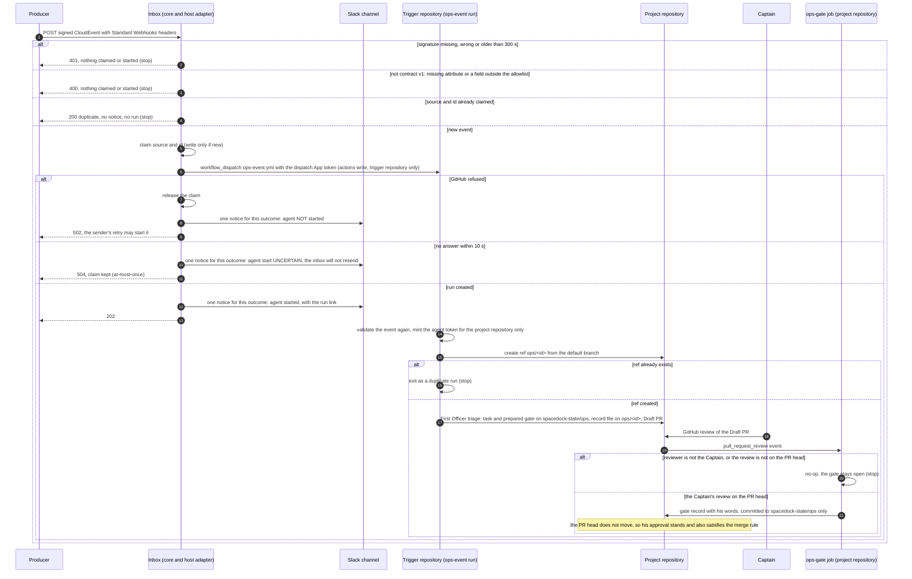
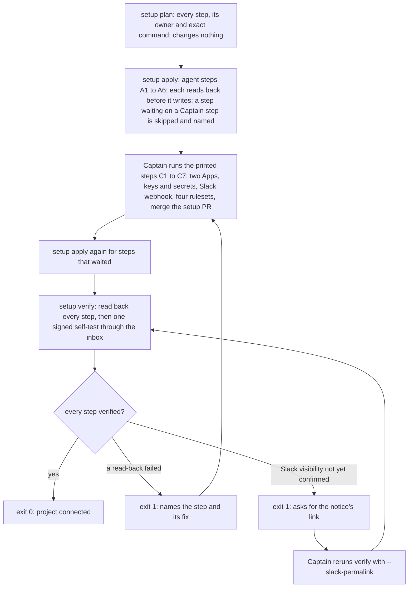

inbox-r1 of the `kc-ops-inbox` package. Two POCs closed PASSED: `hermes-ops-fo-exe-dev-poc` (2026-10-21: a GitHub App token under no-bypass rulesets reaches only ops/* branches and Draft PRs; a headless Claude Code First Officer on a hosted runner files one ops task; the Captain's own GitHub review is the recorded decision) and `inbox-exactly-once-delivery-poc` (2026-10-23: three sends of one signed CloudEvents event gave one workflow run; a tampered send started nothing; the inbox credential could not push; the inbox core imports only node:crypto). Both proved the inbox code is small; the cost is the per-project setup the Captain did by hand (two Apps, rulesets, secrets, Slack webhook) and permission isolation.

Captain's words:
- Outcome (2026-10-19, design brief): 「拉出一個ops inbox抽象，確保必要資訊可以一次到位到inbox 變成一個聚合事件，然後後面可以投影到slack，或是投影給agent … 目的是人要知道，然後agent要同步進行解決方案呈現，要有一個repo內的ops workflow，來按照sd流程進行排查」
- Authority (2026-10-19): 「被叫起來的agent有source存取權限，可以跑 ops flow推entity task到separate branch，但是沒有權限做危險動作例如推main且沒有權限合併pr」
- Contract (2026-10-21): 「應該要先定義好 inbox 合約，由不同管道收取，且 platform 本身也要提供 hook 可以接，不能直接依賴第三方平台」
- Platform (2026-10-21): 「你要注意一件事，平台是剛好是 netlify，不是平台一定是 netlify。」
- Focus (2026-10-23): 「好」 to: r1 Pilot 的範圍改成以兩件事為主：設定流程（一步就能把專案接上 inbox，替你處理這次那六件手動設定）與權限隔離（inbox 只能叫起它自己的那個 workflow）；合約 v1 仍是 r1 的第一件事。

## Scope

- Contract v1: CloudEvents 1.0 attributes and Standard Webhooks signing, an allowlisted data field set, the dedupe key, and a version; published in the package with a validator and fixtures for relay's ceiling event and a Sentry-shaped event. Relay's own hook is written by relay against this contract in a relay task, not here.
- Setup: one command connects a project to its inbox: it creates or updates what an agent may create, lists each step only the Captain may do (App creation, keys, Slack webhook, secrets, ruleset changes) with the exact command, and reads every step back.
- Isolation: the inbox's credential can start only the project's ops workflow (POC2 finding F2: Actions write is repository-wide).
- Event to person and agent: a signed event yields one Slack notice whose arrival is observed, and an FO on a GitHub-hosted runner files one ops task with one recommendation on an ops/* branch and a Draft PR; the Captain's GitHub review is recorded without pushing to the PR branch, so the approval is not dismissed (POC1 finding).
- Platform-neutral core: the same core runs under the Netlify adapter and under a second adapter or plain Node harness.
- Non-goals: relay's live producer, raise-from-link, Slack Q&A, qnow live, the in-service FO, Spacedock gate-actor authentication (upstream), guaranteed delivery and reconciliation (POC2 chose at-most-once; ideation states the delivery semantics for the Captain).
- Budget: at most 3 days (FO proposal; the Captain sets it).
- Stop conditions: isolation needs a credential that can push or start other workflows; the setup cannot read back a step it claims; the estimate exceeds the budget. Each returns a planning delta to the Captain.

## Acceptance criteria

**AC-1**: Contract v1 validates the relay-shaped and Sentry-shaped fixtures and rejects a fixture with a missing attribute, a bad signature or a field outside the allowlist.
Verified by: the validator's output on each fixture, with exit codes.

**AC-2**: On a scratch project, the setup command completes the agent-doable steps, prints each Captain-only step with its exact command, and reports every step as verified by read-back.
Verified by: one full setup run log on a scratch project, and the read-back of each created resource.

**AC-3**: The inbox's credential starts the project's ops workflow and is refused when it tries to start any other workflow in that repository.
Verified by: one accepted dispatch and one refused dispatch with the same credential, against a repository holding a second workflow with secrets.

**AC-4**: A signed event produces one Slack message seen in the channel and one ops task with one recommendation on an ops/* branch with a Draft PR; after the Captain's review, the gate is recorded with his words and his approval still stands on the PR.
Verified by: the Slack message with its time, the task and Draft PR, the gate record, and the PR's review state after recording.

**AC-5**: The inbox core passes the same tests under the Netlify adapter and under a second adapter or plain Node harness.
Verified by: both test runs and the core's import list.

## FO alignment

Direction alignment before ideation: not needed; the Captain set the focus on 2026-10-23 and the contract direction on 2026-10-21. Ideation runs on opus (contract and authority boundary are hard to reverse).
Surfaces: ui
Visible change: An operator runs one setup command for a project; afterwards each signed event shows up as one Slack message and one ops task with a Draft PR that the Captain decides by GitHub review.
Release review: not needed: the kc-ops-inbox journey map (inbox-r1) is only on branch iamcxa/kc-ops-inbox at 0a1d59ce and not on the trunk; set journey fields when it lands.
Captain standing ask, 2026-10-21: 「請持續針對套件的意義做觀察與回饋」. FO reports a package-value observation at each gate.

## Design

### PRFAQ

**kc-ops-inbox r1: one command connects a project to its own ops inbox; a signed event reaches the Captain on Slack and an agent's recommendation on a Draft PR; the inbox can start nothing but that project's ops workflow.**

An operator runs `ops-inbox setup` for a project. The command does every step an agent may do, prints each step only the Captain may do with its exact command, and then reads every step back; it exits 0 only when all of them check out. From then on, a producer such as relay sends one signed CloudEvent. The inbox checks the signature and the contract, posts one Slack notice saying whether the agent started, and starts the project's ops workflow. A First Officer on a GitHub-hosted runner files one ops task with one recommendation and opens a Draft PR. The Captain decides by his GitHub review; a job records his words as the gate without touching the PR branch, so the same approval still stands for the merge. The inbox's credential can start workflows in exactly one place, the project's trigger repository, which holds only the ops trigger workflow.

FAQ
- **Why a separate trigger repository?** GitHub has no per-workflow dispatch permission. Actions write is repository-wide and also re-runs any past run and disables workflows (probe P1 below). The only boundary GitHub enforces on an App token is the list of repositories it is installed on, so the inbox's App is installed on a repository that holds one workflow.
- **What does the Captain still do by hand?** Seven steps: register and install two Apps (one click each through a prefilled link), store two keys, the signing secret and the model token, create the Slack webhook, apply four rulesets, merge the setup PR. Setup prints each command and checks each result.
- **Is delivery guaranteed?** No. r1 is at-most-once for the agent (POC2's choice; guaranteed delivery is a non-goal). Every outcome is visible: the Slack notice says started, not started, or uncertain. See D1.
- **Does it depend on Netlify?** No. The core imports only `node:crypto` and runs under a Netlify adapter and a plain Node server adapter with the same tests (AC-5; ADR 0018 is the same one-core-two-adapters ruling for the journey server).
- **What can the agent do?** As POC1 proved: push `ops/*` and the state branch, open Draft PRs; not push the default branch, merge, approve its own PR, edit workflows or change rulesets.
- **What does it cost per event?** Not measured for r1. POC1: about 2 runner minutes and an imputed 0.74 USD for one FO run; POC2: 1.8 s from arrival to dispatch.

### How an event travels

### How setup runs

### Contract v1 (AC-1)

One module, `kc-ops-inbox/contract/`, used by the validator CLI, the inbox core and the trigger run, so there is one implementation of the rules.

| Part | Rule | Source |
| --- | --- | --- |
| Transport | `webhook-id`, `webhook-timestamp`, `webhook-signature` headers; HMAC-SHA256 over `id.timestamp.body`, `v1,<base64>`; `whsec_` secret; timestamp within 300 s; body at most 16 KiB (fits the 65,535-character dispatch input limit) | Standard Webhooks spec; POC2 core |
| Envelope | CloudEvents 1.0 structured JSON. Required: `specversion` "1.0", `id` (`^[A-Za-z0-9._-]{1,64}$`, branch-safe), `source` (at most 200 characters), `type` (one of the allowlisted types), `time`, `dataschema`. Allowed besides: `datacontenttype`, `subject`, `data`. Any other attribute is refused. | CloudEvents 1.0.2 |
| Version | `dataschema` is `.../kc-ops-inbox/contract/v1/<type>.json`; an incompatible change gets a new URI (v2). Each schema's digest is pinned in `contract-versions.json`, and a test fails when a schema changes without a version entry. | CloudEvents `dataschema` guidance; kc-journey-map `contract-versions.json` pattern |
| Allowlist | `relay.capacity.ceiling`: `v, event, at, day, count, limit, limitSource` (POC1 fixture fields). `sentry.issue.alert`: `issue_id, event_id, title, level, culprit, project, web_url, triggered_rule, datetime, release` (a subset of Sentry's issue-alert `data.event`; `user`, `request`, `contexts`, `exception` and `tags` are excluded). A field outside the list is refused, not dropped. | Sentry issue-alert docs; journey rule `untrusted-event` |
| Dedupe key | `sha256(source + "\n" + id)`; producers must keep `source` + `id` unique (CloudEvents rule). `webhook-id` is not the key, because POC2's sender used a different value for it. | CloudEvents; POC2 |
| Slack text | Event strings are escaped (`&`, `<`, `>`) before they reach Slack, so an event cannot mention a channel or forge a link. | Slack message formatting |

Validator: `node kc-ops-inbox/contract/validate.mjs <fixture.json>`; a fixture holds `headers` and `body`; the signing secret is read from `OPS_INBOX_TEST_SECRET` or the fixture's test-only `secret` field. Exit 0 prints `valid <type> <dedupe key>`; exit 1 prints one reason: `missing-attribute: <name>`, `signature-mismatch`, `timestamp-out-of-tolerance`, `field-not-allowed: <path>`, `unknown-type: <type>`; exit 2 is a usage error. Fixtures: `relay-ceiling.json`, `sentry-issue.json`, `missing-source.json`, `bad-signature.json`, `extra-field.json` (adds `data.user`).

### Setup command (AC-2)

`node kc-ops-inbox/bin/ops-inbox.mjs setup plan|apply|verify --project <owner/repo> --host netlify [--slack-permalink <link>]`, run on the Captain's machine under his `gh` and `netlify` logins. The step list, owners and read-backs are the preview's (`preview/setup-preview.mjs plan`, `verify ok`).

- `plan` writes nothing and prints the agent steps A1 to A6 and the Captain-only steps C1 to C7 (App registration, keys, secrets, Slack webhook, rulesets, merging the setup PR), each with its exact command. App registration uses GitHub's prefilled registration link (`/settings/apps/new?name=…&public=false&webhook_active=false&actions=write`), so the Captain only checks and clicks Create.
- `apply` runs only A1 to A6: create the private trigger repository and push its one workflow, create `spacedock-state/ops`, open the setup Draft PR in the project (`.github/workflows/ops-gate.yml`, `docs/ops/README.md`), deploy the inbox and set its non-secret settings, set the trigger repository's variables. Each step reads its target first and writes only when it differs, so a rerun changes nothing.
- `verify` reads every step back (15 checks in the preview) and sends one signed self-test event through the inbox, reading `WEBHOOK_SECRET` from its environment as provided by the Captain's secrets wrapper; it never prints a value. The self-test reads back what the Captain's login cannot (probe P2): the dispatch token's permissions and repositories from the mint response, a refused mint for the project repository, a refused dispatch of a project workflow, the agent token's permissions from the self-test run, and the Slack webhook's `ok`. Exit 0 only when every check passes.
- One step has no machine read-back: whether the self-test notice is visible in the channel. An incoming webhook answers `ok` and does not return the message timestamp (Slack docs), so verify waits for the Captain's message link, checks that it names the self-test notice's channel and a time after the self-test was sent, and reads the time from it. Reading the channel by machine would need a Slack app with history scope, which r1 does not add.

### Isolation (AC-3)

The inbox's dispatch App has Actions write only and is installed only on the trigger repository. The trigger repository holds one workflow file and one branch, and its default-branch ruleset needs the Captain's approval, so nobody but the Captain can add a second workflow. The trigger run mints the agent App's token for the project repository inside the run (POC2 pattern, `actions/create-github-app-token` with `owner` and `repositories`). The agent App's key lives in the trigger repository's secrets, not in the project's, so the project's other workflows cannot use it, and the inbox's credential cannot reach the project's secrets.

Rejected: Actions write on the project repository (any workflow, plus re-run, disable and the OIDC subject template, probe P1); `repository_dispatch` (needs Contents write, which can push, probe P1); an issue-triggered ops workflow (Issues write starts every issue-triggered workflow and edits issues); the ops workflow pulling events on a schedule (no credential, but scheduled runs start no sooner than every 5 minutes, which loses "agent at once").

### Event to person and agent, and the gate (AC-4)

- The ops workflow is split-root: the Spacedock task and its gate live on branch `spacedock-state/ops` in the project repository (`spacedock state init` sets up the checkout on a runner). The Draft PR on `ops/<id>` adds one file, `docs/ops/<id>.md`: the event fields, the diagnosis, the options and one recommendation. Merging it puts the record on the default branch.
- `ops-gate.yml` (project repository, `pull_request_review`) records the gate only from the review of the login in `OPS_CAPTAIN_LOGIN` on the PR head, with his words (POC1's `record_gate_from_review.sh`), and pushes only the state branch. GitHub dismisses an approval when a push changes the PR's diff (rulesets docs); the state branch is not in the diff, so the approval stands and is the one the merge rule counts.
- Fixes carried from POC1: `ops-gate.yml` must be on the default branch before any ops PR is opened (a `pull_request_review` run reads the workflow from the PR's merge ref); a failed review read exits 1 instead of a no-op; Spacedock's install script is pinned to a release and its checksum checked (roborev:948 Critical), not fetched from `main`.
- The ops workflow's stages in r1: `triage` then `decision` (gate). Acting on the decision and archiving after the merge are inbox-r2.

### Platform-neutral core (AC-5)

`core/` takes a Web `Request`, a store (`create-if-new`, `get`, `delete`), `fetch`, an env map and a clock, and imports only `node:crypto`. Adapters: Netlify (`@netlify/blobs` with strong consistency, POC2's 11 lines) and plain Node (`node:http`, a file store whose create-if-new is an exclusive file create). One test file runs against both adapters. A path-filtered CI job runs it on pull requests that touch `kc-ops-inbox/**` (cost per such PR not measured; about one ubuntu minute expected).

### Acceptance evidence plan

- **AC-1**: `for f in kc-ops-inbox/contract/v1/fixtures/*.json; do node kc-ops-inbox/contract/validate.mjs "$f"; echo "exit $?"; done` prints `valid` and exit 0 for `relay-ceiling` and `sentry-issue`, and exit 1 with `missing-attribute: source`, `signature-mismatch` and `field-not-allowed: data.user` for the other three; plus the contract-digest test.
- **AC-2**: on a new scratch project, the logs of `setup plan`, `setup apply` and `setup verify` (exit 0, every check verified), saved in the task folder, and each check's raw read-back output.
- **AC-3**: the verify self-test's JSON (dispatch of the trigger workflow answered 200 with a run id; dispatch of the project's second workflow, which uses a secret, refused; re-run of a project run refused; mint for the project refused 422), plus `gh api repos/<trigger>/actions/workflows --jq .total_count` printing `1` and the project's second workflow run list unchanged. The wording of AC-3 needs D2's coupled change.
- **AC-4**: one signed relay-shaped event sent with `send.mjs` through the secrets wrapper; the Slack message link with its time (Captain); the run id; the `ops/<id>` ref and the Draft PR (`draft: true`, author the agent App); the task on `spacedock-state/ops`; after the Captain's review, the `ops-gate` run log and the state commit with `by: person:captain` and the review id; then `gh api repos/<project>/pulls/<n>/reviews` shows his review `APPROVED`, not `DISMISSED`, on the unchanged head.
- **AC-5**: `npm test` run once per adapter with equal pass counts and zero failures, and `grep -h '^import' kc-ops-inbox/core/*.mjs` printing only `node:crypto` imports.

### Probes run before the gate (2026-10-23)

- **P1 ran (read-only):** downloaded GitHub's own permission map, `src/github-apps/data/fpt-2022-11-28/server-to-server-permissions.json` at github/docs `481d4e35beb53953e277d0b11ba4a18f8c8ade4f` (committed 2026-10-22), and listed every endpoint that starts or re-runs a workflow. Result: `POST .../actions/workflows/{workflow_id}/dispatches` needs `actions:write`; `POST .../dispatches` (repository_dispatch) needs `contents:write`; the only workflow-named permission is `workflows` (editing workflow files). `actions:write` grants 15 endpoints, including re-running any run or failed job, enabling or disabling any workflow, deleting runs and logs, approving fork runs and `PUT .../actions/oidc/customization/sub`. No permission names a single workflow. This is the fact POC2's F2 noted only for dispatch: re-run also reaches any secret-bearing workflow.
- **P2 ran (read-only, the Captain's `gh` login):** `gh api /user/installations` returned 403 "You must authenticate with an access token authorized to a GitHub App"; so setup cannot read back an App's installation with his login, and the self-test reads it with the App's own token. The same login read `rulesets`, `actions/secrets` (count only, no values) and `actions/workflows` on iamcxa/kc-claude-plugins (exit 0 each), so those read-backs work.
- **Docs only, not run:** that a token minted for the trigger repository is refused for the project (installation-token docs: "cannot be granted access to repositories that the installation was not granted access to"); that a state-branch push leaves an approval standing (rulesets docs: dismissal follows pushes "that affect the diff"); the prefilled App registration link; Slack's `ok` reply; `@netlify/blobs` offering a local test server for the Netlify adapter run.
- Not touched: relay, qnow, the scratch repository and site, any secret, App, ruleset, deployment or push.

### Sources read (2026-10-23)

- GitHub: events that trigger workflows (https://docs.github.com/en/actions/reference/workflows-and-actions/events-that-trigger-workflows): workflow_dispatch runs only if the file is on the default branch, 25 inputs, 65,535 characters. Workflow dispatch REST (https://docs.github.com/en/rest/actions/workflows): 200 with `workflow_run_id`; the `return_run_details` flag and the 204 reply are POC2's observed behaviour, not this page's summary. Installation tokens (https://docs.github.com/en/rest/apps/apps#create-an-installation-access-token-for-an-app). Rulesets (https://docs.github.com/en/repositories/configuring-branches-and-merges-in-your-repository/managing-rulesets/available-rules-for-rulesets). App registration by URL parameters (https://docs.github.com/en/apps/sharing-github-apps/registering-a-github-app-using-url-parameters) and by manifest (https://docs.github.com/en/apps/sharing-github-apps/registering-a-github-app-from-a-manifest). `actions/create-github-app-token` README (https://github.com/actions/create-github-app-token): `owner`, `repositories`, `client-id`.
- Slack incoming webhooks (https://docs.slack.dev/messaging/sending-messages-using-incoming-webhooks/): one fixed channel, `ok` reply, no timestamp returned.
- CloudEvents 1.0.2 (https://github.com/cloudevents/spec/blob/v1.0.2/cloudevents/spec.md); Standard Webhooks (https://github.com/standard-webhooks/standard-webhooks/blob/main/spec/standard-webhooks.md); Sentry issue alerts (https://docs.sentry.io/organization/integrations/integration-platform/webhooks/issue-alerts/).

### Existing-code check

Upstream first: Spacedock 0.27.2's commands include no inbox or webhook intake (`spacedock --help`); kc-dev-flow and kc-dev-flow-2 have none; `origin/main` has no CloudEvents or Standard Webhooks code (`git grep`, 2026-10-23). What exists and is reused: POC2's core (signature, claim, dispatch, 9 tests) and Netlify adapter on `spacedock-ensign/inbox-exactly-once-delivery-poc` at cd079cb8; POC1's `ops-gate.yml`, `record_gate_from_review.sh`, `run_fo.sh` and rulesets on `spacedock-ensign/hermes-ops-fo-exe-dev-poc` at aae7041b; kc-journey-map's `contract-versions.json` digest pin; Spacedock split-root and `spacedock state init`. Both POC branches are reference: implementation copies and rewrites them under `kc-ops-inbox/`, without POC1's shelved `hermes-profile/` and `rehearsal/`.

### UI surface

UI proposal: The operator sees two things. (1) `ops-inbox setup` output, plain text with no colour: `plan` lists the Captain's first steps C1 and C2, the agent steps A1 to A6 and the remaining Captain-only steps C3 to C7, each with its command (a `<...>` marks a value an earlier step prints); `apply --yes` runs A1 to A6, reports each with a verdict (PASS, FAIL, WAIT) and an exit code, and a rerun changes only what differs; `verify` prints one row per read-back with a verdict (PASS, FAIL, ERROR, WAIT), what is read, how, and what was observed, a `next:` line under each row that did not pass, a count and an exit code; the Slack-visibility row waits for the Captain's message link. (2) One Slack notice per event and outcome: a bold heading (producer and event), one line from the allowlisted fields cut at 200 characters, one agent line with an icon (started with the run link, Needs action when NOT started with the reason, Needs a look when UNCERTAIN with the runs link and "will not resend"), and a small context line (event id, source, contract version; Slack's own post time stands in for arrival, about 2 s later in POC2); event text is escaped, never a mention.
Preview: ops-inbox-r1-setup-and-isolation/preview/

### Unresolved decisions for the Captain

Each has one recommendation. D2 and D3 each carry an acceptance-criterion wording change, because the recommended mechanism changes what the approved sentence can test.

- **D1, delivery semantics.** Recommend at-most-once for the agent, as POC2 chose and the Non-goals keep: claim, then dispatch; a refusal releases the claim, an unanswered dispatch keeps it, and Slack says which. What gets worse: an unanswered dispatch that GitHub actually lost starts no agent until someone resends by hand. The cheap alternative, at-least-once without reconciliation, releases the claim on no answer too and relies on the `ops/<id>` ref as a second duplicate check in the run; it costs one wasted runner start per duplicate and could post a second notice.
- **D2, the mechanism that limits the inbox credential to one workflow.** Recommend a per-project trigger repository that holds only `ops-event.yml`, with the dispatch App installed only there. What gets worse: a second repository per project, one more ruleset, and the trigger workflow and the agent key live outside the project repository. Coupled wording change, AC-3: "The inbox's credential starts the ops workflow in the project's trigger repository, which holds no other workflow, and is refused when it tries to start or re-run a workflow in the project repository, which holds a second workflow with secrets."
- **D3, where the gate record lives.** Recommend the split-root state branch `spacedock-state/ops` in the project repository, with the Draft PR carrying only the record file `docs/ops/<id>.md`. What gets worse: the task (state branch) and its record (PR) are two files; the state branch needs its own ruleset; the agent App can still write the state branch, so a forged gate commit stays possible (Spacedock gate-actor authentication is upstream and a non-goal; the merge still needs the Captain's review). Coupled wording change, AC-4: "... and one ops task on the state branch whose recommendation is the record file on an ops/* branch with a Draft PR; ..." with the rest unchanged.
- **D4, the inbox host.** Recommend Netlify, one site per project on the Captain's Pro team, as POC2 ran it; the plain Node adapter is the second adapter for AC-5 and a fallback host (mac mini or a VM). What gets worse: per-project Netlify sites and their secrets; Blobs' atomicity under parallel retries stays unproven (POC2 F4), bounded by the `ops/<id>` ref check, though a race could still post two notices.
- **D5, the form of the setup command.** Recommend one Node CLI in the package with `plan`, `apply` and `verify`, run on the Captain's machine, with App registration by prefilled link. What gets worse: seven Captain steps stay manual, and the manifest flow (one click returns the App id and private key) is not used, because the command would then hold the private key, and the Scope lists keys as Captain-only.

No past ruling goes against these: `git -C <state> grep -n 'Override:'` (2026-10-23) has no hit on an inbox, ops, delivery, credential or host question; ADR 0018 (one core, Node and Cloudflare adapters) agrees with D4 and AC-5; ADR 0003 (secret reads are the adopter's) agrees with verify taking the signing secret only through the wrapper.

ADR draft, landed by implementation (FO reserves the number): "An ops inbox starts workflows only in its project's trigger repository, and the ops gate is recorded on the state branch." Ruling: D2 and D3 as accepted.

### Risks and profile

- Estimate: 3 days, at the budget's limit (contract 0.5, core and adapters 0.5, workflows and split-root ops workflow 1, setup CLI 1, scratch run 0.5, overlapping). If it runs over, the cut is `setup apply` (print the agent steps too); that is the stop condition "estimate exceeds the budget" and returns to the Captain.
- The agent App can push any branch name in the project repository, and a push-triggered workflow there runs the pushed code with that repository's secrets. POC1's scratch repository had no such workflow; relay and qnow do. Follow-up proposal for FO, not adopted here: setup adds a "restrict creations" ruleset limiting the agent to `ops/**` and `spacedock-state/ops`.
- The trigger repository holds the Captain's model token (`CLAUDE_CODE_OAUTH_TOKEN`), as POC1 did.
- Profile: on a scratch project nothing here needs a new obligation. Connecting relay or qnow adds production credentials and an always-on service, which returns to profile selection then.

### Package-value observation

The package made this design checkable before any build: its rule "read third-party mechanisms from their own docs" led to GitHub's permission map, which settled AC-3 in one read-only run, and showed that the approved AC-3 wording cannot be met in one repository. That is the kind of finding POC2's validator wished it had before its live run. The cost showed too: the backlog gate approved criterion wording no one had tested against the vendor's permission model, so two criteria now come back as decisions.

### Batch overlap

- `journey-canvas-hosted-poc`, `journey-server-host-pilot`, `release-acceptance`, `pr-review-lite-value-pilot`: no shared file; this task writes only `kc-ops-inbox/**` and one new `.github/workflows/kc-ops-inbox-tests.yml`.
- `adr-required-statement`, `kc-adr-format-source`: the shared ADR index `docs/adr/` if this task's ADR lands; FO reserves its number at dispatch.
- `design-director-runs-ui-design-review`, `comment-check-reaches-delivery-gate`, `fo-write-checks-parse-top-level`: change package rules this task's later stages follow, not its files.
Recommended order: none required.

### Design review

Design review: design/ideation-2.yaml
Round 1 (`design/ideation-1.yaml`, 5 MAJOR and 12 MINOR) was redrawn: plan prints Captain steps C1 and C2 first and every command in full; apply needs `--yes` and shows a failed, a waiting and a rerun case; verify has a verdict column and a `next:` line per non-passing row; the Slack page shows the notice after a retry, explains which repeats post nothing, and adds dark and phone states. Round 2 is the last allowed run; the fixes marked "after round 2" below were not reviewed again.
Design finding 1: declined: Slack's own post time stands in for arrival (about 2 s later in POC2); after round 2 the UI proposal says so
Design finding 2: fixed: after round 2, the UNCERTAIN icon is ❓ (`:question:`) in preview-slack.png, light and dark
Design finding 3: declined: Slack wraps the real context line itself; the mock's mid-token wrap is the browser's and cannot be fixed by our text
Design finding 4: declined: the drawn dark and phone states cover each layout difference (warning bar, wrapping, long text); the remaining states use the same three lines
Design finding 5: declined: the cut text is the allowlisted field only; the full event is in the task's `## Event` section, which the run link leads to
Design finding 6: declined: the notices are one per outcome by design and are time-ordered in the channel; changing an earlier notice would need a Slack app beyond an incoming webhook, which r1 does not add (Slack docs: incoming webhooks "do not allow you to delete a message after it's been posted")
Design finding 7: declined: verify only checks that a link was given and points at the self-test channel and time; a wrong link is a FAIL row of the same form as the drawn C6 FAIL
Design finding 8: declined: an early-step failure has the same row form as the drawn A5 FAIL, and each step reads its target first, so later steps run or wait on their own inputs, not on order
Design finding 9: fixed: after round 2, verify rows have unique ids (C1a, C1b, C4a, C4b, C5a, C5b) in preview-setup.png, and the C7 row says it also covers A4
Design finding 10: fixed: after round 2, verify prints one line defining PASS, FAIL, ERROR and WAIT in preview-setup.png; one non-zero exit code is kept so a script needs one test
Design finding 11: declined: each `<...>` value is printed by an earlier step the line names (C1, C2) or is the producer's own command, which setup cannot know; C5's prompt keeps the webhook URL out of shell history
Design finding 12: fixed: after round 2, apply's report includes "wrote .ops-inbox/ (the four ruleset files C6 applies, ...)" in preview-setup.png
Design finding 13: declined: the banner adds the trigger repository and inbox URL, which the command line does not show, so a pasted log stands alone
Design finding 14: fixed: after round 2, the A3 and C7 read-back commands are printed in full in preview-setup.png
Design finding 15: declined: the output is plain text with no colour (now stated in the UI proposal); an 80-column terminal wraps it, which is acceptable for a command run a few times per project

## Stage Report: ideation

- DONE: Author the design for AC-1 to AC-5 in the task file with each criterion's reproducible evidence clause, and name for the Captain each unresolved decision with one recommendation: delivery semantics (at-most-once or at-least-once with reconciliation), the mechanism that limits the inbox credential to one workflow, where the gate record lives so a push does not dismiss the approval, the inbox host, and the form of the setup command.
  `## Design` holds the contract, setup, isolation, gate and core designs and an evidence plan per criterion; D1 to D5 each carry one recommendation and what gets worse. D2 and D3 each carry a coupled wording change to AC-3 and AC-4, because the recommended mechanisms change what the approved sentences can test. `## Scope` and `## Acceptance criteria` are unchanged.
  AC-1: not yet verified; evidence plan is the validator's output and exit code on five named fixtures plus the contract-digest test.
  AC-2: not yet verified; evidence plan is the plan, apply and verify logs on a new scratch project with every check PASS, and each raw read-back. Probe P2 shows App installations cannot be read back with the Captain's login, so verify reads them through a signed self-test.
  AC-3: not yet verified on GitHub; probe P1 (GitHub's permission map) shows no permission limits a credential to one workflow in a repository, so the approved wording cannot be met in one repository (D2). Evidence plan is the self-test's accepted and refused dispatch, refused re-run, refused mint, and the trigger repository's workflow count.
  AC-4: not yet verified; evidence plan is one signed event's Slack link and time, run, `ops/<id>` ref, Draft PR, state-branch gate commit and the review still `APPROVED` on an unchanged head. That a state-branch push leaves the approval standing is from the rulesets docs only.
  AC-5: not yet verified; evidence plan is one test file run under the Netlify and the plain Node adapter with equal pass counts, and the core's import list. POC2's core already imports only `node:crypto` (POC2 validation, 2026-10-23).
- DONE: Exercise the riskiest unverified mechanism before the gate with the smallest read-only or local probe (for example how a credential can be limited to one workflow), and record what ran and what is only from docs; no deployment, App, secret, ruleset or push.
  P1 ran: GitHub's permission map at github/docs 481d4e35, every workflow-starting endpoint and the 15 `actions:write` endpoints listed. P2 ran: `gh api /user/installations` 403; rulesets, secret count and workflows readable on iamcxa/kc-claude-plugins. Docs-only claims are listed under "Probes run before the gate". No deployment, App, secret, ruleset or push; relay, qnow and the POC scratch repository and site were not touched.
- DONE: Deliver the PRFAQ and Mermaid with matching actors, order, branches, approvals and stops, the `ui` surface artifact (the Slack message and the setup command output), and one package-value observation.
  PRFAQ, a sequence diagram (seven actors: every stop and branch in the prose, the Captain's review as the only approval) and a setup flowchart. `ui`: `UI proposal:` line, `Preview: ops-inbox-r1-setup-and-isolation/preview/` (runnable `setup-preview.mjs`, pictures rendered with agent-browser), two design reviews (17 then 15 findings, all dispositioned). `python3 <package>/scripts/design_surfaces.py check` printed "design surfaces presentable" and "design review design/ideation-2.yaml: 15 findings, 5 fixed, 0 criteria, 10 declined, 0 decisions", exit 0. Package-value observation under `## Design`.

### Summary

The design is written and checkable. The deciding fact came from a read-only probe: GitHub has no permission that limits a credential to one workflow, and Actions write also re-runs any past run, so the inbox's App goes on a per-project trigger repository holding only the ops workflow (D2). The gate is recorded on the state branch so the Captain's approval stands (D3). The Captain has five decisions, two of which reword AC-3 and AC-4.
