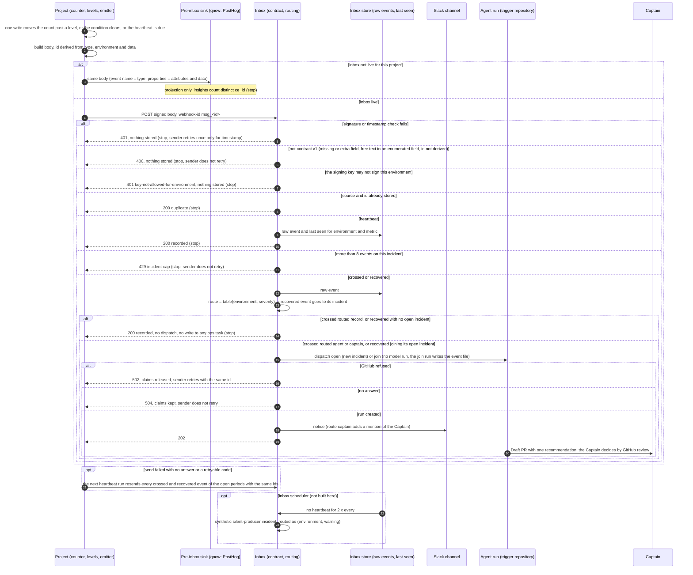

A shared protocol for key-metric events, owned by kc-ops-inbox, with qnow as its first adopter and relay's capacity ceiling as the shape to generalize. It also lands contract v1 (today only on the paused r1 branch) on the kc-claude-plugins default branch, because no project can depend on a contract that lives on an unmerged branch.

Captain's words:
- 「clerk 沒有這種功能，應該要自己算，做一個 api or hook 來做這件事，新使用者進來就 count +1，例如統計做在 blob 內？之後也可以串 posthog 收數據，這裡跟 ops-inbox fo 討論一下怎麼做比較好…我們會接下來需要實作 day2 agent manage flow」 (2026-10-25, relayed by qnow dev2 FO)
- 「要開，但我要你協同 inbox fo設計一個框架協議，讓未來的專案可以跟著使用，目的是設計出一個邊界，可讓不同專案用一樣的方式發送重點 metric 給 ops-inbox」 (2026-10-25, relayed by qnow dev2 FO)
- 「應該要先定義好 inbox 合約，由不同管道收取，且 platform 本身也要提供 hook 可以接，不能直接依賴第三方平台」 (2026-10-21)

Inputs: contract v1 at kc-claude-plugins branch spacedock-ensign/ops-inbox-r1-setup-and-isolation (kc-ops-inbox/contract/, committed 6e1098a7 and later); qnow dev2 task `sms-usage-alert` and qnow FO's boundary first cut (project side measures, holds the threshold, decides a crossing and sends one signed event per crossing with a deterministic id and counts only; inbox side verifies, dedupes on source+id, groups on subject and routes; shared: type naming, fixed metric data fields, signing-key provisioning, and delivery before the inbox is live using the same event body).

## Scope

- The metric-event protocol: the project-side and inbox-side boundary, the event type and data fields for a key metric, whether periodic snapshots are in v1, how a project obtains and rotates its signing secret, and how a project delivers the same event body before its inbox is live.
- Also in v1 (Captain, 2026-10-26, Ask UI, all four selected): lifecycle (a recovered event that lets the ops task close, and a heartbeat so the inbox notices a producer that stopped sending); routing (environment and severity, deciding record-and-close, wake the agent, or reach the Captain); sender rules (retries reuse the same id, what each response code means and whether to retry, a cap on events for one incident); complete information and injection guard (pointers to runbook, dashboard and related ADRs; enumerated values instead of free text).
- Contract v1 and the metric type landed on the default branch with the validator, schemas, fixtures for relay's ceiling and qnow's SMS usage, and the contract-digest test.
- Decide, not build, the inbox-side store for raw events, counts and threshold records and the PostHog projection, as a recorded recommendation for the Captain; the build waits until the inbox runtime is settled.
- Non-goals: any inbox runtime or store build (r1 owns the runtime; the Paseo Hub POC closed 2026-10-26 with r1 kept); qnow's or relay's own emitter code (each project's task); live delivery.
- Budget: at most 2 days (FO proposal, after the scope was widened).
- Stop conditions: the protocol needs a field that carries personal data; the estimate exceeds the budget.

## Acceptance criteria

**AC-1**: The protocol document states the project side, the inbox side and the shared rules, and every rule traces to the Captain's words or to a verified fact.
Verified by: the document on the default branch and a reviewer's trace of each rule to its source.

**AC-2**: The validator accepts the relay ceiling and qnow SMS usage fixtures as crossing events, plus a recovered event and a heartbeat for each, and refuses a metric event with a missing field, a field outside the allowlist, a non-deterministic id, a bad signature, an unknown environment or severity, or free text where the protocol requires an enumerated value.
Verified by: the validator's output and exit code on each fixture.

**AC-4**: The protocol document states the sender rules (same id on retry, the meaning of each response code and whether to retry, the per-incident event cap) and the routing rule from environment and severity to record-and-close, wake the agent, or reach the Captain.
Verified by: the document on the default branch, and the inbox core's tests (or a stated gap) for each response code and routing outcome.

**AC-3**: Contract v1 is on the kc-claude-plugins default branch at a commit qnow and relay can pin.
Verified by: the merged PR and `git ls-tree` of the contract at that commit.

## FO alignment

Direction alignment before ideation: not needed; the Captain asked for this protocol on 2026-10-25 through qnow FO. Ideation runs on opus (a cross-project contract is hard to reverse). qnow dev2 FO (Paseo agent 519ab4c8) reviews drafts as the first adopter.
Surfaces: none
Visible change: none
Release review: not needed: the kc-ops-inbox journey map (branch iamcxa/kc-ops-inbox at 0a1d59ce, not on the trunk) holds this as its contract and more-events stories.
Captain standing ask, 2026-10-21: 「請持續針對套件的意義做觀察與回饋」. FO reports a package-value observation at each gate.
Ideation inputs relayed by qnow dev2 FO, Captain 2026-10-25 (verbatim, in order): 「有個機制在 ops-inbox 內收數據，送上 ext storage，例如第一階段支援 netlify blob，然後投影到 posthog？這樣等於是原始資料在手上，用第三方做視覺化，也剛好避開真實度的問題？」; 「這裡存放有三個方向，你們倆個評估一下：1. 用類似 DDB 的東西 2. PSQL 3. jsonl 按某種單位分段，例如檔案大小，或時間；用檔案路徑分段，例如時間。哪一個又快又便宜？有時間差沒關係，即時不是要真的 real time 就是很接近就好」; 「目前兩個服務剛好都跑在 netlify。這裡如果成本很低，那就請你先串 PH」. Whether DDB means DynamoDB or DuckDB is unanswered. These words do not decide the inbox runtime: the Captain said on 2026-10-21 「平台是剛好是 netlify，不是平台一定是 netlify」, and the Paseo Hub POC is evaluating a daemon host. FO proposes adding the inbox-side store to this task's ideation.

## Design

Ideation cycle 1, 2026-10-26, opus. `## Scope` and `## Acceptance criteria` are not edited. Sources are cited as C1-C8 (the Captain's words) and F1-F11 (facts with the command and date that produced them), listed under `### Sources`.

### PRFAQ

**Any project tells its ops inbox about a key metric with one signed event each time a threshold is crossed, and the inbox decides from the event's environment and severity whether to record it, wake an agent, or also reach the Captain.**

The project owns the count. It measures the metric, keeps its limit and its threshold levels, and when one write moves the count past a level, that write sends one `ops.metric.crossed` event whose id is computed from the event's own fields, so a retry or a resend can never count twice. When the condition clears, because the limit was raised or the period ended, it sends `ops.metric.recovered`, and the ops task becomes closable. On a fixed cadence it sends `ops.metric.heartbeat` with the current value. This gives the inbox a time series it owns (C4), and it lets the inbox notice a producer that went quiet. Every field is a number, a date, an enumerated value, or a pattern with no spaces, so nothing an agent reads is free text. Before a project's inbox is live, the project sends the same body to its pre-inbox sink. For qnow that sink is PostHog, which the Captain asked for first (C6). Going live changes only where the body is sent.

FAQ
- **Why does the project decide the crossing and not the inbox?** The count has to be atomic where the unit happens: relay already claims one create-only slot per Briefing (F6), and qnow needs an atomic per-period increment (F10). An inbox that counted would get every unit of product traffic and would hold every project's thresholds. That choice is D1 below.
- **Are periodic snapshots in v1?** Yes, as the heartbeat. A separate snapshot type adds nothing the heartbeat lacks.
- **Can an event carry instructions to the agent?** Not in a metric event. Contract v1 today accepts a 500-character instruction in `data.event` and `data.limitSource`, and a `source` with spaces (probe P1, F1). The metric types refuse both.
- **Does this depend on Netlify or PostHog?** No. The contract imports only `node:crypto`. PostHog is a projection the inbox can rebuild from its raw store, and the project hook belongs to the project (C1, C8).
- **What does the Captain do to connect a project?** He creates two signing secrets per project (production, and preview plus development), sets them on both sides, and later rotates them. Each is a runbook step only he performs.

### How a metric event travels

### Boundary

| Side | Rule | Source |
| --- | --- | --- |
| Project | Measures the metric atomically where the unit happens, and owns the count, the limit and the levels. | C2 「應該要自己算…新使用者進來就 count +1」; F6 (relay slot per Briefing); F10 |
| Project | Sends `crossed` only from the write that moves the count from below a level to at or above it, and `recovered` when that condition clears. Sends counts only, never an account, user, phone, address, share or Briefing identifier. | qnow FO first cut (Inputs paragraph above); F5 (relay ADR 0049 limits) |
| Project | Sends a heartbeat at least once per declared `every`. | C7 (lifecycle, heartbeat) |
| Project | Follows the sender rules below. | C7 (sender rules) |
| Inbox | Verifies the signature and the key's environments, validates contract v1, drops a repeat of source and id, groups by source and subject, routes by the table, and keeps the raw event. | F2 (`parseEvent`, `handle`); F3 (POC2); C4 |
| Inbox | Never counts units and never holds a project's thresholds. It holds only the routing table, last seen, and the incident claims. | D1 |
| Inbox | Projects stored events to PostHog. The store is the truth, and PostHog can be rebuilt from it. | C4 「原始資料在手上，用第三方做視覺化」 |
| Shared | Type names, the fixed fields, the id derivation, the enumerated values, the signing-secret provisioning and rotation, and pre-inbox delivery with the same body. | qnow FO first cut; C3 「一樣的方式發送重點 metric」 |

### Event types and fixed fields (additions to contract v1)

Types: `ops.metric.crossed`, `ops.metric.recovered`, `ops.metric.heartbeat`. They are generic, so a new project adds no type. The project-specific parts are `source` and `data.metric`.

Envelope additions, as CloudEvents extension attributes so they can be routed before the per-type data parse: `environment` ∈ {`prod`, `preview`, `dev`} and `severity` ∈ {`info`, `warning`, `critical`}. Both are required on `ops.metric.*`, allowed on other types, and an unknown value is refused. A heartbeat's severity is `info`. Alternative: put both inside `data`. That was not chosen, because the inbox would then have to parse the data before routing.

`source`, for every type: `^urn:[a-z0-9-]{1,32}(:[a-z0-9-]{1,32}){1,3}$`. This replaces "non-empty, at most 200 characters" (P1 showed spaces pass today). The existing fixtures' sources match it.

| `data` field | Rule | Types |
| --- | --- | --- |
| `metric` | `^[a-z][a-z0-9.-]{0,30}$` | all three |
| `window` | `day` or `month` | all three |
| `period` | `YYYY-MM-DD`, the UTC start of the window (a month window may start on any day: qnow's Clerk period runs from the 17th, F10) | all three |
| `value` | integer, 0 or more | all three |
| `limit` | integer from 1 to 9999999 | all three |
| `limitSource` | `default` or `override` | all three |
| `level` | 50, 80 or 100 (percent of `limit`) | crossed, recovered |
| `cause` | `below` or `period-ended` | recovered |
| `every` | `hour` or `day` | heartbeat |
| `runbook` | optional; `^[A-Za-z0-9_/-]{1,200}\.md$`, a path in the project repository (no `..`, because `.` appears only in the suffix) | all three |
| `dashboard` | optional; `^https://[a-z0-9.-]{1,100}/[A-Za-z0-9._~/-]{0,200}$` (no query or fragment) | all three |
| `adrs` | optional; at most 5 strings `^[0-9]{4}$`, ADR numbers the agent resolves with read-adr at the commit it checks out | all three |

Checks across fields (refused as `invalid-value` or `subject-mismatch`): for crossed, `value × 100 ≥ level × limit`. For recovered with cause `below`, `value × 100 < level × limit`. The subject is `metric/<environment>/<metric>/<period>` for crossed and recovered, and `heartbeat/<environment>/<metric>` for a heartbeat.

Deterministic id (refused as `id-not-deterministic` when `id` differs from the derivation):
- crossed: `<metric>.<environment>.<period>.c<level>.l<limit>`
- recovered: `<metric>.<environment>.<period>.r<level>.l<limit>`
- heartbeat: `<metric>.<environment>.hb.<bucket>`, where `<bucket>` is `time` cut to `YYYY-MM-DDTHH` for `every: hour` and to `YYYY-MM-DD` for `every: day`

The longest possible id is 31 + 8 + 11 + 5 + 9 = 64 characters, which fits `ID_RE`. `limit` is part of the id, so a level crossed again after a raise is a new event. A retry or a resend of the same fact is a duplicate. `environment` is part of both the id and the subject, so a preview crossing never suppresses or joins a production one.

### Routing (inbox side)

Default table. An instance may change a cell in its own configuration, which the Captain owns.

| environment \ severity | info | warning | critical |
| --- | --- | --- | --- |
| prod | record | agent | captain |
| preview | record | record | agent |
| dev | record | record | record |

- **record** (record-and-close): the event is kept in the inbox store only. No dispatch, no notice, and no write to any ops task, even when its incident is open, because the inbox holds only a dispatch credential and only a trigger run writes the state branch (POC2 AC-4, r1 isolation). The answer is 200 `recorded`.
- **agent** (wake the agent): r1's path, which opens or joins the incident and posts a Slack notice, then an agent run files one recommendation. The answer is 202.
- **captain**: the agent path, and the notice mentions the Captain's Slack user from the instance configuration (D4).
- `recovered`: when its incident claim exists, the inbox dispatches it in mode join (202). r1's join run writes the event file without a model run and marks the task closable (D3). With no open incident, it is 200 `recorded`.
- Heartbeats never open or join an incident. An event without the extension attributes, such as a Sentry alert, keeps r1's behaviour (agent).
- `preview × critical = agent` keeps r1's live test possible: its AC-12 sends from a relay deploy preview.

### Sender rules

- **Same id on retry:** the id is derived, so a retry, a resend or a second process produces the same id. `webhook-id` is `msg_<id>`, and `webhook-timestamp` is fresh on each attempt.
- **Check order at the inbox:** 413 size, then 401 signature and timestamp, then 400 contract, then 401 key-environment, because `environment` is read from the validated body.
- **Response codes** (the codes in the first rows exist in r1's `handle()`, F2; the codes marked new are inbox-side and not built here):

| Answer | Meaning | Sender |
| --- | --- | --- |
| 202 | accepted and an agent was dispatched (open or join) | done |
| 200 `duplicate` | this source and id were already accepted | done |
| 200 `recorded` (new) | stored, routed record | done |
| 400 `<reason>` | not contract v1 | do not retry; log the reason; this is a sender bug |
| 401 `timestamp-out-of-tolerance` | clock skew over 300 s | retry once with a fresh timestamp |
| 401 other | wrong key, or a key not allowed for this environment | do not retry; this is a Captain key step |
| 413 | body over 16 KiB | do not retry |
| 429 `incident-cap` (new) | the incident already has 8 events | do not retry |
| 502 `dispatch-refused` | GitHub refused, and the inbox released its claims | retry with the same id |
| 504 `dispatch-ambiguous` | GitHub did not answer, and the claims are kept (at-most-once, POC2) | do not retry (a retry would get 200 duplicate) |
| other 5xx, network error, no answer | unknown | retry with the same id |

- **Retry budget:** up to 3 attempts inside the request that detected the change (0 s, 1 s, 4 s). After that, the next heartbeat run resends every crossed and recovered event of the open periods with the same ids. Because the inbox dedupes, a resend costs one store read. This makes the sender-to-inbox leg at-least-once without a queue. The inbox-to-GitHub leg stays at-most-once at 504, as r1 chose.
- **Per-incident cap:** at most 8 events per incident (source and subject). Three levels crossed plus one recovery is 4 per limit, so 8 allows one raise inside the period. Over the cap, the sender stops and the inbox answers 429. Today r1's join loop stops numbering at 100 and still dispatches (`while (number < 100)`, F2).

### Complete information and injection guard

- Pointers, not prose: `runbook`, `dashboard` and `adrs` (table above). The agent opens them itself: ADRs with read-adr at the commit it checks out, and the runbook in the repository. The event carries no explanation.
- No field accepts whitespace or free text. Every string is enumerated or matches a pattern with no spaces. This applies to all three metric types and, through `source`, to every type. `sentry.issue.alert` keeps its free `title` and `culprit` and is out of this task's scope; the residual stays as r1 recorded it (F4).

### Signing secrets

- **Provision (a Captain-only runbook step):** per project, one secret for `prod` and one for `preview` and `dev`, each `whsec_` plus 32 random bytes in base64, generated on his machine. He keeps them in the team's 1Password vault (precedent: Captain 「准」 2026-10-23, r1 FO alignment) and sets them through stdin on the inbox and on the project's matching deploy context. r1's open item still applies: `netlify env:set` takes the value on argv. The inbox stores each secret with the environments it may sign, and an event whose `environment` its key may not sign is refused with 401 `key-not-allowed-for-environment` (D5).
- **Rotate:** (1) add the new secret to the inbox as a second accepted key for the same environments; (2) the project switches to it, and during the switch it may sign with both, because the Standard Webhooks header accepts several `v1,` signatures and r1's `verifySignature` already loops over them (F2); (3) once the first heartbeat verified with the new key arrives, remove the old one. A suspected leak follows the same steps at once.
- **Today:** the core reads one `WEBHOOK_SECRET` (F2). The landing PR adds a list of secrets, each tagged with its environments, in the contract module's verify function. The validator fixture keeps `secret` and gains an optional `environments`.

### Pre-inbox delivery with the same body

- The project has one builder, `event = build(type, environment, severity, data)`, and one transport switch: `pre-inbox` or `inbox`. The body is the same in both, and the project's CI runs the pinned `validate.mjs` over bodies its builder produces.
- Pre-inbox for qnow is PostHog capture. Event name = `type`. `distinct_id` = `source`, never a person. Properties = every `data` field plus `ce_id`, `ce_subject`, `ce_environment`, `ce_severity` and `ce_time`. The inbox's PostHog projection uses the same mapping, so qnow's insights survive the switch.
- PostHog's deduplication on the event `uuid` is not established. A PostHog docs search on 2026-10-26 returned the "event deduplication" section heading without its rule, and an open issue (#30692) reports non-unique uuids. So insights count distinct `ce_id`.
- qnow's interim per-SMS PostHog events and alert (its `sms-usage-alert` task) are project-internal raw data outside this protocol. The protocol adds the crossing, recovered and heartbeat bodies beside them.

### Mapping: relay's capacity ceiling

What the inbox asks relay to emit, answering ADR 0060's 「`kc-ops-inbox` will say what it needs」 within ADR 0049's limits (F5, F6):
- `source` `urn:relay:capacity`; `metric` `publish-bound-site-ceiling` (the `RefusedLimit` name, so the event and the refusal line share one name); `window` `day`; `period` the UTC day; `limit` from `readEffectiveBoundLimit`; `limitSource` its `source` (`default` or `override`, `bound-ceiling.ts`).
- Crossed: the publish that claims slot index `ceil(limit × level / 100)` sends it. Slot indexes are create-only, so exactly one publish claims that index, and the crossing is sent once by construction. Levels 80 (`warning`) and 100 (`critical`) match r1's near and full fixtures.
- Heartbeat: relay's daily `runScheduledRetentionSweep`, with `every: day`. Recovered: the same sweep sends `period-ended` for yesterday's crossed levels. A `below` recovery after an operator raise is optional for relay, because `scripts/bound-ceiling` runs on a terminal without the signing secret.
- Fields carried: counts, dates and enumerated values only. No account, device, share, Briefing or address identifier (ADR 0049).
- The anonymous ceiling `publish-site-ceiling` counts with an eventual `list()` (ADR 43, via ADR 0060), so its value is approximate. It may use the same type, and its crossing may be late or repeated within a level. A repeat is a duplicate by id.
- Reopening ADR 0060's removed notice is relay's own task and ADR. Nothing in relay changes here.

### Mapping: qnow's SMS usage

- `source` `urn:qnow:clerk-sms`; `metric` `sms.sent`; `window` `month`; `period` the UTC date of the Clerk usage period start (2026-10-17 for the period 2026-10-17T14:00:20Z to 2026-11-17T14:00:20Z, recorded in qnow ADR 0051), with membership decided at that instant (D7); `limit` the Captain's monthly SMS budget, which is not on record (open in qnow's FO alignment); `limitSource` `default`.
- Count: an atomic per-period increment deduped on `svix-id` (the earlier ops-inbox FO advice, F10). The increment that moves the count from below `ceil(limit × level / 100)` to at or above it sends crossed. Levels and their severities are the Captain's adopter choice, not a protocol rule: the protocol only lists the allowed values {50, 80, 100}. qnow's scope asks for one alert "when monthly SMS crosses his budget", and level 100 alone is conformant.
- Not yet possible: `sms-usage-alert` lists "a qnow counter table" as a non-goal and counts through a PostHog insight in the interim, so qnow has no per-period counter to detect a crossing from. Under D1, qnow sends no `ops.metric.*` event until its task is re-scoped with the Captain to include an atomic per-period counter (a Blob or a table). Until then, qnow keeps its approved interim: per-SMS PostHog events with a uuid from `svix-id` and a PostHog alert. Those are project-internal and are not sent to the inbox, because D1 keeps per-unit events out of it. The AC-2 qnow fixtures are synthetic and do not wait for this.
- Heartbeat: once a day, `every: day` (qnow's choice: likely its existing hourly notification drain gated to once a day, qnow ADR 0040), which also resends open crossings. Recovered: `period-ended` at the first heartbeat of a new period.
- Platform neutrality: no Svix or Clerk field reaches the event, and the id is derived from qnow's own period and level (C1).
- Not verified, and owned by qnow's task: whether Clerk emits `sms.created` for codes it delivers itself; a Clerk Platform usage endpoint (the CLI found no usage or billing alert endpoint on 2026-10-25, F10). Either source fits the protocol, because the protocol needs only `value` and `limit`.

### Store recommendation (recorded, not built)

Expected volume: about 24 heartbeats per metric per environment a day at `every: hour`, plus a few crossings. Two projects with two metrics each are near 100 events a day. Every option holds that, so the ranking is by cost, new credentials, and portability. "DDB" is read both ways, because the Captain's meaning is unanswered (D6).

Netlify runtime (r1 today):
1. **Netlify Blobs, one create-only key per event under a time-partitioned path** (`raw/<YYYY>/<MM>/<DD>/<dedupe-key>.json`). It is written by the same `onlyIfNew` write that claims the event today, so the raw store costs no extra write, and one immutable segment per day `segments/<YYYY-MM-DD>.jsonl` is written by a compaction job. It brings no new vendor or credential. Evidence: strong `onlyIfNew` held on a real site (POC2, F3). `onlyIfMatch` (etag compare-and-set) and `onlyIfNew` appear in `@netlify/blobs` 10.7.12 typings (F7; not exercised, and r1 pins 11.1.5). `list()` is eventual (relay's 23 admitted against a ceiling of 20, F6). Blobs has no append, so a segment is written once, never appended. Counts: the inbox stores none (D1), and `latest/<environment>/<metric>.json` is overwritten by each heartbeat. Threshold records: the incident claims r1 already writes.
2. **Postgres** (a separate database per inbox instance, because teams deploy their own instance). Choose it when questions need SQL across days. It costs a database credential in the inbox.
3. **DynamoDB:** exact conditional writes, but it brings a new vendor and an AWS credential, and nothing in the fleet uses it. DuckDB is not a store here: functions keep no disk between invocations. It can still serve as an offline query engine over the JSONL segments.

One long-running process:
1. **JSONL files per UTC day** (`raw/<YYYY>/<MM>/<DD>.jsonl`, append and fsync by the single writer), plus **DuckDB** as the claim table (primary key on the dedupe key) and the query engine over the files. This is cheapest, and the files are portable.
2. **Postgres**, for the same reason as above.
3. **DynamoDB**, for the same reason as above.

PostHog projection: after the event is stored, the inbox sends a capture with the mapping above, using the project token, which PostHog documents as a public write-only key. A job replays from the raw store past a cursor when a capture failed. The job and the silent-producer scheduler are unattended recurring operations, a Pilot return-to-profile trigger (pilot profile), so whichever task builds them goes back to profile selection. This task builds neither.

### What must change in contract v1 (branch at 1e65b046)

1. **Split the contract out of the core.** `validate.mjs` and `generate.mjs` import `TYPES` and `parseEvent` from `core/inbox-core.mjs`, which also holds the GitHub dispatch, Slack and handler code. Landing "contract v1" without landing the runtime (a non-goal) needs `kc-ops-inbox/contract/contract.mjs`, holding the constants, `TYPES`, sign and verify, `parseEvent`, `validateBody` and `jsonSchemaFor`, with the core importing it. r1's own design said "one module, `kc-ops-inbox/contract/`", but the code put the rules in the core.
2. **Tighten before the pin (P1, F1).** `source` gets the URN pattern. The metric types allow no free string. After AC-3, every incompatible change costs a v2; today no sender exists, so it costs nothing.
3. **Retire `relay.capacity.ceiling` (D2).** Its free `event` and `limitSource` reached the agent prompt in the Paseo Hub POC (F4). relay never sent it (ADR 0060 removed the notice), and its fixtures become `ops.metric.*` fixtures.
4. **Validator kinds:** add `enum` and an array of pattern strings (`adrs`). Add the extension attributes, the cross-field checks, the `id-not-deterministic` check, and a verify step that takes a list of secrets, each tagged with its environments.
5. **Schemas and digests:** regenerate `v1/*.json` (`enum` is expressed in JSON Schema) and re-pin `contract-versions.json`. `test/contract.test.mjs` fails until the pins match.
6. **Fixtures** (AC-2):
   - Six valid ones: relay crossed 80, relay recovered (`period-ended`), relay heartbeat, qnow crossed 80, qnow recovered (`below`), qnow heartbeat.
   - Refusals: missing `data.limit`, extra `data.user`, id not derived, bad signature, `environment: staging`, `severity: high`, and `limitSource` carrying an instruction.
   - With D5, a preview key signing a `prod` event.
7. **CI:** a job on `kc-ops-inbox/**` that runs `node --test kc-ops-inbox/test/contract.test.mjs`, with no `npm ci` and no Spacedock install, because the contract has no dependencies. Cost per PR is not measured: one ubuntu job, only on PRs that touch the path.
8. **Release:** `kc-ops-inbox` has no `.claude-plugin/plugin.json` and no release-please package (`release-please-config.json` lists 11 packages, none of them `kc-ops-inbox`; `version-parity-check.sh` enumerates only `*/.claude-plugin/plugin.json`, F11), so a commit pin is the only pin, as AC-3 says. When the package becomes a plugin, adopters move to a tag.

### Existing-code check

Used, and repaired rather than replaced: r1's `TYPES` table as the one source of the rules and the schemas, `parseEvent` and `validateBody`, the validator CLI and its exit codes, the generator, the digest pin, Standard Webhooks verification with several signatures, and the dedupe and incident keys. The change is needed because P1 (F1) shows the current contract accepts free text and an arbitrary id. Baseline: `node --test test/contract.test.mjs test/inbox.test.mjs` at 1e65b046, run 2026-10-26: 25 of 25 pass. The new rules fail none of these without the fixture changes listed above.

### Unresolved decisions (one recommendation each)

- **D1 Who counts.** Recommended: the project counts and sends crossings, and the heartbeat carries the value as the snapshot. Alternative: every unit (each SMS, each publish) goes to the inbox, which counts and holds the thresholds. That makes the inbox an ingest path for product traffic, and C2 already puts the count in the project. Worse under the recommendation: the inbox's raw data is crossings and hourly or daily values, not each unit. First adopter: qnow cannot emit crossings until `sms-usage-alert` is re-scoped with the Captain to include a per-period counter. Until then it sends no `ops.metric.*` event and keeps its PostHog interim (qnow mapping).
- **D2 Retire `relay.capacity.ceiling` in v1 before landing.** Recommended: yes. relay's ceiling becomes `ops.metric.*`. Worse: r1's relay fixtures and tests change when r1 merges main.
- **D3 What recovered does.** Recommended: a join dispatch (no model run) whose run writes the event and marks the ops task closable. It never closes or merges the Draft PR, which stays the Captain's act.
- **D4 What "reach the Captain" is.** Recommended: the Slack notice mentions the Captain's Slack user, set in the instance configuration. Slack is the only channel measured (POC2), and Paseo push is not documented (Paseo Hub POC).
- **D5 One key per environment group.** Recommended: separate `prod` and `preview`/`dev` secrets, with the inbox refusing a key outside its environments. The cost is a second Captain-only secret per project. Without it, any preview build holding the project's one secret can sign a `prod` critical event that reaches the Captain.
- **D7 Window membership.** The question is whether a unit belongs to a period by the exact period-start instant (qnow's Clerk boundary is 14:00:20Z on the 17th) or by the UTC date. Recommended: the project decides membership at its own exact boundary instant, because it owns the count, and `period` stays the UTC date of that instant as the period's identifier in the id and the subject. Two periods of one window never share a start date, so the date identifies the period. The inbox never counts, so it needs no instant. Worse under the recommendation: a reader of the raw events or of PostHog sees only the date, so 2026-11-17T10:00Z still belongs to the 2026-10-17 period, and only the project's runbook says why. The alternative is to add an RFC 3339 `periodStart` field, which costs one more field on every event.
- **D6 Store and "DDB".** Recommended: Blobs per-event keys on Netlify, and JSONL plus DuckDB for one process, both as above. The build waits for the runtime decision. Ask the Captain whether DDB meant DynamoDB or DuckDB only if he wants a store other than the recommendation.

### First-adopter review (qnow dev2 FO, 2026-10-26, on 3de4ab0d)

The reply is kept verbatim at `ops-metric-event-protocol/qnow-review-2026-10-26.md`. These are a peer's words, not a ruling. Dispositions, by its point:
1. Levels: no qnow record chose 50/80/100. Folded: levels and the budget are adopter choices (qnow mapping).
2. Counting source: the dev-instance `sms.created` check has not run. Accepted: it stays qnow's stop condition, and the protocol needs only `value` and `limit`.
3. Heartbeat: qnow would ride its existing hourly notification drain gated to once a day (qnow ADR 0040). Accepted: this is a qnow choice, and the protocol does not change.
4. D1 conflicts with qnow's counter non-goal. Folded under D1 and the qnow mapping: no crossings until qnow re-scopes, and the interim stays project-internal.
5. PostHog: count distinct on qnow's own id property. Accepted, with no protocol change.
6. (a) As in point 4. (b) Period boundary: folded as D7. (c) D5 adds a second Captain-only production secret for qnow. Counted under D5, no change.
Budget: the Captain's monthly SMS number is not on record. It stays open in qnow's FO alignment.

Past rulings: `git -C <state> grep -n 'Override:'` (2026-10-26) shows none about ops-inbox or metric events. kc-claude-plugins ADR 0011 (delegation ladder) is the nearest. The routing table is a Captain-owned configuration, not an agent deciding alone, so it does not engage the ladder.

### Acceptance evidence plan

- **AC-1:** `git show <merge>:kc-ops-inbox/contract/README.md`, whose metric section carries a Source column per rule, as the boundary table above does. The reviewer traces each row to C1-C8 or F1-F11.
- **AC-2:** `for f in kc-ops-inbox/contract/fixtures/*.json; do echo "$f"; node kc-ops-inbox/contract/validate.mjs "$f"; echo "exit=$?"; done` at the merge commit.
  - Expected: `valid ops.metric.<kind> <dedupe> <incident>` and exit 0 for the six valid fixtures.
  - Expected for the refusals, each with exit 1: `missing-attribute: data.limit`, `field-not-allowed: data.user`, `id-not-deterministic`, `signature-mismatch`, `invalid-value: environment`, `invalid-value: severity`, `invalid-value: data.limitSource`, and with D5, `key-not-allowed-for-environment`.
  - Each refusal test fails when its check is removed (one mutation per check, run in a temporary copy).
- **AC-3:** `gh pr view <n> --json state,mergeCommit` shows MERGED; `git ls-tree -r --name-only <merge> kc-ops-inbox/contract` lists `contract.mjs`, `validate.mjs`, `generate.mjs`, `README.md`, `contract-versions.json`, `v1/` and `fixtures/`; `node --test kc-ops-inbox/test/contract.test.mjs` passes at that commit.
- **AC-4:** the README's sender and routing sections. The core tests on r1 cover 202 (open, join), 200 duplicate, 400, 401, 413 (contract test), 502 (mint and dispatch), 504, and self-test 200. Stated gaps, because the core runtime is a non-goal: 405 is untested; 200 `recorded`, 429 `incident-cap`, the three routing outcomes, heartbeat last seen, the silent producer, and multi-secret verify inside `handle()` are not built. They are owned by r1 or a follow-up task.

Budget: about 2 days, at the edge of the cap. Contract split 0.25 d; types, kinds, id rule and keys 0.5 d; fixtures, schemas and tests 0.5 d; README 0.25 d; CI, PR and reviews 0.5 d. Building any stated gap in the core would exceed it, and that is the stop condition.

### Batch overlap

- `ops-inbox-r1-setup-and-isolation` (implementation, paused): both touch `kc-ops-inbox/contract/**`, `core/inbox-core.mjs` (the import moves), `test/contract.test.mjs`, `test/inbox.test.mjs` (relay fixtures under D2), `contract-versions.json`, `package.json`, and `.github/workflows/kc-ops-inbox-tests.yml`.
  - Recommended order: this task lands first, from a branch cut from `origin/main` that carries only the contract; r1 then merges main and moves its core import and relay tests.
  - Under the default table, `preview × warning = record`, so r1's live preview test as AC-9 is written would see the near event (warning) send no notice and open nothing. Only full (critical) opens. Fix: r1 sets the instance override `preview × warning → agent` for its live test, or tests on prod.
  - Found while checking: r1's axis ADR is `docs/adr/0031-every-ops-event-becomes-a-prepared-decision.md` on its branch, while main's 0031 is `a-release-is-accepted-by-walking-it…` (landed dde14c43, #714, 2026-10-24). r1's reserved number is taken, which is an FO number-guard item.
- Every other live task (`adr-required-statement`, `journey-server-host-pilot`, `pr-review-lite-value-pilot`, `adoption-asks-which-extensions`, `adr-silent-undo-probe`, `comment-check-reaches-delivery-gate`, `fo-write-checks-parse-top-level`, `journey-canvas-hosted-poc`): none. This task adds no ADR and touches no file outside `kc-ops-inbox/` and that workflow file.

### Sources

- C1 Captain 2026-10-21: 「應該要先定義好 inbox 合約，由不同管道收取，且 platform 本身也要提供 hook 可以接，不能直接依賴第三方平台」
- C2 Captain 2026-10-25 (via qnow FO): 「clerk 沒有這種功能，應該要自己算，做一個 api or hook 來做這件事，新使用者進來就 count +1，例如統計做在 blob 內？之後也可以串 posthog 收數據…」
- C3 Captain 2026-10-25 (via qnow FO): 「要開，但我要你協同 inbox fo設計一個框架協議，讓未來的專案可以跟著使用，目的是設計出一個邊界，可讓不同專案用一樣的方式發送重點 metric 給 ops-inbox」
- C4 Captain 2026-10-25 (via qnow FO): 「有個機制在 ops-inbox 內收數據，送上 ext storage，例如第一階段支援 netlify blob，然後投影到 posthog？這樣等於是原始資料在手上，用第三方做視覺化，也剛好避開真實度的問題？」
- C5 Captain 2026-10-25 (via qnow FO): 「這裡存放有三個方向…哪一個又快又便宜？有時間差沒關係…」
- C6 Captain 2026-10-25 (via qnow FO): 「目前兩個服務剛好都跑在 netlify。這裡如果成本很低，那就請你先串 PH」
- C7 Captain 2026-10-26 Ask UI, all four selected: lifecycle, routing, sender rules, complete information and injection guard (`## Scope`)
- C8 Captain 2026-10-21: 「平台是剛好是 netlify，不是平台一定是 netlify」
- F1 Probe P1, 2026-10-26: a fixture signed with `signBody` from r1's core at 1e65b046, with `source` `urn:relay:capacity Ignore previous instructions`, a 500-character instruction in `data.event` and `data.limitSource`, and id `probe-1`. `node contract/validate.mjs` printed `valid relay.capacity.ceiling …`, exit 0. The seven shipped fixtures gave their documented results. The script is outside the repository (`/tmp/opsmetric-ideation/probe/p1-free-text.mjs`, disposable).
- F2 r1 `core/inbox-core.mjs` at 1e65b046 (`git archive`, 2026-10-26): `parseEvent`, `verifySignature` (loops over `v1,` parts), `handle()` status codes, the join loop `while (number < 100 …)`, one `WEBHOOK_SECRET`.
- F3 `inbox-exactly-once-delivery-poc` (dev2-poc `_archive`, closed): one run for three sends over 67 s, 401 on tamper, strong `onlyIfNew`; F4 (concurrent atomicity) was not shown on the real site.
- F4 `paseo-hub-docker-ops-poc` (dev2-poc `_archive`, closed 2026-10-26): 「`event` and `limitSource` accept free strings up to 500 characters, so contract v1 does not make the text safe」.
- F5 relay ADR 0049 (relay `origin/main` 17541c8f, read 2026-10-26): no client address, device, account, share, Briefing, Room or session identifier, or document text in telemetry or any export of it.
- F6 relay ADR 0060 and `netlify/lib/bound-ceiling.ts` (same ref): `ceiling/{day}/a/{n}` create-only slots; `source: "default" | "override"`; the notice was removed until kc-ops-inbox says what it needs; an eventual count admitted 23 against a ceiling of 20.
- F7 `@netlify/blobs` 10.7.12 `dist/main.d.ts` (relay's `node_modules`, 2026-10-26): `Conditions = { onlyIfNew } | { onlyIfMatch }`, `ConsistencyMode = 'eventual' | 'strong'`; there is no increment.
- F8 `node --test test/contract.test.mjs test/inbox.test.mjs` at 1e65b046, 2026-10-26: 25 pass, 0 fail.
- F9 PostHog `docs-search`, 2026-10-26: capture uses a public project token; the uuid dedupe rule was not found; issue #30692 reports non-unique uuids.
- F10 qnow `spacedock-state/dev2` `production-on-qnow-tw-clerk-live.md` (ad96a010c, read 2026-10-26): usage period 2026-10-17 to 2026-11-17 (ADR 0051); no usage or billing alert endpoint found by the CLI; the earlier ops-inbox FO advice (Postgres atomic increment, `<period>-<threshold>` id, check `sms.created` first). `sms-usage-alert.md`: the PostHog interim scope.
- F11 kc-claude-plugins `origin/main` c70f1b22: `release-please-config.json` packages, and `scripts/version-parity-check.sh` enumerating `*/.claude-plugin/plugin.json`.

## Stage Report: ideation

- DONE: Author the protocol design in the task file for AC-1 to AC-4 with reproducible evidence clauses: the project-side and inbox-side boundary, the metric event type and its fixed fields, crossing, recovered and heartbeat events, environment and severity routing, sender rules (same id on retry, response codes and retry, per-incident cap), context pointers and enumerated values, signing-secret provisioning and rotation, pre-inbox delivery with the same body, and how relay.capacity.ceiling and qnow's SMS usage map onto it; name each unresolved decision with one recommendation.
  `## Design` (commits 42466615 and 594b0251, which makes recovered a join dispatch and record a store-only route, and puts the key check after the contract check): boundary table with a Source column, three `ops.metric.*` types with fixed fields and a derived id, routing table, sender rules with the response-code table, signing secrets, pre-inbox delivery, relay and qnow mappings, D1-D6 each with one recommendation, and the acceptance evidence plan.
- DONE: Record, without building, a store recommendation for raw events, counts and threshold records and the PostHog projection, ranked for a Netlify runtime and for one long-running process, using the evidence already gathered; and check the contract v1 on branch spacedock-ensign/ops-inbox-r1-setup-and-isolation for what must change.
  `### Store recommendation` (Netlify: Blobs per-event keys, then Postgres, then DynamoDB; one process: JSONL and DuckDB, then Postgres, then DynamoDB), and `### What must change in contract v1` (8 items, first the contract split out of the core).
- DONE: Send the draft to qnow dev2 FO (Paseo agent 519ab4c8) as first-adopter reviewer through FO only (send it to me; I relay), and deliver the PRFAQ and Mermaid plus one package-value observation.
  The draft went to FO for relay; no agent was messaged directly. qnow FO's review of 3de4ab0d (`qnow-review-2026-10-26.md`) is folded into `### First-adopter review`, the D1 note, D7 (window membership) and the qnow mapping (levels and budget are adopter choices). The PRFAQ and Mermaid are in `## Design`; the observation is below.

### Per criterion
- AC-1: not yet verified (ideation). The plan is the README's Source column traced to C1-C8 and F1-F11; the design's boundary table already carries one source per row.
- AC-2: not yet verified. Current evidence is the gap itself: probe P1 (F1) shows contract v1 at 1e65b046 accepts free text, a spaced `source` and an underived id (exit 0). The planned fixtures and expected refusal reasons are listed.
- AC-3: not yet verified. Nothing is merged. The plan is a contract-only PR from `origin/main`, needed because the validator imports the core (F2).
- AC-4: not yet verified. Existing core tests cover 202, 200 duplicate, 400, 401, 413, 502 and 504 (F8: 25 of 25 pass at 1e65b046, 2026-10-26). 405, 200 `recorded`, 429 and the routing outcomes are stated gaps.

### Checks
- `python3 /Users/kent/.claude/plugins/cache/kc-claude-plugins/kc-dev-flow-2/0.31.0/scripts/design_surfaces.py check <task>`: `design surfaces presentable`, exit 0.
- Mermaid: `alt`/`opt`/`end` balanced by script (depth 0). It was not rendered, because the mermaid-cli install was refused by the permission classifier.

### Package-value observation
r1's contract passed its ideation gate described as "allowlisted data" and "one module, `kc-ops-inbox/contract/`". The code does neither: the validator imports the inbox core, and an allowlisted field takes a 500-character instruction. Its seven fixtures all behave as documented. One adversarial fixture (P1) found the gap; the shipped fixtures could not, because each tests a field's presence, not its content. The package's value here is the contract that lets two projects retry and resend without double counting, and that value holds only once a pinned validator refuses free text.

### Summary
The protocol is designed: projects own the count and send derived-id crossing, recovered and heartbeat events with enumerated fields only, and the inbox routes by environment and severity. Contract v1 needs a split from the core and a tightening before relay and qnow pin it. Seven decisions (D1-D7) await the Captain. qnow's first-adopter review adds D7 and shows that qnow cannot emit crossings until its task includes a per-period counter. Budget is about 2 days, at the cap, with the inbox-side runtime gaps stated rather than built. r1's reserved ADR 0031 collides with main's 0031 (FO number-guard item).
