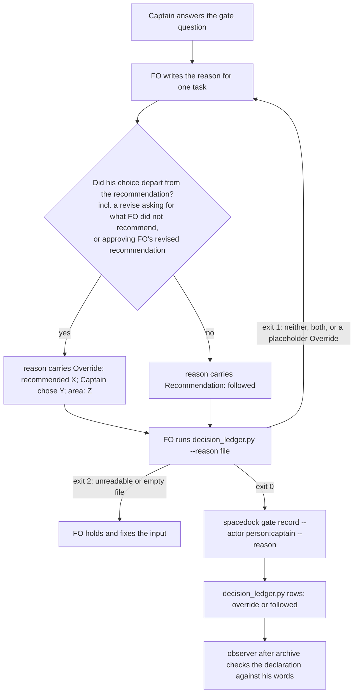

## Scope

- Source: a package finding relayed by the brainprint evaluation session (Paseo agent b1a74093, 2026-10-23), with the relayed instruction to hand it to the dev2 FO and open no GitHub issue; relayed, not a ruling in this session.
- Bite (peer's measurement, 2026-10-23): `decision_ledger.py --summary` over one adopter's dev2 state (749dc1e3d) gives 239 rulings, 0 overrides, 40 amended_after; of 74 Captain resolutions after the Override rule landed (fcc5a417, 2026-10-09), at least four went against FO's recommendation with no Override line. In this workflow, observers recorded the same class (Override placed outside the resolution reason, or absent) on several batch-5 tasks. ADR 0011's L3 (FO decides a class by its record) needs this record and has none.
- Two causes named: a revise that rejects a design and states new requirements has no option pair, so the Override format does not fit and FO writes nothing; when FO revises its recommendation after pushback and the Captain approves the new one, the ledger records agreement. Nothing checks the rule when a gate is recorded; the observer checks it after archive.
- Directions named by the peer, not decided: (a) widen the Override rule to revise rulings and revised recommendations; (b) a scorer over ledger rows that extracts recommended and chosen options and reports agreement against chance (idea from grahac/brainprint pipeline/decisions.py and pipeline/score.py; brainprint itself judged unsuitable).
- Upstream first: Spacedock gate record (reason text); kc-dev-flow-2 decision_ledger.py, workflow.md review-finding disposition; ADR 0011.
- Non-goals: mining session history.
- Folded 2026-10-25 into fo-written-lines-checked-before-dispatch (the Captain 「可以」 (chat, 2026-10-25), answering 「需要你決定：這份第 6 批的清單可以嗎？」 about FO's batch-6 list); not run on its own while that task is live.
- Added 2026-10-26: partly covered by iamcxa/kc-claude-plugins#724 (merged 1a6149f5): only an `Override:` line placed outside a gate resolution reason is now noted. Not covered: an Override for a revise or hold that departs from FO's recommendation (README widening) and a scorer over the decision ledger; fo-written-lines-checked-before-dispatch D4 chose its option A and excluded both. Stays open for that remainder; the Captain allowed closing the folded tasks only 「如果都涵蓋了」 (chat, 2026-10-26).
- Batch 14: the Captain 「可以」 (chat, 2026-11-05), answering 「這 5 張當下一批，可以嗎？」, which named this task.

## Budget
- One package PR. Workflow word budget unchanged unless the design names a raise for the Captain.

## Stop condition
- The design names which of the two causes in Scope it closes and where the check runs; replays of the three batch 12 and 13 resolutions the observer flagged are caught, and a resolution that agrees with FO's recommendation passes.

## FO alignment

Alignment: needed at ideation; whether to widen the rule, check it at record time, or score the ledger is his to accept.
Result: aligned at backlog: Batch 14 backlog sitting, the Captain 「准」 (chat, 2026-11-05), answering 「決定：這批五張（派工交代句的檢查、退一步答案欄位、漏寫 Override、婉拒要寫明、閘門一次問一件事）都用 Pilot，照各自寫下的範圍、預算與停止條件進入構思嗎？其中「婉拒要寫明」照我提的三項範圍（沒寫 Declined 標籤的婉拒、沒有 F 條目的審查者、沒指明接手任務）。要改哪張直接說。」, approved the outcome and bounds in this file.
Surfaces: none
Visible change: none
Release review: not needed: workflow maintenance, on no journey map.

## Design

Read 2026-11-05: package at origin/main d37c6dc65 (kc-dev-flow-2 0.35.0); state checkout at dc91fa798 after `git pull --rebase origin spacedock-state/dev2`; Spacedock 0.27.2 (`spacedock --version`).

### PRFAQ

**Proposition.** When the Captain's ruling departs from FO's recommendation, the gate record says so, because FO cannot record a Captain resolution until its reason declares one of two things: an `Override:` line, or `Recommendation: followed`. A revise that asks for something FO did not recommend, and an approval of a recommendation FO changed after his pushback, count as departures. In a batch sitting, the Override goes on the task the departure concerns.

**Why it is needed (structural cause found here).** A batch sitting writes one reason onto every task in the batch. Batch 12's backlog reason, 「可以，但不用寫了就報錯，接受 `max` 和 `ultra`沒關係…」 answering a question that recommended 「把 xhigh 上限寫進設定檔檢查」, ends "with the stated change." on four tasks; batch 13's ideation reason ends "with the stated change to release-walk-due-trigger D7" on seven. FO named the change and wrote no Override, because one sentence covered N tasks and the Override format did not fit. Over this workflow's ledger (`decision_ledger.py` on the state checkout at dc91fa798): 360 Captain resolutions, 6 with an `Override:`; 24 reasons carry "stated change", "asks:" or "revised recommendation", and 3 of those 24 have an Override.

**FAQ.**
- *Which cause does this close?* Both, as declarations. Cause 1 (a revise with new requirements) and cause 2 (approval of FO's revised recommendation) become named Override cases in the README, and the check makes FO declare one way or the other at every Captain resolution. Whether FO judged correctly stays the observer's job: the check reads FO's words, not the Captain's chat.
- *Where does the check run?* Before `spacedock gate record --actor person:captain`, on the reason text, as `python3 <package>/scripts/decision_ledger.py --reason <file>`. It is the only moment a hold can be repaired: `gate record --reason` takes free text with no validation (`spacedock gate --help`, 0.27.2, 2026-11-05), Spacedock is not Kent's repo, and a recorded resolution has no edit route. `delivery_gate.py check` and the observer run after the record, so they could only note.
- *What does it not do?* It enforces a declaration, not the truth. A departure written as `Recommendation: followed` passes (measured below). It does not check `agent:first-officer` decisions, which are FO's own.
- *Why no scorer over the ledger?* No named consumer; with 6 Overrides in 360 rulings there is nothing to score. ADR 0011 L3 needs the record, which this builds.

### Flow

### Mechanism

1. `decision_ledger.py --reason <file>` (state positional not required in this mode). Exit 0 when the text holds exactly one of: an `Override:` line the existing `OVERRIDE` regex parses whose `recommended` value is not a placeholder (`<`, `.`, `…`), or the literal `Recommendation: followed`; prints `reason: override (area: <area>)` or `reason: followed`. Exit 1 for neither or both, printing the problem and one `next:` line naming the two forms. Exit 2 for an unreadable or empty file.
2. Ledger rows gain `"followed": true|false`; `--summary` gains a `followed` count per area. Existing keys and values are unchanged (captain-ruling-sources-checked imports this reader and needs its JSON compatible).
3. README `## FO steps: review findings`, after the Override sentence (candidate wording, 48 words):
   > A revise asking for what FO did not recommend, and his approval of a recommendation FO revised after pushback, also owe one, on the task they concern. Otherwise the reason carries `Recommendation: followed`. Before `gate record --actor person:captain`, FO runs `python3 <package>/scripts/decision_ledger.py --reason <file>`; nonzero holds the record.
4. `lint-skills.py` gains one `WORKFLOW_BUDGET_STEPS` entry (+48, Captain quote, loaded moment), if D2 is accepted.

Unchanged: `delivery_gate.py`, `design_surfaces.py` (its #724 note on an Override outside the reason stays), the observer skill (its check line already reads "an `Override:` line exists where his choice differs").

**Existing-code check.** Spacedock first: `gate record` stores `--reason` as given; no hook (0.27.2 help). kc-dev-flow-2 next: `decision_ledger.OVERRIDE` already parses the line, so the check reuses it; `design_surfaces.owed_overrides` (#724) notes an Override outside a reason, after the fact; the observer checks after archive. Siblings: subspace-relay, subspace-web and qnow checkouts under ~/conductor/repos hold no reason check (`git grep` for `Recommendation: followed`, `reason_check`, 2026-11-05). The observation that the gap is real: observer violations for a missing Override on the three batch 12 and 13 records below, and on at least six earlier archived tasks (design-director-runs-ui-design-review, fo-batch-sittings, fo-write-rules-checked, new-work-starts-from-a-story-map, ops-metric-event-protocol, release-walk-picky-reviewers-and-director).

**Past rulings.** ADR 0027: an FO-write rule is checked by the script FO runs at the write; at gate record FO runs none, so this adds one. ADR 0027 D4: the Captain chose no phrase check, on FO's revised recommendation, "because there is one case and matching words cannot stop that class of error"; D3 below follows it. fo-written-lines-checked-before-dispatch D4 chose its option A and said widening and a scorer "need a design of their own": a deferral, which this design takes up. ADR 0020: a README raise needs his quoted ruling (D2). Existing Overrides already write cause 2 as "on FO's revised recommendation" (merge-ask-holds-missing-clauses, fo-write-checks-parse-top-level, ADR 0027 D4); the widening writes down that practice.

### Replay (prototype, current-stage evidence)

Prototype `/tmp/ovr-proto/reason_check.py` (disposable, imports the 0.35.0 `decision_ledger`), fed each reason verbatim from the ledger at dc91fa798; run 2026-11-05:

| Resolution | As recorded | + parseable Override | + `Recommendation: followed` |
| --- | --- | --- | --- |
| gate-attempt:model-roster-question-needs-both-families-backlog-1 | exit 1 | exit 0 | exit 0 |
| gate-attempt:special-roles-follow-the-model-table-backlog-1 | exit 1 | exit 0 | exit 0 |
| gate-attempt:release-walk-due-trigger-ideation-1 | exit 1 | exit 0 | exit 0 |
| gate-attempt:commissioned-by-names-spacedock-validation-1 (agrees, "as recommended") | exit 1 | — | exit 0 |

Both forms in one reason: exit 1. Placeholder `Override: recommended <option>; …`: exit 1. Read with the table's third column: the check catches a missing declaration, not a wrong one.

### Words FO reads at each moment

Counted with `text.split()` as `lint-skills.py` does, base origin/main d37c6dc65 vs the candidate wording above:
- Startup and resume (README): 5891 → 5939 (+48).
- Before each Captain gate record (new step): base none; candidate one command, output 3 to 5 words on pass, about 35 on a hold (problem line plus one `next:` line; exact wording at implementation, recounted there).
- Gate preparation, idle, merge ask, archive: unchanged (no change to `delivery_gate.py`, `design_surfaces.py`, `role_triggers.py` or the observer skill).

### Decisions for the Captain

**D1: where the check runs.** Options: A, a pre-record check on the reason text (`decision_ledger.py --reason`) that holds before `gate record`; B, a note from checks FO already runs later (`design_surfaces.py` at the next gate, `delivery_gate.py` at the merge ask); C, widen the README rule only, observer unchanged.
**Recommended:** A, the only point where a hold can still be fixed. What gets worse under A: one new FO step before every Captain gate record (a five-task batch sitting runs it five times), and FO can still skip it; the observer stays the backstop. Under B a recorded reason cannot be repaired, so the note only repeats the observer earlier. Under C nothing checks, the state the peer measured.

**D2: README words.** Options: A, the 48-word passage above in the README, raising the workflow word budget 5891 to 5939; B, only the command sentence in the README (about 19 words) and the departure cases in the check's hold output.
**Recommended:** A, because the departure cases must be read before FO writes the reason, and under B a well-formed but wrong `Recommendation: followed` never shows them. What gets worse under A: every FO startup reads 48 more words. Coupled with D1: under D1 C there is no command sentence.

**D3: a guard against a contradicting declaration.** Options: A, no guard (declaration only); B, hold a reason that says `Recommendation: followed` and also carries a change clause ("stated change", "with the change") naming this task or no task.
**Recommended:** A, following ADR 0027 D4 (matching words cannot stop that class). What gets worse under A: the three flagged reasons with `Recommendation: followed` appended pass (table above); only the observer reads truth.

**D4: the ledger scorer (direction b).** Options: A, not built; B, a scorer reporting agreement against chance per area.
**Recommended:** A. No consumer is named, and 6 Overrides in 360 rulings is nothing to score. What gets worse: the peer's agreement-against-chance number stays unmeasured; the ledger gives counts only.

Known limit, not in scope: the ledger's `area` capture stops at `;`, `.`, newline or `'` but not `)`, so an Override inside a parenthesis reads as "ADR path check)" (`--summary`, 2026-11-05).

### Batch overlap

Files this design would change: `kc-dev-flow-2/scripts/decision_ledger.py`, `kc-dev-flow-2/scripts/test_decision_ledger.py`, `kc-dev-flow-2/references/sd/workflow.md` (`## FO steps: review findings`, the Override paragraph), `kc-dev-flow-2/scripts/lint-skills.py` (`WORKFLOW_BUDGET_STEPS`). Read from each task file as it stands at dc91fa798:

| Task | Same file or check | Effect |
| --- | --- | --- |
| gate-presentation-asks-one-thing-plainly (batch 14, ideation, no design yet) | likely `workflow.md` FO steps: review findings / gate content, and a budget step | text and budget-step conflict; serialize |
| gate-summary-names-each-decline (batch 14, ideation, no design yet) | Scope names README FO steps: review findings step 2 and `delivery_gate.py` | same README section and a budget step; serialize |
| step-back-answer-has-a-record-line (batch 14) | `role_triggers.py`, `delivery_gate.py` | none of mine |
| extension-instruction-check-sees-every-listed-extension (batch 14) | `dispatch_records.py` | none |
| captain-ruling-sources-checked (ideation) | imports `decision_ledger.split_task`/`gate_entries` and needs its JSON compatible | my change is one added key; replay its tests after mine |
| adoption-asks-which-extensions (ideation) | `workflow.md`, `lint-skills.py` | budget-step order only |
| comment-check-reaches-delivery-gate (ideation) | `delivery_gate.py`; states no `workflow.md` edit | none |
| adr-required-statement (validation, closed by the Captain 「那就關掉」 2026-10-20) | its design added a "product rule" token to gate reasons | none while closed; if reopened, both put tokens in the reason |
| fo-write-checks-parse-top-level, seed-check-requires-alignment-result, dispatch-carries-reserved-adr-number, adr-silent-undo-probe, journey-canvas-hosted-poc, journey-server-host-pilot, picky-reviewers-may-run-on-gemini, archive-waits-for-observer-report, ops-inbox-r1-setup-and-isolation, pr-review-lite-value-pilot | `design_surfaces.py`, `delivery_gate.py`, `gate record` usage or none; none touch `decision_ledger.py` or the Override paragraph | none |

Recommended order: after gate-summary-names-each-decline and gate-presentation-asks-one-thing-plainly if either lands a README edit in the same section (rebase and recount the budget step); before captain-ruling-sources-checked's implementation baseline is pinned, so it imports the reader with the added key.

## Acceptance criteria

**AC-1**: `decision_ledger.py --reason <file>` exits 1 on each of the three flagged resolutions' reasons as recorded (gate-attempt:model-roster-question-needs-both-families-backlog-1, gate-attempt:special-roles-follow-the-model-table-backlog-1, gate-attempt:release-walk-due-trigger-ideation-1), and exits 0 on each with a parseable `Override:` line appended, printing its area.
Verified by: `test_decision_ledger.py` cases holding those three reasons verbatim from the state checkout at dc91fa798, plus one CLI run per case recorded in validation. Falsifier: make the missing-declaration branch return 0; the three as-recorded cases must fail.

**AC-2**: an agreeing reason passes: gate-attempt:commissioned-by-names-spacedock-validation-1's reason with `Recommendation: followed` exits 0 and prints `reason: followed`; the same reason as recorded exits 1.
Verified by: the same test file and CLI runs. Falsifier: require an `Override:` line for exit 0; the followed case must fail.

**AC-3**: a reason with both forms exits 1; a placeholder Override (`recommended <option>`) exits 1; an empty or unreadable file exits 2.
Verified by: unit cases and CLI runs. Falsifier: drop the both-forms branch; the both-forms case must fail.

**AC-4**: the declaration survives Spacedock's recording: in a temporary workflow, `spacedock gate record <scratch task> --decision approve --actor person:captain --reason "$(cat <file>)"` on a reason the check passed, then `decision_ledger.py <temp state>` shows `followed: true` for the followed reason and a non-null `override` for the Override reason.
Verified by: a script in the validation evidence folder, run with the installed Spacedock 0.27.2; limit: one Spacedock version. Falsifier: record `Recommendation followed` (no colon); the row must show `followed: false`.

**AC-5**: ledger rows gain `followed`, `--summary` gains `followed` per area, and nothing else in the JSON changes.
Verified by: running base and candidate `decision_ledger.py` on the state checkout at dc91fa798 and diffing after removing the `followed` key: no difference; `followed` is false on every row there. Falsifier: rename an existing key; the diff must show it.

**AC-6**: the README carries the widened rule and the command in `## FO steps: review findings`, and `lint-skills.py` exits 0 with one new `WORKFLOW_BUDGET_STEPS` entry carrying the Captain's quote and the loaded moment (as D2 is ruled).
Verified by: `python3 kc-dev-flow-2/scripts/lint-skills.py` exit 0 and `python3 kc-dev-flow-2/scripts/test_sd_dispatch.py` exit 0 (its existing Override-sentence assertions still hold). Falsifier: remove the budget entry; lint must exit 1.

**AC-7**: the words FO reads change only at startup (+48 under D2 A) and at the new pre-record step; gate preparation, idle, merge ask and archive are unchanged.
Verified by: one recount command run on base d37c6dc65 and the candidate, saved in validation evidence, and `git diff --stat` listing no `delivery_gate.py`, `design_surfaces.py`, `role_triggers.py` or observer skill file. Falsifier: any of those files in the diff.

## Stage Report: ideation

- DONE: Decide which of the two causes in Scope this closes and where the check runs (gate record time, /Users/kent/.claude/plugins/cache/kc-claude-plugins/kc-dev-flow-2/0.35.0/scripts/delivery_gate.py, or the observer), with replays of the three batch 12 and 13 resolutions the observer flagged
  Both causes, as declarations; check runs before `gate record` (`decision_ledger.py --reason`), the only repairable point; prototype replay: three flagged reasons exit 1 as recorded, exit 0 with an Override (## Design, Replay).
- DONE: A `### Batch overlap` section naming each file the design would change and each other batch task and live task that changes the same file or check, so FO can order implementation
  ### Batch overlap lists four files and all 18 named tasks; collisions: two batch-14 tasks on the same README section and budget step, captain-ruling-sources-checked on the ledger JSON.
- DONE: The words FO reads at each lifecycle moment, before and after, per root learning.md "Measure the words FO reads at each moment, not one file's size"
  Startup 5891 → 5939 (+48, `text.split()` as lint-skills.py counts; its `workflow_budget()` is 5891 on origin/main d37c6dc65); a new pre-record step; other moments unchanged.
- DONE: Acceptance criteria with reproducible evidence clauses and falsifiers, and unresolved decisions for the Captain, each with a recommendation and what gets worse under it
  AC-1..AC-7 each with evidence and falsifier; D1-D4 each recommended with its cost.
- DONE: AC-1 (three flagged reasons exit 1, exit 0 with Override)
  Prototype run 2026-11-05 matches; package test not yet written (implementation).
- DONE: AC-2 (agreeing reason passes with `Recommendation: followed`)
  Prototype: commissioned-by-names-spacedock validation-1 exit 0 with the token, exit 1 without; package test not yet written.
- SKIPPED: AC-3 (both forms and placeholder exit 1; unreadable exit 2)
  Partly verified by the prototype: both forms exit 1, placeholder exit 1; exit 2 not yet verified.
- SKIPPED: AC-4 (declaration survives `spacedock gate record`)
  Not yet verified; needs a temporary workflow at implementation or validation.
- SKIPPED: AC-5 (ledger JSON gains only `followed`)
  Not yet verified; no candidate code exists at ideation.
- SKIPPED: AC-6 (README passage and lint-skills budget step)
  Not yet verified; depends on D2.
- SKIPPED: AC-7 (words per moment unchanged except startup and pre-record)
  Base counted (5891); candidate counted on a /tmp copy only (5939); recount at validation.
- DONE: `design_surfaces.py check` on the task file
  `override-recorded-when-captain-departs.md: design surfaces presentable`, exit 0.

### Summary

The design widens the README Override rule to a revise asking for what FO did not recommend and to approval of FO's revised recommendation, and adds `decision_ledger.py --reason`, run before each Captain `gate record`, which holds a reason that declares neither an Override nor `Recommendation: followed`. The finding that makes it needed: a batch sitting copies one reason onto every task, so "with the stated change" landed on 4 and 7 tasks with no Override. The check enforces a declaration, not the truth (a wrong `Recommendation: followed` passes, measured), so the observer stays the truth check. Four decisions go to the Captain: placement (D1), a +48-word budget raise (D2), no phrase guard per ADR 0027 D4 (D3), no scorer (D4).
