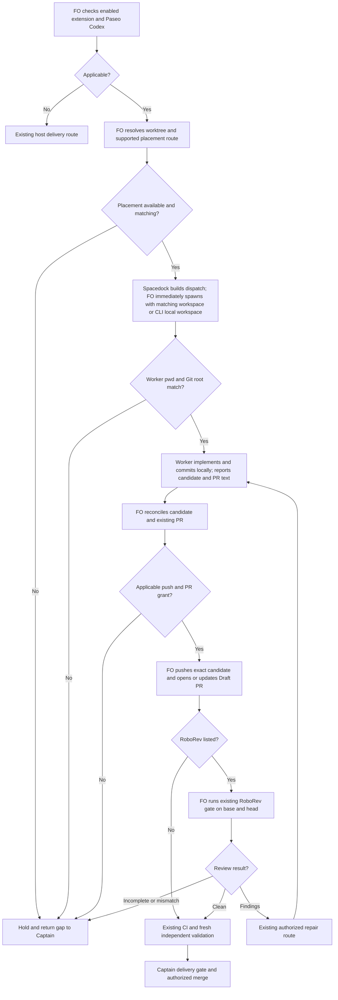

## Scope

- Source: the Captain 「照建議」 (chat, 2026-10-27), answering FO's batch-7 retrospective list (items a to d).
- Bite: batch 7 (2026-10-26/27): Codex workers created with Paseo create_agent could not reach the GitHub API (sync and implementation workers; gh failed, git push worked) or the local RoboRev daemon, so FO pushed, opened PRs and ran RoboRev for them; the relay FO reported its Paseo Codex workers' cwd stays the FO's workspace, so every worktree write needs a permission prompt, dozens per task (interview round 2). FO's 0.32.0 sync briefs that said commit locally and leave delivery to FO ran with no failure.
- Upstream first: `extensions/paseo/EXTENSION.md` (0.32.0), Paseo's own `paseo` skill and `paseo agent --help` (workspace and cwd options), Codex sandbox docs.

## Non-goals

- Changing Paseo or the Codex sandbox; any Paseo-only rule in Spacedock core (the Captain's 2026-10-26 placement ruling); making FO-side push and PR the rule on hosts other than Paseo Codex.

## Budget

- One package PR editing `extensions/paseo`; no new script.

## Stop condition

- The extension states the practice batches 7 and 8 ran (worker commits locally; FO pushes, opens the PR and runs RoboRev; the worker's working directory is its worktree), with the working-directory option checked once against `paseo agent --help`. Return to the Captain if Paseo cannot set a worker's working directory.

## FO alignment

Alignment: needed before ideation; where the check or rule lives is a package design choice.
Result: aligned at backlog: the Captain 「准」 (chat, 2026-10-28) to FO's batch-9 backlog sitting, which asked 「決定：五張全准進入設計階段；要拿掉或換掉哪張，直接說。」, approved the outcome and bounds in this file. Where the rule lives is a package design choice ideation proposes and the ideation gate rules; the placement ruling of 2026-10-26 (within-fleet Paseo use is a dev2 `paseo` extension) already holds.
Surfaces: none
Visible change: none
Release review: not needed: workflow maintenance, on no journey map.
Reviewer: kc-dev-flow-2:engineering-reviewer opus 2026-10-28 — do these amendments withdraw what the Captain approved, and what changes in the build?

## Design definition

### PRFAQ

**Proposition.** A First Officer (FO) using the enabled paseo extension can dispatch a Codex implementation worker into the task's worktree, receive a locally committed candidate, and carry that exact candidate through push, Draft pull request (PR), RoboRev review and independent validation. The worker does useful local work without being assigned GitHub or daemon steps its environment cannot perform. This is an opt-in, host-specific procedure, not a sandbox repair or a claim of enforcement.

**Who owns what?** Spacedock owns the task, worktree assignment, stage order and generated dispatch. Paseo owns workspace placement and agent creation. The worker owns implementation, local commit and truthful report; FO owns product-branch publication, Draft PR and the enabled RoboRev gate. Existing Captain authorization, fresh validation, CI and merge boundaries remain. State-checkout commit/sync is a separate ensign obligation and is not prohibited by the product-branch handoff.

**How is placement selected?** With an existing task directory, FO may reuse a verified matching Paseo workspace or register it with `create_workspace(isolation="local", path=<absolute worktree>)`, then supply the returned `workspaceId` to `create_agent`. Use the same destination server for path, workspace and worker. Do not pass an invented `cwd` field to the MCP create-agent interface. When `dispatch build --stamp` itself creates the worktree, a separate workspace call after it would violate Spacedock's immediate-spawn rule: the immediate spawn instead uses the supported `paseo agent run --new-workspace local --cwd <absolute worktree> ... <unchanged generated prompt>`, which creates the local workspace and agent within that one call. This is an invocation shape, not a full command or permission to choose a provider/mode: preserve the dispatched provider/model, runtime settings and prompt, using Paseo's current discovery/CLI contract. If the active adapter cannot express those required fields losslessly, stop for FO; do not silently translate or weaken them. `--workspace <id>` selects an existing workspace; do not combine it with `--new-workspace`. A prompt containing `cd` does not change the session's launch root.

**What happens on completion or failure?** Worker reports absolute worktree, branch, base, full candidate SHA, local checks and prepared PR title/body. It marks delegated publication/review items not run with their owner, never clean and never an implementation defect merely because they are delegated. FO verifies the local candidate and checks for an existing matching PR before a create/update, uses only an applicable publication grant, and records exact-head RoboRev output when that extension is enabled. Incomplete review or a head mismatch holds the dependent step; findings use existing classification/authorized repair. A repaired head gets new evidence. Validation remains fresh and the Draft PR exists before it. Permission errors in protected Git metadata or the split-root state directory can still occur: return the concrete gap through the existing approval boundary rather than widening the sandbox. No promise of zero permission prompts is made.

### Chain checked and current evidence

Checked on 2026-10-28, source `origin/main` fetched successfully after a sandbox FETCH_HEAD denial and authorized retry: **e57feb6eec956b74a1d4b29f26f1d0a7d1693785**, released manifest **0.32.1**. Runtime skill/package reads use the dispatched Codex package 0.32.1. State evidence inspected at **6658c9b0c3bbaaa78d6086ffdcb95ab1ef495842**; sibling tasks are concurrent and must be rechecked at implementation dispatch.

1. **Spacedock first:** 0.27.3 ensign shared core separates split-root state from code and requires committed reports; first-officer `references/fo-dispatch-core.md` requires the next action after a successful build to be the unchanged spawn, and reuse condition 3 requires a fresh worker when a stage first creates a worktree. Live `dispatch build --help` confirms `--stamp` creates the worktree. Therefore do not add an intermediate workspace operation after build, retarget a running worker by prompt, or put Paseo policy into upstream core. The assignment itself is ideation without a code worktree; this future implementation placement rule does not require creating one now.
2. **Package next:** two bounded checks covered `extensions/paseo/EXTENSION.md` plus `extensions/roborev/EXTENSION.md`, and the workflow's Extensions, Dispatch facts and Delivery authority consumers. Current paseo text covers fleet peer cooperation, not this worker handoff. Existing extension scope notes can carry it; existing RoboRev gate already binds base/head and distinguishes incomplete from clean. Repair the missing policy at that seam, with no new script, hook, transport, permission mode or global worker rule.
3. **Paseo's own contract:** read its installed `paseo/SKILL.md` (Agents/Workspaces/CLI), live MCP schemas, `paseo agent --help`, `paseo agent run --help` and `paseo workspace create --help`. Agent help routes creation to `run`; run lists `--workspace`, `--cwd` and `--new-workspace local|worktree`. The bundled source `@getpaseo/cli/dist/commands/agent/run.js` functions `buildRunWorkspaceSource` and `resolveRunWorkspace` send `path: cwd`, skip inherited caller-workspace resolution only for an explicit new-workspace request, and return the created workspace ID/directory. Three executed source-function cases with a fake client passed: caller plus plain cwd produces no explicit workspace ID; local workspace creation binds the task path; explicit workspace resolves its directory. These prove request routing, not daemon placement or sandbox savings. Reproduce by extracting that function from the installed release, calling it with `{}`, `{newWorkspace:'local'}` and `{workspace:'task-space'}`, a caller ID and a fake `createWorkspace`; assert the above return/call shapes. Removing `newWorkspace:'local'` is the observed negative control. No real workspace or worker was created.
4. **Codex boundary:** local `codex --help` names `--cd` as working root, `--add-dir` as additional writable directories and sandbox modes separately. The [official sandbox permission template](https://github.com/openai/codex/blob/main/codex-rs/prompts/templates/permissions/sandbox_mode/workspace_write.md) likewise separates cwd/writable roots from network access. Correct placement does not establish GitHub, RoboRev or protected metadata access; the proposal changes none of those permissions.
5. **Sibling adopters, read-only local snapshots:** relay `beirut-dev2` at `ab570dbe4125db7a57b27160a8d1c9e39591b3b9` has README marker 0.30.0 and `[learn, peers, roborev, journey-map, release-acceptance]`; web `dev2-fo` at `628c2b2e078aee63c5d5a6e682996db411324014` has 0.32.1 and `[learn, peers, roborev]`; qnow `qnow-adopt-dev2` at `278f79ca3eb03a8c1286817f542c4ec4b744bfed` has 0.27.0 and `[roborev, codex, copilot, learn, peers, journey-map]`. None of those sampled READMEs enables paseo. Relay dhaka is a different local checkout with 0.19.1; do not call it the current fleet adoption. No adopter was changed, and release/install alone would not activate this opt-in procedure there.
6. **Batch 7 evidence:** `_archive/worker-knows-the-team-and-asks-early.md` implementation report records RoboRev exit 3/daemon unavailable and hands Draft PR/CI to FO; later validation separates FO-supplied review from independently observed checks. `_archive/peers-rules-name-each-host-binding.md` records final GitHub API reread failure and FO-owned RoboRev/CI. `fo-interviews-extension/round-2-batch7-texts.md`, relay answer 3 and its final Dispatch practice paragraph, records repeated worktree permission prompts from inherited cwd. These are operator/report observations, not fresh measurements. The historical local-only relay sync is evidenced by commit `e11c56ec910b34f2865f5002fbdb92981dc35d40` (two adopted READMEs, verified via `git show --stat`); its no-push/no-gh handoff is recorded in the prior sync report, not provable from that commit alone.
7. **Batch 8 evidence:** `_archive/read-adr-honors-adr-folder.md` reports head `813e0b09` pushed, Draft PR and inaccessible RoboRev left to FO; `_archive/idle-hook-names-merged-tasks-without-learn.md` reports worker-pushed `207c0a7e` and repaired `aa0f280f`, with FO's distinct `roborev:1264`/`1271` evidence; `_archive/seed-check-requires-schema-fields.md` likewise preserves unavailable daemon/API checks and head-specific evidence. Thus batch records support splitting ownership, but do **not** show all workers already stopped before push. Local-only publication handoff is the requested standardization, not a fabricated historical invariant.
8. **Past decisions:** read ADR 0015 (worker opens Draft PR before validation), 0020 (workflow reading budget), 0035 (extension opt-in/defaults) and 0037 (worker handback), and state `Override:` records. ADR 0015 rejected routine FO opening that demanded another Captain message per task. This proposal retains the early Draft PR and reuses an applicable existing grant; it changes the executing actor only for opted-in Paseo Codex. The scoped exception must be explicit and recorded, not silently inferred from a sandbox error. No applicable recorded override settles that exception. The Captain's already-recorded placement choice keeps policy inside the dev2 paseo extension.

### Proposed extension addition

Append the following exact section to `kc-dev-flow-2/extensions/paseo/EXTENSION.md`, leaving its peer-cooperation instructions intact. It is **272 words**, including its heading; the existing file is 290 words. Its quoted scope-note instruction is 64 words. This is draft design, not installed policy.

<!-- proposed-paseo-addition:start -->

## Codex workers through Paseo

For a listed paseo extension, this is the Paseo Codex exception to the worker-opened Draft PR rule; other hosts keep their delivery owner. It grants no push, PR, ready or merge authority.

Resolve the stage's absolute worktree on the destination host. Pass a matching workspaceId explicitly to create_agent. If Spacedock creates the worktree during dispatch build, the immediate spawn can use Paseo's CLI with --new-workspace local --cwd <worktree>; this registers the existing directory without creating another worktree. Plain --cwd does not override an agent caller's workspace. Check current Paseo help before use. A prompt saying cd is not placement. If placement is unavailable or mismatched, hold and return the gap to the Captain. Preserve Spacedock's generated prompt and immediate spawn order.

Add to scope notes: "Start in the assigned worktree; verify pwd and git root before edits. Commit locally and report the branch, base, candidate SHA and prepared PR text; do not push the product branch or open its PR. FO owns those steps and, when roborev is listed, its review. Report delegated checks as not run, never clean. Split-root state commits and sync still follow the ensign contract."

FO reconciles the local candidate and any existing PR, then under an applicable Captain grant pushes and opens or updates the Draft PR before validation. When roborev is listed, FO runs its existing gate on that exact base/head and records its result; findings return through the existing repair route. Missing access, authority, a mismatched head or incomplete review holds the dependent step. Preserve CI, independent validation and merge gates. Never widen sandbox permissions to make this practice work.
<!-- proposed-paseo-addition:end -->

### Flow



Rendered and visually inspected with Mermaid CLI 12.0.0 after an authorized local-browser retry; actors, owner handoff, opt-in alternative, placement/grant stops and review repair loop agree with the FAQ. Reproduce with the fenced source and `mmdc -i flow.mmd -o flow.png` on an environment with Mermaid CLI and its browser. The disposable rendering is `/tmp/paseo-dispatch-ideation/flow.png`; no preview file is a durable deliverable or UI claim. Actual launch and publication remain future validation.

### Words FO reads at each moment

Method: `len(text.split())` on pinned package bytes and actual output from its existing `test_pr_watch.TasksTests` fixture, equally for base and proposed text. No shrinking claim: the optional extension grows **290 → 562** words. A conservative **full enabled-extension reload** is charged at each lifecycle moment below, including after archive; a warm cached pass adds no reread. This prevents claiming savings by relocating words. These are named instruction-load scenarios, not full session token/attention measurements; task-specific evidence, model replies and provider payloads vary and are excluded equally. Other enabled extensions are unchanged and additive.

| Lifecycle moment and counted passages | Before | After | Delta |
| --- | ---: | ---: | ---: |
| Startup: full workflow, dev skill, dev2 mod, pr-merge startup hook, open-PR fixture output, full paseo extension | 7071 | 7343 | +272 |
| Idle/open PR: dev2 mod, pr-merge idle hook, Delivery authority, Extensions, open-PR output, full paseo extension | 1379 | 1651 | +272 |
| Idle/merged PR: same passages, merged-PR fixture output, full paseo extension | 1350 | 1622 | +272 |
| After archive: dev2 mod, learn extension, archived-task output, full paseo extension | 623 | 895 | +272 |
| Merge ask: Delivery authority, Extensions, Spacedock gate-lifecycle and present-gate skills, four-gate output, full paseo extension | 2925 | 3197 | +272 |
| First Paseo worker dispatch, additional transport-specific load: Paseo skill, full paseo extension, emitted worker instruction | 1670 | 2006 | +336 |

The last row counts the 64-word instruction again when FO reads its emitted scope notes; worker reads those same 64 words. Shared stage checklist/output and Spacedock instructions are unchanged, not included in that additional-load row. Generic workflow stays 5576 words and its exact budget is untouched. The conditional ADR below is decision-time reference material, not a mandated recurring load; its eventual authored length must be added when actually loaded. No CI trigger change; CI cost per PR and real permission/time savings were not measured.

Reproduction: take package 0.32.1 and Spacedock 0.27.3; extract sections from their `##` heading through the next `##`, counting full skill/extension files including metadata. Use existing `test_pr_watch.py` fixture calls, not copied output strings: for startup/open and merged create `task-0` with `pr='o/r#7'` in `TasksTests`, `readme('')`, call `tasks({}, look=lambda ...: snap(state='OPEN' or 'MERGED', checks='pending'))`; for archive use `readme('learn')`, `archive('task-0')`, and `tasks({'pr view 7': {'state':'MERGED'}})`. All four executed calls exited 0; their stdout counts were 29, 29, 0 and 5. Four validation/awaiting-captain dictionaries passed to `watch.sittings` emitted 90 words. Clean up fixtures via `doCleanups()`. Join the named passages with newlines, add 290 for the base extension and 562 for the exact candidate section above. Dispatch adds the read Paseo skill's 1380 words plus zero/64 emitted scope-note words. Recount independently at the actual implementation base, including any newly introduced mandatory reading; do not import these totals after concurrent package edits.

### Needs decision

**One decision: approve the scoped Paseo Codex delivery exception and add one ADR to the extension-only file budget?** Recommend yes, recording an unnumbered draft titled **“Paseo Codex workers hand publication and local review to FO.”** These are coupled: a standing exception to ADR 0015 needs a durable record under this workflow's Decision records rule. The ADR would state the enabled-extension/Paseo/Codex boundary, local candidate handoff, existing-grant requirement, unchanged early Draft PR/validation/merge order and the split-root-state exception; it would explicitly narrow ADR 0015's actor rule for this case without rewriting that accepted file. FO reserves the number only at implementation dispatch.

What gets worse: FO gains the publication/review work and a fresh worker requires workspace registration; the extension adds the measured reading load, and the original one-file budget grows by one decision record. This is no new push/PR grant and no sandbox relaxation. If the Captain declines the coupled exception/record, hold implementation and return a narrower proposal; do not silently ship conflicting actor instructions. Reuse his already-recorded 2026-10-26 extension placement choice; do not ask that settled question again.

### Batch overlap

Complete proposed product changes: `kc-dev-flow-2/extensions/paseo/EXTENSION.md`; conditional on the decision above, `docs/adr/<FO-reserved>-paseo-codex-workers-hand-publication-and-local-review-to-fo.md`. No new script, test file, workflow source, budget constant, plugin manifest, CI file, adopter README, shared ADR index file, or Spacedock source change. State design/report changes only this task. The ADR number namespace is shared; do not reserve during ideation.

| Other task (plain meaning) | Same file or check, based on current record |
| --- | --- |
| `reused-worker-dispatch-leaves-a-record` (record every reused dispatch) | No product file overlap; shared pre-send scope-note/record check. Our instruction must reach fresh and reused dispatches through its existing ownership. Its workflow/budget edits require recount, not concurrent edits here. |
| `paseo-codex-dispatch-practice` (this worker handoff task) | Sole owner of the proposed paseo section and its conditional ADR. |
| `captain-ruling-sources-checked` (verify ruling provenance) | No same product file; shared design-surface/gate evidence checks and ADR number namespace. Its peers/adoption changes must not be substituted for this worker placement rule. |
| `batch-reaches-each-gate-together` (wait for whole batch) | No same product file; shared lifecycle counts, dispatch order and ADR numbering. Its proposed workflow growth changes our next recount base. |
| `fo-interviews-extension` (collect operator experience) | Its current scope adds another extension; no current same file named. Shares round-2 evidence and extension loading. If final design edits paseo or a shared extension check, serialize; do not invent its unapproved paths. |
| `adoption-asks-which-extensions` (check historical enabled extensions) | Current design edits dispatch/number guards, tests and laws, explicitly no EXTENSION.md change. Shares extension-record validation; paseo stays opt-in. |
| `adr-required-statement` (record each durable ruling) | No same file, shared ADR/task-ledger and doc checks. Follow its actually landed contract at dispatch, not its pending design. |
| `adr-silent-undo-probe` (test unnoticed ADR reversal) | Fictional harness in another archived task folder; no shared file/check beyond normal ADR review. |
| `comment-check-reaches-delivery-gate` (count comments before delivery) | delivery_gate/tests/validation prose only; shared delivery gate, no file conflict. |
| `journey-canvas-hosted-poc` (host journey-map preview) | Journey package/server scope; no same file, shares normal stage/report workflow only. |
| `journey-server-host-pilot` (host journey server) | Journey package and its decision records; no same extension, shared ADR numbering and ordinary delivery checks. |
| `ops-inbox-r1-setup-and-isolation` (set up isolated inbox) | Ops inbox product paths; no same file, ordinary delivery/authority checks only. |
| `pr-review-lite-value-pilot` (measure lighter PR review) | Separate review candidate and measurement scope; no same file. Its experimental review policy must not replace RoboRev or independent validation here. |

Recommended order: settle this single scope/ADR choice; FO reconciles live PR ownership and final interview-extension paths; reserve any ADR serially; implement this small extension change independently of workflow/checker edits, then recount against whichever package changes landed first. Re-run current dispatch-record, doc/ADR and design-surface checks on the final candidate. GitHub open PR discovery failed (`error connecting to api.github.com`); the table is local state evidence, not a claim that no conflicting PR exists. No peer session was messaged or edited.

## Acceptance criteria

**AC-1** The procedure is limited to an enabled paseo extension and Codex worker through Paseo, preserves existing peer rules and changes only the extension plus the specifically approved ADR. Evidence: candidate/base named-path diff, current package lint/doc-impact and an independent reader traces enabled-Codex, enabled-other-provider and unlisted-paseo cases. Falsifier: removing the host/opt-in condition or making FO the owner for every host fails those negative cases. Current evidence: exact proposal and bounded source review; candidate behavior not yet verified.

**AC-2** The worker starts at the assigned absolute worktree using supported Paseo placement, without a second Git worktree or an operation inserted between Spacedock build and immediate spawn. Evidence: retain installed Paseo version/help/source, full spawn arguments and returned workspace; in one later authorized disposable local-workspace run record worker `pwd`, `git rev-parse --show-toplevel`, candidate directory, caller workspace and unchanged permission mode. Compare an inherited-workspace control; a mismatch must stop before edits. Falsifier: omit workspace binding under an agent caller; the control must expose the wrong/inherited placement rather than still passing. Current evidence: help/source and three mocked source-function routing cases passed; live daemon/worker placement and prompt-count savings unverified. A platform unable to place the worker returns to Captain, not a sandbox change.

**AC-3** Worker commits the product candidate locally and hands off branch/base/full SHA/PR text; FO alone publishes and opens/updates its Draft PR under an applicable grant before fresh validation. Evidence: one later authorized implementation trace with worker/tool history, matching local/remote/PR head and FO actions; a no-grant case holds without publication, and an existing matching PR is reused. Falsifier: worker pushes, FO opens a duplicate PR, or mismatched head reaches validation. State commits/sync remain allowed. Current evidence: batch 7/8 and local-only sync show historical handoffs with the stated limits; this proposed standardized route has not run.

**AC-4** Where roborev is enabled, FO runs the existing gate for the exact base/head and records its actual output; incomplete is not clean, findings follow existing authorized repair and each repaired head gets new evidence. Evidence: independent validator reads the committed FO trace and exercises gate outcomes with existing fixtures, plus actual FO run on the candidate; unlisted roborev triggers no invocation. Falsifier: label an incomplete run clean, omit the enabled review, or reuse prior-head evidence after repair. Current evidence: current gate contract and cited historical head-bound reports; no new review executed.

**AC-5** Lifecycle reading costs are recounted with the same passages and outputs at the actual base/candidate, including worker scope notes and any newly required reference load; no claimed permission/time saving lacks live evidence. Evidence: independent whitespace recount and existing watcher fixtures as specified above; exact workflow bytes/budget stay unchanged. Falsifier: omit emitted notes, relocate text outside the count, or call the 272-word increase a saving. Current evidence: executed base fixture outputs and exact draft recount (table); no model-cost or savings result.

**AC-6** Required authority and retained documents agree: the scoped ADR exception is approved and numbered by FO only at implementation, generated prompt/adapter fields survive transport, and independent validation, CI, optional extension selection, state sync and Captain merge control remain. Evidence: ADR lint, doc-impact and dispatch-record checks from the then-declared package; independent trace comparison and the exact draft Mermaid rendered at ideation. Falsifier: change sandbox permissions, discard a generated field, start validation before required handoff/review, or treat report/gate success as merge. Current evidence: rendered/inspected design and current contracts; no implementation, new ADR approval, provider/merge or native transport proof.

## Captain amendments

### Amendment 1 — 2026-10-28, ideation gate (batch-9 joint sitting)
Captain: 「照建議」 (chat, 2026-10-28)
Asked: 「決定：五張全照建議（四張准並照上面刪減，一張暫緩）；如果哪張要改，直接說。」, with the paseo-codex-dispatch-practice row 「| 用 Paseo 派 Codex 工作者的做法 | 准，同時在本工作流啟用 paseo 外掛 | 本工作流目前沒列 paseo，沒列的話新寫的規則不會被任何人讀到；另寫一份 ADR，記下「FO 代為推送和開 PR」這個例外 |」; gate question: Approve the ideation of paseo-codex-dispatch-practice to enter implementation, together with listing `paseo` in this workflow's `extensions:`? FO recommends approve; approving accepts both, and the ADR narrowing ADR 0015 for the Paseo Codex delivery exception (worker commits locally; FO pushes, opens the PR and runs RoboRev). Without the listing the new text loads in no workflow that bit (chief-engineer batch review: this workflow lists roborev, codex, copilot, learn, peers).
Supersedes: none

## Number guards

ADR: 0042

## Stage Report: ideation

- DONE: A design for the paseo extension's Codex-worker dispatch practice (the worker commits locally; FO pushes, opens the PR and runs RoboRev; the worker's working directory is its worktree), with the working-directory option checked against `paseo agent --help` or Paseo's own docs; the batch 7 and 8 records and fo-interviews-extension/round-2-batch7-texts.md as evidence
  Current source e57feb6e (0.32.1), vendor skill/help/source and three isolated routing cases checked; batch 7/8 evidence distinguishes worker pushes from local-only handoff. Mermaid rendered/inspected; no native worker launched.
- DONE: A `### Batch overlap` section naming each file the design would change and each other batch task (reused-worker-dispatch-leaves-a-record, paseo-codex-dispatch-practice, captain-ruling-sources-checked, batch-reaches-each-gate-together, fo-interviews-extension) and live task of other sessions (adoption-asks-which-extensions, adr-required-statement, adr-silent-undo-probe, comment-check-reaches-delivery-gate, journey-canvas-hosted-poc, journey-server-host-pilot, ops-inbox-r1-setup-and-isolation, pr-review-lite-value-pilot (driven by other sessions; read only)) that changes the same file or check, so FO can order implementation
  Batch overlap names all 13 requested tasks, the extension file and conditional ADR, shared checks/numbering and ordering. GitHub PR lookup failed: error connecting to api.github.com; local state only.
- DONE: The words FO reads at each lifecycle moment, before and after, per root learning.md "Measure the words FO reads at each moment, not one file's size"
  Executed existing watcher fixtures and counted exact proposal with len(text.split()); lifecycle rows grow by 272, first-dispatch transport load by 336 including the 64-word scope note; workflow remains 5576.
- DONE: Acceptance criteria with reproducible evidence clauses and falsifiers, and unresolved decisions for the Captain, each with a recommendation and what gets worse under it
  Six individual criteria carry reproducible evidence, negative controls and current limits. One coupled decision recommends the Paseo Codex actor exception plus one ADR beyond the original file budget, with costs disclosed.
- DONE: AC-1 current evidence
  Opt-in/host branches and named-path design checked; candidate behavior awaits implementation. Removing opt-in/provider qualification would fail the specified negative cases.
- DONE: AC-2 current evidence
  Vendor help and three source-function cases passed, including inherited-workspace control; native daemon/pwd/permission behavior remains unverified.
- DONE: AC-3 current evidence
  Historical handoffs and exact-head ownership boundaries read; no new push/PR route run. Worker publication, duplicate PR or wrong head is the future falsifier.
- DONE: AC-4 current evidence
  Existing enabled-review/incomplete/head binding read and preserved; no new RoboRev run. Incomplete-as-clean or old-head evidence must fail validation.
- DONE: AC-5 current evidence
  Draft/recount and actual fixture outputs checked; no savings or CI-cost claim. Omitting emitted scope-note words falsifies the count.
- DONE: AC-6 current evidence
  Diagram rendered and inspected; current ADR/delivery/dispatch contracts compared. New actor exception/ADR scope awaits Captain; native transport and delivery remain unverified.
- DONE: Design artifact check
  design_surfaces.py check prints "paseo-codex-dispatch-practice.md: design surfaces presentable", exit 0; frontmatter unchanged, package/source parity and git diff --check pass.
- SKIPPED: Live GitHub overlap and native worker/publication/review execution
  gh pr list failed with error connecting to api.github.com; ideation launches no worker, pushes no product branch and runs no new RoboRev review. Future checks are not passed results.

### Summary

Designed a bounded paseo-extension procedure using explicit task-workspace placement and local worker commits, with exact-head publication/review owned by FO under existing authority. The design preserves Spacedock's immediate-spawn order, reports measured reading increases, and returns one coupled Captain decision for the scoped ADR 0015 exception and its new decision record; GitHub/live-worker proof remains unverified.

## Stage Report: implementation

- SKIPPED: One Draft PR (Conventional Commit title scoped to the plugin) from a branch off origin/main (e57feb6eec956b74a1d4b29f26f1d0a7d1693785) implementing the approved design and acceptance criteria in the task file; Captain amendment 1 applies: also list `paseo` in this repository's workflow README frontmatter `extensions:` (docs/dev2/README.md); ADR 0042 records the Paseo Codex delivery exception that narrows ADR 0015; only the files the design names
  Commit 9a70a3350436fac9e51d0795b3b4299693f020f8 changes exactly the approved extension, workflow selection and ADR 0042; implementation-1-message-1 assigns push/Draft PR to FO, not yet run. PR text: /tmp/impl-paseo-codex-dispatch-practice-pr.md.
- DONE: ADR 0042 records the ruling the design names, quoting the Captain's words from the task file and its gate records
  ADR 0042 quotes 「照建議」 and amendment 1's accepted row; required ADR lint exits 0. ADR 0015 remains Accepted and unchanged at base e57feb6e; SHA256 1c1559d6d627a792c758aca23195e378a14fb75c37ae36a795fcfea82dafd1ad.
- SKIPPED: Every acceptance criterion green with the evidence each names; each falsifier shown failing by a mutation you run (python3 -B, caches cleared)
  Bounded checks/mutations below pass; native AC-2 placement is unverified, AC-3 publication/AC-4 actual review await FO, and independent/native AC-1/AC-6 traces are not local results. No claim that all six criteria are green.
- SKIPPED: kc-dev-flow-2/scripts/lint-skills.py (the repository copy CI runs), /Users/kent/.claude/plugins/cache/kc-claude-plugins/kc-dev-flow-2/0.32.1/scripts/adr_lint.py docs/adr --since <base> --require 0042 exit 0; /Users/kent/.claude/plugins/cache/kc-claude-plugins/kc-dev-flow-2/0.32.1/scripts/number_guards.py check exit 0; /Users/kent/.claude/plugins/cache/kc-claude-plugins/kc-dev-flow-2/0.32.1/scripts/comment_ratio.py within its maximum; roborev evidence= line; push without force and without -u; PR body written for FO; FO reads CI on the PR head; CI cost measured or stated as not measured
  Repository lint, Codex package 0.32.1 ADR/number checks exit 0; ratio: code 0, comments 0, 0.0%, 5% maximum not enforced below 20 code lines. RoboRev exits 3: `incomplete: the roborev daemon is not running`; FO owns review/PR/CI; message-1 supersedes product push. CI cost per PR not measured; no CI changes.
- DONE: Implement the approved files under Captain amendment 1 and run bounded local checks and mutations (python3 -B, caches cleared)
  Exact 272-word approved section appended, original peer text preserved, three approved paths changed. Python -B checks/review mutants rerun with fresh absent PYTHONPYCACHEPREFIX and bytecode writes disabled; evidence logs: /tmp/impl-paseo-codex-dispatch-practice-evidence/.
- DONE: Do not push: commit locally on a branch based on origin/main e57feb6eec956b74a1d4b29f26f1d0a7d1693785 and write the PR title and body to /tmp/impl-paseo-codex-dispatch-practice-pr.md; FO pushes, opens the Draft PR and runs /Users/kent/.claude/plugins/cache/kc-claude-plugins/kc-dev-flow-2/0.32.1/extensions/roborev/roborev_gate.py on the exact head, which is this task's own AC-3 and AC-4 trace
  One local commit from fetched base; no product push or gh invocation. Conventional Commit title/full PR body prepared at the named path, mode 0600; FO trace remains pending.
- DONE: Report AC-2's disposable native-worker proof as not verified, naming that this worker itself started in the FO's workspace (the inherited-workspace case) rather than its worktree
  Launch root: /Users/kent/conductor/workspaces/kc-claude-plugins/colombo, not assigned code worktree. Candidate operations pinned to assigned root; no native success or permission-prompt saving claimed.
- DONE: Create no test agents and claim no native proof
  No agents/workspaces created. Paseo 0.13.0 PTY help retained; three extracted vendor routing cases with stub client/source builder pass. Omitting newWorkspace:'local' leaves workspace id absent and fails the placement assertion; daemon/sandbox behavior unverified.
- DONE: Hand off branch, base, full head SHA and PR text path in the stage report
  Worktree: /Users/kent/conductor/workspaces/kc-claude-plugins/colombo/.context/dev2-adoption/worktree/.worktrees/spacedock-ensign-paseo-codex-dispatch-practice; branch: spacedock-ensign/paseo-codex-dispatch-practice; base: e57feb6eec956b74a1d4b29f26f1d0a7d1693785; head: 9a70a3350436fac9e51d0795b3b4299693f020f8; PR text: /tmp/impl-paseo-codex-dispatch-practice-pr.md.
- DONE: Bounded review falsifiers and existing dispatch checks
  Five RoboRev fixtures pass; accepting an old head, failed job or unavailable-daemon-as-clean each fails the existing negative test. Removing ADR recommendation makes lint exit 1. Spacedock dispatch integration checks pass with executable 0.27.2/plugin 0.27.3, including Team-loss/marker/scope-note controls; no worker execution or live runtime-field proof.
- DONE: AC-5 lifecycle recount and reading-cost falsifier
  Base→candidate: startup 7071→7343; idle/open 1379→1651; idle/merged 1350→1622; archive 623→895; merge ask 2925→3197; first dispatch 1670→2006. Regex recount agrees; omitting emitted notes yields 1942 rather than 2006 and fails. Workflow source/budget unchanged at 5576; conditional ADR load adds 476 words; no time/permission savings measured.
- DONE: Affected documents and dispatch-state checks
  doc_impact.py base HEAD exits 0 with 0 listed documents; design_surfaces.py check exits 0; dispatch_records.py exits 0 for three records. No workflow-source/budget, version, CI, adapter or sandbox edits; independent validation remains pending.

### Summary

Committed the approved three-file Paseo Codex procedure and authority record as 9a70a3350436fac9e51d0795b3b4299693f020f8, with local checks, bounded mutations and reading-cost evidence. Per FO's committed follow-up, publication, Draft PR, exact-head RoboRev and CI belong to FO; native placement is unverified, and this report is neither validation nor delivery approval.

## Stage Report: validation

- SKIPPED: Independent verdict on PR #742 head 9a70a335 against every acceptance criterion in the task file, re-running each evidence command and at least one falsifier per criterion yourself, and judging each limit the implementation report states
  Verdict REJECTED for full acceptance: all six criteria assessed and all available local commands/counterexamples rerun, but AC-2's native success/control and AC-6's native field transport were not exercised; no test agents were authorized by implementation-1-message-1. This is missing proof, not a demonstrated placement defect (F1).
- DONE: Captain amendment 1 applies (paseo listed in docs/dev2/README.md extensions:); AC-3 and AC-4 evidence is FO's publication of this exact head (push of 9a70a335 to the branch, Draft PR #742 opened by FO, RoboRev evidence=roborev:1296 clean on 9a70a3350); AC-2's disposable native-worker proof was reported not verified by implementation
  Three approved paths only; amendment and ADR 0042 agree. Publication/review are FO-supplied committed dispatch evidence (d98200c32, validation-1.md); local tracking ref matches 9a70a3350436fac9e51d0795b3b4299693f020f8. Hosted checks are FO-reported, not independently queried.
- DONE: A minimal acceptance script the Captain can run (three to six steps, exact commands, expected output), run by you exactly as written in a fresh bash shell, with its observed output; /Users/kent/.claude/plugins/cache/kc-claude-plugins/kc-dev-flow-2/0.32.1/scripts/adr_lint.py docs/adr --since <base> with its exit code; your verdict naming the head, with findings classified by the workflow's Review-finding disposition
  Four-step script below ran unchanged with bash --noprofile --norc, exit 0. Used the explicitly supplied equivalent Codex package 0.32.1; ADR lint with --since e57feb6eec956b74a1d4b29f26f1d0a7d1693785 --require 0042 exits 0: 41 ADR file(s) checked, 0 legacy.
- DONE: AC-1 — bounded document scope and independent reader trace
  PASS: original peer bytes preserved; exact approved 272-word addition; enabled Paseo/Codex selects FO publication, other-provider and unlisted cases retain existing ownership. A broadened all-host/always-enabled wording counterexample changes those negative-case decisions and fails exact approved-text comparison; this is document review, not runtime enforcement.
- SKIPPED: AC-2 — native worker placement success and inherited-workspace control
  Paseo 0.13.0 live help and freshly extracted vendor source pass three stub-client routing cases; omitting newWorkspace:'local' yields no explicit workspace ID and fails placement assertion. Full native spawn arguments/returned workspace/pwd/git-root/permission-mode comparison is absent; both implementation report and this worker's actual launch pwd name colombo, not the task worktree.
- DONE: AC-3 — candidate handoff and publication identity
  Local branch/base/full head and prepared PR text agree with FO's Draft PR #742 receipt; no validator publication. Independent reader cases hold without grant and reuse a matching PR; substituting base SHA in the receipt fails the validator's identity assertion. These negative cases do not establish executed provider duplicate prevention or historical absence of every worker push.
- DONE: AC-4 — review gate outcomes and FO evidence
  Five existing fixtures pass; three executed gate mutations accepting old head, failed job or unavailable daemon as clean each fail the existing negative test. FO supplies roborev:1296 clean on this head; unlisted roborev reader case invokes nothing. No new daemon review or independent hosted receipt was fabricated.
- DONE: AC-5 — independent lifecycle recount and omitted-note counterexample
  Anchored-heading recount: startup 7071→7343; idle/open 1152→1424; idle/merged 1123→1395; archive 623→895; merge ask 2698→2970; first dispatch 1670→2006. Existing watcher fixtures output 29/29/0/5 words and sitting 90; omitted 64-word emitted notes gives 1942, failing 2006. Workflow stays 5576; conditional ADR adds 476; F2 corrects prior totals.
- DONE: AC-6 — authority, document checks and bounded dispatch transport
  ADR 0015 and workflow/budget bytes unchanged; reserved ADR 0042, doc-impact (0 documents), number guards, comment ratio (0 code/0 comments), design surfaces and 4 dispatch records all pass. Removing ADR Recommended yields exit 1. Existing Spacedock integration passes 10 handoffs/10 Team-loss controls and scope-note/host-marker negatives; executable 0.27.2/plugin 0.27.3 proves generated artifacts, not native model/runtime-field preservation (F1).

### Findings and evidence limits

- F1 Needs decision: The enabled Paseo/Codex FO-to-worker journey owes real placement and unchanged runtime fields under value-ac[AC-2] and value-ac[AC-6]. Harm is not demonstrated; the trigger evidence is the inherited colombo launch root and absent native success/control receipts. FO's instruction to report not verified does not amend the Captain's criteria. Return the missing-proof decision to the Captain: authorize the disposable native comparison, or explicitly amend acceptance; do not infer a waiver or repair product bytes.
- F2 Polish: The prior reading-cost report starts its Extensions extraction at the inline reference in workflow.md:334, counting 451 words instead of the real heading's 224. Retained passages confirm the extra 227 in idle/open, idle/merged and merge ask on both revisions; corrected totals are above. No reading-growth delta, workflow budget or savings claim changes; no present product harm or protected threshold breach established. FO may disposition this report-only discrepancy.
- Evidence: /tmp/validation-paseo-742-evidence/ contains checks.json, recount.py/json, falsifiers.py, routing-probe.cjs, captured vendor source/help, sd-dispatch.log and acceptance.sh/log. Local tests do not prove native placement, prompt savings, model compliance, hosted CI, merge or adoption. CI cost per PR was not measured; this candidate changes no CI. No user-visible surface exists. The three retained changes are necessary for the scoped procedure, explicit adoption and durable ADR exception; goal sufficiency remains unverified at the native seam.

### Minimal acceptance script

Run on this Mac with the named existing candidate worktree and Codex package. The four steps cover local structure, ADR and review-gate refusal behavior only; they do not satisfy F1 or query GitHub. Each command below ran exactly as written in a fresh bash shell; the complete script exited 0.

```bash
set -e
# 1. Expected: exactly the three paths shown in the observed output below.
cd /Users/kent/conductor/workspaces/kc-claude-plugins/colombo/.context/dev2-adoption/worktree/.worktrees/spacedock-ensign-paseo-codex-dispatch-practice
test "$(git -C /Users/kent/conductor/workspaces/kc-claude-plugins/colombo/.context/dev2-adoption/worktree/.worktrees/spacedock-ensign-paseo-codex-dispatch-practice rev-parse HEAD)" = 9a70a3350436fac9e51d0795b3b4299693f020f8
git -C /Users/kent/conductor/workspaces/kc-claude-plugins/colombo/.context/dev2-adoption/worktree/.worktrees/spacedock-ensign-paseo-codex-dispatch-practice diff --name-only e57feb6eec956b74a1d4b29f26f1d0a7d1693785 HEAD
# 2. Expected: PASS and 5576 of 5576 words.
python3 -B kc-dev-flow-2/scripts/lint-skills.py
# 3. Expected: 41 ADR file(s) checked, 0 legacy; exit 0.
python3 -B /Users/kent/.codex/plugins/cache/kc-claude-plugins/kc-dev-flow-2/0.32.1/scripts/adr_lint.py docs/adr --since e57feb6eec956b74a1d4b29f26f1d0a7d1693785 --require 0042
# 4. Expected: Ran 5 tests; OK.
python3 -B kc-dev-flow-2/extensions/roborev/test_roborev_gate.py
```
Observed step 1: docs/adr/0042-paseo-codex-workers-hand-publication-and-local-review-to-fo.md; docs/dev2/README.md; kc-dev-flow-2/extensions/paseo/EXTENSION.md. Step 2: PASS: basic frontmatter, declared profile routes, role bindings and package script paths; references/sd/workflow.md: 5576 of 5576 words; no unlisted passage repeats it; Not checked: full Agent Skills conformance or host/workflow behavior. Step 3: 41 ADR file(s) checked, 0 legacy. Step 4: Ran 5 tests; OK. All steps exit 0.

### Summary

Independently assessed PR #742 at 9a70a3350436fac9e51d0795b3b4299693f020f8 against base e57feb6eec956b74a1d4b29f26f1d0a7d1693785 in a clean detached throwaway worktree, with available local checks and a counterexample per criterion. Recommend REJECTED pending the native evidence/acceptance decision (F1); the corrected absolute reading totals are report-only Polish (F2), and FO publication/review/CI evidence remains explicitly attributed. Product bytes and entity frontmatter remain unchanged; no test agents, PR actions or product push were performed.

## Stage Report: validation

- DONE: Independent verdict on PR #742 head 9a70a335 against every acceptance criterion in the task file, re-running each evidence command and at least one falsifier per criterion yourself, and judging each limit the implementation report states
  REJECTED on 9a70a3350436fac9e51d0795b3b4299693f020f8 versus e57feb6eec956b74a1d4b29f26f1d0a7d1693785: all six criteria assessed, local evidence and falsifiers rerun in a fresh detached checkout; F1 remains open for integrated dispatch transport/order.
- DONE: Second validation on the same head after validation-1's F1 (missing native placement receipt): judge AC-2 and AC-6 from FO's native placement trial in the task folder, paseo-codex-dispatch-practice/validation-1/native-placement-trial.md with its two JSON receipts (success run with --new-workspace local --cwd placed the agent in the worktree; plain --cwd control from an agent caller inherited the caller's workspace); Captain amendment 1 applies; AC-3 and AC-4 evidence is FO's publication (push of 9a70a335, Draft PR #742 by FO, RoboRev evidence=roborev:1296 clean on 9a70a3350); validation-1's F2 is Polish
  Native placement/control independently confirmed through Paseo status/activity, beyond the saved JSON cwd receipts; amendment 1 agrees with the three-path diff. FO publication/review/checks remain attributed evidence; F2 remains Polish.
- DONE: A minimal acceptance script the Captain can run (three to six steps, exact commands, expected output), run by you exactly as written in a fresh bash shell, with its observed output; /Users/kent/.claude/plugins/cache/kc-claude-plugins/kc-dev-flow-2/0.32.1/scripts/adr_lint.py docs/adr --since <base> with its exit code; your verdict naming the head, with findings classified by the workflow's Review-finding disposition
  Five-step validation-2/acceptance.sh ran byte-for-byte with /bin/bash --noprofile --norc, exit 0; exact commands, expected observations and full output are in acceptance.sh/acceptance.log. Required ADR lint via the supplied equivalent Codex package exits 0: 41 ADR file(s) checked, 0 legacy.
- DONE: Judge AC-6's build-to-spawn transport from your own dispatch as the only existing trace: `spacedock dispatch build` wrote /tmp/spacedock-dispatch/5c030106-8d82-4542-855e-1498b2563c69-spacedock-ensign-paseo-codex-dispatch-practice-validation.md (sha256 6d78f0c89090c8c0c2aaba3d88544456346027f21ba6bf609ae7dee4316ac106 at this message), and FO spawned you through Paseo MCP create_agent with provider codex/gpt-6-astra, settings modeId auto-review and thinkingOptionId high, and an initialPrompt that names that file plus three FO sentences (the Codex ensign skill path, the Codex package path, and FO's reading of PR #742's checks); read your own Paseo status and first activity to compare
  Own status confirms codex/gpt-6-astra, high, auto-review and inherited colombo cwd; first activity confirms the wrapper. Dispatch file SHA256 matches 6d78f0c89090c8c0c2aaba3d88544456346027f21ba6bf609ae7dee4316ac106; see validation-2/self-trace.json.
- DONE: State its limits as found: that spawn was placed by the old practice (no workspace binding; your cwd is the FO workspace), FO's wrapper adds sentences around the generated pointer rather than passing it unchanged, and no trace uses the candidate's `--new-workspace local --cwd` route with a generated dispatch
  No matching workspace binding, no unchanged generated pointer, and no generated-dispatch CLI-local-workspace trace exists; diagnostic placement runs cannot substitute for the missing integrated trace.
- DONE: Return F1 as still open or closed on that evidence; FO creates no further test agents for this validation
  F1 remains open, narrowed to build/immediate-spawn and generated-prompt preservation; no further agents created, no product changes or provider publication performed.
- DONE: AC-1 — enabled host/provider scope and retained content
  Exact approved 272-word addition, unchanged peer prefix, and only extension/ADR 0042/approved README selection changed; independent reader routes other-provider/unlisted cases to existing owner. Broadening the host/opt-in phrase fails the approved-text counterexample; this is prose review, not enforcement.
- FAILED: AC-2 — complete placement and immediate-spawn criterion
  Placement subclaim passes: native success cwd/git-root/workspace match the task, inherited control stays colombo, both sol/low/auto-review; replaying that control fails the assigned-root assertion. Fresh Paseo 0.13.0 source/help and three stub routes agree; full spawn arguments/build order are not retained or exercised (F1).
- DONE: AC-3 — local candidate handoff and FO publication
  Branch/base/head/prepared PR text agree with implementation and FO Draft PR #742 evidence; local remote-tracking head matches. Reader no-grant holds and matching-PR reuse agree with text; substituted base SHA fails identity assertion. Provider actions/absence of duplicate pushes are FO-supplied, not independently queried.
- DONE: AC-4 — exact-head review and incomplete refusal
  Five existing fixtures pass; three executed mutants accepting old head, failed job or unavailable-daemon-as-clean each fail the negative fixture. FO supplies roborev:1296 clean on 9a70a3350; unlisted-extension reader case invokes none. No new daemon review claimed.
- DONE: AC-5 — lifecycle reading cost and report limits
  Fresh anchored recount base→head: startup 7071→7343; idle/open 1152→1424; idle/merged 1123→1395; archive 623→895; merge ask 2698→2970; first dispatch 1670→2006. Omitting 64 emitted words fails at 1942; workflow stays 5576, ADR adds 476. Prior +227 absolute-count error remains F2 Polish; no savings measured.
- FAILED: AC-6 — generated prompt and adapter fields survive the candidate route
  Authority/ADR/doc-impact/number/design/6 dispatch records/comment checks pass; ADR 0015 and workflow/budget stay byte-identical. Native runtime settings match; widening the receipt mode fails comparison and removing ADR Recommended fails lint. Ten generated dispatch handoffs/ten Team-loss controls pass, but own native prompt is wrapped and uses old placement (F1).

### Findings and evidence limits

- F1 Needs decision (still open, narrower): released user/workflow = FO dispatching an opted-in Paseo Codex worker; observable harm = none demonstrated, but full accepted proof absent; boundary = value-ac[AC-2] immediate-spawn order and value-ac[AC-6] unchanged generated prompt/fields; trigger = committed validation-2-message-1 plus independently read native/self activities. Placement is resolved, integrated transport is not. Captain must decide whether to amend the acceptance boundary or retain the missing proof obligation; FO declines more trial agents in this validation, which does not waive an AC.
- F2 Polish remains settled: reading totals corrected by validation-1, independently reproduced here; no changed delta, workflow budget or savings claim. No new Material finding.
- Limits judged: implementation native-placement unknown is now resolved; publication/review pending is resolved by FO evidence; generated/native transport remains open. Local checks do not prove model compliance, provider CI, merge, adoption, protected metadata/network access or permission/time savings. CI cost per PR not measured; no CI changes. No user-visible surface is changed.
- Minimal acceptance: [five exact steps](paseo-codex-dispatch-practice/validation-2/acceptance.sh), [observed output](paseo-codex-dispatch-practice/validation-2/acceptance.log). Requires this Mac’s existing candidate worktree, Codex package and saved trial receipts; checks structure/ADR/review refusal and saved cwd comparison only, not a new spawn or F1 closure. Observed: three approved paths; lint PASS 5576/5576; ADR 41/0; 5 tests OK; saved-success/control PASS; all exit 0.
- Necessity: extension supplies the scoped procedure, README activates it under amendment 1, ADR records the actor exception; removing each loses one accepted obligation. Goal sufficiency remains unverified at the integrated build-to-spawn seam. Live receipts and local outputs are retained in validation-2/; product checkout remains unchanged.

### Summary

Second validation recommends REJECTED for PR #742 head 9a70a3350436fac9e51d0795b3b4299693f020f8. The native success/control and unchanged runtime mode are independently confirmed, closing the placement part of F1; FO confirms no candidate-route generated-dispatch trace, so its transport/order part remains Needs decision. This report supersedes the first validation verdict details without rewriting it; no product repair, new agents, PR action or merge approval is implied.

## Stage Report: validation

- SKIPPED: Independent verdict on PR #742 head 9a70a335 against every acceptance criterion in the task file, re-running each evidence command and at least one falsifier per criterion yourself, and judging each limit the implementation report states
  The following checklist narrows this third pass to validation-2 F1 and unchanged-head checks. Prior AC-1/3/4/5 verdicts and falsifiers are carried forward, not claimed as freshly rerun; necessary package checks and the five existing review fixtures were independently rerun. Verdict: REJECTED on 9a70a3350436fac9e51d0795b3b4299693f020f8 versus e57feb6eec956b74a1d4b29f26f1d0a7d1693785.
- DONE: Third validation on the same head, for validation-2's open F1 (integrated build-to-spawn transport) only, plus a recheck that nothing else changed: you were spawned by FO through the candidate route, `paseo agent run --new-workspace local --cwd` at the implementation worktree, with the prompt `dispatch build` generated passed unchanged as the whole initial prompt; compare your own Paseo status and first activity with this record (provider, model, thinking, mode, cwd, workspace, prompt bytes) and with the assignment file's bytes; FO's create_agent workspaceId trial (agent ddf30e67) is in paseo-codex-dispatch-practice/validation-3/; PR #742 checks on this head were read by FO: adr-path-check, unit tests (python3), multi-profile route gate (live Spacedock), version parity and GitGuardian pass
  Native self status/activity and own provider initial message independently confirm assigned cwd, codex/gpt-6-astra/high/auto-review and workspace wks_c4f3d3de2a4e440b; FO's complete call 4 agrees. The workspaceId trial independently agrees through live status/activity. Hosted checks remain FO-supplied, not a fresh provider query.
- DONE: A minimal acceptance script the Captain can run (three to six steps, exact commands, expected output), run by you exactly as written in a fresh bash shell, with its observed output; /Users/kent/.claude/plugins/cache/kc-claude-plugins/kc-dev-flow-2/0.32.1/scripts/adr_lint.py docs/adr --since <base> with its exit code; your verdict naming the head, with findings classified by the workflow's Review-finding disposition
  Five exact steps in validation-3/acceptance.sh ran with /bin/bash --noprofile --norc; acceptance.log records expected exit 1 at the genuine AC-2 failure. ADR lint from the loaded Codex package 0.32.1, --since e57feb6eec956b74a1d4b29f26f1d0a7d1693785 --require 0042, exits 0: 41 records, 0 legacy.
- DONE: Read paseo-codex-dispatch-practice/validation-3/build-to-spawn-sequence.md: FO's four tool calls from the validate.py call (which runs `spacedock dispatch build`) to the `paseo agent run` spawn, verbatim and in order; do not read FO's session transcript, which holds unrelated conversation
  Read the committed four-call record and validation-3-message-1; no FO session transcript read. FO's sequence is corroborated by live curated activity; its exact call inputs are attributed to FO.
- DONE: Judge AC-2's "no operation inserted between Spacedock build and immediate spawn" on it as found: FO inserted two operations (reading the create_agent trial's activity, then writing receipts and running `spacedock state commit`), about 28 seconds between build and spawn
  AC-2 fails: calls at 12:01:53.525Z and 12:02:02.017Z intervene between build call 12:01:43.539Z and spawn call 12:02:11.630Z. The number of intervening operations, not elapsed seconds, violates the criterion and Spacedock fo-dispatch-core's next-host-action rule.
- DONE: Judge AC-6's unchanged prompt and fields from your own status, first activity, generated-prompt.txt and the spawn command in call 4
  AC-6 transport proof now passes for this route: 206-byte prompt payload SHA256 23d03db76299dafc69584f1fe071950a0872cd3eda5d4acbaa2f9b7dcd375de3 matches native received payload and helper stdout. Saved text has one extra output-terminating LF removed by shell substitution; Paseo's sender envelope is transport metadata, not an FO-added instruction.
- DONE: Independently bind the assignment bytes, native settings and falsifiers
  Assignment is 6359 bytes, SHA256 5014b07f4b1ad9eb87e3a0b8a1912e14a728dbc541161baf7961ee229d02ef21, matching the first read in this worker's own transcript. Changing prompt/model/thinking/mode/cwd/workspace fails six comparisons; a synthetic zero-intermediate sequence passes the order predicate, while the real four-call sequence fails. No synthetic trace is claimed as a native success.
- DONE: Recheck unchanged candidate and necessary existing checks
  Fresh detached 9a70a335 checkout was clean and removed after checking: only extension/README/ADR 0042 differ from base; lint 5576/5576, ADR, number guards, doc impact (0 documents), comment ratio (0 code/0 comments), design and review fixtures (5 tests) exit 0. Dispatch records: 7 initially, 8 after FO follow-up, both exit 0. Original code branch/head/worktree remain unchanged.
- FAILED: AC-2 immediate-spawn proof required to close F1
  This is a real candidate-route native spawn with preserved prompt and placement, but it is not a conforming build-then-next-action-spawn trace. No candidate repair, new trial worker, PR action or permission-mode change performed by this validator.

### Findings and evidence limits

- F1 Needs decision (narrowed to immediate-spawn order): released user/normal workflow = FO using the enabled Paseo Codex procedure; observable harm = the accepted order is not followed, with no stale assignment or product damage observed; boundary = value-ac[AC-2] no intervening operation, plus the retained Spacedock next-host-action contract; trigger = FO's committed four-call sequence and validation-3-message-1. Unchanged-prompt/native-field proof is now supplied; the remaining gap belongs to FO's execution/evidence, not candidate code. A conforming next-action trace is still required unless the Captain amends the accepted boundary.
- AC-1/3/4/5 retain validation-2's bounded conclusions at the unchanged head; F2 reading-total correction remains settled Polish. AC-6's specific transport obligation is now supported, while the retained immediate-spawn contract remains unsatisfied under F1. No new Material product finding.
- Implementation limits judged: native placement and generated prompt/runtime transport now have independent live evidence; product publication and exact-head RoboRev/CI remain attributed FO evidence. No proof of general model compliance, adoption, merge, protected metadata/network access or time/permission savings. CI cost per PR not measured; no CI change.
- Goal sufficiency still fails the accepted order requirement. Minimal necessity is unchanged: extension defines the scoped procedure, README enables it under amendment 1, ADR 0042 records the approved delivery-actor exception. This pass adds only task evidence and this report.
- Acceptance is a retained-evidence replay, not a new spawn or hosted check; the exact fresh-shell failure is expected and must not be presented as green. No user-visible surface changed. Candidate cleanup is complete; delivery and further evidence remain FO/Captain work.

### Summary

Third validation recommends REJECTED for PR #742 head 9a70a3350436fac9e51d0795b3b4299693f020f8. Native placement, prompt bytes, assignment read and declared runtime fields now agree, but two operations between build and spawn leave AC-2 unsatisfied. The prior transport gap is closed; the remaining finding is FO's immediate-spawn execution/evidence gap, not a requested product change or merge approval.
