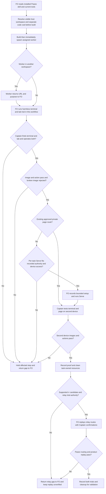

## Scope

- Source: the subspace-relay dev2 FO (Paseo 1671c3a9) relayed the Captain's words of 2026-10-28: 「你這次有幾次終端機開錯在不同路徑，這個是否應該給dev2 fo提報讓它改進paseo ext機制？這裡其實有個改進點，只要在paseo環境內，應該盡可能在它裡面開browser + 終端機，且注意應該要確保跨裝置可用，例如你開localhost時我在手機上就不可用，因為開的不是手雞的localhost，一個可能的解決方案是現在的tailscale但是可能不夠通用，但這個沒關係讓dev2煩惱就好」. Relayed words are not a ruling until the Captain confirms them in this session.
- Bite: relay rr-pairs-once validation trials on staging, 2026-10-28 (relay state branch spacedock-state/dev2, task rr-pairs-once, validation-1/trials/ and dispatch/validation-1.md): a Codex trial worker's Paseo terminal opened with cwd /tmp/rr-sheet-worker and the Captain could not see it from his workspace; the live pairing request was cancelled and recreated (one request, about 2 minutes); trial scripts ran in a terminal he had to choose and browser steps opened in the macOS default browser, not a Paseo tab. Cross-device (a localhost page unusable from his phone) was raised, not yet hit.
- Upstream first: `extensions/paseo/EXTENSION.md` and the open paseo-codex-dispatch-practice change (#742, worker placement in its worktree); Paseo's own `paseo` skill and docs for terminals, browser tabs and workspaces; Tailscale only as the Captain's named candidate, read from its own docs.

## Non-goals

- Changing Paseo itself; product-specific routes (relay's code route for phones stays relay's).
- Exposing local servers beyond the Captain's own devices.

## Budget

- One package PR to the paseo extension; no new script unless the design shows a check is needed.

## Stop condition

- First, FO runs a real harmless terminal and tab trial in this workflow at implementation or validation, recording Captain visibility, input/action, expected pictures, actual second-device reach and task-owned cleanup. Only after that local workflow trial passes does FO attempt relay's rr-pairs-once replay with a supported candidate and the relay owner's existing trial authority.
- Tailscale Serve is the accepted per-task cross-device fallback, after an existing approved private route. Record the exact host, port, allowed devices, lifetime and cleanup; do not ask again about the already accepted direction. A missing device or failed private route leaves cross-device acceptance unmet. Unsupported rr behavior stays unverified and returns to FO; it does not hold authoring this design or justify changing relay.
- Return to FO for anything beyond the three revise asks: enabling this extension in another adopter, changing Paseo or rr, public exposure, broad shared-network access, persistent service/support obligations, or choosing another network mechanism. No such extra design is included. A within-asks revised design may proceed under the recorded Captain grant; this worker does not advance the stage.

## FO alignment

Alignment: needed before ideation; the cross-device approach is the Captain's.
Result: aligned at backlog: the Captain 「對，全准且全確認」 (chat, 2026-10-30) to FO's batch-11 backlog sitting, which asked 「決定：六張全准進設計，並確認上面三件事？要改哪張直接說。」, approved the outcome and bounds in this file. He confirmed the words the relay FO relayed. The cross-device approach was subsequently settled by the ideation revise below.
Surfaces: none
Visible change: none
Release review: not needed: workflow maintenance, on no journey map.
Reviewer: kc-dev-flow-2:chief-engineer opus 2026-10-30 — batch-11 review before the joint ideation sitting: approve, revise, split or hold each task, the Captain's decisions, overlap and order

## Design

### Revision authority

The newest `review/ideation/briefing-1/index.json` asks: use the installed Paseo skill instead of the docs read; trial a real terminal and tab in this workflow first, relay's rr replay second; Tailscale Serve is a per-task fallback for cross-device reach. The committed ideation resolution records Captain 「准」 on 2026-10-30 and permits a within-asks revision to enter implementation without another sitting. The dispatch assigns the real trial to FO at implementation or validation. This revision replaces the current design/criteria below and preserves the earlier report verbatim; the earlier report's pending-network wording is historical.

### PRFAQ

**Proposition.** A Captain attending work in Paseo can find and operate the terminal and page the First Officer (FO) or worker asks him to use. A device handoff names a usable private URL and its tested limits; opening a tab, receiving HTTP 200 or connecting the phone to the daemon does not establish that handoff.

**Who and what is the smallest slice?** The Captain, his FO and a dispatched worker in one workflow that lists `paseo`. Add one human-surface section to `kc-dev-flow-2/extensions/paseo/EXTENSION.md`, used by FO and passed to workers through the existing extension scope-note mechanism. Keep the worker in its assigned code worktree. Resolve the human-facing workspace separately; private test state may remain under `/tmp`. One package PR; no new script, transport, permanent service, default extension selection or product change. The proof order is this workflow’s harmless real terminal/tab trial first, relay replay second; FO operates both later, and the implementer/validator records the FO receipts.

**What happens?** Before an attended operation, FO resolves the destination host, Captain workspace ID and absolute cwd from current Paseo inventory and the task context, plus the separate code cwd and the existing network route. It reads the installed Paseo skill and the current tool schemas, then adds these facts to scope notes before dispatch build, preserving Spacedock's immediate build-to-spawn order. No blanket external Paseo documentation read is added. The installed skill covers hosts/workspaces but has no terminal/browser chapter, so the tools supply their current parameter contract; neither source proves Captain visibility. A terminal is created with the visible workspace cwd; a command uses an absolute candidate path or changes shell cwd afterwards. The terminal's initial ownership and execution directory are different facts. Read back the terminal ID and named workspace before starting a live request; a background workspace listing alone does not prove the Captain sees it.

A caller in that workspace opens the page with `browser_new_tab`. A worker in another workspace hands the safe URL and purpose to its own FO using the existing worker handback. FO opens the tab in the visible workspace; do not move the worker, invent a workspaceId argument on the browser tool, or interpret `cd` as a browser move. The tool opens in the background on the most recently connected desktop host: verify the host/tab and give the Captain the tab title/location, without claiming focus changed. If FO is also in the wrong workspace or no desktop browser host is connected, report the placement/capability gap and hold the attended step. A different browser is an explicit Captain exception, not a silent success.

**What stays usable on another device?** The same daemon/workspace terminal is reached through the Captain's existing Paseo connection, with a harmless input/output check on that device. Desktop browser tabs are not documented as phone browser replicas. Hand the page's private URL to the second device, keep its server alive for the agreed review window, and test rendering and the intended interaction there. Preserve normal sign-in on that device; do not forward cookies or sign in for the Captain. A supplied HTTP URL is not automatically public, private, working or authorized.

**How are pictures checked?** In the actual preview page, check expected images (including lazy images after scrolling), their decoded dimensions, relevant CSS background images, styles, scripts and required fetch/WebSocket traffic; retain a rendered screenshot and one intended interaction. `document.images` with `complete && naturalWidth > 0` is useful but does not cover CSS backgrounds or correct visual content. A known broken-image fixture whose HTML returns 200 must fail. Repeat the material page checks on the second device; a desktop screenshot proves only the desktop page. A safe route to HTML alone does not repair hard-coded localhost asset/API URLs.

**Recovery and scope.** Stop before creating a live request if the human surface is unverified. If an active request has already opened invisibly, use the product's documented cancellation, observe it stopped, then recreate once in the correct place. Do not leave two active requests. Preserve sign-in/approval/terminal-confirmation boundaries and existing secret wrappers. Report runtime/network permission refusal to FO; no automatic sandbox widening. Stop only task-owned preview processes/tabs/terminals after the agreed handoff; do not close a Captain-owned session or reset shared proxy configuration. No unattended availability or support duty is introduced.

### Source chain and bounded existing-code check

Revision research date: 2026-10-30. `git fetch origin` succeeded after the permitted retry for protected FETCH_HEAD; `origin/main` remains `a6612948936a4f075625147b21aabd3b10b19eee`, package **0.33.1**. `gh pr list --repo iamcxa/kc-claude-plugins --state open --json number,title,headRefName` failed with `error connecting to api.github.com`; current remote PR ownership is unverified. Use this pinned local source and state records; FO rechecks provider ownership before implementation. No product branch/commit or sibling mutation is part of this stage.

1. **Spacedock first.** Read 0.27.3 ensign shared/Codex contracts and `skills/first-officer/references/fo-dispatch-core.md`. They own split-root state, worktree placement, preserved dispatch fields, immediate spawn and worker handback. They do not supply a human terminal/browser routing contract in those inspected sections. Do not replace those mechanisms or insert a visibility probe between successful build and spawn.
2. **kc-dev-flow-2 next.** Read the pinned paseo/peers extensions, workflow Extensions section and lifecycle mod. `paseo` is optional; its 562-word file addresses peer exchange and Codex placement/publication. Existing extension scope notes already carry worker instructions. Two bounded searches: terminal/browser/human-facing terms in the inspected upstream contracts; current extension/workflow callers and the archived #742 design. Conclusion: reuse the tools and dispatch seam; add policy text, not a new wrapper or automation gate. This is an instruction checked by attended evidence, not an unskippable runtime guard.
3. **Sibling adopters last, read-only.** Relay `beirut-dev2` code HEAD `8a4e15c1`, historical trial state snapshot `a903bf90` (current state HEAD `2019310178b25a3742ff8ec51bfda09aad634f2c`); Web `dev2-fo` HEAD `f2e1a4cc`; QNow HEAD `278f79ca`. Their `docs/dev2/README.md` extension lists omit paseo. Relay and Web list learn/peers/roborev (relay also journey-map/release-acceptance); QNow lists roborev/codex/copilot/learn/peers/journey-map. No adopter gains these instructions from release alone. The sibling task `peers-paseo-rule-matches-practice` owns listing-versus-relaxing policy; this design remains conditional on a listed extension. No adopter state, configuration or script was changed.
4. **Paseo's installed contract.** Read `/Users/kent/.agents/skills/paseo/SKILL.md`, SHA-256 `4081a50ae285a7a4e48eda8f95ad230e660d3cf629e647e44aa0bf94b27279c3`, 1,380 whitespace words. This path is the present installation receipt, not a hard-coded plugin dependency: adopters resolve their installed `paseo` skill. It defines host/workspace ownership and routing, but contains no terminal/browser chapter. Current native tool schemas supply `create_terminal(cwd,name)`, `list_terminals(cwd|all)`, capture/send/kill, and browser operations. `browser_new_tab` takes URL only and opens in the caller's workspace on the most recently connected automation host, in the background. No workspace/host selector is supported on that tool. Keep the original external-doc research as historical evidence in cycle 1, not an additional operational read requirement.
5. **Read-only current inventory.** `list_workspaces` returned `srv_Vu_gVMYcYLxv`, visible workspace `wks_a8f029f6e72d90cb` at `/Users/kent/conductor/workspaces/kc-claude-plugins/colombo`, `background:false`. `browser_list_tabs` returned no tabs and that same caller workspace. This confirms metadata and tool availability, not Captain visibility, successful opening, or phone reach. This worker created no terminal/tab/server/network route. FO must refresh these values at the actual trial.

6. **Tailscale's own contract, refreshed read-only.** [Tailscale Serve](https://tailscale.com/docs/features/tailscale-serve) forwards a local service within a tailnet (private Tailscale network); HTTPS setup and access rules apply. Funnel is the separate public-sharing mechanism and is outside scope. A tailnet may contain other people/devices: "tailnet-only" is not proof of "Captain's own devices only". Verify the approved access policy and serving host before a bounded trial. Serve can proxy a loopback port without exposing that backend to the LAN. No daemon bind, network setting, tailnet rule, certificate setting or Serve/Funnel state was changed.

Relevant accepted decisions read: ADR 0011 (Captain retains authority/network choice), 0020 (workflow reading-budget rises), 0035 (extension selection), 0042 (Codex worktree and FO publication handoff). State `Override:` records were searched, with the Paseo/network/browser matches read; no applicable contrary network ruling was found. No new ADR is proposed: this operational section stays within existing extension/approval boundaries; a per-adopter network choice remains recorded in its task. A general mandatory network policy would require a new decision, outside this slice. Also read ADR 0038: the sibling peer-policy revision may relax peer asks, but grants no worker/surface adoption. No relevant contrary network/browser/extension `Override:` was found in the state search. The three sibling adopter HEADs and extension lists above were rechecked unchanged this cycle.

### Historical event replay

This is a design replay of recorded events, not a new staging trial. Read relay `_archive/rr-pairs-once/dispatch/validation-1.md`, `validation-1/trials/worker-trial-report.md`, `first-officer-trial-report.md`, and `validation-1/worker-local.sh` / `worker-ssh.sh` in the cited state snapshot.

| Recorded event | Proposed rule at that point | What would disprove the rule works |
| --- | --- | --- |
| Worker SSH trial terminal outside Captain workspace; one request cancelled after 1m49s, retry 1m35s | Resolve visible cwd before creating terminal; retain private XDG state in `/tmp`; confirm reach before starting pair; if already active, observe cancellation before one retry | Terminal is merely created under `/tmp`, or two live requests remain |
| Scope names `/tmp/rr-sheet-worker`; archived worker report confirms invisible placement but does not itself record that exact cwd | Keep the Scope's path attribution separate from the report's measured failure | Claiming the report independently proves the exact cwd |
| FO local `rr publish ... --open` opened this computer's default browser | Use a supported no-auto-open route and open the resulting safe review URL through the visible-workspace Paseo caller | OS browser launch counted as a Paseo tab, or an invented no-open flag |
| FO SSH route printed open/code, Captain entered code and answered y; `--open` correctly reported no browser here | Open the product's code-entry page in Paseo from the correct workspace; Captain retains code/account/confirmation actions | Worker answers y or copies a live code/token into the report |
| Worker local trial hit sandbox network refusal before a permitted retry | Return the actual environment failure to FO and follow applicable authorization | Placement success claimed to solve network permission |
| FO reader check was curl 200 only; revoked share also returned a 200 withdrawn page | Render actual page and exercise intended action; 200 alone is not acceptance | Wrong/withdrawn page or broken assets recorded as ready |
| Web FO bite supplied by this dispatch: preview HTML returns 200 while pictures are broken | Check expected image rendering and assets on the delivered origin, including second device | Known missing image is accepted because document request succeeds |
| Captain raised localhost-on-phone, not yet observed in the trial | Use the recorded per-task fallback direction below, then separately test a real second device | Mobile reach inferred from desktop or daemon connectivity |

Web's original session receipt was not available in the read local notes; the broken-picture case is attributed to this dispatch, not claimed as independently reproduced. The installed `/opt/homebrew/bin/rr` is older than the trial interface: `rr pair --help` printed usage without pair; publish rejected `--help`. Do not substitute that binary for the pinned trial candidate. Before a later native replay, FO must name a supported current candidate and staging authority; inspect that candidate's own opener behavior. If local pairing cannot avoid an OS-only opener without product changes, return that product seam to relay and report that route unverified; do not fake SSH detection or silently patch rr. The already-recorded SSH/code route is a valid separate route, not proof of the local route.

### Proposed extension text

Append this exact section to `kc-dev-flow-2/extensions/paseo/EXTENSION.md` after the existing worker section, rebased over the sibling's peer-policy edit. No extension applicability change is made here.

```text
## Human terminals and pages

For an attended terminal or page in a workflow listing paseo, FO and workers use Paseo when available. Read the installed paseo skill and current tool parameters; missing skill or capability returns to FO. Before dispatch build, resolve the Captain's visible host, workspace ID and cwd separately from the code worktree. Keep the generated build-to-spawn sequence intact.

For each worker needing human interaction, add to scope notes: "Read the listed paseo extension's Human terminals and pages section before opening a human surface. Human host/workspace/cwd: <resolved values>. Code cwd: <assigned worktree>. Existing private page route: <URL or unverified>. Return placement or network gaps to FO."

Create the terminal at the visible cwd; execute the candidate by absolute path or change shell cwd afterwards. Confirm the Captain can find it and perform harmless input before a live request. Browser tools open in the caller's workspace on a connected host, in the background. A worker elsewhere returns the safe URL to its FO to open there. Missing placement or an unsupported product opener holds that step; do not silently substitute the OS browser. Preserve sign-in and confirmation boundaries; cancel an invisible live request before recreating it.

For another device, reuse an approved private route. Tailscale Serve may be a per-task fallback within the task's recorded authority: name host, port, allowed devices, lifetime and cleanup before setup. Return wider exposure or a different network choice to FO. Never infer page reach from localhost or daemon access. Verify the terminal and the page's rendering, expected pictures and intended interaction on the actual second device. HTTP 200 and desktop screenshots are insufficient. Record surface IDs, safe URL, device results, limits and owner in the task. Clean only task-owned surfaces, processes and route changes.
```

### Accepted fallback and remaining boundaries

The Captain has accepted Tailscale Serve as a per-task fallback; the direction is settled, not an unresolved choice. Prefer an already approved private route. For this workflow's trial, FO records concrete host/port/device/access/lifetime/cleanup facts and applies the existing grant where it covers them. A shared tailnet is not automatically limited to the Captain's devices. If setup would change shared access, require broader exposure, replace someone else's route or introduce unattended operation, return that specific expansion to FO for a Captain choice rather than inventing it here.

No new Captain decision is needed to finish this revision. If a boundary is hit, recommendation: hold just the affected route and return its exact gap; what gets worse is delayed cross-device or relay proof, while desktop evidence remains separately usable. The accepted fallback costs setup on each device and requires the serving host awake. Public Funnel, general mandatory Tailscale adoption, another provider, automatic restarts and support obligations remain outside scope.

### FO-run trial, first here and then relay

This is a one-time proof plan for this task, not a new recurring gate. At implementation or validation, FO runs the following in the current workflow; the worker retains the resulting receipt in this task's existing report. Record package candidate SHA, installed skill path/digest, current tools, timestamps, host/workspace/cwd, terminal and tab IDs, URL without credentials, device names, observed actions, failures and cleanup. FO's tool success and the Captain's confirmation are separate fields. Missing human input is unverified, never a timeout pass.

1. **Resolve before dispatch.** FO calls `list_hosts`, `list_workspaces` and `browser_list_tabs`, confirms the Captain's visible workspace and its own caller context, and records the separate worker code cwd. Current expected visible cwd is `/Users/kent/conductor/workspaces/kc-claude-plugins/colombo`; refresh it rather than forcing this path on other adopters. Put the quoted instruction and resolved values into normal scope notes before build. Preserve immediate build-to-spawn; trial preparation never inserts a call after build and before spawn.
2. **Real terminal, harmless first.** FO calls `create_terminal({cwd: <visible cwd>, name: "Human surface trial"})`, then `list_terminals({cwd: <visible cwd>})` and `capture_terminal({terminalId: <returned ID>})`. FO sends `printf 'surface-ready\n'` with `send_terminal_keys` as literal text followed by a separate Enter key. Captain locates the named terminal in Paseo and types `printf 'captain-visible\n'`; capture that output and his explicit confirmation of finding it. A listed cwd is metadata, not this proof. Keep the code worker in its assigned worktree; use absolute candidate paths in the terminal. If invisible, stop and report placement before any live pairing.
3. **Real page and negative control.** In a task-owned temporary directory, create `index.html` containing `<button onclick="document.getElementById('result').textContent='clicked'">Test</button><output id="result">ready</output>` and `probe.svg` containing `<svg xmlns="http://www.w3.org/2000/svg" width="80" height="80"><rect width="80" height="80" fill="green"/></svg>`. Run `python3 -m http.server <free port> --bind 127.0.0.1 --directory <absolute trial directory>` in that terminal. Record the port and owned process. FO calls `browser_new_tab({url: <actual local URL>})` from the visible workspace, then `browser_list_tabs`, `browser_snapshot`, `browser_screenshot` and `browser_logs` using the returned browserId. Captain finds the named tab, sees the green square and clicks Test; capture `clicked` and his confirmation. Use `browser_evaluate` to check the image decoded dimensions. Temporarily rename the task-owned SVG, reload the same page and require the image check to fail while HTML remains HTTP 200; restore it and rerun. Record both results. Check CSS/lazy images and required API/WebSocket requests on the real product page when applicable; this fixture alone does not prove them.
4. **Worker handback.** During the ordinary dispatched worker's attended step, preserve its distinct code workspace. It hands the URL/purpose to FO; FO opens it from the confirmed visible workspace and records both contexts plus the resulting tab. Do not create a new proof-only agent or invent a workspaceId parameter on `browser_new_tab`. If the candidate worker has no browser capability, record the handback and FO operation; an OS-open request remains a reported gap.
5. **Actual second device.** Captain reconnects to the same Paseo workspace on the named phone/other device and repeats harmless terminal input. Open the page's approved private URL on that device, see the square, click Test and record the rendered result. If no approved route works, FO records the per-task Serve boundary and current `tailscale serve --help`/`tailscale serve status` output before configuration. Under the existing grant and compatible access policy, use foreground `tailscale serve <trial port>`; retain the returned private URL and existing settings baseline. Stop on shared-policy changes or unmet setup consent rather than enabling public exposure. Verify the effective allowed-device policy and, where an excluded device is available, denied access; otherwise label that denial test unverified and return the acceptance gap. Stop the owned foreground Serve process at cleanup and compare status with baseline; never reset shared configuration wholesale.
6. **Cleanup, then relay.** End only this task's server/Serve processes; close its tab with `browser_close_tab` and terminal with `kill_terminal`, then list/read back their absence and preserved pre-existing state. After this workflow trial passes, FO coordinates relay's existing owner and pins a supported rr candidate, staging grant and approved instruction sheet. Follow the archived local and SSH/code sequences in the historical replay above, including product cancellation before retry, code/account confirmation by Captain, publish/read/revoke/unpair and cleanup. First inspect the pinned candidate's own help/opener: if it cannot open a supported route inside Paseo, report the local route unverified to FO; no fake SSH detection, invented flag or relay patch. An unavailable candidate does not justify substituting the older installed rr. Record each route independently; do not pass the full replay until it really runs.

Tool failures (no connected browser host, wrong caller workspace, missing capability) return the attended step to FO. Exercise an available real failure without disconnecting someone else's host; an unavailable failure setup is a named limit. The current workflow trial is the first acceptance evidence, while relay remains a separately owed follow-on; its delay does not authorize dropping it.

### Flow



Cycle-2 rendering: Mermaid CLI 11.17.0 produced the local PNG and the rendered actors/order/stops were visually inspected. Initial sandbox Chromium startup failed; the local render succeeded with permitted process access. The installed CLI cache path is an execution receipt, not a fresh-setup dependency. Reproduce by extracting this Mermaid block and running `npx --yes --package @mermaid-js/mermaid-cli@11.17.0 mmdc -i flow.mmd -o flow.png -w 1600` with its required Chromium available. The prose and flow keep setup/placement before build, local workflow trial before relay, second-device proof distinct, and broader network/product changes at FO. No runtime behavior is established by rendering.

### Words FO reads at each lifecycle moment

Recounted against fetched `a6612948936a4f075625147b21aabd3b10b19eee` using `len(text.split())`, including Markdown. Workflow 5,781 and lifecycle mod 48 stay unchanged. Paseo extension 562 becomes 854 (+292); the exact quoted dispatch note is 37 words, counted again when FO composes/reads the note. Installed Paseo skill is 1,380 words (digest above), replacing the old design's mandatory 1,455-word external-doc read. Current schemas for fourteen trial tools total 604 words including tool names and declarations, measured from tool metadata: list_hosts, list_workspaces, create_terminal, list_terminals, send_terminal_keys, capture_terminal, kill_terminal, browser_list_tabs, browser_new_tab, browser_snapshot, browser_evaluate, browser_screenshot, browser_logs, browser_close_tab. Any additional tool schema used at execution is counted there. Actual runtime responses/CLI help cannot be measured before the FO trial: record them as R at the operation, not zero. Resolved paths/URLs add a measured variable delta to the note.

U(moment) denotes unchanged passages and outputs at the same moment on the same fixture; it is not zero and cancels only after byte comparison. The before column is current main, not the superseded design. On a first peer exchange, base already reads its four named Paseo skill sections; use their actual loaded span in U if already loaded on both sides, and do not double-count it. The first-attended rows below assume no skill/schema cache; reuse subtracts the identical already-loaded spans from both sides. These are reading costs, not measured attention or time savings.

| Lifecycle moment and passages | Before | After |
| --- | --- | --- |
| Startup/resume: workflow, mod, all due outputs | 5,829 + U(startup) | 5,829 + U(startup); charge attended row if a trial/operation is due |
| First attended terminal/page: extension, skill, current schemas, operation output | 562 + U(surface) | 2838 + U(surface) + R; cached inputs deducted explicitly |
| Human-interaction worker dispatch: note and resolved values | U(dispatch) | 37 + U(dispatch) + resolved-value delta; charge extension/skill only if not already loaded |
| Idle with open PR: mod, watcher outputs, due instructions | 48 + U(open) | 48 + U(open); charge attended row for a new human operation |
| Idle with merged PR: mod, watcher/after-merge outputs and instructions | 48 + U(merged) | 48 + U(merged) |
| After archive: learn/observer instructions, outputs and reports | U(archive) | U(archive) |
| Merge ask: review/delivery instructions and output | U(merge) | U(merge); any new human operation charged above |
| This task's one-time FO trial preparation and result read | No new trial runbook | 796 runbook words + actual receipt/output words; this task only, not recurring package load |

The runbook span is from `### FO-run trial` through before `### Flow`; extension span is its fenced candidate; the note is the quoted sentence. Reproduce by extracting those spans and whitespace-splitting; source inputs come from `git show <base>:<path>`. First operation now substitutes the installed skill for the old docs mandate; no reduction in total ongoing reads is promised. Conditional Serve help/setup/source reads and relay sheet/candidate help are additional, measured only if used and reported at that trial. Final implementation must recount these same moments against actual integrated bytes and include every changed runtime output. No workflow budget increase, new CI trigger or measured CI cost is proposed.

### Batch overlap

Product change set: **only `kc-dev-flow-2/extensions/paseo/EXTENSION.md`**. Runtime evidence goes in this task's existing stage reports; dispatch notes use the existing mechanism. No new check, ADR number/index, workflow template, adopter README, network config or product route is changed by this PR.

| Other task (current local record read) | Same file or check and ordering effect |
| --- | --- |
| batch10-after-release-obligations | No product file overlap; shares native dispatch evidence timing. Preserve #751's required first post-release build/spawn proof; visibility checks must happen before build, never between build and spawn. Its laws_check/dispatch_records repairs remain its own. |
| names-check-says-what-it-skipped | No file overlap (dispatch_records.py); same scope-note name/path check. Use the installed package's absolute path and validate dispatch notes after its change. |
| peers-paseo-rule-matches-practice | Direct overlap: paseo EXTENSION.md (also peers/adoption owned there). The newest accepted revise permits new asks on confirmed Paseo without listing the extension, and that task owns the moved notice text and new ADR. This does not enable workers or human surfaces. Apply its edit first; reapply this section and recount. |
| peer-status-reaches-fresh | Newest accepted revise deletes its paseo insertion and transfers it to the peer-policy task; peers-only work now has no direct file overlap. Keep freshness proof separate and do not resurrect the removed insertion. |
| model-roster-per-repo | Direct overlap in paseo EXTENSION.md and pre-build scope notes. Revised first slice owns a repository stage-model roster and worker tuple, with absent-file README defaults. Resolve the tuple and visible workspace before build; serialize the shared file and recount. |
| paseo-human-surfaces-visible-and-reachable | This task owns the single section, human-surface dispatch instruction and this design/report only. |
| adoption-asks-which-extensions | No product-file overlap: historical dispatch/number/laws checks. Latest gate holds until a late listing affects a live record; do not wait for or reopen it. |
| adr-required-statement | No shared product file/index. Its body and 2026-10-20 gate say closed despite validation frontmatter; do not revive its abandoned ADR/workflow design. |
| adr-silent-undo-probe | None: held copy moved to its POC experiment; no paseo edit. |
| comment-check-reaches-delivery-gate | None: body and 2026-10-20 gate say closed; its old delivery/validation changes are not a live dependency. |
| journey-canvas-hosted-poc | No file overlap: hosted canvas proof. Its approved URL may later be an existing route, not authorization to deploy or widen this task. |
| journey-server-host-pilot | No file overlap: kc-journey-map server/adapters and private assets/origins. Shared behavioral seam: asset and second-device checks must not claim its unpublished parity or bypass its auth. |
| ops-inbox-r1-setup-and-isolation | None: kc-ops-inbox, its CI and ADRs; no network/secret setup borrowed from that task. |
| pr-review-lite-value-pilot | None: kc-pr-flow Lite review and its value trial; a human review page could later use this policy but creates no shared code/check ownership now. |

Recommended order: apply the accepted peer-policy edit (including the notice text transferred from peer-status) first; integrate this human-surface section and model-roster worker hunk sequentially under an FO-designated file owner, then recount the combined extension. Peer-status now owns peers only. Names-check/after-release fixes may precede final dispatch evidence without inserting work between build and spawn; held or closed tasks are not dependencies. Re-read final sibling diffs/PR ownership before implementation. This snapshot read every named task, including `journey-server-host-pilot/index.md`, and changed none of them.

## Acceptance criteria

**AC-1** The candidate routes FO and a worker through the installed Paseo skill plus current tool parameters, with human workspace facts separate from code cwd and in scope notes before build. Evidence: pin base/head, skill digest and tool snapshot; keep the actual generated dispatch and native build-to-spawn/worker-first-actions receipt. Falsifier: omit the worker instruction, require the old blanket docs read, move the code worker to solve visibility, or insert a probe between build and spawn; validation rejects that candidate. Current evidence: installed skill, native tool signatures and Spacedock contracts read; actual candidate dispatch not yet run.

**AC-2** FO first runs the real terminal trial in this workflow and the Captain can find and operate it. Evidence: FO-run steps 1–2 and cleanup, with terminal ID, visible cwd, independent code cwd, captured Captain-entered marker and explicit confirmation. Falsifier: a terminal created under the test-data `/tmp` cwd or a metadata listing without human input must not pass. Current evidence: live workspace inventory and archived invisible-terminal failure/cancel/retry read; new Captain trial unverified and assigned to FO at implementation/validation.

**AC-3** FO first runs the real Paseo tab trial in this workflow, including the ordinary worker-in-another-workspace URL handback. Evidence: steps 3–4, both caller contexts, returned tab ID/host, Captain locating it, screenshot and button action; record missing-host/unsupported-opener holds. Falsifier: OS browser success, invented workspaceId argument or tool receipt alone cannot satisfy it. Current evidence: URL-only current tool contract and empty local tab inventory; no tab created or Captain confirmation this cycle.

**AC-4** The delivered origin renders the expected pictures and works; HTTP 200 alone fails. Evidence: step 3's intact/missing/restored SVG with HTML still 200, decoded dimensions, rendered view and real click; check actual preview lazy/background images and relevant asset/API/WebSocket requests, and repeat material checks on the second device. Falsifier: the deliberately absent picture accepted as healthy, or a withdrawn/wrong page accepted because of its status code. Current evidence: archived withdrawn-page 200 and dispatch-supplied Web bite; fixture not run.

**AC-5** Actual second-device terminal/page reach uses an approved route or the accepted per-task Serve fallback within own-device bounds. Evidence: step 5's named device input/render/action, exact host/port/effective access/lifetime and baseline-to-cleanup record, including excluded-device test or its explicit unverified acceptance gap. Falsifier: phone localhost, daemon connectivity substituted for page reach, public Funnel, broader access, or removal of pre-existing routes. Current evidence: fallback direction settled by newest briefing/resolution; provider source refreshed; setup, policy and second-device proof unverified. Missing proof remains unmet, not accepted away.

**AC-6** The local workflow trial precedes relay's real rr replay, with route-specific results. Evidence: time-ordered FO receipts for steps 1–6; a supported pinned relay candidate, documented opener, staging authority, Captain sign-in/code/confirmation, cancellation before retry and task-owned cleanup. Falsifier: replaying only old receipts, invoking the unsupported installed rr, accepting duplicate live requests or a successful local workflow fixture as relay proof. Current evidence: historical relay reports reread; neither new trial executed. If the relay candidate/opener is unavailable, FO receives a concrete gap and relay stays unverified; full task acceptance cannot claim this criterion passed.

**AC-7** The change remains the single extension section and reading/ownership claims match the final bytes. Evidence: exact one-file product diff, lifecycle recount above including installed skill, current schemas, dispatch note and one-time trial instructions/outputs; run existing package lint and applicable dispatch/design checks from the dispatched package. Falsifier: counting only workflow.md, hiding the skill/runbook cost, editing an adopter or sibling, or treating relaxed peer asks as surface activation. Current evidence: current source/skill/schema counts and all named local overlap records checked; candidate lint/runtime recount awaits implementation. No new script or CI change/cost-saving claim.

## Stage Report: ideation

- DONE: A design for human-facing terminals and browser tabs opening inside Paseo in the Captain's visible workspace, and what is opened staying usable from another device; the relay rr-pairs-once trial events in Scope replayed; checked against Paseo's own docs and current tool list, and including the web FO's bite that a preview URL's page can answer 200 while its pictures are broken; the cross-device approach returned as a Captain decision, with Tailscale read from its own docs
  Design/PRFAQ, current tools and own-provider docs checked; eight recorded-event rows replayed as policy decisions, not a new live trial; Mermaid CLI 11.17.0 render inspected. One private-route decision remains with Captain.
- DONE: A `### Batch overlap` section naming each file the design would change and each other batch task (batch10-after-release-obligations, names-check-says-what-it-skipped, peers-paseo-rule-matches-practice, peer-status-reaches-fresh, model-roster-per-repo, paseo-human-surfaces-visible-and-reachable) and live task of other sessions (adoption-asks-which-extensions, adr-required-statement, adr-silent-undo-probe, comment-check-reaches-delivery-gate, journey-canvas-hosted-poc, journey-server-host-pilot, ops-inbox-r1-setup-and-isolation, pr-review-lite-value-pilot (driven by other sessions; read only)) that changes the same file or check, so FO can order implementation
  Batch overlap names all 14 required task rows and the sole proposed product file, preserves other sessions, and orders the shared paseo edits; no script, CI, ADR index or adopter file change proposed.
- DONE: The words FO reads at each lifecycle moment, before and after, per root learning.md "Measure the words FO reads at each moment, not one file's size"
  Whitespace counts: extension 562 to 844 (+282); worker instruction +37; first current-doc read +1,455, making the affected first-surface load 562 to 2,299 plus equal unchanged inputs. Seven lifecycle moments listed; no saving claim.
- DONE: Acceptance criteria with reproducible evidence clauses and falsifiers, and unresolved decisions for the Captain, each with a recommendation and what gets worse under it
  Six individually stated criteria include reproducible future evidence and falsifiers. design_surfaces.py check printed "paseo-human-surfaces-visible-and-reachable.md: design surfaces presentable" (exit 0); removing Mermaid or all bold AC declarations would fail that structural check, not prove native behavior.

### Summary

Authored the Pilot design against fetched main a6612948936a4f075625147b21aabd3b10b19eee (package 0.33.1), preserving the code-worktree contract and assigning human surfaces to the Captain-visible workspace. Recommended an explicitly authorized per-task Tailscale Serve fallback, with real second-device/assets evidence required; the Captain still decides it, and no implementation, network setup or native trial was performed.

AC-1: existing injection and immediate-spawn contracts checked; native candidate trace not yet verified.
AC-2: relay's archived invisible-terminal failure/cancel/retry read; new Captain visibility and terminal trial not yet verified.
AC-3: current browser tool signature and workspace-only/desktop restriction verified; native browser opening and current rr local opener not yet verified.
AC-4: dispatch-supplied Web broken-picture case plus archived withdrawn-page 200 mapped; broken-image fixture and real page interaction not yet run.
AC-5: Paseo/Tailscale primary docs checked; Captain network choice, actual policy/setup and second-device acceptance remain pending.
AC-6: exact proposed text and upstream read spans counted, all named overlapping task records read; final implementation/dispatch checks remain future work.

Limits: GitHub API read failed; git fetch succeeded and local main contains #742. Installed rr does not implement the archived pair interface; a later trial needs its own supported candidate. Web's original incident receipt was not found in the read local notes. Render used installed Mermaid CLI 11.17.0 after sandbox Chromium startup refusal; docs were retrieved read-only with curl after DNS/client failures. No peer messages, code branch/commit, product changes or sibling edits.

## Stage Report: ideation (cycle 2)

- DONE: Revise the design under the Captain's ideation-gate revise of 2026-10-30 (「准」); the asks are in this task's newest ideation gate question (review/ideation, newest briefing); do exactly those asks, update criteria and the stop condition to match, and name anything that would go beyond them as a return to FO rather than designing it; the real terminal and tab trial in this workflow is FO-run at implementation or validation, so name exactly what FO must run and record
  The newest briefing and Captain revise are mapped to the installed-skill route, FO-run local trial before relay, accepted per-task Serve fallback, seven updated criteria and the stop condition; no broader design or new approval ask.
- DONE: A `### Batch overlap` section naming each file the design would change and each other batch task (batch10-after-release-obligations, names-check-says-what-it-skipped, peers-paseo-rule-matches-practice, peer-status-reaches-fresh, model-roster-per-repo, paseo-human-surfaces-visible-and-reachable) and live task of other sessions (adoption-asks-which-extensions, adr-required-statement, adr-silent-undo-probe, comment-check-reaches-delivery-gate, journey-canvas-hosted-poc, journey-server-host-pilot, ops-inbox-r1-setup-and-isolation, pr-review-lite-value-pilot (driven by other sessions; read only)) that changes the same file or check, so FO can order implementation
  All 14 named rows rechecked read-only, including newest sibling revise asks and closed/held records; only paseo/EXTENSION.md is proposed. Peer-policy owns the transferred notice; roster shares the worker hunk; FO serializes integration.
- DONE: The words FO reads at each lifecycle moment, before and after, per root learning.md "Measure the words FO reads at each moment, not one file's size"
  Exact whitespace recount: extension 562 to 854 (+292), note 37, installed skill 1,380, current tool schemas 604, first uncached attended read 2,838 plus actual outputs; one-time FO runbook 796. All lifecycle moments and unmeasured future output costs shown.
- DONE: Acceptance criteria with reproducible evidence clauses and falsifiers, and unresolved decisions for the Captain, each with a recommendation and what gets worse under it
  Seven criteria each name current evidence, reproducible FO steps and a falsifier. No within-scope Captain choice remains; broader access/product changes return to FO with the recommendation to hold that route and the cost of delayed proof.

### Summary

Revised the Pilot design within the Captain's 2026-10-30 revise at fetched main a6612948936a4f075625147b21aabd3b10b19eee (package 0.33.1). The installed Paseo skill replaces the mandatory external-doc read; FO first proves a real terminal/tab here at implementation or validation, then replays relay, using the accepted per-task Serve fallback when needed. Earlier report and YAML frontmatter are byte-identical; this stage changes the task body only and makes no runtime acceptance claim.

AC-1: installed skill, current native schemas and dispatch ownership checked; actual candidate build-to-spawn and worker loading remain unverified.
AC-2: workspace inventory and archived invisible-terminal evidence read; new Captain-visible terminal/input proof is FO-run and pending.
AC-3: URL-only browser schema and caller workspace checked; native tab, Captain action and worker handback trial pending.
AC-4: withdrawn-page 200 counterexample reread; broken-image fixture and real preview/device rendering remain unexecuted.
AC-5: fallback direction settled by briefing/resolution and Tailscale source checked; actual access policy, setup, second-device action and cleanup pending.
AC-6: local-first ordering authored and relay reports reread; neither new real trial ran, and a supported relay candidate/opener is still required.
AC-7: source/skill/schema/runbook counts and overlap snapshot measured; implementation diff/lint/output recount remain pending.

Checks: design_surfaces.py check printed "paseo-human-surfaces-visible-and-reachable.md: design surfaces presentable", exit 0; removing the Mermaid or all bold AC declarations defeats this structural claim, not native behavior. Mermaid CLI 11.17.0 rendered the final flow and its actors/order/failure stops were visually inspected; initial sandbox Chromium launch failed, permitted local rendering succeeded. git diff --check passed; prior-report SHA-256 f13cf4bc039e99a4055307a02709c13227ba76f0dd4185a921e46f9fce564a50 and frontmatter were compared equal to the pre-edit snapshot.

Limits: GitHub API query failed with "error connecting to api.github.com"; fetched Git/local state supplies source and ownership evidence, not current hosted PR status. No peer message, terminal/tab creation, trial, network setup, product branch/commit or sibling edit occurred. State commit/sync is this worker's completion duty; FO owns implementation dispatch and the later live trial receipts.
