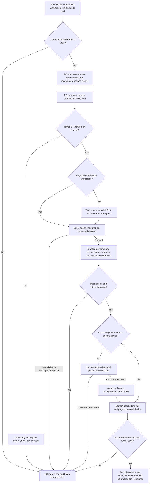

## Scope

- Source: the subspace-relay dev2 FO (Paseo 1671c3a9) relayed the Captain's words of 2026-10-28: 「你這次有幾次終端機開錯在不同路徑，這個是否應該給dev2 fo提報讓它改進paseo ext機制？這裡其實有個改進點，只要在paseo環境內，應該盡可能在它裡面開browser + 終端機，且注意應該要確保跨裝置可用，例如你開localhost時我在手機上就不可用，因為開的不是手雞的localhost，一個可能的解決方案是現在的tailscale但是可能不夠通用，但這個沒關係讓dev2煩惱就好」. Relayed words are not a ruling until the Captain confirms them in this session.
- Bite: relay rr-pairs-once validation trials on staging, 2026-10-28 (relay state branch spacedock-state/dev2, task rr-pairs-once, validation-1/trials/ and dispatch/validation-1.md): a Codex trial worker's Paseo terminal opened with cwd /tmp/rr-sheet-worker and the Captain could not see it from his workspace; the live pairing request was cancelled and recreated (one request, about 2 minutes); trial scripts ran in a terminal he had to choose and browser steps opened in the macOS default browser, not a Paseo tab. Cross-device (a localhost page unusable from his phone) was raised, not yet hit.
- Upstream first: `extensions/paseo/EXTENSION.md` and the open paseo-codex-dispatch-practice change (#742, worker placement in its worktree); Paseo's own `paseo` skill and docs for terminals, browser tabs and workspaces; Tailscale only as the Captain's named candidate, read from its own docs.

## Non-goals

- Changing Paseo itself; product-specific routes (relay's code route for phones stays relay's).
- Exposing local servers beyond the Captain's own devices.

## Budget

- One package PR to the paseo extension; no new script unless the design shows a check is needed.

## Stop condition

- The rr-pairs-once trial replays with the terminal visible in the Captain's workspace and the browser step in a Paseo tab; return to the Captain if cross-device reach needs a network choice (such as Tailscale) the package cannot make generally.

## FO alignment

Alignment: needed before ideation; the cross-device approach is the Captain's.
Result: aligned at backlog: the Captain 「對，全准且全確認」 (chat, 2026-10-30) to FO's batch-11 backlog sitting, which asked 「決定：六張全准進設計，並確認上面三件事？要改哪張直接說。」, approved the outcome and bounds in this file. He confirmed the words the relay FO relayed. The cross-device approach stays his: ideation returns it as a decision at the ideation gate.
Surfaces: none
Visible change: none
Release review: not needed: workflow maintenance, on no journey map.
Reviewer: kc-dev-flow-2:chief-engineer opus 2026-10-30 — batch-11 review before the joint ideation sitting: approve, revise, split or hold each task, the Captain's decisions, overlap and order

## Design

### PRFAQ

**Proposition.** A Captain attending work in Paseo can find and operate the terminal and page the First Officer (FO) or worker asks him to use. A device handoff names a usable private URL and its tested limits; opening a tab, receiving HTTP 200 or connecting the phone to the daemon does not establish that handoff.

**Who and what is the smallest slice?** The Captain, his FO and a dispatched worker in one workflow that lists `paseo`. Add one human-surface section to `kc-dev-flow-2/extensions/paseo/EXTENSION.md`, used by FO and passed to workers through the existing extension scope-note mechanism. Keep the worker in its assigned code worktree. Resolve the human-facing workspace separately; private test state may remain under `/tmp`. One package PR; no new script, transport, service, default extension selection or product change.

**What happens?** Before an attended operation, FO resolves the destination host, Captain workspace ID and absolute cwd from current Paseo inventory and the task context, plus the separate code cwd and the existing network route. It adds these facts to scope notes before dispatch build, preserving Spacedock's immediate build-to-spawn order. A terminal is created with the visible workspace cwd; a command uses an absolute candidate path or changes shell cwd afterwards. The terminal's initial ownership and execution directory are different facts. Read back the terminal ID and named workspace before starting a live request; a background workspace listing alone does not prove the Captain sees it.

A caller in that workspace opens the page with `browser_new_tab`. A worker in another workspace hands the safe URL and purpose to its own FO using the existing worker handback. FO opens the tab in the visible workspace; do not move the worker, invent a workspaceId argument on the browser tool, or interpret `cd` as a browser move. The tool opens in the background on the most recently connected desktop host: verify the host/tab and give the Captain the tab title/location, without claiming focus changed. If FO is also in the wrong workspace or no desktop browser host is connected, report the placement/capability gap and hold the attended step. A different browser is an explicit Captain exception, not a silent success.

**What stays usable on another device?** The same daemon/workspace terminal is reached through the Captain's existing Paseo connection, with a harmless input/output check on that device. Desktop browser tabs are not documented as phone browser replicas. Hand the page's private URL to the second device, keep its server alive for the agreed review window, and test rendering and the intended interaction there. Preserve normal sign-in on that device; do not forward cookies or sign in for the Captain. A supplied HTTP URL is not automatically public, private, working or authorized.

**How are pictures checked?** In the actual preview page, check expected images (including lazy images after scrolling), their decoded dimensions, relevant CSS background images, styles, scripts and required fetch/WebSocket traffic; retain a rendered screenshot and one intended interaction. `document.images` with `complete && naturalWidth > 0` is useful but does not cover CSS backgrounds or correct visual content. A known broken-image fixture whose HTML returns 200 must fail. Repeat the material page checks on the second device; a desktop screenshot proves only the desktop page. A safe route to HTML alone does not repair hard-coded localhost asset/API URLs.

**Recovery and scope.** Stop before creating a live request if the human surface is unverified. If an active request has already opened invisibly, use the product's documented cancellation, observe it stopped, then recreate once in the correct place. Do not leave two active requests. Preserve sign-in/approval/terminal-confirmation boundaries and existing secret wrappers. Report runtime/network permission refusal to FO; no automatic sandbox widening. Stop only task-owned preview processes/tabs/terminals after the agreed handoff; do not close a Captain-owned session or reset shared proxy configuration. No unattended availability or support duty is introduced.

### Source chain and bounded existing-code check

Research date: 2026-10-30. Code baseline: `origin/main` fetched successfully, pinned to `a6612948936a4f075625147b21aabd3b10b19eee`; its `kc-dev-flow-2/.claude-plugin/plugin.json` says **0.33.1**. `gh pr view 742 --repo iamcxa/kc-claude-plugins --json state,mergedAt,headRefOid` failed with `error connecting to api.github.com`. Local integration history contains `6bc82b501 fix(kc-dev-flow-2): define Paseo Codex worker handoff (#742)`; the Scope's description of #742 as open is historical, not a current provider check.

1. **Spacedock first.** Read 0.27.3 ensign shared/Codex contracts and `skills/first-officer/references/fo-dispatch-core.md`. They own split-root state, worktree placement, preserved dispatch fields, immediate spawn and worker handback. They do not supply a human terminal/browser routing contract in those inspected sections. Do not replace those mechanisms or insert a visibility probe between successful build and spawn.
2. **kc-dev-flow-2 next.** Read the pinned paseo/peers extensions, workflow Extensions section and lifecycle mod. `paseo` is optional; its 562-word file addresses peer exchange and Codex placement/publication. Existing extension scope notes already carry worker instructions. Two bounded searches: terminal/browser/human-facing terms in the inspected upstream contracts; current extension/workflow callers and the archived #742 design. Conclusion: reuse the tools and dispatch seam; add policy text, not a new wrapper or automation gate. This is an instruction checked by attended evidence, not an unskippable runtime guard.
3. **Sibling adopters last, read-only.** Relay `beirut-dev2` code HEAD `8a4e15c1`, state snapshot `a903bf90`; Web `dev2-fo` HEAD `f2e1a4cc`; QNow HEAD `278f79ca`. Their `docs/dev2/README.md` extension lists omit paseo. Relay and Web list learn/peers/roborev (relay also journey-map/release-acceptance); QNow lists roborev/codex/copilot/learn/peers/journey-map. No adopter gains these instructions from release alone. The sibling task `peers-paseo-rule-matches-practice` owns listing-versus-relaxing policy; this design remains conditional on a listed extension. No adopter state, configuration or script was changed.
4. **Paseo's own contract.** Read the installed `paseo` skill and current [index](https://paseo.sh/llms.txt), [workspaces](https://paseo.sh/docs/workspaces.md), [browser](https://paseo.sh/docs/browser.md), [connectivity](https://paseo.sh/docs/connectivity.md), [worktrees/services](https://paseo.sh/docs/worktrees.md), and [MCP terminal reference](https://paseo.sh/docs/mcp.md#terminals). Browser tools are desktop-hosted, workspace-scoped and background-opening. Connectivity describes client-to-daemon access, not arbitrary preview-port forwarding. The documented service proxy uses `*.localhost`; it supports WebSockets but remains device-local by hostname. Current tools expose `create_terminal(cwd,name)`, `list_terminals(cwd|all)`, `capture_terminal`, `send_terminal_keys`, `kill_terminal`; browser new/list/navigate/snapshot/screenshot/evaluate/logs/close; and workspace-script list/start/stop. `browser_new_tab` accepts URL only, no workspace/host selector. Terminal/browser tools have no destination serverId parameter. A foreign host needs an executor there; do not treat paths as globally addressable.
5. **Read-only live capability evidence.** `list_workspaces` returned server `srv_Vu_gVMYcYLxv` and visible `kc-dev-flow` workspace `wks_a8f029f6e72d90cb` at the colombo path (`background:false`). `browser_list_tabs` returned no tabs and the same caller workspace. `list_workspace_scripts` returned zero scripts there. This proves inventory/tool availability, not Captain visibility, a connected browser host that can create a tab, or second-device reach. No human surface, network route or pairing was started for ideation.
6. **Tailscale's own contract.** [Tailscale Serve](https://tailscale.com/kb/1312/serve) forwards a local service within a tailnet (private Tailscale network); HTTPS setup and access rules apply. Funnel is the separate public-sharing mechanism and is outside scope. A tailnet may contain other people/devices: "tailnet-only" is not proof of "Captain's own devices only". Verify the approved access policy and serving host before a bounded trial. Serve can proxy a loopback port without exposing that backend to the LAN. No daemon bind, network setting, tailnet rule, certificate setting or Serve/Funnel state was changed.

Relevant accepted decisions read: ADR 0011 (Captain retains authority/network choice), 0020 (workflow reading-budget rises), 0035 (extension selection), 0042 (Codex worktree and FO publication handoff). State `Override:` records were searched, with the Paseo/network/browser matches read; no applicable contrary network ruling was found. No new ADR is proposed: this operational section stays within existing extension/approval boundaries; a per-adopter network choice remains recorded in its task. A general mandatory network policy would require a new decision, outside this slice.

### Historical event replay

This is a design replay of recorded events, not a new staging trial. Read relay `_archive/rr-pairs-once/dispatch/validation-1.md`, `validation-1/trials/worker-trial-report.md`, `first-officer-trial-report.md`, and `validation-1/worker-local.sh` / `worker-ssh.sh` in the cited state snapshot.

| Recorded event | Proposed rule at that point | What would disprove the rule works |
| --- | --- | --- |
| Worker SSH trial terminal outside Captain workspace; one request cancelled after 1m49s, retry 1m35s | Resolve visible cwd before creating terminal; retain private XDG state in `/tmp`; confirm reach before starting pair; if already active, observe cancellation before one retry | Terminal is merely created under `/tmp`, or two live requests remain |
| Scope names `/tmp/rr-sheet-worker`; archived worker report confirms invisible placement but does not itself record that exact cwd | Keep the Scope's path attribution separate from the report's measured failure | Claiming the report independently proves the exact cwd |
| FO local `rr publish ... --open` opened this computer's default browser | Use a supported no-auto-open route and open the resulting safe review URL through the visible-workspace Paseo caller | OS browser launch counted as a Paseo tab, or an invented no-open flag |
| FO SSH route printed open/code, Captain entered code and answered y; `--open` correctly reported no browser here | Open the product's code-entry page in Paseo from the correct workspace; Captain retains code/account/confirmation actions | Worker answers y or copies a live code/token into the report |
| Worker local trial hit sandbox network refusal before a permitted retry | Return the actual environment failure to FO and follow applicable authorization | Placement success claimed to solve network permission |
| FO reader check was curl 200 only; revoked share also returned a 200 withdrawn page | Render actual page and exercise intended action; 200 alone is not acceptance | Wrong/withdrawn page or broken assets recorded as ready |
| Web FO bite supplied by this dispatch: preview HTML returns 200 while pictures are broken | Check expected image rendering and assets on the delivered origin, including second device | Known missing image is accepted because document request succeeds |
| Captain raised localhost-on-phone, not yet observed in the trial | Return network decision below, then separately test a real second device | Mobile reach inferred from desktop or daemon connectivity |

Web's original session receipt was not available in the read local notes; the broken-picture case is attributed to this dispatch, not claimed as independently reproduced. The installed `/opt/homebrew/bin/rr` is older than the trial interface: `rr pair --help` printed usage without pair; publish rejected `--help`. Do not substitute that binary for the pinned trial candidate. Before a later native replay, FO must name a supported current candidate and staging authority; inspect that candidate's own opener behavior. If local pairing cannot avoid an OS-only opener without product changes, return that product seam to relay and report that route unverified; do not fake SSH detection or silently patch rr. The already-recorded SSH/code route is a valid separate route, not proof of the local route.

### Proposed extension text

Append the following exact section to `kc-dev-flow-2/extensions/paseo/EXTENSION.md`; existing text remains. This is the candidate used for the reading counts below, not an implemented repository edit.

```text
## Human terminals and pages

For an attended terminal or page, FO and workers use Paseo when available. Before dispatch build, FO resolves the Captain's visible host, workspace ID and cwd separately from the code worktree. Read Paseo's current terminal, browser and connectivity documentation; never infer remote reach from localhost or a daemon connection. Keep the generated build-to-spawn sequence intact.

For each worker needing human interaction, add to scope notes: "Read the listed paseo extension's Human terminals and pages section before opening a human surface. Human host/workspace/cwd: <resolved values>. Code cwd: <assigned worktree>. Existing private page route: <URL or unverified>. Return placement or network gaps to FO."

Create the terminal with that visible cwd; run the candidate by absolute path or change shell cwd afterwards. Read back its ID and workspace before starting a live request. Browser tools open in the caller's workspace on a connected desktop host, in the background. A worker elsewhere returns the safe URL to its own FO to open there; do not move the worker or silently open the OS browser. Missing placement or browser capability holds the attended step for FO. Preserve product sign-in and confirmation boundaries; cancel an invisible live request before recreating it.

For another device, reuse an approved private route or return one network choice to the Captain. Never enable exposure from this instruction. Verify the terminal there and the page's rendering, expected pictures and intended interaction on its delivered origin; HTTP 200 and desktop screenshots alone are insufficient. Record host/workspace, surface IDs, URL without credentials, tested devices, remaining limits and owner/lifetime in the existing task. On handoff or cleanup, affect only task-owned surfaces and processes. Report unverified reach or unavailable tools explicitly.
```

### Needs decision — private cross-device route

**One Captain decision:** approve the provider-neutral rule with **Tailscale Serve as an explicitly authorized, per-task fallback trial** for a local page, or leave local-page cross-device use on hold pending another private route. Recommendation: approve the bounded fallback, after first reusing any already approved working private URL; it addresses the named local-server case without making Tailscale compulsory for all adopters. This gate recommendation does not itself configure anything: the later trial names the page port, devices, effective access policy, lifetime and cleanup, then follows that exact grant.

What gets worse: both devices need Tailscale/access setup when none exists; a shared tailnet needs narrower rules; the serving computer must remain awake, and each page still needs origin/assets/login checks. Existing Paseo relay access can continue for terminals; it does not establish preview URL reach. No Funnel, public listener, broad access, persistent unattended proxy or automatic daemon restart is included. If the Captain declines or setup cannot meet own-devices-only, continue desktop verification and return cross-device acceptance as unmet rather than accepting it away.

### Flow



Rendering evidence: Mermaid CLI 11.17.0 rendered this exact source to a local PNG; the diagram was visually inspected. Fresh setup reproduction: extract this Mermaid block and run `npx --yes --package @mermaid-js/mermaid-cli@11.17.0 mmdc -i flow.mmd -o flow.png -w 1600` with its required Chromium available. The local installed CLI was `/Users/kent/.npm/_npx/d62b6517736c1e35/node_modules/@mermaid-js/mermaid-cli/src/cli.js`; that cache path is an execution receipt, not a teammate prerequisite. Initial sandbox Chromium startup failed; the same local render passed with approved process access.

The diagram keeps the worker's code workspace separate, places the network decision before configuration, and keeps human confirmation and second-device verification outside tool-success claims. An unsupported product opener follows the same hold path; it cannot be papered over by a duplicate tab.

### Words FO reads at each lifecycle moment

Count by Python whitespace split (`len(text.split())`) against the pinned source and the exact proposed section above. All unchanged instructions and outputs at moment m are denoted `U(m)`; they remain byte-identical because this design changes one extension only, including workflow/mod, reviewer extensions, stage text and all script outputs. This explicit common term is not assumed to be zero, and these are design reading totals, not a measured runtime attention saving. No CI trigger/check changes or cost-saving claim.

Measured fixed inputs: whole workflow template 5,781 words; whole lifecycle mod 48; existing paseo extension 562; proposed section 282 words; its quoted worker instruction 37 words. The whole extension becomes 844 words. The worker line is contained in the section, so it is not double-counted at an extension read; count it again when FO composes/reads a dispatch note. Variable resolved host/path/URL values are counted again at implementation, not hidden in the placeholder count.

| Lifecycle moment and passages read | Before | After |
| --- | --- | --- |
| Startup/resume: workflow + lifecycle mod + all due output/other reads | 5,829 + U(startup) | 5,829 + U(startup); if an attended operation or first exchange also loads paseo, use the next row |
| First applicable Paseo exchange or attended operation: full extension + current upstream docs + operation facts | 562 + U(surface) | 2,299 + U(surface) on a first read (844 extension + 1,455 docs); 844 + U(surface) when those docs are already current |
| Dispatch requiring human interaction: existing scope-note reads + inserted worker instruction | U(dispatch) | 37 + U(dispatch), plus resolved-value delta; also full extension if not already loaded |
| Idle with an open PR: lifecycle mod + pr_watch output and every due next instruction | 48 + U(open) | 48 + U(open); charge surface row if opening an attended review |
| Idle with a merged PR: lifecycle mod + pr_watch and after-pr-merge output/instructions | 48 + U(merged) | 48 + U(merged) |
| After archive: due learn/observer instructions, output and reports | U(archive) | U(archive) |
| Merge ask: due reviewer and delivery-gate text/output | U(merge) | U(merge); charge surface row if a new human page is owed |

The newly required upstream documentation has a real read cost: installed paseo skill and provider docs are variable external text, not included in 282. The implementation report must list the exact docs/version actually loaded and their before/after word counts on the same snapshot; no credit for moving instructions to docs or scope notes. The ideation research read current browser, workspaces, connectivity and worktrees pages; before had no mandatory human-surface doc read, after adds the relevant terminal/browser/connectivity portions once per host capability change. Current-snapshot new documentation: browser.md 646 words, connectivity.md 737, MCP reference from `### Terminals` to before `### Schedules and heartbeats` 72; total 1,455. These are full named read spans, including Markdown, measured from successful curl reads on 2026-10-30. Snapshot SHA-256: browser `4c40bcd4840a58c6a2b68e2ec7c2389418c8a2bd8fc8e6594822001e5d2ffc2d`; connectivity `0fc288a048b35ac0f74ad1097d9f08222ee4f9c763f825673e37dfc0549af8bf`; full MCP source `f8cf99fcbf92623701f323ceddd8bc2ed5fe23d99de53d1a3499454552ae6624`. Workspaces/services pages informed ideation; they are not additional mandatory per-operation reads. Conditional Tailscale setup research is charged separately to that chosen trial, not disguised as baseline workflow cost. Root learning's per-moment rule is honored by charging that additional read at the first operation; this proposal increases reading and makes no reduction claim. No `workflow.md` budget change is proposed.

### Batch overlap

Product change set: **only `kc-dev-flow-2/extensions/paseo/EXTENSION.md`**. Runtime evidence goes in this task's existing stage reports; dispatch notes use the existing mechanism. No new check, ADR number/index, workflow template, adopter README, network config or product route is changed by this PR.

| Other task (current local record read) | Same file or check and ordering effect |
| --- | --- |
| batch10-after-release-obligations | No product file overlap; shares native dispatch evidence timing. Preserve #751's required first post-release build/spawn proof; visibility checks must happen before build, never between build and spawn. Its laws_check/dispatch_records repairs remain its own. |
| names-check-says-what-it-skipped | No file overlap (dispatch_records.py); same scope-note name/path check. Use the installed package's absolute path and validate dispatch notes after its change. |
| peers-paseo-rule-matches-practice | Direct overlap: paseo EXTENSION.md (also peers/adoption owned there). Its concurrent uncommitted design was re-read before handoff: routine asks remain listed; a Captain-named one-off peer ask does not enable workers or human surfaces. Settle that choice first; reapply this section and recount afterwards. |
| peer-status-reaches-fresh | Direct overlap: paseo EXTENSION.md (also peers owned there). Keep peer facts/freshness separate from human surface evidence; merge sequentially. |
| model-roster-per-repo | Potential direct overlap in paseo EXTENSION.md and shared pre-build scope-note seam; model/storage design not yet authored in the read record. Resolve model/workspace context before build; recheck its final file list. |
| paseo-human-surfaces-visible-and-reachable | This task owns the single section, human-surface dispatch instruction and this design/report only. |
| adoption-asks-which-extensions | No product-file overlap: dispatch_records.py, number_guards.py, tests and laws.md; shared extension-instruction check judges the listed extension at dispatch. Do not backfill older records or infer automatic adoption. |
| adr-required-statement | No shared product file/index (this task drafts no ADR); that record's workflow/ADR repair remains other-session work. |
| adr-silent-undo-probe | None: fictional ADR scenario harness/state, no paseo change. |
| comment-check-reaches-delivery-gate | None: delivery_gate.py/tests and validation principles; any future validation statement still reports the real changed head. |
| journey-canvas-hosted-poc | No file overlap: hosted canvas proof. Its approved URL may later be an existing route, not authorization to deploy or widen this task. |
| journey-server-host-pilot | No file overlap: kc-journey-map server/adapters and private assets/origins. Shared behavioral seam: asset and second-device checks must not claim its unpublished parity or bypass its auth. |
| ops-inbox-r1-setup-and-isolation | None: kc-ops-inbox, its CI and ADRs; no network/secret setup borrowed from that task. |
| pr-review-lite-value-pilot | None: kc-pr-flow Lite review and its value trial; a human review page could later use this policy but creates no shared code/check ownership now. |

Recommended order: Captain settles extension applicability and this network choice; implement peers/paseo applicability, then peer-status, coordinate model-roster's dispatch seam, then this section (or FO assigns non-overlapping hunks with one integration owner). Re-read final sibling designs and recount the extension immediately before implementation. Keep names/adoption checker changes ordered before validating the final dispatch fixture. None of these orderings grants another session edit authority.

## Acceptance criteria

**AC-1** FO and a dispatched worker follow one reachable instruction route for a listed paseo workflow, while preserving code worktree placement and immediate spawn. Evidence: implementation pins base/head and records the generated dispatch scope notes plus native build-to-spawn trace for one attended worker; validator reads its first actions and the section it loaded. Falsifier: omit the scope-note pointer or insert a surface check between build and spawn; that case must be rejected. Current evidence: existing extension-injection and Spacedock contracts checked; candidate behavior not yet executed.

**AC-2** A human terminal belongs to the Captain-visible workspace, with isolated test data and the intended candidate execution directory. Evidence: replay the recorded SSH terminal case with the supported trial candidate, list/capture its terminal ID/cwd, Captain opens it and performs harmless input; then follow the product's attended trial. Preserve visibility confirmation before live pairing, cancellation/one-retry evidence if needed, and cleanup readback. Falsifier: create the human terminal under the original temp cwd or start a second request before the first is stopped; it cannot be accepted. Current evidence: archived failure and successful retry read; no new trial or Captain visibility confirmation.

**AC-3** A supported browser step opens in a Paseo tab in the Captain's workspace, including the worker-in-another-workspace case. Evidence: caller workspace from list-tabs, tab ID/host, screenshot and Captain finding the named tab; an out-of-workspace worker returns URL to FO, who opens it in the correct context. Exercise no-browser-host and unsupported product-opener failures with honest holds; do not force an OS opener or treat an extra tab as repaired routing. Falsifier: use default-browser open or add an unsupported workspace argument; evidence must fail. Current evidence: documented/current tool restrictions verified; native opening and local rr compatibility unverified.

**AC-4** The delivered page is usable, including pictures; successful HTML alone cannot pass. Evidence: validation serves a benign fixture with one expected image and one action at the chosen preview origin, records image decode/visual checks, required assets/network and a real action; break the image URL while retaining document HTTP 200 and require rejection. Repeat relevant checks on the real preview, including lazy/background images it uses. Falsifier: an HTTP-only check or accepting the deliberately broken picture. Current evidence: dispatch-supplied Web bite and archived withdrawn-200 counterexample mapped; future fixture not run.

**AC-5** Cross-device reach stays inside the Captain's chosen private route and is established on an actual second device. Evidence: dated Captain choice, exact host/route/access-policy/lifetime, private reach and intended terminal/page action from the named phone or other device, expected images, session behavior, plus denied access from a non-allowed device where the policy is tested. Record which layer was tested; no credential/code in receipts. If the device or route is unavailable, report unverified and return to Captain; desktop success cannot satisfy it. Falsifier: pass a localhost URL from the phone, confuse daemon relay reach with app reach, enable public Funnel, or leave access broader than own devices. Current evidence: provider research complete; decision/setup/second-device proof pending.

**AC-6** Reading cost and ownership remain bounded. Evidence: exact diff changes the named extension only; compare all lifecycle passages/outputs on identical fixtures with whitespace counts, including upstream docs, dispatch instructions and failure paths. Run existing package lint and design/dispatch checks appropriate to the final source; no new script or CI trigger. Recheck sibling ownership before editing and record any necessary FO ordering. Falsifier: count only workflow.md while the extension/docs/note grows, change a sibling file, or claim an unlisted adopter now follows the policy. Current evidence: pinned-source counts, one-file design and all named overlap records checked; implementation counts/checks remain future work.

## Stage Report: ideation

- DONE: A design for human-facing terminals and browser tabs opening inside Paseo in the Captain's visible workspace, and what is opened staying usable from another device; the relay rr-pairs-once trial events in Scope replayed; checked against Paseo's own docs and current tool list, and including the web FO's bite that a preview URL's page can answer 200 while its pictures are broken; the cross-device approach returned as a Captain decision, with Tailscale read from its own docs
  Design/PRFAQ, current tools and own-provider docs checked; eight recorded-event rows replayed as policy decisions, not a new live trial; Mermaid CLI 11.17.0 render inspected. One private-route decision remains with Captain.
- DONE: A `### Batch overlap` section naming each file the design would change and each other batch task (batch10-after-release-obligations, names-check-says-what-it-skipped, peers-paseo-rule-matches-practice, peer-status-reaches-fresh, model-roster-per-repo, paseo-human-surfaces-visible-and-reachable) and live task of other sessions (adoption-asks-which-extensions, adr-required-statement, adr-silent-undo-probe, comment-check-reaches-delivery-gate, journey-canvas-hosted-poc, journey-server-host-pilot, ops-inbox-r1-setup-and-isolation, pr-review-lite-value-pilot (driven by other sessions; read only)) that changes the same file or check, so FO can order implementation
  Batch overlap names all 14 required task rows and the sole proposed product file, preserves other sessions, and orders the shared paseo edits; no script, CI, ADR index or adopter file change proposed.
- DONE: The words FO reads at each lifecycle moment, before and after, per root learning.md "Measure the words FO reads at each moment, not one file's size"
  Whitespace counts: extension 562 to 844 (+282); worker instruction +37; first current-doc read +1,455, making the affected first-surface load 562 to 2,299 plus equal unchanged inputs. Seven lifecycle moments listed; no saving claim.
- DONE: Acceptance criteria with reproducible evidence clauses and falsifiers, and unresolved decisions for the Captain, each with a recommendation and what gets worse under it
  Six individually stated criteria include reproducible future evidence and falsifiers. design_surfaces.py check printed "paseo-human-surfaces-visible-and-reachable.md: design surfaces presentable" (exit 0); removing Mermaid or all bold AC declarations would fail that structural check, not prove native behavior.

### Summary

Authored the Pilot design against fetched main a6612948936a4f075625147b21aabd3b10b19eee (package 0.33.1), preserving the code-worktree contract and assigning human surfaces to the Captain-visible workspace. Recommended an explicitly authorized per-task Tailscale Serve fallback, with real second-device/assets evidence required; the Captain still decides it, and no implementation, network setup or native trial was performed.

AC-1: existing injection and immediate-spawn contracts checked; native candidate trace not yet verified.
AC-2: relay's archived invisible-terminal failure/cancel/retry read; new Captain visibility and terminal trial not yet verified.
AC-3: current browser tool signature and workspace-only/desktop restriction verified; native browser opening and current rr local opener not yet verified.
AC-4: dispatch-supplied Web broken-picture case plus archived withdrawn-page 200 mapped; broken-image fixture and real page interaction not yet run.
AC-5: Paseo/Tailscale primary docs checked; Captain network choice, actual policy/setup and second-device acceptance remain pending.
AC-6: exact proposed text and upstream read spans counted, all named overlapping task records read; final implementation/dispatch checks remain future work.

Limits: GitHub API read failed; git fetch succeeded and local main contains #742. Installed rr does not implement the archived pair interface; a later trial needs its own supported candidate. Web's original incident receipt was not found in the read local notes. Render used installed Mermaid CLI 11.17.0 after sandbox Chromium startup refusal; docs were retrieved read-only with curl after DNS/client failures. No peer messages, code branch/commit, product changes or sibling edits.
