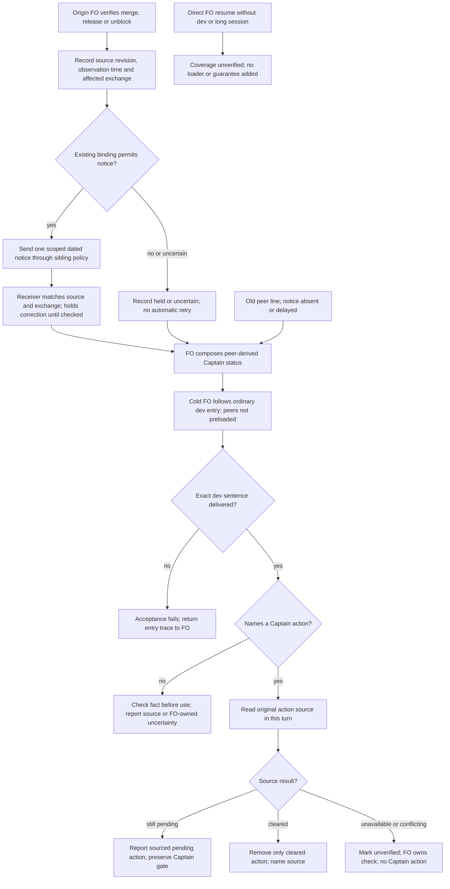

## Scope

- Source: interview round 004 finding (state .notes/fo-feedback/round-004.md, 2026-10-28), proposed by FO; the Captain chose theme B for batch 11 (「那就 B 可以」, chat, 2026-10-30), whose row named 「FO 之間狀態過期」.
- Bite: on 2026-10-28 relay told the Captain Web's half waited on his merge after it had merged (b71f912), and web's status named a v0 step CL had already cleared; web corrected relay twice. Their originals sit in their sessions; this is the two-sided account.
- Upstream first: `extensions/peers/EXTENSION.md`, `extensions/paseo/EXTENSION.md`, Paseo agent labels (next, next-owner).

## Non-goals

- A shared status store or a new service; receipts for every message.

## Budget

- One package PR changes `kc-dev-flow-2/extensions/peers/EXTENSION.md` (shared Current peer facts) and `kc-dev-flow-2/skills/dev/SKILL.md` (the unchanged 38-word source-check sentence). Amendment 2 withdraws the workflow README insertion and budget increase: workflow stays 5781/5781 words. `peers-paseo-rule-matches-practice` owns all Paseo binding/notice wording. No new script or loader; natural-use observation follows delivery.
- Amendment 3’s follow-up in `dispatch/implementation-4-message-1.md` authorizes one product commit: peers opens Current peer facts with “A relayed status names its source.” Candidate `39fdbb28b411d44a323741f645c7c1d75c653be1`, based on `422caef5a9b115a14f8391836499520d9fba6d91`; dev and the correction/record paragraphs remain unchanged. It removes only the observation-time duty from FO's Captain-facing acceptance status. Source checks/attribution, uncertainty ownership and originating correction/notice times remain required. Direct `spacedock:first-officer` resumes without dev and long sessions remain unverified.

## Stop condition

- Before delivery, the two admitted 2026-10-28 events replay as prevented: AC-9 starts a fresh isolated FO through ordinary `kc-dev-flow-2:dev` entry and proves current-turn original-source checking before assigning the Captain action; reading peers is not a pass condition. AC-2 preserves the boundary between authorization and completed release. Complete AC-3, AC-5 and AC-6 at their designated stages. Injected rules/answers or preloaded-rule replays are insufficient; direct First Officer resumes and long sessions remain unverified.
- If ordinary dev entry does not deliver the sentence, or a required current-source/replay/transport check fails, stop dependent acceptance and return the trace to FO. Do not require peers discovery or design a startup preload, hook, watchdog, script, host repair or broader send permission. Missing Captain-facing observation time alone is no longer a failure under amendment 3; originating correction/notice time duties are unchanged.
- AC-4 is explicitly after delivery: FO retains the observation obligation in the existing task/exchange record and observes the first natural transition after normal adoption. No event or unavailable authority means not run, not acceptance and not a pre-delivery hold. Do not delay delivery waiting for a natural event or claim real-use proof from fixtures.

## FO alignment

Alignment: not needed before ideation: text inside the extensions' existing authority.
Surfaces: none
Visible change: none
Release review: not needed: workflow maintenance, on no journey map.
Reviewer: kc-dev-flow-2:chief-engineer opus 2026-10-30 — batch-11 review before the joint ideation sitting: approve, revise, split or hold each task, the Captain's decisions, overlap and order
Reviewer: kc-dev-flow-2:engineering-reviewer gpt-6-astra 2026-10-30 — does amendment 1 withdraw what the Captain approved, and what changes in the build?
Reviewer: kc-dev-flow-2:engineering-reviewer gpt-6-astra 2026-10-31 — does amendment 2 withdraw what the Captain approved, and what changes in the build?
Reviewer: kc-dev-flow-2:engineering-reviewer gpt-6-astra 2026-10-31 — does amendment 3 withdraw what the Captain approved, and what changes in the build?

## Design

### PRFAQ

**Proposition — proposed, not implemented.** A First Officer (FO, workflow coordinator) stops repeating another project's cleared Captain action. Before naming that action in a status or gate question, the receiving FO checks the action's original source in the current reporting turn. The originating FO sends a short, sourced change notice with its observation time to previously involved peers when its own merge, release or unblock changes their next step. Under amendment 3, the receiving FO’s Captain-facing status must name its source but need not write its observation time; a repository and PR number is that source. These are instructions for existing hosts, not an enforced freshness service.

**Who uses it?** FOs already exchanging a dependency fact, including relay and web in the two admitted 2026-10-28 incidents. One integrated slice runs from source transition through a permitted notice or missing notice to a checked Captain-facing statement. There is no shared status store, new script, timer, fleet broadcast, delivery guarantee, extra gate or background service. No claim is made that every historical status becomes current.

**Why source checks and correction notices?** A push reduces the time peers hold an obsolete fact, but can be unavailable, deferred or lost. A correction’s observation time shows its age, but a one-second-old fact can already be wrong. A current-turn original-source check determines whether the Captain still owes that action; unavailable evidence stays unverified with an FO-owned check. Amendment 3 removes the Captain-facing timestamp acceptance duty only; correction records and notices retain their times. Age is not a truth test.

| Option | Useful effect | Failure and cost |
| --- | --- | --- |
| Push changes only | Involved peers learn merged/released/unblocked early | A lost, held or out-of-order notice leaves the old action; creates sends |
| Observation time only | Makes old observations visible | Age alone does not determine validity; adds a few words |
| Check action at source only | A missing notice cannot justify a stale Captain request | A source read per reporting turn; unavailable source leaves uncertainty |
| Recommended combination, as amended | Checked Captain action plus bounded, dated correction notices | Adds reads/notices; Captain-facing observation time is optional under amendment 3; no delivery guarantee |

**What does “fresh” mean here?** The reader queried the relevant original source during the turn composing the statement, after processing relevant received changes. Name the source in the Captain-facing status (a repository and PR number suffices); amendment 3 removes its explicit observation-time duty. Originating correction records/notices still carry the actual observation time with timezone. Send time, an old pasted `as of`, a display label or another FO’s finish timestamp never substitutes for a current-turn source check. A subsequent concurrent change can still race this observation; report the observation rather than a timeless guarantee. Read once per unchanged source within that composing turn; a conflicting notice requires another check before using it.

**Which source?** For merge, the repository-qualified pull request (PR) state and merged revision; a local commit's presence does not prove hosted merge. For release, the actual tag/release or installation evidence relevant to the claim; merged does not mean released. For an unblock, the blocking task or original decision and the exact question it settled. An original authorization clearing a token-rotation step does not prove the credential changed or a release shipped; do not read secrets. Keep separate remaining steps separate. Missing access or disagreement yields `unverified: <source gap>` and an FO-owned check, not “Captain must do X.” A dated form remains allowed; it is no longer required in Captain-facing acceptance. Existing Captain-source rules still apply to any authority claim.

### Captain revise and ownership

The 2026-10-30 ideation resolution at 09:31:42.445165Z records the Captain's 「准」 to the joint sitting. Its newest `peer-status-reaches-fresh/review/ideation/briefing-1/index.json` asks exactly: delete the paseo insertion and let `peers-paseo-rule-matches-practice` carry it under one owner; start AC-1 with an FO that has not read peers because startup does not preload it; move AC-4 after delivery. The resolution permits FO to move a design staying within those asks to implementation without another sitting. This worker neither applies that transition nor grants acceptance.

This cycle replaces the active design/criteria while preserving the entire earlier Stage Report. That report's two-file plan, reading totals, unlisted-send restriction and pre-delivery natural-use requirement are historical, not this cycle's instructions. The sibling's cycle-2 design at state commit `da23dd127b929a0d580fa181ce1c3d8879fc71d6` owns all Paseo-specific wording, including the transferred notice pointer, confirmed-transport permission without optional paseo listing, send flags and quiet-mode failure visibility. This task retains transport-neutral Current peer facts and, under amendment 2, the 38-word source-check sentence in dev. No duplicate paseo insertion, workflow insertion or budget raise remains. Amendment 3 also narrows the peers opening sentence under the recorded follow-up; dev and all correction/record timestamp wording stay unchanged.

### Upstream chain and current evidence

Read order this cycle: Spacedock 0.27.3 ensign/shared/Codex contract and first-officer shared/Codex runtime, then kc-dev-flow-2 framework/profile and source, then sibling adopters. Spacedock owns state, gates, dispatch and worker completion verification. Its boot marks counts possibly stale and does not preload peers. No worker notification or dispatch change is proposed.

`git fetch origin` succeeded. `origin/main` is `a6612948936a4f075625147b21aabd3b10b19eee`; `kc-dev-flow-2/.claude-plugin/plugin.json` is **0.33.1**. Source was read with `git show`; stage checks use `/Users/kent/.codex/plugins/cache/kc-claude-plugins/kc-dev-flow-2/0.33.1`. The unrelated colombo branch `iamcxa/trim-kc-dev-flow-third` has pre-existing `.gitignore` and `.gstack/browse-startup-error.log` changes, preserved. The amendment-3 follow-up permits the one peers opening-sentence edit at product head `39fdbb28b411d44a323741f645c7c1d75c653be1` plus this split-root entity body/report on `spacedock-state/dev2`. Product publication and RoboRev remain with FO; the earlier task-only scope is superseded by `dispatch/implementation-4-message-1.md`. Earlier origin/main/adopter/ownership observations in this section are historical, not refreshed deployment facts.

Bounded existing-capability check: required peers already checks cited sources, preserves original human authority, records exchanges and bounds busy-peer deferral; the package README routes it before opening a task or exchanging peer facts. The workflow Extensions section requires following listed extensions at their due steps. Neither this source read nor a keyword proves an FO composing a status discovers the rule. AC-9 therefore measures ordinary dev entry from a cold FO without preloading peers, hinting its path or injecting the answer. The dev sentence now supplies the source-check duty directly; a peers read is not a pass condition. Entry/source failure returns to FO; no additional loader or entry repair is authorized. Direct First Officer resumes without dev and long sessions remain unverified. The new content adds current-turn timing, sourced observation and bounded transition corrections to the existing mechanism.

Paseo primary evidence is its own `/Users/kent/.agents/skills/paseo/SKILL.md`, especially Connected hosts, Agents, Waiting and CLI semantics: queued sends are not answers, steering may fall back to interruption, and completion callbacks also carry errors/permission requests. Labels are display hints, not proof that a Captain action remains owed. The sibling owns callback policy and its authorized native failure-visibility test; this design supplies no alternative transport or silence-is-success rule. No sends, labels or native trials ran in this ideation.

Read-only local origin/main snapshots, not newly fetched remote truth: relay `/Users/kent/conductor/workspaces/subspace-relay/beirut-dev2` `a448ea34391653fc71b0760c048f29c781fbe50a`; web `/Users/kent/conductor/workspaces/subspace-web/dev2-fo` `f2e1a4ccce8af1d9ab4ffb6591f8c84ff18d619a`; qnow `/Users/kent/conductor/repos/qnow-adopt-dev2` `f364b6e8bfa072db46374dccfcc566d10667cf40`. Relay/web `docs/dev2/README.md` and qnow `docs/dev2-poc/README.md` list peers and omit paseo. After the sibling's published policy is adopted, omission no longer blocks confirmed-Paseo peer messaging; it still does not enable optional worker procedures. No adopter edit or listing campaign is proposed.

`gh pr list --repo iamcxa/kc-claude-plugins --state open --limit 100 --json number,title,headRefName` failed this cycle: `error connecting to api.github.com`. Current open PR ownership is unverified; FO must reconcile it before implementation. Local state and git evidence remain usable. Round-004's relay/web accounts were reread; historical original sessions remain unread, so the two incidents are admitted replay inputs, not independently authenticated history.

Read accepted Architecture Decision Records (ADRs, durable repository rulings) 0011, 0020, 0035, 0038 and 0042 at the pinned source; relevant task/gate records show no contrary Override. ADR 0038's existing listing restriction is superseded only through the sibling's new Captain-authorized ADR, owned there. This task requires no ADR number/index, workflow budget change or new permission. Preserve human authority, non-Paseo routes and worker completion.

### Reviewable extension text

Proposed exact insertion in `kc-dev-flow-2/extensions/peers/EXTENSION.md`, immediately before `## Claude Code binding`. Keep existing transport, record, authority and deferral text. All text below is candidate wording, not an already adopted instruction.

<!-- candidate-fresh-peers-start -->
```markdown
## Current peer facts

A relayed status names its source. Before naming a Captain action from a peer, check that action at its original source in the current reporting turn, after relevant notices. A label, timestamp, queued receipt or finish notice is not that check. If inaccessible or conflicting, mark the fact unverified and keep the check with FO; do not assign the Captain the unverified action. A merge proves neither release nor another step's completion.

When your verified merge, release or unblock changes a previously involved peer's next step, record the changed fact, source revision, observation time and affected exchange in the existing task or peer-exchanges note. Send one information-only correction to those confirmed peers through the authorized binding; no broadcast. A correction answering the same question follows its reply route; a new notice needs new-send authority. If held, unavailable or uncertain, record the unsent or uncertain notice and reason; do not infer delivery or retry automatically. At the next attended resume, reconcile pending notices before any authorized send. No timer or background retry is added.

On receipt, match the source and exchange, check before using the fact, and update the affected status at its next authorized write. Duplicates or older observations do not restore a stale action; conflicting or unordered evidence requires a source check. Preserve a bound briefing and record the correction in the existing note. Do not send receipt-only acknowledgements or surface a no-action peer finish to the Captain; report a material change, blocker or decision instead. Worker completion follows its own contract.
```
<!-- candidate-fresh-peers-end -->

**Paseo wording has one owner.** This design contains no candidate paseo block and changes no Paseo binding. The sibling's current candidate carries the status pointer in its peers Paseo binding and optional paseo pre-worker text. Integrate that owner first, then this shared peers insertion once; reconstruct/recount the combined bytes. Its chosen transport permits confirmed-Paseo asks and notices without listing the optional extension, while retaining identity, authority, idle/deferral and requested-reply rules. No listing exception, callback default or native failure remedy is independently designed here. If that sibling cannot deliver its chosen policy, FO reconciles the dependency; do not silently retain its superseded restriction or transplant its text into this task.

The second retained product change is the exact 38-word sentence in `kc-dev-flow-2/skills/dev/SKILL.md`, before “For existing work, preserve”:

> Before naming a Captain action from a peer, check that action at its original source in the current reporting turn; if inaccessible, mark it unverified and keep the check with FO; do not assign it to the Captain.

Amendment 3 leaves the dev sentence unchanged and narrows only the shared peers block’s opening sentence. Correction records/notices retain their observation-time duties; current-turn source checks and source attribution stay required.

### Sequence and stops



The cold-entry nodes describe AC-9’s dev-entry proof, not a runtime guard or peers-loading requirement. Source checking belongs to the composing turn, with recheck after conflict. Captain-facing status retains source attribution and explicit uncertainty; amendment 3 removes only its observation-time acceptance duty. Originating correction/notice times remain required by the retained peers correction paragraphs. Direct First Officer resumes without dev and long sessions remain unverified by these cold runs.

The binding retains the five-minute ceiling, one natural recheck and stop without independent work. A same-question correction uses the requested-reply route; a new notice uses the new-send route. On receipt, duplicates/older observations do not restore stale actions; conflicting evidence triggers a source read. No receipt-only acknowledgement or no-action Captain reply is due, but errors/permission holds remain material under the sibling's policy. Do not edit a bound briefing, infer delivery, retry automatically or turn an observation into gate authority. These rules govern existing records, not a durable notice service.

### Two admitted incidents replayed as prevented

These are policy walkthroughs of `.notes/fo-feedback/round-004.md`, not new original-session or native messaging evidence. Correction/notice times come from the actual read, never invented historical timestamps. Captain-facing observation time is optional under amendment 3.

| Incident and admitted input | Proposed execution and observable result | Falsifier |
| --- | --- | --- |
| 2026-10-28: relay repeats Web “waits on your merge / Review approval”; Web #186 had merged at b71f912, correction reference 81dc0663 | Web verifies its merge, records a sourced correction for the existing relay exchange, and sends if permitted. Even if absent/delayed, relay queries `spacedock-dev/subspace-web` PR 186 before the Captain request; a merged result removes only that merge/approval action and names the checked source, for example `spacedock-dev/subspace-web` PR 186, without owing an observation-time field. | Relay outputs the old action after reading MERGED, or trusts the timestamp/label without a query. If the provider is unreachable it must say unverified, not ask Captain to merge. |
| 2026-10-28: web still says “v0 0.16.2 等 CL 換 token” after the relevant authorization cleared that step (CL is the operator named in the account) | Originating FO records the precise unblock and source. Web reads the original authorization plus the question answered, or the authoritative blocking record carrying that source. It removes the cleared CL step; it does not claim token rotation or v0 release complete. If the original is inaccessible, report that source gap and do not repeat the old Captain/CL action as current. | Treating a finish notification as the authorization, assigning the old cleared step, reading a secret to verify it, or turning authorization into a “released” claim. |

A live read of current history cannot prove what a 2026-10-28 actor saw. The source-check rule prevents the admitted false action under the stated replay inputs; behavior by an actual fresh FO remains an implementation/validation proof obligation. Neither adding a phrase nor this diagram proves compliance.

### Decisions and returns to FO

No unresolved material choice remains within the three revise asks. The accepted product is the shared peers insertion plus the exact 38-word dev sentence, with workflow/budget restored. Require AC-9 dev-entry/current-source and stale-action proof before delivery; retain natural-use observation after delivery. The recorded amendment-3 follow-up adds one product commit narrowing the peers opening sentence; no other product text changes. Costs: extra source reads and explicit unverified outcomes remain; a dev-entry/source-check failure can block candidate acceptance; real-use benefit is still unproven at delivery.

Return to FO rather than design here: startup preloading or an additional entry-path repair if AC-9 fails; changing quiet-mode flags or error surfaces; a watcher, timer, status store, new script or delivery guarantee; host changes, broader send authority, adopter enablement or an ADR beyond the sibling's owned ruling. The sibling's real two-agent transport test remains its pre-delivery obligation; moving this task's AC-4 does not move or waive that test. No second sitting is required for this faithful revision; any broader remedy needs FO to route the new decision.

### Words FO reads at each lifecycle moment

Counts use Python `len(text.split())`, including headings/syntax. At exact stacked base `422caef5a9b115a14f8391836499520d9fba6d91` → product head `39fdbb28b411d44a323741f645c7c1d75c653be1`: peers **1091 → 1348 (+257)**, paseo **389 → 389**, dev **763 → 801 (+38 per actual dev read)**, workflow **5781 → 5781**. Paseo primary sections add **607**; unlisted exchange **1698 → 1955**, listed **2087 → 2344**. Count the sibling’s transferred pointer once; add dev separately only when read. Older assembled 1412/1974 → 1908/2297 totals and earlier 1058/1320 peers counts describe historical inputs, not this final integrated head.

The pinned common fixture program is the Python block starting `import sys, importlib.util, subprocess, json, re` in `peers-paseo-rule-matches-practice.md` at state commit `da23dd127b929a0d580fa181ce1c3d8879fc71d6`. Extract with `git show <commit>:<task>` and run `python3 -B <extracted-program> <package-root> <spacedock-plugin-root>`. It exercises mocked provider/Spacedock responses in temporary repositories. Its unanchored heading split counts an inline Extensions reference, giving historical rows 442/672/1021/371/1003. Use `re.search(r'^'+re.escape(h)+r'\n.*?(?=^## |\Z)', t, re.M|re.S).group(0)` in `sec(t,h)` for actual heading sections: corrected rows **442/672/1021/371/776**, unchanged at the final base/head. The retained programs and results are in `peer-status-reaches-fresh/validation-1/common-{fixture,anchored}.py` and their JSON outputs. Missing observer refusal or a failed delivery fixture fails the instrument; it proves control text, not live freshness or delivery.

| Lifecycle moment | No peer event, base → candidate | Listed peer event, base → candidate |
| --- | ---: | ---: |
| startup | 442 → 442 | 2529 → 2786 |
| idle, open PR | 672 → 672 | 2759 → 3016 |
| idle, merged PR / observer refusal and rerun | 1021 → 1021 | 3108 → 3365 |
| after archive | 371 → 371 | 2458 → 2715 |
| merge ask | 776 → 776 | 2863 → 3120 |
| unrelated dispatch without peer fact | unchanged | no extra peer load unless used |

Listed rows add 2087/2344 exchange words to the common rows. For unlisted exchange add 1698/1955 instead. The five-word cut from prior head 1df246fa changes every candidate peer-event row by −5; common passages and dev invocation costs are unchanged. Add 763/801 for each actual dev entry read; this is +38 per invocation, not an automatic startup load. Add actual source/error/status/notice output words from AC-9/AC-2/AC-3 without double-counting source responses already included in tool totals. The final cold-record and warm-replay counts remain in `peer-status-reaches-fresh/validation-1/details.md`; missing project/private context stays unmeasured, not zero. AC-4 records the later natural event’s actual entry path and counts; it cannot gate delivery. Direct First Officer resumes and long sessions remain unverified. No reading-time, callback, runtime saving or measured CI cost per PR is claimed; no CI trigger changes.

Reproduce exact integrated file/route counts using the pinned code worktree and Paseo primary skill:

```python
import json, subprocess, sys
from pathlib import Path
repo, host = sys.argv[1:3]
base = '422caef5a9b115a14f8391836499520d9fba6d91'
head = '39fdbb28b411d44a323741f645c7c1d75c653be1'
paths = {'peers': 'extensions/peers/EXTENSION.md', 'paseo': 'extensions/paseo/EXTENSION.md', 'dev': 'skills/dev/SKILL.md', 'workflow': 'references/sd/workflow.md'}
def words(rev, path):
    return len(subprocess.check_output(['git', '-C', repo, 'show', rev + ':kc-dev-flow-2/' + path], text=True).split())
c = {k: [words(base, p), words(head, p)] for k, p in paths.items()}
h = Path(host).read_text()
hw = sum(len((k + h.split(k, 1)[1].split('\n## ', 1)[0]).split()) for k in ['## Connected hosts', '## Agents', '## Waiting', '## CLI semantics'])
c.update(host=hw, unlisted=[p + hw for p in c['peers']], listed=[p + x + hw for p, x in zip(c['peers'], c['paseo'])])
assert c['peers'] == [1091, 1348] and c['dev'] == [763, 801]
assert c['paseo'] == [389, 389] and c['workflow'] == [5781, 5781] and hw == 607
print(json.dumps(c, indent=2))
```

### Batch overlap

Active product change set after amendment 2: **`kc-dev-flow-2/extensions/peers/EXTENSION.md` and `kc-dev-flow-2/skills/dev/SKILL.md`**. Insert shared Current peer facts before Claude Code binding and the unchanged 38-word source-check sentence in dev; workflow/budget stay at the base. The amendment-3 follow-up narrows the peers opening sentence in one local product commit and updates this task body/report; no other product edit is authorized. The sibling is sole owner of the transferred Paseo pointer and all Paseo binding/extension edits. No executable checker, workflow template, ADR file/index, provider setting, adopted README or label schema changes. Runtime exchange records use the existing task or `.notes/peer-exchanges.md` path under the existing authority; they are not new package files. Only this task body is writable in ideation.

| Batch/live task (routing slug; short meaning) | Same file or check; implementation ordering |
| --- | --- |
| batch10-after-release-obligations — post-release proof and repairs | No direct file overlap: laws_check/dispatch_records and native spawn proof. Same release/adopter timing; its evidence is not freshness evidence. |
| names-check-says-what-it-skipped — dispatch diagnostics | No direct file overlap: dispatch_records and its checks. A new freshness paragraph is not a new pre-send diagnostic. |
| peers-paseo-rule-matches-practice — peer send/selection policy | Direct overlap in peers only and peer replay/reading checks. Its cycle-2 ruling permits confirmed-Paseo messaging without optional selection and owns flags, notice pointer, ADR and native failure test. Apply that binding first, then this shared section once; no independent paseo insertion. |
| peer-status-reaches-fresh — this freshness design | Owns shared peers insertion, 38-word dev sentence, cold dev-entry/current-source proof, two stale-action replays and post-delivery observation; amendment 3 narrows the peers opening sentence; no sibling state edits. |
| model-roster-per-repo — role model selection | No direct file overlap in its revised eight-file stage-worker slice; shares workflow reading corpus, test_sd_dispatch and package lint through integration. Its paseo/model/adoption changes require a final combined recount. |
| paseo-human-surfaces-visible-and-reachable — visible terminals/pages | No direct file overlap now that this task deletes its paseo insertion. Its paseo surface edits still affect combined reading counts; integrate with that file owner before recount. |
| adoption-asks-which-extensions — historical extension checks | Current narrowed task owns dispatch_records/number_guards/tests/laws, not these extension files. No shared file; normal adopter selection remains its existing authority. |
| adr-required-statement — decision evidence at completion | No direct extension overlap; existing ADR/report checks may apply at implementation. No ADR number or shared index is requested here. |
| adr-silent-undo-probe — fictional refactor experiment | No peers file overlap: local record remains ideation for its fictional refactor harness/scenario; do not infer closure from an earlier overlap table. |
| comment-check-reaches-delivery-gate — exact-head comment evidence | No overlap: delivery_gate/tests/validation principles. Rerun the reading fixture if its output lands first; do not change its check. |
| journey-canvas-hosted-poc — hosted canvas experiment | No overlap: kc-journey-map hosting artifacts and its own state. |
| journey-server-host-pilot — private server adapters | No peers overlap established: top-level/archive task absent locally; sibling cites validation dispatch records for local server adapters. Current remote ownership remains unverified; return ownership check to FO. |
| ops-inbox-r1-setup-and-isolation — signed ops intake | No product-file overlap. Its relay/qnow notices are a concrete shared **authority case**: go-live-held notices cannot be sent merely to satisfy freshness. |
| pr-review-lite-value-pilot — bounded review experiment | No overlap: kc-pr-flow review capability and trial state; no shared checker or numbering here. |

Recommended order: sibling owns and integrates peer-send/notice policy under its accepted revise, then add this shared peers section once and the dev sentence; model-roster/human-surface owners reconcile their own paseo changes and recount combined reads. Require this task's cold-entry replay before delivery; retain natural-use observation after delivery. Other code/check tasks may proceed independently; if delivery-gate output changes, rerun the common fixtures. FO rechecks live task and PR ownership before implementation. All sibling files were read only; active designs can change after this snapshot.

## Acceptance criteria

**AC-9** — A cold FO checks a peer-derived Captain action through the dev entry skill. Amended by Captain, amendment 3. Before delivery, FO reruns the cold runs on the new head: start a fresh isolated FO context without inherited history, peers preloading/path hints, a current-turn source answer or a replay verdict. Provide ordinary adopted workflow entry through `kc-dev-flow-2:dev` carrying the exact candidate dev skill sentence, a Captain status request, the admitted stale relay line and logged read-only source access. Do not put this task's criteria or answer in the FO prompt. Capture initial context, file/tool read trace, package SHA, fixture bytes and resulting Captain-facing status. Require a current-turn source query for `spacedock-dev/subspace-web` PR 186 before naming its Captain action; reading peers is no longer a pass condition. Run notice present, absent and delayed with MERGED/b71f912; all remove the cleared merge/approval and include source. A repository and PR number is that source; a source revision or URL is not an added acceptance duty. Amendment 3 removes only the explicit current observation-time/timezone duty from the FO’s Captain-facing status; originating correction records/notices retain their observation-time duties in the unchanged correction paragraphs. OPEN negative control retains the pending action without merge authority; unavailable source yields unverified and an FO-owned check, with no Captain action assigned. Falsifier: injecting the rule or expected answer into the prompt, no query, stale request after MERGED, suppressing the OPEN action or assigning the inaccessible action to the Captain. Retain the shared peers section for transition corrections. If the ordinary entry/source test fails, report the trace to FO; do not add a startup preload, hook, watchdog or other loader. Current evidence: final f-* records in `peer-status-reaches-fresh/cold-fo/README.md` and validation-1/cold-audit.json name product head 1df246fa992ce0864348c2ffe67d93e80ad0a4b8: exact dev body/current-turn query 8/8, MERGED cleared 4/4, OPEN retained 1/1, unavailable FO-owned 3/3. The follow-up candidate 39fdbb28b411d44a323741f645c7c1d75c653be1 changes only the peers opening sentence; dev bytes match the recorded runs. No new cold agent was launched and the f-* records remain evidence at prior head 1df246fa, not a rerun of this candidate; earlier r/s scratch runs are not final-head proof. Fixture reconstruction and full acceptance remain for independent validation. Limit: an FO resuming through `spacedock:first-officer` without the dev entry does not get this text; these runs prove only the bounded cold dev-entry path; direct First Officer resumes and long sessions remain unverified. AC-4 records the actual entry path and later failures for FO.

**AC-2 — A cleared unblock does not become a release claim.** Before delivery, replay web's old v0/CL line with accessible original authorization and the question it answered clearing that step; then with originals unavailable and with an unrelated completion. Record exact input/source bytes, current-turn read calls and transcript. Expected: remove only the proved cleared step; unavailable/irrelevant evidence is unverified with an FO-owned check, never credential access or a released claim. Falsifier: skipping originals, upgrading authorization to delivery or treating the old cleared step as current. Historical originals remain unverified; these are declared replay inputs, not invented historical proof.

**AC-3 — Transition corrections preserve the integrated binding.** Before delivery, use a recording transport and the exact integrated peer policy to exercise merged/released/unblocked changes, known involved/unrelated peers, running/unknown recipients, confirmed-Paseo with paseo unlisted, held go-live and same-question correction. Observe scoped authorized recipients, binding-owned explicit flags/quiet notice, existing deferral and unsent/uncertain reasons; unlisted paseo alone is not a refusal after the sibling lands. At attended resume reconcile uncertain delivery, never auto-resend. Duplicate, older or conflicting observations cannot restore a stale action; source checks settle conflict. Receipt-only/no-action finishes cause no new acknowledgement or Captain turn, while errors/permission holds remain material. Falsifier: broadcast, authority bypass, interrupt override, suppression of a real error, duplicate action, timestamp-only truth or automatic retry. Recorder evidence proves requested behavior only; sibling owns native ask/reply/notice/failure visibility and must not have its test replaced by this one. Current evidence: design cases only.

**AC-4 — After delivery, observe one natural adopted peer transition.** This is a post-delivery observation, not a condition for implementation, validation pass or delivery. FO retains ownership in this task/exchange record and, after normal authorized adoption, uses the first naturally occurring transition in one confirmed pair; no synthetic peer message, polling, timer or forced enablement. Retain original source observation, permitted notice or held reason, receiver's next query and Captain-facing status, with actual response/message word counts and actual entry path. Direct First Officer resumes without dev and long sessions remain unverified; report later failures to FO. The status must be checked or explicitly unverified even if notice was lost/skipped. Falsifier: repeating a disproved Captain action or treating receipt/finish as proof. If no event or authority exists, record not run and the reason; report the later failure to FO without designing a remedy or silently reopening a gate. No real-use success is claimed at delivery; the accepted cost is delayed evidence of value. Current evidence: future obligation only.

**AC-5 — Reading cost and ordinary orchestration remain visible.** Before delivery, independently run the embedded recount at exact base/combined candidate and the pinned common fixture instrument. Record the five lifecycle rows, cold-entry reads and actual source/error/status/notice words in AC-9/AC-2/AC-3; AC-4 adds later real-use words without gating delivery. This task adds 257 peers words, zero paseo words and 38 dev words per actual entry invocation; workflow remains 5781/5781. Explain final integrated totals; older reconstructed totals are historical. Run existing package lint and applicable test_lint_skills.py/test_sd_dispatch.py with the dispatched Spacedock root; preserve worker signals, authority/gates and optional worker selection. Falsifier: counting the transferred pointer twice, hiding new reads/output, asserting fixture/native callback savings, requiring AC-4 to complete pre-delivery or changing worker completion. Current evidence: exact final-head file/route counts and bounded lifecycle fixtures are measured in the active reading section and validation-1/details.md; full-session/native costs remain unmeasured, not zero.

**AC-6 — The revised design is presentable and scoped.** At ideation, run dispatched design_surfaces.py check; render/inspect the Mermaid against origin/receiver, ordinary cold dev entry, source-read branches and both failure/uncertain stops. Verify body-only change and prior report/frontmatter byte preservation, four dispatch checklist items and exact newest gate asks. Falsifier: remaining owned paseo insertion, omitted cold-start trace, AC-4 blocking delivery, missing criterion/diagram, changed sibling/frontmatter or unauthorized implementation/send/adopter change. Current receipts are in the appended cycle-2 report.

## Captain amendments

### Amendment 1 — 2026-10-30, chat
Captain: 「可以」 (chat, 2026-10-30)
Asked: 「決定：#756 改成在工作流 README 加這 38 個字並放寬上限，可以嗎？」, which FO had stated as: 「**建議：加這一句，共 38 個字。** #756 其餘文字留在 peers 檔，用來規範發更正通知的那一方。」
Supersedes: AC-1
Design: Proposed product change set: **only `kc-dev-flow-2/extensions/peers/EXTENSION.md`**, inserting the transport-neutral Current peer facts section before Claude Code binding.

Superseded text:

**AC-1 — A cold FO loads the rule and removes a cleared Web merge.** Before delivery, start a fresh isolated FO context that has not read peers (no inherited history, peers content, path hint, current-turn source answer or replay verdict). Provide ordinary adopted workflow entry, a Captain status request, the admitted stale relay line and logged read-only source access; expose the exact combined candidate through normal package paths. Do not put this task's criteria or answer in the FO prompt. Capture initial context, file/tool read trace, package SHA, fixture bytes and resulting Captain-facing status. Require an observed read of peers before reliance on the peer fact, followed by a current-turn source query for `spacedock-dev/subspace-web` PR 186. Run notice present, absent and delayed with MERGED/b71f912; all remove the cleared merge/approval and include source/time. OPEN negative control retains the pending action without merge authority; unavailable source yields unverified and an FO-owned check. Falsifier: preloading/hinting peers to make the run pass, failure to discover it, no query, stale request after MERGED or suppressing the OPEN action. A harness that injects the rule or expected response proves nothing about loading. If the normal entry fails, report the trace to FO; do not add a loader here. Current evidence: planned cold test and incident walkthrough; no fresh FO has been launched in this ideation.

### Amendment 2 — 2026-10-31, chat
Captain: 「756可以。」 (chat, 2026-10-31)
Asked: 「現在只等你回覆 #756：改放 `dev` 入口技能、不放寬上限，可以嗎？」, which FO had stated as: 「**建議：把這句話改放 `dev` 入口技能，撤掉工作流 README 那句和放寬上限。**」
Supersedes: AC-7

Superseded text:

**AC-7** — A cold FO checks a peer-derived Captain action through the workflow entry. Amended by Captain, amendment 1. Before delivery, FO reruns the cold runs on the new head: start a fresh isolated FO context without inherited history, peers preloading/path hints, a current-turn source answer or a replay verdict. Provide ordinary adopted workflow entry carrying the exact candidate workflow sentence, a Captain status request, the admitted stale relay line and logged read-only source access. Do not put this task's criteria or answer in the FO prompt. Capture initial context, file/tool read trace, package SHA, fixture bytes and resulting Captain-facing status. Require a current-turn source query for `spacedock-dev/subspace-web` PR 186 before naming its Captain action; reading peers is no longer a pass condition. Run notice present, absent and delayed with MERGED/b71f912; all remove the cleared merge/approval and include source/time. OPEN negative control retains the pending action without merge authority; unavailable source yields unverified and an FO-owned check, with no Captain action assigned. Falsifier: injecting the rule or expected answer into the prompt, no query, stale request after MERGED, suppressing the OPEN action or assigning the inaccessible action to the Captain. Retain the shared peers section for transition corrections. If the ordinary entry/source test fails, report the trace to FO; do not add a startup preload, hook, watchdog or other loader. Current evidence: earlier FO-run cold cases in `peer-status-reaches-fresh/cold-fo/README.md` are on the prior head or scratch wording; new-head reruns are pending.

### Amendment 3 — 2026-10-31, chat
Captain: 「可以」 (chat, 2026-10-31)
Asked: 「決定：#756 拿掉 FO 回報要寫查證時間這項驗收要求，可以嗎？」, which FO had stated as: 「peers 檔裡規範發更正通知那一方的時間要求不變。」
Supersedes: AC-8

Superseded text:

**AC-8** — A cold FO checks a peer-derived Captain action through the dev entry skill. Amended by Captain, amendment 2. Before delivery, FO reruns the cold runs on the new head: start a fresh isolated FO context without inherited history, peers preloading/path hints, a current-turn source answer or a replay verdict. Provide ordinary adopted workflow entry through `kc-dev-flow-2:dev` carrying the exact candidate dev skill sentence, a Captain status request, the admitted stale relay line and logged read-only source access. Do not put this task's criteria or answer in the FO prompt. Capture initial context, file/tool read trace, package SHA, fixture bytes and resulting Captain-facing status. Require a current-turn source query for `spacedock-dev/subspace-web` PR 186 before naming its Captain action; reading peers is no longer a pass condition. Run notice present, absent and delayed with MERGED/b71f912; all remove the cleared merge/approval and include source/time. OPEN negative control retains the pending action without merge authority; unavailable source yields unverified and an FO-owned check, with no Captain action assigned. Falsifier: injecting the rule or expected answer into the prompt, no query, stale request after MERGED, suppressing the OPEN action or assigning the inaccessible action to the Captain. Retain the shared peers section for transition corrections. If the ordinary entry/source test fails, report the trace to FO; do not add a startup preload, hook, watchdog or other loader. Current evidence: earlier FO-run cold cases in `peer-status-reaches-fresh/cold-fo/README.md` are on the prior head or scratch wording; new-head reruns are pending. Limit: an FO resuming through `spacedock:first-officer` without the dev entry does not get this text; these runs prove only the dev-entry path.

## Finding disposition

- **F5 — historical validation finding; transcription corrected.** `dispatch/implementation-4-message-2.md` identifies “source revision/link” as a widening introduced while transcribing AC-9. AC-1, AC-7 and AC-8 required “include source/time”; amendment 3 removes only time, leaving “include source.” A repository and PR number is that source. The corrected AC-9 restores that approved duty and adds none. Validation-2’s F5, REJECTED report and evidence files remain unchanged as history; no new validation verdict is asserted here.
- **F1 — superseded by Captain amendment 3.** The missing Captain-facing observation times were a valid finding under the earlier AC-8 and peers opening at 1df246fa. Amendment 3 withdraws that duty; the scoped follow-up changes the product opening to “A relayed status names its source.” The historical validation report, cold-audit.json and details.md remain unchanged. This is a changed acceptance duty, not a claim that the older outputs included times.
- Reassessment of existing bounded evidence: prior-head f-* records retain exact dev text/current-turn queries 8/8, MERGED action removal 4/4, OPEN action retention 1/1 and FO-owned unavailability 3/3. The five-word product cut and unchanged dev sentence do not create a new cold run or reconstruct missing fixtures. Source attribution, remaining AC-9 duties, AC-2/AC-3 limits, native proof and direct-resume/long-session gaps still need independent assessment. F1’s withdrawal alone clears neither F2’s contract-review obligation nor other outstanding evidence.

## Stage Report: ideation

- DONE: A design for a peer FO's status reaching other FOs fresh, comparing a peer pushing its own state changes (merged, released, unblocked) when they happen, a status line carrying its time, and checking a Captain action named from a peer at its source before relaying it; the two 2026-10-28 events in Scope replayed as prevented; receipt-only acknowledgements and no-action finish notices considered; overlap with peers-paseo-rule-matches-practice's design named
  PRFAQ compares push/time/source-check; both admitted incidents replay to a removed action or explicit uncertainty; receipt/finish suppression and the sibling send-policy dependency are named. Original-session and native delivery proof are not claimed.
- DONE: A `### Batch overlap` section naming each file the design would change and each other batch task (batch10-after-release-obligations, names-check-says-what-it-skipped, peers-paseo-rule-matches-practice, peer-status-reaches-fresh, model-roster-per-repo, paseo-human-surfaces-visible-and-reachable) and live task of other sessions (adoption-asks-which-extensions, adr-required-statement, adr-silent-undo-probe, comment-check-reaches-delivery-gate, journey-canvas-hosted-poc, journey-server-host-pilot, ops-inbox-r1-setup-and-isolation, pr-review-lite-value-pilot (driven by other sessions; read only)) that changes the same file or check, so FO can order implementation
  Batch overlap lists both proposed extension files and all 14 named batch/live task rows, shared replay/reading checks, authority-held notices and an explicit integration order; other state files were read only.
- DONE: The words FO reads at each lifecycle moment, before and after, per root learning.md "Measure the words FO reads at each moment, not one file's size"
  Embedded recount exit 0: peers 805→1067, paseo 562→629, listed with host 1974→2303. Executed common lifecycle fixtures exit 0: startup 442, idle/open 672, idle/merged 1021, archive 371, merge ask 1003; real source/message output remains unmeasured.
- DONE: Acceptance criteria with reproducible evidence clauses and falsifiers, and unresolved decisions for the Captain, each with a recommendation and what gets worse under it
  Six individually falsifiable criteria distinguish design, recording-transport, fresh-agent and native-use evidence. One Captain choice recommends current-turn source checks and states extra reads/unverified holds as its cost.
- SKIPPED: AC-1 — Fresh-agent Web merge replay.
  Design walkthrough supplied; execution awaits an approved implementation. A MERGED source followed by a Captain merge request is the named failure.
- SKIPPED: AC-2 — Fresh-agent unblock replay.
  Design walkthrough supplied; originals/native replay not read or run. Authorization becoming a release claim is the named failure.
- SKIPPED: AC-3 — Recorded transport/duplicate/authority behavior.
  Reproducible cases defined; no peer send or implementation performed. An unlisted new notice, duplicate action or forbidden send would fail.
- SKIPPED: AC-4 — One real adopted peer transition.
  Requires later authorized normal adoption and a natural event; fixture success does not satisfy it. Repeating a disproved Captain action would fail.
- DONE: AC-5 — Design-stage reading evidence; final behavior proof deferred.
  Exact draft counts and common fixture outputs measured above; hidden source/notice text would invalidate a full-total claim. Candidate lint and real S/M totals remain not run.
- DONE: AC-6 — Current design is presentable and scoped.
  design_surfaces.py check exit 0: "peer-status-reaches-fresh.md: design surfaces presentable"; original 2655 bytes/frontmatter preserved, only this entity modified, git diff --check clean.
- DONE: Render and inspect the required diagram.
  Mermaid 11.16.1/Playwright 1.62.1 rendered 18 nodes, SVG 36849 bytes, exit 0; inspected origin/receiver, permitted notice, current-turn query and unavailable-source stop against prose. Initial sandbox launch failed; authorized temporary-browser retry succeeded.

### Summary

Designed mandatory current-turn source checks for peer-derived Captain actions, timestamped facts and bounded change notices inside the two existing extension files. Design and reading fixtures pass within their stated limits; implementation, original-event verification, actual peer delivery and real-use acceptance are not claimed. FO must present the single freshness-standard recommendation, coordinate the sibling send-policy gate and integrate shared extension edits before implementation; no gate was resolved here.

## Stage Report: ideation (cycle 2)

- DONE: Revise the design under the Captain's ideation-gate revise of 2026-10-30 (「准」); the asks are in this task's newest ideation gate question (review/ideation, newest briefing); do exactly those asks, update criteria and the stop condition to match, and name anything that would go beyond them as a return to FO rather than designing it; peers-paseo-rule-matches-practice now owns the shared text, so read its newest design and stay consistent with it
  Newest briefing and 2026-10-30 revise govern: deleted owned paseo insertion, cold-entry AC-1, post-delivery AC-4; stop/criteria match; sibling cycle 2 at da23dd127 owns transport wording. Out-of-scope loading/host remedies return to FO.
- DONE: A `### Batch overlap` section naming each file the design would change and each other batch task (batch10-after-release-obligations, names-check-says-what-it-skipped, peers-paseo-rule-matches-practice, peer-status-reaches-fresh, model-roster-per-repo, paseo-human-surfaces-visible-and-reachable) and live task of other sessions (adoption-asks-which-extensions, adr-required-statement, adr-silent-undo-probe, comment-check-reaches-delivery-gate, journey-canvas-hosted-poc, journey-server-host-pilot, ops-inbox-r1-setup-and-isolation, pr-review-lite-value-pilot (driven by other sessions; read only)) that changes the same file or check, so FO can order implementation
  Batch overlap names the sole changed product path, all 14 required task rows and shared reading/replay checks; sibling owns Paseo, while model/surface tasks have no direct file overlap with this narrowed change.
- DONE: The words FO reads at each lifecycle moment, before and after, per root learning.md "Measure the words FO reads at each moment, not one file's size"
  Recount exit 0: own peers 805→1067 (+262), own paseo unchanged; integrated listed route 1974→2297. Common mocked lifecycle fixtures reran exit 0: 442/672/1021/371/1003; actual replay/native response words remain pending.
- DONE: Acceptance criteria with reproducible evidence clauses and falsifiers, and unresolved decisions for the Captain, each with a recommendation and what gets worse under it
  Six individually falsifiable criteria name evidence and stage timing; no unresolved material choice within the revise grant. Added reads, cold-loading failure risk and delayed real-use evidence are explicit costs.
- SKIPPED: AC-1 — Cold-FO loading and cleared Web merge replay.
  Not run at ideation; before delivery require unhinted entry/read trace and MERGED/OPEN/unavailable controls. Preloading peers or repeating the cleared action fails acceptance.
- SKIPPED: AC-2 — Cleared unblock replay.
  Inputs and falsifiers specified; original-session/native behavior unverified. Treating authorization as release completion fails.
- SKIPPED: AC-3 — Integrated correction/authority behavior.
  Candidate recorder and sibling-owned native checks are later work; no sends performed. Unlisted-only refusal under the delivered sibling policy, forbidden send or hidden material error fails.
- SKIPPED: AC-4 — Natural adopted transition after delivery.
  Captain explicitly moved this observation after delivery; FO retains it without a pre-delivery hold. No natural event is not run, never proof of value.
- DONE: AC-5 — Design-stage reading evidence.
  Embedded independent reconstruction and pinned common fixture program executed; double-counted pointer or omitted due text changes the counts. Final candidate lint/behavior and response-word evidence remain pending.
- DONE: AC-6 — Presentability and scoped revision.
  design_surfaces.py check exit 0: peer-status-reaches-fresh.md: design surfaces presentable; frontmatter and whole prior report preserved byte-for-byte; git diff --check clean; only this entity is modified by this worker.
- DONE: Render and inspect the revised diagram.
  Mermaid 11.16.1 / Playwright 1.62.1 / Chrome rendered 18 nodes, SVG 37,210 bytes; inspected cold-loading failure, notice/hold, status-only and action-source exits. Sandbox browser launch failed; permitted temporary-browser retry passed.
- DONE: Use the dispatched local fallback after GitHub API failure.
  gh pr list failed: error connecting to api.github.com; git fetch/source and local state checked, remote ownership remains for FO to reconcile before implementation.

### Summary

Revised only the active state design under the Captain's three asks: shared peers text only, cold-FO loading proof before delivery, and natural-use observation after delivery. Current-stage design/diagram/recount checks pass; fresh-agent behavior, native delivery and real-use value are not claimed. FO can dispatch within the recorded revise grant, after reconciling shared-file/PR ownership; any loading or transport remedy beyond the asks returns to FO.

## Stage Report: implementation

- DONE: Implement the approved design and acceptance criteria in the task file; the revised design approved under the Captain's 2026-10-30 grant (「准」, recorded at the ideation gate): shared peers text only, no paseo insertion, consistent with the wording PR #754 owns; only the files the design names
  Candidate 8f42107b1cc9ae0b3a7d10ad2a2408b46fcbe0cd on spacedock-ensign/peer-status-reaches-fresh, base 4c182bc66a1384d8a677b6a83a2b8dbd2088a7df; adds the exact approved 262-word Current peer facts section to kc-dev-flow-2/extensions/peers/EXTENSION.md; no other product path changed.
- DONE: Commit locally, no push; PR text written for FO; stacked on PR #754, so write the PR text with base branch spacedock-ensign/peers-paseo-rule-matches-practice
  Scoped Conventional Commit made locally; /tmp/impl-peer-status-reaches-fresh-pr.md contains title/body and the stacked base. No product push or PR creation; fetched source and live open-PR inventory confirmed #754 owns the base and no open PR uses this task branch.
- SKIPPED: One Draft PR in iamcxa/kc-claude-plugins; FO pushes, opens the Draft PR, runs RoboRev and reads CI
  Explicit Paseo/Codex dispatch assigns publication, exact-head review and CI to FO; prepared text is concrete for that handoff. No PR opened: no worker push grant.
- SKIPPED: Every acceptance criterion green with the evidence each names; each falsifier shown failing by a mutation you run (python3 -B, caches cleared)
  Full acceptance is not green. Four exact-byte/scope controls refuse base-without-change, duplicate insertion, missing current-turn wording and missing worker boundary; these are structural checks, not behavioral falsifier proof. AC-1/AC-2/AC-3 behavior and their mutations remain not run.
- SKIPPED: AC-1 — A cold FO loads the rule and removes a cleared Web merge
  Dispatched to FO: unhinted cold entry/read trace plus notice present/absent/delayed, MERGED/OPEN/unavailable controls. No fresh FO launched, source queried or cold-entry/source/status words measured by this worker; failure must return to FO without a loader repair.
- SKIPPED: AC-2 — A cleared unblock does not become a release claim
  Accessible/unavailable/unrelated original-source behavioral replays and mutations not run; no historical authorization authenticated or credential read. The candidate preserves original-authority rules; this textual preservation does not prove compliant behavior.
- SKIPPED: AC-3 — Transition corrections preserve the integrated binding
  Recording-transport merged/released/unblocked, recipient/authority/duplicate/conflict/uncertain/error cases and behavioral mutations not run. FO retains independent replay and the sibling's native transport/error-visibility duties; no peer experiment, send retry or host change performed.
- SKIPPED: AC-4 — After delivery, observe one natural adopted peer transition
  FO owns this post-delivery obligation in this task: first natural authorized pair transition, source/notice-or-held reason, receiver query, Captain-facing result and actual word counts. No event/adoption here; not real-use success and not a pre-delivery hold.
- DONE: AC-5 — Reading cost and ordinary orchestration remain visible: independent recount and pinned common fixtures
  Embedded programs extracted from this task and sibling state da23dd127b929a0d580fa181ce1c3d8879fc71d6 ran python3 -B, exit 0. Actual stacked-base→candidate peers 1039→1301; paseo 389 unchanged; primary host addend 607; unlisted 1646→1908 and listed 2035→2297. Original route totals 1412/1974; pointer counted once.
- DONE: Record the five lifecycle rows
  Startup/idle-open/idle-merged/archive/merge-ask common fixture rows remain 442/672/1021/371/1003; listed original→base→candidate rows 2416→2477→2739, 2646→2707→2969, 2995→3056→3318, 2345→2406→2668, 2977→3038→3300. Missing observer refusal changes/fails the fixture; these are mocked control-text counts, not callback/runtime savings.
- SKIPPED: AC-5 actual cold-entry/source/error/status/notice word addends
  Behavioral replays were not run, so these addends are unmeasured, not zero; FO must append them with AC-1/AC-2/AC-3, and later AC-4. Existing capability audit was completed in the accepted design; no new mechanism or missing-capability claim is introduced.
- DONE: kc-dev-flow-2/scripts/lint-skills.py (the repository copy CI runs), applicable test_lint_skills.py/test_sd_dispatch.py with the dispatched Spacedock root
  All exit 0: workflow 5781/5781 words; 45 lint tests and fresh/reused dispatch/Team/authority/report/refusal fixtures. Final test rerun uses python3 -B and fresh empty PYTHONPYCACHEPREFIX directories; Spacedock CLI 0.27.2, plugin root /Users/kent/.codex/plugins/cache/spacedock/spacedock/0.27.3. Logs: /private/tmp/peer-status-reaches-fresh-evidence/{lint-tests,dispatch-tests}.log.
- DONE: adr_lint.py docs/adr --since <base> exit 0; number_guards.py check exit 0
  Dispatched 0.33.1 scripts at exact base/candidate: 45 ADR records, no legacy; number guard PASS/no findings with --base 4c182bc66a1384d8a677b6a83a2b8dbd2088a7df. Initial default-trunk check wrongly included sibling ADR 0046 and failed R4; explicit stacked base correctly excludes it. No ADR added/reserved by this task; existing 0020/0037/0038/0042/0046 read at candidate, with 0046 narrowing 0038.
- DONE: comment_ratio.py within its maximum; affected-document disposition; scope and AC-6 preservation checks
  comment_ratio.py base HEAD exit 0: code 0, comments 0, 0.0%, maximum 5% not enforced below 20 code lines. doc_impact.py exit 0, 0 documents listed; peers is updated. design_surfaces.py exit 0/presentable (implementation scope check not run); diagram and AC-6 ideation receipts remain unchanged. Existing transport/authority/worker bytes, workflow budget and sibling/adopter files preserved; git diff --check clean.
- SKIPPED: RoboRev complete review evidence
  Required post-commit roborev_gate.py --repo <assigned worktree> --base 4c182bc66a1384d8a677b6a83a2b8dbd2088a7df exited 3: incomplete: the roborev daemon is not running. Preflight absence was sent to FO; no clean review or repair is claimed.
- DONE: CI cost measured or stated as not measured; split-root state boundary
  CI cost per PR not measured; no CI trigger changed. State root/branch verified spacedock-state/dev2; append after status --read total_lines 339, preserve all previous bytes/frontmatter, commit and sync this entity path only. Task remains implementation; no acceptance, transition or gate resolution claimed.

### Summary

The exact approved single-file insertion is committed locally at 8f42107b1cc9ae0b3a7d10ad2a2408b46fcbe0cd, stacked on #754, with PR text prepared for FO. Structural, dispatch and reading checks pass within their stated boundaries; cold loading, independent behavior/mutations, native transport, actual replay word addends, exact-head RoboRev and CI remain for FO before accepted delivery, while natural-use observation remains after delivery. This is an implementation handoff, not a claim that every acceptance criterion is green.

## Stage Report: implementation

- DONE: Apply Captain amendment 1 and commit one follow-up on the existing PR #756 branch; keep the peers section and use only the authorized files.
  Candidate 362418e024e61f842ba44ece845adf3063b31517 on spacedock-ensign/peer-status-reaches-fresh; stacked base c804241d24a2b378604409c17340db29c096ac51, prior head 153e3b0d90904e55cac9000bf7d94ce4fd5ffc31. This commit changes only workflow.md and lint-skills.py; full base diff also retains the prior peers insertion.
- DONE: Add the unchanged 38-word sentence at the top of Extensions and record the +38 budget raise with the Captain's amendment words.
  Exact text compared with cold-fo/README.md; workflow 5781 → 5819, Extensions 224 → 262; the step quotes 「可以」 and its exact Asked question, and names startup/resume and Extensions reads. It replaces no existing sentence and answers the admitted stale-action incidents; no script enforces FO behavior. No version bump, new script or ADR added.
- DONE: Move superseded AC-1 into amendment 1 verbatim and write its replacement under a fresh id.
  AC-7 says “Amended by Captain, amendment 1”; it preserves cold unhinted ordinary entry, current-turn source and MERGED/OPEN/unavailable controls, and removes peers loading as a pass condition. Frontmatter, other criteria, diagram, prior reports and sibling files remain unchanged; design_surfaces.py check exits 0.
- DONE: Commit locally, no push; PR text written for FO.
  /tmp/impl-peer-status-reaches-fresh-pr.md contains the scoped Conventional Commit title and complete replacement body for existing Draft #756, retaining the stacked base and new full SHA; live PR before work was OPEN/Draft at 153e3b0d9. No product push, PR edit, review request, ready or merge performed.
- SKIPPED: One Draft PR implementing every acceptance criterion, with the PR text updated and FO cold runs on the new head.
  Existing #756 is reused; publication/body update, exact-head cold reruns, fresh RoboRev and CI are delegated to FO, not run or clean on this new head. The prepared text supersedes the old single-file scope and earlier-head evidence.
- SKIPPED: Every acceptance criterion green with the evidence each names; each falsifier shown failing by a mutation you run (python3 -B, caches cleared).
  Full acceptance is not green: behavioral replays/mutations are not run. Four structural mutation controls with python3 -B and a fresh empty cache prefix refuse missing sentence, missing raise, missing Captain quote and missing loaded moment; they establish budget/scope checks only, not source-query behavior.
- SKIPPED: AC-7 cold-entry/current-source behavior, and AC-2 cleared-unblock/source controls.
  FO owns the new-head cold rerun; prior cold-fo results are earlier-head/scratch evidence. Accessible/unavailable/unrelated-original unblock transcripts, behavioral falsifiers and actual source/error/status word addends remain not run; no historical authority or release claim is authenticated here.
- SKIPPED: AC-3 recording-transport behavior and sibling native ask/reply/notice/failure visibility.
  Recipient, authority, uncertainty/resume, duplicate/conflict and error/hold controls and behavioral mutations remain not run. No peer experiment, secret access, auto-retry or host repair performed; recorder checks would not replace the sibling's native proof.
- SKIPPED: AC-4 after-delivery natural adopted transition.
  FO retains the existing post-delivery obligation: first natural authorized pair transition, source/notice-or-held reason, receiver query, Captain-facing status and actual words. No event/adoption here; not real-use success or a pre-delivery hold.
- DONE: AC-5 independent recount, five lifecycle rows and unchanged ordinary orchestration within the fixture boundary.
  Pinned embedded recount/common program ran exit 0; actual base → candidate peers 1058 → 1320, paseo 389 unchanged, host 607, unlisted 1665 → 1927 and listed 2054 → 2316. Shared insertion stays 262 words and the transferred pointer is counted once; native/output addends remain unmeasured.
- DONE: Correct the measurement limit exposed by the workflow addition, without changing the product fixture.
  Historical sec() matches the inline “## Extensions” reference (451 words), so its 442/672/1021/371/1003 rows miss +38. Independent anchored-heading recount gives 442/672/1021/371/776 → 442/672/1021/371/814; full README reads separately add 38. Scripts/logs: /private/tmp/peer-status-amendment-evidence/{common-anchored-base,common-anchored-candidate}.{py,json}; these are bounded mocked corpora, not session totals or savings.
- DONE: kc-dev-flow-2/scripts/lint-skills.py, applicable test_lint_skills.py/test_sd_dispatch.py with dispatched Spacedock root.
  All exit 0: 5819/5819 words, 45 lint tests, 10 fresh/reused route/stage/host handoffs plus Team/authority/report/gate refusal controls. python3 -B with fresh empty cache prefixes; /Users/kent/.codex/plugins/cache/spacedock/spacedock/0.27.3, CLI 0.27.2. Extensions is outside worker context sections; stage definition bytes are unaffected by this commit. Fresh logs: /private/tmp/peer-status-amendment-evidence/{lint-tests-fresh,dispatch-tests-fresh}.log.
- DONE: adr_lint.py docs/adr --since <base> exit 0; number_guards.py check exit 0; comment_ratio.py within maximum.
  Dispatched /Users/kent/.claude/plugins/cache/kc-claude-plugins/kc-dev-flow-2/0.33.1 scripts at base c804241d24a2b378604409c17340db29c096ac51/candidate: 45 ADRs, 0 legacy; number guard PASS/no findings (no migrations-path); code 3, comments 0, 0.0%, maximum 5% not enforced below 20 code lines. git diff --check clean.
- DONE: Affected-document disposition and AC-6 preservation within implementation scope.
  doc_impact.py lists five: docs/adr/0020 and 0037 unaffected (rulings remain unchanged); kc-dev-flow-2/README.md unaffected (extension table and lint command remain accurate); skills/maintain-flow/SKILL.md unaffected (existing budget/replay procedure retained); learning.md unaffected (measurement practice followed). workflow and peers updated; AC-6 ideation render receipts retained, not rerun; body-only amendment/report preserves the diagram.
- SKIPPED: RoboRev evidence= line; FO exact-head review and CI.
  Required post-commit roborev_gate.py --repo <assigned worktree> --base c804241d24a2b378604409c17340db29c096ac51 exited 3: incomplete: the roborev daemon is not running. FO notified at preflight; no clean evidence or review finding asserted, and earlier-head clean evidence is not reused.
- DONE: CI cost stated as not measured; split-root report ownership and bounded handoff.
  CI cost per PR not measured; no CI trigger changed. Shared state checkout verified on spacedock-state/dev2; amend/report only peer-status-reaches-fresh.md, preserve all other bytes, path-scoped commit and sync. Task stays implementation; no acceptance, transition or gate resolution claimed.

### Summary

This report supersedes the earlier implementation report: the shared peers section remains, and the new local candidate 362418e024e61f842ba44ece845adf3063b31517 adds the Captain-approved workflow entry sentence with its +38 budget record and applies the AC-1 → AC-7 amendment. Static/dispatch/budget checks pass; the corrected measurement exposes the common fixture's earlier heading-match error. FO retains publication/PR update, new-head cold and other behavioral acceptance, exact-head RoboRev/CI, and later natural-use observation; full acceptance is not claimed.

## Stage Report: implementation

- DONE: Apply Captain amendment 2 on the existing branch of PR #756, using only the named files.
  Candidate 6f1f83522c673ecb19f1acb461137fbd4576b609 on spacedock-ensign/peer-status-reaches-fresh, stacked base c804241d24a2b378604409c17340db29c096ac51, prior local head 362418e024e61f842ba44ece845adf3063b31517; one follow-up commit, product tree clean. Net base diff is peers/EXTENSION.md and skills/dev/SKILL.md only.
- DONE: Remove the workflow sentence and budget raise with a git revert of unpushed 362418e02, then add the unchanged 38-word sentence to dev before “For existing work, preserve”; no workflow word budget change.
  git revert --no-commit 362418e024e61f842ba44ece845adf3063b31517 followed by the scoped commit; exact sentence compared with cold-fo/README.md. Workflow and lint-skills.py equal stacked-base bytes; workflow 5781/5781, dev 763→801; peers unchanged from prior candidate. No version bump, new product script or ADR.
- DONE: Move superseded AC-7 into amendment 2 and write its replacement under a fresh id, keeping retained duties and the no-dev-entry limit.
  AC-7 moved verbatim; AC-8 says “Amended by Captain, amendment 2”, changes only loading location and adds the limit. Cold/no-hint entry, source calls/trace, MERGED notice present/absent/delayed, OPEN/unavailable controls, correction text and failure returns retained; other criteria, frontmatter, diagram and all prior reports preserved.
- DONE: Commit locally, no push; PR text written for FO.
  /tmp/impl-peer-status-reaches-fresh-pr.md holds scoped Conventional Commit title/full replacement body for #756, branch/base/full SHA. Fetch succeeded; origin task head 153e3b0d90904e55cac9000bf7d94ce4fd5ffc31; live GitHub API read failed connecting to api.github.com. No product push, PR edit, review request, ready or merge performed.
- SKIPPED: One Draft PR with PR text updated; FO pushes, updates existing #756, runs exact-head review and reads CI.
  Dispatch delegates these steps to FO; prepared text is ready. Live PR/hosted CI not verified here; earlier-head evidence is not current proof.
- SKIPPED: Every acceptance criterion green with its named evidence; each behavioral falsifier shown failing by mutation with python3 -B and caches cleared.
  Full acceptance is not green. Eight temporary structural controls reject missing/misplaced sentence, retained workflow/budget changes, removed peers text, altered superseded text, removed OPEN duty and missing limit. These prove structure only; fresh empty cache prefixes and python3 -B used. Behavioral falsifiers not run.
- SKIPPED: AC-8 new-head cold-entry/current-source behavior, and AC-2 cleared-unblock/source controls.
  FO owns new-head cold and source-down/MERGED/OPEN/notice reruns; scratch runs are earlier-head evidence. No fresh FO launched; original-authorization/irrelevant/unavailable replays not run, actual read/output words unmeasured. No credential read or released claim; an FO resuming without dev does not get the sentence.
- SKIPPED: AC-3 recording-transport behavior and sibling native ask/reply/notice/failure visibility.
  Recipient/authority/busy/unknown/uncertain-resume/duplicate/conflict/error/permission-hold replays and mutations not run; sibling owns native proof. No peer experiment, permission response, retry or host repair performed.
- SKIPPED: AC-4 after-delivery natural adopted transition.
  FO retains first natural authorized pair transition, source/notice-or-held reason, receiver query, Captain status and actual word counts. No event/adoption here; not real-use success or a pre-delivery hold.
- DONE: AC-5 independent recount and pinned common fixture; record reading costs and five lifecycle rows.
  Embedded instruments ran exit 0. Actual stacked-base→candidate peers 1058→1320, paseo 389 unchanged, host 607, unlisted 1665→1927, listed 2054→2316; shared insertion 262, pointer once. Dev adds 38 per actual entry read separately; historical assembled design routes remain 1412/1974→1908/2297.
- DONE: Preserve ordinary orchestration and expose the historical common fixture's heading-match limit.
  Pinned startup/idle-open/idle-merged/archive/merge-ask rows: 442/672/1021/371/1003. Independent anchored-heading base/candidate runs both: 442/672/1021/371/776; inline Extensions reference caused overcount. Listed exchange corrected base→candidate: 2496→2758, 2726→2988, 3075→3337, 2425→2687, 2830→3092, before actual dev/output addends. Mocked corpora, not runtime/callback savings.
- SKIPPED: AC-5 actual cold-entry/source/error/status/notice output addends and real-use costs.
  Behavioral runs delegated; actual costs remain unmeasured, not zero. FO records with AC-8/AC-2/AC-3 and later AC-4. Accepted capability audit retained; no new mechanism or missing-capability claim.
- DONE: Repository CI copy of lint-skills.py, applicable test_lint_skills.py/test_sd_dispatch.py with dispatched Spacedock root.
  All exit 0: workflow 5781/5781, 45 lint tests, fresh/reused pilot/POC/host handoffs and Team/authority/report/gate/refusal controls. Python3 -B/fresh empty cache prefixes; Spacedock plugin 0.27.3, CLI 0.27.2. Logs /private/tmp/peer-status-dev-entry-evidence/{lint,lint-tests,dispatch-tests}.log; dropping a declared binding/report correction refuses its fixture. Not native worker/skill execution proof.
- DONE: adr_lint.py docs/adr --since <base> exit 0; number_guards.py check exit 0; comment_ratio.py within maximum.
  Dispatched 0.33.1 scripts: 45 ADRs/0 legacy; number PASS/no findings (no migrations-path, R4 no task reservation); code/comment lines 0/0, 0.0%, maximum 5% not enforced below 20 code lines. Existing 0005/0016/0020/0037/0038/0042/0046 read at pinned prior HEAD; no ADR added/changed/reserved. git diff --check clean.
- DONE: Affected-document disposition and AC-6 preservation within implementation scope.
  doc_impact.py exit 0, 0 listed documents; dev/peers updated, workflow budget restored. design_surfaces.py check exit 0/presentable; scope check not run for implementation. AC-6 ideation render receipts retained; unchanged diagram not rerendered. Final scripts/logs under /private/tmp/peer-status-dev-entry-evidence.
- SKIPPED: RoboRev evidence= line and FO exact-head review/CI.
  Required post-commit roborev_gate.py --repo <assigned worktree> --base c804241d24a2b378604409c17340db29c096ac51 exited 3: incomplete: the roborev daemon is not running. FO notified; missing evidence, not clean review; no review finding or repair asserted.
- DONE: CI cost measured or stated as not measured; split-root state boundary and bounded handoff.
  CI cost per PR not measured; no CI trigger changed. State root/branch verified spacedock-state/dev2; body-only amendment/report after status --read total_lines 437, path-scoped commit and state sync before signal, preserving sibling changes. Task stays implementation; no acceptance, transition or gate resolution claimed.

### Summary

This report supersedes all earlier implementation reports. Candidate 6f1f83522c673ecb19f1acb461137fbd4576b609 retains peers, moves the exact 38-word sentence to dev under amendment 2, and restores workflow/budget bytes to the stacked base; AC-8 retains AC-7's proof duties and the no-dev-entry limit. Structural/dispatch/reading checks pass within their boundaries; FO retains publication/PR update, new-head cold and other behavioral acceptance/mutations, exact-head RoboRev/CI and later natural-use observation.

## Stage Report: validation

- DONE: Independent verdict on PR #756 head 1df246fa against every acceptance criterion in the task file, re-running each evidence command and at least one falsifier per criterion yourself, and judging each limit the implementation report states
  REJECTED at 1df246fa992ce0864348c2ffe67d93e80ad0a4b8; stacked base 422caef5a9b115a14f8391836499520d9fba6d91. Detached exact checkout, product bytes preserved; detailed matrix, commands, output, dispositions and limits: peer-status-reaches-fresh/validation-1/details.md.
- FAILED: AC-8 — A cold FO checks a peer-derived Captain action through the dev entry skill.
  Independently recounted FO's final f-* records: exact dev body 8/8; current-turn source query 8/8; MERGED 4/4 cleared, OPEN 1/1 retained, unavailable 3/3 FO-owned. All four MERGED statuses omit explicit current observation time/timezone (F1); missing-query mutation is detected. Earlier r/s runs are not final-head proof.
- DONE: Read the reviewer's report at review/engineering-reviewer-amendment-2.md in the task folder, a copy FO took from the reviewer's log
  Placement reversal preserves behavioral duties; reviewer corrected old workflow source-down to 0/3. New final evidence does not cover direct spacedock:first-officer resumes or long sessions; active Budget/Stop/diagram reconciliation remains missing (F2).
- SKIPPED: AC-2 — A cleared unblock does not become a release claim.
  Partial warm-validator replay: declared accessible/unavailable/unrelated originals were read; statuses clear only authorization or retain unverified FO checks. Authorization→release output mutation refuses. Historical originals and an independent unhinted FO replay remain unverified; no credential read.
- SKIPPED: AC-3 — Transition corrections preserve the integrated binding.
  Partial warm recording replay: 21 cases, four intended sends, zero real sends; scoped notices steer/true, same-question reply steer/false, holds/deferral/uncertainty/duplicates/conflict/errors/permission/worker boundaries retained. Recipient/interrupt/quiet-notice mutations refuse in the audit; real source reconciliation and sibling-owned native proof remain unverified.
- SKIPPED: AC-4 — After delivery, observe one natural adopted peer transition.
  No delivered/adopted natural event here. FO retains source, notice/held reason, receiver query/status, actual entry path and word counts; future falsifier not run. This is not a pre-delivery hold or real-use success.
- DONE: AC-5 — Reading cost and ordinary orchestration remain visible.
  Exact base→head: peers 1091→1353 (+262), paseo 389 unchanged, dev 763→801 (+38), workflow 5781 unchanged; host 607, unlisted 1698→1960/listed 2087→2349. Older report counts precede sibling's extra 33 words; pointer counted once. Actual cold source/status/tool/skill and replay words retained in details.md; no session/native savings claimed.
- DONE: AC-5 — Independently run the embedded recount, pinned common fixture, lint and applicable tests.
  Recount and pinned fixture exit 0; lifecycle rows 442/672/1021/371/1003, anchored-heading correction 442/672/1021/371/776; involved base/candidate corpus unchanged. Lint 5781/5781, 45 lint tests and dispatch contracts/negative controls pass with Spacedock plugin 0.27.3 / CLI 0.27.2; no native worker-execution claim.
- FAILED: AC-6 — The revised design is presentable and scoped.
  Checker exits 0/presentable and missing-criteria mutation exits 1; prior ideation render receipt read, not independently rerendered. Active diagram/stop still require peers loading; Budget still excludes dev. Candidate amendment product scope is correct, but contract/diagram are stale (F2).
- DONE: adr_lint.py docs/adr --since <base> with its exit code; comment ratio, affected documents, dispatch and number checks.
  Dispatched /Users/kent/.codex/plugins/cache/kc-claude-plugins/kc-dev-flow-2/0.33.1 scripts: adr_lint at stacked base and origin/main exit 0 (45/0 legacy); comments 0/0, 0.0%, maximum 5% not enforced below 20; doc_impact 0 documents; seven dispatch records complete; all exit 0. Number guard default initially rejects sibling ADR 0046 (R4); --base 422caef5a9b115a14f8391836499520d9fba6d91 passes; no new task ADR/migration.
- DONE: A minimal acceptance script the Captain can run (three to six steps, exact commands, expected output), run by you exactly as written in a fresh bash shell, with its observed output.
  Six numbered groups in peer-status-reaches-fresh/validation-1/acceptance.sh, run with /bin/bash --noprofile --norc; acceptance-output.log preserves output and exit 0. Last audit line remains REJECTED: exit 0 reproduces the assessment, not full acceptance. No changed application screen; native/historical/direct-resume/adoption coverage excluded.
- SKIPPED: Every behavioral falsifier green, native transport, exact-head hosted CI/review and complete cold-fixture reconstruction.
  Recorded mutations test evidence-audit sensitivity, not mechanical enforcement of prose. Project/gh-wrapper fixture bytes were not retained (F4). Hosted PR read failed api.github.com; prior RoboRev daemon-unavailable is incomplete, not clean review. CI cost per PR not measured; triggers unchanged.
- DONE: Candidate preservation, split-root report and bounded handback.
  Only task report/evidence are written; no product repair, PR action, review request, merge, permission response, adopter edit or extra agent. Throwaway candidate removed after checks; stage remains validation and FO owns disposition.

### Summary

Core stale-request prevention passes within FO's eight recorded dev-entry cases; full acceptance is REJECTED for missing observation times and the unreconciled active contract. AC-2/AC-3 have bounded warm instruction replays rather than independent/native proof; future natural use and direct First Officer resumes remain unverified. FO receives the evidence for disposition without a product or gate change.

### Findings

- F1 Material: normal dev-entry status loses observable fact age; value-ac[AC-8] and contract[kc-dev-flow-2/extensions/peers/EXTENSION.md#current-peer-facts] require observation time/timezone; all four final MERGED outputs omit it (cold-audit.json).
- F2 Needs decision: active Budget/Stop/diagram still require the superseded peers-loading route; FO must route reconciliation with amendment 2 and the engineering reviewer's retained duties.
- F3 Deferred risk: warm synthetic/recording decisions do not prove unhinted FO/native behavior; actual authorization-to-release, forbidden send, hidden error or bypass would make it Material.
- F4 Deferred risk: original cold project configuration/gh wrapper bytes are absent; unexpected inherited context or injected rule evidence would invalidate the cold-entry claim.

## Stage Report: implementation

- DONE: Apply Captain amendment 3 as a task-file edit only; product head stays 1df246fa992ce0864348c2ffe67d93e80ad0a4b8; no product commit and only the files the design names.
  Assigned code root/branch verified clean; exact candidate 1df246fa992ce0864348c2ffe67d93e80ad0a4b8, stacked base 422caef5a9b115a14f8391836499520d9fba6d91. Code diff remains peers/EXTENSION.md and skills/dev/SKILL.md only; no version, workflow, budget, ADR or sibling edit.
- DONE: Move superseded AC-8 verbatim into amendment 3 and write its replacement under a fresh id, removing only the observation-time duty from FO's Captain-facing status and keeping every other duty.
  AC-9 is marked “Amended by Captain, amendment 3”; ordinary cold dev entry, current-turn original-source query, source revision/link, fixture/trace retention, notice variants, MERGED/OPEN/unavailable controls, FO-owned uncertainty and correction times remain. Direct First Officer resumes without dev and long sessions are explicitly unverified.
- DONE: Reconcile the active Budget, Stop condition, diagram and reading counts with dev-entry placement required by validation finding F2 and review/engineering-reviewer-amendment-2.md.
  Active scope now names peers plus the exact 38-word dev sentence; workflow 5781/5781, no budget raise. Diagram uses sentence delivery/current-source branches, not peers discovery; Mermaid CLI 11.4.3 rendered and image inspected for actors, decisions, uncertainty/entry stops and uncovered paths. Evidence: /tmp/peer-status-am3/{candidate.md,diagram.mmd,diagram.png}.
- DONE: Preserve frontmatter, approved words, prior reports and the unchanged product text; check the amendment form and meaningful refusal.
  prepare.py compares byte-preserved frontmatter/report history, verbatim moved AC-8 and peers candidate block. Existing design_surfaces.py refuses the original missing replacement (exit 1), accepts the corrected document (exit 0), and refuses a removed amendment-3 marker (exit 1); python3 -B and fresh empty cache prefix. Scope check is not run for implementation.
- SKIPPED: Every acceptance criterion green with the evidence each names; each behavioral falsifier shown failing by mutation (python3 -B, caches cleared).
  This is a task-only correction, not independent acceptance. No new cold-agent, original-authorization or recording/native transport replay or behavioral mutation was run; the final-head f-* records and validation-1 bounded warm evidence are retained, never upgraded to full/native/historical proof. FO routes fresh independent validation against AC-9; no validator verdict is overwritten.
- SKIPPED: AC-4 after-delivery natural adopted transition and broader resume coverage.
  FO retains first natural authorized pair transition with source/notice-or-held reason, receiver query/status, actual entry path and word counts. No new adoption/event, direct-resume or long-session proof exists here; natural-use observation is not a pre-delivery hold.
- DONE: AC-5 exact integrated recount and pinned common fixture; record reading costs and the five lifecycle rows.
  Current run exit 0: peers 1091→1353 (+262), paseo 389 unchanged, dev 763→801 (+38 per actual dev read), workflow 5781 unchanged, host 607, unlisted 1698→1960/listed 2087→2349. Pointer once; actual response words retain validation-1/details.md limits, missing session inputs remain unmeasured.
- DONE: Preserve ordinary orchestration and distinguish historical from heading-corrected lifecycle counts.
  Pinned common instrument exit 0 gives 442/672/1021/371/1003; anchored headings give 442/672/1021/371/776 at both archived exact base and current candidate. Final listed rows 2529→2791, 2759→3021, 3108→3370, 2458→2720, 2863→3125, before actual dev/output addends. Mocked control-text corpus, not native/runtime savings.
- DONE: kc-dev-flow-2/scripts/lint-skills.py (repository CI copy), applicable test_lint_skills.py/test_sd_dispatch.py with dispatched Spacedock root.
  All exit 0: 5781/5781 workflow words, 45 lint controls, fresh/reused dispatch/report/authority/gate fixtures. Spacedock plugin 0.27.3; native skill/worker execution and remote merge are explicitly not run. Logs/commands: /tmp/peer-status-am3/{checks.json,lint.log,lint-tests.log,dispatch-tests.log}; removal of a declared contract fails its fixture.
- DONE: adr_lint.py docs/adr --since <base> exit 0; number_guards.py check exit 0; comment_ratio.py within maximum; affected-document disposition.
  Package /Users/kent/.codex/plugins/cache/kc-claude-plugins/kc-dev-flow-2/0.33.1: ADR 45/0 legacy, numbers PASS with explicit stacked base 422caef5a9b115a14f8391836499520d9fba6d91 (no migration path), comments 0/0, 0.0%, 5% maximum not enforced below 20 code lines, doc_impact 0 listed documents. Relevant accepted amendment/word-budget/peer/publication ADRs read; no new repository-wide ruling.
- SKIPPED: RoboRev evidence= line; FO owns exact-head review and hosted CI.
  Required gate rerun on the already committed unchanged candidate with the explicit stacked base exited 3: incomplete: the roborev daemon is not running. This is missing review evidence, never clean review. No finding-driven code repair or new product commit; hosted CI not read by this worker.
- DONE: Prepare PR text and verify existing Draft PR; no product push or new PR.
  gh pr view 756 read-only: OPEN, isDraft=true, head 1df246fa992ce0864348c2ffe67d93e80ad0a4b8, base spacedock-ensign/peers-paseo-rule-matches-practice. Fetch succeeded; /tmp/impl-peer-status-reaches-fresh-pr.md has updated scoped Conventional Commit title/body. FO owns publication/body update, exact-head review/CI; no review request, comment, ready or merge.
- DONE: CI cost measured or stated as not measured; split-root state commit/sync and bounded handoff.
  CI cost per PR not measured; no CI trigger changed. Only peer-status-reaches-fresh.md body/report is applied and committed path-scoped on spacedock-state/dev2 then synced; sibling state changes preserved, frontmatter/status untouched. Task remains implementation pending FO routing; product head unchanged.

### Summary

This report supersedes all earlier implementation reports. Amendment 3 moves AC-8 into its record and introduces AC-9, withdrawing only Captain-facing observation-time acceptance while retaining source checks, correction times, uncertainty ownership and explicit direct-resume/long-session limits; active scope, stops, diagram and final reading counts now agree with dev placement. Product head remains 1df246fa992ce0864348c2ffe67d93e80ad0a4b8 with no product commit; structural checks pass, while independent acceptance, incomplete RoboRev/hosted CI and later natural-use observation remain with FO.

## Stage Report: implementation

- DONE: One product commit: change the sentence opening Current peer facts to “A relayed status names its source.” and leave correction-notice and record timestamp duties unchanged.
  Candidate 39fdbb28b411d44a323741f645c7c1d75c653be1, parent 1df246fa992ce0864348c2ffe67d93e80ad0a4b8, branch spacedock-ensign/peer-status-reaches-fresh, stacked base 422caef5a9b115a14f8391836499520d9fba6d91. Parent diff is exactly one sentence in kc-dev-flow-2/extensions/peers/EXTENSION.md; full-file replacement equality and correction-paragraph byte comparison pass. No dev, version or other product edits.
- DONE: Recount the peers word totals, correct the report, and record finding F1 as superseded by amendment 3 with its history kept.
  Peers base/prior/new 1091/1353/1348: +257 over base, −5 from prior. Paseo 389 unchanged, dev 763→801, workflow 5781 unchanged, host 607; unlisted 1698→1955, listed 2087→2344. Active block, scope, candidate/count instrument and affected rows corrected; all prior reports and Captain words preserved.
- DONE: Record F1 disposition without rewriting historical validation or claiming other evidence cleared.
  Finding disposition marks missing status times superseded by Captain amendment 3; older F1/REJECTED verdict, cold-audit.json and details.md remain historical. Existing dev-entry action outcomes remain 8 queries, 4 cleared MERGED, 1 retained OPEN, 3 FO-owned unavailable at 1df246fa; no new-head cold proof or wider validation verdict is asserted.
- DONE: Affected checks and source/authority boundaries.
  Repository CI lint exits 0 at 5781/5781; exact replacement/correction-byte checks and git diff --check pass. comment_ratio exits 0: code/comments 0/0, 0.0%, 5% maximum not enforced below 20 code lines. doc_impact exits 0, 0 listed documents; task/candidate text and counts updated. Embedded recount and design_surfaces results recorded in /tmp/peer-status-am3/followup; no new permanent test for the one-line prose change.
- SKIPPED: Repeating broader suites or behavioral/native acceptance and falsifiers.
  Earlier 45 lint/dispatch/ADR/number/common-fixture checks remain evidence of their recorded head, not this new head. No orchestration, ADR, numbering or common-fixture corpus changed; affected lint/recount/document checks rerun. FO retains independent AC-9/source/authorization/transport assessment and direct-resume/long-session limits; natural-use AC-4 remains post-delivery.
- SKIPPED: Product push, PR update, RoboRev and hosted CI.
  Follow-up explicitly assigns publication and RoboRev to FO; product commit is local only. Updated /tmp/impl-peer-status-reaches-fresh-pr.md names 39fdbb28b411d44a323741f645c7c1d75c653be1 and corrected counts. Earlier daemon-unavailable evidence is historical, not a current clean review. No PR comment, review request, ready or merge; CI cost per PR not measured, no trigger changed.
- DONE: Split-root body/report preservation and state handoff.
  Only peer-status-reaches-fresh.md is applied/committed path-scoped on spacedock-state/dev2 and synced under the existing ensign contract; frontmatter, earlier reports, sibling state and amendment words remain unchanged. Product worktree clean at the one local commit; task stage unchanged for FO routing.

### Summary

This report supersedes all earlier implementation reports, including the task-only/unchanged-head claim that the follow-up corrects. Candidate 39fdbb28b411d44a323741f645c7c1d75c653be1 narrows the peers opening sentence, preserves all correction/record timestamp duties and removes five peer-reading words; F1 is superseded by amendment 3 with its historical evidence preserved. FO owns product publication, exact-head RoboRev/CI and independent acceptance; existing evidence limits and later natural-use observation remain.

## Stage Report: validation

- DONE: Independent verdict on PR #756 head 39fdbb28 against every acceptance criterion in the task file, re-running each evidence command and at least one falsifier per criterion yourself, and judging each limit the implementation report states
  REJECTED at 39fdbb28b411d44a323741f645c7c1d75c653be1, stacked base 422caef5a9b115a14f8391836499520d9fba6d91; validation-2/details.md, checks.json and exercise-checks.json retain independent runs, outputs and limits; AC-4/falsifier deferred under its explicit post-delivery timing.
- DONE: Re-judge findings F1 and F2 of validation-1 under Captain amendment 3, recount FO's exact-head g-* records and retain AC-2/AC-3 and direct-resume limits.
  F1 superseded, not repaired; F2 resolved: Budget/Stop/diagram/counts now agree with dev entry. FO records: exact dev 8/8, returned current-turn queries 8/8, MERGED cleared 4/4, OPEN retained 1/1, unavailable FO-owned 3/3; historical f/r/s runs remain historical.
- FAILED: AC-9 — A cold FO checks a peer-derived Captain action through the dev entry skill.
  Two MERGED outputs (g-absent1/g-absent2) contain PR names but no source revision or URL, despite URL-bearing source results; only notice/delayed outputs include b71f912. Missing-query mutation detects; citation-input control clears this specific audit gap. Full outputs/hashes in validation-2/cold-audit.json.
- SKIPPED: AC-2 — A cleared unblock does not become a release claim (full historical/unhinted proof).
  Bounded replay rerun: read three declared original-source files; authorization clears only its hold, inaccessible/unrelated remain FO-owned. Source/status words 38/30, 9/28, 22/26; release-upgrade falsifier detected. Synthetic warmed evidence is partial, never authenticated history.
- SKIPPED: AC-3 — Transition corrections preserve the integrated binding (native/receiver proof).
  Bounded replay rerun: 21 policy cases, four intended calls, zero native sends; input/decision words 189/211, prompts 11 each. Wrong recipient, interrupt and quiet-notice mutations detected; real error/hold and uncertain delivery remain visible; sibling retains native testing.
- SKIPPED: AC-4 — After delivery, observe one natural adopted peer transition, and run its natural-use falsifier.
  No post-delivery normally adopted natural event/authority here; FO retains observation, actual entry path, response counts and later failure reporting. Does not hold delivery itself; direct first-officer resumes and long sessions remain unverified.
- DONE: AC-5 — Reading cost and ordinary orchestration remain visible.
  Exact embedded recount passes: peers 1091→1348 (+257), dev 763→801 (+38/read), paseo 389 unchanged, workflow 5781 unchanged; unlisted 1698→1955, listed 2087→2344. Pinned and anchored instruments run at both base/head; corrected common rows 442/672/1021/371/776; duplicate-addition mutation detected.
- DONE: AC-5 — Existing lint/dispatch contracts, actual cold/replay output counts and implementation limits.
  Lint, 45 lint tests and dispatched Spacedock 0.27.3 dispatch suite exit 0; counts/table in validation-2/details.md separate source, status, tools and normalized body. Source output is not double-counted; full-session/native costs unmeasured, no savings claimed, CI cost per PR unmeasured/no trigger changed.
- DONE: AC-6 — The revised design is presentable and scoped.
  design_surfaces exit 0; empty-criteria mutation exit 1. Current diagram rendered/visually inspected: 20 nodes, SVG 39662 bytes; entry/query/failure/uncertainty paths agree with active prose. Implementation amendment commits preserve frontmatter/prior history; candidate remains two approved prose files only.
- DONE: A minimal acceptance script the Captain can run (three to six steps, exact commands, expected output), run by you exactly as written in a fresh bash shell, with its observed output
  validation-2/acceptance.sh has six exact groups; fresh bash output in acceptance-output.log, shell exit 0 reproduces REJECTED rather than acceptance. It does not cover native delivery, historical authority, direct resumes, long sessions, hosted checks, adoption or AC-4.
- DONE: /Users/kent/.claude/plugins/cache/kc-claude-plugins/kc-dev-flow-2/0.33.1/scripts/adr_lint.py docs/adr --since <base> with its exit code; verdict naming head and findings classified by Review-finding disposition.
  Loaded-root rule selects /Users/kent/.codex/plugins/cache/kc-claude-plugins/kc-dev-flow-2/0.33.1/scripts/adr_lint.py: exit 0, 45 ADRs/0 legacy at explicit stacked base. Numbers, comments, doc impact (0 listed), 10 dispatch records/names and design all exit 0; full commands retained.
- SKIPPED: Current-head RoboRev and hosted head/CI confirmation.
  RoboRev belongs to FO and current-head proof is not supplied; historical daemon failure is not clean review. Read-only gh PR/CI query failed connecting api.github.com. No product push, comment, review request, ready change, adoption or merge.
- DONE: Summary — exact-candidate assessment, scope preservation and committed split-root handoff.
  Clean detached candidate and extracted base removed; assigned branch/head unchanged. Only this entity and validation-2 evidence are committed through the task-scoped state helper; no product repair or sibling edit.
- F5 Material: Released user/normal workflow: Captain status via dev, stale PR186 line and absent notice; observable harm: clearance has no followable URL or source revision in the returned status; value-ac[AC-9] retains source revision/link after amendment 3; trigger: both g-absent1/g-absent2 final outputs omit these while successful source results contain the URL. F3 warm/native and F4 package-sealing limits remain Deferred risk; exact evidence and dispositions in details.md.

### Summary

This report supersedes the prior validation verdict for the new head only: 39fdbb28b411d44a323741f645c7c1d75c653be1 is REJECTED for F5, the retained source revision/link gap in two no-notice responses. F1 is superseded by amendment 3 and F2's active-contract mismatch is resolved; core stale-action prevention passes in the bounded FO records, while AC-2/AC-3 stay partial and direct resumes, long sessions, native/hosted proof and post-delivery natural use remain unverified.

## Stage Report: implementation

- DONE: Task-file edit only; product head stays 39fdbb28b411d44a323741f645c7c1d75c653be1. Correct AC-9 to “include source”; a repository and PR number is that source.
  dispatch/implementation-4-message-2.md routes the transcription correction: AC-1/AC-7/AC-8 said “include source/time”; amendment 3 removed time. AC-9 now says “include source”, accepts the repository and PR number and adds no source-revision or URL duty. Current-turn queries, cleared/pending/unavailable controls, source attribution, correction times and coverage limits remain.
- DONE: Restore the approved duty and add none; reconcile the same wording in active prose/diagram.
  Captain-facing references in Budget, PRFAQ, diagram and incident walkthrough now say source; originating correction source revisions/timestamps are unchanged. No new amendment, criterion id, product change or user decision. Historical frontmatter, Captain amendments and all earlier reports remain byte-preserved; only the task body/report changes.
- DONE: Keep validation-2 finding F5 as history.
  Finding disposition records the “source revision/link” transcription error and points to the follow-up; validation-2’s F5, REJECTED summary and evidence files remain untouched. This restores the approved source-attribution duty rather than repairing a newly approved duty; FO owns the next independent assessment and no acceptance verdict is rewritten.
- DONE: Verify affected task and artifact boundaries.
  design_surfaces.py check exits 0; scope check is not run because the task’s recorded stage is validation; its frontmatter is preserved. The revised diagram is rendered/inspected with unchanged query/authority/uncertainty branches; only the cleared-status source label changes. Preservation comparisons and product root/branch/head/clean-status checks pass. comment_ratio at stacked base 422caef5a9b115a14f8391836499520d9fba6d91 exits 0: 0 code/0 comment lines, 0.0%, 5% maximum not enforced below 20 lines. Receipts: /tmp/peer-status-am3/followup2.
- SKIPPED: Product commit/push, broader test suites, new cold/native replays, RoboRev/hosted CI, new validation verdict or post-delivery natural-use observation.
  No product bytes or file counts changed: peers 1348, dev 801, paseo 389, workflow 5781. This is a task transcription correction; existing behavioral/native/direct-resume/long-session limits remain. FO retains publication/review/validation and natural-use routing; CI cost per PR unmeasured, no CI trigger changed.
- DONE: Commit/sync the corrected task and appended implementation report only.
  Split-root state path peer-status-reaches-fresh.md is committed path-scoped on spacedock-state/dev2 and synced under the ensign contract. Frontmatter/status, validation-2 files, prior reports and sibling changes are preserved; product head remains 39fdbb28b411d44a323741f645c7c1d75c653be1.

### Summary

This report supersedes all earlier implementation reports concerning the Captain-facing source duty: my earlier “source revision/link” wording widened the approved requirement and is corrected to “include source”; a repository and PR number suffices. The correction restores the approved duty and adds none, preserves validation-2’s F5 as history and changes no product bytes at 39fdbb28b411d44a323741f645c7c1d75c653be1. Independent assessment and other outstanding evidence remain with FO.
