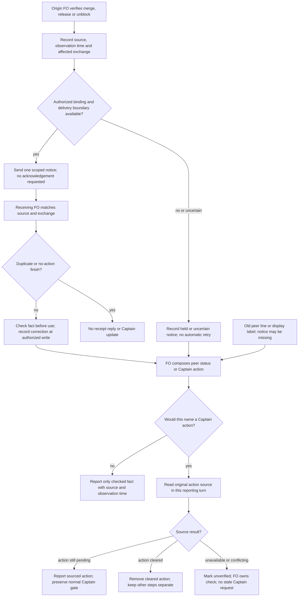

## Scope

- Source: interview round 004 finding (state .notes/fo-feedback/round-004.md, 2026-10-28), proposed by FO; the Captain chose theme B for batch 11 (「那就 B 可以」, chat, 2026-10-30), whose row named 「FO 之間狀態過期」.
- Bite: on 2026-10-28 relay told the Captain Web's half waited on his merge after it had merged (b71f912), and web's status named a v0 step CL had already cleared; web corrected relay twice. Their originals sit in their sessions; this is the two-sided account.
- Upstream first: `extensions/peers/EXTENSION.md`, `extensions/paseo/EXTENSION.md`, Paseo agent labels (next, next-owner).

## Non-goals

- A shared status store or a new service; receipts for every message.

## Budget

- One package PR to the peers and paseo extension text; no new script.

## Stop condition

- The two 2026-10-28 events replay as prevented by the stated rule (a peer pushes merged, released or unblocked when it happens, or a Captain action named from a peer is checked at its source first).

## FO alignment

Alignment: not needed before ideation: text inside the extensions' existing authority.
Surfaces: none
Visible change: none
Release review: not needed: workflow maintenance, on no journey map.

## Design

### PRFAQ

**Proposition — proposed, not implemented.** A First Officer (FO, workflow coordinator) stops repeating another project's cleared Captain action. Before naming that action in a status or gate question, the receiving FO checks the action's original source in the current reporting turn. The originating FO sends a short, sourced change notice to previously involved peers when its own merge, release or unblock changes their next step; every relayed status carries its observation time. These are instructions for existing hosts, not an enforced freshness service.

**Who uses it?** FOs already exchanging a dependency fact, including relay and web in the two admitted 2026-10-28 incidents. One integrated slice runs from source transition through a permitted notice or missing notice to a checked Captain-facing statement. There is no shared status store, new script, timer, fleet broadcast, delivery guarantee, extra gate or background service. No claim is made that every historical status becomes current.

**Why all three measures?** A push reduces the time peers hold an obsolete fact, but can be unavailable, deferred or lost. An observation time shows the age of a fact, but a one-second-old fact can already be wrong. A source check directly answers whether the Captain still owes that particular action; if unavailable, the FO reports uncertainty without assigning the action. Use all three with the source check as the necessary condition for relaying an action, not a time-to-live heuristic.

| Option | Useful effect | Failure and cost |
| --- | --- | --- |
| Push changes only | Involved peers learn merged/released/unblocked early | A lost, held or out-of-order notice leaves the old action; creates sends |
| Observation time only | Makes old observations visible | Age alone does not determine validity; adds a few words |
| Check action at source only | A missing notice cannot justify a stale Captain request | A source read per reporting turn; unavailable source leaves uncertainty |
| Recommended combination | Checked action plus faster bounded updates and visible age | Adds reading and notices; remains a human/agent policy, not a delivery guarantee |

**What does “fresh” mean here?** The reader queried the relevant original source during the turn composing the statement, after processing relevant received changes. Show an ISO 8601 observation time with timezone and source revision/link. Do not substitute send time, an old pasted `as of`, a display label or another FO's finish timestamp. A subsequent concurrent change can still race this observation; report the observation rather than a timeless guarantee. Read once per unchanged source within that composing turn; a conflicting notice requires another check before using it.

**Which source?** For merge, the repository-qualified pull request (PR) state and merged revision; a local commit's presence does not prove hosted merge. For release, the actual tag/release or installation evidence relevant to the claim; merged does not mean released. For an unblock, the blocking task or original decision and the exact question it settled. An original authorization clearing a token-rotation step does not prove the credential changed or a release shipped; do not read secrets. Keep separate remaining steps separate. Missing access or disagreement yields `unverified as of <time>: <source gap>` and an FO-owned check, not “Captain must do X.” Existing Captain-source rules still apply to any authority claim.

### Upstream chain and prior evidence

Research sequence: Spacedock 0.27.3 ensign/shared core and first-officer shared/Codex runtime first; then kc-dev-flow-2 source; then sibling adopter snapshots. Spacedock owns local convergence, dispatch, state and gates; its boot counts are possibly stale, and its Codex completion notification starts durable-report verification. It supplies no peer-fact freshness rule in those read surfaces. This proposal changes neither worker completion nor its notification contract.

After successful `git fetch origin`, package source is `origin/main` **a6612948936a4f075625147b21aabd3b10b19eee**, manifest version **0.33.1**, read with `git show` rather than the unrelated colombo branch. Package checks use the dispatched Codex install `/Users/kent/.codex/plugins/cache/kc-claude-plugins/kc-dev-flow-2/0.33.1`. Target state root is `/Users/kent/conductor/workspaces/kc-claude-plugins/colombo/.context/dev2-adoption/worktree/docs/dev2/.spacedock-state`; pre-edit HEAD **07e7e5d7f85f9c0c4342628055d77ee0efab1890**. This task had Scope/alignment and no previous report or recorded PR; its original body/frontmatter are preserved.

Bounded existing-capability check: (1) read peers and paseo extensions at that source, tracing fact → record → reply/send → Captain claim; (2) searched Spacedock's own core/runtime and read Paseo's own `SKILL.md` Connected hosts, Agents, Waiting and CLI semantics, plus `paseo agent update --help` and `paseo send --help`. peers already says check cited facts, keep human originals, record work-changing exchanges, and use bounded deferral. paseo already separates queue receipt from answer. Missing in that boundary are the point-of-report freshness requirement, observation time, and a transition-triggered notice to involved peers. No mechanism replacement is needed. No claim about all dormant host integrations follows from this bounded read.

Paseo's own help exposes arbitrary label updates; its own skill exposes `labels`, not a freshness contract for `next` (displayed next step) or `next-owner` (displayed responsible actor). Treat both as hints and check their source. This task creates no label schema or board update obligation. Agent-scoped sends return a queued receipt, default to steer and finish notifications, and steering can fall back to interruption. `--no-wait` does not document callback suppression. Do not infer reliable delivery or atomic idle-check/send from those APIs. No live sends or label updates were performed.

Read-only local `origin/main` adopter snapshots, not freshly fetched remote truth: relay `/Users/kent/conductor/workspaces/subspace-relay/beirut-dev2` **a448ea34391653fc71b0760c048f29c781fbe50a**, `docs/dev2/README.md`, `[learn, peers, roborev, journey-map, release-acceptance]`; web `/Users/kent/conductor/workspaces/subspace-web/dev2-fo` **f2e1a4ccce8af1d9ab4ffb6591f8c84ff18d619a**, same README, `[learn, peers, roborev]`; qnow `/Users/kent/conductor/repos/qnow-adopt-dev2` **9cb4cf2c37d21f03918ddc9c50f2864f110b2524**, `docs/dev2-poc/README.md`, `[roborev, codex, copilot, learn, peers, journey-map]`. All omit paseo. Their normal adoption/sync and the sibling policy decision must govern new notices; freshness does not silently opt them in. Incoming evidence and source checks remain useful without new-send authority.

`gh pr list --repo iamcxa/kc-claude-plugins --state open --limit 100 --json number,title,headRefName` succeeded on 2026-10-30: #699 ADR path probe, #674 model policy, #635 behavior-diff CI, #374 peer reply skill. None names this freshness task; this is inventory, not proof of unclaimed local work. No PR comment, issue comment, adopter mutation or peer message occurred.

Read Architecture Decision Records (ADRs, durable repository rulings) 0011 (Captain authority), 0020 (workflow word budget), 0035 (extension selection), 0038 (peer transport/data), and 0042 (Paseo worker handoff) at the pinned source. They are Accepted there. State `Override:` matches relevant to peers/Paseo contain no contrary freshness ruling. Follow 0038's explicit refusal to require Paseo for all users and its requested-reply exception; do not broaden permissions from a notice. This is an operational refinement inside that authority, so no new ADR, number reservation or workflow budget change is proposed. The sibling adoption exception, if approved, owns its own ADR.

### Reviewable extension text

Proposed exact insertion in `kc-dev-flow-2/extensions/peers/EXTENSION.md`, immediately before `## Claude Code binding`. Keep existing transport, record, authority and deferral text. All text below is candidate wording, not an already adopted instruction.

<!-- candidate-fresh-peers-start -->
```markdown
## Current peer facts

A relayed status names its source and observation time with timezone. Before naming a Captain action from a peer, check that action at its original source in the current reporting turn, after relevant notices. A label, timestamp, queued receipt or finish notice is not that check. If inaccessible or conflicting, mark the fact unverified and keep the check with FO; do not assign the Captain the unverified action. A merge proves neither release nor another step's completion.

When your verified merge, release or unblock changes a previously involved peer's next step, record the changed fact, source revision, observation time and affected exchange in the existing task or peer-exchanges note. Send one information-only correction to those confirmed peers through the authorized binding; no broadcast. A correction answering the same question follows its reply route; a new notice needs new-send authority. If held, unavailable or uncertain, record the unsent or uncertain notice and reason; do not infer delivery or retry automatically. At the next attended resume, reconcile pending notices before any authorized send. No timer or background retry is added.

On receipt, match the source and exchange, check before using the fact, and update the affected status at its next authorized write. Duplicates or older observations do not restore a stale action; conflicting or unordered evidence requires a source check. Preserve a bound briefing and record the correction in the existing note. Do not send receipt-only acknowledgements or surface a no-action peer finish to the Captain; report a material change, blocker or decision instead. Worker completion follows its own contract.
```
<!-- candidate-fresh-peers-end -->

Proposed exact insertion in `kc-dev-flow-2/extensions/paseo/EXTENSION.md`, before `## Codex workers through Paseo`. Keep this as a pointer plus notice classification; the sibling `peers-paseo-rule-matches-practice` (peer transport policy) owns general send flags and selection.

<!-- candidate-fresh-paseo-start -->
```markdown
For status changes, follow peers' Current peer facts. An information-only notice asks for no acknowledgement and sets `notifyOnFinish: false`; use a tool exposing that flag. Treat it as a new exchange unless it answers the same requested question. Apply the binding's identity, authority, idle/deferral and steering rules; a freshness need bypasses none of them. A no-action peer callback needs no Captain reply. Keep worker completion notifications unchanged.
```
<!-- candidate-fresh-paseo-end -->

**Integration with the sibling design.** Its current proposed default `notifyOnFinish: false`, explicit reply references and no-ack notice route are compatible. Do not merge its replacement Paseo binding over this new shared section, or retain the base new-question `true` rule after that sibling replaces it. This task alone uses false only for information-only notices, leaving current requested replies false and base new questions true. General quiet-ask policy and the direct one-off exception remain that sibling's Captain choice. If it is deferred, this design can still check sources and use notices under the current listed-paseo policy; unlisted new notices stay unsent. A held go-live notice remains held.

### Sequence and stops



The notice branch uses the existing five-minute ceiling, one natural recheck, and stop when no independent work remains; it does not promise a timed wake. A requested same-question correction may reach a running asker under peers' existing exception; a new notice to a busy/unknown peer defers. An attended resume must reconcile prior uncertain delivery rather than resend. Receipt processing never changes a gate decision or bound briefing. An actual Captain approval/merge remains on its own authorized path.

### Two admitted incidents replayed as prevented

These are policy walkthroughs of `.notes/fo-feedback/round-004.md`, not new original-session or native messaging evidence. Times below are placeholders to be filled from the actual read, not invented historical timestamps.

| Incident and admitted input | Proposed execution and observable result | Falsifier |
| --- | --- | --- |
| 2026-10-28: relay repeats Web “waits on your merge / Review approval”; Web #186 had merged at b71f912, correction reference 81dc0663 | Web verifies its merge, records a sourced correction for the existing relay exchange, and sends if permitted. Even if absent/delayed, relay queries `spacedock-dev/subspace-web` PR 186 before the Captain request; a merged result removes only that merge/approval action and reports `as of <observed time>`. | Relay outputs the old action after reading MERGED, or trusts the timestamp/label without a query. If the provider is unreachable it must say unverified, not ask Captain to merge. |
| 2026-10-28: web still says “v0 0.16.2 等 CL 換 token” after the relevant authorization cleared that step (CL is the operator named in the account) | Originating FO records the precise unblock and source. Web reads the original authorization plus the question answered, or the authoritative blocking record carrying that source. It removes the cleared CL step; it does not claim token rotation or v0 release complete. If the original is inaccessible, report that source gap and do not repeat the old Captain/CL action as current. | Treating a finish notification as the authorization, assigning the old cleared step, reading a secret to verify it, or turning authorization into a “released” claim. |

A live read of current history cannot prove what a 2026-10-28 actor saw. The source-check rule prevents the admitted false action under the stated replay inputs; behavior by an actual fresh FO remains an implementation/validation proof obligation. Neither adding a phrase nor this diagram proves compliance.

### One unresolved Captain decision

**Recommendation:** require the source check in every turn that relays a peer-derived Captain action, with timestamped facts and best-effort transition notices to involved peers. Accept the added read and an explicit “unverified” outcome when the source is unavailable. The alternative is allowing a recent timestamp/notice to stand in for that read; it costs less but can repeat either admitted stale action after a rapid transition. This is one freshness standard choice; send-policy selection remains the sibling's separate gate, not silently decided here. No fixed expiry duration is proposed because the two incidents supply no evidence for one.

Gate wording for FO: “Approve this design with mandatory current-turn source checking for peer-derived Captain actions, timestamped facts and scoped notices, accepting extra reads and unverified holds?” Approval of the design is still required; this report does not grant it.

### Words FO reads at each lifecycle moment

<!-- freshness-reading-ledger -->

Counts use Python `len(text.split())`, including headings, against the pinned source and exact insertion blocks above. This is a correctness repair that **increases reading**, not a reduction claim. Conservative cold reads include the full peers file (805 → 1067 words), full paseo file when listed (562 → 629), and the unchanged Paseo skill's Connected hosts, Agents, Waiting and CLI semantics (607). Thus an incoming/unlisted route is 1412 → 1674 (+262); a listed exchange is 1974 → 2303 (+329). The sibling's independent proposed reduction is not credited here: recount their combined bytes at integration.

The following common control-text fixtures were executed in this stage using the dispatched package's `test_pr_watch.TasksTests`, `PrWatchTests`, `test_delivery_gate.DeliveryGateTests` and `observer_check.py`, with mocked provider/Spacedock responses in temporary repositories, exit 0. No real send or product check is inferred. Reproduction instrument: the Python block beginning `import sys, importlib.util, subprocess, json, re` in `peers-paseo-rule-matches-practice.md` at state commit **07e7e5d7f85f9c0c4342628055d77ee0efab1890**, file SHA-256 **44bd888650055b252b1dea6f64dc7dcca180665ac419aa166c55ea01395eafd6**. Extract that block from `git show <commit>:peers-paseo-rule-matches-practice.md`; run with Python 3 `-B`, package root and Spacedock plugin root. This is a pinned shared measurement instrument, not adoption of that sibling's unapproved policy.

| Lifecycle moment | No peer event, before → after | Listed peer event, before → after | Common measured read corpus |
| --- | ---: | ---: | --- |
| Startup, open PR with pending checks | 442 → 442 | 2416 → 2745 | Spacedock startup hook 365 + dev2 mod 48 + tasks output 29 |
| Idle, open PR becomes ready | 672 → 672 | 2646 → 2975 | idle hook 100 + mod 48 + Delivery authority 488 + tasks 29 + wait output 7 |
| Idle, merged PR lacks observer, then report committed | 1021 → 1021 | 2995 → 3324 | idle 100 + mod 48 + authority 488 + learn 280 + wait 17 + refusal 68 + rerun 20 |
| After archive, observer reaches learn handoff | 371 → 371 | 2345 → 2674 | mod 48 + learn 280 + after-merge output 15 + observer output 28 |
| Merge ask, docs-only candidate matches dispatch | 1003 → 1003 | 2977 → 3306 | authority 488 + Extensions section 451 + wait 7 + delivery-gate output 57 |
| Quiet dispatch / other unrelated event | unchanged corpus | +262 or +329 only if its peer route is due | No worker procedure or dispatch output changed |

These are measured instruction-and-output totals up to the next worker/learn handoff, not entire live-session totals. They include every instruction-bearing script output in those bounded fixtures. A real new source query has additional response words **S(moment)**, and its changed status/notice has **M(moment)**; neither has a constant size nor was live-host traffic measured. Before/after real peer-action totals are the table + actual old/new S and M, to be captured at validation, including failed query responses. A source fact cannot be priced as zero because it is outside a Markdown file. The new required check adds a source-read call whenever no current-turn result exists; original authority checks may already incur the same read. Do not claim measured reading-time savings, lower notice counts or full runtime totals from this ledger. Startup does not newly preload these optional routes. No CI change or cost-per-PR claim is proposed.

Reproduce the changed text counts using only the pinned git repository, task file and primary host skill supplied as arguments (Python 3 standard library):

```python
import re, subprocess, sys
from pathlib import Path
repo, task, host = sys.argv[1:4]
base = 'a6612948936a4f075625147b21aabd3b10b19eee'
t = Path(task).read_text()
w = lambda s: len(s.split())
def source(name):
    return subprocess.check_output(['git', '-C', repo, 'show', base + ':kc-dev-flow-2/extensions/' + name + '/EXTENSION.md'], text=True)
def added(name):
    block = t.split('<!-- candidate-fresh-' + name + '-start -->', 1)[1].split('<!-- candidate-fresh-' + name + '-end -->', 1)[0]
    return block.split('```markdown\n', 1)[1].rsplit('```', 1)[0]
p, x = source('peers'), source('paseo')
p2 = p.replace('## Claude Code binding', added('peers') + '\n## Claude Code binding', 1)
x2 = x.replace('## Codex workers through Paseo', added('paseo') + '\n## Codex workers through Paseo', 1)
h = Path(host).read_text()
host_words = sum(w(k + h.split(k, 1)[1].split('\n## ', 1)[0]) for k in ['## Connected hosts', '## Agents', '## Waiting', '## CLI semantics'])
for label, before, after in [('peers', p, p2), ('paseo', x, x2)]:
    print(label, w(before), w(after))
print('unlisted', w(p)+host_words, w(p2)+host_words)
print('listed', w(p)+w(x)+host_words, w(p2)+w(x2)+host_words)
```

### Batch overlap

Proposed product change set: **only `kc-dev-flow-2/extensions/peers/EXTENSION.md` and `kc-dev-flow-2/extensions/paseo/EXTENSION.md`**, with the insertion points above. No executable checker, workflow template, ADR file/index, provider setting, adopted README or label schema changes. Runtime exchange records use the existing task or `.notes/peer-exchanges.md` path under the existing authority; they are not new package files. Only this task body is writable in ideation.

| Batch/live task (routing slug; short meaning) | Same file or check; implementation ordering |
| --- | --- |
| batch10-after-release-obligations — post-release proof and repairs | No direct file overlap: laws_check/dispatch_records and native spawn proof. Same release/adopter timing; its evidence is not freshness evidence. |
| names-check-says-what-it-skipped — dispatch diagnostics | No direct file overlap: dispatch_records and its checks. A new freshness paragraph is not a new pre-send diagnostic. |
| peers-paseo-rule-matches-practice — peer send/selection policy | Direct overlap in both extension files and peer replay cases. Settle its Captain choice and apply its replacement binding first; insert freshness shared section and notice pointer after it. Owns quiet-ask default, direct named exception and any associated ADR. |
| peer-status-reaches-fresh — this freshness design | Owns the two insertions and the two stale-action replay cases; no sibling state edits. |
| model-roster-per-repo — role model selection | Direct overlap in paseo worker text; common full-file reading counts and package lint. Keep role/worker resolution out of the freshness section; rebase and recount. |
| paseo-human-surfaces-visible-and-reachable — visible terminals/pages | Direct overlap in paseo full file and reading counts. Distinct human-surface section; serialize/rebase before final integrated recount. |
| adoption-asks-which-extensions — historical extension checks | Current narrowed task owns dispatch_records/number_guards/tests/laws, not these extension files. No shared file; normal adopter selection remains its existing authority. |
| adr-required-statement — decision evidence at completion | No direct extension overlap; existing ADR/report checks may apply at implementation. No ADR number or shared index is requested here. |
| adr-silent-undo-probe — fictional refactor experiment | No overlap: existing archived harness/scenario only. |
| comment-check-reaches-delivery-gate — exact-head comment evidence | No overlap: delivery_gate/tests/validation principles. Rerun the reading fixture if its output lands first; do not change its check. |
| journey-canvas-hosted-poc — hosted canvas experiment | No overlap: kc-journey-map hosting artifacts and its own state. |
| journey-server-host-pilot — private server adapters | No overlap: kc-journey-map server/adapters; existing validation stays independently owned. |
| ops-inbox-r1-setup-and-isolation — signed ops intake | No product-file overlap. Its relay/qnow notices are a concrete shared **authority case**: go-live-held notices cannot be sent merely to satisfy freshness. |
| pr-review-lite-value-pilot — bounded review experiment | No overlap: kc-pr-flow review capability and trial state; no shared checker or numbering here. |

Recommended order: settle peer-send policy, land its extension edits, add freshness, then integrate model-roster/human-surface edits under a single owner for the shared paseo file and recount the combined reads. Other code/check tasks may proceed independently; if delivery-gate output changes, rerun the common fixtures. FO rechecks live task and PR ownership before implementation. All sibling files were read only; active designs can change after this snapshot.

## Acceptance criteria

**AC-1 — A cleared Web merge is not a Captain action.** At the exact candidate, run a fresh FO policy replay with the admitted stale relay line, Web PR 186 MERGED/b71f912, and a source-read interface whose calls are logged. Run with notice present, absent and delayed; in each case the output removes the cleared merge/approval, includes source/time, and has a current-turn source read. Negative control: make the source OPEN with a pending action and expect that action to remain, without claiming permission to merge. Falsifier: no query, stale request after MERGED, or suppressing a truly pending action. Design evidence: incident walkthrough above; fresh-agent execution is not yet run.

**AC-2 — A cleared unblock does not become a release claim.** Replay web's old v0/CL line with an accessible original authorization plus its answered question clearing that step; then with those originals unavailable, and with an unrelated completion notice. Expected: remove only the proved cleared step; unavailable/irrelevant evidence gives unverified and an FO-owned source check, never credential access or “released.” Record transcript, source fixture bytes and source-read calls. Falsifier: original text is never consulted, unavailable evidence preserves the stale action as current, or authorization is upgraded to delivery. Design evidence: second walkthrough; native/history originals remain unverified.

**AC-3 — Transition notices are scoped, quiet and authority preserving.** Exercise merged/released/unblocked changes through a recording transport, with known involved peers, an unrelated peer, running/unknown recipient, unlisted paseo, a held go-live action and a same-question correction. Observe only permitted recipients, explicit steer, notice false flag/no acknowledgement request, existing deferral, unsent/uncertain reason, and no automatic resend at an attended resume without reconciliation. Deliver the same notice twice and an older conflicting notice: source recheck must keep the current fact. Deliver a receipt-only and no-action finish: no new send or Captain status turn; material change/blocker remains reportable. Falsifier: broadcast, interrupt override, unlisted new send, duplicate action, timestamp ordering assumed authoritative, or a new timer. Recorder proves requested routing/flags, not real delivery. Candidate replay and native delivery are future checks.

**AC-4 — Real bounded use demonstrates the value.** After normal authorized adoption, use the first naturally occurring peer dependency transition in one named pair, without synthetic peer messages or a background watch. Retain the original source observation, notice or held reason, recipient's subsequent query and Captain-facing status in the existing exchange record. A skipped/lost notice must still lead to a checked or explicitly unverified action. Falsifier: the first resulting status repeats a disproved Captain action or takes a receipt/finish as proof. If no suitable event occurs or send/adoption authority is absent, report not run and hold this acceptance claim; do not invent a live success. This requirement is distinct from fixture success and from approval of this design.

**AC-5 — Reading cost and ordinary orchestration remain visible.** Rerun the embedded recount at the exact base/candidate, plus the pinned common fixture instrument, and capture actual source/error responses and old/new status/notice words in the AC-4 sample. Report every lifecycle row, including +262 peers and +329 listed cold-policy load or an explained updated count after sibling integration; do not claim full totals without S/M. Run existing package routing/lint checks applicable to text edits and verify unchanged worker completion, optional adoption and gate/authority paths. Falsifier: hiding moved/added text, counting callback suppression as proven savings, dropping worker finish signals, or asserting a wrapper enforces these prose rules. Design counts/fixture output are measured; final candidate checks and real-output totals are not yet verified.

**AC-6 — The design is reviewable and stays within scope.** Run the dispatched `design_surfaces.py check` on this task; render the Mermaid and inspect origin/receiver roles, authorized-send branch, source-read branch and both uncertain stops against the prose. Verify only this entity body changed and all four dispatch checklist items are reported. Falsifier: missing usable criterion/artifact, a diagram allowing stale Captain action on unreadable source, changed frontmatter/sibling task, or any implementation/message/adopter change in ideation. Current-stage receipts follow in the report.

## Stage Report: ideation

- DONE: A design for a peer FO's status reaching other FOs fresh, comparing a peer pushing its own state changes (merged, released, unblocked) when they happen, a status line carrying its time, and checking a Captain action named from a peer at its source before relaying it; the two 2026-10-28 events in Scope replayed as prevented; receipt-only acknowledgements and no-action finish notices considered; overlap with peers-paseo-rule-matches-practice's design named
  PRFAQ compares push/time/source-check; both admitted incidents replay to a removed action or explicit uncertainty; receipt/finish suppression and the sibling send-policy dependency are named. Original-session and native delivery proof are not claimed.
- DONE: A `### Batch overlap` section naming each file the design would change and each other batch task (batch10-after-release-obligations, names-check-says-what-it-skipped, peers-paseo-rule-matches-practice, peer-status-reaches-fresh, model-roster-per-repo, paseo-human-surfaces-visible-and-reachable) and live task of other sessions (adoption-asks-which-extensions, adr-required-statement, adr-silent-undo-probe, comment-check-reaches-delivery-gate, journey-canvas-hosted-poc, journey-server-host-pilot, ops-inbox-r1-setup-and-isolation, pr-review-lite-value-pilot (driven by other sessions; read only)) that changes the same file or check, so FO can order implementation
  Batch overlap lists both proposed extension files and all 14 named batch/live task rows, shared replay/reading checks, authority-held notices and an explicit integration order; other state files were read only.
- DONE: The words FO reads at each lifecycle moment, before and after, per root learning.md "Measure the words FO reads at each moment, not one file's size"
  Embedded recount exit 0: peers 805→1067, paseo 562→629, listed with host 1974→2303. Executed common lifecycle fixtures exit 0: startup 442, idle/open 672, idle/merged 1021, archive 371, merge ask 1003; real source/message output remains unmeasured.
- DONE: Acceptance criteria with reproducible evidence clauses and falsifiers, and unresolved decisions for the Captain, each with a recommendation and what gets worse under it
  Six individually falsifiable criteria distinguish design, recording-transport, fresh-agent and native-use evidence. One Captain choice recommends current-turn source checks and states extra reads/unverified holds as its cost.
- SKIPPED: AC-1 — Fresh-agent Web merge replay.
  Design walkthrough supplied; execution awaits an approved implementation. A MERGED source followed by a Captain merge request is the named failure.
- SKIPPED: AC-2 — Fresh-agent unblock replay.
  Design walkthrough supplied; originals/native replay not read or run. Authorization becoming a release claim is the named failure.
- SKIPPED: AC-3 — Recorded transport/duplicate/authority behavior.
  Reproducible cases defined; no peer send or implementation performed. An unlisted new notice, duplicate action or forbidden send would fail.
- SKIPPED: AC-4 — One real adopted peer transition.
  Requires later authorized normal adoption and a natural event; fixture success does not satisfy it. Repeating a disproved Captain action would fail.
- DONE: AC-5 — Design-stage reading evidence; final behavior proof deferred.
  Exact draft counts and common fixture outputs measured above; hidden source/notice text would invalidate a full-total claim. Candidate lint and real S/M totals remain not run.
- DONE: AC-6 — Current design is presentable and scoped.
  design_surfaces.py check exit 0: "peer-status-reaches-fresh.md: design surfaces presentable"; original 2655 bytes/frontmatter preserved, only this entity modified, git diff --check clean.
- DONE: Render and inspect the required diagram.
  Mermaid 11.16.1/Playwright 1.62.1 rendered 18 nodes, SVG 36849 bytes, exit 0; inspected origin/receiver, permitted notice, current-turn query and unavailable-source stop against prose. Initial sandbox launch failed; authorized temporary-browser retry succeeded.

### Summary

Designed mandatory current-turn source checks for peer-derived Captain actions, timestamped facts and bounded change notices inside the two existing extension files. Design and reading fixtures pass within their stated limits; implementation, original-event verification, actual peer delivery and real-use acceptance are not claimed. FO must present the single freshness-standard recommendation, coordinate the sibling send-policy gate and integrate shared extension edits before implementation; no gate was resolved here.
