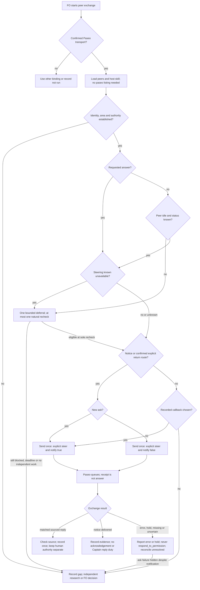

## Scope

- Source: interview round 004 finding (state .notes/fo-feedback/round-004.md, 2026-10-28), proposed by FO; the Captain chose theme B for batch 11 (「那就 B 可以」, chat, 2026-10-30), whose row named 「「沒列 paseo 就不能主動問」的規則跟實際做法矛盾」.
- Bite: all five interviewed FOs initiated Paseo asks with paseo unlisted and none recorded `peers not run`; qnow's Captain-directed ask had no compliant path; web did not know the clause existed; default sends steer into running peers and web received about 15 no-action finish notices on 2026-10-28.
- Upstream first: `extensions/peers/EXTENSION.md` § Paseo binding, `extensions/paseo/EXTENSION.md`, `references/sd/adoption.md`, Paseo `send_agent_prompt` defaults.

## Non-goals

- Changing Paseo; a hook that blocks sends.

## Budget

- One package PR to peers/paseo, their README/adoption/fo-feedback claims and one new ADR. No adopter listing campaign. Validation uses the Captain-authorized real two-agent ask, reply, notice and safe failure-visibility check; no host change or recurring obligation.

## Stop condition

- Every round-004 event has a stated allowed/refused/unknown disposition under confirmed-transport permission, including a compliant qnow path without a listing exception. Validation requires real ask/reply/notice with ask callbacks enabled, replies/notices quiet, and visible ask failure/hold notifications with report-only permission handling under amendment 1. If that check is unavailable or an ask failure/hold remains hidden, stop and return evidence to FO; no host repair, watcher, automatic listing or notification redesign is authorized. Preserve non-Paseo routing, worker signals and human authority.

## FO alignment

Alignment: needed before ideation; list paseo everywhere or relax the clause is the Captain's.
Result: aligned at backlog: the Captain 「對，全准且全確認」 (chat, 2026-10-30) to FO's batch-11 backlog sitting, which asked 「決定：六張全准進設計，並確認上面三件事？要改哪張直接說。」, approved the outcome and bounds in this file. List paseo everywhere or relax the clause stays his: ideation returns it as a decision at the ideation gate.
Surfaces: none
Visible change: none
Release review: not needed: workflow maintenance, on no journey map.
Reviewer: kc-dev-flow-2:chief-engineer opus 2026-10-30 — batch-11 review before the joint ideation sitting: approve, revise, split or hold each task, the Captain's decisions, overlap and order
Reviewer: kc-dev-flow-2:engineering-reviewer gpt-6-astra 2026-10-30 — does amendment 1 withdraw what the Captain approved, and what changes in the build?

## Design

### PRFAQ

**Proposition.** A First Officer (FO, the workflow coordinator) can initiate a fact question through a confirmed Paseo peer transport without listing the optional paseo extension. Incoming replies use the same binding; non-Paseo adopters keep their own binding and acquire no Paseo requirement. Required peers retains identity, original human authority, task search, bounded busy-peer deferral and source checks. This is a prose policy change, not a send interceptor.

**What did the Captain decide?** On 2026-10-30 he answered 「准」 to the joint ideation question 「決定：六張全照建議，同意放寬 Paseo 規則和真實測試，並授權改完直接進實作？要改哪張直接說。」 The task's ideation resolution at 09:31:39.460058Z points to `review/ideation/briefing-1/index.json`: relax the listing clause for confirmed Paseo, reverse Architecture Decision Record (ADR, durable repository ruling) 0038's chosen listing option in a new ADR, run one real two-agent ask/reply/notice at validation, and check that notifyOnFinish false does not silence an errored peer. This definition replaces the earlier listing-plus-named-exception recommendation. The earlier report remains historical; its counts and unresolved choice do not describe this cycle.

**What stays optional?** paseo still selects the existing Paseo Codex worker publication/local-review procedure. Messaging never activates it. fo-feedback still needs its own selection, named maintainer, anchor, cadence and question grant; only its redundant paseo prerequisite is removed. No adopter README listing campaign, model change, host change or extra polling service is needed.

**Why different notification flags?** Captain amendment 1 enables notifyOnFinish for peer asks after the old-head real-pair check found quiet cancelled turns appearing finished. Requested replies and information-only notices keep it false and request no receipt-only acknowledgement. A permission notification about another agent is reported to FO, never approved or denied with respond_to_permission. Native error/hold visibility and report-only handling still need a rerun on the amended head; a callback grants no authority.

**Who owns freshness wording?** The newest `peer-status-reaches-fresh` (current peer facts) gate asks that task to delete its paseo insertion and let this task carry that text. This task alone owns the Paseo send/notice wording in both transport binding and optional-extension pointer; the sibling retains its `## Current peer facts` section in peers, its fresh-FO loading test and its real-use observation after delivery. Its old candidate-paseo insertion must not also land. Reading its task/briefing is coordination; no sibling edit or message is authorized here.

### Captain ruling and decision record

No unresolved material design choice remains within the revise asks. Cost accepted by the relaxation: required peers gains proactive Paseo scope and a repository cannot disable peer asks just by omitting paseo; existing authority still limits each exchange. No six-README enablement or Captain-named exception remains. Recommendation: implement this bounded ruling, then require the native evidence before validation passes. What gets worse: more peer text for an incoming-only reader, and a live failure-visibility requirement can hold delivery.

New unnumbered ADR draft title: **“Confirmed Paseo transport permits peer asks without optional extension selection.”** Context: round-004's five unlisted senders and qnow's named ask. Decision: cite the exact Captain Words/Asked and this gate; supersede only ADR 0038's optional-listing prerequisite for outbound Paseo peer asks. Retain its transport-based routing, non-Paseo path, source/authority rules, busy bound and requested-running-reply exception. Preserve ADR 0035's required learn/peers and optional worker choice, and ADR 0042's listed worker handoff. Consequences: loss of listing-based opt-out, ask callbacks, report-only permission handling and required native proof under amendment 1. FO reserves the ADR number at implementation dispatch; no ADR/index or prior decision is edited during ideation.

Return to FO rather than design here: host/error-notification changes; a polling/watchdog or reliable queue; further notification-default changes if the amended failure test fails; automatic adopter selection; zero-interruption guarantee; new model/worker/surface policy; broader profile or production obligations. The existing recorded callback choice when an explicit return route is unavailable is retained, not a new fallback mechanism. An unavailable native test leaves acceptance unverified, not waived.

### Upstream chain and evidence refreshed this cycle

Read order: Spacedock 0.27.3 ensign shared/Codex and first-officer Codex runtime; kc-dev-flow-2 0.33.1 framework/profile/source; sibling adopter refs. Spacedock owns dispatch, worker signals, state and gates; a completion notification starts durable verification. No worker notification or dispatch control changes. The existing peers binding and paseo pre-worker policy supply the mechanism to repair; no wrapper, new checker or host modification is needed.

`git fetch origin` succeeded this cycle. Pinned source remains `a6612948936a4f075625147b21aabd3b10b19eee`, manifest 0.33.1, read with `git show`. Stage scripts use `/Users/kent/.codex/plugins/cache/kc-claude-plugins/kc-dev-flow-2/0.33.1`. ADR 0035, 0038 and 0042 were reread; the new gate, not the previous design or memory, authorizes reversal. The root learning says to count every due passage/output at each lifecycle moment; no reduction is promised here.

Paseo primary evidence: `/Users/kent/.agents/skills/paseo/SKILL.md` Connected hosts, Agents, Waiting and CLI semantics and the discovered `send_agent_prompt` schema. Agent-scoped sends default steer and notify true; steering can fall back to interrupt; queued receipts are not answers. The schema says false disables callbacks for finish, error and permission events; the docs do not prove another failure surface reaches the sender. That is why native failure visibility is an acceptance condition, not a current finding of success. No native send, agent creation or simulated peer failure occurs in this ideation.

Read-only adopter local origin/main refs (not fetched as live remote truth): relay beirut-dev2 `a448ea34391653fc71b0760c048f29c781fbe50a`, web dev2-fo `f2e1a4ccce8af1d9ab4ffb6591f8c84ff18d619a`, qnow-adopt-dev2 `f364b6e8bfa072db46374dccfcc566d10667cf40`. Relay/web `docs/dev2/README.md` and qnow `docs/dev2-poc/README.md` all still list peers and omit paseo. Their list bytes remain untouched; a published package upgrade delivers the new peer rule without opting them into workers. Round-004 remains operator evidence for project-env, ops-inbox and v0. This cycle's `gh pr list --repo iamcxa/kc-claude-plugins --state open` failed `error connecting to api.github.com`; live PR overlap is unverified. Source worktree is the unrelated `iamcxa/trim-kc-dev-flow-third` branch with existing `.gitignore` and `.gstack/browse-startup-error.log` changes; preserved. State branch is `spacedock-state/dev2`, clean before this edit at af41b314b294bf4a802cb5df13b0c3e7786ace5c.

### Proposed text and loading boundaries

Replace only peers' Paseo binding and paseo's text above `## Codex workers through Paseo`; keep the worker section unchanged in this task. Keep peers' shared text, Claude/Other bindings and the sibling's eventual Current peer facts insertion. The latter is explicitly conditional below until delivered; combined acceptance must resolve the link against the delivered sibling. An unlisted peer sender loads peers plus Paseo's own skill, never the optional worker extension. Current workflow entry already reads peers before peer exchanges; the sibling owns proving loading for a fresh FO reporting peer status.

<!-- candidate-peers-start -->
```markdown
## Paseo binding

Use this binding only when the peer transport is confirmed Paseo, regardless of model provider. New asks and incoming replies need no paseo listing; this does not enable that extension or its worker procedure. Non-Paseo peers keep their own binding. Read Paseo's own paseo skill at the first exchange; missing skill or capability records peers not run and uses the existing fallback.

Keep serverId with the full host-stamped agentId and confirm the destination through list_hosts. Exclude workers and teammates. Identity does not prove area or authority. Keep a Captain-named peer; otherwise confirm area from a reply or task record. If unclear, ask that identified idle peer one ownership question. Never broadcast or infer area from titles. Claude probes and opening lines do not apply.

For a new ask or information-only notice, check status and send once only to an idle peer. Busy or unknown status uses the five-minute deferral above. Requested answers may reach a running asker. Set activeTurnBehavior: "steer" explicitly; never select interrupt. Known unavailable steering defers even a reply; unknown capability or a status race still risks Paseo's interrupt fallback. These restrictions do not govern FO's own workers.

Set notifyOnFinish: true for peer asks; set it false for requested replies and information-only notices. An ask names its question reference and requests one explicit sourced reply to the confirmed return address; check that return host route first. A notice asks for no acknowledgement. If the return route is unavailable, use independent research or record a specifically chosen completion callback with notifyOnFinish: true. Use a tool exposing both flags; CLI --no-wait does not prove callbacks are disabled. Match replies and callbacks once to the question; a receipt, unrelated finish or duplicate is not an answer. Preserve missing, failed or uncertain outcomes in the exchange record; no automatic resend.

Report a permission notification about another agent to FO; never answer it with respond_to_permission. A notification grants no authority to approve or deny that agent's request. Do not infer success from silence or discard an error as a no-action finish. At the next attended reconciliation, inspect unresolved exchange evidence and report a material failure or hold to FO. If the host cannot expose an ask's failure or hold with callbacks enabled, record the gap and return the policy to FO; do not claim it validated or invent polling, a watcher or host changes.

For status corrections, follow peers' Current peer facts when that rule is delivered: a same-question answer uses the reply route; another notice uses the new-send route. Freshness bypasses no identity, authority or busy-peer boundary. A no-action finish creates no Captain reply duty; worker completion keeps its own contract.
```
<!-- candidate-peers-end -->

<!-- candidate-paseo-start -->
```markdown
# paseo extension

Optional dev2 policy for the Paseo Codex worker handoff.

Requires: peers

Enable only through the adopter's extension choice. Confirmed Paseo peer asks and incoming replies use peers without this listing. The Captain's board, labels and gates remain outside this extension.

Use peers' Paseo binding for identity, send flags, replies, notices and recovery; read Paseo's own skill for current host capabilities. For status changes, follow peers' Current peer facts when delivered. An information-only notice requests no acknowledgement; a same-question correction uses the reply route, otherwise the new-send route. No-action peer finishes require no Captain reply; errors and permission holds remain material. Preserve worker completion notifications. Listing paseo selects the worker procedure below, not peer-message permission.
```
<!-- candidate-paseo-end -->

Update affected retained claims in the same package PR; these are consequences of the approved relaxation, not new policy:

<!-- candidate-adoption-start -->
```markdown

The template lists the `required` extensions of the package README table (`learn`, `peers`);
`extensions:` sits above `state:`, where the template puts it. Each
`<package>/extensions/<name>/EXTENSION.md` names what that extension needs.

Ask which recommended or optional rows to add once, before the Captain reviews the README:

1. Probe each row's **Needs** read-only and show the result beside it: `journey-map` with
   `release-acceptance` needs a `.yaml` file under `docs/journey/`, including product folders
   (`find docs/journey -type f -name '*.yaml' -print` from the code root), `python3` and `node`; `codex` needs `gh auth
   status` to pass; `roborev` needs `roborev status` to pass; `copilot` needs `gh` 2.92 or later
   authenticated; `paseo` needs peers, Paseo's own `paseo` skill and read-only host/agent
   discovery. `fo-feedback` needs a named interviewing maintainer, a state checkout, peers,
   readable batch membership/completion records and an available peer transport. Confirmed
   Paseo peer asks use peers without a separate paseo selection. Show a row whose probe failed unchecked with the reason.
2. Put one multi-select to the Captain through the host's structured Ask UI, or in plain chat
   when none is available: the required rows shown as already on, `journey-map` with
   `release-acceptance` as one choice that writes both names, `codex`, `roborev`, and `copilot`
   unchecked and marked quota-limited, and `paseo` unchecked for its Paseo Codex worker handoff. Confirmed
   Paseo peer asks and replies already belong to peers. Offer `fo-feedback` unchecked for the interviewing
   maintainer only; show its prerequisite results without enabling dependencies.
3. Write the chosen names after the required ones. Never list a row whose probe failed; report
   `not listed: <name>, <reason>` and list it only when the Captain insists after seeing the reason.
4. With no answer, or a worker that cannot ask, keep the template line and report
   `recommended not chosen: <names>`, naming each recommended extension (`journey-map` and `release-acceptance` are two names)
   in the order step 2 lists them, whatever its probe said, and not the optional `copilot` or `paseo` or `fo-feedback`.
5. Refuse a selection of `paseo` or `fo-feedback` without `peers`. For `fo-feedback`,
   require its available peer transport; confirmed Paseo uses peers without paseo opt-in. Before its
   first round, record the Captain-approved adoption anchor and question grant in
   `.notes/fo-feedback/index.md` in the state checkout; follow its extension for cadence.
   No answer leaves it off; selection here does not authorize an interview send.
6. When `codex` and `copilot` are both listed, write `second-reviewer: copilot`; otherwise leave it empty.

The `extensions:` line is the adopter's own after adoption. At a re-sync, `git merge-file` against
the template's new line merges an adopter `[]` clean to `[learn, peers]`, merges an equal list
clean, and conflicts on any other list (measured 2026-10-25). Keep the adopter's value when it
conflicts, and when a clean merge changed it, restore it; no check reads a re-synced README for a
dropped extension, so the adopter's review of the sync PR is the only check.
```
<!-- candidate-adoption-end -->
<!-- candidate-readme-start -->
```markdown
| [peers](extensions/peers/EXTENSION.md) | required | FO, before opening a task or exchanging peer facts | selects the peer transport, permits confirmed Paseo asks and replies without paseo listing, searches existing work and checks facts within existing authority |
| [paseo](extensions/paseo/EXTENSION.md) | optional, requires peers | FO, before a listed Paseo Codex worker dispatch | selects its worker publication and local-review handoff; peers owns peer asks and replies |
```
<!-- candidate-readme-end -->
<!-- candidate-feedback-start -->
```markdown
- **Needs:** a named maintainer, a state checkout, peers, readable batch membership/completion records and an available peer transport. Confirmed Paseo asks use peers without a separate paseo listing. Probe these read-only at adoption; failed prerequisites stay unselected.
```
<!-- candidate-feedback-end -->

All other adoption/probe/selection text stays intact. fo-feedback's anchor, authority and cadence do not change. No workflow template, hook, executable checker, test runner or CI trigger change is proposed.

### Sequence and stops



Deferral is one episode, not a loop resetting five minutes. An eligible recheck still checks known-unavailable steering; otherwise it ends unsent. New notices use the idle rule; requested same-question corrections use the running-reply exception. Status races still carry upstream interruption risk. Errors/permission holds are material, distinct from no-action finishes. Permission notifications about another agent are reported to FO, never answered with respond_to_permission. A silent peer is unresolved, never success. Worker completion is outside this graph. No diagram node performs a host repair or bypasses a gate.

### Round-004 replay

Each event below was re-read against `.notes/fo-feedback/round-004.md`. Dispositions are prospective under the revised policy, never retroactive approvals. Missing historical flags, source or status stay unknown. Confirmed transport replaces the listing gate in every affected row; interview/worker/action authority remains separate.

| Round section and each reported event | Verdict under proposed rule and correction/limit |
| --- | --- |
| project-env peers 1 / paseo 1–2: Captain-requested 0.13.2 share to Bridge, waiting for idle; no task | Allow a confirmed-Paseo, authorized quiet notice with original source and existing state note; no paseo listing or named-ask exception is needed. |
| project-env peers 1: docs-staleness need to another FO | Allow the confirmed-Paseo question within existing authority, subject to identity/idle/flags/record checks; no listing is needed. Receiving the answer is allowed. |
| project-env peers 2: no task record for share; docs exchange only in local-ext/doc-site.md | Refuse as complete record under current rule; state note holds taskless share and links checked docs evidence. A document elsewhere is not the required state record. |
| project-env peers 3: relayed “dogfood” quote → direct Captain question → “試” | Allow verified fact/direct authority path; refuse treating the relayed quote alone as authorization. |
| project-env peers 4 / paseo 3: Bridge stayed running awaiting Captain, 60-second polling loop | Refuse polling; at most one natural recheck, five-minute ceiling, stop earlier without independent work. Retain the non-interruption intent. |
| project-env paseo 1,4: round 3/004 replies, including running asker with steer | Allow requested answers with explicit steer/false and capability caveat; unknown prior flags are not a pass. |
| ops-inbox peers 1,3: qnow first-adopter review, period-boundary fact, D7 | Allow requested review answer and verified contract fact; new originating ask uses confirmed transport and existing authority, without paseo listing. Workers still use their FO. |
| ops-inbox peers 1,4: vault question to relay inferred from name, steered into running turn | Refuse guessed area and known-busy new question. Captain later names project-env: use confirmed named destination and bounded send. |
| ops-inbox peers 2: relayed C2–C6 Captain quotations | Allow as marked data; refuse action authority without accessible originals or direct confirmation. |
| ops-inbox peers 2: no `Peer:` lines, exchanges in task sections | Allow Paseo identity/source/task record if complete; Claude's `Peer:` probe format is not required for Paseo. |
| ops-inbox peers 2: several vault questions bundled | Refuse under the one-question rule unless a separately authorized interview bundle applies; split ordinary questions. |
| ops-inbox peers 4: v1 landing notices owed but held behind go-live | Allow keeping them unsent under the authority hold; a notice is not permission to go live. Durable notice tracking policy belongs to a separate task. |
| ops-inbox paseo 1: proposed enabling still open; future relay emitter cooperation | Allow confirmed-Paseo questions without selection; neither this nor the open extension proposal grants emitter changes or go-live. |
| ops-inbox paseo 2–4: status checks, flags only for replies, default steering, no deferral used | Require both flags for each permitted exchange; known busy/unknown status defers. No event using deferral is no evidence of compliance; a blocking wrapper is out of scope. |
| relay peers 1,3: room-menu facts, action kinds, shell gate, path correction, #186 merge facts | Allow requested answers/verified facts; fresh proactive questions require confirmed Paseo transport and existing authority, not paseo listing. Verify cited commit before changing design; never equate a peer claim with repository truth. |
| relay peers 1–2: new tasks from relayed “A＋C...” ruling; alignment pending | Allow pending intake/data; refuse marking alignment approved from the relay. Original Captain confirmation remains necessary. |
| relay peers 4: “waits on your merge” after merge, stale token authority line, receipt-only acknowledgements | Refuse stale claim as checked fact; peer-status-reaches-fresh owns shared freshness/reporting policy; this task owns its Paseo pointer. Quiet informational notices request no acknowledgement. |
| relay paseo 1: ideation/implementation/research workers created through Paseo | Allow only under their existing dispatch contract, not the peers rule; callback suppression here must not affect workers. |
| relay paseo 2–4: wrong cwd/root, /tmp staging/invisible terminal, missing explicit mode, about 20 approvals | Refuse calling that valid placement/visible handoff under existing worker policy. Upstream worker placement and paseo-human-surfaces-visible-and-reachable own repair; approvals are observations, not new authority to widen sandbox. |
| qnow peers 1–2,4: Captain-directed relay mockup-review question while unlisted | Allow the named question through the ordinary confirmed-Paseo route with original authority, sourced reply and state record; no special exception or extension enablement. This resolves the reported no-compliant-path case. |
| qnow peers 1–2: Bridge incoming design-before-code answer plus addendum | Allow answer and same-question clarification; unrelated new asks/addenda use the new-send identity/authority/idle route. Missing task/state note refuses recording completion. |
| qnow peers 3: search zh/en before holiday task; duplicate deployment task created without search | Allow search/reuse; refuse new duplicate without search. Captain-authorized deletion is separate authority, not a peer remedy. |
| qnow paseo: reused designer through passes 1–5f; 3–5 approvals/pass; overwrite caught | Allow authorized worker reuse/checks under upstream dispatch; no new peer send policy governs it. Preserve evidence file; do not treat fewer approvals as proof of safety. |
| web peers 1,3: “relay needs no change”, source checks, corrected sequencing risk | Allow sourced exchange, refuse unchecked no-change claim; new asks need confirmed transport and existing authority, not listing. Existing commit verification retained. |
| web peers 1–2: v0 ADR reservation checks, hold on tagging, taskless check unrecorded | Allow authorized read-only check/hold; record taskless exchange in state note; no permission to tag or alter a reservation follows. |
| web peers 2–3: relayed quotes in task, Review backlog approval | Allow marked relayed data and separately verified human approval; refuse relayed quote as direct ruling. |
| web peers 4: stale remaining-work line after #186; suggestion for as-of | Refuse stale line as current checked fact; the accepted current-turn source-check standard stays with peer-status-reaches-fresh. |
| web paseo 1–2: all new asks sent while unlisted; no flags or `peers not run` | Allow new asks without listing when transport/authority are confirmed; refuse missing explicit flags. Unknown past identity/status/authority stays unknown. |
| web paseo 4: about 15 no-action finished notices | Refuse making each finish an answer or a new Captain reply duty; proposed routine false removes that callback request, with no measured delivery reduction claimed. |
| Round's own disclosure: interview bundles from unlisted maintainer, defaults; web deferred while busy | Require fo-feedback selection, adoption anchor and question grant, but not paseo selection for confirmed-Paseo transport; preserve valid idle deferral. Historical early-round authority still needs its exact grant; the relaxed transport clause supplies no interview grant. |
| Evidence comparison: counts, two-sided stale status, observer absent, unchanged cadence anchor | Allow as bounded operator evidence, refuse promotion to native runtime proof/observer verdict; no backfill, new cadence or retrospective compliance is authorized. |


### Bounded native validation plan

The Captain authorized one real two-agent ask, reply and notice in the newest gate. FO binds one consenting, confirmed pair, their server/agent IDs, current candidate/package revision and one disposable read-only question before validation. No live projects are edited; this worker does not message peers. The validator records actual arguments, queue receipts, recipient receipt, explicit sourced reply and information-only notice in the existing task record. The notice requests no acknowledgement. A permission or error is evidence, never approval to bypass it.

Exercise a harmless failure/permission condition on the same bounded pair using a supported, reversible host route with ask notifyOnFinish true. Do not damage a repository, credentials or a provider to induce failure. Compare sender-visible permission/error notifications with the receiver error/hold and attended unresolved-exchange reconciliation; retain source and reporting time. FO reports a notification about another agent and never calls respond_to_permission to approve or deny it. Requested replies and information-only notices keep notifyOnFinish false as controls, with no acknowledgement. If no safe real failure route exists or an ask failure remains hidden, state the missing evidence and return to FO; do not pass acceptance or invent host changes, polling or a permission workaround. The old-head real-pair/README.md is historical evidence; FO owns the amended-head rerun under AC-7 and AC-8.

The sibling's first natural dependency-transition observation stays **after delivery**, under its owner; it is not substituted for this task's authorized native validation or imposed here as an extra pre-delivery dependency. Its fresh-FO test must start without peers preloaded, but that test and loading repair are not implemented by this task.

### Words FO reads at each lifecycle moment

Amendment 1 recount (previous reports remain historical): counts are Python `len(text.split())`, including headings and syntax, on the pinned source and exact draft blocks above. This correctness change may increase reading. Count whole peers, plus whole paseo only when listed, plus the primary host sections at first exchange; no hidden saving from moving the procedure. The retained-document replacements are counted too. No script output changes are designed.

| Package passage | Before | Revised | Delta |
| --- | ---: | ---: | ---: |
| `extensions/peers/EXTENSION.md` | 805 | 1058 | +253 |
| `extensions/paseo/EXTENSION.md` | 562 | 389 | -173 |
| `references/sd/adoption.md` | 2182 | 2188 | +6 |
| `README.md` | 3118 | 3128 | +10 |
| `extensions/fo-feedback/EXTENSION.md` | 599 | 603 | +4 |

Unchanged primary host addend: **607** words. Unlisted Paseo exchange: **1412 → 1665** (+253); listed full-file exchange: **1974 → 2054** (+80). Non-Paseo operation loads no Paseo binding/host skill as a new obligation; whole-file peers growth is shown above for readers who cold-read the whole file. There is no list-selection or named-exception branch to read.

The previous cycle's declared Python fixture instrument was executed again from the installed 0.33.1 package with Spacedock 0.27.3 (exit 0). It exercises mocked GitHub/Spacedock responses, not live peer messaging. Measured common corpus stays: startup 442; idle/open 672; idle/merged 1021; archive 371; merge ask 1003. Full reproduction instrument remains below.

| Lifecycle moment | No peer event, before → revised | Listed peer event, before → revised |
| --- | ---: | ---: |
| startup | 442 → 442 | 2416 → 2496 |
| idle-open | 672 → 672 | 2646 → 2726 |
| idle-merged | 1021 → 1021 | 2995 → 3075 |
| after-archive | 371 → 371 | 2345 → 2425 |
| merge-ask | 1003 → 1003 | 2977 → 3057 |

For an unlisted exchange at any row add 1412 before and 1665 after instead. Adoption/sync cold read counts full adoption plus README (both listed above), then selected extensions as actually due; no peer-message list changes or forced six-adopter rollout. Interview-resume cold read adds fo-feedback, peers and host; do not auto-load paseo. Scope ends at the next worker/learn handoff: real source/error output and message words vary and are not priced zero. Validation records their actual before/after words in the native sample; no live-session total, runtime saving or notice reduction has been measured here.

The sibling freshness section is not included twice: it owns a separate peers insertion. Its current proposed section adds 262 words; an integrated cold read adds that once to both revised exchange routes, subject to the sibling's final bytes. Our transferred status pointer is already included in the figures above; do not add its old 67-word paseo insertion. Model/surface/adoption edits by other tasks require an exact final recount, not addition of stale deltas. No workflow budget increase or CI change is proposed; CI cost per PR is not measured because no CI work is in scope.

Reproduce policy counts with Python 3 and the declared base repository, this task and the Paseo skill; extract the `candidate-*` blocks. Replace peers between its Paseo/Other host headings, replace paseo before its worker heading, use the full candidate adoption Extensions body and exact README/Needs replacements above. Print len(split()) for each complete before/after file and the named host sections. The previous report remains byte-for-byte historical and is not the current ledger.

Reproduction command: `python3 -B <extracted-recount.py> <git-repository> <this-task.md> <Paseo-SKILL.md>`. The following independent reconstruction matched every count above and asserted the worker section unchanged. It reconstructs candidate strings in memory; it writes no package file.

```python
import json, subprocess, sys
from pathlib import Path
repo, task, host = sys.argv[1:4]
base = 'a6612948936a4f075625147b21aabd3b10b19eee'
text = Path(task).read_text()
def old(path):
    return subprocess.check_output(['git', '-C', repo, 'show', base + ':kc-dev-flow-2/' + path], text=True)
def draft(name):
    block = text.split('<!-- candidate-' + name + '-start -->', 1)[1].split('<!-- candidate-' + name + '-end -->', 1)[0]
    return block.split('```markdown\n', 1)[1].rsplit('```', 1)[0]
p, x = old('extensions/peers/EXTENSION.md'), old('extensions/paseo/EXTENSION.md')
a, r, f = old('references/sd/adoption.md'), old('README.md'), old('extensions/fo-feedback/EXTENSION.md')
p2 = p.split('## Paseo binding', 1)[0] + draft('peers') + '\n## Other host binding' + p.split('## Other host binding', 1)[1]
x2 = draft('paseo') + '\n## Codex workers through Paseo' + x.split('## Codex workers through Paseo', 1)[1]
a2 = a.split('## Extensions\n', 1)[0] + '## Extensions\n' + draft('adoption') + '\n## Before activation' + a.split('\n## Before activation', 1)[1]
r2 = r
for row in draft('readme').splitlines():
    if row.startswith('| ['):
        prefix = row.split(' | ', 1)[0] + ' | '
        prior = next(line for line in r.splitlines() if line.startswith(prefix))
        r2 = r2.replace(prior, row)
f2 = f.replace(next(line for line in f.splitlines() if line.startswith('- **Needs:**')), draft('feedback').strip())
w = lambda s: len(s.split())
h = Path(host).read_text()
hw = sum(w(k + h.split(k, 1)[1].split('\n## ', 1)[0]) for k in ['## Connected hosts', '## Agents', '## Waiting', '## CLI semantics'])
pairs = {'extensions/peers/EXTENSION.md': (p,p2), 'extensions/paseo/EXTENSION.md': (x,x2), 'references/sd/adoption.md': (a,a2), 'README.md': (r,r2), 'extensions/fo-feedback/EXTENSION.md': (f,f2)}
assert x.split('## Codex workers through Paseo', 1)[1] == x2.split('## Codex workers through Paseo', 1)[1]
print(json.dumps({'files': {k: [w(v[0]),w(v[1])] for k,v in pairs.items()}, 'host': hw, 'unlisted': [w(p)+hw,w(p2)+hw], 'listed': [w(p+x)+hw,w(p2+x2)+hw]}, indent=2))
```

### Design-stage verification receipts

The common-fixture reproduction program (unchanged from cycle 1) is retained below. Run it with Python 3 -B, the dispatched kc-dev-flow-2 package root and Spacedock plugin root; its fixtures use disposable temporary repositories and fake provider results. Current run exit 0; losing observer refusal or the successful delivery fixture changes/fails its recorded outputs. A fixture result proves the measured control text, not an actual merge or native callback.

```python
import sys, importlib.util, subprocess, json, re
from pathlib import Path
P=Path(sys.argv[1]); SD=Path(sys.argv[2])
spec=importlib.util.spec_from_file_location('fixtures',P/'scripts/test_pr_watch.py')
m=importlib.util.module_from_spec(spec);spec.loader.exec_module(m)
f=m.TasksTests();f.setUp()
out={}
try:
 f.readme('learn, peers, paseo');
 (f.workflow/'README.md').write_text((f.workflow/'README.md').read_text().replace('entity-type: task','entity-type: task\ntrunk: main'))
 f.task('some-task',pr='o/r#7')
 for label,args in [('tasks-pending',m.view()),('tasks-green',m.view())]:
  if label=='tasks-pending':args['statusCheckRollup']=[{'status':'IN_PROGRESS','conclusion':None}]
  code,lines=f.tasks({'pr view 7':args});assert code==0,(code,lines);out[label]='\n'.join(lines)
 wait=m.PrWatchTests()
 for label,snap in [('wait-green',m.snap()),('wait-merged',m.snap(state='MERGED'))]:
  wait.run_main(['add','o/r#1'],[m.snap(checks='pending')],f.root/(label+'.json'))
  code,o=wait.run_main(['wait','1'],[snap],f.root/(label+'.json'));assert code==0;out[label]=o
 code,lines=f.tasks({'pr view 7':m.view('MERGED')});assert code==0;out['tasks-missing']='\n'.join(lines)
 f.report('some-task');code,lines=f.tasks({'pr view 7':m.view('MERGED')});assert code==0;out['tasks-rerun']='\n'.join(lines)
 out['after-lines']='\n'.join(l for l in lines if l.startswith('after pr-merge:'))
 (f.state/'_archive').mkdir();f.git(f.state,'mv','some-task.md','_archive/some-task.md');f.git(f.state,'mv','some-task','_archive/some-task');f.git(f.state,'commit','-qm','archive')
 d=subprocess.run([sys.executable,'-B',str(P/'scripts/observer_check.py'),str(f.state),'some-task'],capture_output=True,text=True);assert d.returncode==0,d.stdout;out['observer-archived']=d.stdout
 gs=importlib.util.spec_from_file_location('gatefixtures',P/'scripts/test_delivery_gate.py')
 gm=importlib.util.module_from_spec(gs);gs.loader.exec_module(gm)
 code,o=gm.DeliveryGateTests().check()
 assert code==0,(code,o)
 out['gate']=o;out['gate-exit']=str(code)
 def sec(t,h):return h+t.split(h,1)[1].split('\n## ',1)[0]
 wf=(P/'references/sd/workflow.md').read_text();mod=(P/'references/sd/mods/kc-dev-flow-2.md').read_text();pm=(SD/'mods/pr-merge.md').read_text()
 stat={'startup-hook':sec(pm,'## Hook: startup'),'idle-hook':sec(pm,'## Hook: idle'),'mod':mod,'authority':sec(wf,'## Delivery authority'),'extensions':sec(wf,'## Extensions'),'learn':(P/'extensions/learn/EXTENSION.md').read_text()}
 w=lambda x:len(x.split())
 total=lambda st,ot:sum(w(stat[k]) for k in st)+sum(w(out[k]) for k in ot)
 rows={
 'startup':total(['startup-hook','mod'],['tasks-pending']),
 'idle-open':total(['idle-hook','mod','authority'],['tasks-green','wait-green']),
 'idle-merged':total(['idle-hook','mod','authority','learn'],['wait-merged','tasks-missing','tasks-rerun']),
 'after-archive':total(['mod','learn'],['after-lines','observer-archived']),
 'merge-ask':total(['authority','extensions'],['wait-green','gate']),
 }
 result={'static-words':{k:w(v) for k,v in stat.items()},'output-words':{k:w(v) for k,v in out.items() if k!='gate-exit'},'common-totals':rows,'outputs':out}
 # JSON is printed below; no persistent output path is required.
 print(json.dumps(result,indent=2))
finally:f.doCleanups()
```

Pre-amendment design-stage receipt (historical): the dispatched `design_surfaces.py check` printed `peers-paseo-rule-matches-practice.md: design surfaces presentable`, exit 0. Independent reconstruction from the task blocks matched all five complete-file counts and both exchange routes; a missing row or stale paragraph changes the comparison. The unchanged common fixture program reran exit 0.

Before amendment 1, Mermaid 11.16.1 and Playwright 1.62.1 with supported Chrome rendered the then-current graph (19 nodes, SVG 50,973 bytes) and its actors, routing, single deferral, quiet/callback branches, notice/result exits and failure stop were visually inspected. The sandbox browser launch failed; the permitted local-browser retry succeeded. Scratch outputs `/private/tmp/peers-practice-cycle2/policy.svg` and `.png` are disposable; the durable diagram source is above. A fresh reviewer supplies these declared render versions/browser; no package dependency is added. Frontmatter and the earlier Stage Report were compared byte-for-byte unchanged. Native messaging/error behavior and final candidate checks remain unverified.

### Batch overlap

Implementation file set: `kc-dev-flow-2/extensions/peers/EXTENSION.md` (Paseo binding), `kc-dev-flow-2/extensions/paseo/EXTENSION.md` (pre-worker text and transferred status pointer), `kc-dev-flow-2/references/sd/adoption.md` (peer/worker distinction and redundant prerequisite), `kc-dev-flow-2/README.md` (peers/paseo table rows), `kc-dev-flow-2/extensions/fo-feedback/EXTENSION.md` (Needs only), and a new `docs/adr/<FO-reserved-number>-confirmed-paseo-transport-permits-peer-asks.md`. There is no known ADR index file; the number namespace is shared. No source branch, product commit, adopter file, CI, hook or new executable check is written in this ideation.

| Batch/live task (routing slug; purpose) | Same file/check or shared namespace; ordering |
| --- | --- |
| batch10-after-release-obligations — post-release repairs/proof | No direct file overlap: dispatch/laws scripts and VALIDATION.md, plus state pin/proof. Shared release timing and ADR reservation namespace; its native worker proof is not this native peer proof. |
| names-check-says-what-it-skipped — dispatch diagnostics | No direct file overlap: dispatch/laws tests, workflow/lint/dispatch checks. Their changed fixture output requires recount; no diagnostic changes here. |
| peers-paseo-rule-matches-practice — this peer transport policy | Sole owner of the five package paths above except the sibling's distinct shared peers section; owns new ADR and native ask/reply/notice/failure acceptance. |
| peer-status-reaches-fresh — current peer facts | Shared peers file and replay cases. Sibling owns Current peer facts and fresh-FO loading proof; this task alone carries the deleted sibling paseo insertion. Apply both without overwriting shared text; sibling natural-use sample is after delivery. |
| model-roster-per-repo — per-role model choice | Direct overlap: README.md, adoption.md, paseo EXTENSION.md; shared lint and ADR namespace. Serialize/rebase those hunks and recount the final corpus. Peer rules never activate its worker policy. |
| paseo-human-surfaces-visible-and-reachable — human terminals/tabs | Direct overlap: paseo full file and word ledger. Its worker/surface changes remain its own; this task preserves current worker bytes. |
| adoption-asks-which-extensions — historical selection checks | Its narrowed design changes dispatch_records/number_guards/tests/laws, not adoption.md. No direct file overlap; do not reopen adoption defaults here. |
| adr-required-statement — decision evidence at completion | No extension overlap; shared ADR number namespace and eventual ADR/report checks. Current local status validation; its owner retains the task. |
| adr-silent-undo-probe — fictional ADR refactor trial | No overlap: archived harness/scenario; no product policy or number allocation here. |
| comment-check-reaches-delivery-gate — report comment evidence | No direct overlap: delivery_gate/tests/validation principles. Rerun control-output fixture if its output changes. |
| journey-canvas-hosted-poc — hosted canvas direction | No direct overlap: journey hosting artifacts; shared ADR namespace if a decision is later recorded. |
| journey-server-host-pilot — private server adapters | No direct package overlap. Top-level entity absent locally; newest available validation-10 dispatch addresses cwd-dependent local acceptance only, so live ownership beyond those records remains unverified. Shared ADR namespace only. |
| ops-inbox-r1-setup-and-isolation — signed event intake | No product overlap: kc-ops-inbox, its CI and ADRs; shared ADR namespace. Held go-live notices stay held; a relaxed transport prerequisite supplies no send/action grant. |
| pr-review-lite-value-pilot — bounded review trial | No direct overlap: kc-pr-flow and trial state in its own worktree; no experimental or model-run authority transfers here. |

Recommended order: this task owns one coherent Paseo/notice wording change; integrate sibling Current peer facts once and require its own fresh-FO test. Serialize paseo/README/adoption edits with roster and human-surface owners, then recount combined bytes. Other-script tasks may proceed independently; refresh fixtures if their outputs land. FO reserves the ADR, checks live PR ownership (unavailable here), and dispatches implementation under the existing revise grant; no extra sitting if the design remains within the asks. Normal published upgrade reaches adopters without enabling paseo. Native ask/reply/notice/failure proof precedes this task's validation pass; the sibling's natural-use proof follows delivery.

## Acceptance criteria

**AC-1 — Confirmed transport, not listing, permits peer asks.** Evidence: at exact base/candidate, run fresh policy replay for listed/unlisted/declined/no-answer Paseo, non-Paseo, absent skill, unknown destination and qnow's Captain-named question. Log loaded files, identity/authority decisions and intended sends. Confirm no optional-extension activation and no special named-ask exception; adoption list bytes unchanged. Falsifier: unlisted confirmed-Paseo ask is refused solely for missing paseo, non-Paseo users acquire Paseo requirements, or worker/fo-feedback authority turns on with a message. Current evidence: revised text/source/adopter reads; no candidate behavior or native success yet.

**AC-2 — Existing authority and every round-004 event retain a path or stated stop.** Evidence: independent reviewer maps every numbered answer, qnow worker answer, disclosure and comparison to the full revised replay above. Exercise relayed authority, wrong area, busy/unknown status, known-unavailable steer, one natural recheck, missing return route and duplicate/unrelated reply. Falsifier: qnow still has no path, a peer quote grants action authority, an unknown/busy new send proceeds, explicit interrupt appears, or the five-minute deadline resets. Current evidence: complete prospective table and primary host semantics; historical missing facts remain unknown, not newly compliant.

**AC-5 — One owner carries compatible status wording.** Evidence: diff final files against both revised tasks: this task contains Paseo notice classification/flags/no-ack/error distinction; sibling contains only its shared Current peer facts rule and no duplicate paseo insertion. Exercise same-question correction versus new notice, held go-live, stale or duplicate status and source-unavailable cases using the sibling's accepted source rules. Falsifier: old listing restriction survives in any entry/prerequisite, duplicate sibling pointer lands, freshness bypasses send authority, or a no-action finish generates Captain work while an error is discarded. Current: sibling file and newest gate read; no sibling edits. Its fresh-FO loading and after-delivery real-use checks remain separately owned and unverified here.

**AC-6 — Point-of-use cost and existing orchestration remain visible.** Evidence: independently reproduce complete draft/shipped-file counts and the five common fixture rows; capture real source/error/message word addends in AC-7/AC-8; recount combined sibling/roster/surface changes once. Run shipped design_surfaces.py check, render/inspect final Mermaid; at implementation run existing lint-skills.py and applicable test_lint_skills.py/test_sd_dispatch.py with the declared Spacedock root, and verify worker section/defaults/template unchanged by this task. Verify the new FO-reserved ADR records the actual ruling without rewriting 0038. Falsifier: measuring only one shrinking file, omitting moved/status/output words, stale count treated as final, missing graph branch/criterion, disabled worker signal, guessed ADR number, or changed sibling/frontmatter. Current: draft counts and common fixtures measured; final candidate/native/ADR evidence still pending.

**AC-7 — Amended by Captain, amendment 1: real asks notify; replies and notices stay quiet.** Evidence: on the exact amended candidate, FO binds the authorized real pair and retains confirmed server/agent identities, explicit steer/notify true ask, queued receipt and recipient-side ask, one sourced explicit reply with notify false matched once, and one notify false no-ack notice. Keep queue receipt, delivery, explicit answer, callback and authority separate; callback/reply duplicates update the same exchange without another action. Falsifier: an ask uses false, a requested reply or information-only notice uses true, recorder-only or old-head proof substitutes for the rerun, a callback alone counts as the explicit answer, or worker notifications are disabled. Current: real-pair/README.md records the FO-run old-head experiment at 4c182bc66a1384d8a677b6a83a2b8dbd2088a7df; the amended-head rerun stays with FO and is not yet verified.

**AC-8 — Amended by Captain, amendment 1: ask errors and holds surface; another agent's permission is report-only.** Evidence: on that exact real pair and amended head, use a safe supported failure/hold route with ask notify true; retain receiver error/hold and sender notification/activity, source and reporting time. Observe FO report a permission notification about the other agent without calling respond_to_permission to approve or deny it. Keep unresolved reconciliation, quiet reply/notice, unavailable return route, duplicate/no-action finish and a normal worker signal as controls. A failed or held quiet reply or notice stays discoverable through sender-visible evidence or explicitly unresolved in the exchange record, and never reads as success. Falsifier: a failed or held quiet reply or notice becomes undiscoverable without an unresolved record or is recorded as success, ask failure/hold is hidden or treated as success, another agent's permission notification triggers respond_to_permission, quiet controls generate acknowledgements, a callback grants action authority, or a hold is bypassed. Current: the old-head experiment found quiet cancelled turns appearing finished and a hold visible through status; notified permission/error events were observed, but no amended-head rerun or provider crash is proved. An unavailable safe route or hidden ask failure holds acceptance and returns evidence to FO; no host repair, polling or permission workaround is authorized.

## Captain amendments

### Amendment 1 — 2026-10-30, chat
Captain: 「好」 (chat, 2026-10-30)
Asked: 「決定：#754 改成「提問開通知、其餘關閉，並禁止替對方回應權限」，可以嗎？」, which FO had stated as: 「建議不變，但要連同禁止回應權限的那句一起加，並用真實測試確認收到權限通知時 FO 只回報。沒有這句，我就不建議開。」
Supersedes: AC-3, AC-4
Design: Set notifyOnFinish: false for routine peer asks, requested replies and information-only notices.

Superseded text:

**AC-3 — Real two-agent ask, reply and notice are observed before validation passes.** Evidence: on the exact candidate, FO binds one authorized pair; validator retains actual confirmed server/agent identities, explicit steer/notify false calls, receipt and recipient-side ask, one sourced reply matched once, and one no-ack notice. Separate queue receipt, delivery, answer and authority. Falsifier: recorder-only proof, guessed recipient, list-gated ask, callback counted as the explicit answer, duplicate handling causes another action, or worker notifications are disabled. Current: Captain's gate explicitly authorizes the bounded validation; no live experiment in this ideation. Missing host access holds this criterion; do not substitute the sibling's post-delivery observation.

**AC-4 — Quiet sends do not silently lose peer errors or permission holds.** Evidence: use the same authorized real pair and a safe supported failure/hold route; compare actual receiver failure with sender-visible notification/activity and attended unresolved-exchange reconciliation while false. Preserve error/hold source and reporting time; silence stays unresolved. Include unavailable return route, duplicate/no-action finish and a normal worker signal as separate controls. Falsifier: errored peer becomes invisible, no way to distinguish unresolved/failure from success, or a hold is bypassed. Current: primary docs/schema show callbacks also carry errors/holds, so this is explicitly unverified and may fail. If untestable or failed, return evidence to FO and hold quiet-send acceptance; do not invent host changes, polling or a new default under this design.

## Number guards

ADR: 0046

## Stage Report: ideation

- DONE: A design for making the peers rule on new Paseo asks match practice, comparing listing paseo in adopters whose peers run inside Paseo against relaxing the clause, including default steer and finish-notice behaviour and a Captain-named outbound ask; each round-004 event in .notes/fo-feedback/round-004.md replayed as allowed or refused by a stated rule; the choice returned as a Captain decision with a recommendation
  Design compares both options; recommends explicit routine selection plus direct named one-off exception, explicit steer/false and one deliberate callback escape; round table maps every recorded section without retroactive compliance.
- DONE: A `### Batch overlap` section naming each file the design would change and each other batch task (batch10-after-release-obligations, names-check-says-what-it-skipped, peers-paseo-rule-matches-practice, peer-status-reaches-fresh, model-roster-per-repo, paseo-human-surfaces-visible-and-reachable) and live task of other sessions (adoption-asks-which-extensions, adr-required-statement, adr-silent-undo-probe, comment-check-reaches-delivery-gate, journey-canvas-hosted-poc, journey-server-host-pilot, ops-inbox-r1-setup-and-isolation, pr-review-lite-value-pilot (driven by other sessions; read only)) that changes the same file or check, so FO can order implementation
  Three extension/adoption paths plus future reserved ADR; direct shared edits with status/model/surface tasks, all named siblings classified, adopter sync separate; no sibling changed.
- DONE: The words FO reads at each lifecycle moment, before and after, per root learning.md "Measure the words FO reads at each moment, not one file's size"
  Embedded recount and shipped scratch fixtures ran exit 0: listed-exchange startup 2416→2391, idle/open 2646→2621, idle/merged 2995→2970, archive 2345→2320, merge ask 2977→2952; unlisted policy +155 and adoption +66, with corpus/output limits stated.
- DONE: Acceptance criteria with reproducible evidence clauses and falsifiers, and unresolved decisions for the Captain, each with a recommendation and what gets worse under it
  Six criteria separately name evidence/falsifiers; one coupled policy decision returns to Captain, with adoption effort, worker-policy effect and increased unlisted reading disclosed.
- DONE: AC-1 design evidence and limit
  Pinned 0.33.1 source plus read-only relay/web/qnow refs confirm the list gap; future selection replay fails on auto-enable or unsolicited unlisted send; candidate/adopter behavior not verified.
- DONE: AC-2 design evidence and limit
  Proposed named-question rule permits qnow's exact reported case; falsifiers substitute relayed authority, recipient or question; no native send performed.
- DONE: AC-3 design evidence and limit
  Live tool schema and exercised CLI help expose steer/default callbacks and no callback-disable CLI flag; omitted flags, deadline reset or unrelated finish fail the proposed replay; delivery behavior remains unverified.
- DONE: AC-4 design evidence and limit
  Round-004 table covers five FOs, worker complaints, interview disclosure and evidence limits; an omitted event or retroactive authorization fails it; peer-session originals and independent replay not read/run.
- DONE: AC-5 design evidence and limit
  Draft recount and five routine control-text fixture counts executed; eight installed measurement inputs match pinned main bytes; falsifier is hidden moved text/output; complete live-session totals and notification savings remain unmeasured.
- DONE: AC-6 design-stage evidence and implementation limit
  design_surfaces.py check: "peers-paseo-rule-matches-practice.md: design surfaces presentable", exit 0; current Mermaid rendered/visually read (19 nodes); original 55 lines/frontmatter preserved; no product test, ADR reservation or adoption performed.
- SKIPPED: Live GitHub pull-request inventory and native peer-send trial
  gh pr list failed "error connecting to api.github.com"; dispatch prohibits other-session messages. Existing native defaults are documented, not experimentally certified here.

### Summary

Pilot ideation only: the design, Mermaid, full event replay, reproducible word ledger, six acceptance criteria and overlap ordering are in this entity. Recommendation awaits the Captain; package code, adopter READMEs and task frontmatter remain unchanged, and no implementation, live delivery or rollout is claimed. This state-only report must be path-scoped committed/synced before handback; FO retains gate and implementation dispatch ownership.

## Stage Report: ideation (cycle 2)

- DONE: Revise the design under the Captain's ideation-gate revise of 2026-10-30 (「准」); the asks are in this task's newest ideation gate question (review/ideation, newest briefing); do exactly those asks, update criteria and the stop condition to match, and name anything that would go beyond them as a return to FO rather than designing it; this task now carries the peer-status text under one owner, so coordinate the wording with peer-status-reaches-fresh by reading its task file
  Latest gate and Captain 「准」 govern: confirmed-Paseo asks need no listing; new unnumbered ADR reverses only 0038 listing choice; native ask/reply/notice and failure visibility stay validation obligations; sibling paseo text has this sole owner.
- DONE: A `### Batch overlap` section naming each file the design would change and each other batch task (batch10-after-release-obligations, names-check-says-what-it-skipped, peers-paseo-rule-matches-practice, peer-status-reaches-fresh, model-roster-per-repo, paseo-human-surfaces-visible-and-reachable) and live task of other sessions (adoption-asks-which-extensions, adr-required-statement, adr-silent-undo-probe, comment-check-reaches-delivery-gate, journey-canvas-hosted-poc, journey-server-host-pilot, ops-inbox-r1-setup-and-isolation, pr-review-lite-value-pilot (driven by other sessions; read only)) that changes the same file or check, so FO can order implementation
  Five package paths plus new FO-reserved ADR enumerated; every named task read/classified, journey-server limited to available dispatch records; shared peers/paseo/adoption/README hunks require ordered integration and recount; sibling unchanged.
- DONE: The words FO reads at each lifecycle moment, before and after, per root learning.md "Measure the words FO reads at each moment, not one file's size"
  Independent reconstruction plus rerun control-text fixtures passed: listed startup 2416→2477, idle/open 2646→2707, idle/merged 2995→3056, archive 2345→2406, merge ask 2977→3038; unlisted +234, listed +61; real output costs remain unmeasured.
- DONE: Acceptance criteria with reproducible evidence clauses and falsifiers, and unresolved decisions for the Captain, each with a recommendation and what gets worse under it
  Six criteria separately state evidence and falsifiers; no unresolved in-scope choice remains after the grant; native failure or broader mechanism change returns to FO, without a worker-invented remedy.
- DONE: AC-1 design evidence and limit
  Current source/adopter refs and full draft remove the listing prerequisite; future replay fails on unlisted refusal or accidental worker activation. Actual candidate/native behavior is not yet verified.
- DONE: AC-2 design evidence and limit
  Round-004 was reread and every event row revised; busy/authority/source stops retained. Independent replay must fail on omitted events, deadline reset or historical unknowns promoted to approval; not yet run.
- DONE: AC-3 design evidence and limit
  Gate explicitly authorizes one real two-agent ask/reply/notice during validation; exact pair, arguments and both-side receipt/answer evidence required. Recorder-only success fails; no live send performed in this stage.
- DONE: AC-4 design evidence and limit
  Paseo primary docs/schema confirm callbacks carry errors/holds; false-mode visibility remains unverified. A hidden error or unavailable safe failure route holds acceptance and returns to FO, not success.
- DONE: AC-5 design evidence and limit
  Read sibling task and newest revise question; only this task carries its Paseo insertion, while sibling owns shared freshness, fresh-FO test and after-delivery observation. Duplicate/contradictory wording fails integration; sibling bytes untouched.
- DONE: AC-6 current-stage proof and implementation limit
  design_surfaces.py check: design surfaces presentable, exit 0; independent five-file counts match, worker section unchanged, common fixtures exit 0, Mermaid rendered/visually inspected. Product lint/native behavior/new ADR remain future checks; frontmatter and old report preserved.
- SKIPPED: Live GitHub pull-request inventory
  gh pr list failed error connecting to api.github.com; local git/state/adopter sources used and live overlap remains unverified.
- SKIPPED: Product implementation, native peer traffic and sibling/adopter changes
  Ideation writes only this entity body/report; the Captain-authorized native check belongs to validation, while this dispatch prohibits other-session messages.

### Summary

Revised Pilot design implements the exact 2026-10-30 revise direction: transport-based peer permission, no listing campaign or named exception, one owner for Paseo status wording, a new ADR at implementation, and real native/failure proof before validation passes. The previous report and frontmatter remain unchanged; no host, product, adopter or sibling mutation occurred. FO retains transition ownership under the existing grant; hidden-error evidence or any broader redesign returns to FO.

## Stage Report: implementation

- DONE: Bounded implementation on the assigned origin/main-based worktree, committed locally with named-file staging and no version bump
  Branch spacedock-ensign/peers-paseo-rule-matches-practice; base a6612948936a4f075625147b21aabd3b10b19eee; candidate 4c182bc66a1384d8a677b6a83a2b8dbd2088a7df; exactly the five approved package documents and ADR 0046 changed; git fetch origin succeeded and product worktree is clean.
- DONE: ADR 0046 records the ruling the design names, quoting the Captain's words from the task file and its gate records
  docs/adr/0046-confirmed-paseo-transport-permits-peer-asks.md quotes 「准」 and the exact Asked from the 2026-10-30 gate; reverses only 0038's listing prerequisite and preserves 0035/0042; prior ADR 0038 bytes unchanged.
- DONE: AC-1 implementation and entry/prerequisite consistency review
  Required peers now permits confirmed-Paseo asks/replies for listed, unlisted, declined or unanswered optional selection; absent skill/unknown destination still stops, non-Paseo keeps its binding, and messaging grants neither worker nor interview authority. Draft blocks and actual five files match; no adopter or template change.
- DONE: AC-2 implementer crosswalk of every round-004 event and retained authority/busy boundaries
  Reread .notes/fo-feedback/round-004.md and all 31 prospective replay rows: qnow uses the ordinary confirmed route; relayed authority, wrong area, busy/unknown new sends, unavailable steering and held go-live stop; one natural recheck never resets the deadline; missing routes and duplicate/unrelated replies remain unresolved or use the recorded callback choice. This is a prose review, not independent runtime proof.
- SKIPPED: Every acceptance criterion green with the evidence each names; each falsifier shown failing by a mutation you run (python3 -B, caches cleared)
  Full acceptance is not green: fresh independent AC-1/AC-2/AC-5 policy replays and behavioral falsifier mutations remain for validation. The executed structural/ADR mutations below prove document/dispatch checks only; no invented policy interpreter or recorder is offered as native behavior.
- SKIPPED: AC-3 real two-agent ask, reply and notice; AC-4 quiet-send error/permission visibility and native word addends
  The dispatch explicitly assigns the Captain-authorized real pair and safe failure/hold route to FO at validation. No peer experiment ran; hidden errors or an unavailable safe route hold quiet-send acceptance and return to FO; silence is not success.
- DONE: AC-5 one owner carries the Paseo status wording without changing the sibling
  Read peer-status-reaches-fresh's revised task: this candidate owns notice/reply flags, no-ack/error distinctions and the conditional Current peer facts pointer; sibling owns its sole shared section, cold-entry proof and after-delivery observation. No sibling/adopter changes, worker suppression or duplicate sibling paseo insertion.
- SKIPPED: Final integrated sibling/roster/surface acceptance and independent source-status replay
  Sibling's shared section is not in this candidate; in-memory composition adds its current 262-word draft once (peers 1301; unlisted with host 1908; listed 2297), not a delivered combined head. FO must integrate owners and recount exact final bytes; no status/freshness behavior is certified here.
- DONE: AC-6 complete-file and point-of-use word recount, including unchanged common lifecycle controls
  len(split()) base→candidate: peers 805→1039, paseo 562→389, adoption 2182→2188, package README 3118→3128, fo-feedback 599→603; host addend 607, unlisted 1412→1646, listed 1974→2035. Task's embedded recount was extracted with fence-aware closing lines and checked against actual files; no output/source/message saving is claimed.
- DONE: Five lifecycle fixture rows reproduced with the dispatched package and declared Spacedock root
  Embedded fixture program exited 0: no-peer startup/idle-open/idle-merged/archive/merge-ask 442/672/1021/371/1003 unchanged; listed exchange 2416→2477 / 2646→2707 / 2995→3056 / 2345→2406 / 2977→3038. Fixture provider data is synthetic, not live traffic.
- DONE: Repository lint-skills.py and applicable test_lint_skills.py/test_sd_dispatch.py
  All exit 0: workflow 5781/5781 words; 45 lint tests, rerun python3 -B with an empty PYTHONPYCACHEPREFIX; dispatch fixtures include route/report/Team-loss/wording refusal controls (binary spacedock 0.27.2, plugin root /Users/kent/.codex/plugins/cache/spacedock/spacedock/0.27.3). Missing required peers or optional EXTENSION.md is refused; these tests do not parse peer policy prose.
- DONE: ADR lint, reserved-number guard, design-surfaces check and decision-record falsifiers
  Dispatched 0.33.1 adr_lint.py docs/adr --since a6612948936a4f075625147b21aabd3b10b19eee --require 0046 exits 0 (45 records); number_guards.py check exits 0 at base/candidate; design_surfaces.py check exits 0. Three isolated python3 -B/empty-cache ADR mutations remove Words, Recommended or required 0046: each exits 1, control exits 0; form does not authenticate human authority.
- DONE: Render/inspect the final Mermaid and preserve orchestration/default bytes
  Mermaid 11.16.1/Playwright 1.62.1 with local Chrome rendered 19 nodes, SVG 50,973 bytes; visually checked transport/identity/idle/reply, bounded deferral, callback, notice and unresolved/error exits against prose. Recheck eligibility includes the prose's steering check. Worker section, shared/Claude/other binding text, workflow template and fo-feedback outside Needs match base byte-for-byte.
- DONE: comment_ratio.py within its maximum; doc_impact.py per-document disposition; scope/diff check
  comment_ratio.py: code lines 0, comment lines 0, 0.0%; maximum 5% not enforced below 20 code lines, exit 0. doc_impact.py base HEAD: 0 documents listed, exit 0; five affected retained documents updated. git diff --check exits 0; no script, CI, hook, model or host change.
- SKIPPED: RoboRev complete review evidence
  Required post-commit roborev_gate.py --repo <assigned worktree> --base a6612948936a4f075625147b21aabd3b10b19eee attempted once, exit 3: incomplete: the roborev daemon is not running. FO notified; no clean review claimed and no daemon/host repair attempted.
- SKIPPED: One Draft PR in iamcxa/kc-claude-plugins; FO pushes, opens the Draft PR, runs RoboRev and reads CI
  No product push/PR opened under the explicit worker boundary. Conventional scoped title/body prepared at /tmp/impl-peers-paseo-rule-matches-practice-pr.md; FO owns publication, exact-head review and CI. Live open PR inventory read successfully: #699, #674, #635, #374; no PR from this task branch.
- DONE: CI cost measured or stated as not measured; final ownership/state boundary
  CI cost per PR not measured; no CI trigger changed. Assigned code worktree has only this running worker; shared state branch verified spacedock-state/dev2, task remains implementation. Append only this report, preserve prior body/frontmatter, commit/sync only this entity path; no task transition or gate approval is claimed.

### Summary

The approved six-file implementation is committed at 4c182bc66a1384d8a677b6a83a2b8dbd2088a7df with prepared PR text; required local structural checks and reading measurements passed. Implementation is ready for FO handoff, not accepted delivery: independent policy replay/mutations, exact-head RoboRev, native AC-3/AC-4 and integrated-owner recount remain. The product branch stays local; the separate path-scoped state commit/sync records this report without publishing code.

## Stage Report: implementation

- DONE: Apply Captain amendment 1 with one follow-up commit on the existing branch of Draft PR #754
  Branch spacedock-ensign/peers-paseo-rule-matches-practice; base a6612948936a4f075625147b21aabd3b10b19eee; prior head 4c182bc66a1384d8a677b6a83a2b8dbd2088a7df; candidate c804241d24a2b378604409c17340db29c096ac51. Fetch succeeded; only peers EXTENSION.md and named ADR 0046 changed in this commit; no version bump or product push.
- DONE: Move superseded AC-3 and AC-4 verbatim into amendment 1 and replace them under fresh ids
  Both original blocks preserved byte-for-byte under Superseded text; active AC-7/AC-8 carry Amended by Captain, amendment 1. Design, native plan, stops, graph and ledger follow notified asks, quiet replies/notices and report-only permissions; frontmatter and prior reports preserved.
- DONE: ADR 0046 records the ruling the design names, quoting the Captain's words from the task file and its gate records
  Existing in-branch ADR 0046 updated as expressly dispatched: quotes Captain 「好」 and Asked 「決定：#754 改成「提問開通知、其餘關閉，並禁止替對方回應權限」，可以嗎？」; original listing reversal and ADR 0035/0038/0042 boundaries retained.
- DONE: Implement the approved send flags and permission boundary in peers' Paseo binding
  Asks set notifyOnFinish true; requested replies/notices false; permission notifications about another agent go to FO, never respond_to_permission. Explicit steer, sourced answers, duplicate reconciliation, bounded deferral and worker signals retained. This is prose policy, not a send interceptor.
- SKIPPED: Every acceptance criterion green with the evidence each names; each falsifier shown failing by a mutation you run (python3 -B, caches cleared)
  Full acceptance remains unverified: independent AC-1/AC-2/AC-5 policy replays and behavioral falsifiers stay with validation. Existing executable checks and isolated amendment-form mutations ran python3 -B without caches; no substring assertion or mock is offered as native behavior.
- SKIPPED: AC-7/AC-8 amended-head real pair, error/hold visibility, report-only permission proof and native reading addends
  Read real-pair/README.md: prior-head quiet cancelled turns appeared finished; holds visible in status; notified permission/error controls observed, no provider crash proved. FO owns the amended-head rerun including no respond_to_permission call; this worker created no agents and ran no peer experiment.
- DONE: Repository lint-skills.py and applicable test_lint_skills.py/test_sd_dispatch.py
  Repository lint exits 0 (workflow 5781/5781 words), 45 existing lint tests pass, dispatch fixtures pass with binary 0.27.2 and declared plugin root /Users/kent/.codex/plugins/cache/spacedock/spacedock/0.27.3. These prove structural routes, not execution of peer policy prose.
- DONE: ADR lint, number guards, design-surfaces check and amendment falsifiers
  Dispatched 0.33.1 adr_lint.py docs/adr --since a6612948936a4f075625147b21aabd3b10b19eee --require 0046 exits 0 (45 records); number_guards.py check and design_surfaces.py check exit 0. Control exits 0; removing replacement markers or restoring active AC-3/AC-4 exits 1 with the actual dispatch retained; omitting that fixture defers the move check by design.
- DONE: AC-6 complete-file recount and five common lifecycle fixture rows
  len(split()) base→candidate: peers 805→1058, paseo 562→389, adoption 2182→2188, README 3118→3128, fo-feedback 599→603; host 607. Unlisted exchange 1412→1665, listed 1974→2054; amendment adds 19 words over prior head. Common fixtures 442/672/1021/371/1003 unchanged; listed totals 2496/2726/3075/2425/3057. Embedded reconstruction matches actual package bytes.
- SKIPPED: Integrated sibling/roster/surface acceptance and final combined recount
  Read peer-status-reaches-fresh: it owns shared Current peer facts and cold-entry/post-delivery evidence; this task owns Paseo wording. No sibling/adopter edits or combined-head acceptance; FO integrates/recounts final bytes once. Native source/error/message words and runtime/notice savings unmeasured.
- DONE: Render/inspect amended Mermaid and preserve orchestration/default bytes
  Mermaid 11.16.1/Playwright 1.62.1 with supported Chrome renders 20 nodes, SVG 53,437 bytes; visually inspected ask-true/reply-notice-false branches, bounded deferral and report-only hold exit. Worker procedure, template, shared/Claude/Other text and ADR 0038 match base; sandbox Chrome launch required permitted retry.
- DONE: comment_ratio.py within its maximum, doc_impact.py and scope checks
  Exact committed candidate: code lines 0, comment lines 0, 0.0%; maximum 5% not enforced below 20 code lines, exit 0. doc_impact.py lists 0 documents, exit 0; six original retained PR files remain, two amended documents updated. git diff --check exits 0; no executable/CI change.
- SKIPPED: RoboRev complete review evidence
  Required post-commit roborev_gate.py --repo <assigned worktree> --base a6612948936a4f075625147b21aabd3b10b19eee exits 3: incomplete: the roborev daemon is not running. No clean review or host repair claimed; FO owns exact-head review before its dependent step.
- DONE: PR text prepared and ownership/state checked
  Updated /tmp/impl-peers-paseo-rule-matches-practice-pr.md with scoped Conventional Commit title, candidate and #754 update text. Product worktree clean on assigned branch; only this worker running there, previous worker idle; task remains implementation. State report commit/sync is path-scoped to this entity on spacedock-state/dev2.
- SKIPPED: FO pushes/updates existing Draft PR #754 and reads CI
  Live #754 OPEN/Draft at prior head; explicit worker boundary delegates publication/CI. No product push, PR mutation, review request, ready or merge. CI cost per PR not measured; no trigger changed.

### Summary

Captain amendment 1 is implemented at c804241d24a2b378604409c17340db29c096ac51 with fresh AC-7/AC-8, updated design/ADR, passing local structural checks and prepared PR text. This complete report supersedes the earlier implementation report for the amended candidate; old reports and moved criteria remain historical. Acceptance still needs FO publication, amended-head native/error/permission proof, independent policy validation, exact-head RoboRev/CI and final integrated recount.

## Stage Report: implementation

- DONE: Follow-up implementation-2-message-1 edits AC-8 only and keeps the product head unchanged
  AC-8 now requires a failed/held quiet reply or notice to stay discoverable or explicitly unresolved, never success; its named falsifier rejects undiscoverable/unrecorded failure or false success. Product HEAD remains c804241d24a2b378604409c17340db29c096ac51 with a clean worktree; all earlier reports remain byte-for-byte. Other implementation evidence below is retained from the prior run, not rerun for this task-only clarification.
- DONE: Apply Captain amendment 1 with one follow-up commit on the existing branch of Draft PR #754
  Branch spacedock-ensign/peers-paseo-rule-matches-practice; base a6612948936a4f075625147b21aabd3b10b19eee; prior head 4c182bc66a1384d8a677b6a83a2b8dbd2088a7df; candidate c804241d24a2b378604409c17340db29c096ac51. Fetch succeeded; only peers EXTENSION.md and named ADR 0046 changed in this commit; no version bump or product push.
- DONE: Move superseded AC-3 and AC-4 verbatim into amendment 1 and replace them under fresh ids
  Both original blocks preserved byte-for-byte under Superseded text; active AC-7/AC-8 carry Amended by Captain, amendment 1. Design, native plan, stops, graph and ledger follow notified asks, quiet replies/notices and report-only permissions; frontmatter and prior reports preserved.
- DONE: ADR 0046 records the ruling the design names, quoting the Captain's words from the task file and its gate records
  Existing in-branch ADR 0046 updated as expressly dispatched: quotes Captain 「好」 and Asked 「決定：#754 改成「提問開通知、其餘關閉，並禁止替對方回應權限」，可以嗎？」; original listing reversal and ADR 0035/0038/0042 boundaries retained.
- DONE: Implement the approved send flags and permission boundary in peers' Paseo binding
  Asks set notifyOnFinish true; requested replies/notices false; permission notifications about another agent go to FO, never respond_to_permission. Explicit steer, sourced answers, duplicate reconciliation, bounded deferral and worker signals retained. This is prose policy, not a send interceptor.
- SKIPPED: Every acceptance criterion green with the evidence each names; each falsifier shown failing by a mutation you run (python3 -B, caches cleared)
  Full acceptance remains unverified: independent AC-1/AC-2/AC-5 policy replays and behavioral falsifiers stay with validation. Existing executable checks and isolated amendment-form mutations ran python3 -B without caches; no substring assertion or mock is offered as native behavior.
- SKIPPED: AC-7/AC-8 amended-head real pair, error/hold visibility, report-only permission proof and native reading addends
  Read real-pair/README.md: prior-head quiet cancelled turns appeared finished; holds visible in status; notified permission/error controls observed, no provider crash proved. FO owns the amended-head rerun including no respond_to_permission call; this worker created no agents and ran no peer experiment.
- DONE: Repository lint-skills.py and applicable test_lint_skills.py/test_sd_dispatch.py
  Repository lint exits 0 (workflow 5781/5781 words), 45 existing lint tests pass, dispatch fixtures pass with binary 0.27.2 and declared plugin root /Users/kent/.codex/plugins/cache/spacedock/spacedock/0.27.3. These prove structural routes, not execution of peer policy prose.
- DONE: ADR lint, number guards, design-surfaces check and amendment falsifiers
  Dispatched 0.33.1 adr_lint.py docs/adr --since a6612948936a4f075625147b21aabd3b10b19eee --require 0046 exits 0 (45 records); number_guards.py check and design_surfaces.py check exit 0. Control exits 0; removing replacement markers or restoring active AC-3/AC-4 exits 1 with the actual dispatch retained; omitting that fixture defers the move check by design.
- DONE: AC-6 complete-file recount and five common lifecycle fixture rows
  len(split()) base→candidate: peers 805→1058, paseo 562→389, adoption 2182→2188, README 3118→3128, fo-feedback 599→603; host 607. Unlisted exchange 1412→1665, listed 1974→2054; amendment adds 19 words over prior head. Common fixtures 442/672/1021/371/1003 unchanged; listed totals 2496/2726/3075/2425/3057. Embedded reconstruction matches actual package bytes.
- SKIPPED: Integrated sibling/roster/surface acceptance and final combined recount
  Read peer-status-reaches-fresh: it owns shared Current peer facts and cold-entry/post-delivery evidence; this task owns Paseo wording. No sibling/adopter edits or combined-head acceptance; FO integrates/recounts final bytes once. Native source/error/message words and runtime/notice savings unmeasured.
- DONE: Render/inspect amended Mermaid and preserve orchestration/default bytes
  Mermaid 11.16.1/Playwright 1.62.1 with supported Chrome renders 20 nodes, SVG 53,437 bytes; visually inspected ask-true/reply-notice-false branches, bounded deferral and report-only hold exit. Worker procedure, template, shared/Claude/Other text and ADR 0038 match base; sandbox Chrome launch required permitted retry.
- DONE: comment_ratio.py within its maximum, doc_impact.py and scope checks
  Exact committed candidate: code lines 0, comment lines 0, 0.0%; maximum 5% not enforced below 20 code lines, exit 0. doc_impact.py lists 0 documents, exit 0; six original retained PR files remain, two amended documents updated. git diff --check exits 0; no executable/CI change.
- SKIPPED: RoboRev complete review evidence
  Required post-commit roborev_gate.py --repo <assigned worktree> --base a6612948936a4f075625147b21aabd3b10b19eee exits 3: incomplete: the roborev daemon is not running. No clean review or host repair claimed; FO owns exact-head review before its dependent step.
- DONE: PR text prepared and ownership/state checked
  Updated /tmp/impl-peers-paseo-rule-matches-practice-pr.md with scoped Conventional Commit title, candidate and #754 update text. Product worktree clean on assigned branch; only this worker running there, previous worker idle; task remains implementation. State report commit/sync is path-scoped to this entity on spacedock-state/dev2.
- SKIPPED: FO pushes/updates existing Draft PR #754 and reads CI
  Live #754 OPEN/Draft at prior head; explicit worker boundary delegates publication/CI. No product push, PR mutation, review request, ready or merge. CI cost per PR not measured; no trigger changed.

### Summary

This complete corrected report supersedes the earlier implementation reports for the AC-8 clarification in implementation-2-message-1. The only new change is the task criterion and this report; product HEAD remains c804241d24a2b378604409c17340db29c096ac51. FO retains amended-head native ask/quiet-reply/quiet-notice failure and permission proof, publication, independent validation, RoboRev/CI and final integrated recount.

## Validation evidence: c804241d

Candidate: PR #754, c804241d24a2b378604409c17340db29c096ac51; base a6612948936a4f075625147b21aabd3b10b19eee (origin/main at dispatch). Independent detached checkout: /Users/kent/conductor/workspaces/kc-claude-plugins/colombo/.context/dev2-adoption/worktree/.worktrees/spacedock-ensign-peers-paseo-rule-matches-practice/.validation-c804241d, removed after checks. Pilot: verify the bounded real exchange and failure reconciliation; no host repair, recurring monitoring, agent creation, permission answer or delivery authority.

### Independent policy replay and falsifiers

This is a fresh human-style application of the shipped prose to inputs, not a policy interpreter or a claim that a model obeyed it. Read all six changed documents, ADRs 0035/0038/0042/0046, all implementation dispatches, the complete round-004 source and the sibling's accepted draft. The five package documents and ADR each have a necessary home: required transport permission, optional worker pointer, entry table, adopter selection, interview prerequisites and durable reversal.

| Criterion | Inputs exercised and observed disposition | Falsifier exercised; boundary |
| --- | --- | --- |
| AC-1 | Confirmed listed/unlisted/declined/no-answer Paseo all load peers plus host skill, allow an otherwise authorized idle ask, and do not load/activate paseo or fo-feedback. Bare Codex falls back; Claude retains its probe; absent skill or unknown destination records not run. Qnow's Captain-named question follows the ordinary route. | Replayed the actual base's unlisted rule: it refuses the identical question solely for listing. Candidate removes that refusal across all five entry documents; no adopter/template list bytes changed. Prose review, not agent execution. |
| AC-2 | Independently checked all 31 replay rows against round-004: project-env's share/docs/record/quote/wait/reply; ops-inbox's review/wrong-area/quotes/records/bundle/go-live/enablement/flags; relay's facts/relayed ruling/stale status/workers/placement; qnow's named ask/addendum/search/reused worker; web's source/reservation/quotes/stale status/flags/notices; disclosure and evidence comparison. The qnow worker answer remains its dispatch contract. | Applied relayed “dogfood” authority to an action request: refused until original/direct Captain confirmation. Wrong-area and busy/unknown new asks stop; first deferral at 12:00 expires by 12:05, a 12:02 still-busy natural recheck ends it immediately, not at 12:07. Known-unavailable steer also defers replies; missing return route is research or an expressly recorded callback, duplicate/unrelated reply never answers. No native falsifier run under this dispatch's no-agent boundary. |
| AC-5 | Same-question correction uses quiet reply; a different notice needs idle/new-send authority. Held go-live stays unsent. Sibling Current peer facts rejects stale/duplicate status, checks current original sources, leaves inaccessible/conflicting sources unverified and preserves bound briefings. Candidate carries only conditional pointers, sibling owns the sole shared section. | Replayed an apparent “merged” callback against held go-live and inaccessible original: neither grants delivery or a Captain action. Base adoption's separate-paseo prerequisite fails the same unlisted case. Candidate did not land duplicate sibling text; combined delivery remains FO-owned. |
| AC-6 | Whole-file counts, common fixtures, graph, ADR, unchanged worker/template/non-Paseo/shared sections and all listed scripts rerun below. No executable/CI change or saving claimed. | In isolated copies, removing ADR Words, Recommended or required 0046 each exits 1; controls 0. Removing the amendment replacement marker or restoring withdrawn AC-3 also exits 1 with actual dispatch files retained; controls 0. These falsify structure, not peer obedience. |
| AC-7 | FO record plus independently fetched recipient activity shows notified ask, one explicit sourced quiet reply and separate callback; quiet notice produces no outbound acknowledgement. Ask/reply peer 56634892-132c-4f8c-bf07-db0dfb81cd12 differs from later notice peer a412c4be-d4dd-4cbd-8e18-34b59988b28d. | Reclassified the actual old-head notify-false ask as failing amended AC-7; it is not replacement proof. Reclassified the hold callback's stale READY as not an answer. Native rerun by validator intentionally not run; the literal single-pair ask/reply/notice sequence is not retained on amended head. |
| AC-8 | Notified ask to 06c575b9-4f3f-465b-af8f-26dd98b35e8c holds on its attempted quiet reply; FO receives permission notification and reports it before cleanup. Cancellation gives an errored event; no provider-crash proof claimed. Old quiet cancellation reads finished, never evidence of success. | Applied the actual finished-but-no-answer cancellation and READY callback to the success decision: both remain unresolved, not success. A held quiet reply is evidenced, but no failed quiet reply or failed/held quiet notice plus attended unresolved reconciliation was exercised. No native falsifier run or permission response by validator. |

### Native evidence and limits

The FO's real-pair/README.md, sender-trace.jsonl and peer-56634892.log / peer-a412c4be.log are FO-produced records. I separately fetched the two recipient activities and FO's curated native timeline read-only, corroborating receipt, explicit reply flags, separate callback, hold report and cancellation error; these are host observations, not an independent rerun or universal obedience proof.
Full host: srv_Vu_gVMYcYLxv. Ask at 10:50:51.410Z uses explicit steer/true; hold ask at 10:50:52.892Z uses steer/true; permission notification at 10:51:03.876Z precedes cleanup kill at 10:51:07.677Z. The FO timeline reports “權限通知到了，我沒有回應，只記錄下來並結束這個測試代理” before that kill. The extracted trace has zero respond_to_permission tool calls; this is bounded FO extraction, not a completeness guarantee. Cleanup is not the report-only proof.
The explicit reply reads CLAUDE.md line 1, '# kc-claude-plugins', matching this candidate's tracked copy. Its call has steer/false and question b11-754-c804-ask. Receipt, recipient delivery, explicit answer, finished callback and authority remain separate. Sender extraction omits the queued-receipt tool result and some notification timestamps; no latency is inferred.
Quiet notice at 11:02:48.171Z uses steer/false; recipient logs it and sends no peer reply. This later separate recipient proves flag/no-ack behavior, not the literal one-pair sequence. Worker notifications remain outside this policy; the same FO timeline includes an independent worker completion as a control.
Native reading addends, len(split()): old/new ask payload 40/40, old/new notice 16/16; amended hold ask 30; actual source line 2; amended reply/notice retained logs 175/86 words. Permission excerpt is at least 81 words and explicitly truncated. Full before/after error/source/receipt totals are unavailable, not zero; no runtime/notice-saving claim follows.
Engineering reviewer d020a432-5ce7-4bf1-ba04-b9a7ea45df30's “adjust” report is substantially addressed by AC-8's clarification, updated #754 description, explicit quiet-reply arguments, quiet notice trace and corroborated report-only handling. Its remaining quiet-message failure proof and final stacked integration/recount are still open. No sibling was edited.

### Commands and observed results

All commands ran from the detached exact candidate unless the acceptance script below explicitly names the assigned worktree. Package scripts use the dispatch's installed 0.33.1 root, repository lint/tests use the actual candidate.

- Repository lint: exit 0, workflow 5781/5781; test_lint_skills.py: 45 tests, OK. test_sd_dispatch.py --sd-plugin-root /Users/kent/.codex/plugins/cache/spacedock/spacedock/0.27.3: exit 0 with binary 0.27.2; route/report/host, Team-loss, wording, amendment, seed and missing-hook controls pass. First invocation omitted the required plugin-root flag (exit 2); corrected declared invocation passed.
- python3 -B /Users/kent/.claude/plugins/cache/kc-claude-plugins/kc-dev-flow-2/0.33.1/scripts/adr_lint.py docs/adr --since a6612948936a4f075625147b21aabd3b10b19eee --require 0046: exit 0, 45 ADR files, 0 legacy.
- Installed number_guards.py check at this workflow/task: exit 0, no findings; no migrations-path, base/head/merge-base a6612948936a/c804241d24a2/a6612948936a. design_surfaces.py check: exit 0, presentable; scope check correctly not run at validation. dispatch_records.py: exit 0, 6 records, then 7 after FO's evidence follow-up.
- Installed comment_ratio.py base candidate --workflow-dir: exit 0, 0 code/comment lines, 0%; ceiling inapplicable below 20 lines. Read all additions; no added code comments. doc_impact.py base candidate: exit 0, 0 listed; all five retained package documents updated, original ADR unchanged, new ADR records ruling.
- Extracted and reran both embedded Python commands with -B. Actual full-file base/candidate words: peers 805/1058, paseo 562/389, adoption 2182/2188, README 3118/3128, fo-feedback 599/603; host 607. Unlisted 1412/1665, listed 1974/2054; fixture common totals 442/672/1021/371/1003 and listed totals 2496/2726/3075/2425/3057.
- Rendered task Mermaid using declared Mermaid 11.16.1, Playwright 1.62.1 and Chrome: 20 nodes, 53,437 SVG bytes; viewed rendered PNG and checked transport, identity, busy/reply, one deferral, notify true/false, callback, notice and unresolved/error exits. Recheck edge relies on the adjacent explicit steering qualification; it is not an executable state machine. Sandbox launch failed; permitted retry passed.
- Own roborev_gate.py attempt exits 3, daemon unavailable. Subsequently read FO's existing job 1347 with roborev show --job 1347 --json: status done, exact a6612948936a4f075625147b21aabd3b10b19eee..c804241d24a2b378604409c17340db29c096ac51, verdict_bool 1, output SEVERITY_THRESHOLD_MET; this was a High/Critical-only review. No new review enqueued by validator.
- Live #754 is OPEN/Draft at exact candidate; all five checks SUCCESS. Updated body names ask true/reply-notice false and the remaining evidence, so the reviewer's stale-body finding is no longer current. CI cost per PR not measured; CI triggers unchanged. No PR/comment/review-request/ready/product push.
- git diff --check passes; six approved files only. ADR 0038, workflow template, worker section and non-Paseo/shared sections byte-identical to base. Detached checkout clean. Draft/sibling combined counts remain estimates until FO integrates exact bytes once.

### Captain acceptance script

No user-visible screen changes. Requires Python 3, this preserved assigned checkout and the dispatched installed package/state paths shown in full. Run each of these five lines in a fresh Bash shell, unchanged; total observed runtime under one second. This checks candidate identity and structural rules, not native messaging, failure reconciliation, final sibling integration or delivery approval.

```bash
git -C /Users/kent/conductor/workspaces/kc-claude-plugins/colombo/.context/dev2-adoption/worktree/.worktrees/spacedock-ensign-peers-paseo-rule-matches-practice rev-parse HEAD
cd /Users/kent/conductor/workspaces/kc-claude-plugins/colombo/.context/dev2-adoption/worktree/.worktrees/spacedock-ensign-peers-paseo-rule-matches-practice && python3 -B kc-dev-flow-2/scripts/lint-skills.py
cd /Users/kent/conductor/workspaces/kc-claude-plugins/colombo/.context/dev2-adoption/worktree/.worktrees/spacedock-ensign-peers-paseo-rule-matches-practice && python3 -B /Users/kent/.claude/plugins/cache/kc-claude-plugins/kc-dev-flow-2/0.33.1/scripts/adr_lint.py docs/adr --since a6612948936a4f075625147b21aabd3b10b19eee --require 0046
cd /Users/kent/conductor/workspaces/kc-claude-plugins/colombo/.context/dev2-adoption/worktree/.worktrees/spacedock-ensign-peers-paseo-rule-matches-practice && python3 -B /Users/kent/.claude/plugins/cache/kc-claude-plugins/kc-dev-flow-2/0.33.1/scripts/design_surfaces.py check /Users/kent/conductor/workspaces/kc-claude-plugins/colombo/.context/dev2-adoption/worktree/docs/dev2/.spacedock-state/peers-paseo-rule-matches-practice.md
cd /Users/kent/conductor/workspaces/kc-claude-plugins/colombo/.context/dev2-adoption/worktree/.worktrees/spacedock-ensign-peers-paseo-rule-matches-practice && python3 -B /Users/kent/.claude/plugins/cache/kc-claude-plugins/kc-dev-flow-2/0.33.1/scripts/number_guards.py check --workflow-dir /Users/kent/conductor/workspaces/kc-claude-plugins/colombo/.context/dev2-adoption/worktree/docs/dev2 --task /Users/kent/conductor/workspaces/kc-claude-plugins/colombo/.context/dev2-adoption/worktree/docs/dev2/.spacedock-state/peers-paseo-rule-matches-practice.md
```

Expected and observed step outputs (all exits 0):

1. c804241d24a2b378604409c17340db29c096ac51
2. PASS: basic frontmatter, declared profile routes, role bindings and package script paths; references/sd/workflow.md: 5781 of 5781 words; no unlisted passage repeats it; Not checked: full Agent Skills conformance or host/workflow behavior
3. 45 ADR file(s) checked, 0 legacy
4. peers-paseo-rule-matches-practice.md: design surfaces presentable; scope check not run: stage is validation, not ideation
5. migration guard skipped: no migrations-path declared; PASS: no findings; base a6612948936a head c804241d24a2 merge-base a6612948936a

Executed exactly with bash --noprofile --norc on the five-line script; no environment carried from a prior shell beyond normal inherited PATH. Initial mutation-copy attempts had wrong ADR-root/pointer context; discarded those results, reran single-ADR controls successfully. No failed harness setup is counted as a detected candidate defect.

## Stage Report: validation

- DONE: Independent verdict on PR #754 head c804241d against every acceptance criterion in the task file, re-running each evidence command and at least one falsifier per criterion yourself, and judging each limit the implementation report states
  REJECTED for incomplete Pilot evidence at c804241d24a2b378604409c17340db29c096ac51, base a6612948936a4f075625147b21aabd3b10b19eee. AC-1/2/5 policy replay passes within prose scope; AC-6 structural/count/graph checks pass but native/combined totals remain partial; AC-7 native components pass with a separate notice peer; AC-8 is incomplete. Detailed independent replay/falsifier observations and all implementation limits are above; no agent-obedience mutation is claimed.
- DONE: AC-7 and AC-8 use FO's real two-agent runs, retained in real-pair/README.md and its logs in the task folder, plus the amendment-1 engineering-reviewer report at Paseo agent d020a432; judge that evidence and name any gap, and do not start agents or answer any permission prompt yourself
  Read reviewer and all records, corroborated recipient/FO activity. Notified ask/error/hold, quiet reply/notice, report before cleanup, stale READY rejection and no permission-response call in extracted record are supported; no agents launched or permission answered.
- DONE: A minimal acceptance script the Captain can run (three to six steps, exact commands, expected output), run by you exactly as written in a fresh bash shell, with its observed output; /Users/kent/.claude/plugins/cache/kc-claude-plugins/kc-dev-flow-2/0.33.1/scripts/adr_lint.py docs/adr --since <base> with its exit code; your verdict naming the head, with findings classified by the workflow's Review-finding disposition
  Five complete commands with expected/observed outputs are above; fresh bash --noprofile --norc exit 0, ADR lint exit 0 (45 files). Script proves structure, not native acceptance or delivery.
- DONE: Read real-pair/sender-trace.jsonl: FO's tool calls with arguments, received notifications with session timestamps, extracted from FO's transcript
  Explicit true asks at 10:50:51.410Z/10:50:52.892Z; permission at 10:51:03.876Z before kill 10:51:07.677Z; quiet notice 11:02:48.171Z; missing timestamps/receipt result and truncation stay limits.
- DONE: FO extracted that file, so judge it as FO's record, not an independent trace; the count of respond_to_permission calls is from the same transcript
  Zero such calls in bounded extraction, corroborated curated host timeline; not an independent replay, complete transcript attestation or universal prohibition proof.
- DONE: No failed quiet reply was run; judge that as a gap if AC-8 needs one, and state it
  No failed quiet reply was run; one attempted quiet reply was held and surfaced through its notified parent ask. No failed/held quiet notice and attended unresolved-record proof; do not substitute successful no-ack control.
- FAILED: AC-8 quiet-message failure reconciliation evidence
  The remaining failed/held quiet notice path has no exercised sender-visible discovery or explicitly unresolved exchange reconciliation. Candidate says preserve uncertain outcomes, but success of the notice control alone does not prove that boundary.
- SKIPPED: Native model-behavior mutations and complete single-pair rerun
  Dispatch explicitly forbids starting agents; manual counterexamples and retained old-head failures are labeled as such, not new native tests. FO owns any authorized evidence completion.
- SKIPPED: Final combined sibling/roster/surface acceptance and complete native before/after output addends
  This candidate is six scoped documents, not the delivered combined stack. Counts and retained native payload addends are measured above; truncated output and undispatched failure paths are not priced zero.
- DONE: Required checks, report-only assessment and artifact boundaries
  Lint/45 tests/dispatch/ADR/number/design/comment/doc checks pass; structural mutations control 0 and five negatives 1. Exact-head FO RoboRev 1347 and five green CI checks verified read-only. Product unchanged; no delivery authority exercised.
- F1 Material: Quiet notice failure reconciliation remains unverified.
  Released user/normal workflow: FO sends allowed quiet informational notices. Observable harm: cancellation can read finished and a missing notice has no requested reply to reveal loss. Boundary: value-ac[AC-8] requires discoverable or explicitly unresolved failed/held quiet sends. Trigger: real-pair known-limit/cancel evidence plus successful-only amended notice, and FO follow-up confirms no failed quiet reply experiment. Missing acceptance evidence, not a demonstrated new code defect; keep acceptance held pending bounded evidence or a recorded Captain amendment.
- F2 Needs decision: Literal amended one-pair sequence versus separately evidenced notice.
  AC-7 and approved plan name one pair; amended ask/reply uses 56634892 and notice uses a412c4be after the first peer was killed. Components are real and correct, but validator cannot silently waive the pair-specific evidence boundary. FO must reconcile the accepted evidence route; no extra experiment authorized by validator.
- F3 Deferred risk: Complete native output and final integrated reading totals are unavailable.
  No measured saving is claimed and unchanged common fixtures pass. Full native source/error/receipt addends and exact stacked recount become material if FO claims final cost/composition acceptance from these partial totals.

### Summary

REJECTED on c804241d24a2b378604409c17340db29c096ac51: transport relaxation and notification/authority prose meet the scoped design, and local structure, measurements, CI and bound RoboRev evidence pass. Pilot acceptance still lacks the quiet-notice failure/reconciliation proof and literal single-pair sequence; FO owns evidence routing, final combined recount and delivery decision. Validation changed no product bytes, task frontmatter, sibling, PR or host policy.

