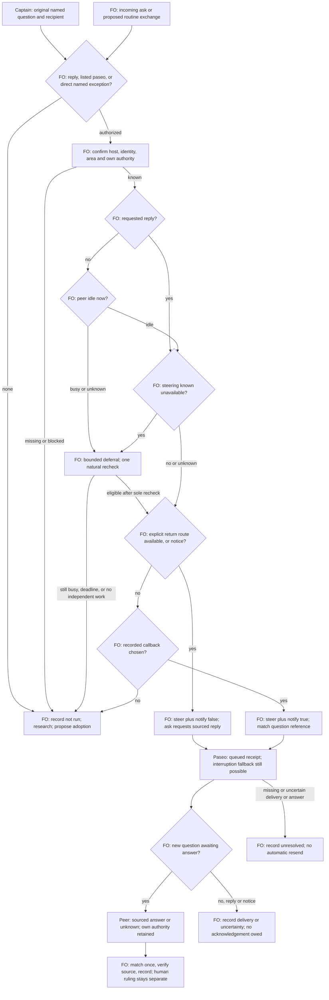

## Scope

- Source: interview round 004 finding (state .notes/fo-feedback/round-004.md, 2026-10-28), proposed by FO; the Captain chose theme B for batch 11 (「那就 B 可以」, chat, 2026-10-30), whose row named 「「沒列 paseo 就不能主動問」的規則跟實際做法矛盾」.
- Bite: all five interviewed FOs initiated Paseo asks with paseo unlisted and none recorded `peers not run`; qnow's Captain-directed ask had no compliant path; web did not know the clause existed; default sends steer into running peers and web received about 15 no-action finish notices on 2026-10-28.
- Upstream first: `extensions/peers/EXTENSION.md` § Paseo binding, `extensions/paseo/EXTENSION.md`, `references/sd/adoption.md`, Paseo `send_agent_prompt` defaults.

## Non-goals

- Changing Paseo; a hook that blocks sends.

## Budget

- One package PR to the peers and paseo extensions and adoption text; adopters' README listing follows through the normal sync.

## Stop condition

- Each round-004 event replays as allowed or as refused by a stated rule, with no FO left without a compliant path for a Captain-named ask.

## FO alignment

Alignment: needed before ideation; list paseo everywhere or relax the clause is the Captain's.
Result: aligned at backlog: the Captain 「對，全准且全確認」 (chat, 2026-10-30) to FO's batch-11 backlog sitting, which asked 「決定：六張全准進設計，並確認上面三件事？要改哪張直接說。」, approved the outcome and bounds in this file. List paseo everywhere or relax the clause stays his: ideation returns it as a decision at the ideation gate.
Surfaces: none
Visible change: none
Release review: not needed: workflow maintenance, on no journey map.
Reviewer: kc-dev-flow-2:chief-engineer opus 2026-10-30 — batch-11 review before the joint ideation sitting: approve, revise, split or hold each task, the Captain's decisions, overlap and order

## Design

### PRFAQ

**Proposition (not yet implemented).** A First Officer (FO, the workflow coordinator) can ask a confirmed Paseo peer for a fact without silently enabling a fleet policy or sending unwanted completion notices. A workflow that uses routine proactive Paseo cooperation explicitly selects paseo at adoption/sync; a direct Captain-named one-off question has a narrow path before that selection. Peer facts remain data and each recipient keeps its own authority.

**Who benefits?** The five FOs in feedback round 004, including qnow's Captain-directed relay question, and adopters that use Claude Code or bare Codex without Paseo. The integrated slice is selection/authorization → confirmed recipient → status-aware send → one matched answer or recorded fallback. It adds no timer, wrapper, send-blocking hook, runtime enforcement, paid experiment, deployment or recurring support obligation.

**Which choice?** Recommend explicit listing for routine outbound cooperation plus a direct one-off instruction exception. Compare the full relaxation below; neither is approved by this report. A package release cannot edit adopter lists. A normal sync must show and obtain the adopter's selection before routine asks use the extension. If declined or unanswered, ordinary asks remain refused; incoming replies and the narrowly named direct ask still work.

**Why not simply switch every adopter on?** The optional extension also selects the Paseo/Codex worker publication and local-review handoff. Installing it because an FO happens to run in Paseo would change that procedure without an informed choice. A sender's actual peer transport, not provider or worker transport alone, is the reason to recommend selection.

**Why quiet sends?** Use explicit replies for bounded fact questions, suppress receipt-only acknowledgements, and disable completion callbacks by default for peer exchanges. A deliberately recorded callback remains available if the explicit return route is unavailable. There is no promise that a requested reply will arrive, or that disabling callbacks guarantees no other notification. Worker completion notifications are unaffected.

### Upstream chain and current evidence

Read 2026-10-30, in this order: Spacedock's ensign shared/runtime contract and first-officer Codex runtime; kc-dev-flow-2 package; sibling adopters. Spacedock owns dispatch, worker completion, gates and state; its Codex adapter treats a final notification as a reason to verify durable state, not as proof of completion. This task changes none of it and never applies peer callback suppression to worker completion.

`git fetch origin` succeeded after sandbox access to FETCH_HEAD was granted. Current source is `origin/main` at **a6612948936a4f075625147b21aabd3b10b19eee**, released manifest **0.33.1**. The dispatched installed Codex package is `/Users/kent/.codex/plugins/cache/kc-claude-plugins/kc-dev-flow-2/0.33.1`; its scripts supply stage checks. Source targets are read through `git show <commit>:<path>`, not the unrelated colombo branch. The state baseline was d53e7ba458a161fb6845b28a742e5694db93a1e7; this task had Scope/alignment only, no prior stage report or PR recorded.

Current peers already owns taskless/bound-briefing notes, transport-based identity, incoming replies with explicit steer/false, original Captain-source checks and a five-minute ceiling with at most one natural recheck. Current paseo still requires explicit steer/true for new questions. Its existing worker procedure already addresses placement and FO publication; the round's worker sandbox complaints do not justify another implementation here. The gap is policy/adoption/send selection, not an absent messaging API. `lint-skills.py` checks extension tiers/template consistency; it does not intercept sends or inspect every adopter list. No new enforcement claim or parallel helper is proposed.

Paseo primary evidence: its own `/Users/kent/.agents/skills/paseo/SKILL.md` sections Connected hosts, Agents, Waiting and CLI semantics, plus this session's `send_agent_prompt` schema. Agent sends default to steer, may fall back to interrupt, return a queued receipt after scheduling, and default completion notification to true. `paseo send --help` was exercised: it exposes `--behavior` and `--no-wait`, but no explicit callback-disable flag. The proposal therefore uses the tool's `notifyOnFinish` parameter; it does not equate no-wait with no notification. No peer was contacted and no real delivery/default experiment was run.

Read-only adopter snapshots (local origin/main refs; not freshly fetched and not claimed as live remote state): relay `/Users/kent/conductor/workspaces/subspace-relay/beirut-dev2`, a448ea34391653fc71b0760c048f29c781fbe50a, `docs/dev2/README.md`: `[learn, peers, roborev, journey-map, release-acceptance]`; web `/Users/kent/conductor/workspaces/subspace-web/dev2-fo`, f2e1a4ccce8af1d9ab4ffb6591f8c84ff18d619a, same README: `[learn, peers, roborev]`; qnow `/Users/kent/conductor/repos/qnow-adopt-dev2`, 9cb4cf2c37d21f03918ddc9c50f2864f110b2524, `docs/dev2-poc/README.md`: `[roborev, codex, copilot, learn, peers, journey-map]`. All three still omit paseo in those snapshots. Round 004 is the source for project-env/ops-inbox and v0, not an independent current read. `gh pr list --repo iamcxa/kc-claude-plugins --state open ...` failed with `error connecting to api.github.com`; live PR inventory is unverified. No PR comment, peer message or adopter mutation occurred.

### Prior decisions and the one Captain choice

Architecture Decision Records (ADRs, durable repository decisions) 0035, 0038 and 0042 were read at the pinned main above. They remain Accepted there: required learn/peers and explicit optional selection; incoming versus proactive peer distinction and human authority; listed paseo's scoped Codex handoff. Filtered state `Override:` records contain no contrary peer-transport ruling. ADR 0038 deliberately rejected requiring Paseo for non-Paseo adopters and rejected deferring all requested replies to idle; retain both. The proposed one-off exception narrows its opt-in clause only upon a new Captain ruling; it is not inferred as already accepted. The root learning rule about words read at lifecycle moments governs the ledger below.

Verified ADR SHA-256 digests at a6612948936a4f075625147b21aabd3b10b19eee: 0035 `6d9b63ed7650183877ba0c5b8092565dfd0ddb36a58a1a37cd5ac6c47e6ed8a4`; 0038 `7006089c00c69a592dc4f21ae18af94e4a7c7b46ad1b7cb21cf0fce5ec805d4e`; 0042 `4f8603fd34f432392c6031be761c6cf3fe8c8bb37338e914b63865ab04cad4b4`.

| Captain choice | What works | What gets worse |
| --- | --- | --- |
| **Recommended: explicit listing for routine asks, direct named one-off exception** | Preserves optional policy and existing ADR direction; every named question has a bounded route; adopter sees the worker handoff before choosing | Adoption/sync work remains; no answer still refuses ordinary unsolicited asks; peers grows for an incoming-only user |
| Relax the clause for all authorized new asks over a confirmed Paseo transport | peers alone allows both incoming and proactive exchanges; no listing rollout needed for peer messaging | Reverses ADR 0038's optional proactive boundary; a required extension gains proactive scope; README table, fo-feedback prerequisites and adoption wording also need consistent revision; paseo remains optional for workers |

**Gate question:** Adopt the recommended listing policy, its direct one-off exception and quiet peer-send behavior as one policy? Approval must explicitly say it accepts this recommendation; an ideation report is not approval. These are coupled because without the exception an adopter awaiting selection still cannot carry out qnow's named ask, and listing changes which send policy is loaded. Under either option, retain existing source/authority and busy-peer boundaries. No additional material decision is hidden in test placement or prose.

If approved, implementation writes a new unnumbered-at-design ADR draft titled **“Routine Paseo peer asks use explicit adoption; named asks remain executable”**, citing the Captain's actual answer and the narrow relationship to ADR 0038. FO reserves its number at implementation dispatch; no ADR is written, numbered or silently rewritten now. No workflow word-budget raise is requested.

### Proposed text and loading boundaries

The following are reviewable replacement text, not installed rules. Keep the rest of peers unchanged, including shared authority, records, five-minute bound, Claude binding and Other host binding. Move the reusable Paseo send procedure into peers so a one-off direct ask need not load an unlisted extension. Replace paseo's pre-worker section with its selection/pointer text; retain `## Codex workers through Paseo` byte-for-byte. Add the adoption paragraph under `## Extensions`; adjust the existing optional-row label to point to it, preserving required defaults and unanswered-selection behavior.

<!-- candidate-peers-start -->
```markdown
## Paseo binding

Read Paseo's own paseo skill at the first exchange. Keep serverId with the full host-stamped agentId; confirm the destination through list_hosts. Identity does not prove area or authority. Keep a Captain-named peer; otherwise confirm area from a reply or task record. Never infer it from a title or broadcast. Claude probes and opening lines do not apply.

Answer incoming asks through Paseo without loading an unlisted extension. New routine asks require listed paseo. An original Captain instruction naming this outbound question and recipient authorizes that exchange without listing paseo; record its words, source, question and recipient before sending. A relayed quote or a general wish for cooperation is insufficient. This exception enables neither the extension nor worker dispatch, interview rounds or later asks. Otherwise record `peers not run: new Paseo ask requires the paseo extension`, research independently, and propose listing paseo at the normal adoption review.

For a new authorized ask or information-only notice, check status and send once only to an idle peer. A busy or unknown-status peer uses the five-minute deferral above. Requested answers may reach a running asker. Set `activeTurnBehavior: "steer"` explicitly and never select interrupt. Known unavailable steering defers even a reply; unknown capability or a status race still risks Paseo's interrupt fallback. These restrictions do not govern FO's own workers.

Set `notifyOnFinish: false` for routine peer asks, requested replies and information-only notices. An ask names its question reference and requests one explicit sourced reply to the confirmed return address; a notice requests no acknowledgement. Check the return host route first. If unavailable, use independent research or record a specifically chosen completion callback with `notifyOnFinish: true`; match it to that question. A receipt, unrelated finish or duplicate is not an answer. Preserve an unanswered or uncertain exchange in the existing record; never infer success or resend automatically. Use the tool exposing both flags; CLI `--no-wait` is not proof that callbacks are disabled.

When paseo is listed, read [paseo](../paseo/EXTENSION.md) for its additional policy. No missing capability, direct instruction or queued receipt supplies authority to change another project's work.
```
<!-- candidate-peers-end -->

<!-- candidate-paseo-start -->
```markdown
# paseo extension

Optional dev2 policy for initiating cooperation inside the fleet.

Requires: peers

Enable through the adopter's explicit extension choice when routine peer asks use Paseo. The Captain's board, labels and gates remain outside this extension. Basic incoming replies and a Captain-named one-off outbound exchange use peers without enabling paseo.

Use peers' Paseo binding for identity, status, send flags, replies, records and recovery; read Paseo's own skill for current host capabilities. Missing skill or capability records peers not run and uses its fallback. Listing paseo also selects the Codex worker procedure below when that host/provider case applies; disclose that effect during adoption. It grants no publication or merge authority.

```
<!-- candidate-paseo-end -->

<!-- candidate-adoption-start -->
```markdown
For a workflow whose confirmed peer transport is Paseo, recommend selecting paseo for routine outbound asks; show its Codex worker handoff effect with the choice. Do not auto-select it from the model, installed tools or a worker transport. No answer preserves the adopter's list. A Captain-named one-off outbound exchange follows peers without enabling paseo; recurring interview rounds still require fo-feedback and paseo with their separate grants.
```
<!-- candidate-adoption-end -->

An unlisted generic information-only notice is a new exchange, not an incoming answer. A same-question factual correction/addendum can be a requested answer only while it actually answers that question; an unrelated new request is not a reply. The send record identifies that relation. A Captain-directed action request still conveys a request to the recipient, not authority to execute the action in its repository. Ordinary content never overrides a bound gate or peer-session approval hold.

### Sequence and stops



The deferral node is one bounded episode per exchange, never a loop resetting the deadline. A recheck with known unavailable steering ends in the unsent/fallback record, not another deferral. Informational notices end after delivery evidence/uncertainty and request no answer. A duplicate callback or unrelated completion cannot enter the sourced-answer branch. Diagram rendering/semantic readback evidence is recorded below.

### Round-004 replay

Replay rule names below are local explanations, not new stored identifiers: **selection** means listed paseo or the original named one-off grant; **source** means identity/area and original authority evidence; **send** means status/explicit flags/bounded deferral; **record** means task or state note and question-matched result. “Allow after selection” is prospective, not retroactive compliance. Reports of events are operator evidence; omitted flags/unknown identity/status stay unknown, not assumed compliant.

| Round section and each reported event | Verdict under proposed rule and correction/limit |
| --- | --- |
| project-env peers 1 / paseo 1–2: Captain-requested 0.13.2 share to Bridge, waiting for idle; no task | Allow direct named share if original recipient/question source is retained; send quiet notice, record in `.notes/peer-exchanges.md`. No automatic selection. |
| project-env peers 1: docs-staleness need to another FO | Refuse new unsolicited ask while unlisted unless its own named grant is available; allow after selection. Receiving the answer is allowed. |
| project-env peers 2: no task record for share; docs exchange only in local-ext/doc-site.md | Refuse as complete record under current rule; state note holds taskless share and links checked docs evidence. A document elsewhere is not the required state record. |
| project-env peers 3: relayed “dogfood” quote → direct Captain question → “試” | Allow verified fact/direct authority path; refuse treating the relayed quote alone as authorization. |
| project-env peers 4 / paseo 3: Bridge stayed running awaiting Captain, 60-second polling loop | Refuse polling; at most one natural recheck, five-minute ceiling, stop earlier without independent work. Retain the non-interruption intent. |
| project-env paseo 1,4: round 3/004 replies, including running asker with steer | Allow requested answers with explicit steer/false and capability caveat; unknown prior flags are not a pass. |
| ops-inbox peers 1,3: qnow first-adopter review, period-boundary fact, D7 | Allow requested review answer and verified contract fact; new originating ask needs selection/grant. Workers still use their FO. |
| ops-inbox peers 1,4: vault question to relay inferred from name, steered into running turn | Refuse guessed area and known-busy new question. Captain later names project-env: use confirmed named destination and bounded send. |
| ops-inbox peers 2: relayed C2–C6 Captain quotations | Allow as marked data; refuse action authority without accessible originals or direct confirmation. |
| ops-inbox peers 2: no `Peer:` lines, exchanges in task sections | Allow Paseo identity/source/task record if complete; Claude's `Peer:` probe format is not required for Paseo. |
| ops-inbox peers 2: several vault questions bundled | Refuse under the one-question rule unless a separately authorized interview bundle applies; split ordinary questions. |
| ops-inbox peers 4: v1 landing notices owed but held behind go-live | Allow keeping them unsent under the authority hold; a notice is not permission to go live. Durable notice tracking policy belongs to a separate task. |
| ops-inbox paseo 1: proposed enabling still open; future relay emitter cooperation | Refuse ordinary new asks before selection; a direct named question is allowed; neither grants emitter changes or go-live. |
| ops-inbox paseo 2–4: status checks, flags only for replies, default steering, no deferral used | Require both flags for each permitted exchange; known busy/unknown status defers. No event using deferral is no evidence of compliance; a blocking wrapper is out of scope. |
| relay peers 1,3: room-menu facts, action kinds, shell gate, path correction, #186 merge facts | Allow requested answers/verified facts; fresh proactive questions require selection/grant. Verify cited commit before changing design; never equate a peer claim with repository truth. |
| relay peers 1–2: new tasks from relayed “A＋C...” ruling; alignment pending | Allow pending intake/data; refuse marking alignment approved from the relay. Original Captain confirmation remains necessary. |
| relay peers 4: “waits on your merge” after merge, stale token authority line, receipt-only acknowledgements | Refuse stale claim as checked fact; peer-status-reaches-fresh owns refreshing/reporting policy. Quiet informational notices request no acknowledgement. |
| relay paseo 1: ideation/implementation/research workers created through Paseo | Allow only under their existing dispatch contract, not the peers rule; callback suppression here must not affect workers. |
| relay paseo 2–4: wrong cwd/root, /tmp staging/invisible terminal, missing explicit mode, about 20 approvals | Refuse calling that valid placement/visible handoff under existing worker policy. Upstream worker placement and paseo-human-surfaces-visible-and-reachable own repair; approvals are observations, not new authority to widen sandbox. |
| qnow peers 1–2,4: Captain-directed relay mockup-review question while unlisted | Allow the exact named question with original grant, sourced return path and state record; no extension auto-enable. This resolves the reported no-compliant-path case. |
| qnow peers 1–2: Bridge incoming design-before-code answer plus addendum | Allow answer and same-question clarification; unrelated new ask/addendum requires selection/grant. Missing task/state note refuses recording completion. |
| qnow peers 3: search zh/en before holiday task; duplicate deployment task created without search | Allow search/reuse; refuse new duplicate without search. Captain-authorized deletion is separate authority, not a peer remedy. |
| qnow paseo: reused designer through passes 1–5f; 3–5 approvals/pass; overwrite caught | Allow authorized worker reuse/checks under upstream dispatch; no new peer send policy governs it. Preserve evidence file; do not treat fewer approvals as proof of safety. |
| web peers 1,3: “relay needs no change”, source checks, corrected sequencing risk | Allow sourced exchange, refuse unchecked no-change claim; new asks need selection/grant. Existing commit verification retained. |
| web peers 1–2: v0 ADR reservation checks, hold on tagging, taskless check unrecorded | Allow authorized read-only check/hold; record taskless exchange in state note; no permission to tag or alter a reservation follows. |
| web peers 2–3: relayed quotes in task, Review backlog approval | Allow marked relayed data and separately verified human approval; refuse relayed quote as direct ruling. |
| web peers 4: stale remaining-work line after #186; suggestion for as-of | Refuse stale line as current checked fact; timestamp/refresh choice stays with peer-status-reaches-fresh. |
| web paseo 1–2: all new asks sent while unlisted; no flags or `peers not run` | Refuse ordinary new asks before selection, allow after explicit selection with both flags. Unknown past grants remain unknown. |
| web paseo 4: about 15 no-action finished notices | Refuse making each finish an answer or a new Captain reply duty; proposed routine false removes that callback request, with no measured delivery reduction claimed. |
| Round's own disclosure: interview bundles from unlisted maintainer, defaults; web deferred while busy | Refuse recurring interview sends until fo-feedback and paseo prerequisites/grants hold; preserve valid idle deferral. A one-off question exception is not an interview-adoption loophole; historical early-round trial authority must be evaluated against its exact grant, not rewritten here. |
| Evidence comparison: counts, two-sided stale status, observer absent, unchanged cadence anchor | Allow as bounded operator evidence, refuse promotion to native runtime proof/observer verdict; no backfill, new cadence or retrospective compliance is authorized. |

### Words FO reads at each lifecycle moment

Measure with `len(text.split())`, including headings/fenced inline syntax, on pinned base versus exact candidate text above. This is a policy repair, **not a claim that every moment gets shorter**. Count shared passages every time a cold reader needs them; do not hide text by moving it between files. No script, generated dispatch text, hook or script output changes in this design. Full host skill wording is an unchanged addend; paths below identify it explicitly. Actual runtime output length and conversation reading time are not measured.

<!-- reading-ledger -->
The unchanged primary host reading is 607 words: Paseo's own skill sections Connected hosts, Agents, Waiting and CLI semantics. For the conservative cold-read route ledger below, count the entire peers file and, when listed, the entire paseo file (including worker policy even when not used), plus those host sections. This deliberately avoids claiming a reduction by excluding the moved text. An adopter that already cached a passage may read less; that is not measured.

| Route read at any moment | Base policy + host | Proposed policy + host | Change |
| --- | ---: | ---: | ---: |
| Incoming answer, paseo unlisted | 1412 | 1567 | +155 |
| New ordinary ask, paseo unlisted: refused before and after | 1412 | 1567 | +155 |
| Captain-named outbound, paseo unlisted: old refusal → bounded send | 1412 | 1567 | +155 |
| Listed paseo exchange, full files | 1974 | 1949 | -25 |
| Adoption decision only, new paragraph in addition to existing adoption text | existing adoption corpus | same corpus +66 | +66 |

The common control-text corpus was then measured by executing package 0.33.1's shipped scratch fixtures (`test_pr_watch.TasksTests` and `test_delivery_gate.DeliveryGateTests`) with fake GitHub/Spacedock responses, never a live message. The full measurement program is retained below. Baseline and design run the same scripts because this proposal changes none; its static candidate blocks supply the changed peer load. Current fixture script exits were 0, including delivery_gate's successful path. Initial measurement attempts used an incomplete gate fixture and exited 2/1; those were repaired before these figures and are not green delivery evidence.

| Lifecycle moment and matched fixture | Base without exchange → design without exchange | Base with listed exchange → design with listed exchange | Complete measured addends, words |
| --- | ---: | ---: | --- |
| Startup, one open PR with pending checks | 442 → 442 | 2416 → 2391 | pr-merge startup 365 + dev2 mod 48 + tasks output 29 |
| Idle, open ready PR, pending checks become green | 672 → 672 | 2646 → 2621 | pr-merge idle 100 + mod 48 + Delivery authority section 488 + tasks 29 + wait 7 |
| Idle, merged PR missing observer, then committed report | 1021 → 1021 | 2995 → 2970 | idle 100 + mod 48 + Delivery authority 488 + full learn extension 280 + wait 17 + tasks refusal 68 + rerun 20 |
| After archive, committed observer reaches learn handoff | 371 → 371 | 2345 → 2320 | mod 48 + full learn extension 280 + after-pr-merge output 15 + observer_check output 28 |
| Merge ask, synthetic docs-only candidate matches dispatch | 1003 → 1003 | 2977 → 2952 | Delivery authority 488 + full Extensions section 451 + wait 7 + successful delivery_gate output 57 |
| Adoption / sync choice, no send | existing adoption corpus → same +66 | first exchange adds its appropriate route row | exact proposed paragraph 66; existing selection/probe text is unchanged |

These are reproducible **control-text fixture totals up to the next worker/learn handoff**, not a measurement of an entire live FO session or of model-authored observer reports/learn notices. The latter are unchanged inputs with variable lengths; no saving is claimed for them. Full source sections are deliberately counted even where the scenario uses only part. Use the incoming/unlisted route row instead of +1974/+1949 when that event occurs: +1412 before, +1567 after. Startup does not newly load all optional extensions. The design accepts +155 for an unlisted exchange and +66 at adoption; it claims neither a universal reduction nor a measured reduction of the ~15 notices. Validation reruns this ledger at the shipped candidate and includes any added instruction-bearing output or newly due passage.

Reproduce the changed-load numbers without a machine-specific helper: Python 3 standard library, the repository containing base commit a6612948936a4f075625147b21aabd3b10b19eee, this task file, and the active Paseo skill path are the declared inputs. The exact scratch program below prints the policy counts; the host addend above was measured on the named installed skill and must be recounted if that skill changes.

```python
import re, subprocess, sys
from pathlib import Path
repo, task = sys.argv[1:3]
base = "a6612948936a4f075625147b21aabd3b10b19eee"
text = Path(task).read_text()
def old(path):
    return subprocess.check_output(["git", "-C", repo, "show", base + ":kc-dev-flow-2/" + path], text=True)
def draft(name):
    block = text.split("<!-- candidate-" + name + "-start -->", 1)[1].split("<!-- candidate-" + name + "-end -->", 1)[0]
    return block.split("```markdown\n", 1)[1].rsplit("```", 1)[0]
p = old("extensions/peers/EXTENSION.md")
x = old("extensions/paseo/EXTENSION.md")
newp = p.split("## Paseo binding")[0] + draft("peers") + "\n## Other host binding" + p.split("## Other host binding", 1)[1]
newx = draft("paseo") + "## Codex workers through Paseo" + x.split("## Codex workers through Paseo", 1)[1]
for label, before, after in [("peers", p, newp), ("paseo", x, newx), ("listed total", p+x, newp+newx)]:
    print(label, len(before.split()), len(after.split()))
print("adoption added", len(draft("adoption").split()))
```

### Design-stage verification receipts

`design_surfaces.py check` from the dispatched 0.33.1 package printed `peers-paseo-rule-matches-practice.md: design surfaces presentable` (exit 0). The embedded draft recount ran with Python 3 (exit 0): peers 805 → 960, paseo 562 → 382, listed total 1367 → 1342, adoption paragraph 66. The primary host addend is 607. The following fixture instrument produced the five control-text totals above; it uses only the declared package's test helpers and standard library, and all Git mutations occur in its disposable fixture repositories. Run `python3 -B <extracted-program.py> <kc-dev-flow-2-package-root> <spacedock-plugin-root>`; install neither plugin nor optional extension as part of this check.

```python
import sys, importlib.util, subprocess, json, re
from pathlib import Path
P=Path(sys.argv[1]); SD=Path(sys.argv[2])
spec=importlib.util.spec_from_file_location('fixtures',P/'scripts/test_pr_watch.py')
m=importlib.util.module_from_spec(spec);spec.loader.exec_module(m)
f=m.TasksTests();f.setUp()
out={}
try:
 f.readme('learn, peers, paseo');
 (f.workflow/'README.md').write_text((f.workflow/'README.md').read_text().replace('entity-type: task','entity-type: task\ntrunk: main'))
 f.task('some-task',pr='o/r#7')
 for label,args in [('tasks-pending',m.view()),('tasks-green',m.view())]:
  if label=='tasks-pending':args['statusCheckRollup']=[{'status':'IN_PROGRESS','conclusion':None}]
  code,lines=f.tasks({'pr view 7':args});assert code==0,(code,lines);out[label]='\n'.join(lines)
 wait=m.PrWatchTests()
 for label,snap in [('wait-green',m.snap()),('wait-merged',m.snap(state='MERGED'))]:
  wait.run_main(['add','o/r#1'],[m.snap(checks='pending')],f.root/(label+'.json'))
  code,o=wait.run_main(['wait','1'],[snap],f.root/(label+'.json'));assert code==0;out[label]=o
 code,lines=f.tasks({'pr view 7':m.view('MERGED')});assert code==0;out['tasks-missing']='\n'.join(lines)
 f.report('some-task');code,lines=f.tasks({'pr view 7':m.view('MERGED')});assert code==0;out['tasks-rerun']='\n'.join(lines)
 out['after-lines']='\n'.join(l for l in lines if l.startswith('after pr-merge:'))
 (f.state/'_archive').mkdir();f.git(f.state,'mv','some-task.md','_archive/some-task.md');f.git(f.state,'mv','some-task','_archive/some-task');f.git(f.state,'commit','-qm','archive')
 d=subprocess.run([sys.executable,'-B',str(P/'scripts/observer_check.py'),str(f.state),'some-task'],capture_output=True,text=True);assert d.returncode==0,d.stdout;out['observer-archived']=d.stdout
 gs=importlib.util.spec_from_file_location('gatefixtures',P/'scripts/test_delivery_gate.py')
 gm=importlib.util.module_from_spec(gs);gs.loader.exec_module(gm)
 code,o=gm.DeliveryGateTests().check()
 assert code==0,(code,o)
 out['gate']=o;out['gate-exit']=str(code)
 def sec(t,h):return h+t.split(h,1)[1].split('\n## ',1)[0]
 wf=(P/'references/sd/workflow.md').read_text();mod=(P/'references/sd/mods/kc-dev-flow-2.md').read_text();pm=(SD/'mods/pr-merge.md').read_text()
 stat={'startup-hook':sec(pm,'## Hook: startup'),'idle-hook':sec(pm,'## Hook: idle'),'mod':mod,'authority':sec(wf,'## Delivery authority'),'extensions':sec(wf,'## Extensions'),'learn':(P/'extensions/learn/EXTENSION.md').read_text()}
 w=lambda x:len(x.split())
 total=lambda st,ot:sum(w(stat[k]) for k in st)+sum(w(out[k]) for k in ot)
 rows={
 'startup':total(['startup-hook','mod'],['tasks-pending']),
 'idle-open':total(['idle-hook','mod','authority'],['tasks-green','wait-green']),
 'idle-merged':total(['idle-hook','mod','authority','learn'],['wait-merged','tasks-missing','tasks-rerun']),
 'after-archive':total(['mod','learn'],['after-lines','observer-archived']),
 'merge-ask':total(['authority','extensions'],['wait-green','gate']),
 }
 result={'static-words':{k:w(v) for k,v in stat.items()},'output-words':{k:w(v) for k,v in out.items() if k!='gate-exit'},'common-totals':rows,'outputs':out}
 # JSON is printed below; no persistent output path is required.
 print(json.dumps(result,indent=2))
finally:f.doCleanups()
```

Mermaid 11.16.1 rendered the current diagram in a fresh temporary headless Chrome context through Playwright 1.62.1: 19 nodes, SVG 49,465 bytes, exit 0. The initial sandbox browser launch failed; the authorized local render retry succeeded. Disposable outputs are `/private/tmp/peers-practice.svg` and `.png`; the durable source is the Mermaid block in this task. Those cached render dependencies are local tooling, not a repository runtime dependency: a fresh reviewer supplies those declared versions and a supported browser and renders this block. Visually inspected actors/order, both authorization stops, single deferral, notification choice, and separate reply/notice versus question exits. No agent spawn, message or network-send proof follows from a rendered diagram.

### Batch overlap

Proposed implementation files: `kc-dev-flow-2/extensions/peers/EXTENSION.md` (Paseo binding); `kc-dev-flow-2/extensions/paseo/EXTENSION.md` (pre-worker selection/send text); `kc-dev-flow-2/references/sd/adoption.md` (Extensions choice paragraph); one new `docs/adr/<reserved-number>-routine-paseo-peer-asks-use-explicit-adoption.md` after a Captain ruling. No executable checker, script, workflow template, CI trigger or global default changes. Tests are behavioral policy replay plus the package's existing routing/lint checks; do not invent a string-pinning test as proof of model compliance. The adoption wording keeps fo-feedback's two-extension requirement, so its EXTENSION.md and package README table remain accurate.

Adopter follow-through, separately approved normal syncs after a published package: relay and web `docs/dev2/README.md`, qnow `docs/dev2/README.md` if adopted plus derived `docs/dev2-poc/README.md` (or its sole POC README), and project-env/ops-inbox/v0's confirmed workflow README paths at that time. These are a rollout proposal, not this worker's writes or already authorized selection. Reuse the current `poc_readme.py` derivation path; never hand-maintain two workflow variants. This workflow already has paseo from the earlier scoped adoption and needs no duplicate selection.

Read-only overlap snapshot, 2026-10-30; new batch files currently contain their admitted scope/alignment, so their eventual exact paths may still change:

| Other live task (slug retained for FO routing) | Same file/check or shared index; ordering |
| --- | --- |
| batch10-after-release-obligations (post-release evidence and repairs) | No direct package file overlap: dispatch_records/laws_check, laws pin and native proof. Its adopter README refresh can share rollout ordering; do not mark those proofs satisfied by this policy. |
| names-check-says-what-it-skipped (dispatch diagnostics) | No direct overlap: dispatch_records.py/tests/laws consumer. Same eventual package release; no new script output introduced here. |
| peers-paseo-rule-matches-practice (this peer policy) | Owns the three files and future ADR listed above; only this state entity is writable now. |
| peer-status-reaches-fresh (current peer facts) | Direct overlap: peers and paseo files, exchange records and their replay cases. Land this send/selection contract first, then status freshness; freshness may use its quiet notice policy but must not force new unsolicited broadcasts. |
| model-roster-per-repo (role model settings) | Direct potential overlap: paseo worker policy, peers pointers and adoption.md; shared ADR directory if it records a ruling. This task preserves worker section bytes; rebase/recount after whichever lands first. |
| paseo-human-surfaces-visible-and-reachable (visible terminals/tabs) | Direct overlap: paseo EXTENSION.md worker/surface guidance; keep its worker changes separate from peer callback behavior. Recount the full-file ledger after it lands. |
| adoption-asks-which-extensions (historical extension checks) | Despite its old slug, narrowed design changes dispatch_records.py, number_guards.py, their tests and laws.md; no adoption.md edit is currently proposed. Do not reopen adoption defaults here. |
| adr-required-statement (ADR terminal evidence) | No extension-file overlap; shared `docs/adr/` reservation namespace and eventual ADR/report checks. Respect its current validation ownership. |
| adr-silent-undo-probe (ADR refactor experiment) | No file/check overlap; uses its archived harness and fictional scenario, no package changes. |
| comment-check-reaches-delivery-gate (comment evidence) | No file overlap: delivery_gate.py/tests/validation principles. Its future check may apply to implementation, not a reason to amend it now. |
| journey-canvas-hosted-poc (hosted canvas trial) | No direct overlap: journey hosting artifacts; shared ADR namespace only if its direction later creates one. |
| journey-server-host-pilot (private server contract) | No direct overlap: kc-journey-map server/adapters and its own ADR; current validation remains independent. Shared ADR namespace only. |
| ops-inbox-r1-setup-and-isolation (ops event intake) | No extension-file overlap: kc-ops-inbox files/workflow; shared ADR namespace. Its held relay/qnow notices remain behind its go-live authority. |
| pr-review-lite-value-pilot (bounded PR-review trial) | No direct overlap: kc-pr-flow review capability; preserves its candidate and experiment ownership. Shared ADR namespace only if new records are proposed. |

Recommended order: settle this Captain choice before interpreting fresh-status notices; implement this send-policy edit, then peer-status freshness; serialize/rebase paseo edits from model-roster and human-surfaces tasks and recount the full file. Dispatch diagnostics/post-release checks and other-session work can proceed independently. FO reserves any ADR number across all concurrent writers. After release, each adopter reviews its selection and normal sync; no task completion implies those syncs happened. Recheck live file/PR ownership before implementation because GitHub inventory was unavailable here.

## Acceptance criteria

**AC-1 — Choice and adoption remain explicit.** Evidence: implementation's exact-base/candidate replay for listed, unlisted, declined, no-answer, missing host capability and non-Paseo cases records rule, disposition and loaded files; adopter list bytes remain unchanged until a separately approved sync. Required learn/peers and fo-feedback prerequisites remain. Falsifier: presence of Paseo tools silently enables paseo, no-answer adds it, or an unlisted routine ask sends. Current: source/adopter observations and proposed wording only; implementation and adoption unverified.

**AC-2 — Captain-named outbound question has a usable bounded path.** Evidence: replay qnow's named relay question with original grant, confirmed recipient, idle status and return route while paseo is unlisted; expected one send with steer/false, one linked record and no extension/worker-policy activation. Repeat with relayed quote, different recipient, different question and an action beyond scope: refuse those authority substitutions. Falsifier: qnow's exact case still has no compliant path, or its grant authorizes unrelated future questions. Current: design replay permits the named case; no native send performed.

**AC-3 — Busy-peer and notification behavior is explicit.** Evidence: exercise policy replay against the current host tool schema for idle/new, busy/new, running/reply, known-unavailable steer, unknown capability, status race, return-route failure, duplicate/irrelevant finish and no answer. Log intended call arguments and stops; routine calls request false, one declared callback exception true; worker completion remains unchanged. Falsifier: implicit flags, explicit interrupt, recurring polling, deadline reset, no-wait treated as notify false, unrelated finish counted as answer, or silent failure counted as success. Current: tool/help observations and event table only; host delivery/interruption and callback reduction unverified. A future native check needs FO's authorized bounded recipients; no automatic test peer or live sends are authorized here.

**AC-4 — Every round-004 event has a stated disposition.** Evidence: independent reviewer maps each numbered answer, unnumbered qnow worker answer, round disclosure and evidence-comparison row to the replay table above, with source/unknown limits. Compare base and chosen candidate; preserve good source-checking, task search and pending-authority cases. Falsifier: omitted event, historical noncompliance relabelled approved, worker complaints claimed fixed by this rule, or stale peer status treated as current. Current: design table covers the recorded sections; originals in peer sessions and independent replay remain unverified.

**AC-5 — Reading cost is measured at the point of use.** Evidence: run the embedded recount against pinned base and candidate draft/shipped text; list every loaded passage and instruction-bearing output at startup, idle/open, idle/merged, archive, merge ask and adoption. Reproduce the measured common addends on matched fixtures before quoting control-text totals; include model-authored downstream output separately if claiming an entire-session total. Proposed changed-load budget: unlisted peers +155, listed full policy -25, adoption +66; source or scope changes require recount, not silent acceptance. Falsifier: counting only paseo's shrinkage, excluding moved peers text, hiding changed script output, or presenting the symbolic totals as measured runtime totals. Current: draft counts and five matched control-text lifecycle fixtures measured; live-session totals and notification reduction unmeasured; no universal reduction claimed.

**AC-6 — Existing orchestration and decision ownership survive.** Evidence: at exact candidate, run shipped `design_surfaces.py check` on this task, repository `lint-skills.py`, applicable existing `test_lint_skills.py` and `test_sd_dispatch.py --sd-plugin-root <declared active SD root>`; compare worker section, workflow template, required defaults and fo-feedback prerequisite bytes against base. Render the final Mermaid and inspect branches against prose. Reserve/write the new ADR only after the explicit ruling; no adopter/state frontmatter changes in this ideation. Falsifier: missing artifact/AC, disabled worker completion, changed worker handoff/host default without scope, or guessed ADR number. Current: design-stage check/render receipts below; candidate implementation tests/ADR not yet run or written.


## Stage Report: ideation

- DONE: A design for making the peers rule on new Paseo asks match practice, comparing listing paseo in adopters whose peers run inside Paseo against relaxing the clause, including default steer and finish-notice behaviour and a Captain-named outbound ask; each round-004 event in .notes/fo-feedback/round-004.md replayed as allowed or refused by a stated rule; the choice returned as a Captain decision with a recommendation
  Design compares both options; recommends explicit routine selection plus direct named one-off exception, explicit steer/false and one deliberate callback escape; round table maps every recorded section without retroactive compliance.
- DONE: A `### Batch overlap` section naming each file the design would change and each other batch task (batch10-after-release-obligations, names-check-says-what-it-skipped, peers-paseo-rule-matches-practice, peer-status-reaches-fresh, model-roster-per-repo, paseo-human-surfaces-visible-and-reachable) and live task of other sessions (adoption-asks-which-extensions, adr-required-statement, adr-silent-undo-probe, comment-check-reaches-delivery-gate, journey-canvas-hosted-poc, journey-server-host-pilot, ops-inbox-r1-setup-and-isolation, pr-review-lite-value-pilot (driven by other sessions; read only)) that changes the same file or check, so FO can order implementation
  Three extension/adoption paths plus future reserved ADR; direct shared edits with status/model/surface tasks, all named siblings classified, adopter sync separate; no sibling changed.
- DONE: The words FO reads at each lifecycle moment, before and after, per root learning.md "Measure the words FO reads at each moment, not one file's size"
  Embedded recount and shipped scratch fixtures ran exit 0: listed-exchange startup 2416→2391, idle/open 2646→2621, idle/merged 2995→2970, archive 2345→2320, merge ask 2977→2952; unlisted policy +155 and adoption +66, with corpus/output limits stated.
- DONE: Acceptance criteria with reproducible evidence clauses and falsifiers, and unresolved decisions for the Captain, each with a recommendation and what gets worse under it
  Six criteria separately name evidence/falsifiers; one coupled policy decision returns to Captain, with adoption effort, worker-policy effect and increased unlisted reading disclosed.
- DONE: AC-1 design evidence and limit
  Pinned 0.33.1 source plus read-only relay/web/qnow refs confirm the list gap; future selection replay fails on auto-enable or unsolicited unlisted send; candidate/adopter behavior not verified.
- DONE: AC-2 design evidence and limit
  Proposed named-question rule permits qnow's exact reported case; falsifiers substitute relayed authority, recipient or question; no native send performed.
- DONE: AC-3 design evidence and limit
  Live tool schema and exercised CLI help expose steer/default callbacks and no callback-disable CLI flag; omitted flags, deadline reset or unrelated finish fail the proposed replay; delivery behavior remains unverified.
- DONE: AC-4 design evidence and limit
  Round-004 table covers five FOs, worker complaints, interview disclosure and evidence limits; an omitted event or retroactive authorization fails it; peer-session originals and independent replay not read/run.
- DONE: AC-5 design evidence and limit
  Draft recount and five routine control-text fixture counts executed; eight installed measurement inputs match pinned main bytes; falsifier is hidden moved text/output; complete live-session totals and notification savings remain unmeasured.
- DONE: AC-6 design-stage evidence and implementation limit
  design_surfaces.py check: "peers-paseo-rule-matches-practice.md: design surfaces presentable", exit 0; current Mermaid rendered/visually read (19 nodes); original 55 lines/frontmatter preserved; no product test, ADR reservation or adoption performed.
- SKIPPED: Live GitHub pull-request inventory and native peer-send trial
  gh pr list failed "error connecting to api.github.com"; dispatch prohibits other-session messages. Existing native defaults are documented, not experimentally certified here.

### Summary

Pilot ideation only: the design, Mermaid, full event replay, reproducible word ledger, six acceptance criteria and overlap ordering are in this entity. Recommendation awaits the Captain; package code, adopter READMEs and task frontmatter remain unchanged, and no implementation, live delivery or rollout is claimed. This state-only report must be path-scoped committed/synced before handback; FO retains gate and implementation dispatch ownership.
