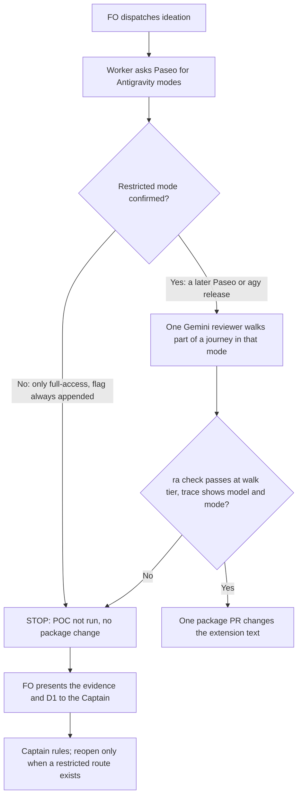

## Scope

- Source: the Captain, chat 2026-11-02: 「挑剔使用者應該要可以改，甚至使用 gemini 的模型」. Batch 12 sitting: the Captain 「可以」 (chat, 2026-11-02), answering 「決定：多開「完成通知」和「挑剔使用者可用 Gemini」兩張票，先前五件事照建議，可以嗎？」.
- Bite: `extensions/release-acceptance/EXTENSION.md` says reviewers run "on different Claude models", so a Gemini reviewer is outside its words, though `release_acceptance.py` reviewer `model` is free text.
- Consumer: the next release walk in a repository listing release-acceptance; subspace-relay lists it (read 2026-11-02).
- First a POC, before any package text changes: one Gemini reviewer through Paseo's `antigravity` provider, in a restricted mode, walks a small part of an existing journey and returns a report that `release_acceptance.py` accepts. If it cannot, stop and return that to FO.
- If it can: the extension text stops naming one family and says a non-Claude reviewer is launched through Paseo with an explicitly chosen mode. The choice stays in the task's `Reviewers:` field, not the model roster.
- Antigravity's Paseo default mode is `full-access`; the trial must not use it. FO's standing rule: never `--dangerously-skip-permissions` with agy.
- Upstream first: `extensions/release-acceptance/EXTENSION.md`, `release_acceptance.py`, Paseo `antigravity` provider and its modes, `kc-team-ops` gemini skill.

## Non-goals

- Gemini as a stage worker, FO or special role; proving two models find different things; changing the design director's model rule.

## Budget

- One package PR changing the extension text, after the POC. Workflow word budget unchanged.

## Stop condition

- The POC's report passes `ra check` at its walk tier and its trace shows the requested model and restricted mode; or the task stops with that evidence and no package change.

## FO alignment

Alignment: needed before ideation; the scope is the Captain's ruling.
Result: aligned at backlog: Batch 12 sitting: the Captain 「可以」 (chat, 2026-11-02), answering 「決定：多開「完成通知」和「挑剔使用者可用 Gemini」兩張票，先前五件事照建議，可以嗎？」, approved the outcome and bounds in this file.
Surfaces: none
Visible change: none
Release review: not needed: workflow maintenance, on no journey map.

## Design

**Ruling: the POC did not run and the task stops under its own stop condition, with no package change.** Paseo offers Antigravity one mode, `full-access`, and that mode is the one Scope forbids. No restricted Antigravity mode was confirmed through Paseo or through `agy` alone.

### PRFAQ

**Proposition, once a restricted route exists:** a release walk may list a Gemini picky reviewer in `Reviewers:`, launched through Paseo in an explicitly chosen restricted mode, and its report passes `ra check` (`release_acceptance.py`) like any other.

**Today:** that route does not exist, so a walk's reviewers stay as the extension's words say, on different Claude models.

- **Does the checker block a Gemini reviewer?** No. A fixture walk with `antigravity/gemini-4-argon-high` as one reviewer's `model` printed `tier walk: ok`. The block is the launch, not the report.
- **Can Paseo be configured out of the flag?** Not by configuration. A custom provider's `command` becomes `launch.args`, and `driverArgs` appends `--dangerously-skip-permissions` after them in every case.
- **Would dropping the flag be enough?** No. `agy` with no flag and no mode reported `permission_mode always-proceed` and ran `touch` unprompted. Never passing the flag holds the standing rule but buys no restriction by itself.
- **Is `--mode plan` the restricted mode?** Not confirmed. It wrote only a plan file and made no change in the workspace, but it also reported `always-proceed`, it ran `ls -la`, and no tool refusal was seen, so this may be the model holding back rather than enforcement. Whether it lets a reviewer operate a product through the browser tools is untested.
- **Is `--sandbox` the restricted mode?** Not confirmed. In one run it refused `touch` in the workspace and allowed `touch` in a sibling temp folder. Archived `worker-knows-the-team-and-asks-early` validation-2 reports writes outside the workspace failing, on `--mode auto` without `--sandbox`; the two runs are different setups and are not reconciled here.

### Evidence (2026-11-02; Paseo 0.14.0, agy 1.4.12)

| Question | Command or source | Result |
|---|---|---|
| Modes Paseo offers | `list_providers` and `inspect_provider antigravity`; `getCatalog` in the app's `builtin-plugins/antigravity-provider/server/internal/catalog.ts`; `paseo.sh/docs/supported-providers.md` | `full-access` only, also the default |
| Can the flag be removed | `driverArgs` in `.../internal/process.ts`; `paseo.sh/docs/custom-providers.md` | Appended unconditionally after `launch.args` |
| Models Paseo offers | `list_models antigravity` | 13, including `gemini-4-argon-{low,medium,high}` and `gemini-3.8-flash-{low,medium,high}` |
| Other Paseo routes to Gemini | `list_models omp`; `which gemini`; supported-providers ACP catalog | OMP: 234 models, none Gemini (Gemma only). Gemini CLI is in the ACP catalog but not installed, and `kc-team-ops` gemini skill records it as discontinued for consumer tiers |
| `agy` under the real HOME | 9 `--print` runs across plan, default, accept-edits and sandbox | All timed out with empty output; the two with event output showed 0 turns, status `SUCCESS` and exit 0. Same cause archived in `worker-knows-the-team-and-asks-early`: unauthenticated MCP servers |
| `agy` with no MCP servers | 7 runs, `gemini-3.8-flash-low`, one each, temporary HOME linking `~/.gemini` with an empty MCP config | Answers; results above. n=1 per case |
| Checker | `build_world` from `test_release_acceptance.py`, one reviewer's model changed, `ra check --tier walk`, at origin/main 146727ded | Exit 0, `reviewers: 2 (models: 2)` |

Limits: `--dangerously-skip-permissions` was never passed by this task and no Paseo Antigravity agent was started. Paseo's own launch under the real HOME was therefore not tested, and may hit the same MCP timeout. Not tried: `agy --settings` permission keys, and browser tools under any mode. No record of the Captain's 2026-10-25 one-walk exception (Codex plus Antigravity on kc-paseo-plugins, in `gpt-partner-extension-proposal`) was found on this host, so whether that walk ran, or in what mode, is unknown. The temporary HOME linked the real `~/.gemini/antigravity-cli`, so these 7 conversations remain in its history; the temporary folders are deleted.

### Existing-code check

Upstream order checked: Spacedock has no provider or reviewer-launch mechanism for this. kc-dev-flow-2's `release-acceptance` already accepts the model string, and `REVIEWER_KEYS` refuses a separate `provider` key, so the string carries the provider and no script change is owed. Sibling evidence is the archived `agy` replays above; for the mechanism itself this design read Paseo's plugin source and docs and `agy --help`. A local Paseo plugin or wrapper that strips the flag is not proposed: it works around a provider's stated limit and, per the no-flag run, would not restrict anything.

### Words FO reads at each moment

| Moment | Source | Base | Stop route | If later reopened |
|---|---|---|---|---|
| Startup, idle, merge ask, after the archive | workflow README and scripts | unchanged | 0 | 0 |
| Filing and first implementation of an acceptance task | `extensions/release-acceptance/EXTENSION.md` | 600 | 600, delta 0 | 611, +11: drop "Claude", add "A non-Claude reviewer is launched through Paseo with an explicitly chosen mode." |

`references/sd/workflow.md` carries no such text, so the workflow word budget is unchanged on either route.

### Unresolved decisions for the Captain

- **D1: Accept the stop?** Recommended: yes. Close with no package change, and FO adds this evidence to `gpt-partner-extension-proposal`, where the Captain placed multi-model work and the Gemini extension idea. Reopen when Paseo offers a non-skip Antigravity mode that a test shows refusing a write. **What gets worse:** the next release walk's words stay Claude-only, so a blind spot two Claude models share stays untested (ADR 0033 records this limit), and 「挑剔使用者應該要可以改，甚至使用 gemini 的模型」 stays undelivered for Gemini. Other options:
  - Run `full-access` in an isolated workspace: not recommended, it is what Scope and FO's standing rule forbid, and a reviewer holds environment identities while every tool call runs unprompted.
  - Launch `agy --mode plan` directly: not through Paseo, enforcement and browser use unproven, and it needs the no-MCP HOME.
- **D2: The first half of his sentence, "可以改", without Gemini?** Recommended: FO asks whether to file a separate task; this task stays stopped, since Scope ties the text change to the Gemini POC. Paseo's Codex provider lists non-full-access modes, and `gpt-partner-extension-proposal` records another FO launching Codex picky users through Paseo on 2026-10-24, but no Codex reviewer's report or mode enforcement was checked here. **What gets worse:** one more small task in the queue, or, if declined, the extension's words stay narrower than practice already seen.
- **D3, owed only on reopening: does a non-Claude reviewer bump `release-acceptance/v1`?** ADR 0033 says "Reopen when a reviewer on another provider is added (a `release-acceptance/v1` bump)", while the field table does not change for a free-text `model`. Recommended: amend the ADR with no version bump. **What gets worse:** a reader of a report tells the provider only from the model string.

### Batch overlap

Stop route: this design changes no file or check. If reopened: `extensions/release-acceptance/EXTENSION.md` and an ADR 0033 follow-up, which takes one number from the shared ADR index.

| Task | Same file or check | Effect |
|---|---|---|
| worker-completion-reaches-fo-on-paseo | none: `extensions/paseo/EXTENSION.md` | None |
| model-roster-question-needs-both-families | none: reviewer choice stays in `Reviewers:`, not the roster | None |
| special-roles-follow-the-model-table | none: its D4 leaves this extension alone; director model is a non-goal here | None |
| second-round-prompts-a-step-back | none | None |
| validation-gate-requires-the-question-check | none | None |
| adoption-asks-which-extensions | none: extension list, not this extension's text | None |
| adr-required-statement | ADR index, on reopening only | Index |
| adr-silent-undo-probe | none: its file does not mention this extension | None |
| comment-check-reaches-delivery-gate | none: its own table lists none | None |
| journey-canvas-hosted-poc | none | None |
| journey-server-host-pilot | not live: found under `_archive` only | None |
| ops-inbox-r1-setup-and-isolation | none | None |
| pr-review-lite-value-pilot | none | None |

Recommended order: no implementation to order under the stop route; if reopened, after batch 12, as its own task.

## Acceptance criteria

**AC-1** Paseo offers Antigravity no restricted mode. Verified by, on the installed app: `grep -c 'id: "' /Applications/Paseo.app/Contents/Resources/builtin-plugins/antigravity-provider/server/internal/catalog.ts` prints 1 with `id: "full-access"`, and `grep -c -- '--dangerously-skip-permissions' .../internal/process.ts` prints 1 inside `driverArgs`; or `inspect_provider antigravity` lists only that mode. Falsifier: a Paseo release adding a second mode or making the flag conditional fails this, and the task returns to FO to run the POC in that mode.

**AC-2** This task changes no package file. Verified by: `git log origin/main --oneline --grep=picky-reviewers-may-run-on-gemini -- kc-dev-flow-2` prints nothing, `gh pr list --repo iamcxa/kc-claude-plugins --state all --search picky-reviewers-may-run-on-gemini` prints nothing, and `git show origin/main:kc-dev-flow-2/extensions/release-acceptance/EXTENSION.md | grep -c 'different Claude models'` prints 1. Falsifier: any such commit or PR, or that line gone through this task.

**AC-3** The checker needs no change to accept a Gemini reviewer later. Verified by: `build_world` from `test_release_acceptance.py`, one reviewer's `model` set to `antigravity/gemini-4-argon-high`, then `release_acceptance.py check <folder> --tier walk --workflow-dir <wf>` exits 0 with `reviewers: 2 (models: 2)`. Falsifier: a model allowlist or a provider-specific refusal makes it exit non-zero. Bound: this proves the report shape only; no Gemini reviewer produced that report.

## Stage Report: ideation

- DONE: A design for this task's Scope; run the POC only with a restricted Antigravity mode you have confirmed, and report the modes Paseo offers
  POC not run: Paseo offers only `full-access` and `driverArgs` always appends the skip flag; `--mode plan` and `--sandbox` not confirmed as restrictions. `## Design` holds the stop route, the evidence and the conditions to reopen.
- DONE: A `### Batch overlap` section naming each file the design would change and each other batch task (worker-completion-reaches-fo-on-paseo, model-roster-question-needs-both-families, special-roles-follow-the-model-table, second-round-prompts-a-step-back, validation-gate-requires-the-question-check, picky-reviewers-may-run-on-gemini) and live task of other sessions (adoption-asks-which-extensions, adr-required-statement, adr-silent-undo-probe, comment-check-reaches-delivery-gate, journey-canvas-hosted-poc, journey-server-host-pilot, ops-inbox-r1-setup-and-isolation, pr-review-lite-value-pilot (driven by other sessions; read only)) that changes the same file or check, so FO can order implementation
  No file changes on the stop route; on reopening, one extension file and the shared ADR index. journey-server-host-pilot is archived, not live.
- DONE: The words FO reads at each lifecycle moment, before and after, per root learning.md "Measure the words FO reads at each moment, not one file's size"
  Delta 0 at every moment on the stop route; `EXTENSION.md` 600 to 611 only if reopened.
- DONE: Acceptance criteria with reproducible evidence clauses and falsifiers, and unresolved decisions for the Captain, each with a recommendation and what gets worse under it
  AC-1 to AC-3 below; D1 accept the stop, D2 "可以改" without Gemini, D3 version bump on reopening.
- DONE: AC-1 Paseo offers Antigravity no restricted mode
  Verified today: both greps print 1 and `inspect_provider` lists only `full-access`. Fails if a Paseo release adds a mode or makes the flag conditional.
- DONE: AC-2 This task changes no package file
  Verified today: 0 commits, 0 PRs, and the `different Claude models` line count is 1. Fails on any such commit or PR.
- DONE: AC-3 The checker needs no change to accept a Gemini reviewer later
  Verified on a fixture at origin/main 146727ded: exit 0, `reviewers: 2 (models: 2)`. Fails if a model allowlist is added; proves report shape only, no Gemini reviewer ran.
- DONE: `design_surfaces.py check`
  `picky-reviewers-may-run-on-gemini.md: design surfaces presentable`, exit 0.

### Summary

The POC did not run and the task stops under its stop condition with no package change, because Paseo's only Antigravity mode is the one Scope forbids. The new fact for the Captain: headless `agy` reports `always-proceed` even with no flag, so never passing the flag does not by itself restrict a reviewer. The checker already accepts a Gemini model string, so the launch is the only block found; browser operation under any restricted mode is untested.
