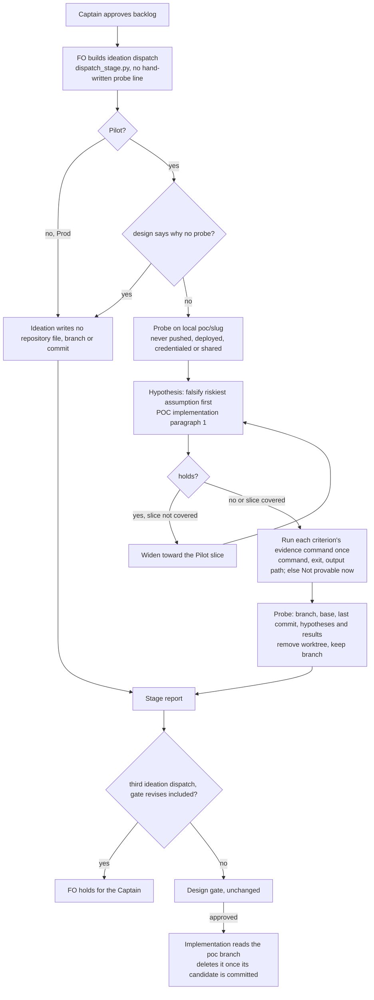

## Scope

- Source: the Captain 「開」 (chat, 2026-11-13), answering FO's item 「要不要開「Pilot 流程改動」的任務（你上一則問的後續，我建議開，拆成先進套件的和維持逐批授權的兩段）。」, after his 「那接下來要怎樣才能改？目前的證據顯示進步了多少？可以說品質也有進步，因為更早開始迭代嗎？」 (chat, 2026-11-13). His standing priority (chat, 2026-11-12): Pilot is too heavy; POC stays; Pilot may share POC's stages with its own bars; Prod stays rigorous.
- Outcome, the first of the two parts FO proposed: on the five-stage Pilot route, the ideation worker may build a throwaway working probe on a local branch that is never pushed, runs it on the real cases the task names, runs each acceptance criterion's evidence command once on it and records command, exit and saved output, and lists what cannot be run under a "Not provable now" heading the Captain sees at the design gate. The design gate stays as it is.
- Evidence (FO's hand-kept logs of 2026-11-12 and 2026-11-13, two rounds, ten small package tasks chosen by FO): with a probe in ideation, 0 of 7 built tasks changed design or a criterion after approval; without one, 2 of 2 did; one task ended in 15 minutes when its probe showed the premise was already fixed. Not shown: any gain in time from dispatch to merge (none was measured), fewer defects in what is delivered (not measured; two counterexamples recorded), or anything about tasks with ui, db or more than one component.
- What exists: the released workflow says ideation writes no repository file, branch or commit; the POC workflow has no ideation stage; the Worth questions (0.39.0) and the existing-chain check (0.40.0, ADR 0083) already cover need, upstream and cheaper-way; FO has carried the probe permission and the proof-run wording by hand in ten dispatch records.
- Open for the design: the exact words that replace the ideation write ban and what bounds the probe (local only, never pushed, no deploy, no credential, no shared environment); whether the probe is allowed, expected, or expected unless the worker says why not; where the probe's branch and commit are recorded and when the branch is removed; what the change deletes or shortens so the workflow does not only grow, with the word counts before and after.
- Non-goals: the second part FO proposed, which stays a per-batch grant from the Captain: the same worker continuing from ideation into implementation; FO recording the design gate when no stop fired; any change to Prod or to the POC workflow; a contract probe for tasks with more than one component (a separate proposal).

## Budget
1 implementation and 2 validation cycles, in one package PR.

## Stop condition
- An ideation dispatch built from the candidate text carries the probe permission and the proof-run requirement with no hand-written line from FO, and a replay of two of the ten recorded dispatches shows it. Return to the Captain if the design cannot name what it removes, or if it needs to touch the design gate, Prod or the POC workflow.

## FO alignment

Alignment: not needed before ideation: his words admit the first part and name the second as staying with him; the wording is ruled at the design gate.
Surfaces: none
Visible change: none
Release review: not needed: workflow maintenance, on no journey map.
Reviewer: kc-dev-flow-2:engineering-reviewer not run 2026-11-13: amendment 2 replaces only the evidence command of AC-3 with the pattern the independent validator ran and recorded in validation-1 (finding F1); the criterion's statement and falsifier are unchanged and no approved behaviour is withdrawn.

## Captain amendments

### Amendment 1 — 2026-11-13, chat
Captain: 「可以，要同時加入預算與計時機制，我看目前你 X implementiation + Y valdiation cycle 方式還不錯」 (chat, 2026-11-13), after his 「我想知道是否可做成 pilot 就是在設計階段跑 poc 流程，就是假設->驗證->擴大方案->假設->驗證->... 等於 pilot 會某種程度上復用 poc proile 的東西，而 prod 就是復用 piliot 的東西，但是更多一些部署，維護承諾等等考量，這是你現在的方向嗎？」 (chat, 2026-11-13)
Asked: 「有一件事現在就可以順手做：那張設計中的任務，我可以把你這段話原文交給設計 worker，要它把措辭設計成「引用 POC 的規則」而不是另寫一套，這樣第 3 步之後會省很多。這不改任務範圍，只是多一個設計方向。要不要這樣做由你決定。」
Supersedes: none

### Amendment 2 — 2026-11-13, host question dialog
Captain: 「改指令、查原因、修文字、再驗（建議）」 (host question dialog, 2026-11-13)
Asked: 「#864（Pilot 設計階段先做試作）第一次驗證被退回，有兩個發現，要怎麼處理？我建議修完再驗一次。兩個發現會一起決定剩下那一次驗證怎麼用，所以放在同一題：一、第三條驗收條件的檢查指令寫錯了（會把檢查工具「成功」的訊息也當成重複），成品其實符合條件，驗證者用正確的指令跑過；要你同意把指令改成只算失敗訊息。二、驗證者找了一個沒有背景的 worker 讀新版派工：它確實先做試作才寫設計，而且發現那張任務的前提已不成立；但三條驗收條件裡有一條沒照規定記下指令、結束代碼和輸出位置。同意即接受：用掉預算裡最後一次驗證；第二次觀察也只是一個 worker 跑一次，再不過我就停下來回到你這裡。」
Supersedes: AC-3
Superseded text:

**AC-3** The ideation write ban has one home: `skills/ideation/principles.md` no longer states it, `KNOWN_DUPLICATES` no longer lists it, and lint reports no repeat. Evidence: `accept.sh AC-3`; exit 0; `evidence/ideation-1/out/AC-3.log`. Falsifier: `test_the_known_overlap_is_listed_and_a_new_one_is_not` (an ideation copy in another principles file is refused); red on the probe only from the budget, green with a raise step (`evidence/ideation-1/test_lint_skills.with-temp-raise.log`).

### Feedback Cycles

- Cycle 1 (FO, 2026-11-13): validation-1 on #864 head f0e00d30c recommended REJECTED with two findings. F1 Needs decision (kind evidence or form): AC-3's approved evidence command counts lint's own success line as a repeat and exits 1 on a conforming candidate; settled by Captain amendment 2, statement unchanged, command corrected. F2 assessed Material and owned (kind build, pending investigation): one history-free test subject built a probe before its design but recorded command, exit and output path for two of its three criteria only, so AC-8 is not met as written; under Captain amendment 2 the implementation worker first investigates without changing the candidate, FO then authorises a repair of the wording, and validation-2 observes again; a second rejection stops the task.

## Design

### PRFAQ

**Pilot designs are tried before they are written.** From the next kc-dev-flow-2 release, the
ideation worker of a Pilot task builds a throwaway probe of the outcome on a local branch, runs
every acceptance criterion's evidence command on it once, and hands the Captain a design that says
what the probe showed, what it lacks, and which criteria could not be run yet (`Not provable now`).
FO no longer hand-writes that instruction into each dispatch; the workflow text carries it. Prod
ideation and the POC route are unchanged, and the design gate is the same gate.

- **Who reads what?** FO reads 66 more README words at startup. The Pilot ideation worker reads them
  in its dispatch's stage definition, plus a `## Probe` section in the Pilot ideation reference that
  points at one paragraph of POC implementation instead of restating it.
- **What is a probe round?** One ideation dispatch. The worker's own hypothesis → check → widen loop
  inside a dispatch is not counted, as an implementation cycle does not count a worker's internal
  retries. The released timeline helper already counts ideation dispatches and times the ideation
  stage (AC-7); it does not print each round's own start, end or result (D4).
- **What does it not prove?** That tasks reach merge faster or ship fewer defects (FO's ten-task
  trial measured neither), or anything about ui, db or multi-component tasks.

### Before building: the existing chain

- **Spacedock 0.27.3** (plugin cache, read 2026-11-13): no ideation probe concept. A stage's
  `worktree: true` creates the `spacedock-ensign-<slug>` branch that implementation reuses and pushes,
  so turning it on for ideation would put probe commits on the delivery branch; rejected.
- **kc-dev-flow-2 0.41.0** (origin/main 88f86f27): `### ideation` and `skills/ideation/principles.md`
  both state the write ban (lint-skills.py `KNOWN_DUPLICATES` lists it as "awaiting a decision on
  which copy survives"). ADR 0005 states the ban and rejected "a throwaway worktree for ideation — it
  creates a branch per task". `poc_readme.py derive` drops the whole `### ideation` section, so the
  POC workflow cannot see an edit there (AC-2). `replay_dispatch.py` rebuilds a closed task's dispatch
  at any package ref (used for AC-1). `task_timeline.py` (0.40.0) times each ideation dispatch;
  `role_triggers.py` budget (0.39.0, ADR 0077) counts implementation and validation only.
- **Sibling adopters** (read-only, 2026-11-13): 3 of 3 adopter dev2 READMEs carry the ban
  unchanged; 0 of 3 carry an ideation probe.

### Worth questions

- **Probe permission and bounds.** Serves 「Pilot 的設計階段可以在本機分支做一個不推送的拋棄式試作」 (FO's backlog
  question, which he approved with 「進設計階段（建議）」).
  Without it FO hand-writes 184 words (142 checklist, 42 scope notes) into every Pilot ideation
  dispatch, measured in two of the ten trial records. Premise that would make it unneeded: workers
  already probe under the released text. Cheap test: the base control dispatch (AC-1) carries the ban
  and no permission.
- **Proof run and `Not provable now`.** Serves 「每條驗收條件當場跑一次並記下指令和結果，跑不了的列在「現在無法證明」」
  (the same approved backlog question).
  Without it, the design gate sees future proof plans, which principles.md already says are not
  passed results. Unneeded if the stage report already demands runs: it asks only for "actual current
  evidence or an honest not-yet-verified statement" (principles.md, base).
- **Reuse POC's loop by pointer** (amendment 1). Serves 「pilot 會某種程度上復用 poc proile 的東西」.
  Without it a second set of proof rules is written into Pilot. Unneeded if POC has no proof rule:
  it does, the first paragraph of `skills/implementation/profiles/poc.md` (43 words).
- **Round count and timing** (amendment 1). Serves 「要同時加入預算與計時機制」. Without it probe rounds
  have no bound. Unneeded if rounds were already counted and timed: dispatches are counted and the stage
  is timed (AC-7), but no per-round time is printed.

### What the probe showed

`Probe:` branch `poc/pilot-ideation-runs-a-probe-before-the-design`, worktree
`.worktrees/poc-pilot-ideation-runs-a-probe-before-the-design` under the workflow checkout, base
88f86f2749dadb6f4ef0cf9aa089c1827096865b, commits 154b8e543 then 70f701063292a5c20bfa891214c4c9280b70342e
(last), local only; diff in `evidence/ideation-1/probe.diff`. Five files: `references/sd/workflow.md`
(`### ideation`), `skills/ideation/principles.md`, `skills/ideation/profiles/pilot.md`,
`skills/implementation/profiles/pilot.md`, `scripts/lint-skills.py` (`KNOWN_DUPLICATES`).

- H1 held: words in `### ideation` reach a dispatch built by the package's own builder, with FO's line
  stripped from both trial records' inputs; the origin/main control shows the ban (AC-1).
- H2 held: the POC workflow derived from the candidate equals the base one (AC-2).
- H3 held: the ban's principles.md copy and its `KNOWN_DUPLICATES` entry go, with no repeat finding (AC-3).
- H4 failed: the README rises 66 words (6033 to 6099); lint's exact budget refuses it (AC-4), so a
  raise needs the Captain's words.
- H5 partly held: the released timeline helper reports ideation `dispatches 2, repeats 1` and the
  stage's start and end for a task with two ideation dispatches (AC-7; its `--json` has no per-dispatch
  times, and that task's second dispatch was a design-gate revise). For a one-dispatch trial task it
  shows one span (`evidence/ideation-1/timeline-pr-watch.txt`): rounds inside a dispatch are invisible
  to it, and each round's own end and result are not printed.
- H6 narrowed: pointing at both POC files added 336 words to the worker's skill reading; pointing at
  the one POC implementation paragraph adds 135 (commit 70f70106).

What it lacks for the Pilot bar: no live worker has run from the candidate text (only the built
dispatch was checked); `test_lint_skills.py` is red on the probe (47 tests, 8 failing results counting
subtests), all from the word budget: with a temporary raise step in a throwaway export all 47 pass
(`evidence/ideation-1/test_lint_skills.probe.log`, `test_lint_skills.with-temp-raise.log`), so no test
file changes; the third-dispatch hold and the branch deletion are prose with no script;
the README raise has no recorded ruling; no ADR file (implementation writes it after FO reserves the
number).

### What the change deletes or shortens

- FO's hand-written probe text per Pilot ideation dispatch: 184 words to 0 (AC-5 inputs).
- `skills/ideation/principles.md`: the duplicated ban sentence, 681 to 660 words, and the
  `KNOWN_DUPLICATES` entry that held the open "which copy survives" question.
- A restated proof rule in Pilot: avoided by pointing at POC implementation's first paragraph.
- Nothing in `references/sd/workflow.md` can be removed by this change: it grows 66 words. Returned to
  the Captain as D5.

### Words read at each moment (root learning.md "Measure the words FO reads at each moment")

Counter: whitespace split, as lint-skills.py's budget; base origin/main 88f86f27, candidate 70f70106;
`evidence/ideation-1/out/AC-5/words-by-moment.json`.

| Moment | Base | Candidate | Change |
| --- | --- | --- | --- |
| FO startup and resume (whole README) | 6033 | 6099 | +66 |
| FO builds a Pilot ideation dispatch: words FO writes for the probe | 184 (trial) / 0 (released) | 0 | −184 / 0 |
| FO ideation gate preparation, idle, merge ask, archive | unchanged | unchanged | 0 |
| Pilot ideation worker: stage definition in its dispatch | 632 | 698 | +66 |
| Pilot ideation worker: skill text (SKILL.md, principles, pilot.md, POC file pointed to) | 1169 | 1304 | +135 |
| Pilot ideation worker, per dispatch total | 1985 (trial) / 1801 (released) | 2002 | +17 / +201 |
| Pilot implementation worker: profiles/pilot.md | 47 | 62 | +15 |

### Decisions for the Captain

- **D1. Is the probe allowed, expected, or expected unless the worker says why not?** Recommended:
  expected unless the design says why not (the probe's wording). Worse: a worker can skip with one
  sentence; "allowed" would let the habit fade; "expected" always forces a probe on doc-only tasks.
- **D2. Bounds.** Recommended as admitted: local branch only, never pushed or deployed, no
  credential, no shared environment. Worse: a probe that needs a seam it cannot reach goes under
  `Not provable now` rather than being tried.
- **D3. Where the branch is recorded and when it goes.** Recommended: a `Probe:` line in the design
  (branch, base, last commit, hypotheses and results); the ideation worker removes the worktree and
  keeps the branch; the implementation worker deletes the branch once its candidate is committed.
  Evidence: 8 of 10 trial tasks made a probe branch, all 8 are still present, 0 worktrees remain, and
  all 7 built ones were named in their implementation dispatch. Alternatives: FO deletes at archive
  (more README words, touches Delivery authority); no rule (branches accumulate). Worse: a design
  that never reaches implementation leaves its branch (1 of 8 today), and an unpushed branch cannot
  be read by an implementation worker on another machine or in a cloud workspace; a saved diff in the
  task folder (as `evidence/ideation-1/probe.diff` here) is the portable copy, at a few more words.
- **D4. Probe rounds and budget.** Recommended: a round is one ideation dispatch, counted by the
  released `task_timeline.py` (`dispatches`, which ADR 0080 counts by highest plain record number,
  gate revises included); FO holds a third ideation dispatch for the Captain, revises included, and
  the 0.39.0 default applies (keep results, report remaining work, stop adding). Each round's result
  is its stage report; its start is the commit adding its dispatch record, which the helper reads but
  does not print per dispatch.
  The `N implementation and M validation cycles` form cannot carry it unchanged: `budget_bound`
  reads only those two stages and `DIAGNOSIS_RECORD` matches only implementation and validation.
  Alternatives: (b) extend the form to `N ideation, N implementation and M validation cycles` and
  count ideation in `role_triggers.py` (a new grammar, but a per-task bound the script FO runs at
  each boundary enforces; ADR 0077 names this reopen condition: "countable fixed forms cannot express
  an approved outcome's bound"); (c) `at most N dispatches total` already counts ideation records but drops
  the split he likes. Worse under the recommendation: a fixed cap of two in prose, not checked by a
  script, and a task the Captain sent back twice gets one more question; per-round times need a
  `task_timeline.py` change in either option.
- **D5. README raise of 66 words (6033 to 6099).** Recommended: raise, loaded at FO startup and
  resume and in each Pilot ideation dispatch's stage definition. Worse: FO reads 1.1% more at every
  startup. Alternative: move the round sentence (15 words) to the skill; then FO does not read the
  cap it must apply.
- **D6. ADR.** Recommended: one new ADR, short title "Pilot ideation builds a throwaway probe on a
  local branch", superseding ADR 0005's ideation write-ban clause and its rejected "throwaway worktree
  for ideation" option for Pilot only; no number here (FO reserves it). Worse: ADR 0005 is read
  together with the new one.
- **D7. POC's loop has no "widen" step.** POC implementation falsifies one assumption and POC returns
  its outcome for the next planning decision. Recommended: keep "widen toward the slice and check the
  next" in the Pilot pointer (11 words), no POC text change. Alternative: add a widen sentence to POC
  text, a POC workflow change outside this task's Non-goals.

### Batch overlap

Files the design would change: `kc-dev-flow-2/references/sd/workflow.md` (`### ideation`),
`kc-dev-flow-2/scripts/lint-skills.py` (`KNOWN_DUPLICATES` and one `WORKFLOW_BUDGET_STEPS` step),
`kc-dev-flow-2/skills/ideation/principles.md`, `kc-dev-flow-2/skills/ideation/profiles/pilot.md`,
`kc-dev-flow-2/skills/implementation/profiles/pilot.md`, one new ADR under `docs/adr/` (number index).

- merge-ask-is-produced-from-records, validator-commands-fit-the-delivery-check,
  ready-pr-gets-a-codex-code-review-without-fo-noticing, evidence-is-declared-public-before-state-publication
  (backlog): none of these files named in their task files.
- agent-messages-are-english (backlog): names no file of these; may later touch worker skill text.
- adr-required-statement (other session, validation): changes `references/sd/workflow.md`
  § Decision records and its own `WORKFLOW_BUDGET_STEPS` step, and lands an ADR: same README budget
  count and ADR number index.
- comment-check-reaches-delivery-gate, adoption-asks-which-extensions (other sessions, ideation):
  both state no `workflow.md` edit and no budget step; no overlap.
- adr-silent-undo-probe, journey-canvas-hosted-poc, journey-server-host-pilot,
  ops-inbox-r1-setup-and-isolation, pr-review-lite-value-pilot: none of these files.

Recommended order: adr-required-statement merges first; this task recounts the README budget on top
of it and takes the next ADR number.

## Acceptance criteria

Run on the probe: `REPO=<workflow checkout> CAND=70f701063292a5c20bfa891214c4c9280b70342e BASE=origin/main
STATE=<state checkout> SD=<spacedock binary> SDROOT=<spacedock 0.27.3 plugin root>
INPUTS=evidence/ideation-1/inputs bash evidence/ideation-1/bin/accept.sh <AC> <out dir>`; at
implementation, CAND is the candidate head. Paths below are under `pilot-ideation-runs-a-probe-before-the-design/`.

**AC-1** A Pilot ideation dispatch built by `replay_dispatch.py` (which runs `spacedock dispatch build`) from two trial records (pr-watch-tasks-foreign-worktree, new-work-checks-what-exists-first) with FO's probe line removed carries the probe permission, its bounds, the proof-run requirement, `Not provable now` and the round rule; the same inputs at origin/main carry the old ban and none of them. Evidence: `accept.sh AC-1`; exit 0; `evidence/ideation-1/out/AC-1.log` and `out/AC-1/*.worker-sees.txt`. Falsifier: the origin/main control arm, which prints `ban-only`.

**AC-2** The POC workflow is unchanged: `poc_readme.derive` of the candidate README equals that of origin/main. Evidence: `accept.sh AC-2`; exit 0; `evidence/ideation-1/out/AC-2.log` (`poc derived equal`). Falsifier: an edit outside `### ideation` prints `poc derived DIFFER`.

**AC-3** Amended by Captain, amendment 2. 把指令改成只算失敗訊息。 The ideation write ban has one home: `skills/ideation/principles.md` no longer states it, `KNOWN_DUPLICATES` no longer lists it, and lint reports no repeat. Evidence: `evidence/implementation-1/bin/accept.sh AC-3 <output>`, which counts only lint lines matching `^FAIL:.*repeats`; exit 0; `evidence/validation-1/AC-3-corrected.log`. Falsifier: `test_the_known_overlap_is_listed_and_a_new_one_is_not` (an ideation copy in another principles file is refused), and a copied ban exits 1 (`evidence/validation-1/mutation-AC-3-duplicate-ban.log`).

**AC-4** `lint-skills.py` passes, the README rising by the raise step that carries the Captain's quoted words and loaded moment. Evidence: `accept.sh AC-4`; exit 1 on the probe; `evidence/ideation-1/out/AC-4.log` (66 words over). Not provable now: see below.

**AC-5** FO's startup reading rises by at most 66 words, and the stripped trial inputs hold no FO probe line. Evidence: `accept.sh AC-5`; exit 0; `evidence/ideation-1/out/AC-5.log` and `out/AC-5/words-by-moment.json`. Falsifier: a README longer than 6099 words exits 1.

**AC-6** The dispatch contract suite passes on the candidate. Evidence: `accept.sh AC-6`; exit 0 (second run; the first exported only `kc-dev-flow-2/` and the suite stopped on a missing `docs/adr`, a harness defect fixed in `accept.sh`); `evidence/ideation-1/out/AC-6/test_sd_dispatch.log`.

**AC-7** The released timeline helper counts each ideation dispatch as a round and times the ideation stage. Evidence: `accept.sh AC-7` on the archived task adr-reserved-when-design-names-one; exit 0; `evidence/ideation-1/out/AC-7/timeline.txt` (`ideation: … dispatches 2, repeats 1`).

**AC-8** A live Pilot ideation worker dispatched from the candidate with no FO probe line builds a probe and writes command, exit and output path beside each criterion. Not provable now.

**AC-9** An implementation worker deletes the `Probe:` branch once its candidate is committed. Not provable now.

### Not provable now

- AC-4: needs the Captain's quoted words for the raise (D5); expected to pass once the step exists.
- AC-8: needs a live worker run; validation can run one replay with a worker through `replay_dispatch.py`
  (one model run).
- AC-9: needs an implementation run after release.
- Each round's own start, end and result printed by the timeline helper: not printed today (D4).
- FO holding a third ideation dispatch (D4): prose only; observable only when a third is due.
- The claimed benefit (fewer design changes after approval): FO's ten-task trial counted 0 of 7 with a
  probe and 2 of 2 without; not measured on this change.

## Number guards

ADR: 0084

## Stage Report: ideation

- DONE: The Captain admitted this task to be designed the way it proposes (his words are in the backlog gate record). So first build a throwaway probe of the outcome on a local branch poc/pilot-ideation-runs-a-probe-before-the-design in a worktree you create under the workflow checkout's .worktrees/ from origin/main: the candidate words in kc-dev-flow-2/references/sd/workflow.md and the ideation skill that replace the ideation write ban, bound the probe, and require each criterion's proof to be run once with a 'Not provable now' list; commit it locally, never push, no PR. Then build two ideation dispatches from the probe with the package's own dispatch builder, replaying two of the ten recorded trial dispatches (their records are in this state checkout under the archived trial tasks' dispatch folders, for example the ideation-1 record of pr-watch-tasks-foreign-worktree), and show the built dispatch carries the permission and the proof-run requirement with no hand-written FO line; save what it showed in the task folder. Then write the design as what the probe showed and what it lacks. Decide and justify, as options for the Captain with a recommendation and what gets worse: whether the probe is allowed, expected, or expected unless the worker says why not; the probe's bounds (local only, never pushed, no deploy, no credential, no shared environment); where its branch and commit are recorded and when the branch is removed. State what the change deletes or shortens, with word counts before and after per root learning.md; if nothing can be removed, say so and return that to the Captain. Stay out of the design gate's authority, Prod, the POC workflow, same-worker continuation and contract probes. For every acceptance criterion, run its evidence command once on the probe and write the exact command, its exit and the saved output path beside it; a criterion that cannot be run now goes under 'Not provable now'
  Probe 70f70106 on local poc branch (unpushed); replay of 2 trial records via replay_dispatch.py: candidate `carries`, origin/main control `ban-only` (AC-1); D1–D3 and deletions in `### Decisions for the Captain` and `### What the change deletes or shortens`; README cannot shrink (D5).
- DONE: A `### Batch overlap` section naming each file the design would change and each other batch task (merge-ask-is-produced-from-records, validator-commands-fit-the-delivery-check, ready-pr-gets-a-codex-code-review-without-fo-noticing, evidence-is-declared-public-before-state-publication, agent-messages-are-english (all in backlog, not dispatched)) and live task of other sessions (adoption-asks-which-extensions, adr-required-statement, adr-silent-undo-probe, comment-check-reaches-delivery-gate, journey-canvas-hosted-poc, journey-server-host-pilot, ops-inbox-r1-setup-and-isolation, pr-review-lite-value-pilot (driven by other sessions; read only)) that changes the same file or check, so FO can order implementation
  Only adr-required-statement shares the README budget and ADR index; recommended order: it first.
- DONE: The words FO reads at each lifecycle moment, before and after, per root learning.md "Measure the words FO reads at each moment, not one file's size"
  FO startup 6033→6099; FO-written probe words per Pilot ideation dispatch 184→0; other FO moments 0; worker rows in the table.
- DONE: Acceptance criteria with reproducible evidence clauses and falsifiers, and unresolved decisions for the Captain, each with a recommendation and what gets worse under it
  AC-1 exit 0 (out/AC-1.log); AC-2 exit 0 (out/AC-2.log); AC-3 exit 0 (out/AC-3.log); AC-4 exit 1, budget +66 (out/AC-4.log), Not provable now; AC-5 exit 0 (out/AC-5.log); AC-6 exit 0 on second run after a harness fix (out/AC-6/test_sd_dispatch.log); AC-7 exit 0 (out/AC-7/timeline.txt); AC-8, AC-9 Not provable now. D1–D7.
- DONE: Captain amendment 1 (read it in the task file; his two messages are quoted there in full): design the wording so that Pilot ideation runs the POC route's own loop (hypothesis, check, widen the plan, hypothesis, check) by pointing at the POC profile's rules where they exist instead of writing a second set, and say which POC words are reused and which Pilot words that lets the design delete
  Pilot `## Probe` points at POC implementation's first paragraph (43 words reused); widen is Pilot's own (D7); deletes nothing in Pilot text, avoids a restated proof rule.
- DONE: Captain amendment 1 also asks for budget and timing in the same design: say how probe rounds in ideation are bounded and counted (a round cap or a line in that same Budget form the existing budget reader already accepts; do not invent a second grammar unless you show the existing one cannot carry it), who checks the count before another round, and how each round's start, end and result are recorded so the released timeline helper can read them; reuse the 0.39.0 budget rule and the 0.40.0 timeline records before adding anything
  Round = ideation dispatch; FO holds a third, revises included; count and stage span from task_timeline.py (AC-7), per-round times not printed; the cycles form cannot carry it (`budget_bound`, `DIAGNOSIS_RECORD`); options in D4.
- DONE: Keep out of scope what the task's Non-goals name; changing the POC workflow's own text is still outside this task, so if reuse needs a POC text change, put it to the Captain as an unresolved decision with a recommendation
  POC derived README unchanged (AC-2); the widen step's home is D7.

### Summary

The probe moves the Pilot probe permission, its bounds, the proof-run rule and a probe-round cap into `### ideation`. A dispatch built from it carries them with no FO line, and the POC workflow is unchanged. The ban's duplicate in principles.md goes. The README grows 66 words and needs a Captain raise (D5). It reverses part of ADR 0005, so a new ADR is proposed (D6). `design_surfaces.py check` exit 0 (`evidence/ideation-1/design-surfaces.log`). Scratch close: `Scratch removed: /private/tmp/dev2/kc-claude-plugins-3042bb224e995ded/pilot-ideation-runs-a-probe-before-the-design/ideation-1 (151998 bytes)` / `Evidence: evidence/ideation-1/ (37 files, 102.1 KiB)`.

## Stage Report: implementation

- DONE: Build the approved Pilot design D1 to D7 and Captain amendment 1 in the named files, based on current origin/main, with a local candidate and prepared PR text.
  Base 88f86f2749dadb6f4ef0cf9aa089c1827096865b; candidate f0e00d30ce00542b2895f13173bd41075cc8bfd4 on spacedock-ensign/pilot-ideation-runs-a-probe-before-the-design; six named files, no version change; clean worktree in evidence/implementation-1/final-code-state.json; PR title/body in implementation/pr.md.
- SKIPPED: One Draft PR (Conventional Commit title scoped to the plugin) from a branch off origin/main (88f86f2749dadb6f4ef0cf9aa089c1827096865b) implementing the approved design and acceptance criteria in the task file; Build the approved design with decisions D1 to D7 as the Captain approved them at the ideation gate (his words are in the gate record) and Captain amendment 1: the workflow text, the ideation skill and principles text, the lint budget step for the approved 66-word raise quoting his words, and the new ADR that supersedes ADR 0005's ideation write-ban clause for Pilot only. Start from the local probe poc/pilot-ideation-runs-a-probe-before-the-design at 70f70106 (carry what meets the Pilot bar, rewrite what does not); a portable copy of its diff is in the task folder under evidence/ideation-1. D4 as approved: a probe round is one ideation dispatch and FO holds a third for the Captain, stated in prose; do not extend the budget grammar or the timeline helper, which a follow-up task carries. Every acceptance criterion as written in the task file, each with its evidence command rerun on the candidate; AC-8 and AC-9 stay listed as not provable until validation and release. Per decision D3, delete the poc branch once your candidate is committed and say so. Stop and report if anything outside the design, the named files or the Budget is needed; only the files the design names
  Local implementation and proof obligations are recorded in evidence/implementation-1/evidence.md; the expressly delegated Draft PR/publication step is not run here. FO removed the clean probe worktree, then this worker deleted poc/pilot-ideation-runs-a-probe-before-the-design after committing its candidate (probe-cleanup.log); the saved ideation diff remains portable.
- DONE: ADR 0084 records the ruling the design names, quoting the Captain's words from the task file and its gate records
  docs/adr/0084-pilot-ideation-builds-a-throwaway-probe-on-a-local-branch.md quotes the gate's seven-decision question, the Captain's approval and amendment; installed 0.41.0 adr_lint.py docs/adr --since 88f86f2749dadb6f4ef0cf9aa089c1827096865b --require 0084 exits 0 (evidence/implementation-1/adr-lint.log).
- SKIPPED: Every acceptance criterion green with the evidence each names; each falsifier shown failing by a mutation you run (python3 -B, caches cleared)
  AC-1, AC-2 and AC-4 to AC-7 exit 0 on the exact candidate (accept-results.json); original AC-3 exits 1, explained below, and AC-8/live ideation and AC-9/post-release cleanup remain Not provable now as dispatched. No criterion or approved evidence clause was edited.
- DONE: Every listed falsifier was run against disposable candidate bytes with python3 -B and caches cleared, with the expected failing result.
  Base substituted as candidate makes AC-1 fail with ban-only; an edit outside ideation makes POC derivation DIFFER; a copied ban is refused; removing the raise is 66 words over; a 6100-word README fails the +66 bound. All five mutated checks exit 1 (mutation-results.json, mutation-AC-1-result.json and matching logs); the unmutated lint suite passes all 47 tests (test_lint_skills.log).
- DONE: Preserve the AC-3 evidence-harness deviation and both outputs for independent validation and the Captain.
  Original evidence/ideation-1/bin/accept.sh AC-3 exits 1 because grep -c "repeats" counts lint's success text "no unlisted passage repeats it" (evidence/implementation-1/AC-3.log). With the exact environment in accept-results.json, the corrected command is bash evidence/implementation-1/bin/accept.sh AC-3 <out dir>; its changed pipeline is python3 -B "$tmp/kc-dev-flow-2/scripts/lint-skills.py" --root "$tmp/kc-dev-flow-2" | grep -c "^FAIL:.*repeats"; exit 0 (AC-3-corrected.log; exact invocation in AC-3-corrected-result.json). PR text names it. FO directed retaining the approved clause unchanged; validation/Captain disposition is owed. An invalid-ref invocation is retained separately and excluded from candidate evidence.
- SKIPPED: kc-dev-flow-2/scripts/lint-skills.py (the repository copy CI runs), /Users/kent/.claude/plugins/cache/kc-claude-plugins/kc-dev-flow-2/0.41.0/scripts/adr_lint.py docs/adr --since <base> --require 0084 exit 0; /Users/kent/.claude/plugins/cache/kc-claude-plugins/kc-dev-flow-2/0.41.0/scripts/number_guards.py check exit 0; /Users/kent/.claude/plugins/cache/kc-claude-plugins/kc-dev-flow-2/0.41.0/scripts/comment_ratio.py within its maximum; commit locally, no push; PR text written for FO; FO pushes, opens the Draft PR, runs RoboRev and reads CI; CI cost measured or stated as not measured
  All named local checks exit 0: repository lint 6099/6099; ADR lint; number guard at candidate/base; design-surfaces; native dispatch suite and timeline (evidence.md and logs). Comment-ratio exits 0: 4 code lines, 1 required ADR pointer, 25.0%, with the maximum exempt below 20 code lines (comment-ratio.log). Publication, RoboRev and hosted CI are delegated/not run; CI cost per PR not measured, no CI trigger changed.
- DONE: Reuse the approved existing-chain audit, record lifecycle word costs and disposition every document returned by doc_impact.py.
  Base still origin/main; the probe diff remains within the approved scope. Applicable ADRs and base/digests in adr-read-refs.json. Startup +66; ideation dispatch +66 and skill reading +135; implementation profile +15 (AC-5/words-by-moment.json). Updated: ADR 0084. Unaffected: ADR 0020 (budget rule followed), 0037 (+144 step), 0049 (model lint), 0052 (permissions), 0080 (timeline); docs/dev2-poc/README.md (POC unchanged), docs/dev2/README.md (separate post-release sync), kc-dev-flow-2/README.md (entry/commands valid), skills/maintain-flow/SKILL.md (maintenance rules valid), learning.md (historical practice valid). Full paths/reasons: doc-impact-verdicts.md.
- DONE: Retain cited public evidence under evidence/implementation-1 and run the assigned scratch close-out before reporting.
  implementation/scratch-close.txt records the helper's exact output; evidence/implementation-1/SHA256SUMS checksums the 69 retained files. No private repository evidence archived.

### Summary

The local candidate implements the Pilot-only probe rule, POC proof pointer, prose third-dispatch hold, approved +66 budget step and ADR 0084; it changes no budget grammar or timeline helper. The original AC-3 command remains red because of its success-line match, while the stated task-evidence correction passes; AC-8, AC-9, publication, RoboRev and hosted CI remain owed to validation/release/FO, so this report is a handoff, not an all-criteria or delivery acceptance.

Scratch removed: /private/tmp/dev2/kc-claude-plugins-3042bb224e995ded/pilot-ideation-runs-a-probe-before-the-design/implementation-1 (33212136 bytes)
Evidence: evidence/implementation-1/ (69 files, 191.1 KiB)

## Stage Report: validation

- DONE: Independent verdict on PR #864 head f0e00d30 against every acceptance criterion in the task file, re-running each evidence command and at least one falsifier per criterion yourself, and judging each limit the implementation report states
  REJECTED at f0e00d30ce00542b2895f13173bd41075cc8bfd4, base 88f86f2749dadb6f4ef0cf9aa089c1827096865b; runnable checks/falsifiers and explicit AC-9 exception are mapped in evidence/validation-1/report.md and criteria.json. Product bytes remain unchanged.
- FAILED: Judge decisions D1 to D7 as the Captain approved them and Captain amendment 1 against the candidate text, judge AC-3's evidence clause, and run AC-8 through the package dispatch replay with a history-free worker
  D1-D7/amendment match; original AC-3 exits 1 despite the correct condition (F1). One gpt-6-astra test subject, not a second validator, built/reran its local probe before design but recorded complete command/exit/output ledgers for only 2 of 3 criteria (F2); live/criterion-coverage.json and live-midrun-observation.json.
- DONE: A minimal acceptance script the Captain can run (three to six steps, exact commands, expected output), run by you exactly as written in a fresh bash shell, with its observed output
  Four steps, final fresh-shell exit 0 in 29 seconds: evidence/validation-1/captain-accept.sh, captain-accept.log and captain-accept-result.json; report.md gives the sole acceptance command and limits. Public pinned download works without product checkout or retained scratch.
- DONE: /Users/kent/.claude/plugins/cache/kc-claude-plugins/kc-dev-flow-2/0.41.0/scripts/adr_lint.py docs/adr --since <base> with its exit code; verdict and workflow finding disposition
  Installed helper with --since 88f86f2749dadb6f4ef0cf9aa089c1827096865b --require 0084 exits 0, 77 ADR files (adr-lint-corrected-fixture.log); initial empty-index setup error retained. F1 Needs decision; F2 Material; four evidence fields for each are in report.md.
- DONE: Required guard, dispatch, document and falsifier checks
  Number guards, real-task design surfaces, dispatch records, native dispatch suite and 47 lint tests pass (other-results.json, AC-6/test_sd_dispatch.log, test-lint.log). Comment ratio 1/4 = 25%, below-size exemption (comment-ratio.log); all 11 document dispositions verified (doc-impact.log and report.md). Known-bad controls fail; source and expected behavior stay fixed.
- SKIPPED: AC-9 post-release implementation branch cleanup and its post-release falsifier
  Expressly accepted Not provable now; current task probe ref absent (cleanup-observation.json), but no released implementation run is claimed. Third-dispatch hold remains prose and per-round timing remains deferred as approved.
- DONE: Retain public evidence and close assigned scratch before reporting
  evidence/validation-1/SHA256SUMS verifies 107 retained evidence files; no private adopter repositories read or logs retained. validation/scratch-close-first.txt records removal; validation/scratch-close.txt records the final close after the self-cleaning acceptance rerun.

### Summary

Verdict: REJECTED. The candidate carries the approved Pilot-only rule and the live worker probes before writing design, but the accepted evidence command remains false-red and the live all-criteria ledger is incomplete. Local success is not approval, merge, release or adoption; CI cost per PR was not measured and no CI trigger changed.

- F1 Needs decision: AC-3's approved unanchored repeats pattern counts lint's success line; its statement and corrected failure-only check pass. Only a Captain amendment can replace the accepted evidence clause.
- F2 Material: worker AC-3 at evidence/validation-1/live/task.md:156 names source-identity.json without an exact command or recorded exit; the other two ledgers are complete. The isolated seed's Scope-check refusal is caused by removing its historical handwritten trial permission, not by this product candidate; no test-subject output was repaired.

Scratch removed: /private/tmp/dev2/kc-claude-plugins-3042bb224e995ded/pilot-ideation-runs-a-probe-before-the-design/validation-1 (absent)
Evidence: evidence/validation-1/ (107 files, 142.7 KiB)
